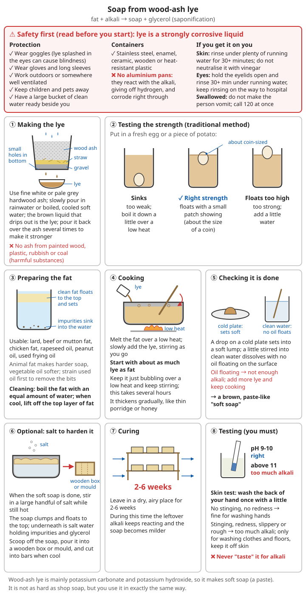

# Soap Making

## Contents
- [Why you should know how to make soap](#why-you-should-know-how-to-make-soap)
- [Simplest: natural soap pods and soapnuts](#simplest-natural-soap-pods-and-soapnuts)
- [Soap from wood-ash lye](#soap-from-wood-ash-lye)
- [When there is no soap](#when-there-is-no-soap)

---

## Why you should know how to make soap

This handbook says again and again that "frequent handwashing is the most important way to prevent infection" (see [Sanitation](03-sanitation.md) and [Making antibiotics – Preventing infection](../06-pharmaceuticals/02-antibiotics.md#5-preventing-infection)). Stockpiled soap always runs out, but the raw materials for soap – wood ash and fat – are easy to come by in the countryside and in long-term survival conditions.

**Principle**: fat + alkali → soap + glycerol (saponification). One end of a soap molecule attracts water and the other attracts oil, so soap wraps up grease, together with the bacteria and viruses stuck to the skin, and lets you rinse them away.

---

## Simplest: natural soap pods and soapnuts

No alkali needed and no risk of burns. Good for washing hands, clothes and dishes.

### Soap pods (*zaojia*, Chinese honey locust)

```
Source: the seed pods of the Chinese honey locust tree (Gleditsia sinensis).
        Pick them in autumn when they ripen and turn dark brown; dry them in the sun to store

How to use:
1. Break up 2-3 pods (remove the seeds)
2. Soak in water, or boil for 10-15 minutes
3. Scrub with the water you boiled them in; it will lather

⚠️ The pods and seeds are somewhat toxic. External use only, never eat them;
   do not cook food in the pot you boiled them in
⚠️ The lather stings if it gets in the eyes; rinse with clean water
```

### Soapnuts (*wuhuanzi*)

```
Source: the fruit of the soapnut tree (Sapindus, common in southern China).
        Pick in autumn, remove the stones and dry in the sun
How to use: rub the fruit skins in water, or boil them, as for soap pods
⚠️ Likewise for external use only; never eat them
```

**Limitations**: they do not cut grease as well as soap, but they are good enough for everyday handwashing.

---

## Soap from wood-ash lye

The traditional way of making soap. The raw materials are easy to get, but **lye is a strongly corrosive liquid**, so you must protect yourself properly.

### ⚠️ Safety first (read before you start)

```
Protection:
✓ Wear goggles (lye splashed in the eyes can cause blindness)
✓ Wear gloves and long sleeves
✓ Work outdoors or somewhere well ventilated
✓ Keep children and pets away from the work area
✓ Have a large bucket of clean water ready beside you

Containers:
✓ Use stainless steel, enamel, ceramic, wooden or heat-resistant plastic containers
❌ Do not use aluminium pans (they react with the alkali, giving off hydrogen,
   and corrode right through)

If you get it on you:
- Skin: rinse immediately under plenty of running water for 30 minutes or more
  (alkali is harder to rinse off than acid, so rinse longer rather than shorter);
  do not neutralise it with vinegar
- Eyes: hold the eyelids open at once and rinse continuously under running water;
  rinse for 30 minutes or more for lye in the eye, and get to hospital while rinsing
- Swallowed: do not make the person vomit; call 120 immediately
```

For full treatment of chemicals in the eye, see [Foreign bodies – Chemicals in the eye](../01-first-aid-and-family-health/04-foreign-bodies-and-choking.md#chemicals-in-the-eye-emergency).

### Step 1: making the lye

```
Raw material: fine white or pale grey ash from burnt hardwood
  ✓ Ash from hardwoods (fruit wood, oak, locust wood, etc.) works well
  ❌ Do not use ash from painted wood, plastic, rubbish or coal
     (it contains harmful substances)

Method:
1. Take a wooden or plastic bucket with small holes in the bottom, and put
   a container underneath to catch the liquid
2. Put a layer of gravel in the bottom of the bucket, then a layer of straw
   (as a filter)
3. Fill with wood ash and press it down lightly
4. Slowly pour in rainwater, or soft water that has been boiled and cooled
5. The brown liquid that drips out underneath is the lye
6. Pour the lye back over the ash several times; this makes it stronger

Testing the strength (traditional method):
- Put in a fresh egg or a piece of potato
- It floats with a small patch (about the size of a coin) showing → right strength
- It sinks → too weak; boil it down a little over a low heat
- It floats too high → too strong; add a little water
```

### Step 2: preparing the fat

```
Usable: lard, beef or mutton fat, chicken fat, rapeseed oil, peanut oil,
        used frying oil
  - Animal fat makes harder soap; vegetable oil makes softer soap
  - Strain used oil first to remove the bits

Cleaning the fat:
1. Boil the fat with an equal amount of water
2. Let it cool; the clean fat floats to the top and sets, and the impurities
   sink into the water
3. Lift off the top layer of fat and keep it for use
```

### Step 3: cooking

```
1. Melt the fat in a pan over a low heat
2. Slowly add the lye, stirring as you go (start with about as much lye as fat)
3. Keep it just bubbling over a low heat and keep stirring; this takes several hours
4. The mixture gradually thickens, like thin porridge or honey
5. How to tell it is done:
   - Drip a drop from a spoon onto a cold plate; it sets into a soft lump
   - Stir a little into clean water; it dissolves and no oil floats on the surface
   - Oil floating → not enough alkali; add more lye and keep cooking
6. What you get is a brown, paste-like "soft soap"

Wood-ash lye is mainly potassium carbonate and potassium hydroxide, so it makes
soft soap (a paste). It is not as hard as shop soap, but you use it in exactly the same way.
```

### Optional: adding salt to harden it

```
1. When the soft soap is done, stir in a large handful of salt while it is still hot
2. The soap clumps together and floats to the top; underneath is salt water
   holding the impurities and glycerol
3. Scoop off the soap on top and pour it into a wooden box or mould
4. Cut into bars once it has cooled
```

### Step 4: curing and testing

```
Curing:
- Leave in a dry, airy place for 2-6 weeks
- During this time the leftover alkali keeps reacting and the soap becomes milder

Testing (you must do this):
- With pH paper: a soap solution of pH 9-10 is right; above 11 means too much alkali
- Skin test: wash the back of your hand once with a little of it and watch
  - No stinging, no redness → fine for washing hands
  - Stinging, redness, a slippery or rough feeling → too much alkali; use it only
    for washing clothes and floors, and keep it off skin

❌ Do not "taste" the soap with your tongue to check for alkali
   (a traditional practice that risks burns)
```



*Figure: safety notes, then making lye → testing strength → preparing fat → cooking → checking it is done → (optional) hardening with salt → curing for 2-6 weeks → testing*

---

## When there is no soap

```
Hands:
✓ Rub with wood ash for 20 seconds, then rinse under running water
✓ Just rubbing carefully under running water for 20 seconds also removes most pathogens
❌ Do not use soil (it may be contaminated with faeces)

Clothes:
✓ Ash water: soak wood ash in water and wash with the clear water on top
  (a traditional method)
✓ Soap-pod water, soapnut water

Dishes:
✓ Water used to rinse rice, or water noodles were cooked in (cuts grease)
✓ Hot water + a loofah scrubber
✓ Dry in the sun after washing
```

---

## 📝 Key points on soap making

```
1. Simplest and safest: soap pods and soapnuts, just boiled in water
2. Wood-ash lye + fat → soft soap
3. Lye is strongly corrosive: goggles, gloves, no aluminium pans
4. Cure for 2-6 weeks; test on the back of the hand before washing hands with it
5. No soap: rub with wood ash or under running water for 20 seconds
```

---

**Next chapter**: [Long-term shelter](05-long-term-shelter.md)
**Back to**: [Part contents](README.md) | [Main contents](../../README.md)
