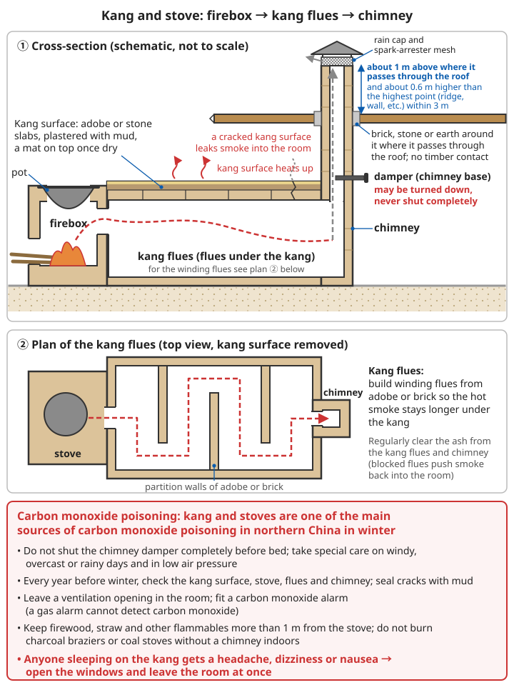

# Long-term Shelter

## Contents
- [First, be clear: what this chapter is for](#first-be-clear-what-this-chapter-is-for)
- [Choosing a site](#choosing-a-site)
- [Keeping out damp: good boots, good hat](#keeping-out-damp-good-boots-good-hat)
- [Adobe walls](#adobe-walls)
- [Rammed-earth walls](#rammed-earth-walls)
- [Simple timber framing](#simple-timber-framing)
- [Earthquake resistance: life or death for earth houses](#earthquake-resistance-life-or-death-for-earth-houses)
- [Insulation](#insulation)
- [Kang and stoves](#kang-and-stoves)
- [Chimneys: preventing fire and carbon monoxide](#chimneys-preventing-fire-and-carbon-monoxide)
- [Maintenance](#maintenance)

---

## First, be clear: what this chapter is for

[Wilderness survival](../03-wilderness-survival/00-basic-survival-skills.md#building-shelters) covers temporary shelters for a few days to a few weeks. This chapter covers a house you will **live in for years**: built from local materials such as earth, timber and stone, able to keep out wind and rain, get you through winter, and not collapse in the next rainstorm or earthquake.

```
⚠️ Collapsing buildings are the main cause of death in earthquakes
⚠️ Heating is the main source of carbon monoxide poisoning and house fires in winter

So the focus of this chapter is not "how to build fast" but "how to build
so that the house does not kill you":
1. Choose a site away from natural hazards
2. In earthquake areas, earthquake-resistant measures are a must
3. Kang, stoves and chimneys must not leak smoke or start fires
```

**Where possible, get guidance from experienced local builders and follow local technical rules for rural house building.** This chapter gives basic principles and general methods; adjust actual dimensions to the local soil, climate and earthquake intensity.

---

## Choosing a site

```
✓ Fairly high ground with good drainage
✓ Firm ground for the foundations (do not build on made ground, silt or swamp)
✓ Sheltered from the wind and facing the sun (cold north) or airy and shaded (hot south)
✓ Close to water, but above flood level
✓ Some distance from the edge of woodland (against wildfire)

❌ Avoid:
- River beaches, dry riverbeds, the mouths of gullies (floods, debris flows)
- Below steep slopes, at the foot of slopes (landslides, rockfall)
- Cliff edges, the top edge of steep slopes
- Low ground where water collects
- Hillsides that already have cracks or leaning trees (signs of a coming landslide)
```

For recognising each kind of geological hazard, see [Geological hazards](../02-disaster-response/01-geological-disasters.md).

⚠️ Wells and springs used for household water must be at least 30 m from toilets; see [Sanitation – Pit latrines](03-sanitation.md#pit-latrines).

---

## Keeping out damp: good boots, good hat

Earth walls fear water more than anything. The wisdom of traditional houses is **"good boots and a good hat"**: a waterproof footing at the base of the wall, and eaves that overhang far enough overhead.

### Good boots: the wall footing

```
1. Dig a foundation trench down to firm undisturbed soil
   (in the cold north, below the frost line)
2. Build the footing from stone, brick or concrete
3. The footing must stand at least 30-50 cm above the ground outside
   - So rain does not splash the base of the wall and standing water does not soak it
4. Lay a damp-proof course on top of the footing: roofing felt, plastic sheet,
   or a layer of dense stone slabs
5. Slope the ground outside away from the house, and dig drainage ditches all round
```

### Good hat: the roof and eaves

```
✓ Eaves overhang by at least 50 cm, wider in rainy areas
✓ The roof is steep enough for rain to run off quickly
✓ The roof is not too heavy (see the earthquake section below)
✓ Cap the top of the wall with stone slabs, tiles or boards so rain does not soak in from above
```

### Rendering the outside walls

- Earth walls can be rendered outside with straw-clay or lime-sand mortar, to protect them from being washed away by rain
- Repair cracked or fallen render promptly

For lime mortar and limewash, see [Lime and building materials](16-lime-and-building-materials.md#lime-mortar-and-three-part-earth).

---

## Adobe walls

Adobe blocks are sun-dried mud bricks. They are simple to make and suit hand labour.

### Choosing the soil

```
Ideal soil: somewhat sticky, but not all clay (pure clay cracks badly as it dries;
pure sand will not hold its shape)

Simple test (jar settling test):
1. Fill a clear jar 1/3 with soil and 2/3 with water, and add a pinch of salt
2. Shake hard, then leave to stand for one or two days
3. The soil settles into layers: sand at the bottom, silt in the middle, clay on top
4. Clay making up about 1/4 to 1/3 of the soil is about right
   - Too much clay: mix in sand
   - Too little clay: use different soil or mix in clay

Remove: the topsoil (it contains grass roots and organic matter, which rot) and stones
```

### Making the blocks

```
1. Mix the soil with water into mud and work in chopped wheat or rice straw
   (about 5-10 cm long; it stops cracking and binds the block together)
2. Tread it over and over until even, then leave it covered for a day or two
3. Make a wooden mould (a common size is about 30 long × 15 wide × 10 cm high;
   adjust as needed)
4. Wet the mould or dust it with sand so the mud does not stick; fill it,
   press the mud down and scrape the top flat
5. Lift off the mould and leave the block on flat ground
6. Dry in the shade for 2-3 days, then stand the blocks on edge and dry in the sun
   for 2-4 weeks, until completely dry
   - Avoid fierce sun and rain; cover them in bad weather

Quality check:
- A fully dry block dropped onto the ground from about 1 m only chips at the corners
  and does not break into pieces → it passes
- Many surface cracks, crumbles at a touch → the soil is unsuitable; change the mix
```

### Laying the wall

```
1. Build on the damp-proofed footing
2. Use the same mud as the blocks (without straw, or with fine straw) as mortar
3. Stagger the joints between courses (like bricklaying); avoid continuous vertical joints
4. Interlock the blocks at corners and where inner and outer walls meet
5. Do not build too high in one day (about 1 m); let the lower courses dry a little
   before going higher
6. The wall must be thick enough (usually no less than about 35-40 cm)
```

---

## Rammed-earth walls

Built by packing earth in layers between two boards and ramming it hard. A rammed-earth wall holds together better as a whole than an adobe wall, but needs formwork and more labour.

### Soil and moisture content

```
Soil: as for adobe; a little crushed stone or coarse sand can be mixed in

Judging moisture (traditional method, "clenches into a ball, bursts when dropped"):
- Grab a handful of soil and squeeze hard → it forms a ball and no muddy water
  is left on your hand
- Drop it onto the ground from about 1 m → it breaks apart
- Will not form a ball: too dry, sprinkle with water
- Does not break when dropped, sticks together in a lump: too wet, spread it out to dry a little
```

### Ramming

```
1. Set up boards (formwork) on both sides on the damp-proofed footing, and clamp
   them tight with poles and rope or bolts
2. Spread each layer of loose soil about 15-20 cm thick
3. Ram it evenly with a wooden or stone rammer until it is compacted to about
   one half to two thirds of its original thickness and the rammer's thud
   changes from dull to sharp
4. Finish one layer before spreading the next
5. When one section is full, take down the formwork and move it along or up to continue
6. Stagger the joints between upper and lower sections
7. Ram corners and T-junctions as one piece, or add tie pieces (see the earthquake section)
8. Protect the finished wall from rain and let it dry out slowly (weeks to months)
```

---

## Simple timber framing

Where timber is plentiful, timber-framed houses are light and flexible, and **much safer in an earthquake than earth-walled houses**.

```
Basic form: timber posts + timber beams make the frame; the walls only enclose
the space (they can be boards, wattle and daub, or adobe infill)

Key points:
✓ Stand the posts on stone bases; do not bury them in the ground (they will rot)
✓ Join posts and beams firmly (mortise and tenon, wooden pegs, iron fittings)
✓ Add diagonal braces to stop the frame racking from side to side
✓ Use seasoned timber and protect it from rot (paint with tung oil, char the surface)
✓ Fix the roof frame firmly to the posts so strong winds cannot lift the roof off
⚠️ Timber burns: separate stoves and chimneys from it with brick, stone or earth
⚠️ Against termites: keep timber off the ground and inspect it regularly
```

---

## Earthquake resistance: life or death for earth houses

⚠️ **Adobe and rammed-earth houses without any earthquake-resistant measures easily collapse completely in an earthquake, and have caused huge numbers of deaths and injuries in past earthquakes.** If you build an earth house in an earthquake-prone area, the measures below are not "extras". They are a must.

```
1. Build one storey only, and do not make the walls too tall
2. Keep the roof light
   - Avoid thick, heavy earth roofs and heavy tiles
   - Use lightweight tiles, boards or thatch (take care against fire with thatch)
3. Put a ring beam on top of the walls
   - Run a continuous timber ring beam (or reinforced-concrete ring beam) right round
     the tops of all the walls, firmly joined at the four corners
   - It hoops all the walls into one unit, so in an earthquake they do not each
     fall outwards
4. Tie the corners and the junctions of inner and outer walls
   - Every 50 cm or so of height, lay strips of wood, bamboo or brushwood horizontally
     inside the wall, running into the walls on both sides
5. Door and window openings
   - Keep openings small and few
   - Keep openings at least about 1 m from the corners
   - Put a timber lintel over each opening, running far enough into the wall at both ends
6. A regular plan
   - Keep the plan square and symmetrical; avoid L-shapes and complicated projections
     and recesses
   - Do not space partition walls too far apart (add cross walls or buttresses in
     the middle of long walls)
7. Connect the roof frame securely to the walls so the roof cannot slide off in a quake
```

**In high earthquake-risk areas, choose timber framing first, or build under professional guidance.** Existing old earth houses can be strengthened by adding timber ring beams, reinforcing the corners and lightening the roof.

For what to do in an earthquake, see [Geological hazards – Earthquakes](../02-disaster-response/01-geological-disasters.md#earthquakes).

---

## Insulation

### Cold northern areas

```
✓ Thick walls: thick earth walls store heat well, absorbing it by day and releasing it at night
✓ Few or small windows in the north wall; more windows in the south wall for light and warmth
✓ Build an enclosed porch at the door or hang a thick door curtain (less cold draught
  when the door opens)
✓ Windows: double windows, or nail plastic sheet over the outside in winter
✓ Roof insulation: spread dry grass, rice husks, sawdust, etc. above the ceiling
  (take care against fire)
✓ Seal draughts round walls, doors and windows

⚠️ While sealing doors and windows to keep warm, any room with a fire burning must
   still be ventilated (see the kang and chimney sections below)
```

For recognising and treating carbon monoxide poisoning, see [Carbon monoxide poisoning](../01-first-aid-and-family-health/07-home-and-traffic-accidents.md#carbon-monoxide-poisoning).

### Hot southern areas

```
✓ Deep eaves to shade the walls from direct sun
✓ Windows front and back for a through draught
✓ Roof insulation: a double roof or a ceiling, with an air gap between
✓ Light-coloured outside walls to reflect the sun
✓ Plant trees in front of and behind the house for shade
```

---

## Kang and stoves

The *kang* (heated brick bed) is the traditional way of heating in northern China: smoke and heat from the stove's firebox first pass through flues under the kang, warming its surface, and then leave through the chimney.

### Key points of construction

```
1. Firebox (the cooking stove) → kang flues (the flues under the kang) → chimney
2. Kang flues: build winding flues from adobe or brick so the hot smoke stays
   longer under the kang
3. Kang surface: lay adobe slabs or stone slabs, plaster with mud, and lay a mat
   on top once dry
4. Fit a damper at the base of the chimney (it may be turned down, but must never
   be shut completely; see below)
```

### ⚠️ The risk of carbon monoxide poisoning

Kang and stoves are one of the main sources of carbon monoxide poisoning in northern China in winter.

```
Why smoke leaks:
- The kang surface cracks or sags, and smoke seeps into the room through the cracks
- The flues are blocked with ash, so smoke cannot get out and is pushed back into the room
- The chimney is too short, or blocked by snow or debris
- Smoke is pushed back down in strong wind or low air pressure
- The chimney damper is shut completely before bed "to keep the warmth in"

Prevention:
✓ Every year before winter, check the kang surface, stove, flues and chimney;
  seal any cracks with mud
✓ Regularly clear the ash from the kang flues and chimney
✓ Do not shut the chimney damper completely before bed
✓ Take special care on windy, overcast or rainy days and in low air pressure
✓ Leave a ventilation opening in the room
✓ Fit a carbon monoxide alarm (a gas alarm cannot detect carbon monoxide)
✓ If anyone sleeping on the kang gets a headache, dizziness or nausea →
  open the windows and leave the room at once
```

### Stoves

```
✓ Fuel-saving stove: a small, deep firebox, the bottom of the pot close to the flame,
  a fire-retaining ring, and a flue with bends; it uses less firewood and makes less
  smoke than an open stove
✓ Keep firewood, straw and other flammables more than 1 m from the stove
✓ Separate the stove from timber walls and posts with brick, stone or a thick layer of mud
✓ Do not burn charcoal braziers or coal stoves without a chimney indoors
✓ Empty stove ash into a metal bucket and make sure it is completely out before
  tipping it outside (embers can reignite)
```



*Figure: top, cross-section; middle, plan of the kang flues (schematic, not to scale). For chimney height and fire safety see [Chimneys: preventing fire and carbon monoxide](#chimneys-preventing-fire-and-carbon-monoxide) below*

---

## Chimneys: preventing fire and carbon monoxide

### Height and position

```
✓ The chimney must stand above the roof. A common guide:
  - About 1 m above the point where it passes through the roof
  - And about 0.6 m higher than the highest point (ridge, wall, etc.) within 3 m of it
  (too short, and wind pressure pushes smoke back down; sparks also land on the roof more easily)
✓ Fit a rain cap and spark-arrester mesh on top of the chimney
  (especially with thatched or timber roofs)
✓ Where the chimney passes through a timber roof or floor, surround it with brick,
  stone or earth; it must not touch the timber directly
```

### Preventing chimney fires

Incomplete burning of firewood leaves tar (creosote) on the inside of the chimney. When enough builds up it can catch fire, causing a chimney fire, which can then set the roof alight.

```
✓ Burn well-seasoned firewood (wet wood makes more tar and smoke)
✓ Do not keep the fire smouldering slowly for long periods
✓ Sweep the chimney at least once a year (with heavy use, once more halfway
  through each heating season)
✓ Check the chimney regularly for cracks

Signs of a chimney fire: a roaring sound in the chimney, lots of sparks or flames
from the top, the outside of the chimney is hot
What to do: close the stove door and air inlet, get everyone out of the house,
     call 119, and watch whether sparks have set the roof or anything nearby alight
```

---

## Maintenance

```
Every year before the rainy season:
- [ ] Check the roof for leaks and repair them
- [ ] Clear the drainage ditches
- [ ] Check whether rain has washed away or softened the base of the walls

Every year before winter:
- [ ] Check the kang, stove, flues and chimney; repair cracks
- [ ] Sweep the ash out of the chimney and kang flues
- [ ] Test the carbon monoxide alarm
- [ ] Get firewood ready (prepare it a year ahead so it dries thoroughly)

At any time:
- [ ] Walls with obvious cracks or a lean → strengthen them promptly; if cracks
      are widening, stop living in the house
- [ ] Rotten or insect-damaged timber → replace promptly
- [ ] Fallen render on outside walls → repair
```

---

## 📝 Key points on long-term shelter

```
1. Site: avoid river beaches, gully mouths and the foot of steep slopes;
   stay above flood level
2. Damp: good boots (a stone or brick footing raised above the ground),
   good hat (wide eaves)
3. Earthquake areas: one storey, light roof, ring beam on the walls, ties at
   the corners, doors and windows well away from corners; prefer timber framing
4. Balance insulation with ventilation; any room with a fire must have a vent
5. Kang and stoves: check for cracks and clear ash every year, never shut the
   damper completely, fit a carbon monoxide alarm
6. Chimneys: tall enough, burn dry wood, sweep every year
```

---

**Next chapter**: [Lighting and energy](06-lighting-and-energy.md)
**Back**: [Chapter index](README.md) | [Main contents](../../README.md)
