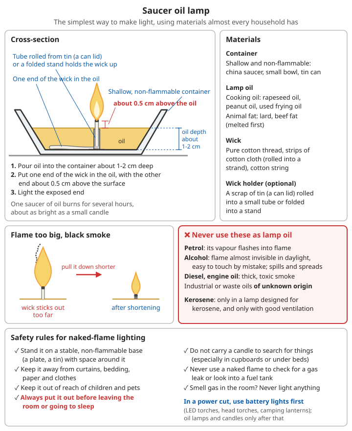
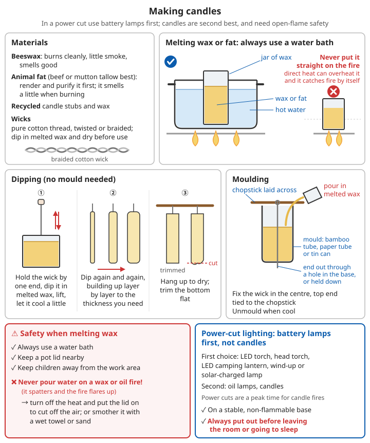

# Lighting and Energy

## Contents
- [Emergency lighting in a power cut](#emergency-lighting-in-a-power-cut)
- [Home-made oil lamps](#home-made-oil-lamps)
- [Home-made candles](#home-made-candles)
- [Storing fuel safely](#storing-fuel-safely)
- [Generators](#generators)
- [Small-scale solar power](#small-scale-solar-power)
- [Biogas](#biogas)
- [Saving energy](#saving-energy)

---

## Emergency lighting in a power cut

### Use battery lights first, not candles

Power cuts are a peak time for candle fires: people walk around in the dark, fall asleep or look after children, and it is easy to knock a candle over or forget to put it out.

```
First choice:
✓ LED torches and head torches (a head torch leaves both hands free)
✓ LED camping lanterns (light a whole room)
✓ Wind-up or solar-charged lights
✓ Keep plenty of batteries and check them regularly (batteries left in a device
  for a long time may leak and corrode it; take them out for storage)

Second choice: oil lamps, candles (follow the safety rules below)
```

### Safety rules for lighting with a naked flame

```
✓ Stand it on a stable, non-flammable base (a plate, a tin) with space around it
✓ Keep it away from curtains, bedding, paper and clothes
✓ Keep it out of reach of children and pets
✓ Always put it out before leaving the room or going to sleep
✓ Do not carry a candle while searching for things (especially in cupboards or under beds)
✓ Never use a naked flame to check for a gas leak or look into a fuel tank
✓ If you can smell gas in the room, never light anything
```

---

## Home-made oil lamps

The simplest way to make light, using materials almost every household has.

### Saucer oil lamp

```
Materials:
- A shallow, non-flammable container: a china saucer, small bowl or tin can
- Lamp oil: cooking oil (rapeseed oil, peanut oil, used frying oil) or animal fat
  (lard, beef fat, melted first)
- Wick: pure cotton thread, strips of cotton cloth (rolled into a strand), cotton string

Method:
1. Pour oil into the container to a depth of about 1-2 cm
2. Put one end of the wick in the oil, with the other end about 0.5 cm above
   the surface
   - Roll a small tube or fold a small stand from a scrap of tin (a can lid)
     to hold the wick upright
3. Light the exposed end
4. Flame too big, giving off black smoke → pull the wick down a little shorter

One saucer of oil burns for several hours, about as bright as a small candle
```



*Figure: cross-section of a saucer oil lamp (oil about 1-2 cm deep, wick about 0.5 cm above the oil), materials, what to do if the flame is too big, oils not to use, and naked-flame safety rules*

### ❌ Never use these as lamp oil

```
❌ Petrol: its vapour flashes into flame when it meets fire and very easily
   causes serious burns and house fires
❌ Alcohol (spirit): the flame is almost invisible in daylight, so it is easy to
   touch by mistake; it spills and spreads easily
❌ Diesel, engine oil: burn with thick, toxic smoke; not suitable for indoor lighting
❌ Industrial or waste oils of unknown origin
```

**Kerosene (paraffin)**: use only in a lamp designed for kerosene, and only where there is good ventilation.

---

## Home-made candles

### Raw materials

```
✓ Beeswax: burns cleanly with little smoke and a pleasant smell
  (collect it from the combs if you keep bees)
✓ Animal fat (beef or mutton tallow is best): must be rendered and purified first;
  it smells a little when burning
✓ Recycled candle ends and lumps of wax
✓ Wick: pure cotton thread, twisted or plaited; dip it in melted wax and let it
  dry before use
```

### Rendering animal fat

```
1. Cut raw fat into small pieces, add a little water and heat slowly over a low flame
2. When all the fat has melted out, strain off the solids through muslin
3. Add an equal amount of clean water, boil again, and let it cool
4. The layer that sets on top is fairly pure fat; scrape the impurities off the bottom
```

### Dipping (no mould needed)

```
1. Melt the wax or fat in a water bath (stand the container of wax in a pan of
   hot water; do not put it directly on the fire)
2. Hold one end of the wick, dip it into the melted wax, lift it out and let it cool slightly
3. Dip again and again, building up layer by layer until it is as thick as you need
4. Hang up to set, then trim the bottom flat
```

### Moulding

```
1. Use a bamboo tube, paper tube, tin can, etc. as a mould
2. Fix the wick in the centre (tie the top end to a chopstick laid across the top;
   thread the bottom end out through a small hole in the base, or weigh it down)
3. Pour in the melted wax; remove from the mould once it has cooled
```

### ⚠️ Safety

```
✓ Always use a water bath: wax and fat heated directly get too hot and can catch
  fire on their own
✓ Keep a pan lid beside you
❌ Never pour water on burning wax or a burning pan of oil! (it spatters explosively
   and the fire spreads violently)
   → Turn off the heat and put a lid on to cut off the air; or smother it with
     a wet towel, sand or soil
✓ Keep children away from the work area
```



*Figure: raw materials and cotton wick; water bath (do not put it directly on the fire); dipping and moulding; safety when melting wax, and using battery lights first in a power cut*

---

## Storing fuel safely

### Firewood

```
✓ Split it after felling and stack it to dry for at least 6 months to 1 year
  - Dry wood: two pieces knocked together ring sharply, the ends have radial cracks,
    and it is noticeably lighter
  - Wet wood: smoky, gives little heat, builds up tar in the chimney and easily
    causes chimney fires
✓ Stack it somewhere airy and out of the rain: covered on top, raised off the ground,
  with air round it
✓ Keep the woodpile some distance from the walls of the house (against fire, termites,
  and snakes and rats hiding there)
✓ Keep only one day's supply indoors
```

For chimney and stove safety, see [Long-term shelter – Chimneys](05-long-term-shelter.md#chimneys-preventing-fire-and-carbon-monoxide).

For how much firewood you burn in a year, how to dry it and how to rotate cutting in woodland, see [Firewood and woodland management](../04-farming-and-animal-husbandry/09-firewood-and-woodland-management.md).

### Charcoal

- Burning charcoal gives off large amounts of carbon monoxide; **never use it indoors with the doors and windows shut**
- For how to make it, see [Metallurgy – Making charcoal](../05-metallurgy/00-metallurgy-basics.md#32-making-charcoal-smouldering-method)
- Store it somewhere dry and away from fire; make sure freshly made charcoal is completely out and cold before putting it away (it may reignite)

### Petrol

```
✓ Use only proper fuel cans (metal or purpose-made plastic)
✓ Store outdoors somewhere airy, cool and away from any source of fire
  (such as a separate shed)
✓ The less you keep, the better
✓ It usually keeps for 3-6 months; adding a fuel stabiliser makes it last longer
✓ Use and replace it in rotation (first in, first out)

❌ Do not keep it in living rooms, bedrooms, basements or vehicles
❌ Do not keep petrol in drinks bottles or water bottles (someone may drink it;
   ordinary plastic is attacked by it and leaks)
❌ No naked flames, no smoking and no mobile phone calls nearby while filling
   or pouring
❌ Do not refuel while an engine is running or still hot
```

### LPG cylinders

```
✓ Keep upright; do not turn upside down or lay on their side
✓ Keep somewhere well ventilated, away from heat and naked flames
✓ Do not leave in strong sun; never warm a cylinder with hot water or fire
  (it raises the pressure inside)
✓ Regularly brush soapy water over the connections, regulator and hose to check
  for leaks (bubbles mean a leak)
✓ Replace hoses promptly when they perish or crack
✓ Turn the cylinder valve off tightly after use

❌ Do not keep in basements, bedrooms, stairwells or closed cupboards
   (LPG is heavier than air, so after a leak it collects low down)
❌ Do not decant it yourself or pour out the residue
```

For what to do when you smell gas, see [Gas leaks](../02-disaster-response/04-fire.md#gas-leaks).

### Kerosene, diesel, alcohol

- Keep in the original container or a purpose-made one, clearly labelled
- Away from fire and away from children
- Alcohol evaporates quickly and is flammable; close the lid tightly after use

---

## Generators

```
✓ Use outdoors only, away from doors, windows and vents (at least several metres)
  - Generator exhaust contains large amounts of carbon monoxide; running one in
    a garage, basement, on a balcony or in a doorway can kill
✓ Switch off and let the engine cool before refuelling
✓ Shelter it from rain and do not let it get wet (electric shock)
✓ Power appliances directly with approved outdoor extension leads

❌ Never connect a generator straight to a household socket or the consumer unit
   to "backfeed" the house
   - The power flows back along the lines to the outside grid and can kill
     electricians repairing them
   - If it must be connected to the household wiring, an electrician must install
     a proper changeover switch
```

For recognising and treating carbon monoxide poisoning, see [Carbon monoxide poisoning](../01-first-aid-and-family-health/07-home-and-traffic-accidents.md#carbon-monoxide-poisoning).

---

## Small-scale solar power

In a long power cut, a small solar system is enough for lighting, phones, a radio and other basic needs.

### Components

```
Solar panel → charge controller → battery → (inverter) → appliances

- Solar panel: turns sunlight into electricity
- Charge controller: stops the battery being overcharged or over-discharged
  (do not leave it out)
- Battery: stores the energy for use at night
- Inverter: turns direct current into 220 V alternating current
  (not needed if you only use DC appliances)

Simplest of all: solar lights with built-in batteries, solar power banks
```

### Installation and use

```
✓ Direction: due south in the northern hemisphere
✓ Tilt: about equal to your latitude (it can be set a little steeper in winter)
✓ Keep clear of shade from trees and buildings (even partial shade cuts the
  output sharply)
✓ Regularly wipe dust, snow and leaves off the panel
✓ Use it first for low-power devices: LED lights, phones, radios, small fans
  ❌ Not suitable for electric kettles, rice cookers, electric heaters or other
     high-power appliances
✓ Output is very low on overcast and rainy days; use battery power sparingly
```

### Battery safety

```
Lead-acid batteries:
✓ Keep somewhere ventilated (charging gives off hydrogen, which can explode
  if it builds up and meets a spark)
✓ The battery fluid is sulphuric acid; if it gets on skin or in the eyes,
  rinse immediately with plenty of clean water
✓ Do not short the positive and negative terminals (a metal tool across them
  makes sparks and causes burns)

Lithium batteries (power banks, newer storage batteries):
✓ Use the matching charger and controller
✓ Swollen, hot, deformed or leaking → stop using it at once and put it outdoors,
  away from anything that can burn
✓ Do not crush or puncture it; do not leave it in a car in the sun
❌ If a lithium battery catches fire, do not go near it; get out and call 119
```

---

## Biogas

A biogas digester ferments human and animal manure and crop straw in a sealed tank to produce flammable biogas (mainly methane) for cooking and lighting. The leftover sludge and liquid make good fertiliser.

### ⚠️ The dangers of biogas digesters: people die every year

```
1. Suffocation and poisoning
   - There is almost no oxygen in the tank, and there is highly toxic hydrogen sulphide
   - Someone who climbs into the tank collapses and dies within minutes
   - The most tragic case: one person goes in and collapses, family members go in
     one after another to rescue them, and die one after another

2. Explosion
   - Methane explodes on contact with a flame at a concentration of about 5%-15%
     in air
   - This concentration can occur around the digester, at the outlet, or in a
     closed kitchen
```

### Safety rules

```
❌ Never climb into the tank!
   - Remove sludge with a pump or long-handled tools from outside the tank
   - If someone really must go in for repairs, it must be done by professionals
     following proper procedures: open all covers and ventilate for a long time,
     test the gas with instruments, wear a safety line, and have someone watching
     from outside
❌ No flames or smoking near the digester opening, the outlet or the gas pipe
   - Do not use a flame to "see if there's any gas" (only light it at the burner)
✓ Regularly check the gas pipe, valves and joints for leaks with soapy water
✓ Keep the inlet, outlet and pressure chamber tightly covered
   - So children and animals cannot fall in
✓ Ventilate rooms where a biogas stove or lamp is used
✓ If you smell biogas (rotten eggs): close the valve, open the windows, do not
  switch electrical appliances on or off, and do not light anything

If someone has collapsed inside the tank:
1. ❌ Do not go straight in to rescue them!
2. Call 120 and 119 immediately
3. Open all the covers and blow fresh air into the tank with a blower or fan
4. Only go in to rescue them if you are wearing a safety line, have professional
   protection (breathing apparatus), and someone is above holding the line
```


*Figure: schematic cross-section of a biogas digester, not to scale and not a construction drawing; to build one, hire a qualified construction team*

### Using the sludge and liquid

- Fermented sludge and liquid are high-quality fertiliser, with clearly fewer pathogens and parasite eggs
- But if the sludge comes from human excreta, still take care before using it on vegetables eaten raw; see [Sanitation – Using faeces and urine](03-sanitation.md#using-faeces-and-urine)

**Building a biogas digester needs professional design and construction** (sealing, pressure, leak-proofing). Hire a qualified team to build it to the standards of the local rural energy authority; do not improvise by digging a pit yourself.

---

## Saving energy

```
Heating:
✓ Keep the whole family in one heated room (choose a smaller, south-facing room)
✓ Open the curtains by day to let the sun in; close thick curtains at night to keep warm
✓ Wear more clothes and sleep under thick bedding with hot-water bottles;
  this saves far more than heating with a fire
✓ Keep the room ventilated while keeping warm

Cooking:
✓ Cook with the lid on
✓ Soak beans and rice first to shorten cooking time
✓ Haybox cooking: bring to the boil, then put the pot in thick bedding or a
  straw basket to keep it hot, and let the remaining heat finish the cooking
✓ A fuel-saving stove uses less wood and makes less smoke than an open stove

Lighting:
✓ Work from sunrise and make full use of daylight
✓ Use one lamp for everyone and gather round it
```

For balancing insulation and ventilation, see [Long-term shelter – Insulation](05-long-term-shelter.md#insulation); for fuel-saving stoves, see [Long-term shelter – Kang and stoves](05-long-term-shelter.md#kang-and-stoves).

---

## 📝 Key points on lighting and energy

```
1. In a power cut, use LED battery lights first; naked flames must be watched
   and put out before sleep
2. Oil lamps: cooking oil or animal fat, never petrol or alcohol
3. Melt wax in a water bath; if a pan of oil catches fire, put a lid on it,
   never pour on water
4. Dry firewood for six months or more; never use charcoal or a generator indoors
5. Petrol never indoors or in drinks bottles; LPG cylinders upright and never
   in a basement
6. Never backfeed a generator into the household wiring
7. Solar: facing south, tilt about equal to latitude, always use a charge controller
8. Never climb into a biogas digester; if someone collapses inside, do not go
   straight in after them
```

---

**Next chapter**: [Textiles, sewing and tanning](07-textiles-sewing-and-tanning.md)
**Back to**: [Part contents](README.md) | [Main contents](../../README.md)
