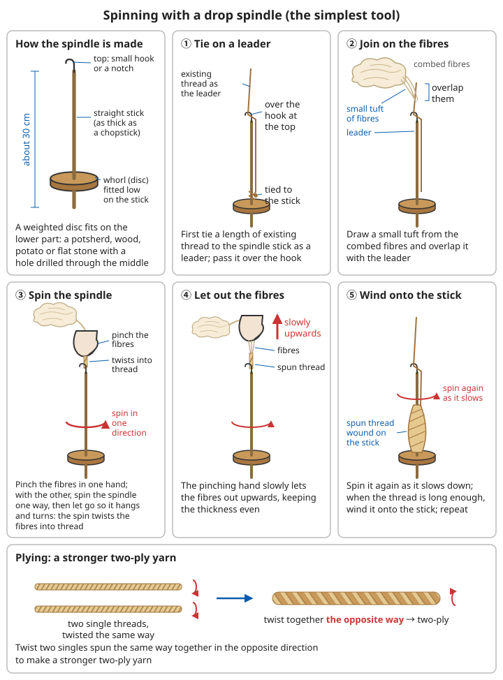

# Textiles, Sewing and Tanning

## Contents
- [Mend first, then think about spinning and weaving](#mend-first-then-think-about-spinning-and-weaving)
- [Mending](#mending)
- [Spinning](#spinning)
- [Weaving and knitting](#weaving-and-knitting)
- [Tanning](#tanning)
- [Storing clothes and furs](#storing-clothes-and-furs)

---

## Mend first, then think about spinning and weaving

In a long breakdown of supplies, modern clothes gradually wear out, but **spinning and weaving cloth from scratch takes an enormous amount of work**: traditionally it took one person many days just to spin enough yarn for one garment. So:

```
Order of priority:
1. Look after the clothes you have: mend often and mend early
   (a stitch in time saves nine)
2. Remake old clothes: cut large ones down, long ones short, and take worn-out
   clothes apart for patches and strips
3. Recycle: unravel old jumpers and knit them again, weave with old strips of cloth
4. Only as a last resort, spin and weave cloth from raw materials
```

For the principles of dressing to keep warm, see [Snow and polar survival – Keeping warm](../03-wilderness-survival/04-snow-and-polar-survival.md#keeping-warm-the-most-critical).

---

## Mending

### Tools to stock up on

```
- [ ] Hand-sewing needles of various sizes (including heavy needles and curved needles)
- [ ] Thread: polyester (strong), cotton, heavy nylon thread (for canvas and shoes)
- [ ] Thimble (protects your finger; used to push the needle through thick cloth)
- [ ] Scissors
- [ ] Needle threader
- [ ] Awl (for making holes in leather and thick cloth)
- [ ] Buttons, zips, elastic
- [ ] Patch fabric (collect the sound parts of old clothes)

These things are cheap, light and do not expire; it is worth keeping plenty.
```

### Home-made needles and thread (when you have none stored)

```
Needles:
- Bone needle: split animal bone into thin slivers, grind to a fine point on a stone,
  and drill an eye at the end with a sharp stone or a nail
- Wire needle: grind one end of a piece of thin wire to a point and bend the other
  end into a small loop for the eye
- If you cannot make an eye: pierce a hole with an awl first, then push the thread through

Thread:
- Plant fibres: hemp, cotton, twisted into thread (see Spinning below)
- Animal sinew: dry it in the sun and tear it into fine strands; wet before use,
  it tightens as it dries; very strong, good for sewing leather
- Thread unpicked from old clothes and old woven sacks
```

For more ways to make cordage, see [Basic survival skills – Cordage](../03-wilderness-survival/00-basic-survival-skills.md#cordage).

### Basic stitches

**Threading and knotting**: pass the thread through the eye of the needle, single or doubled, and knot the end.

| Stitch | How to sew it | Where to use it |
|------|--------|----------|
| Running stitch | Needle in and out, moving forward evenly | Temporary fixing, places that take no strain |
| Backstitch | After each stitch, go back half a stitch or a whole stitch, then forward again | The strongest; replaces machine stitching; the crotch, armpits and other places under strain |
| Overcast stitch (whipstitch) | Wrap the thread over and round the edge of the cloth | Stops raw edges fraying |
| Slip stitch (blind stitch) | The needle travels inside the folded edges of the two pieces, so the stitches do not show | Closing split seams, patch edges |

```
How to backstitch:
1. Bring the needle up from the back of the cloth to the front
2. Go back a short way and put the needle in
3. Bring it up again the same distance in front of where it last came out
4. Repeat 2-3, each stitch going back to the end of the previous one
```

### Common repairs

**Split seam**: turn the split to the inside and resew it with backstitch along the original line of stitching.

**Patching a hole**:
```
1. Cut a patch about 2 cm bigger than the hole on each side
   (fabric of the same weight if possible)
2. Fold in the edges of the patch on all four sides
3. Place it behind the hole (inside patch) or over it (outside patch) and hold it
   with pins or a few stitches
4. Sew all round the patch with slip stitch or overcast stitch
5. Trim the frayed edges of the hole neatly and overcast them so they stop fraying
```

**Darning (small holes in socks and jumpers)**:
```
1. Put a round object inside behind the hole (a light bulb, an egg, a small bowl)
   to hold it flat
2. First run parallel threads back and forth across the hole until it is filled,
   sewing both ends into the sound fabric
3. Then weave the needle over and under these threads in the other direction,
   like weaving cloth, until it is filled
4. Match the original colour and thickness of the yarn as closely as you can
```

**Sewing on a button**:
```
1. Double thread, knotted
2. Bring the needle up from the back of the cloth, through a buttonhole and back
   down into the cloth; repeat 6-8 times
3. Finally wind the thread a few times between the button and the cloth to make a
   "shank" (so the button stands off the cloth and is easy to fasten)
4. Knot on the back
```

**Shoes with soles coming away or worn through**:
- Sole coming unstuck: glue it first if you have glue, then reinforce by sewing round the edge of the shoe with a heavy needle and thread
- Pierce holes with an awl, pass nylon thread or sinew through, and sew with backstitch
- Sole worn through: cut a piece of old tyre, thick rubber or several layers of leather and put it inside, or sew/nail it on the outside

---

## Spinning

### Raw materials

| Material | How to get it | Characteristics |
|------|----------|------|
| Cotton | Grow it; pick the fluff from the bolls | Soft and absorbs sweat; seeds must be removed |
| Sheep's wool | Shear in spring (see [Livestock](../04-farming-and-animal-husbandry/06-livestock.md)) | Warm, and stays warm when wet; must be washed |
| Bast fibres (ramie, hemp, flax) | Grow them; strip the bark from the stems | Strong and hard-wearing; must be retted |
| Rabbit fur | Comb or shear Angora rabbits | Extremely soft and warm; short fibres, often blended with wool |

⚠️ Growing hemp (cannabis) is controlled in China and allowed only for legally approved industrial uses; do not grow it yourself. Use ramie or flax instead.

### Preparing the fibre

**Wool**:
```
1. First pick out bits of grass and dung from the shorn fleece
2. Soak and wash in warm water (not boiling); add a little wood-ash water or
   soap-pod water to remove the grease
   - Do not rub or wring it, and do not switch between hot and cold water
     (it will felt into lumps)
3. Rinse in clean water and spread out to dry
4. Carding: comb it back and forth between two combs (or nail boards) until the
   fibres are straight and fluffy
```

**Cotton**:
```
1. Remove the seeds from the sun-dried cotton (by hand, or by pressing it between
   two rollers)
2. Fluff it: beat the cotton with a bowstring so the fibres fluff up
3. Roll it into loose rolls (rovings)
```

**Bast fibres**:
```
1. Cut the stalks and soak them in a pond for 1-3 weeks (retting) so the bark
   separates from the woody core
   - Retting smells; do not ret in a drinking-water source
2. Strip off the bark and dry it in the sun
3. Beat it with a wooden club and scrape away the waste, leaving the fibre
4. Comb it into long, fine fibres
```

### Spinning with a drop spindle (the simplest tool)

```
Making the spindle:
- A straight wooden stick about 30 cm long and as thick as a chopstick
- Fit a weighted disc (whorl) on the lower part of the stick (a potsherd, a piece of
  wood, a potato or a flat stone with a hole in the middle)
- Cut a small notch or fix a small hook at the top of the stick

Spinning:
1. Tie a length of existing yarn to the spindle as a leader and take it over the
   hook at the top
2. Draw out a small tuft from the carded fibre and overlap it with the leader
3. Pinch the fibre in one hand, spin the spindle in one direction with the other,
   then let go so it hangs and turns
4. The spinning of the spindle twists the fibre into yarn
5. The hand holding the fibre slowly lets it out upwards, keeping the thickness even
6. Give the spindle another turn when it is about to stop; when the yarn is long
   enough, wind it onto the spindle shaft
7. Repeat

Plying: take two single yarns spun in the same direction and twist them together
in the opposite direction, to make a stronger two-ply yarn
```



*Figure: structure of a drop spindle (wooden shaft, disc on the lower part, hook at the top); tie on the leader → overlap the fibre → spin the spindle → let the fibre out upwards → wind onto the shaft; and plying*

---

## Weaving and knitting

### Knitting with needles (the beginner's first choice)

Simpler than weaving and needs only two needles. Good for wool yarn. Yarn unravelled from old jumpers can be knitted again.

```
Tools: two smooth bamboo or wooden sticks of the same thickness, one end of each
       whittled to a point and polished

Basic steps:
1. Casting on: wind the number of stitches you need onto one needle
2. Knit stitch: put the right needle into the front of the first loop on the left
   needle, wrap the yarn, pull a new loop through, and let the old loop slip off
   the left needle
3. At the end of a row, swap hands and knit the next row
4. Casting off: on the last row, after every two stitches knitted, lift the first
   stitch over the second

Practise on a scarf first (just knit stitch all the way), then move on to hats,
socks and jumpers once you are skilled
```

### Simple weaving

```
Frame loom:
1. Make a square wooden frame
2. Hammer a row of evenly spaced nails along the top and bottom (or cut notches)
3. Warp: wind thread back and forth between the top and bottom nails and pull it
   tight, to make a row of parallel warp threads
4. Weft: use a shuttle (a flat piece of wood with thread wound on it) to carry the
   weft over and under the warp threads
5. Reverse on the next row: warp threads that were on top last time go underneath
6. After each row, press the weft down tight with a comb or piece of wood
7. When the frame is full, cut the warp threads and knot both ends so it does not unravel

This makes plain-weave cloth, good for small pieces, belts and bags. Large pieces
of cloth need a bigger loom and the work is very slow, so recycling old cloth comes first.
```

### Plaiting and basketry (no spinning needed)

- Rice straw, wheat straw, cattail, maize husks: plait mats, straw hats, straw sandals and straw rain capes
- Bamboo strips, willow withies, brushwood: weave baskets, hampers and winnowing baskets
- Old strips of cloth: twist into strands and plait into floor mats and cushions

---

## Tanning

Raw hide dries as hard as a board, and rots and stinks when it gets damp. Tanning turns raw hide into soft leather or fur that does not rot.

### ⚠️ Safety first (read before you start)

```
Animal skins and fur can spread diseases that pass between animals and people:
- Anthrax: hides and fur of cattle, sheep and other livestock that died of disease
  can carry anthrax spores (it was once called "woolsorters' disease")
- Brucellosis: cattle, sheep, pigs, etc.; infection through contact with skins,
  organs and body fluids
- Tularaemia: easily caught when skinning wild hares and wild rodents

You must:
✓ Only handle livestock and poultry that were healthy when slaughtered, or animals
  of known origin
❌ Never skin an animal that died of disease or of unknown causes
   (report it to the local animal husbandry and veterinary authority)
✓ Wear rubber gloves; where possible also a mask, goggles and an apron
✓ Do not handle raw hides if you have cuts on your hands
✓ Wash your hands thoroughly afterwards; clean and disinfect your tools
✓ If you develop fever, skin ulcers or joint pain during this work, tell the doctor
  that you have handled animal skins and fur

The law:
❌ Do not hunt, buy or process wild animals protected by the state, or their skins
   (Wildlife Protection Law); use skins from cattle, sheep, rabbits and pigs you
   raise yourself first

Environment:
✓ Dispose of tanning waste liquid and scraped-off flesh and fat away from water
  sources (bury deep)
```

### Step 1: skinning and fleshing

```
1. When skinning, leave as little flesh and fat on as possible and avoid cutting holes
2. Fleshing: lay the skin fur side down over a log or smooth board and scrape the
   remaining flesh, fat and membrane off the flesh side with a blunt knife
   - Scrape it clean: leftover fat makes it stink, rot and tan unevenly
3. Deal with it promptly; in summer it may start to go off if left for half a day or more
```

### Step 2: temporary storage (if you cannot tan straight away)

```
Salting: sprinkle coarse salt evenly all over the flesh side, fold flesh side to
         flesh side, and keep somewhere cool
Drying: stretch it out and nail it to a board, and dry somewhere cool and airy
        (not in strong sun)
When ready to tan: soak in clean water until soft again, and wash out the salt
```

### Method 1: *xiaomian* tawing (for furs with the hair on)

A traditional method from northern China, tanning with a fermented paste of Glauber's salt and flour; the usual way of making sheepskin coats and rabbit skins.

```
1. Soften the skin again and flesh it clean
2. Make the tanning paste: mix millet flour or wheat flour with water into a thin
   paste, add Glauber's salt (sodium sulphate) and salt, and leave to ferment for
   1-2 days (slightly sour, smelling of distillers' grains)
   - Recipes vary from place to place and there is no single standard; test on a
     small piece of skin first, or ask an experienced local skinner
3. Spread the paste evenly all over the flesh side (or soak the skin in the paste),
   keeping the fur side clean
4. Fold flesh side to flesh side, put in a vat or cover it, and leave somewhere warm
   for a few days to a week or two; turn it every day and add more paste
5. Check: the flesh side has turned evenly white; a fingernail drawn hard across it
   leaves a white mark, and it is no longer translucent and sticky
6. Scrape off the paste; when half dry, start rubbing, stretching and drawing it
   back and forth over a blunt wooden edge, over and over, until it is completely
   dry and soft (this step decides whether the skin is soft, so be patient)
7. Rub the flesh side with fine sand or sawdust to make it softer and cleaner;
   comb the fur

⚠️ Skins tawed this way do not like water; if they stay damp for long they revert,
   go hard and stink
```

### Method 2: vegetable tanning (for leather with the hair removed)

Tanning with the tannins in tree bark. The leather is strong and long-lasting, good for shoes, belts and straps.

```
1. Removing the hair: soak the raw hide in wood-ash water or lime water for several
   days until the hair roots loosen, then scrape off the hair and outer skin
   (⚠️ the alkaline water is corrosive; wear gloves and goggles, with the same
   protection as in the soap-making chapter)
2. Soak and wash repeatedly in clean water to remove the alkali
3. Tanning liquor: crush bark rich in tannin (oak, chestnut, willow, larch, etc.),
   soak or boil it in water to get a brown tanning liquor
4. Put the hide into the liquor, starting with a weak liquor and moving gradually
   to stronger ones
   - Thick hides take weeks to months; even thin ones take weeks
   - Cut into the edge to check: an even colour right through the cut means it is
     tanned through
5. Take it out and let it half dry, rub in animal fat or vegetable oil, and work it
   over and over
6. Once dry, oil it again to keep it in condition

Characteristics: takes a long time, but the leather stands up to water better
than tawed skins
```

### Making skins softer and waterproof

```
✓ Softness: rubbing and stretching over and over while half dry after tanning is
  the key; rub in a mixture of egg yolk and oil (the yolk helps the oil soak in)
  and then work it
✓ Waterproofing: rub leather regularly with animal fat or beeswax; for furs, smoke
  the flesh side slowly over a wood fire – smoked skins do not go hard so easily
  when they get damp
```

### ❌ Methods not to use

```
❌ Chrome tanning: an industrial method; the chromium salts used are toxic and the
   waste liquid badly pollutes the environment
❌ Arsenic, mercury, etc. against insects (once used in preparing specimens;
   highly toxic)
```

---

## Storing clothes and furs

```
✓ Wash and dry thoroughly in the sun before storing (clothes with sweat and stains
  attract more insects)
✓ Wool and furs: a camphor-wood chest, or add camphor-wood blocks, Sichuan pepper,
  dried mugwort or dried lavender to keep insects away
✓ Store in sealed bags or boxes, against damp
✓ Once or twice a year, take them out on a sunny day to air and beat them
  (especially important after the plum-rain season)
✓ Oil leather goods regularly so they do not dry out and crack

❌ Do not put damp clothes or sweaty furs straight into storage
   (they go mouldy, get insects, and the skins rot)
⚠️ Mothballs (naphthalene or para-dichlorobenzene) are toxic; keep them away from
   children and never store them with baby clothes
```

---

## 📝 Key points

```
1. Mend and remake old clothes first; spinning and weaving from scratch takes
   enormous work
2. Stock needles, thread, thimbles, awls and buttons: cheap, light and they do not expire
3. Backstitch is the strongest; patches about 2 cm bigger than the hole on each side;
   hold the hole flat before darning
4. A drop spindle is the simplest spinning tool; knitting is simpler than weaving
5. Wear gloves for skinning and tanning; never touch animals that died of disease
   or of unknown origin, and never touch protected species
6. Flesh the skin clean; taw furs with the flour-and-Glauber's-salt paste,
   vegetable-tan leather with bark tannin
7. Skins only become soft with repeated working after tanning; oil leather regularly
8. Store clothes and furs dry, protected from insects and damp
```

---

**Next chapter**: [Household electrical safety](08-household-electrical-safety.md)
**Back**: [Chapter index](README.md) | [Main contents](../../README.md)
