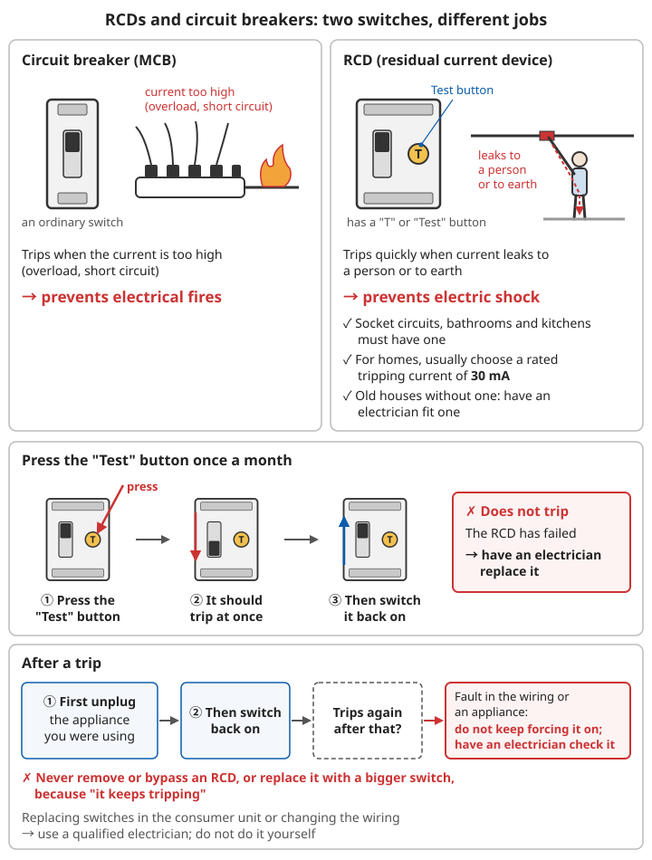
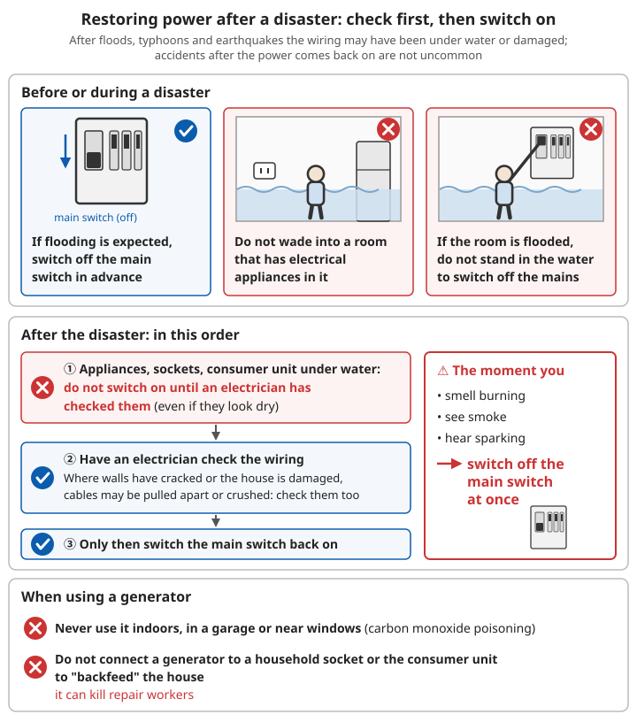

# Household Electrical Safety

## Contents
- [First, be clear: what not to do yourself](#first-be-clear-what-not-to-do-yourself)
- [RCDs and circuit breakers](#rcds-and-circuit-breakers)
- [Sockets, extension leads and cables](#sockets-extension-leads-and-cables)
- [High-power appliances](#high-power-appliances)
- [Charging electric bikes](#charging-electric-bikes)
- [Electricity in damp places](#electricity-in-damp-places)
- [Restoring power after a disaster](#restoring-power-after-a-disaster)
- [Routine checklist](#routine-checklist)

---

## First, be clear: what not to do yourself

Electrical accidents have two outcomes: **electric shock** and **electrical fire**. Most electrical fires come from ageing wiring, overloaded sockets, and unauthorised, makeshift wiring, and all of these can be prevented.

```
You can do yourself:
✓ Press the test button on the RCD regularly
✓ Check extension leads, cables and plugs for heat, discolouration and damage
✓ Change light bulbs and plugs (with the power off)
✓ Plan your use of high-power appliances so you do not run too many at once

❌ Do not do yourself (call a qualified electrician):
- Altering or adding wiring and sockets in the house
- Replacing switches in the consumer unit (distribution board)
- Connecting a generator or solar system to the household wiring
- Any work on live circuits
```

For first aid after an electric shock, see [Acute symptoms – Electrical injuries](../../../docs/01-日常疾病和伤害/05-急性症状.md#电击伤).

---

## RCDs and circuit breakers

The consumer unit at home usually has two kinds of switch, which do different jobs:

| Switch | What it does | How to recognise it |
|------|------|--------|
| Circuit breaker (MCB) | Trips when the current is too high (overload, short circuit); **prevents electrical fires** | An ordinary switch |
| RCD (residual current device) | Trips quickly when current leaks to a person or to earth; **prevents electric shock** | Has a "T" or "Test" button |

```
✓ Socket circuits, bathrooms and kitchens must have RCD protection
  (for homes, usually choose one with a rated tripping current of 30 mA)
✓ Press the "Test" button once a month: it should trip at once; then switch it back on
  Does not trip when pressed → the RCD has failed; have an electrician replace it
✓ In old houses without an RCD, have an electrician fit one (it is the most
  important electrical safety device in the home)

After a trip:
✓ First unplug the appliance you were using, then switch back on
✓ Trips again after switching on → there is a fault in the wiring or an appliance;
  do not keep forcing it back on; have an electrician check it
❌ Never remove or bypass an RCD, or replace it with a bigger switch, because
   "it keeps tripping"
```



*Figure: circuit breakers prevent electrical fires, RCDs prevent electric shock; press the "Test" button once a month; after a trip, unplug appliances before switching back on; if it keeps tripping, have an electrician check it*

---

## Sockets, extension leads and cables

### Extension leads

```
✓ Buy extension leads with the 3C certification mark, with a master switch and
  overload protection
✓ Read the maximum power marked on the extension lead (commonly about 2500 W);
  the appliances plugged into it must not add up to more than that
❌ Do not plug one extension lead into another ("daisy-chaining")
❌ Do not use extension leads for air conditioners, electric water heaters, electric
   heaters or other high-power appliances
❌ Do not leave extension leads on wet floors, under furniture, or covered by duvets
   or rugs
✓ Switch off or unplug when not in use; unplug unused chargers before going out
  or going to bed
```

### Plugs and sockets

```
✓ Push plugs fully in: a loose plug with poor contact heats up and can eventually
  scorch and catch fire
✓ Pull out a plug by holding the plug, not by tugging the cable
❌ Do not plug in, unplug or switch appliances with wet hands
✓ In homes with children, use sockets with safety shutters
```

### Cables

```
Signs that a cable must be taken out of use and replaced:
- The outer sheath is damaged, cracked, hardened or yellowed
- Plugs, sockets or cables feel hot, smell of burning or are discoloured
- A socket sparks or crackles

❌ Do not wrap a damaged cable in tape and carry on using it
❌ Do not nail cables to walls, trap them in door gaps or under furniture,
   or wind them round nails or wire
❌ Do not run unauthorised, makeshift cables (especially from a window down
   to the ground)
⚠️ In houses lived in for twenty or thirty years, the wiring may have aged;
   have an electrician check the whole installation
```

---

## High-power appliances

```
Air conditioners, electric water heaters, electric heaters, induction hobs,
electric ovens, rice cookers, etc.:
✓ Use a dedicated wall socket, not an extension lead
✓ Do not run several high-power appliances on the same circuit at the same time
✓ Keep electric heaters at least 1 m from curtains, bed sheets and clothes;
  do not dry clothes on them
✓ Do not use electric blankets folded; do not leave them on for long periods or
  all night; replace old ones promptly
✓ Switch appliances off after use; unplug them if they will not be used for a long time
```

For fighting electrical fires (cut the power first; never use water), see [Fire – Electrical fires](../../../docs/02-灾难应对/04-火灾.md#电气火灾).

---

## Charging electric bikes

Electric bike batteries burn very fiercely when they catch fire and give off large amounts of thick, toxic smoke. **Most deaths and injuries from electric bike fires happen indoors: in entrance halls, corridors and stairwells.**

```
❌ Do not park or charge in corridors, stairwells, entrance halls or at fire exits
   (these are escape routes; in a fire, the thick smoke cuts off the way out for
   everyone in the building)
❌ Do not take the battery home to charge it; do not charge indoors or on a balcony
❌ Do not run a "flying lead" out of a window and down to charge it
✓ Charge at the shared charging point for your housing estate
✓ Use the original or a matching charger
✓ Disconnect promptly once fully charged; do not charge overnight
✓ Battery swollen, leaking, unusually hot, or has been dropped or knocked →
  stop using it and have it checked or replaced at a proper shop
❌ Do not modify the battery yourself or fit a higher-capacity battery

If it catches fire: get out immediately, close the door behind you, call 119,
and do not try to put it out
```

---

## Electricity in damp places

```
Bathrooms:
✓ Electric water heaters must be reliably earthed and have RCD protection
✓ Avoid using a hairdryer or charging a phone while showering or bathing
❌ Do not put an extension lead in the bathroom

Kitchens:
✓ Keep sockets away from the sink
✓ Do not touch switches or plugs with wet hands

Outdoors:
❌ Do not use electrical appliances outdoors in a thunderstorm; unplug appliances
   not in use
❌ Do not fish or fly kites under power lines
❌ If you see a power line down on the ground, do not go near it; keep at least
   8-10 m away and call the power supply service number 95598
```

---

## Restoring power after a disaster

After floods, typhoons and earthquakes, the wiring may have been under water or damaged, and **accidents after the power comes back on are not uncommon**.

```
Before or during a disaster:
✓ If flooding is expected, switch off the main switch in advance
✓ Do not wade into a room that has electrical appliances in it
✓ If a room is flooded, do not stand in the water to switch off the main switch

After the disaster:
❌ Do not switch on appliances, sockets or a consumer unit that have been under
   water until an electrician has checked them (even if they look dry)
✓ Have an electrician check the wiring before switching the main switch back on
✓ Where walls have cracked or the house is damaged, cables may have been pulled
  apart or crushed; have them checked first too
✓ Smell burning, see smoke or hear sparking → switch off the main switch at once

When using a generator:
❌ Never use it indoors, in a garage or near windows (carbon monoxide poisoning)
❌ Do not connect a generator to a household socket or the consumer unit to
   "backfeed" the house (it can kill repair workers)
```



*Figure: after a disaster, keep the power off and have an electrician check the wiring before switching the main switch back on; if you smell burning, see smoke or hear sparking, switch off the main switch at once*

For detailed generator safety rules, see [Lighting and energy – Generators](../../../docs/07-日常生活技能/06-照明与能源.md#发电机).

---

## Routine checklist

```
Every month:
- [ ] Press the RCD test button once
- [ ] Feel the extension leads and plugs you use most for heat

Every year (or before winter and before the plum-rain season):
- [ ] Check cables and extension leads for damaged or ageing sheaths
- [ ] Check electric blankets and electric heaters
- [ ] Check electric bike batteries

Always keep at home:
- [ ] A torch (and know where the consumer unit is, so you can find it in a power cut)
- [ ] An extension lead with RCD protection
- [ ] A fire extinguisher suitable for electrical fires (dry powder)
```

---

## 📝 Key points on household electrical safety

```
1. RCDs prevent electric shock; press the test button once a month; never remove
   or bypass one
2. After a trip, unplug appliances before switching back on; if it keeps tripping,
   call an electrician
3. Extension leads: no daisy-chaining, no high-power appliances, never over the rated power
4. Damaged cables, hot plugs or a smell of burning → stop using and replace
5. Electric bikes: not in corridors, not in the home, not charged overnight
6. Changing wiring, adding sockets or connecting a generator: call an electrician
7. Appliances and wiring that have been under water stay off until checked
8. If an appliance catches fire, cut the power first; never throw water on it
```

---

**Next chapter**: [Woodworking and tool maintenance](../../../docs/07-日常生活技能/09-木工与工具维护.md)
**Back**: [Chapter index](../../../docs/07-日常生活技能/README.md) | [Main contents](../../README.md)
