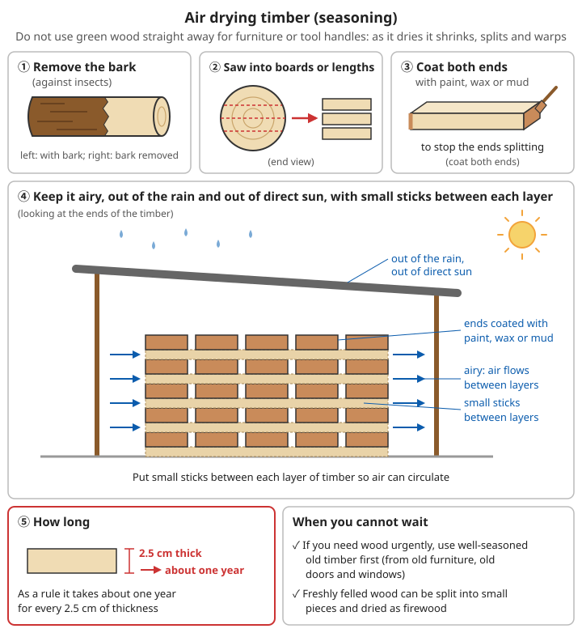
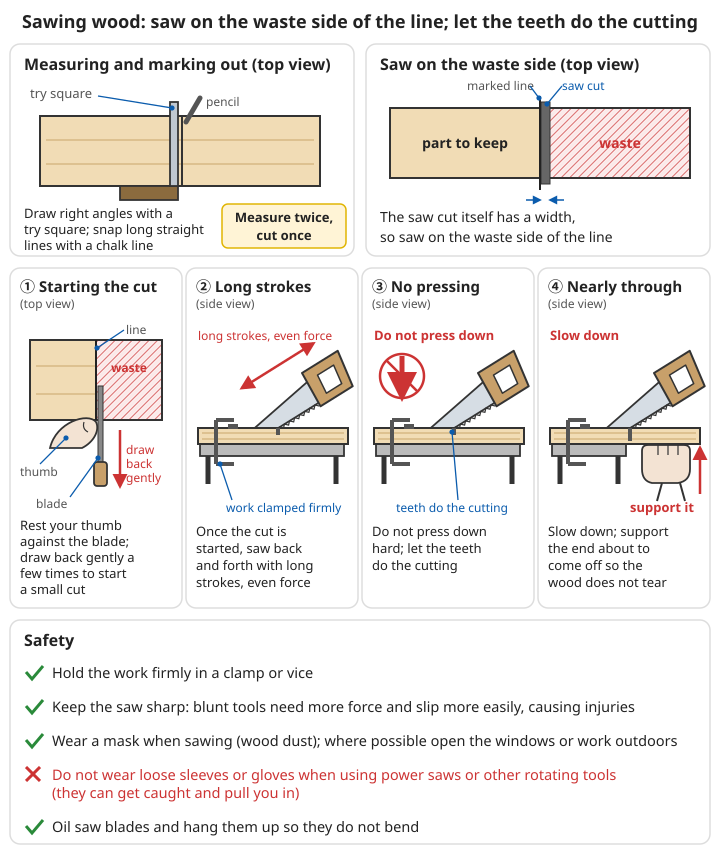
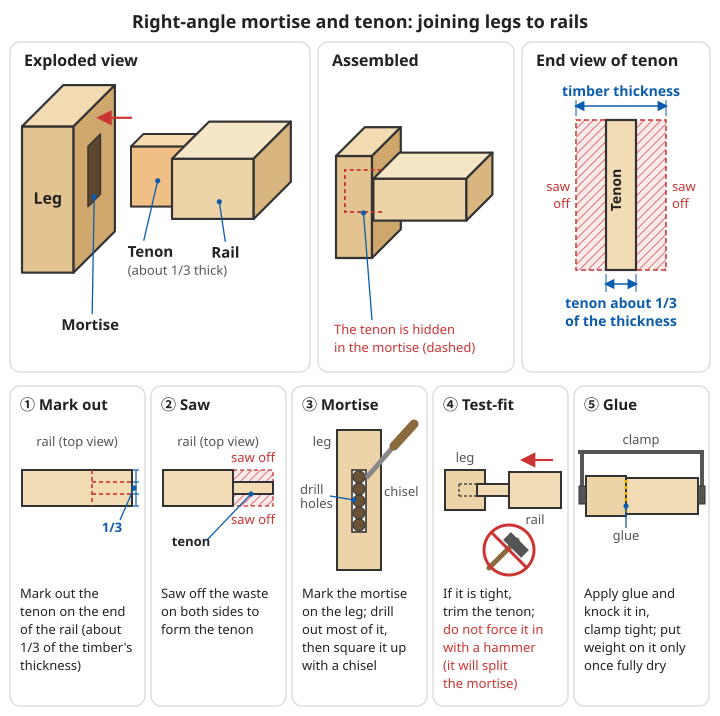
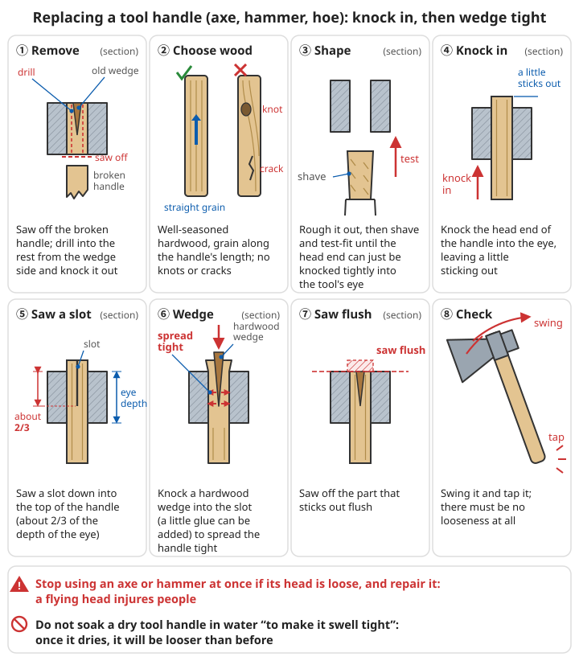
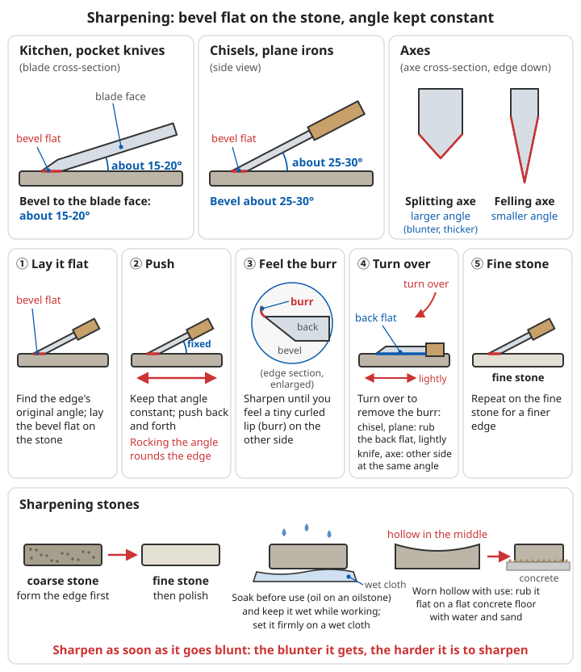

# Woodworking and Tool Maintenance

## Contents
- [Why learn this](#why-learn-this)
- [Tools to stock up on](#tools-to-stock-up-on)
- [Safety](#safety)
- [Timber](#timber)
- [Basic operations](#basic-operations)
- [Ways of joining wood](#ways-of-joining-wood)
- [Common repair jobs](#common-repair-jobs)
- [Sharpening](#sharpening)
- [Looking after tools](#looking-after-tools)

---

## Why learn this

When supplies are short and you have to be self-sufficient for a long time, broken tables and chairs, doors and windows, tool handles, chicken coops and fences can only be mended by yourself. **Knowing how to repair is more useful than knowing how to build**: most woodwork is repair, not making furniture from scratch.

```
Order of priority:
1. Look after the tools you have (rusty, blunt tools are slow and dangerous)
2. Learn to repair: replace tool handles, strengthen loose tables and chairs,
   mend doors and windows
3. Learn to make simple things: wooden boxes, benches, shelves, fences
4. Then learn more complex mortise-and-tenon joinery
```

---

## Tools to stock up on

```
Basic tools (stock these first):
- [ ] Saws: a general-purpose woodworking saw (panel saw) and a fine-toothed saw
- [ ] Hammer: claw hammer (it can pull nails)
- [ ] Chisels: one or two each of wide and narrow
- [ ] Plane: one medium-length plane
- [ ] Axe
- [ ] Hand drill or brace, with bits of different sizes
- [ ] Tape measure, try square, pencil, chalk line
- [ ] Screwdrivers (several each of flat-head and cross-head)
- [ ] Pliers, pincers
- [ ] Sharpening stones (one coarse, one fine)
- [ ] Clamps (F-clamps or woodworking clamps, two or more)

Consumables:
- [ ] Nails and screws of all sizes
- [ ] Wood glue (white PVA glue)
- [ ] Sandpaper (several grades)
- [ ] Rust-preventing oil, machine oil

Hand tools do not need electricity and last for decades; they are a good choice
for long-term stockpiling.
```

If tools break and cannot be bought, see [Simple tool forging](../05-metallurgy/03-forging-simple-tools.md) for how to make them.

---

## Safety

```
✓ Always push knives and chisels away from you, with your hands behind the
  cutting edge, never in front of it
✓ Hold the workpiece firmly in a clamp or vice; do not hold the work in one hand
  and the chisel in the other
✓ Keep saws, planes and chisels sharp: blunt tools need more force and slip
  more easily, causing injuries
✓ Wear goggles when splitting wood or hammering (flying wood chips and metal fragments)
✓ Wear a mask when sanding or sawing (wood dust); where possible open the windows
  or work outdoors
✓ Clear the area when using an axe; nobody may be within the swing of the axe
✓ Put tools away after use, edge down or with a guard on; do not leave them lying
  on the floor

❌ Do not wear loose sleeves or gloves when using power drills, power saws or other
   rotating tools (they can get caught and pull you in)
❌ Do not try to catch a falling knife or chisel
⚠️ Do not burn old timber treated with preservatives or paint as firewood
   (it gives off toxic fumes)
```

For treating cuts, see [Wound and injury care – Cuts and grazes](../01-first-aid-and-family-health/02-wounds-and-injuries.md#cuts-and-grazes).

---

## Timber

### Characteristics of common timbers

| Timber | Characteristics | Good for |
|------|------|----------|
| Chinese fir, pine | Light, soft, easy to work, cheap | House framing, boxes, shelves, fences |
| Pagoda tree (locust), elm, oak | Hard, tough, strong | Tool handles, farm tools, table and chair legs |
| Ash, hickory | Very tough, hard to break | Axe, hammer and hoe handles |
| Bamboo | Light, tough, grows fast | Fences, shelves, simple furniture, weaving |

### Drying

**Freshly felled green wood must not be used straight away for furniture or tool handles**: as it dries it shrinks, splits and warps.

```
Air drying (seasoning):
1. Remove the bark (against insects)
2. Saw into boards or lengths, and coat both ends with paint, wax or mud
   (to stop the ends splitting)
3. Keep somewhere airy, out of the rain and out of direct sun
4. Put small sticks between each layer of timber so air can circulate
5. As a rule it takes about one year for every 2.5 cm of thickness

✓ If you need wood urgently, use well-seasoned old timber first (from old furniture,
  old doors and windows)
✓ Freshly felled wood can be split into small pieces and dried as firewood
```



*Figure: remove the bark, saw into boards, coat both ends with paint, wax or mud; small sticks between each layer, airy, out of the rain and out of direct sun; as a rule about one year for every 2.5 cm of thickness*

For using timber in house construction, see [Long-term shelter – Simple timber framing](05-long-term-shelter.md#simple-timber-framing).

---

## Basic operations

### Measuring and marking out

```
✓ "Measure twice, cut once"
✓ Draw right angles with a try square; snap long straight lines with a chalk line
✓ Saw on the waste side of the line (the saw cut itself has a width)
```

### Sawing

```
1. Rest your thumb against the saw blade and draw it back gently a few times
   to start a small cut
2. Once the cut is started, saw back and forth with long strokes and even force
3. Do not press down hard; let the teeth do the cutting
4. Slow down when nearly through, and support the end that is about to come off
   so the wood does not tear
```



*Figure: top, marking out and where the saw cut goes; middle, the four steps of sawing; bottom, safety points for sawing*

### Nailing

```
✓ The nail should be about 2.5-3 times as long as the thickness of the top board
✓ Nailing near the end of a board easily splits it: drill a small pilot hole first
  with a fine bit
✓ Nails driven at crossed angles hold better than nails driven straight
✓ When pulling nails, put a piece of wood under the claw hammer to protect the surface
```

### Screws

```
✓ In hardwood, drill a pilot hole (a little narrower than the screw) first
✓ Screws are stronger than nails and can be undone; use them where there is load
  or where you will want to take it apart later
```

---

## Ways of joining wood

| Method | Difficulty | Characteristics |
|------|------|------|
| Nails | ⭐ | Fastest; not very strong, works loose easily as the wood shrinks |
| Screws | ⭐ | Stronger than nails, can be undone |
| Bolts | ⭐ | Strongest; for load-bearing places (such as sheds, doors) |
| Glue + nails/screws | ⭐⭐ | Glued surfaces must fit tightly; clamp and let dry completely before use |
| Lashing | ⭐ | No nails needed; good for bamboo, poles and temporary structures |
| Mortise and tenon | ⭐⭐⭐ | Very strong without nails; needs practice |

### A simple mortise and tenon: the right-angle joint

```
For joining table and chair legs to rails:
1. Mark out the tenon on the end of the rail (about 1/3 of the timber's thickness)
2. Saw off the waste on both sides to form the tenon
3. Mark out the mortise in the matching place on the leg; drill out most of it,
   then square it up with a chisel
4. Test-fit first; if it is tight, trim the tenon – do not force it in with a hammer
   (it will split the mortise)
5. Apply glue and knock it in, clamp tight, and only put weight on it once fully dry

✓ Practise a few times on scrap wood first
```



*Figure: top, exploded view, assembled joint and end view of the tenon; bottom, the five steps*

For the knots used in lashing, see [Basic survival skills – Cordage](../03-wilderness-survival/00-basic-survival-skills.md#cordage).

---

## Common repair jobs

### Replacing a tool handle (axe, hammer, hoe)

```
1. Remove the old handle: saw off the broken handle, then drill into what is left
   from the wedge side and knock it out
2. Choose the wood: well-seasoned hardwood with the grain running along the length
   of the handle, free of knots and cracks
3. Shape the handle: rough it out first, then shave and test-fit repeatedly until
   the head end can just be knocked tightly into the tool's eye
4. Fitting:
   - Knock the head end of the handle into the eye, leaving a little sticking out
   - Saw a slot down into the top of the handle (about 2/3 of the depth of the eye)
   - Knock a hardwood wedge into the slot (a little glue can be added) to spread
     the handle tight; if you have an iron wedge, drive one in crossways as well
     for a firmer fit
   - Saw off the part that sticks out flush
5. Check: swing it and tap it; there must be no looseness at all

⚠️ Stop using an axe or hammer at once if its head is loose and repair it;
   a flying head injures people
❌ Do not soak a dry tool handle in water "to make it swell tight": once it dries,
   it will be looser than before
```



*Figure: eight steps, with the tool head drawn in cross-section; the slot is about 2/3 of the depth of the eye*

### Wobbly tables and chairs

```
✓ Find the loose joint, take it apart, clean off the old glue, reglue and clamp
✓ If it cannot be taken apart: add a triangular wooden block or metal corner
  bracket at the joint, fixed with screws
✓ Legs of unequal length: pack under the longest leg, or saw a little off the
  long legs (only a little at a time)
```

### Doors and windows

```
Door will not close properly or has dropped:
✓ First tighten the screws in the hinges
✓ Screw holes stripped: push a few glued toothpicks or slivers of wood into the
  hole, let it dry, then drive the screw in again

Drawers, sliding doors or windows sticking:
✓ Rub candle wax or soap on the sliding surfaces
✓ If still sticking, plane a little off where it rubs
```

---

## Sharpening

Knives, axes, chisels and plane irons all need regular sharpening. **Sharpen as soon as they go blunt; the blunter they get, the harder they are to sharpen.**

```
Sharpening stones:
✓ Start on a coarse stone to form the edge, then polish on a fine stone
✓ Soak the stone in water before use (use oil on an oilstone) and keep it wet
  while you work
✓ Set the stone firmly, on a wet cloth so it does not slip

Method:
1. Find the original angle of the edge and lay the bevel flat on the stone
2. Keep that angle constant and push back and forth (if the angle rocks up and down
   you will round the edge)
3. Sharpen until you can feel a tiny curled lip (burr) along the other side of the edge
4. Turn it over and remove the burr:
   - Chisels, plane irons (single bevel): lay the back flat on the stone and rub
     lightly a few times
   - Kitchen knives, axes (double bevel): sharpen the other side at the same angle,
     the same amount on both sides
5. Repeat on the fine stone for a finer edge

Common angles (guide):
- Kitchen knives, pocket knives: bevel about 15-20° to the face of the blade
- Chisels, plane irons: bevel about 25-30°
- Axes: about 20-30°; a splitting axe has a larger angle (blunter and thicker),
  a felling axe a smaller one

✓ A stone wears hollow in the middle with use; flatten it by rubbing on a flat
  concrete floor with water and sand
✓ With no sharpening stone: a flat piece of fine sandstone, or the unglazed rim on
  the base of a coarse earthenware jar, will do
```



*Figure: top, common angles; middle, the five steps of sharpening; bottom, using and flattening the stone*

For sharpening and looking after forged tools, see [Simple tool forging – Tool maintenance](../05-metallurgy/03-forging-simple-tools.md#10-tool-care).

---

## Looking after tools

```
Rust prevention:
✓ Wipe off wood dust, soil and moisture after use
✓ Give the metal parts a thin coat of oil (machine oil, sewing-machine oil or
  vegetable oil all work)
✓ Keep them somewhere dry, not directly on an earth or concrete floor
✓ Already rusty: remove the rust with a wire brush or sandpaper, then oil

Wooden handles:
✓ Rub in boiled tung oil or linseed oil regularly to stop them drying out and cracking
✓ Replace a handle as soon as it cracks; do not wrap it in tape and carry on

Storage:
✓ Hang on the wall or keep in a toolbox, with guards on the edges
✓ Oil saw blades and hang them up so they do not bend

Farm tools:
✓ After each season, clean, dry, oil and store them indoors
✓ Before the next season starts, check handles and edges and repair them in good time
```

---

## 📝 Key points on woodworking and tool maintenance

```
1. Hand tools do not need electricity and last for decades; worth stockpiling
2. Push cutting tools away from you, clamp the work, keep tools sharp; wear a mask
   when sawing and sanding
3. Green wood must be seasoned before making furniture or tool handles: about one
   year per 2.5 cm of thickness
4. Nails about 2.5-3 times the thickness of the top board; drill pilot holes in hardwood
5. Replacing an axe handle: well-seasoned, straight-grained hardwood, knocked tight
   and wedged; stop using it at once if it works loose
6. Keep the angle constant when sharpening; raise a burr, then turn over and remove it
7. Wipe tools dry and oil them after use; oil wooden handles regularly
```

---

**Next chapter**: [Water supply](10-water-supply.md)
**Back**: [Chapter index](README.md) | [Main contents](../../README.md)
