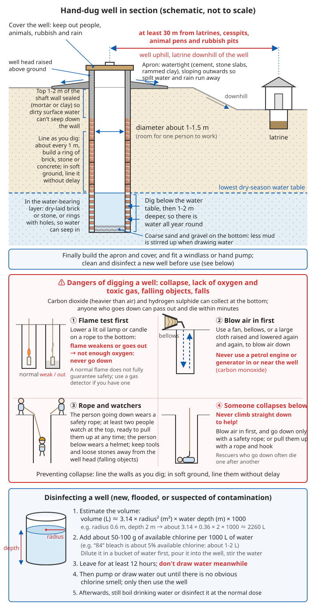
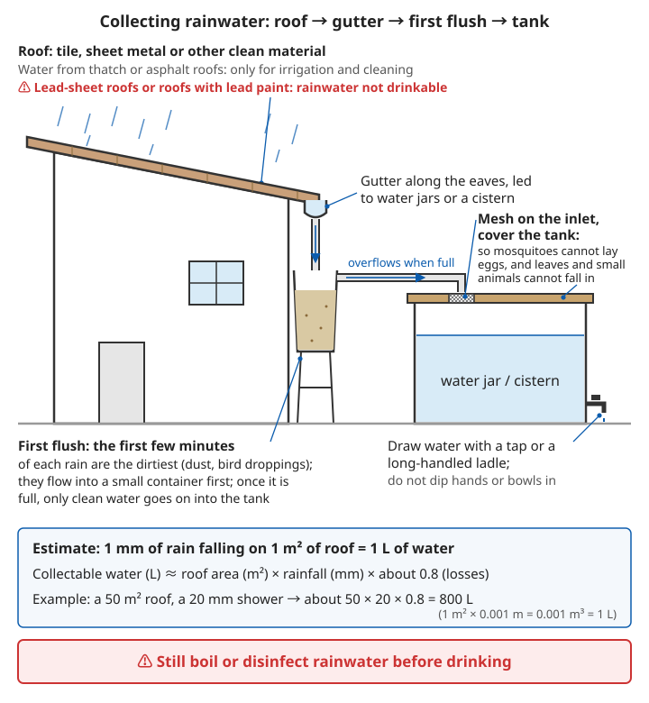
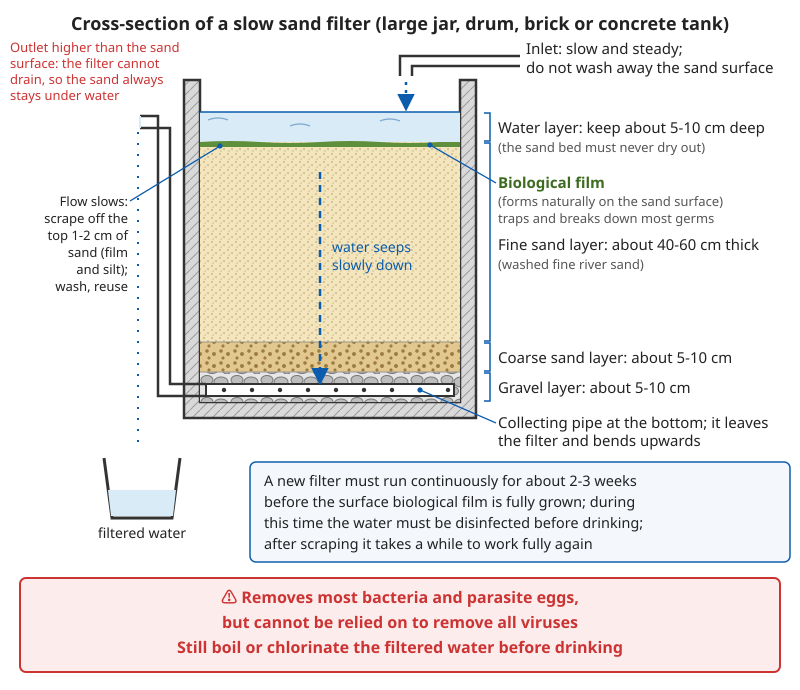

# Water Sources and Water Supply

## Contents
- [Why water supply comes first](#why-water-supply-comes-first)
- [How much water you need](#how-much-water-you-need)
- [Protecting water sources](#protecting-water-sources)
- [Springs](#springs)
- [Digging wells](#digging-wells)
- [Collecting rainwater](#collecting-rainwater)
- [Purification: from muddy water to drinking water](#purification-from-muddy-water-to-drinking-water)
- [Storage](#storage)
- [Carrying and lifting water](#carrying-and-lifting-water)
- [Wastewater](#wastewater)

---

## Why water supply comes first

After disasters, in history and today, diseases spread by dirty water, such as cholera, dysentery, typhoid and hepatitis A, often kill more people than the disaster itself. **Once a community has enough clean water, most intestinal infections are kept out.**

```
Three goals of water supply:
1. Enough: not just for drinking, but also for washing hands, cooking, bathing and laundry
2. Clean: not contaminated by faeces
3. Convenient: the further people walk for water, the less they use, and the worse hygiene gets
```

For germ theory and intestinal infections see [Biology and Medicine Basics – Germ theory](../08-basic-science/04-biology-and-medical-basics.md#2-germ-theory-the-insight-that-changed-human-destiny) and [Infectious Disease at Home – Diarrhoeal infections](../01-first-aid-and-family-health/15-infectious-disease-at-home.md#diarrhoeal-infections).

---

## How much water you need

```
Per person per day:
- Drinking: about 2-3 L (more in hot weather or during hard work)
- Cooking, hand washing, personal hygiene: at least about 15 L in a post-disaster emergency
- Normal living (bathing, laundry, cleaning): several tens of L or more
In addition: livestock and vegetable plots need more

Example: a community of 50 people, at 20 L per person per day, needs at least 1000 L (1 m³) a day
```

---

## Protecting water sources

```
✓ Keep latrines, cesspits, animal pens and rubbish pits at least 30 m from wells,
  springs and streams, and downhill of the water source
✓ Raise the wellhead above the ground and build a watertight apron around it
  (cement, stone slabs, rammed clay), sloping outwards so spilt water and rain
  run away instead of back into the well
✓ Cover the wellhead so people, animals, rubbish and rain cannot get straight in
✓ Draw water with a dedicated bucket and rope; never put the bucket on the ground
✓ Do not wash clothes, bathe or water animals upstream of the water source
✓ Fence off the area upstream of the collection point at springs and streams
```

For siting latrines see [Sanitation – Dry latrines](03-sanitation.md#pit-latrines).

---

## Springs

Spring water is groundwater that flows naturally out of the ground. It is usually fairly clean, but the place where it comes out is easily contaminated.

```
Spring box (protecting the spring):
1. Clear the area around the spring and dig back to where the water emerges
2. Build a small covered tank (spring box) of stone, brick or concrete around
   the spring, so the water flows in through the bottom or side
3. Fit an outlet pipe high in the tank wall and lead it to the collection point
4. Dig a cut-off ditch above the spring box to divert surface rainwater
5. Fence the uphill side to stop people and animals trampling it and fouling it with faeces
```

For finding springs and groundwater see [Geology, Minerals and Soil – Groundwater](../08-basic-science/06-geology-minerals-and-soil.md#4-groundwater).

---

## Digging wells

### ⚠️ Dangers of digging wells

```
Well digging causes deaths and injuries every year. The main dangers:
1. Collapse: the well wall caves in and buries the digger
2. Lack of oxygen and toxic gases: carbon dioxide (heavier than air) and
   hydrogen sulphide can collect at the bottom; a person who goes down can pass
   out and die within minutes, and rescuers who follow often die one after another
3. Falling objects: stones and tools dropped from above
4. Falls

Safety rules:
✓ Before every descent, lower a lit oil lamp or candle on a rope to the bottom:
  flame weakens or goes out → not enough oxygen, never go down
  (note: a normal flame does not fully guarantee safety; use a gas detector if you have one)
✓ Before going down, blow air into the well with a fan or bellows, or by
  repeatedly raising and lowering a large piece of cloth
✓ The person going down wears a safety rope, with at least two people watching
  at the top, ready to pull them up at any moment
✓ The person below wears a helmet; keep tools and loose stones away from the wellhead
✓ Never run a petrol engine or generator in or beside the well (carbon monoxide)
✓ If someone collapses down the well, do not go straight down to rescue them:
  blow in air first and go down on a safety rope, or pull them up with a rope and hook
```

For toxic gases see [Chemistry – Chemical safety](../08-basic-science/03-chemistry.md#9-chemical-safety).

### Hand-dug wells

```
1. Site: where groundwater is likely to be shallow (see the geology chapter),
   at least 30 m from sources of contamination and uphill of them
2. Diameter about 1-1.5 m (room for one person to work at the bottom)
3. Line the wall as you dig:
   - Build a section of well lining (brick, stone, precast concrete rings) for about every 1 m dug
   - In soft ground, line even more promptly
4. Dig below the water table:
   - Ideally dig in the dry season when the water table is lowest, and go a further
     1-2 m deeper so there is water all year
   - Once in the water-bearing layer, line the lower wall with brick or stone laid
     without mortar, or with perforated rings, so water can seep in
5. Spread a layer of coarse sand and gravel on the bottom so drawing water stirs up less mud
6. The top 1-2 m of the well wall must be sealed (with mortar or clay) so dirty
   surface water cannot seep down the wall
7. Build the apron and cover, and fit a windlass or hand pump
8. Clean and disinfect a new well before use (see "Disinfecting well water" below)
```

### Disinfecting well water

```
New wells, wells that have been flooded, wells suspected of contamination:
0. Flooded wells: first pump or bail the well as dry as you can, clear the mud and
   debris from the bottom, let it fill up again, then disinfect as below; after
   disinfection send a sample for testing if possible, otherwise watch it for a few days before use
1. Estimate the volume of water in the well: round well volume (L) ≈ 3.14 × radius² (m²) × water depth (m) × 1000
   Example: radius 0.6 m, water depth 2 m → about 3.14 × 0.36 × 2 × 1000 ≈ 2260 L
2. Add a chlorine disinfectant at about 50-100 g of available chlorine per 1000 L of water
   (e.g. "84" bleach, about 5% available chlorine: about 1-2 L)
   Dilute it in a bucket of water first, then pour it into the well and stir the water
3. Leave it to stand for at least 12 hours, drawing no water during this time
4. Then pump or draw water until there is no obvious smell of chlorine before using it
5. After that, drinking water should still be boiled or disinfected at the usual dose
```



*Figure: Diameter about 1-1.5 m, top 1-2 m of the wall sealed, dug below the dry-season water table and then a further 1-2 m; before going down, lower a flame to test, blow in air; if someone collapses do not go straight down to rescue them; disinfect at about 50-100 g of available chlorine per 1000 L of water and leave for at least 12 hours*

For the strength of "84" bleach see [Infectious Disease at Home – Making household disinfectant](../01-first-aid-and-family-health/15-infectious-disease-at-home.md#making-household-disinfectant).

---

## Collecting rainwater

```
Rainwater itself is fairly clean; prevent contamination while collecting and storing it

Estimating the amount you can collect:
  1 mm of rain falling on 1 m² of roof = 1 L of water
  Collectable water (L) ≈ roof area (m²) × rainfall (mm) × about 0.8 (losses)
Example: a 50 m² roof in a 20 mm shower → about 50 × 20 × 0.8 = 800 L

Key points:
✓ Use roofs of tile, sheet metal or other clean materials; water from thatch or
  asphalt roofs is only for irrigation and cleaning
  (⚠️ rainwater from lead-sheet roofs or roofs with lead paint is not drinkable)
✓ Fit gutters along the eaves and lead them to water jars or a cistern
✓ First flush: the first few minutes of every rain are the dirtiest (washing off dust
  and bird droppings); fit a small container on the inlet pipe that fills first and then
  overflows, so the dirty first water goes into it and only clean water reaches the tank once it is full
✓ Fit a mesh screen on the inlet and cover the tank so mosquitoes cannot lay eggs
  and leaves and small animals cannot fall in
✓ Still boil or disinfect rainwater before drinking
```



*Figure: The dirty water from the first few minutes of each rain flows into the first-flush container first, and only when it is full does water overflow into the tank; 1 mm of rain on 1 m² of roof is 1 L of water, so 20 mm of rain on a 50 m² roof collects about 800 L; still boil or disinfect before drinking*

For measuring rainfall see [Weather Observation and Forecasting – Making your own observations](../08-basic-science/07-weather-observation-and-forecasting.md#6-making-your-own-observations).

---

## Purification: from muddy water to drinking water

### Multi-stage treatment

```
1. Settling: let muddy water stand in a bucket or jar for a few hours to a day, and take the clearer water from the top
   → A little alum speeds up settling (see Chemistry – Separation and purification)
2. Filtering: removes the remaining suspended matter and some of the germs (see the slow sand filter below)
3. Disinfection: boiling or chlorine kills bacteria and viruses
→ Disinfecting muddy water directly works poorly; settle and filter it first, then disinfect
```

### Slow sand filter

Slow sand filtration is one of the oldest and most reliable ways to purify water for a whole community: water passes slowly through a bed of fine sand, and a biological film forms naturally on the sand surface that traps and breaks down most germs.

```
Construction (top to bottom):
- Top: keep a layer of water about 5-10 cm deep (the sand bed must never dry out)
- Fine sand layer: about 40-60 cm thick (washed fine river sand)
- Coarse sand layer: about 5-10 cm
- Gravel layer: about 5-10 cm, with the collecting pipe at the bottom
- The outlet pipe leaves the bottom of the filter and then bends upwards; its outlet
  must be higher than the sand surface
  (if the outlet is too low, the filter drains, the sand is exposed and the biological film dies)
Container: large water jar, large drum, brick or concrete tank

Use:
1. A new filter must run continuously for about 2-3 weeks before the surface
   biological film is fully grown; during this time the water must be disinfected before drinking
2. Feed water in slowly and steadily; do not wash away the sand surface
3. Keep the sand bed under water at all times (ensured by the outlet being higher than the sand surface)
4. When the flow gets slower and slower, scrape off the top 1-2 cm of sand
   (biological film and silt); it can be washed and reused
   (after scraping it takes a while for the filter to work fully again)

Effect: removes most bacteria and parasite eggs, but cannot be relied on to remove all viruses
→ Still boil or chlorinate the filtered water before drinking
```



*Figure: Layer thicknesses as in the text; the outlet pipe bends upwards with its outlet higher than the sand surface; the biological film on the sand takes 2-3 weeks to grow, and the filtered water must still be boiled or chlorinated*

For simple filters in the wild see [Basic Survival Skills – Finding and purifying water](../03-wilderness-survival/00-basic-survival-skills.md#finding-and-purifying-water).

### Disinfection

```
Boiling (most reliable): boil for at least 1 minute; at altitudes above 2000 m, at least 3 minutes

Chlorine ("84" bleach, household bleach and other chlorine disinfectants):
- Clear water: 2 drops per litre; muddy water: 4 drops per litre (based on bleach with about 5% available chlorine)
- Shake well and leave for 30 minutes
- Disinfected water should have a faint smell of chlorine; if there is no chlorine smell at all, add another dose
- Large stores of water: about 100 mL of 5% bleach per 1000 L of clear water (equivalent to 2 drops per litre), leave for at least 30 minutes

Solar disinfection: put clear water in transparent plastic bottles and leave them in strong sunlight for at least 6 hours (on cloudy days, 2 days in a row; not usable during continuous rain)
```

### Water ordinary methods cannot treat

```
❌ Water contaminated with pesticides, chemicals, industrial waste water or fuel: neither boiling nor filtering removes chemical poisons
❌ Seawater and brackish water: must be distilled before drinking
❌ Groundwater high in arsenic or fluoride: ordinary methods cannot remove it
→ Do not drink such water; find another source
```

---

## Storage

```
✓ Use clean, covered containers kept only for water; a narrower opening is less easily contaminated
✓ Take water out with a dedicated long-handled ladle or a tap; do not dip hands or bowls in
✓ Keep containers in a cool, dark place (light makes algae grow)
✓ Clean containers regularly: scrub with dilute chlorine disinfectant, then rinse well
✓ Disinfect water that has been stored a long time again before drinking
✓ Never store drinking water in containers that have held pesticides, fuel or chemicals
```

---

## Carrying and lifting water

### Bringing water by gravity

```
- Use the natural fall: water flows from a spring or stream higher up through a channel or pipe down to the village
- Channel gradient: it need not be steep; water flows at a gradient of about one in a thousand
  (you need levelling to set out the line; see Measurement and Scientific Method – Finding level)
- Pipes: bamboo, clay, salvaged plastic and metal pipes
- Siphon: to cross a small rise (highest point no more than about 10 m above the water; see Physics – Atmospheric pressure)
- Covered channels and closed pipes stay cleaner than open channels
```

For ways of finding level see [Measurement and Scientific Method – Finding level](../08-basic-science/00-measurement-and-scientific-method.md#42-finding-the-level).

### Lifting water

```
- Windlass, pulley, lever (shadoof, *jiegao*): lift water from a well (see Physics – Simple machines)
- Hand pump (suction pump): water surface no more than about 7-8 m below the pump
- Deeper wells: use a bucket, or put the pump down the well
- Water wheel: uses the force of flowing water to lift water up to fields for irrigation
```

### Hydraulic ram pump: sending water uphill without fuel

```
Uses the pressure produced when flowing water is suddenly stopped (water hammer) to push part of the water far higher than the source
- Needs: a stream with some fall and a steady flow
- No electricity, no fuel, works day and night
- Only a small part of the water is sent up; the rest flows away
  Delivery ≈ inflow × fall ÷ delivery height × about 0.6 (efficiency)
Example: inflow 100 L per minute, fall 2 m, delivered to a height of 20 m
  → about 100 × 2 ÷ 20 × 0.6 = 6 L/min, about 8600 L a day
```

For the principles of water power and atmospheric pressure see [Physics – Pressure and fluids](../08-basic-science/02-physics.md#4-pressure-and-fluids).

---

## Wastewater

```
✓ Grey water from laundry, bathing and washing vegetables: lead it to a soakaway pit or
  vegetable plot at least 30 m from the well (not on vegetables eaten raw);
  do not throw it on the ground next to the well or the house
✓ Soakaway pit: dig a pit, fill it with broken stone and brick, cover with soil, and let grey water slowly soak into the ground
✓ Keep faeces and urine out of the grey-water system; deal with them as in the sanitation chapter
✓ Fill in standing puddles promptly (against mosquitoes)
```

For dealing with faeces see [Sanitation](03-sanitation.md).

---

## 📝 Key points on water supply

```
1. Latrines and animal pens at least 30 m from water sources, downhill
2. Wellhead above ground level, with apron and cover; top of the well wall sealed
3. Before going down a well, test with a lamp flame and blow in air; if someone collapses, do not go straight down to rescue them
4. 1 mm of rain × 1 m² of roof = 1 L of water; divert the dirty first flush
5. Settle and filter muddy water first, then disinfect
6. Keep a water layer on a slow sand filter; still disinfect the filtered water
7. Boiling is most reliable; bleach: 2 drops per litre for clear water, 4 for muddy, wait 30 minutes
8. Chemically contaminated water cannot be made safe by boiling or filtering
```

---

**Next chapter**: [Pottery, Glass and Papermaking](11-pottery-glass-and-papermaking.md)
**Back to**: [Part contents](README.md) | [Main contents](../../README.md)
