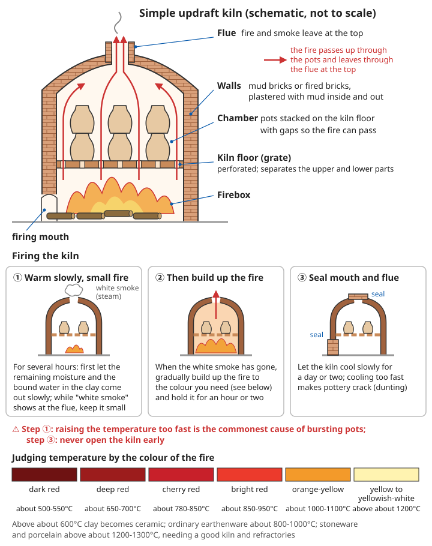
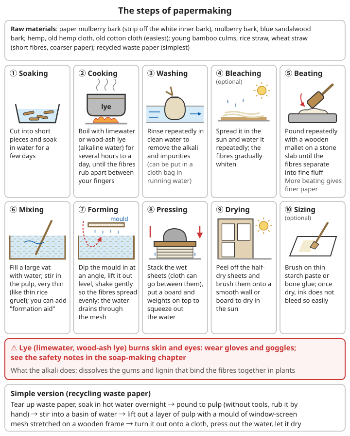

# Pottery, Glass and Papermaking

## Contents
- [First, be clear: what this chapter is for](#first-be-clear-what-this-chapter-is-for)
- [Pottery: choosing and preparing clay](#pottery-choosing-and-preparing-clay)
- [Shaping](#shaping)
- [Drying](#drying)
- [Firing](#firing)
- [Glazes and sealing](#glazes-and-sealing)
- [Bricks and tiles](#bricks-and-tiles)
- [Glass](#glass)
- [Papermaking](#papermaking)
- [Ink and writing](#ink-and-writing)

---

## First, be clear: what this chapter is for

Pottery can store grain and water, and be used for cooking and fermenting; bricks and tiles build houses; glass makes bottles, lenses and chemical vessels; paper lets knowledge be written down and passed on. All of these are bottlenecks in the [technology-rebuilding roadmap](../09-advanced-science-and-engineering/00-technology-rebuilding-roadmap.md#3-key-bottlenecks). This chapter covers small-scale, hand methods.

```
⚠️ Safety:
- Kilns and furnaces are extremely hot: burns, and setting fire to nearby plants and
  houses; build kilns well away from houses and clear a firebreak around them
- Firing kilns and melting glass produce carbon monoxide; never fire indoors or in a closed shed
- Breathing dry clay powder, quartz sand or glaze dust over a long time causes silicosis:
  wet materials before handling them, and wear a mask
- ☠️ Never use lead glazes on vessels for food (lead slowly dissolves into food, especially acidic food)
- Molten glass can be several hundred degrees Celsius even when it does not look red;
  broken glass is sharp; wear gloves and goggles
- The alkaline water used in papermaking (limewater, wood-ash lye) burns skin and eyes
```

The most realistic route: **salvage first**. Ceramic bowls, glass bottles and paper from ruins are far easier to get than making your own; making your own is for long-term resupply.

---

## Pottery: choosing and preparing clay

### What kind of earth makes pottery

```
Finding clay: fine-textured layers by rivers, lakes and low-lying ground; dig below the
  topsoil to an evenly coloured layer (see Geology, Minerals and Soil)
Testing:
1. Take a handful of earth, add water and knead it into clay; roll a coil as thick as a pencil
2. Bend it round a finger into a ring: no cracks or only fine lines → good plasticity, can make pottery
   Snaps as soon as it bends → too much sand, unsuitable
3. Pinch a small bowl or a clay disc, let it dry, then put it in a bonfire
   - Does not break after firing and rings clearly when tapped → usable
   - Bursts → probably not fully dry, or needs sand mixed in
   - Bubbles, melts or deforms → too many impurities; can only be fired at low temperature

Colour:
- Red and brown earths: high in iron, fire to red earthenware at lower temperatures
- White and greyish-white earths (kaolin, china clay): withstand higher temperatures;
  raw material for porcelain and refractories
```

For identifying clay see [Geology, Minerals and Soil – Where to find useful things](../08-basic-science/06-geology-minerals-and-soil.md#3-where-to-find-useful-things).

### Preparing the clay

```
1. Dry it in the sun, break it up and soak it in water until it dissolves
2. Wash it: stir into a thin slurry, let it stand a few minutes so sand and stones sink,
   and pour the slurry off the top into another container
   (this step removes sand, stones and grass roots)
3. Let the slurry settle, pour off the clear water on top, spread it on cloth or on
   absorbent ground, and let it dry until it can be kneaded without sticking to your hands
4. Add temper:
   - Mix in fine sand or crushed fired pottery (grog), about 10-25%
   - Purpose: reduces shrinkage and cracking during drying and firing; especially
     needed for cooking pots
5. Knead (wedge) the clay: press and fold it repeatedly like dough to squeeze out air bubbles
   → Air bubbles in the clay expand during firing and make the pot burst
6. Wrap the kneaded clay in a damp cloth or keep it in a jar and let it "age" for a few
   days to a few weeks; its plasticity improves
```

---

## Shaping

```
Pinching: press a hollow into the middle of a ball of clay with your fingers, and turn
  and pinch it thinner → small bowls, small cups, crucibles

Coiling (most practical; can make large jars):
1. Make a round clay disc for the base
2. Roll clay into coils of even thickness and lay them ring by ring on the edge of the base
3. After each ring, smooth and press the join between the upper and lower ring with
   your fingers (inside and outside)
4. Once it reaches a certain height, wait until the lower part has stiffened enough
   to support it before adding more
5. Beat the outer wall with a wooden paddle while holding a pebble against the inside,
   to make the wall thinner and stronger

Slab building: roll clay into even slabs, cut and join them → square containers, tiles, bricks
  Score the joins and brush them with slip before sticking them together

Wheel throwing: with a potter's wheel, throw the pot as it spins fast; the result is round and thin
  → Needs a great deal of practice; a wheel can be made from salvaged bearings and a flywheel

✓ Keep the wall an even thickness (about 5-10 mm); uneven walls crack easily in drying and firing
✓ Attach handles, spouts and other parts when the pot is leather-hard; score the joint and brush on slip
```

---

## Drying

**Most failures happen in drying.** The raw pot holds water; if it dries too fast, the outside dries while the inside is still wet, shrinkage is uneven, and it cracks.

```
1. Put it in a cool place out of draughts and direct sun, and let it dry slowly in the shade
2. For the first few days after shaping you can cover it with plastic sheet or a damp cloth so it dries evenly
3. Large pieces take one or two weeks, or even longer
4. Telling when it is fully dry: it no longer feels cold to the touch, its colour is
   evenly lighter, and it does not feel cool held against your cheek
   → In a kiln, water left inside an incompletely dried pot turns to steam and makes it burst
5. Before firing, ideally dry it by the fire or in the sun for another day or two
```

---

## Firing

### Temperature

```
Above about 600°C: clay becomes ceramic and no longer dissolves in water (this is the
  essential difference between pottery and sun-dried clay)
About 800-1000°C: ordinary earthenware
Above about 1200-1300°C: stoneware and porcelain, dense and watertight; needs a good kiln and refractories

Judging temperature by the colour of the fire:
Dark red → about 500-550°C
Deep red → about 650-700°C
Cherry red → about 780-850°C
Bright red → about 850-950°C
Orange-yellow → about 1000-1100°C
Yellow to yellowish-white → above about 1200°C
```

For judging temperature by colour see [Basic Metallurgy – Judging temperature](../05-metallurgy/00-metallurgy-basics.md#41-judging-temperature).

### Open (pit) firing: the simplest

```
1. Dig a shallow pit in the ground and lay a layer of dry firewood
2. Place the fully dried pots mouth down, and first keep a small fire around them for
   an hour or two to warm them
   (so the last of the moisture comes out slowly)
3. Gradually add wood until the pots are completely buried in the woodpile, and cover
   the outside with bark, potsherds or wet mud to hold in the heat
4. Burn hard for several hours, then let it cool naturally in the ashes and take the pots out the next day
→ Temperature about 600-900°C, uneven, many breakages; suitable for small pieces
```

### Simple updraft kiln

```
Structure:
- A firebox below and a chamber for the pots above, separated by a perforated kiln floor (grate)
- Walls of mud bricks or fired bricks, plastered with mud inside and out, with a flue opening at the top
- The fire passes up through the pots and leaves through the flue at the top

Firing the kiln:
1. Stack the pots on the kiln floor with gaps between them so the fire can pass
2. Warm slowly with a small fire for several hours: first let the remaining moisture and
   the chemically bound water in the clay come out slowly
   ⚠️ Raising the temperature too fast at this stage is the commonest cause of
   bursting pots; while "white smoke" (steam) shows at the flue, keep the fire small
3. When the white smoke has gone, gradually build up the fire, fire to the colour you
   need, and hold it there for an hour or two
4. Seal the firing mouth and the flue and let the kiln cool slowly for a day or two;
   never open it early
   → Cooling too fast makes pottery crack (dunting)

✓ With bellows or other blowers you can reach higher temperatures
✓ Record every firing: how much wood, how long, what share came out sound; improve step by step
```



*Figure: Structure of a simple updraft kiln (firebox, kiln floor, chamber, flue) and the three firing stages: warm slowly with a small fire → build up the fire once the white smoke has gone → seal the kiln and cool slowly; below, judging temperature by the colour of the fire*

For refractory materials for kiln bricks and furnace linings see [Engineering Mechanics and Materials – Ceramics and refractories](../09-advanced-science-and-engineering/01-engineering-mechanics-and-materials.md#105-ceramics-and-refractories); for blowing see [Bellows and Forges](../05-metallurgy/08-bellows-and-forges.md).

### Crucibles and firebricks

```
Smelting and melting glass both need containers that withstand high temperatures:
- Use white refractory clay (kaolin) with a large amount of crushed grog (broken
  firebrick, broken porcelain) mixed in; grog can make up a third or even half
- Make the walls thick, dry thoroughly, then give a first low-temperature (bisque) firing
- Preheat before use; never put a cold crucible straight into a hot furnace
```

---

## Glazes and sealing

```
Unglazed pottery is porous and seeps water:
- A water jar that seeps slightly keeps the water cool through evaporation from its outer wall; this is actually an advantage
- Pots for oil, alcohol or soup need sealing

Sealing without glaze:
- Burnishing: when the pot is leather-hard, rub the surface repeatedly with a smooth
  pebble until it shines; it is denser after firing
- Hot dipping: while the pot is still hot from the kiln, dip it in or splash it with
  rice water, flour paste or milk to seal the pores
  (this only reduces seepage and does not last)
- A coat of wax or pine resin (only for cold contents)

Glazes (form only at high temperature):
- Ash glaze: mix wood ash and fine clay about 1:1, add water to make a slurry, and coat
  bisque-fired pots; it needs above about 1200°C to melt into a glossy glaze
- ☠️ Lead glazes (containing red lead or litharge) melt at lower temperatures and were
  widely used in history, but lead dissolves into food, especially acidic food, wine
  and vinegar → never use lead glazes on vessels for food
- Old porcelain and lead-free glass, salvaged and ground to a fine powder, can serve as
  raw material for low-temperature glazes (experimental)
```

---

## Bricks and tiles

```
Bricks: clay with a little sand, pressed into a wooden mould, turned out, dried in the
  shade, then fired (about 900-1000°C)
  - Well-fired brick: rings clearly when struck, even colour on a broken face
  - Under-fired brick: sounds dull, yellowish colour, softens in water; use only where it stays dry
Tiles: form a clay slab round a wooden cylinder, cut it into several pieces when dry, then fire
✓ Brick and tile kilns can be shared with pottery kilns; one firing is usually several
  thousand pieces and needs a lot of wood

Unfired mud bricks can also build houses: see Long-term shelter
```

For mud bricks and walls see [Long-term Shelter – Mud-brick walls](05-long-term-shelter.md#adobe-walls).

For lime mortar for bricklaying see [Lime and Building Materials](16-lime-and-building-materials.md#lime-mortar-and-three-part-earth).

---

## Glass

### The most realistic approach: salvage and remelting

```
There is a great deal of glass in ruins, in bottles and window panes:
✓ Wash and keep intact bottles and jars; they are the best storage containers and chemical vessels
✓ Collect broken glass sorted by colour (keep clear, green and brown separate)
✓ Remelting broken glass: ordinary glass starts to soften above about 700°C and only
  flows and can be blown above about 1000°C; this is much easier than melting from raw materials
⚠️ Glass from different sources expands and contracts differently with heat; mixed and
  melted together, it tends to crack as it cools
  → As far as possible use glass from one source only (e.g. one batch of bottles)
⚠️ Do not mix heat-resistant glass (laboratory ware, oven glass) with ordinary glass;
  do not use glass from fluorescent tubes or cathode-ray tubes, which contains harmful substances
```

### Melting from raw materials (principles)

```
Approximate recipe for ordinary soda-lime glass (by mass):
- Quartz sand (SiO₂): about 70%; the whiter and purer the better; sand high in iron makes green glass
- Soda ash (Na₂CO₃) or potash from wood ash: about 15-20%; lowers the melting temperature
- Lime (CaO): about 10%; makes the glass insoluble in water and more stable
- Adding broken glass (cullet, 10-30%) helps it melt

Melting temperature is about 1400-1500°C. When ancient kilns could not reach it, the batch
was often first fired at a lower temperature into a "frit", crushed and melted again,
and fired for a very long time

⚠️ Needs: good refractory crucibles, a kiln that can hold high temperature for a long time, large amounts of fuel
→ Very hard for a small community; salvage first, and only then consider melting your own
```

For the chemistry of soda ash and lime see [Advanced Chemistry](../09-advanced-science-and-engineering/05-advanced-chemistry.md) and [Chemistry – Important reactions that changed human society](../08-basic-science/03-chemistry.md#4-important-reactions-that-changed-human-society).

### Blowing and shaping (for understanding)

```
- Blowpipe: an iron tube about 1.2-1.5 m long
- Gather a lump of molten glass from the crucible on one end of the blowpipe, turn it
  while blowing, and the glass swells into a bubble; then shape it with tools and moulds
- Molten glass can also be poured into a preheated mould and pressed
```

### Annealing: a step you cannot skip

```
If shaped glass is simply left to cool in the air, the surface and the inside cool at
different rates, leaving large internal stresses → it shatters by itself hours or days later

Annealing:
1. Immediately after shaping, put it in an insulated annealing oven (or a part of the kiln
   still warm from firing), at about 500°C
2. Hold it there for a while so the inside and outside reach the same temperature
3. Then let it cool slowly to room temperature over several hours to a day or two
Thick pieces need longer
```

### What glass is good for

```
- Bottles and jars: storing medicines, chemicals, food
- Lenses: grind convex lenses for magnifying glasses and spectacles (long sight,
  age-related long sight), and then microscopes and telescopes
  → Grind repeatedly in a concave mould with finer and finer abrasives; needs great patience
- Chemical vessels, thermometers
- Window glass: lets light into the house while keeping out the wind
```

For how lenses work see [Physics – Waves, sound and light](../08-basic-science/02-physics.md#6-waves-sound-and-light).

---

## Papermaking

Cai Lun of the Eastern Han dynasty in China improved papermaking, using tree bark, hemp ends, rags and old fishing nets. Today's method works on the same principles.

### Raw materials

```
✓ Paper mulberry bark (one of the best materials; paper mulberry is very common in China): strip off the white inner bark
✓ Mulberry bark, blue sandalwood (Pteroceltis tatarinowii) bark
✓ Hemp, old hemp cloth, old cotton cloth (rag paper; the fibres are already processed, so it is easiest)
✓ Bamboo (young shoots), rice straw, wheat straw (short fibres, coarser paper)
✓ Waste paper (simplest): soak it soft, beat it to pulp, and it can be made into paper again
```

### Steps

```
1. Soaking: cut bark, hemp or straw into short pieces and soak them in water for a few days
2. Cooking: boil with limewater or wood-ash lye (alkaline water) for several hours to a day,
   until the fibres are soft and can be rubbed apart between your fingers
   → Alkali dissolves the gums and lignin that bind the fibres together in plants
   ⚠️ Lye burns skin and eyes; wear gloves and goggles; see Soap Making – Safety
3. Washing: rinse repeatedly in clean water to remove the alkali and impurities (you can
   put it in a cloth bag in running water)
4. Bleaching (optional): spread it in the sun and water it repeatedly; the fibres gradually whiten
5. Beating: pound repeatedly with a wooden mallet on a stone slab, or in a stone mortar,
   until the fibres separate into fine fluff
   → The more thoroughly it is beaten, the finer and stronger the paper
6. Mixing the vat: fill a large vat with water and stir in the pulp to make a very thin
   suspension (like thin rice gruel)
   You can add "formation aid" (mucilage from plants such as sunset hibiscus root or
   kiwi vine) so the fibres disperse evenly in the water
7. Forming the sheet: dip the mould (fine bamboo strips or gauze mesh stretched on a
   wooden frame) into the vat at an angle and lift it out level; shake it gently so the
   fibres spread evenly; the water drains through the mesh and leaves a thin layer of wet paper
8. Pressing: stack the wet sheets one on another (you can put cloth between them),
   put a board and weights on top, and squeeze out the water
9. Drying: peel the half-dry sheets off one at a time and brush them onto a smooth wall
   or board to dry in the sun
10. Sizing (optional): brush on a thin starch paste or bone glue solution; once dry, ink does not bleed so easily
```

```
Simple version (recycling waste paper):
1. Tear waste paper into small pieces and soak in hot water overnight
2. Pound it into pulp (without tools you can rub it by hand)
3. Stir it into a basin of water
4. Make a mould from window-screen mesh stretched on a wooden frame and lift out a layer of pulp
5. Turn it out onto a cloth, press out the water, and let it dry
```



*Figure: The steps of papermaking from soaking and cooking in lye to forming, pressing and drying the sheet (bleaching and sizing optional), and the simple version using waste paper*

For making lye see [Soap Making – Making lye](04-soap-making.md#step-1-making-the-lye).

### Making paper last longer

```
✓ Paper made by the alkaline method lasts longer than modern acidic paper; good handmade paper can last several hundred years
✓ Protect from damp, insects (keep camphor wood, Sichuan pepper or mugwort with it, and air it regularly), fire and rats
✓ Copy important content several times and store the copies in separate places
```

For preserving records see [Education and Knowledge Preservation – Copying and preserving records](12-education-and-knowledge-preservation.md#copying-and-preserving-records).

---

## Ink and writing

```
Ink (carbon-black ink, the most durable):
1. Collect soot: hold a bowl or tile over an oil lamp (vegetable oil or animal fat) and
   scrape off the black soot inside (lamp black); soot from burning pine (pine soot) also works
2. Add glue (bone glue, hide glue, or a tree gum such as peach gum) and a little water,
   and grind and mix thoroughly
3. Use it straight away, or make it into ink sticks and dry them; grind with water when needed
→ Carbon-black ink does not fade; documents thousands of years old are still clear

Pens:
- Brush: tie animal hair into a bundle and insert it into a bamboo tube
- Dip pen: a sharpened bamboo strip or a bird's feather quill, cut to a slanted point with a fine slit split up the middle
- Charcoal sticks, pencils (graphite)

Other writing materials: bamboo strips (bamboo slips), wooden boards (wooden tablets),
cloth and silk, carving into pottery or stone (most durable)
```

```
Glue (bone glue, hide glue): wash scraps of hide and bones, simmer in water over a low heat
  for a long time, strain off the residue, keep boiling it down, let it cool and set into
  a jelly, cut into pieces and dry; to use, add water and melt it in a water bath
```

---

## 📝 Key points on pottery, glass and papermaking

```
1. Salvage first: ceramic bowls and jars, glass bottles and paper are all easier than making your own
2. The three most important steps in pottery: knead out the air bubbles, dry slowly in the shade, start the firing with a small, slow fire
3. Mix sand or crushed pottery (about 10-25%) into cooking pots and large pieces to prevent cracking
4. Cool kilns slowly; never open them early
5. Never use lead glazes on vessels for food
6. Glass must be annealed after shaping or it will shatter by itself; do not melt broken glass from different sources together
7. Papermaking: soak → cook in lye → wash → beat → form sheets → press → dry
8. Carbon-black ink (soot + glue) is the most durable; copy important records several times and store them separately
```

---

**Next chapter**: [Education and Knowledge Preservation](12-education-and-knowledge-preservation.md)
**Back to**: [Part contents](README.md) | [Main contents](../../README.md)
