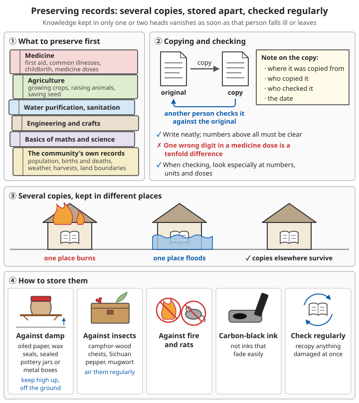

# Education and Knowledge Preservation

## Contents
- [Why this chapter matters](#why-this-chapter-matters)
- [What to teach first](#what-to-teach-first)
- [Teaching children and adults to read](#teaching-children-and-adults-to-read)
- [Teaching arithmetic](#teaching-arithmetic)
- [How to teach a craft](#how-to-teach-a-craft)
- [Running a small school](#running-a-small-school)
- [Writing your own textbooks and manuals](#writing-your-own-textbooks-and-manuals)
- [Copying and preserving records](#copying-and-preserving-records)
- [When there is no paper](#when-there-is-no-paper)

---

## Why this chapter matters

If a craft or a piece of knowledge exists only in the heads of one or two people, it disappears as soon as they fall ill or leave. Many technologies in history were lost this way.

```
For knowledge to be passed on, you need three things:
1. People who can read, write and calculate (so they can learn from books on their own)
2. Records that are written down and well kept (this handbook is one)
3. Someone willing to teach, and someone with time to learn
```

After a disaster and through long hard times, **children's learning must not stop**: regular lessons in themselves help children regain a sense of safety (see Mental Health), and after a few years without school a whole generation's literacy falls markedly.

For psychological support see [Mental Health](../01-first-aid-and-family-health/10-mental-health.md); for the role of "people" in rebuilding technology see [Technology-Rebuilding Roadmap – People](../../../docs/09-进阶科学与工程/00-技术重建路线图.md#36-人).

---

## What to teach first

When time and hands are short, rank things by their effect on survival and health:

```
Level 1 (everyone must know):
- Hand washing, drinking-water hygiene, using latrines (see Sanitation, Water Supply)
- Basic first aid: stopping bleeding, CPR, treating burns, when you must get help
- Safety: fire, water, electricity, poisonous plants and mushrooms, dangerous animals
- The community's emergency plan: assembly points, how to raise the alarm

Level 2 (basic abilities):
- Reading and writing
- Arithmetic: addition, subtraction, multiplication, division, fractions, ratios, measurement
- The local farming calendar and basic methods of growing crops and raising animals

Level 3 (streamed by interest and need):
- Crafts: woodwork, blacksmithing, weaving, pottery, nursing, building... (apprenticeship)
- Science: physics, chemistry, biology (using parts 8 and 9 of this handbook)
```

---

## Teaching children and adults to read

### Features of Chinese characters

```
- Knowing about 2500 common characters lets you read the great majority (about 98%) of everyday text
  Knowing about 3500 characters, ordinary books and newspapers pose almost no difficulty
- Learning Pinyin first helps self-study: look up unknown characters in a dictionary, or read books with phonetic annotation
- Characters are learnt one by one; they must be seen and written again and again, ideally learnt within meaningful words and sentences
```

### Method

```
1. Recognise first, write later: recognising characters is much faster than writing them;
   read a large number first and let writing catch up gradually
2. Start with characters from daily life: the learner's own name and family members'
   names, "water", "fire", "rice", "medicine", "danger", "exit" and so on
3. Learn in sentences: put characters into short sentences, children's rhymes and labels used in daily life
4. Read a lot: once a few hundred characters are known, start reading simple texts and learn new characters while reading
5. Revise every day: revise newly learnt characters the next day, the day after, a week
   later and a month later; this sticks better than learning many at once
6. Writing: trace first, then copy, paying attention to stroke order; write a little every day, not a lot
7. Have learners read aloud and explain to others

Character cards: the character on one side, a picture or Pinyin on the other; children can test each other
Labels around the community: write on the well, latrine, medicine box and dangerous goods, so people see and learn them all the time
```

```
Teaching adults:
- Adults learn more slowly but have clear goals: start with what they need (keeping
  accounts, reading instructions, writing letters, reading medicine labels)
- Never embarrass anyone in front of others; many people who cannot read feel ashamed
- Keep each session short (about half an hour) and keep it up every day
```

---

## Teaching arithmetic

```
1. Start with objects: count with pebbles, beans and small sticks to understand "how many"
2. Place value: ten ones bundled make a "ten", ten tens make a "hundred" (bundling small sticks is most intuitive)
3. Addition and subtraction: first with objects, then in written columns
4. Multiplication: learn the multiplication table by heart (it can be made into a song)
5. Division and fractions: easiest to grasp by sharing things out (sharing flatbread, sharing grain)
6. Ratios and percentages: mixing disinfectant, mixing ingredients, sharing by head
7. Measurement: measuring length, weighing, working out area and volume (see Measurement and Scientific Method)
8. Abacus: once practised, calculation is fast and needs no electricity

✓ Link every problem to real life: how much seed for a plot, how many days a sack of grain feeds how many people
✓ Estimate first, then calculate exactly, and check that the result is sensible
```

For mathematics see [Mathematics](../../../docs/08-基础科学知识/01-数学.md); for the abacus see [Computing and Information – Abacus](../../../docs/09-进阶科学与工程/08-计算与信息.md#11-算盘).

---

## How to teach a craft

### Apprenticeship

Many of the tricks of a craft (smithing, woodwork, pottery, midwifery, farming) can only be learnt by doing; books can only help.

```
Stages of an apprenticeship:
1. Watch: help out and fetch and carry first, watch how the master does it, ask why
2. Do under guidance: do the simple parts while the master corrects you
3. Do simple jobs on your own, checked by the master
4. Do complete jobs on your own
5. Be able to teach the next apprentice → only then is the skill truly mastered

✓ Everyone who holds a key skill takes on at least two apprentices
✓ Several people must know each key skill (midwifery, wound care, ironmaking, water
  purification); never depend on just one person
```

### A general teaching sequence

```
1. Explain: say clearly what is to be done, why it is done this way, and where the dangers are
2. Demonstrate: do the whole thing once slowly, talking as you go
3. Let the learner do it: watch, and correct mistakes at once (any mistake involving safety must stop immediately)
4. Let the learner explain: have them say each step and the reason while doing it → only if they can explain it clearly do they really understand
5. Practise repeatedly, with less and less guidance
6. Check again after a while
```

### Safety

```
- For dangerous work (fire, knives, heights, chemicals, electricity), learn the safety rules first and pass a test before starting
- Assign children's work by age: do not let children use knives, machines, open fire or chemicals on their own
- Record accidents and near misses and discuss together how to avoid them
```

For child safety see [Child Safety](../01-first-aid-and-family-health/14-child-safety.md).

---

## Running a small school

```
With few pupils: one room, one teacher, children of different ages taught together
- Divide them into small groups by level; the teacher teaches each in turn while the others do exercises
- Let older children teach younger ones (explaining it once helps the older child learn it better too)

A day's timetable (example):
- Morning: reading, writing, arithmetic (when attention is best)
- Afternoon: practical lessons: growing vegetables, handicrafts, hygiene, first aid, learning plants and animals, experiments
- Keep each lesson short: about 20-30 minutes for young children, with a break to move about in between

Teaching aids:
- Blackboard: a wooden board painted with black paint made from soot and glue; lumps of lime or white gypsum as chalk
- Sand tray: a shallow wooden tray of fine sand; write with a stick, smooth it over and write again, no paper needed
- Slates, boards, the backs of old paper

✓ Record how far each child has got
✓ Regularly let children show their work in front of everyone (reading aloud, explaining, doing experiments), and encourage them
✓ Adults can have lessons in the evening or in the slack farming season
```

---

## Writing your own textbooks and manuals

Much knowledge exists only in one person's experience. Writing it down is the most valuable thing you can leave to those who come after.

```
Writing an operating manual (how to do something):
1. Begin by stating clearly: what it is for, what materials and tools are needed, what the dangers are
2. Number the steps; one action per step
3. Give quantities and criteria: do not write "add a suitable amount of lye"; write
   "how much per litre of water" and "boil until it looks like this"
4. Write why: knowing the principle lets the reader adjust when conditions change
5. Write down common failures and their causes
6. Draw pictures: the shape of a tool, the posture for a task; one picture is worth many words
7. Have someone who has never done it follow the manual once, see where it is unclear, and revise
8. Add the date and the author; when errors are found later, note the correction

Recording experience:
- Record every trial and every production run: what was used, how it was done, what the result was
- Records of failures are just as important
```

For record-keeping methods see [Measurement and Scientific Method – Recording](../../../docs/08-基础科学知识/00-度量衡与科学方法.md#13-记录).

---

## Copying and preserving records

```
What to preserve first:
✓ Medicine (first aid, common illnesses, childbirth, medicine doses)
✓ Agriculture (growing crops, raising animals, saving seed)
✓ Water purification, sanitation
✓ Engineering and crafts
✓ The basics of mathematics and science
✓ The community's own records: population, births and deaths, weather, harvests, land boundaries

Preserving:
✓ Several copies kept in different places (if one burns or floods, others remain)
✓ Against damp: oiled paper, wax seals, sealed pottery jars or metal boxes; keep them high up, off the ground
✓ Against insects: camphor-wood chests, Sichuan pepper, mugwort; air them regularly
✓ Against fire and rats
✓ Write in carbon-black ink, not inks that fade easily
✓ Check regularly; recopy anything damaged without delay

Copying:
✓ Write neatly; numbers above all must be clear (one wrong digit in a medicine dose is a tenfold difference)
✓ When the copy is finished, have another person check it against the original,
  especially numbers, units and doses
✓ Note on the copy: where it was copied from, who copied it, who checked it, and the date
```

For making paper and ink see [Pottery, Glass and Papermaking – Papermaking](11-pottery-glass-and-papermaking.md#papermaking); for the lifespan of digital records see [Computing and Information – Preserving knowledge](../../../docs/09-进阶科学与工程/08-计算与信息.md#八保存知识-数字资料不可靠).



*Figure: Copying and preserving records: preserve medicine, agriculture, water purification and sanitation first; have each copy checked by another person and marked with its source and date; store several copies separately; protect against damp, insects, fire and rats; check regularly and recopy promptly*

---

## When there is no paper

```
- Rhymes and songs: rhyming, rhythmic material is the easiest to remember and to pass on by word of mouth
  Examples: the multiplication table, the song of the 24 solar terms, first-aid rhymes
- Storytelling: build important lessons into stories
- Carving: carve characters into bamboo strips, wooden boards, potsherds or stone (pottery and stone can last thousands of years)
- Sand trays and slates: for practice, wiped and rewritten again and again
- Regular retelling: have young people tell everyone what they have learnt, and correct anything misremembered at once
```

---

## 📝 Key points on education and knowledge preservation

```
1. Teach hygiene, first aid and safety first, then reading, writing and arithmetic, then crafts as needed
2. Reading: recognise first and write later, learn in sentences, revise every day; about 2500 common characters let you read most text
3. Start arithmetic with objects; link every problem to real life
4. Teaching a craft: explain → demonstrate → learner does it → learner explains → practise repeatedly
5. Several people must know each key skill; every master takes on at least two apprentices
6. Writing manuals: numbered steps, clear quantities and criteria, explain why, draw pictures, have a beginner try it
7. Copy records several times and store them separately; numbers and doses must be checked by someone else
```

---

**Next chapter**: [Record-keeping, Trade and Division of Labour](13-record-keeping-trade-and-division-of-labour.md)
**Back**: [Chapter index](README.md) | [Main contents](../../README.md)
