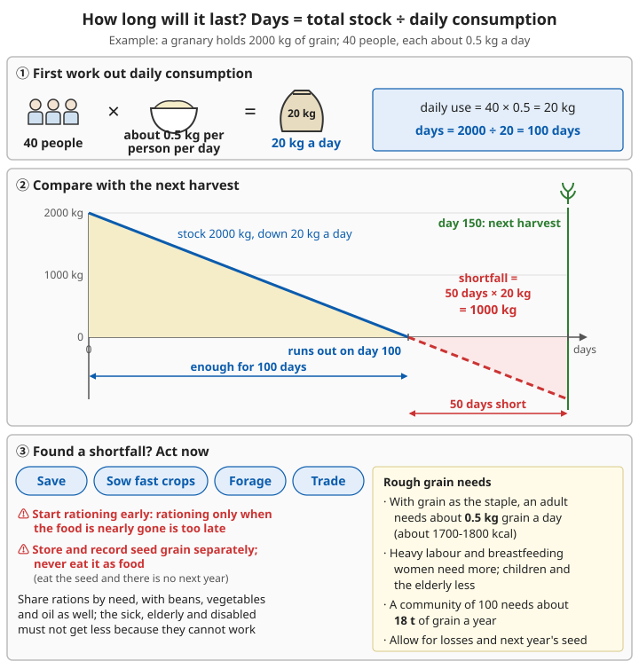

# Record-keeping, Trade and Division of Labour

## Contents
- [First, be clear: what this chapter is for](#first-be-clear-what-this-chapter-is-for)
- [Keeping accounts](#keeping-accounts)
- [Managing stores](#managing-stores)
- [Rationing](#rationing)
- [Trade](#trade)
- [Division of labour and cooperation](#division-of-labour-and-cooperation)
- [Rules and decisions](#rules-and-decisions)
- [Preventing errors and unfairness](#preventing-errors-and-unfairness)
- [Community records](#community-records)

---

## First, be clear: what this chapter is for

A single family can keep track of things in their heads. When tens or hundreds of people live together, how long the grain will last, how much work each person has done and who owes whom what will certainly get muddled unless they are written down; muddled accounts lead to quarrels and even to the group splitting up.

```
This chapter covers the most basic ways for a small community to organise itself in hard times:
- Keeping accounts: how much there is, how much has come in, how much has gone out
- Rationing: how to share fairly when there is not enough
- Trade: exchanging things with others
- Division of labour: who does what, and how work is recorded

Principles:
✓ Open: accounts, stocks and rules are visible to everyone
✓ Simple: the simpler, the fewer mistakes and the easier for people to trust
✓ Written: spoken agreements are easily forgotten and easily disputed; write important things down
```

For the overall strategy for rebuilding a community see [Long-term Collapse Survival – Rebuilding the community](../../../docs/03-野外生存/06-末日求生.md#社区重建).

---

## Keeping accounts

### Daybook: the most basic account

Each time something comes in or goes out, write one line in date order:

| Date | Item | In | Out | Balance | Handled by |
|------|------|------|------|------|--------|
| 1 March | Balance from last month | | | 520 kg | |
| 2 March | Sweet potatoes harvested | 80 kg | | 600 kg | Zhang |
| 3 March | Rations issued (40 people) | | 20 kg | 580 kg | Li |
| 5 March | Traded for salt (to neighbouring village) | | 30 kg | 550 kg | Zhang, Wang |

```
✓ Keep a separate book or a separate page for each kind of thing (grain, salt, fuel, medicines)
✓ Write the unit clearly (kg, L, pieces, bundles)
✓ Record who handled every entry
✓ Do not blot out a mistake: strike it through with one line, write the correct entry beside it, and sign
```

### Regular stocktaking

```
Every week or every month:
1. Physically count and weigh the stock
2. Compare it with the balance in the book
3. If they do not match, find out why: an entry missed? losses (mould, rats)? a miscalculation?
4. Enter the stocktake result in the book, signed by two people
```

### Debts and IOUs

```
Write an IOU for every loan, borrowing and credit:
- Who borrowed from whom, what, how much, when it will be repaid, and with what
- Both parties sign (or put a thumbprint), ideally with a witness
- Two copies, one kept by each party
- When repaid in full, write "repaid in full" on the IOU and both parties sign
```

---

## Managing stores

```
✓ First in, first out: use what came in first; put new stock at the back or underneath
✓ Label every container: contents, quantity, date stored
✓ Keep seed grain separately with its own account, and **never eat it as food** (eat the seed and there is no next year)
✓ Store in several places: do not keep all the grain in one place (against fire, flood, theft and rats)
✓ Check regularly for mould, insects and rats, and deal with problems promptly
✓ Record medicine expiry dates; use those nearest to expiry first
```

For storing food see [Food Processing and Preservation](../../../docs/07-日常生活技能/01-食物加工与保存.md).

### Working out how long it will last

```
Days available = total stock ÷ daily consumption

Example: the granary holds 2000 kg of grain; 40 people, each eating about 0.5 kg a day
  Daily consumption = 40 × 0.5 = 20 kg
  Days available = 2000 ÷ 20 = 100 days
  → 150 days until the next harvest → shortfall = 50 days × 20 kg = 1000 kg
  → Start acting now: save, sow quick-maturing crops, forage, trade
```

```
Approximate grain needs:
- When grain is the staple, an adult needs about 0.5 kg of grain a day (about
  1700-1800 kcal, most of the day's energy needs)
- Heavy manual workers and breastfeeding women need more; children and old people less
- A community of 100 people needs about 18 t of grain a year
- Allow for losses and next year's seed
```



*Figure: Days available = total stock ÷ daily consumption; compare it with the next harvest, and if there is a shortfall act now; start rationing early*

---

## Rationing

When there is not enough to go round, things must be shared out by rules.

```
Principles:
1. Share by need, not equally: heavy manual workers, pregnant and breastfeeding women, growing children and the sick need more
2. Set the rules in advance and make them public so everyone knows them
3. Two people hand out rations together and record them on the spot
4. Start rationing early: waiting until supplies are nearly gone is too late

⚠️ Watch nutrition when rationing: handing out only grain leads to deficiency diseases; also share out pulses, vegetables and oil
⚠️ The sick, the old and the disabled must not get less food because they cannot work
```

Ration register (example):

| Date | Head of household | People | Grain | Salt | Signature of recipient |
|------|------|------|------|------|------|
| 3 March | Liu | 4 | 2.0 kg | 50 g | Liu |

For nutritional needs see [Nutrition and Deficiency Diseases](../../../docs/07-日常生活技能/02-营养与营养缺乏病.md).

---

## Trade

### Common measures

```
The biggest disputes in trade come from "inaccurate measures":
✓ The community keeps one shared set of scales and measures (measuring buckets, measuring cups, rulers), clearly marked
✓ Calibrate them regularly against a known standard: 1 L of water has a mass of 1 kg (see Measurement and Scientific Method)
✓ Both parties weigh and count together, face to face
```

For rebuilding units see [Measurement and Scientific Method – Rebuilding length, mass, volume and time](../../../docs/08-基础科学知识/00-度量衡与科学方法.md#二重建长度质量体积时间).

### Barter

```
- Agree the ratio first: e.g. how much grain for 1 kg of salt, how many days' work for repairing a hoe
- Within the community you can draw up a "reference price list": use one thing everyone
  needs (usually grain) as the unit of account, convert everything else into an amount of
  grain, and write it up publicly
- Prices change (after the harvest grain is plentiful and cheap); adjust them regularly

Trading with outsiders:
- Meet at a fixed place outside the community
- Go in a group; never carry large amounts of supplies alone
- Do not reveal the total size of the community's stores
- Inspect goods face to face: check grain for mould and damp, medicines for expiry date and packaging
```

### Work points and credit

```
A community does not necessarily need "money" internally; accounts can take its place:
- Work points: record what work each person did each day and for how long; take
  work points into account when sharing out
  (while still meeting the basic needs of the old, children and the sick)
- IOUs and credit: the Zhang family helps the Li family build a house for three days;
  record it, and later the Li family pays back three days' work
- Keep records open and check them once a month
```

---

## Division of labour and cooperation

### Skills register

```
1. List what everyone in the community can do: nursing, electrical work, carpentry, cooking,
   farming, driving, teaching, mechanical repair, foreign languages... (many skills never come to mind in ordinary times)
2. List what the community needs done: fetching water, cooking, farming, looking after
   children and the sick, night watch, gathering firewood, repairs, sanitation, accounts, teaching
3. Match people to jobs; where there is a gap (e.g. no one can deliver babies), arrange for someone to learn
```

### Organising work

```
✓ Key jobs need a back-up: at least two people can do each important job
✓ Hard, dangerous and unpopular jobs (cleaning latrines, night watch) are done in turns
✓ Write a duty rota and post it publicly
✓ Hold a short meeting every day (or every week): what was done yesterday, what is to be done today, what problems came up
✓ Every task has one clearly named person in charge
✓ Make sure people rest: long-term overwork leads to illness, accidents and resentment
```

### A common way of forming groups (example)

| Group | Responsible for |
|----|------|
| Water and sanitation | Protecting water sources, purifying water, latrines, rubbish |
| Food | Growing, raising animals, foraging, storage, cooking |
| Medical care | First aid, caring for the sick, managing medicines, disease prevention |
| Building | Housing, repairs, tools, fuel |
| Safety | Fire prevention, night watch, emergency plans |
| Education | Children's lessons, skills training, preserving records |
| Records | Accounts, stocks, archives |

---

## Rules and decisions

```
✓ Write important rules down and make them public so all adults know them
  Examples: no washing clothes near the water source, who keeps the granary key, how things are shared, how breaches are dealt with
✓ Major decisions (moving, accepting new members, using seed grain) are discussed and decided at a general meeting, and recorded
✓ Leave day-to-day matters to the group leaders; not everything needs a meeting
✓ Leaders report to everyone regularly
✓ When there is disagreement: first hear both sides out, find someone with no stake in it to mediate, and deal with it by the rules agreed in advance
✓ When a rule is unreasonable, change it at a meeting rather than each person breaking it
```

---

## Preventing errors and unfairness

```
Keys and books kept apart: the person who holds the storeroom key does not keep the accounts, and the bookkeeper does not hold the key
Two people present: at least two people are present when the store is opened, rations are issued or trade is done, and both sign
Openness: accounts and stocks are posted regularly; anyone may inspect them
Regular rotation: change the people in posts handling money and goods regularly
Regular stocktaking: check the goods against the books

These rules are not about distrusting anyone; they protect the people who handle things: with clear accounts, no one is wrongly accused
```

---

## Community records

```
Records to keep over the long term:
- Population: name, date of birth, family relationships, skills
- Births and deaths: date, cause (death records also help detect infectious disease; see Handling the Dead after Disasters)
- Illness: when, and how many people had which illness (spotting early signs of an epidemic)
- Land: location, area, boundaries of each plot and who farms it (see Surveying and Mapping)
- Harvests: what each plot grew and how much it yielded (compare year by year to improve farming)
- Weather and phenology (see Weather Observation and Forecasting)
- Important decisions and rules

Preservation: make several copies and store them separately (see Education and Knowledge Preservation)
```

Related chapters: [Handling the Dead after Disasters](../../../docs/02-灾难应对/07-灾后遗体处理.md), [Surveying and Mapping – Land measurement and boundaries](../../../docs/08-基础科学知识/08-测量与制图.md#六土地丈量与边界), [Weather Observation and Forecasting – Weather diary](../../../docs/08-基础科学知识/07-天气观测与预报.md#62-天气日记), [Education and Knowledge Preservation – Copying and preserving records](../../../docs/07-日常生活技能/12-教育与知识传承.md#抄写和保存资料).

---

## 📝 Key points on accounts and division of labour

```
1. Record every movement in and out: date, item, quantity, balance, who handled it
2. Take stock regularly, signed by two people; correct mistakes by striking through, never by blotting out
3. Write an IOU for every loan, debt and exchange, signed by both parties with a witness
4. First in, first out; keep seed grain separately and never eat it
5. Days available = stock ÷ daily consumption; start rationing early
6. Ration by need, with rules made public in advance; look after the old, weak, sick and disabled
7. Use common scales and measures, calibrated regularly with 1 L of water = 1 kg
8. Keep a skills register; at least two people for every key job; share dirty and heavy work in turns
9. Keys and books kept apart, two people present, accounts open
```

---

**Next chapter**: [Grain and Oil Processing](../../../docs/07-日常生活技能/14-粮油加工.md)
**Back**: [Chapter index](../../../docs/07-日常生活技能/README.md) | [Main contents](../../../README.md)
