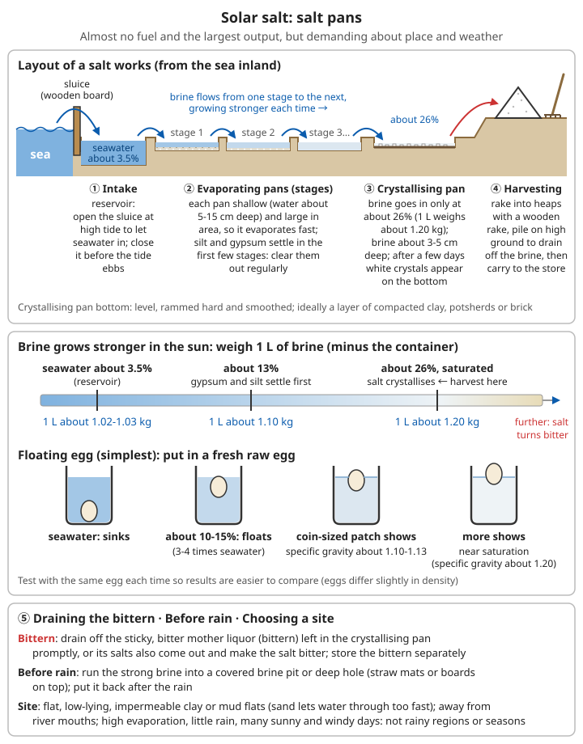

# Salt Making

## Contents
- [First, be clear: why you need to know how to make salt](#first-be-clear-why-you-need-to-know-how-to-make-salt)
- [How much salt is needed](#how-much-salt-is-needed)
- ["Salt" you must not eat](#salt-you-must-not-eat)
- [Salt from seawater: the basic idea](#salt-from-seawater-the-basic-idea)
- [Judging brine strength](#judging-brine-strength)
- [Solar salt: salt pans](#solar-salt-salt-pans)
- [Boiling salt: concentrate first, then boil](#boiling-salt-concentrate-first-then-boil)
- [Inland salt: salt lakes, salt springs, well salt, earth salt](#inland-salt-salt-lakes-salt-springs-well-salt-earth-salt)
- [Purification and bittern](#purification-and-bittern)
- [Iodine: the biggest weakness of home-made salt](#iodine-the-biggest-weakness-of-home-made-salt)
- [Storage](#storage)
- [Safety](#safety)

---

## First, be clear: why you need to know how to make salt

Salt (sodium chloride) is one of the few necessities that **nothing else can replace**. In ancient China salt was a strategic good under state monopoly; inland, where salt was scarce, it could be worth as much as grain or cloth.

```
Uses of salt:
1. People: sodium is essential for body fluids and nerve and muscle function; heavy sweating and diarrhoea lose the most
2. Livestock: cattle, sheep, horses and other grazing animals cannot get enough sodium
   from their feed, and will lick soil and walls and gnaw bones
3. Curing: salted vegetables, cured meat, salt fish, fermented sauces: the main way of preserving food without a refrigerator
4. Tanning: fresh hides are salted first to stop them rotting
5. Soap making: salt added to soft soap separates out hard soap
6. Other: disinfecting fish fry, selecting seed in salt water, cleaning
```

```
⚠️ Safety
1. Industrial salt, sodium nitrite and de-icing salt all look like table salt and can kill
   if eaten by mistake: never eat "salt" of unknown origin
2. The pan for boiling salt holds concentrated brine above 100°C; splashes or a tipped pan cause severe scalds
3. Work in salt pans and on the shore means strong sun and strong glare: guard against heatstroke and sunburn
4. Brine and bittern are not for drinking: label them and keep them away from children
5. Salt you make yourself by evaporation or boiling contains almost no iodine; eating it
   for a long time inland leads to iodine deficiency (see below)
```

**Salvage first, then make your own**: supermarkets, warehouses, restaurants, food factories and livestock farms (feed salt, salt licks) often hold more salt than you would expect. Ordinary table salt keeps for any number of years as long as it is dry and sealed.

---

## How much salt is needed

### People

```
Modern advice: adults no more than 5 g of salt a day (about one level beer-bottle cap)
  → This is an upper limit set because modern diets are "too salty", not a minimum requirement
  → Too much salt raises blood pressure and increases the risk of stroke and heart disease

The body's real minimum need: about 1-2 g of salt a day covers basic needs (when not sweating)

When sweating: sweat contains salt; each 1 L of sweat loses about 1-4 g of salt
(this varies greatly between people, and falls after acclimatising to heat)
  - Heavy work in hot weather can mean several L of sweat a day
  → Then 5-10 g of salt a day is reasonable, but take it with meals and with water, not all at once

Replacing salt after sweating at work:
✓ Salt food normally; soup and salted vegetables are enough to replace it
✓ When sweating very heavily, add a little salt to drinking water (so weak you can hardly taste it)
✓ For diarrhoea or heat illness use oral rehydration salts, made to the recipe; do not add extra salt
✗ Do not swallow salt tablets or chew dry salt; do not drink strong salt water
✗ People with high blood pressure, heart disease or kidney disease, and babies, need little salt
  (add no salt for babies under 1 year)
```

For fluids in heat cramps and heat exhaustion see [Acute Symptoms – Heatstroke](../01-first-aid-and-family-health/05-acute-symptoms.md#heatstroke); for the ORS recipe see [Common Illnesses – Diarrhoea](../01-first-aid-and-family-health/01-common-illnesses.md#diarrhoea).

### Livestock

| Animal | Approximate need | How to feed |
|------|-----------|------|
| Cattle, horses | About 30-60 g per head per day | Salt lick or salt trough, free access |
| Sheep | About 5-10 g per head per day | Salt lick or mixed into feed |
| Pigs | About 0.3-0.5% of feed | Mixed into feed |
| Chickens, ducks | About 0.3% of feed | Mixed into feed; must be mixed evenly |

```
⚠️ Pigs and poultry are very sensitive to salt: feeding them leftovers, salted vegetables or
   salt fish, or giving too little water, easily causes salt poisoning
   (thirst, convulsions, walking in circles, death). Always provide plenty of water when feeding salt
```

For details of animal husbandry see [Livestock Husbandry](../04-farming-and-animal-husbandry/06-livestock.md) and [Poultry Keeping](../04-farming-and-animal-husbandry/05-poultry.md).

### Curing and other uses

```
Salted vegetables: salt about 10-15% of the vegetable weight → 100 kg of vegetables needs 10-15 kg of salt
Cured and salt meat: salt about 6-8% of the meat weight
Pickles in brine: brine strength about 5-8%
Salt fish: as much salt as for meat, or more
Short-term storage of fresh hides: cover the flesh side with coarse salt, about a third to a half of the fresh hide weight
```

For curing methods see [Food Processing and Preservation – Salting](01-food-processing-and-preservation.md#salting); for salting fresh hides see [Textiles, Mending and Tanning – Short-term storage](07-textiles-sewing-and-tanning.md#step-2-temporary-storage-if-you-cannot-tan-straight-away); for adding salt in soap making see [Soap Making – Adding salt to harden](04-soap-making.md#optional-adding-salt-to-harden-it).

### How much salt a community needs in a year (estimate)

```
Example: a community of 50 people keeping 10 cattle, 30 sheep, a few pigs and a flock of chickens

Eaten by people:        50 people × about 6 g a day × 365 days ≈ 110 kg
Salted vegetables:      about 50 kg of salted vegetables per person per year, salt about 10% → about 250 kg for 50 people
Cured meat and fish:    about 50 kg
Cattle:                 10 head × about 40 g a day × 365 days ≈ 150 kg
Sheep:                  30 head × about 8 g a day × 365 days ≈ 90 kg
Pigs, chickens, tanning, soap making, losses: about 50-100 kg

Total: about 700-800 kg, i.e. about 10-15 kg per person per year
→ Conclusion: far more salt goes on curing and livestock than people eat directly
→ A community needs to prepare several hundred kg to a tonne of salt a year; this is worth assigning people to specially
```

For keeping accounts of stocks and rations see [Record-keeping, Trade and Division of Labour – Managing stores](13-record-keeping-trade-and-division-of-labour.md#managing-stores).

---

## "Salt" you must not eat

| Substance | Appearance | Danger |
|------|------|------|
| Sodium nitrite (industrial salt, "nitrite salt") | White or slightly yellowish crystalline powder, very like table salt, slightly salty | A few tenths of a g can poison, a few g can kill: blue lips and nails, dizziness, palpitations, difficulty breathing |
| Industrial salt (for chemical works, dyeing, leather making) | Same as table salt | May contain nitrites, heavy metals and other impurities |
| De-icing salt | White granules, some coloured | Calcium chloride, magnesium chloride, industrial salt or other chemicals; not edible |
| Feed salt, salt licks | Blocks or granules | May contain added minerals or drugs; for livestock only |
| Water-softener salt, regeneration salt (for water purifiers) | Large white granules or flakes | Not made to food standards |
| Earth salt scraped from saline-alkali land | Greyish-white, yellowish, bitter | May contain large amounts of nitrates, nitrites, sulphates (Glauber's salt); must be purified |
| Bagged or loose "salt" of unknown origin | — | Impossible to judge; never eat it |

```
✓ Eat only edible salt of known origin, or salt you have purified yourself from seawater, salt springs or brine wells as described in this chapter
✓ Store industrial salt and de-icing salt separately, clearly labelled "NOT FOOD", and never in the kitchen
✗ Do not try to tell table salt from sodium nitrite by taste: one taste can poison you
✗ Do not drink bittern or brine as salt water or use them to season food

If swallowed by mistake: blue lips, dizziness, difficulty breathing → call 120 at once and get to hospital as fast as possible (hospitals have a specific antidote)
```

For nitrites and other food poisoning see [Food Processing and Preservation – High-risk foods and food poisoning](01-food-processing-and-preservation.md#high-risk-foods-and-food-poisoning) and [Poisoning – Other poisoning](../01-first-aid-and-family-health/12-poisoning.md#other-poisonings).

**Wood ash cannot replace salt.** The lye from soaking wood ash is mainly potassium carbonate (potash), a strong alkali used for making soap and treating maize; eaten, it corrodes the mouth and digestive tract, and it does not supply sodium either. Some plants of the seashore and saline land (such as seepweed, *Suaeda*) taste salty and can be eaten in small amounts as wild vegetables, but the ash from burning them is also alkali, not salt.

---

## Salt from seawater: the basic idea

```
Seawater contains about 3.5% salts: 1 L of seawater holds about 35 g of salts
  - A little over three quarters of this is sodium chloride (about 27 g); the rest is
    magnesium, calcium and potassium salts (the source of bittern)
  - Near river mouths and in the rainy season seawater is diluted by fresh water and
    less salty; take water well away from river mouths, where the tide is clear

Getting salt means driving off the water:
1. Solar evaporation: sun and wind evaporate it; no fuel, but needs a large area and clear, dry weather
2. Boiling: fire evaporates it; not dependent on weather, but uses a great deal of fuel
3. In practice the two are often combined: first concentrate by sun (or by leaching), then boil

As water evaporates, the salts come out one after another, least soluble first:
  Volume evaporated to about 1/4 (strength about 13%) → gypsum (calcium sulphate) and silt settle out first
  Volume evaporated to about 1/9 (strength about 26%, saturated) → sodium chloride starts to crystallise in quantity ← collect this stage
  Further concentration → magnesium sulphate, magnesium chloride, potassium chloride etc. come out and the salt turns bitter ← stop here and drain off the remaining bittern
```

For the principles of solubility and crystallisation by evaporation see [Chemistry – Solubility](../../../docs/08-基础科学知识/03-化学.md#53-溶解度) and [Chemistry – Separation and purification](../../../docs/08-基础科学知识/03-化学.md#八分离与提纯).

**Do not drink seawater directly**; see [Desert Island Survival – Getting water on an island](../03-wilderness-survival/01-desert-island-survival.md#getting-water-on-an-island).

---

## Judging brine strength

The stronger the brine, the heavier it is. At every step of solar evaporation, boiling and leaching you need to know whether the brine is "strong enough".

```
Method 1: weighing (most accurate; use it if you have scales)
  Weigh 1 L of brine (subtract the container weight):
  - Seawater                                    about 1.02-1.03 kg
  - About 13%, gypsum starts to come out        about 1.10 kg
  - About 26%, saturated, salt about to form    about 1.20 kg
  → If 1 L of brine weighs 1.15 kg or more, it is worth boiling; at 1.20 kg, salt will form in the evaporating pan

Method 2: floating egg (simplest)
  - A fresh raw egg sinks in seawater
  - When brine reaches about 10-15% (3-4 times seawater), the egg begins to float
  - The stronger the brine, the more of the egg shows above the surface: with about a
    coin-sized patch showing, the specific gravity is about 1.10-1.13; near saturation
    (specific gravity about 1.20) more shows
  → If the egg floats, the brine is concentrated enough to boil
  → Test with the same egg each time so results are easier to compare (eggs differ slightly in density)
  Salt workers in ancient China tested brine with old lotus seeds; the principle is the same

Method 3: home-made hydrometer
  Plug a small stone into the lower end of a thin bamboo tube so it floats upright; float it
  once in seawater and once in saturated brine, mark the waterline each time, and divide the
  space between into equal graduations (the principle of the traditional Baumé hydrometer)
```

For the principles of buoyancy and density see [Physics – Buoyancy](../../../docs/08-基础科学知识/02-物理.md#45-浮力-阿基米德原理).

---

## Solar salt: salt pans

Solar salt needs almost no fuel and gives the largest output, but it is demanding about place and weather.

```
Suitable places:
✓ Flat, low-lying beaches or tidal flats with impermeable clay or mud underfoot (sand lets water through too fast and will not do)
✓ High evaporation and low rainfall, many sunny and windy days: spring and autumn in northern China, the dry season in the south
✓ Seawater can be let in at high tide; well away from river mouths
✗ Rainy regions and rainy seasons: one heavy shower dilutes the concentrated brine and wastes all the work
```

```
Layout of a salt works (from the sea inland):
1. Intake: open the sluice (a wooden board gate) at high tide to let seawater into the
   reservoir; close it before the tide ebbs
2. Evaporating pans: in several stages, with brine flowing from one stage to the next and growing stronger each time
   - Each pan is shallow (water about 5-15 cm deep) and large in area, so it evaporates fast
   - Silt and gypsum settle on the bottom of the first few stages; clear them out regularly
3. Crystallising pans: brine goes into the crystallising pan only when it reaches about 26% (1 L weighs about 1.20 kg)
   - The bottom must be level, rammed hard and smoothed; ideally lay a layer of compacted clay, potsherds or brick
   - Brine about 3-5 cm deep; after a few days white crystals appear on the bottom
4. Harvesting: rake the salt into heaps with a wooden rake, pile it on high ground to drain off the brine, then carry it to the store
5. Draining the bittern: drain off the sticky, bitter mother liquor (bittern) left in the
   crystallising pan promptly, or its salts will also come out and make the salt bitter; store the bittern separately (see below)

Before rain: run the concentrated brine into a covered brine pit or deep hole (covered with straw mats or boards), and put it back after the rain
```



*Figure: Intake → evaporating pans (in stages) → crystallising pan → harvesting; changes in brine strength (weighing, floating egg); draining the bittern, what to do before rain, and choosing a site*

```
Order of magnitude of output (sunny, dry regions):
  - Each square metre of salt works (including evaporating pans) yields a few kg of salt a year
    (large salt works are designed for about 5 kg/m²; small hand-worked pans are often lower)
  - A community needing 1 t of salt a year → needs roughly several hundred square metres of salt works
  - In rainy regions output is much lower and must be made up by boiling salt
```

For planning salt making around the weather see [Weather Observation and Forecasting](../../../docs/08-基础科学知识/07-天气观测与预报.md).

---

## Boiling salt: concentrate first, then boil

### Why not boil seawater directly

```
Boiling seawater (3.5%) directly: about 28 L of water must be evaporated for 1 kg of salt
  → An open pan over a wood fire is very inefficient: roughly several tens of kg of dry wood for 1 kg of salt
  → A community's salt for a year = several tens of t of wood; almost impossible

Concentrate to about 20% or more before boiling: only about 3-4 L of water needs evaporating for 1 kg of salt
  → Fuel falls to about a tenth: a few kg of dry wood for 1 kg of salt

Conclusion: always concentrate the brine before boiling; use the sun if you can, and leaching if you cannot
```

### Leaching: concentrating with salty beach sand (or wood ash)

This is the traditional method where there are no large clay flats (in ancient China called "scraping earth and leaching brine" or "spreading ash and leaching brine"). It takes less land than salt pans and less wood than boiling seawater directly.

```
1. Choose a level stretch of beach and rake the surface sand or mud loose
   (or spread a layer of clean wood ash or fine sand about 3-5 cm thick on level ground)
2. Splash seawater over it and let sun and wind dry it; when dry, splash again, and repeat for several days
   → The salt stays on the surface of the sand grains; on sunny days you can see a white frost on the surface
3. Scrape up the salty surface layer (about 2-3 cm thick) and pile it by the leaching pit
4. Leaching pit: dig a pit or use a wooden barrel or pottery vat; line the bottom with straw
   and twigs, then a layer of clean sand as a filter; leave an outlet at the bottom with a brine jar beneath
5. Put the salty sand in and pour seawater slowly through it
   → The seawater dissolves the salt off the sand; what flows out at the bottom is strong brine
6. Check with the floating egg or by weighing: only brine that floats an egg goes into the pan
   Brine that is too weak is run through salty sand again
7. Spread the leached sand back on the beach to dry in the sun again, and reuse it in a cycle
```

### Boiling salt

```
Pans:
✓ Iron pans, the wider and shallower the better (large evaporating surface); for large-scale
  production weld or rivet iron plate into shallow trays
✓ Pottery pans and trays can be used too (they were in ancient times), but crack easily and yield little
✗ Do not use lead, galvanised or aluminium pans or containers: concentrated brine dissolves
  harmful metals out of them, and aluminium pans are corroded
✗ Do not use old drums that have held paint or chemicals

Steps:
1. Clarify and filter the strong brine before it goes in the pan (silt and gypsum form a hard scale in the pan)
2. Bring to the boil over a high heat and skim off the scum
3. Keep it boiling, topping up with strong brine as it evaporates to keep the level in the pan
4. When salt flakes appear at the edge and on the surface and crystals settle on the bottom, lower the heat
   → Slow evaporation over a low heat gives larger, purer crystals
5. Lift out the salt with a perforated iron or bamboo ladle and put it in a bamboo basket set above the pan to drain
6. Do not boil the pan dry: the last tenth or so, a sticky, bitter liquid, is bittern; pour it off and store it separately
7. Spread the salt out to dry in the sun or by the fire

Scrape off the hard scale (mainly gypsum) on the bottom of the pan regularly, or heat
transfer suffers and the pan burns out easily
```

```
Fuel estimate (for brine of about 20%):
  - About a few kg of dry wood for each 1 kg of salt
  - A community's 700-800 kg of salt a year → several t of wood, plus the labour that goes with it
  - Saving wood: a stove with a cover that leads the smoke away, a well-built firebox and flue;
    use sun-concentrated brine; set several pans in series so waste heat from the first preheats the brine in the next
  - In ancient Zigong, Sichuan, salt was boiled with natural gas rising from underground; this is a special case
```

For wood-saving stoves and firewood storage see [Lighting and Energy – Safe fuel storage](06-lighting-and-energy.md#storing-fuel-safely).

---

## Inland salt: salt lakes, salt springs, well salt, earth salt

### Salt lakes

```
There are many salt lakes in dry regions such as north-west China, Inner Mongolia and Qinghai-Tibet
  - At some, a thick layer of salt crusts the shore and lake bed; dig it out and you have "rock salt" or "lake salt"
  - Others hold strong brine; dig shallow pans on the shore and evaporate it
⚠️ Not everything in a salt lake is table salt: some are soda lakes (sodium carbonate,
   slippery and astringent), some are Glauber's salt lakes (sodium sulphate, cool and bitter).
   Taste a tiny amount: only purely salty material is table salt; anything bitter,
   astringent or cooling must be purified or abandoned
⚠️ Salt lake shores may have soft mud and hollows under the salt crust; do not go far out alone
```

### Salt springs

```
Some springs and streams are salty (livestock and wild animals often go there to lick; a good clue for finding salt springs)
1. Measure the strength with the floating egg or by weighing
2. Strong brine can be evaporated or boiled directly; weak brine should be concentrated by sun first
3. Wall in the spring so fresh water cannot get in
```

### Well salt: the zhuotong wells of Zigong

Beneath the Sichuan Basin lie brines left by ancient seas and layers of rock salt. People in Sichuan began drilling wells for brine more than two thousand years ago. The ***zhuotong* well** (bamboo-tube well), which appeared in the Northern Song dynasty, was a great invention in the history of drilling:

```
How the zhuotong well works (for understanding only; you are not expected to drill deep wells after a disaster):
1. Percussion drilling: a heavy iron bit is driven by a tilt-hammer beam (like a lever for
   pounding rice), rising and falling to smash the rock; the bit hangs on a rope of split
   bamboo and is turned as it strikes; the borehole is only as wide as a bowl's mouth
2. Bamboo casing: large bamboo tubes with the nodes knocked through are joined and lowered
   into the well to keep out the fresh water and collapses of the upper layers
3. Brine bucket: a long bamboo tube with a leather one-way valve at the bottom:
   as it is lowered, brine pushes the valve open and enters; as it is pulled up, the valve is pressed shut and no brine leaks
4. Derrick and windlass: a tall wooden frame and an ox-driven windlass pull the brine bucket up
5. In the Qing dynasty (1835) the Shenhai well at Zigong reached about 1001 m deep, the deepest in the world at the time
```

For a post-disaster community: existing brine wells and brine pipelines in old salt districts may still be repairable; shallow saltwater wells and salty springs can be worked with the same brine-bucket principle; drilling deep wells needs a great deal of labour, time and experience, and ordinary communities need not attempt it.

### Earth salt: scraping and leaching saline land

On the saline-alkali land of the northern plains and the coast, a white frost (salt bloom) appears on the ground in dry weather. Farmers short of salt in the past often scraped up this soil to boil "small salt" (earth salt).

```
1. Choose the patch with the most obvious white frost and scrape up a thin surface layer of soil in dry weather (less than 1 cm)
2. As in "leaching": put the soil in a leaching pit and pour clean water through it to leach out brine
3. Let the brine stand to clear first, then use it for the purification steps that follow

⚠️ Earth salt has many impurities:
  - Often contains a lot of sodium sulphate (Glauber's salt) and magnesium sulphate, which cause diarrhoea
  - May contain nitrates and nitrites (especially soil near villages, animal pens, cesspits and latrines)
  - May contain local fluoride, arsenic and so on (take extra care in areas with endemic disease)
✓ Scrape soil only well away from villages, animal pens, latrines, graves and rubbish pits
✓ Earth salt must be purified (see the next section); do not eat any that is bitter, cooling or astringent
✓ When sea salt, well salt or lake salt is available, use that first; purify earth salt even when it is for salting vegetables or feeding livestock
```

For how saline-alkali land forms and how to improve it see [Geology, Minerals and Soil – Acidity and alkalinity](../../../docs/08-基础科学知识/06-地质矿物与土壤.md#53-酸碱性).

---

## Purification and bittern

### Purification: dissolve → filter → settle → evaporate again

```
For: grey or yellowish coarse salt, earth salt, caked salt mixed with silt

1. Dissolve: add clean water to coarse salt (about 3 parts water to 1 part salt) and stir until no more dissolves
2. Filter: through cloth, or a basket lined with straw and fine sand, to remove silt
3. Settle: leave overnight for fine impurities to settle, and ladle off the clear liquid on top
   (you can add a little limewater to precipitate the magnesium, then let it settle again: the traditional method)
4. Evaporate again: in the sun or over a low heat
5. Do not evaporate to dryness: stop once most of the salt has crystallised and pour off the remaining mother liquor (which holds most of the impurities)
6. Wash the salt: rinse the crystals with a little clean saturated brine (not fresh water)
   → Saturated brine dissolves no more sodium chloride but washes off the bittern clinging to the crystal surfaces
7. Dry in the sun

For purer salt, repeat once (recrystallisation)
```

```
"Winter separation of nitre" for inland earth salt:
  Glauber's salt (sodium sulphate) and saltpetre become far less soluble in cold water, while table salt hardly changes
  → In winter, leave strong brine outside to cool overnight; the large clear crystals that form at the bottom of the vat are mostly Glauber's salt or saltpetre: lift them out and do not eat them
  → Boil the remaining brine for salt; it will be much less bitter
  (Glauber's salt can be used in dressing hides; see the chapter on textiles, mending and tanning)
```

For the principle of recrystallisation see [Chemistry – Solubility](../../../docs/08-基础科学知识/03-化学.md#53-溶解度).

### Bittern

```
The sticky, bitter liquid left at the end of boiling or evaporating salt: mainly magnesium chloride, magnesium sulphate and potassium chloride

Uses:
✓ It is the "lushui" used to set tofu (firm northern-style tofu)
✓ The magnesium sulphate that comes out in winter and other components of bittern were also used in other crafts in the past

⚠️ Not to be eaten in quantity: a few mouthfuls can cause diarrhoea; drinking a large amount by mistake can cause severe poisoning and even death
⚠️ Keep it in dedicated bottles or jars labelled "BITTERN – DO NOT DRINK", out of children's reach
⚠️ If salt tastes bitter, the bittern has not been fully drained: wash or purify the salt again
```

For setting tofu with bittern see [Food Processing and Preservation – Tofu](01-food-processing-and-preservation.md#tofu).

---

## Iodine: the biggest weakness of home-made salt

```
Inland iodine-deficient areas (mountains and hills far from the sea; historically found in most inland provinces of China):
  - Adults: goitre ("big neck disease")
  - Iodine deficiency in pregnancy: damages the developing brain of the fetus; the child may
    have intellectual disability, short stature, deafness and muteness (cretinism)
    → The damage is irreversible, so pregnant women, babies and young children matter most

Why home-made salt contains almost no iodine:
  - Seawater holds very little iodine, and even less stays in the salt after evaporation or boiling
  - Well salt, lake salt and earth salt usually contain little iodine either
  - Today's iodised salt has potassium iodate specially added at the factory; Chinese national
    standards set its iodine content at about 20-30 mg/kg (as iodine)
```

```
What to do:
1. Stockpile iodised salt: reserve it first for pregnant and breastfeeding women and children
   - An adult eating about 5 g of iodised salt a day meets a day's iodine needs
2. Eat seafood: kelp, nori (laver), sea fish and shellfish are all rich in iodine
   - Coastal communities are rarely short of iodine
   - Inland communities can trade salt or grain with the coast for dried kelp and nori; eating them a few times a week is enough
   - Kelp is very high in iodine; do not eat large amounts every day (too much iodine also causes thyroid problems)
3. Do not use iodine tincture, povidone-iodine or other iodine products for external use in place of iodised salt
4. People with thyroid disease should follow their doctor's advice
```

```
Storing iodised salt (iodine is lost over time):
✓ Sealed, dark, cool and dry: damp, heat and light all slowly drive off the iodine
✓ Use a covered pottery jar or a dark bottle; do not leave it open beside the stove
✓ Add salt to food just before it comes off the heat; avoid long stir-frying or long boiling
✓ First in, first out; rotate stored iodised salt and use it up in time
```

For the symptoms of iodine deficiency and other deficiency diseases see [Nutrition and Deficiency Diseases – Iodine](02-nutrition-and-deficiency-diseases.md#iodine). For extracting elemental iodine from kelp (for disinfection) see [Disinfectant Preparation – Sources of iodine](../06-pharmaceuticals/01-disinfectants.md#22-sources-of-iodine); that is a disinfectant for external use, not a way of getting dietary iodine.

---

## Storage

```
Salt absorbs moisture from the air (salt jars "sweat" in damp weather); once damp it cakes, or dissolves into brine and runs away

✓ Pottery vats, pottery jars or wide-mouthed glass jars with sealed lids; for large stores use vats with the mouth tied tight with oilcloth or waxed paper
✓ Keep in a dry, ventilated place off the ground, not against the foot of a wall or on the floor
✓ Plastic drums, or woven sacks lined with plastic bags, also work; guard against rats gnawing them
✓ Caked salt broken up is still fine to eat; it has not gone off
✓ A small bag of dry-roasted rice or dry charcoal in the jar helps keep out damp
✗ Do not keep salt in iron containers or tinplate cans for long: salt rusts iron quickly and is stained yellow
✗ Do not store with industrial salt, fertilisers, pesticides or de-icing salt

Ordinary (non-iodised) table salt keeps indefinitely as long as it stays dry
For storing iodised salt see the previous section
```

Salt is also an important trade good: communities with sea or salt springs can trade salt for grain, ironware and furs; see [Record-keeping, Trade and Division of Labour – Trade](13-record-keeping-trade-and-division-of-labour.md#trade). For why salt water speeds up rusting of iron see [Chemistry – Rusting](../../../docs/08-基础科学知识/03-化学.md#43-生锈).

---

## Safety

```
Boiling salt:
⚠️ Strong brine boils at a higher temperature than water and scalds deeper when it splashes on skin; large pans of brine tipped over have serious consequences
✓ Build the stove solidly, set the pan level, and leave plenty of room to move around it
✓ Pour brine in slowly down the side of the pan, not from a height
✓ Lift salt out with long-handled tools; wear long sleeves, long trousers and cloth shoes; never go barefoot
✓ Keep children away from the stove and brine pits
✓ Ventilate the boiling house against carbon monoxide; keep it away from woodpiles against fire
✓ If scalded: cool with cold running water at once for at least 15-20 minutes, then treat as a scald

Work on the shore and in salt pans:
⚠️ Salt pans reflect light as strongly as snow; sun plus glare easily causes sunburn, heatstroke and snow-blindness-like eye pain
✓ Wear a wide-brimmed straw hat and light-coloured long-sleeved clothes, and sunglasses if you have them
✓ Avoid heavy work in the hottest part of the day around noon; drink plenty of water and salt your food normally
✓ Walking barefoot in brine dries, cracks and ulcerates the skin: wear straw sandals or rubber boots; wash your feet in clean water after work and rub in oil
✓ If you have cuts on your hands, wear gloves or cover them (strong brine stings in wounds and slows healing)

Other:
⚠️ Cover or fence brine pits, brine wells and leaching pits so children and animals cannot fall in and drown
⚠️ Leave low tidal flats and salt pans at high tide and during storm surges
⚠️ Label brine, bittern and industrial salt; never store them with food or drinking water
```

For treating scalds see [Wound and Injury Care – Scalds and burns](../01-first-aid-and-family-health/02-wounds-and-injuries.md#scalds-and-burns); for heatstroke see [Acute Symptoms – Heatstroke](../01-first-aid-and-family-health/05-acute-symptoms.md#heatstroke); for storm surges see [Ocean Disasters](../02-disaster-response/03-ocean-disasters.md).

---

## 📝 Key points on salt making

```
1. Salvage stored salt first; ordinary table salt kept sealed against damp keeps indefinitely
2. Adults no more than 5 g a day normally; when sweating heavily take a little more with meals and water; do not swallow salt or drink strong salt water
3. Most of a community's salt goes on curing and livestock: about 10-15 kg per person per year
4. Seawater is about 3.5%; always concentrate it by sun or leaching before boiling, saving about nine tenths of the fuel
5. Judge brine strength by weighing (1 L about 1.20 kg = saturated) or the floating egg
6. Do not evaporate to dryness: pour off the bitter bittern at the end and store it separately; use only small amounts for setting tofu; never drink it
7. Dissolve, filter, settle and recrystallise earth salt and coarse salt; do not eat any that is bitter, cooling or astringent
8. Never eat industrial salt, sodium nitrite, de-icing salt or salt of unknown origin, and do not taste them
9. Wood ash is alkali and cannot replace salt
10. Home-made salt contains almost no iodine: keep iodised salt for pregnant women and children; inland communities use kelp and nori for iodine
```

---

**Next chapter**: [Lime and Building Materials](16-lime-and-building-materials.md)
**Back**: [Chapter index](README.md) | [Main contents](../../README.md)
