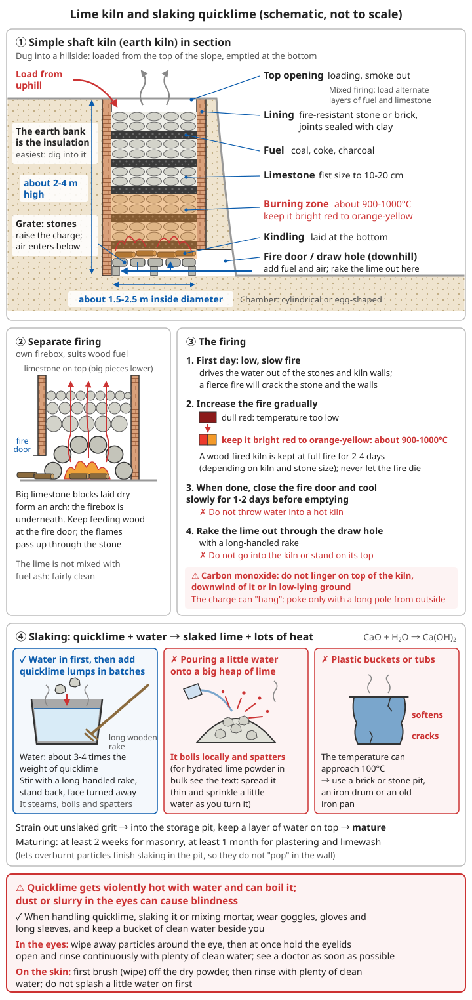

# Lime and Building Materials

## Contents
- [First, what this chapter covers](#first-what-this-chapter-covers)
- [The lime cycle](#the-lime-cycle)
- [Raw materials: which stones can be burnt for lime](#raw-materials-which-stones-can-be-burnt-for-lime)
- [Lime kilns](#lime-kilns)
- [Slaking and maturing](#slaking-and-maturing)
- [Lime mortar and three-part earth](#lime-mortar-and-three-part-earth)
- [Limewashing and disinfection](#limewashing-and-disinfection)
- [Farming and other uses](#farming-and-other-uses)
- [Gypsum](#gypsum)
- [Cement and concrete: salvage first](#cement-and-concrete-salvage-first)
- [Other building materials](#other-building-materials)

---

## First, what this chapter covers

Cement has to be fired at about 1450°C, which a small community will find hard to do well; **lime needs only about 900°C, and a simple earth kiln can make it**. For thousands of years before cement became common, the mortar for laying walls, the white plaster for rendering them, the three-part earth for floors and the disinfectant wash for animal pens all depended on lime. It can also improve acid soil and help with papermaking and tanning.

This chapter covers finding raw materials, burning lime and slaking it, and building with lime and other local materials. For how to build the walls themselves (adobe, rammed earth, earthquake resistance) see [Long-term Housing](05-long-term-shelter.md); for firing bricks and tiles see [Pottery, Glass and Papermaking – Bricks and tiles](11-pottery-glass-and-papermaking.md#bricks-and-tiles); for load calculations see [Engineering Mechanics and Materials](../09-advanced-science-and-engineering/01-engineering-mechanics-and-materials.md).

```
⚠️ Safety
- Quicklime gets violently hot when it meets water, hot enough to boil it; spattered lime
  slurry scalds and burns skin
- Quicklime dust or slurry in the eyes can cause blindness
- Damp quicklime swells and heats up; piled next to wood or hay it can start a fire
- Lime kilns produce carbon monoxide (colourless, odourless and deadly), and the charge
  inside a kiln can collapse
✓ When handling quicklime, slaking it or mixing mortar, wear goggles and gloves and long
  sleeves, and keep a bucket of clean water beside you
✓ Keep children away from lime pits, lime heaps and lime kilns
```

If quicklime gets on the skin: **first brush (wipe) off the dry powder, then rinse with plenty of clean water**; do not splash a little water on first. If it gets in the eyes: wipe away any particles you can see around the eye, then at once hold the eyelids open and rinse continuously with plenty of clean water, and see a doctor as soon as possible. For treating chemical burns see [Wound and Injury Care – Chemical burns](../01-first-aid-and-family-health/02-wounds-and-injuries.md#chemical-burns).

---

## The lime cycle

The beauty of lime is that it "goes round in a circle and turns back into stone":

```
1. Burning (above about 900°C):    CaCO₃ → CaO + CO₂↑
   Limestone (calcium carbonate)    →  quicklime (calcium oxide)

2. Slaking (adding water):          CaO + H₂O → Ca(OH)₂ + a lot of heat
   Quicklime                        →  slaked lime (calcium hydroxide), also called hydrated lime

3. Hardening (in the air):          Ca(OH)₂ + CO₂ → CaCO₃ + H₂O
   Slaked lime absorbs carbon dioxide from the air → turns back into hard calcium carbonate
```

```
Practical conclusions:
- Below about 840°C (with the high CO₂ concentration inside a kiln) limestone decomposes
  extremely slowly, so it must be burnt above about 900°C
- Pure limestone burnt right through loses about 44% of its weight in theory
  (100 kg leaves only about 56 kg)
- Lime mortar hardens by absorbing CO₂ from the air: very slowly (weeks for the outer layer,
  years deep inside a thick wall); parts that stay soaked in water or buried in damp soil
  never harden → use hydraulic mortar (see below)
```

For the chemistry see [Chemistry – The lime cycle](../08-basic-science/03-chemistry.md#44-the-lime-cycle-the-basis-of-building); for why about 900°C is needed see [Advanced Chemistry – Entropy and Gibbs free energy](../09-advanced-science-and-engineering/05-advanced-chemistry.md#22-entropy-and-gibbs-free-energy); for calculating the weight loss see [Chemistry – Calculating with equations](../08-basic-science/03-chemistry.md#32-calculating-with-equations).

---

## Raw materials: which stones can be burnt for lime

| Raw material | Where to find it | Notes |
|------|--------|------|
| Limestone | Limestone hill country, often with caves, stone forests and underground rivers | The most common; off-white or blue-grey; purer stone burns whiter |
| Marble | Areas of metamorphic rock | High purity, makes good lime, but often harder to find than limestone |
| Seashells, snail shells | Shell banks by the sea, lakes and rivers | Traditional coastal "oyster-shell lime"; wash out the salt with fresh water first |
| Dolomite | Found with limestone | Burns to a "magnesian lime" that slakes slowly; still usable |
| Marl (limestone containing clay) | Limestone areas | Burns to a lime with some hydraulic properties, suited to damp places |

```
How to test: a drop of vinegar
1. Put a few drops of vinegar (or dilute hydrochloric acid) on a freshly broken face of the stone
2. Lots of small bubbles at once → limestone, marble, shell (calcium carbonate)
3. No bubbles or very weak ones, but bubbles once the stone is ground to powder
   → possibly dolomite
4. No bubbles at all → not a carbonate; cannot be burnt for lime
   (granite, sandstone, quartz and so on)

Choosing stone:
✓ Even colour, dense, no obvious yellow-brown rust stains or clay layers
✓ Break it into pieces from fist size to 10-20 cm, as uniform as possible
  (big lumps do not burn through, fine chips block the draught)
✗ Stone with a lot of clay or sand: the lime has many impurities and slakes poorly
```

For identifying rocks see [Geology, Minerals and Soil – The three main kinds of rock](../08-basic-science/06-geology-minerals-and-soil.md#1-the-three-main-kinds-of-rock) and [Building and everyday materials](../08-basic-science/06-geology-minerals-and-soil.md#31-building-and-household-materials).

---

## Lime kilns

### Simple shaft kiln (earth kiln)

The simplest lime kiln is an upright "big firebox", often dug into a hillside, loaded from above and emptied from below.

```
Structure (small batch kiln, producing a few hundred kg to a few t of quicklime per firing):
- Kiln chamber: cylindrical or egg-shaped, about 1.5-2.5 m inside diameter, about 2-4 m high;
  digging it into an earth bank is easiest, as the bank acts as insulation; line the inside
  with fire-resistant stones or bricks, with the joints sealed with clay
- Fire door / draw hole: an opening at one side of the base for adding fuel and air,
  and for raking out the lime when the firing is done
- Top opening: for loading and letting smoke out; stones laid across the bottom raise the
  charge off the floor as a grate, so air can come in from below
```

### Two ways of loading the kiln

```
1. Separate firing (own firebox, suits wood fuel):
   Build an arch of large limestone blocks laid dry at the bottom of the kiln; the space
   under the arch is the firebox; fill the kiln above the arch with limestone (big pieces
   at the bottom); keep feeding wood at the fire door, and the flames pass up through
   the stone; the lime is not mixed with fuel ash and comes out fairly clean
2. Mixed firing (layered charge, suits coal, coke and charcoal):
   Lay kindling at the bottom, then load alternate layers of fuel and limestone upwards;
   the fire burns from the bottom up; a continuous kiln has lime raked out at the bottom
   and fresh charge added at the top and can stay alight for a long time; the lime is
   mixed with fuel ash, which does not matter for laying walls or improving soil
```

### The firing

```
1. First day, low, slow fire: drive the water out of the stones and kiln walls;
   a fierce fire will crack the stone and the kiln walls
2. Increase the fire gradually, keeping the inside of the kiln bright red to orange-yellow
   (about 900-1000°C; dull red means the temperature is too low)
   A wood-fired kiln is kept at full fire for 2-4 days (depending on the size of the kiln
   and stones), without letting the fire die
3. When done, close the fire door and let the kiln cool slowly for 1-2 days before
   emptying; do not throw water into a hot kiln
4. Rake the lime out through the draw hole with a long-handled rake; do not go into the kiln
   or stand on its top

How to tell it is burnt through:
✓ Lighter: weigh a sample piece before firing; pure calcium carbonate loses about 44% in
  theory, ordinary limestone about 35-43%; a loss well below this → not burnt through
✓ Break it open: the inside is white or off-white and porous; a hard core the colour of
  the original stone → underburnt; pick it out and burn it again
✓ Add water: sprinkled with a little water it soon hisses, steams, gets hot and crumbles
  to powder; it heats only slowly and the faces look shiny and glassy
  → overburnt (too hot or burnt too long)

Fuel needed (order of magnitude): about 1-2 kg of dry firewood, or about 0.5 kg of coal,
for each 1 kg of quicklime (batch kiln; a continuously fired shaft kiln uses less)
→ A kiln load of a few t of lime takes several t of firewood; cut and dry it a month or two
  in advance; use coal in mixed firing if you have it
```

```
⚠️ Kiln dangers:
- Carbon monoxide: do not linger on top of the kiln, downwind of it or in low-lying ground
  nearby, and do not sleep beside the kiln
- Collapse: the charge often "hangs" (it burns away and slumps underneath while the top
  forms an arch); anyone standing on it or climbing in to poke it can fall into the hot
  chamber; poke only with a long pole from outside; with a kiln dug into a hillside,
  the bank may slip after rain
- Very dusty when emptying: wear goggles and a mask (a damp cloth will do) and stand upwind
```

For kiln draught and refractory materials see [Pottery, Glass and Papermaking – Simple updraught kiln](11-pottery-glass-and-papermaking.md#simple-updraft-kiln) and [Crucibles and firebricks](11-pottery-glass-and-papermaking.md#crucibles-and-firebricks).

**Storing quicklime**: slake it as soon as possible after it comes out of the kiln, or put it in dry, lidded iron drums or earthenware jars kept off the ground; do not pile it on wooden floors or next to haystacks (damp lime heats up and can set them alight), and do not leave it open for long (it slowly loses its strength).



*Figure: A shaft kiln dug into a hillside (mixed firing: alternate layers of fuel and limestone), the stone-arch firebox of separate firing, the four firing steps (keep bright red to orange-yellow, about 900-1000°C; a wood-fired kiln burns for 2-4 days), and slaking by putting the water in first and then the quicklime in batches; for the details of slaking and maturing see the next section*

---

## Slaking and maturing

### Slaking to lime putty (for laying walls and plastering)

```
1. Slaking pit: dig a pit and line it with brick or stone, or use an iron drum or an old
   iron pan
   ✗ Do not use plastic buckets or tubs: the temperature can approach 100°C and plastic
     softens and cracks
2. Put the water in first, then add the lumps of quicklime in batches; use about 3-4 times
   as much water as quicklime by weight (a rule of thumb)
   ✗ Do not pour a little water onto a big heap of lime: it boils locally and spatters
3. Stir with a long-handled wooden rake, standing well back with your face turned away:
   it steams, boils and spatters
4. Strain out unslaked grit through a sieve or bamboo screen into the storage pit;
   keep a layer of water over the surface of the putty to keep air out
```

```
Maturing: leave the lime putty soaking in the pit for a while before use
- At least 2 weeks for laying masonry, at least 1 month for plastering and limewash;
  the longer the better
  (the masonry mortar code JGJ 98 requires a minimum of 7 days; this book uses a safer time)
- Why: overburnt particles slake very slowly; if they go onto the wall unslaked they absorb
  water and swell inside it, pushing out small pits, blisters and cracks in the plaster
  ("lime popping"); maturing lets them finish slaking in the pit
```

### Hydrated lime powder (for spreading on the ground, disinfection and soil improvement)

```
1. Spread lumps of quicklime in a thin layer and sprinkle a little water as you turn them
   (about 40-60 L of water per 100 kg of quicklime, a rule of thumb; enough to turn it to
   dry powder, not to slurry)
2. The lumps heat up, crack and fall to dry powder; then sieve
⚠️ Very dusty: wear goggles and a mask and work upwind
✓ Hydrated lime powder also absorbs CO₂ and slowly loses strength; slake only as much as
  you need and keep it in bags away from damp
```

---

## Lime mortar and three-part earth

### Lime mortar

```
Mix (by volume): lime putty : sand ≈ 1 : 3
- Use clean river sand; wash sea sand in fresh water to remove the salt; mix until it holds
  on a shovel without running off
- Use it within a few days, turning it over again before use; keep it covered so it does
  not dry

Laying: wet bricks, stones and adobe bricks first; joints about 1 cm, completely filled
  with no gaps; stagger the joints between courses
Plastering: base coat 1 : 3 with chopped hemp fibre or straw mixed in (fibre-reinforced
  plaster) to prevent cracking; finishing coat with less sand (about 1 : 1-2), applied thin
  and trowelled smooth; no coat thicker than about 1 cm, and apply the next once the last
  is half dry; keep damp for the first few days and out of strong sun

⚠️ Limits: low strength and slow to harden; suitable for small one- or two-storey houses;
  parts that stay soaked or buried in damp soil (foundations, water tanks, well linings)
  will soften
  → Use dry-laid stone, cement mortar, or the hydraulic mortar below
```

### Hydraulic mortar: making lime harden in damp places too

The ancient Romans mixed lime with volcanic ash from around Pozzuoli in Italy and made a mortar that hardened in seawater and has lasted two thousand years. The principle: the reactive silica and alumina in volcanic ash react with slaked lime to form products similar to those of hydrated cement, **so it hardens without needing CO₂ from the air**.

```
Materials that work like volcanic ash (pozzolans):
✓ Natural volcanic ash, ground pumice (volcanic areas)
✓ Burnt clay powder: clay fired at about 600-900°C and ground fine
  (it can be fired alongside the ware in a pottery or brick kiln)
✓ Fine powder ground from broken bricks, tiles and pottery (red bricks that were not
  overfired work better)
✓ White ash from burnt rice husks or straw (contains silica; results vary with the source)

Rough mix (by volume): lime putty : volcanic ash or brick powder : sand ≈ 1 : 1 : 2
- Try a small batch first: spread it on a brick, cure it for a week, then soak it in water;
  if it does not soften or fall off → usable
- Keep it damp while curing (as with cement)
Uses: foundations, water tanks, the inside of cisterns, wellheads, washrooms, the base of
  walls near the ground
```

Traditionally there was also **sticky-rice mortar**: glutinous rice cooked into a thin paste was mixed into lime mortar. It was used in Ming-dynasty city walls, tombs and sea walls, and is dense and durable. But it uses up food, so do not make it when food is short.

### Three-part earth and lime-stabilised soil

```
Three-part earth (traditional): lime + clay (or loess) + sand (or gravel, broken brick),
  about 1 : 2 : 3 by volume, adjusted to suit the soil
Lime-stabilised soil: hydrated lime powder : clayey soil ≈ 3 : 7 (commonly called
  "3-7 lime soil") or 2 : 8

Method:
1. Sieve the soil and remove grass roots and large stones
2. Mix it evenly with the lime and sprinkle with water until "it forms a ball when squeezed
   and bursts apart when dropped" (as for rammed-earth walls)
3. Lay in layers, each about 15-20 cm loose, and ram firm
4. Do not soak it straight after ramming; keep it damp and let it harden slowly;
   do not load it for a week or two

Uses: indoor floors, drying yards, the bed under foundations, roads, the bottom of cisterns
✓ Far more water-resistant than plain rammed earth; does not get dusty or grow weeds easily
```

For judging the water content and ramming see [Long-term Housing – Rammed-earth walls](05-long-term-shelter.md#rammed-earth-walls); for foundations and footings see [Engineering Mechanics – Foundations](../09-advanced-science-and-engineering/01-engineering-mechanics-and-materials.md#9-foundations) and [Long-term Housing – Good boots: footings](05-long-term-shelter.md#good-boots-the-wall-footing); for the essentials of masonry see [Engineering Mechanics – Masonry walls](../09-advanced-science-and-engineering/01-engineering-mechanics-and-materials.md#72-masonry-walls).

---

## Limewashing and disinfection

### Limewashing walls

```
1. Thin well-matured lime putty with water to a milky wash (a little salt or glue can be
   added so it rubs off less)
2. Sweep the wall clean and dampen it with water
3. Brush on a thin coat with a brush or a bundle of straw; when dry apply another,
   2-3 coats in all; thick coats peel and rub off

✓ Alkaline: kills some of the germs and mould on the wall, and insects dislike hiding in it
✓ White and reflective: brighter rooms, cooler outside walls in summer; cheap, and can be
  renewed every year
```

### Disinfecting animal pens and latrines

```
Milk of lime: 1 kg slaked lime to 4-9 L water (about 10-20%), stirred well; mix fresh
              each time
✓ Brush it on the walls and floors of animal pens and poultry houses; clear out the dung
  and rubbish first, or it will not work well
✓ Foot dips and disinfectant mats at the doors of pens
✓ Dry latrines: after each use, sprinkle a handful of plant ash, dry soil or a little lime
  powder to reduce smell and flies
✓ When deeply burying animals that died of disease, scatter quicklime over the carcass
  before covering it with soil

⚠️ Dry lime powder scattered on dry ground disinfects very weakly and loses its strength
   over time; only wet milk of lime brushed on is effective
⚠️ Human bodies do not need lime scattered on them; see handling bodies after a disaster
```

For dry latrines see [Sanitation – Dry latrines](03-sanitation.md#pit-latrines); for dead animals see [Sanitation – Disposing of dead animals](03-sanitation.md#disposing-of-diseased-animal-carcasses); for human bodies see [Handling Bodies After a Disaster](../02-disaster-response/07-handling-the-dead-after-disasters.md).

---

## Farming and other uses

### Improving acid soil

The red and yellow soils of southern China are mostly acidic, and many crops grow poorly in them. Lime neutralises acidity, adds calcium and makes heavy clay soil a little looser.

```
1. Test the soil first: stir with water and test the acidity with red-cabbage juice or
   test paper (see Geology, Minerals and Soil – Acidity and alkalinity)
   - Do not lime soil that is not acidic; liming alkaline soil makes it worse
2. Amount (order of magnitude): about 750-1500 kg/ha of slaked lime; use the higher figure
   for very acid or heavy clay soils
   - Better too little than too much; do not apply too much at once; test and lime again
     after 2-3 years
   - Quicklime is stronger: use about a quarter less, but it easily scorches seedlings,
     so slaked lime is normally used
3. Timing: spread it when preparing the ground and dig it in evenly; sow or plant
   1-2 weeks later
4. Keep it apart from fertilisers:
   ✗ Do not apply it together with ammonium nitrogen fertilisers (ammonium bicarbonate,
     ammonium sulphate), urea, human waste or farmyard manure: lime turns their nitrogen
     into ammonia gas that escapes, and "burns off" the fertiliser
   → Lime first, then wait about 1-2 weeks before applying manure and nitrogen fertiliser
```

Lime-sulphur (lime and sulphur boiled in water) is a traditional fungicide and insecticide for fruit trees; for how to make it and the strengths to use, follow specialist sources; this book does not go into it.

For testing soil acidity see [Geology, Minerals and Soil – Acidity and alkalinity](../08-basic-science/06-geology-minerals-and-soil.md#53-acidity-and-alkalinity); for using quicklime to clean out fish ponds see [Aquaculture – Preparing the pond](../04-farming-and-animal-husbandry/07-aquaculture.md#pond-preparation).

### Other uses

| Use | How | See |
|------|--------|------|
| Helping water settle | When alum does not form flocs in muddy water, first add a very little limewater; after settling the water must still be filtered and disinfected; never drink limewater | See links below |
| Dehairing hides for tanning | Soak raw hides in limewater for several days; scrape off the hair once the roots loosen | See links below |
| Cooking pulp for papermaking | Boil bark or straw with limewater to dissolve the gummy matter | See links below |
| Alkali treatment of maize | Boil maize kernels with water and a little slaked lime to release niacin and prevent pellagra | See links below |
| Preserving eggs in limewater | Fresh, uncracked eggs submerged in clear saturated limewater keep for several months in a cool place | — |
| Century eggs (pidan) | Traditionally coated in a paste of quicklime, soda ash, salt and tea | ⚠️ Do not add litharge (contains lead) |
| Glass | The lime in the batch makes glass insoluble in water | See links below |

For water treatment see [Water Supply Engineering – Multi-stage treatment](10-water-supply.md#multi-stage-treatment); for tanning see [Textiles, Mending and Tanning – Vegetable tanning](07-textiles-sewing-and-tanning.md#method-2-vegetable-tanning-for-leather-with-the-hair-removed); for papermaking see [Pottery, Glass and Papermaking – Papermaking](11-pottery-glass-and-papermaking.md#papermaking); for maize see [Nutrition and Deficiency Diseases – Niacin](02-nutrition-and-deficiency-diseases.md#niacin-treat-maize-with-alkali-before-eating-it); for glass see [Pottery, Glass and Papermaking – Glass](11-pottery-glass-and-papermaking.md#glass).

---

## Gypsum

Gypsum is another mineral that "sets again after burning". It hardens much faster than lime, setting in a few minutes to half an hour, but it does not stand up to water. For identifying medicinal gypsum and its dose see [Animal and Mineral Medicines – Gypsum](../10-chinese-medicinal-herbs/08-animal-and-mineral-medicines.md#41-shigao-gypsum).

```
Raw material: raw gypsum (calcium sulphate dihydrate, CaSO₄·2H₂O), white or off-white,
  can be scratched with a fingernail, does not bubble with vinegar; common in dry regions,
  around salt lakes and in sedimentary rock beds

Burning gypsum:
1. Break it up and grind it to powder; heat it in an iron pan over a low fire, stirring,
   at around 150°C (far below the temperature for lime)
2. The powder gives off steam as if "boiling"; stop heating when the steam has more or
   less stopped
   → This gives plaster of Paris (hemihydrate gypsum); store it in sealed jars away from damp
   ⚠️ Too hot (several hundred °C) or heated too long and it is "dead-burnt": once water is
      added it sets very slowly or not at all

Use: plaster powder : water about 3 : 2 (by weight); mix to a paste and use within
  a few minutes; it warms and expands slightly as it sets and copies fine detail of a mould
  exactly; use only in dry places

Uses:
✓ Moulds: patterns for casting, slip-casting moulds for pottery (gypsum absorbs water)
✓ Indoor plastering, cornices and decoration; much faster than lime
✓ Setting tofu (use a little food-grade plaster of Paris)
✓ Blackboard chalk

⚠️ Immobilising fractures: plaster casts in hospital are a professional procedure;
  wrapped too tightly they compress blood vessels and nerves and can cause the limb to die,
  and a large mass of setting plaster can get hot enough to burn;
  in first aid and when there is no doctor, splint the limb instead, and check the
  circulation in the fingers or toes regularly
```

For immobilising fractures see [Bone and Joint Injuries – Immobilisation](../01-first-aid-and-family-health/03-bone-and-joint-injuries.md#4-immobilise); for setting tofu see [Food Processing and Preservation – Tofu](01-food-processing-and-preservation.md#tofu).

---

## Cement and concrete: salvage first

Making your own cement needs about 1450°C and precise proportions, which a small community will find hard to do well (for the principle see [Chemistry – Cement and glass](../08-basic-science/03-chemistry.md#49-cement-and-glass)). The most realistic course is to **salvage ready-made cement from ruins, warehouses and building sites**.

```
Salvaged bagged cement:
✓ Usable: loose powder, or only small lumps that crumble in your fingers (sieve before use)
✗ Not usable: hard lumps that do not crumble in your fingers → it has absorbed moisture
  and hydrated and lost its binding power; broken up, it is good only as aggregate
- If you cannot tell how damp it has been, use it only for floors and beds, not for beams
  and floor slabs
- The longer it has been stored, the weaker it is; store it off the ground and away from
  walls, well covered against damp

When cement is limited, give priority to: wellheads and well linings, waterproofing of
  water tanks and cisterns → foundations, damp-proof courses → waterproof latrine floors
  → lintels, ring beams and other key load-bearing parts
  For ordinary walls lime mortar and adobe are enough

Recycled aggregate (broken concrete, broken brick):
1. Break it up (about 2-4 cm to use as gravel, finer as sand); pick out reinforcing steel,
   wood, plastic and plasterboard
2. Wash off soil and dust; broken brick absorbs a lot of water, so wet it before mixing
   concrete
✓ Suitable for floor beds, footings, non-load-bearing walls and road surfaces; for important
  load-bearing structures use natural gravel and sand where possible

⚠️ When demolishing ruins:
- Corrugated asbestos sheets and pipe lagging in older buildings may contain asbestos:
  do not break them up or sweep them dry; wet them and remove them whole, wearing a mask
- Dust from breaking concrete and brick damages the lungs: damp it down with water and wear
  a mask and goggles
- Check the structure of damaged buildings first; do not salvage material from buildings
  that could collapse again at any moment
```

For concrete mix proportions and curing see [Engineering Mechanics and Materials – Concrete](../09-advanced-science-and-engineering/01-engineering-mechanics-and-materials.md#106-concrete); for arches and lintels see [Engineering Mechanics and Materials – Arches](../09-advanced-science-and-engineering/01-engineering-mechanics-and-materials.md#71-arches).

---

## Other building materials

| Material | Key points | See |
|------|------|------|
| Adobe | Clay mixed with straw, moulded and sun-dried; vulnerable to water, needs footings and eaves | Long-term Housing – Adobe walls |
| Rammed earth | Rammed in layers inside formwork; monolithic, but labour-intensive | Long-term Housing – Rammed-earth walls |
| Bricks and tiles | Clay fired at about 900-1000°C; underfired bricks are vulnerable to water | Pottery, Glass and Papermaking – Bricks and tiles |
| Stone | Choose stone without cracks or severe weathering; lay dry or in mortar | Geology, Minerals and Soil |
| Timber | Use once seasoned; keep off the ground to prevent rot and insects | Woodworking and Tool Maintenance – Timber |
| Thatch, reeds | The roof must be steep (about 45° or more) not to leak; a fire risk | — |
| Bamboo | Light and tough; for frames, or woven into walls and plastered with mud; soak in water or smoke after cutting against insects | — |

```
Stone: use stone first for foundations, wall bases, steps and column bases; build stone
  walls wider at the bottom than at the top, with long stones laid through the wall as
  "through-stones" to tie it together; dry-stone walls must be thick, with gaps packed
  tight with small stones
  ⚠️ In earthquake zones, rubble walls without ties and ring beams are dangerous;
     take the same measures as for earth buildings
Thatched roofs: bind dry grass into bundles and lay them in overlapping layers from the
  eaves upwards, about 20-30 cm thick
  ⚠️ Catches fire very easily: the chimney must rise above the roof and stay clear of the
     thatch; keep water nearby
Wattle and daub: weave bamboo strips into wall panels, plaster both sides with straw-mud,
  and limewash when dry; light, and relatively safe in earthquakes
```

For adobe and rammed earth see [Long-term Housing – Adobe walls](05-long-term-shelter.md#adobe-walls) and [Rammed-earth walls](05-long-term-shelter.md#rammed-earth-walls); for earthquake measures see [Long-term Housing – Earthquake resistance](05-long-term-shelter.md#earthquake-resistance-life-or-death-for-earth-houses); for timber frames see [Long-term Housing – Simple timber frames](05-long-term-shelter.md#simple-timber-framing); for timber see [Woodworking and Tool Maintenance – Timber](09-woodworking-and-tool-maintenance.md#timber); for bricks and tiles see [Pottery, Glass and Papermaking – Bricks and tiles](11-pottery-glass-and-papermaking.md#bricks-and-tiles); for rendering outside walls see [Long-term Housing – Rendering outside walls](05-long-term-shelter.md#rendering-the-outside-walls).

---

## 📝 Key points of lime and building materials

```
1. The lime cycle: limestone burnt at about 900°C becomes quicklime → add water to slake it
   to slaked lime → it absorbs CO₂ and turns back into stone
2. Only stone that bubbles with vinegar can be burnt for lime; well-burnt lime is lighter
   (pure stone loses about 44%), has no hard core and gets violently hot with water
3. Quicklime on the body: brush it off first, then rinse with water; wear goggles and gloves
   when handling it; do not slake it in plastic buckets
4. Lime kilns carry carbon monoxide and collapse hazards: do not go into the kiln or onto
   its top; work only with long poles
5. Lime putty must be matured: at least 2 weeks for walling, at least 1 month for plaster,
   or the wall surface will "pop"
6. Lime mortar about 1 : 3; in damp places add burnt clay powder, brick powder or volcanic
   ash to make hydraulic mortar
7. Ram three-part earth and lime-stabilised soil in layers for floors and foundation beds
8. Brush milk of lime on animal pens, latrines and walls; when improving acid soil, test
   first, use little, and keep it apart from manure and nitrogen fertiliser
9. Heat gypsum at about 150°C to make plaster of Paris; it sets in minutes; use it for moulds
   and plastering; it does not stand up to water
10. Salvaged cement that has set into hard lumps is useless; give limited cement first to
    wells, water tanks, foundations and key load-bearing parts
```

---

**Next chapter**: [Rope and Knots](17-rope-and-knots.md)
**Back to**: [Part contents](README.md) | [Main contents](../../README.md)
