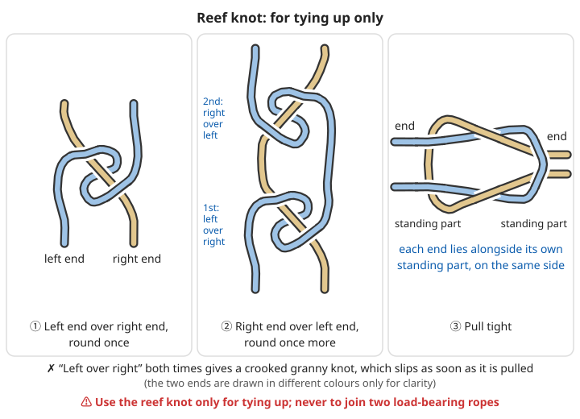
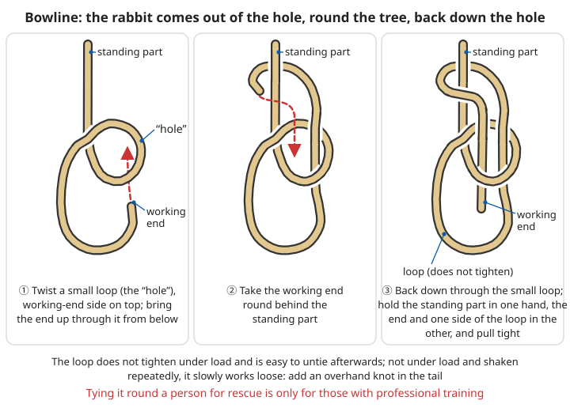
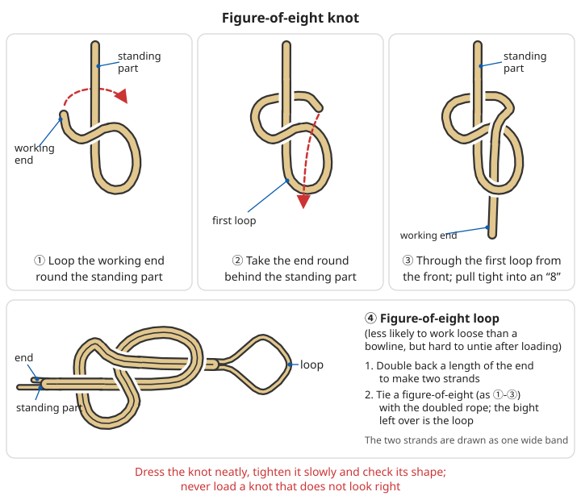
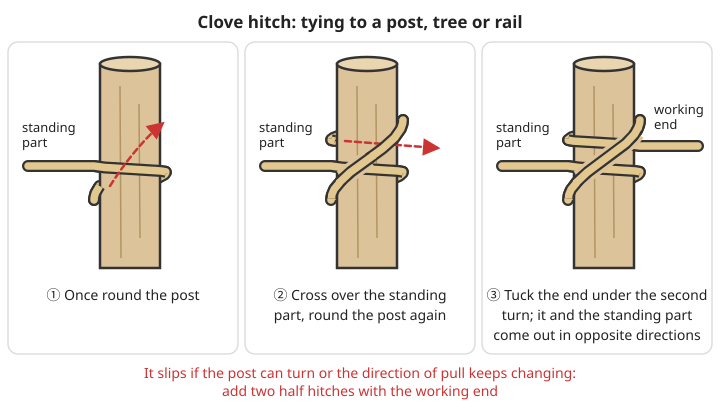
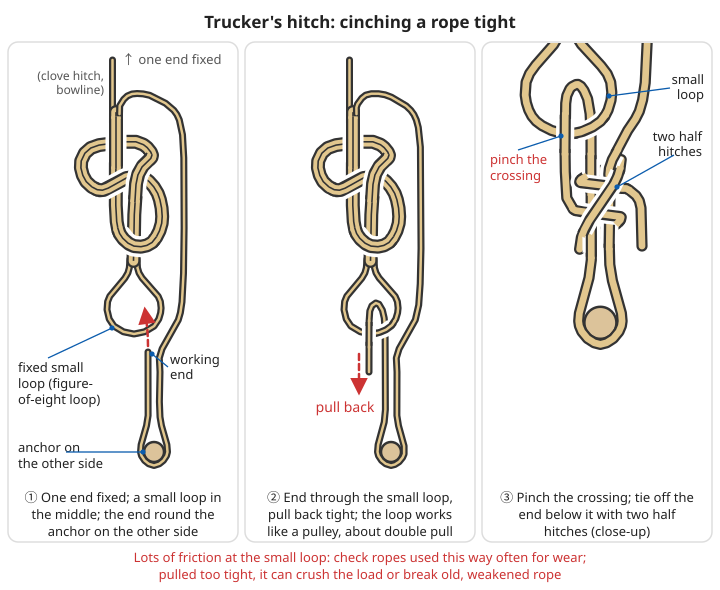

# Rope and Knots

## Contents
- [First, what this chapter covers](#first-what-this-chapter-covers)
- [Where fibre comes from](#where-fibre-comes-from)
- [Twisting and making rope](#twisting-and-making-rope)
- [How much can a rope hold?](#how-much-can-a-rope-hold)
- [Common knots](#common-knots)
- [Finishing rope ends and splicing](#finishing-rope-ends-and-splicing)
- [Uses of rope: securing loads, building, hoisting, drawing water](#uses-of-rope-securing-loads-building-hoisting-drawing-water)
- [Care and storage](#care-and-storage)
- [Safety](#safety)

---

## First, what this chapter covers

Tying firewood, tethering animals, putting up shelters, raising well water, securing loads, hauling timber: rope is needed almost every day. [Basic Survival Skills](../03-wilderness-survival/00-basic-survival-skills.md#knots) lists the few knots most used in the wild; this chapter is more systematic: where rope comes from, how much force it can take, how to tie a dozen or so common knots, and when not to use them.

```
⚠️ Safety:
- A rope that breaks snaps back violently and can injure the eyes and face; do not stand
  in line with a loaded rope, and do not stand inside a loop of rope
- Home-made plant-fibre rope varies enormously in strength; use it only for tying, hauling,
  drying lines and other jobs where "nobody gets hurt if it breaks"
- ☠️ Do not use home-made rope for climbing, abseiling or rescue at height; without proper
  dynamic rope, a harness and training, do not attempt rope rescue
- Wear gloves when hauling or paying out rope: rope sliding fast through your hand can
  strip the skin off your palm
- Loops and running nooses around children and animals are a strangulation hazard
```

For the principles of rescue and climbing in the wild see [Mountain Survival – Falls](../03-wilderness-survival/05-mountain-survival.md#falls) and [Crossing rivers](../03-wilderness-survival/08-river-crossing-flash-floods-and-hypothermia.md#wading-across-rivers) (do not tie the rope to someone crossing a river).

The most realistic course: **salvage first**. Nylon rope, polyester rope, wire rope, electric cable and bicycle inner tubes from the ruins are all far stronger than anything you can twist yourself. Use home-made rope to cover everyday consumption.

---

## Where fibre comes from

| Material | How to get it | Strength | Durability | Good for |
|------|--------|------|------|------------|
| Ramie | Strip the stem bark, scrape off the outer skin, dry | Very high | Water-resistant, fairly rot-resistant | All load-bearing rope, fishing nets, sewing thread |
| Hemp | Ret, then strip the bark | Very high | Fairly rot-resistant | Heavy rope, hawsers (⚠️ growing it is regulated) |
| Jute, sisal | Retting / scrape the leaf pulp to get the fibre | Medium (sisal higher) | Jute rots easily when damp; sisal more durable | Sacks, tying cord |
| Inner bark of lime (linden), paper mulberry, elm | Strip bark in spring and summer, take the inner bast layer, soak and ret until soft | Medium | Lime bast fairly water-resistant | Tying cord, straw sandals, weaving |
| Palm fibre (from the windmill palm) | Peel the fibrous sheaths off the trunk and tear into strands | Medium | Very water- and rot-resistant | Well ropes, mooring lines, brooms, rain capes |
| Rice straw, wheat straw | Choose long, unbroken stalks and pound them soft | Low | Rots in about one season | Temporary bundling of firewood and rice, straw rope to protect trees |
| Bamboo strips | Split into thin strips | High (in tension) | Fairly water-resistant, but breaks when bent sharply | Bamboo cables, baskets, lashing |
| Rattan, vines (rattan, kudzu etc.) | Use whole or split | Medium-high | Brittle when dry | Lashing furniture, fences, baskets |
| Rawhide strips | Cut rawhide into long spiral strips | High | Softens when soaked; rats gnaw it | Tie on wet; it shrinks tight as it dries (binding tool handles) |
| Animal sinew | Dry the back sinews of cattle or deer and tear into strands | Very high | Vulnerable to damp | Bowstrings, sewing thread, fine binding |
| Salvaged nylon, polyester, polypropylene rope | Unpick old ropes, old nets, woven sacks | Very high | Does not mind water or go mouldy; degraded by sun | Every important use |
| Electric cable, network cable, inner tubes | Strip out the wires / cut into rubber strips | Medium | Plastic sheathing goes brittle after long sun | Binding, tying, temporary fixing |

```
Choosing material:
✓ The longer the fibre the better: long fibres mean fewer joins and stronger rope
✓ For rope that stays in water (well ropes, mooring lines, fishing nets): palm fibre, ramie
  and nylon first; not straw or jute
✓ Exposed to wind and sun: natural fibres rot, synthetic fibres go brittle in the sun;
  check both regularly
✓ Bamboo strips and rattan can only be pulled in a straight line; they cannot take tight
  knots or sharp bends
✓ Rawhide strips are tied on wet and shrink tight as they dry; good for binding axe handles
  and spearheads; they loosen when damp
✗ Rotten, blackened bark that snaps when tugged: do not use it
```

For retting and combing hemp and bark see [Textiles, Mending and Tanning – Preparing fibre](07-textiles-sewing-and-tanning.md#preparing-the-fibre); for treating hide strips see [Tanning](07-textiles-sewing-and-tanning.md#tanning); paper mulberry bark is also a papermaking material, see [Pottery, Glass and Papermaking – Papermaking](11-pottery-glass-and-papermaking.md#papermaking). ⚠️ Growing hemp is regulated in China; ramie or flax can be used instead.

---

## Twisting and making rope

### The principle: twist in opposite directions so it holds together

```
A bundle of fibres twisted tight wants to "untwist" (come loose)
Lay two strands that have each been twisted tight in the same direction side by side,
then twist them together in the OPPOSITE direction:
  → each strand's urge to untwist makes the two strands grip each other tighter
  → when you let go, the rope does not come apart

Rule: the twist of the strands is opposite to the twist of the rope
  (the twist of the yarn is also opposite to that of the strand: the layers alternate)
```

Spinning thread on a spindle and plying work the same way; see [Textiles, Mending and Tanning – Spinning](07-textiles-sewing-and-tanning.md#spinning).

### Hand-twisting two-strand cord (no tools at all)

```
1. Take a bundle of fibre (or bark strips) and fold it at about 1/3 of its length
   (not exactly in the middle)
   → one strand is long and one short, so later joins are staggered and never fall
     at the same place
2. Pinch the fold between the fingers of your left hand
3. With your right hand, twist the strand further from you tight, turning it away from you
   (until it wants to kink)
4. Lay this twisted strand over the other one towards you, so it becomes the near strand
5. The other strand is now the far one: twist it tight away from you and lay it over too
6. Repeat: every strand is "twisted outwards, laid inwards"; keep moving your left hand
   forward to hold the cord you have just made
7. The finished cord should be firm and even, with no slack places

Rolling on your thigh (faster):
  Lay the two strands flat on your thigh and push your palm forward so each strand
  twists tight;
  then draw your palm back so the two strands twist round each other; repeat
```

### Splicing in new fibre

```
1. When one strand has only about 5 cm left, take a small new bundle of fibre
2. Thin one end of the new bundle (spread it into a taper) and overlap it with the old
   strand by 5-10 cm
3. Twist them tight together and carry on; the overlap gets twisted in
4. Stagger the joins in the two strands by at least a few cm; never join both at the same place
5. When finished, trim off the loose ends sticking out (without cutting into the rope)
✓ Add the same amount of new fibre as was there before, to keep the thickness even
```

### Three-strand rope and a simple rope-making machine

Three-strand rope is rounder, stronger and more hard-wearing than two-strand cord, and is the standard way to make well ropes and hawsers.

```
Rope-making machine (one person turns, one watches):
- Crank end: a board drilled with 3 holes, each holding a crank with a hook
  (or one handle that turns all 3 hooks at once; 3 hand drills can also be used instead)
- Tail end: a single hook that turns freely, mounted on a movable post or heavy weight
- Top (laying tool): a wooden cone with 3 grooves cut in its side

Steps:
1. Run the yarn back and forth between the 3 hooks at the crank end and the single hook at
   the tail end, making 3 strands of the same length
2. Turn the crank so all 3 strands twist in the same direction, until they kink by
   themselves when slackened a little
3. Put the top between the 3 strands near the tail end, one strand in each groove
4. Release the single hook at the tail end: it turns in the opposite direction, and the
   3 strands twist together into rope behind the top by themselves
5. Keep turning while slowly pushing the top towards the crank end; the tail end is drawn in
   → The rope ends up about 1/4-1/3 shorter than the strands; allow enough length when
     preparing the yarn
6. When the twist reaches the end, bind both ends tight, hang the rope up stretched straight
   and let it set for a few days
```

### Braiding

```
Three-strand plait: left strand over to the middle, right strand over to the middle, repeat;
  suits straw, bamboo leaves, hide strips and old strips of cloth
Four-strand round braid: rounder and stronger; good for whips and animal reins
✓ Braiding needs no twist in the fibre; short fibres and flat materials work too
✓ Salvaged plastic bags and woven sacks cut into strips and braided make decent tying cord
```

---

## How much can a rope hold?

### Thickness and strength

```
Strength is roughly proportional to cross-sectional area, i.e. to the square of the diameter:
  Double the diameter → about 4 times the strength
  Halve the diameter  → only about 1/4 of the strength

1 kN is roughly the force needed to hold a 100 kg weight hanging still
```

### Breaking strength of common ropes (rough order of magnitude)

These are estimates for new rope about 10 mm in diameter; similar products can differ by a factor of two or more, so **go by the rating on the actual product**, and test home-made rope yourself.

| Rope | Breaking strength (approx.) | Characteristics |
|------|---------------|------|
| Home-made straw or bark rope | 0.5-2 kN | Varies enormously; for tying only |
| Cotton rope | 1-5 kN | Soft, goes mouldy easily |
| Fibre rope (manila, sisal) | 6-7 kN | Little stretch, prone to mould and rot |
| Polypropylene rope (the common coloured plastic rope) | 9-15 kN | Floats on water; the most sensitive to sun |
| Polyester rope | 13-18 kN | Little stretch, fairly good sun resistance |
| Nylon rope | 18-25 kN | Very stretchy; about 10% weaker when wet |
| Wire rope | 50-60 kN | Discard if wires are broken, kinked or corroded |
| Paracord (about 4 mm diameter) | About 2 kN | The inner core can be pulled out for fine thread |

### Safety factor: use only a small fraction of the breaking strength

```
Conservative rules (better too thick a rope than too thin):
- Carrying people, people underneath, or would hurt someone if it broke: use only about
  1/12-1/15 of the breaking strength (or less)
- Hoisting goods: no more than about 1/5
- Tying, drying lines, anything where breaking does not matter: up to about 1/3

Then reduce further for:
- Knots: a knot leaves only about half to seven-tenths of the strength; count it as half
- Damp: natural fibres lose a great deal of strength once mouldy; nylon loses about 10%
  when wet
- Sun: synthetic fibres go stiff and brittle after a few months to a year or two in the sun;
  polypropylene fastest
- Wear: if the outer layer is furry or strands are broken, count it as less than half
  of a new rope
- Shock loads: when something falls and jerks the rope taut, the force can be several times
  its weight

Example: a new nylon rope with a breaking strength of about 20 kN; knotted, count it as 10 kN;
         for hoisting goods use 1/5 → about 2 kN, i.e. hoist at most about 200 kg
```

For the general principles of safety factors see [Engineering Mechanics and Materials – Safety factors](../../../docs/09-进阶科学与工程/01-工程力学与材料.md#34-安全系数).

### Checking whether a rope is fit to use

```
✓ Run your hand along the whole rope: are there places that are thinner, stiffer, softer
  or lumpy?
✓ Twist it open in several places to look inside: natural fibre that is black, powdery or
  smells mouldy inside → discard
✓ Synthetic fibre with a whitish, chalky surface that sheds bits when scraped
  → damaged by the sun
✓ Any place that has melted, been scorched or soaked in chemicals (acid, alkali, petrol)
  → cut it out or discard the rope
✗ Old rope of unknown origin that has been stored for years: never use it to bear a load
```

---

## Common knots

A good knot is **quick to tie, does not slip under load and is easy to untie afterwards**. Practise each knot at home over and over until you can tie it with your eyes shut. Below, the "working end" is the free end and the "standing part" is the part that takes the load.

```
General points:
✓ When tied, dress the knot neatly, tighten it slowly and check that its shape is right
✓ Leave a tail at least 10 times the rope's diameter
✓ Slippery nylon and new rope come undone more easily; for important knots add a half hitch
  or an overhand knot in the tail
✓ Do not use a knot you do not recognise, or one that does not look right, to bear a load
```

### Reef knot: for tying up only

```
Uses: tying bandages, closing sacks, tying bundles of firewood, tying shoelaces (slipped)
How to tie:
1. Left end over right end and round once (like the first step of tying shoelaces)
2. Right end over left end and round once more
3. Pull tight: each end should lie alongside its own standing part, both coming out on the
   same side
✗ "Left over right" both times gives a crooked "granny knot" that slips as soon as it is pulled
⚠️ Do not use a reef knot to join two load-bearing ropes: if they are of different thickness,
   very slippery or shaken about, it capsizes and comes undone
```

Use the reef knot only for tying up (as in [Basic Survival Skills – Knots](../03-wilderness-survival/00-basic-survival-skills.md#knots)); to join ropes under load use the sheet bend or fisherman's knot below.



*Figure: The two ends are drawn in different colours only for clarity. Pulled tight, each end lies alongside its own standing part and both come out on the same side; "left over right" twice gives a granny knot, which slips as soon as it is pulled*

### Sheet bend: joining two ropes of different thickness

```
Uses: joining two ropes (especially one thick and one thin), tying a rope to the corner
      of a cloth
How to tie:
1. Fold the end of the thicker rope into a U (a bight)
2. Pass the thinner rope up through the U from underneath
3. Take the thinner rope round the back of the U, around both legs of the U together
4. Tuck the thinner rope under itself (between the thin rope and the U), not into the U
5. Pull tight: both tails should be on the same side
✓ If the ropes differ greatly in thickness or are very slippery, go round twice in step 3
  (double sheet bend)
⚠️ It works loose easily when not under load; reinforce it where it will be shaken about
```

### Bowline: a loop that does not tighten

```
Uses: a fixed loop at the end of a rope to drop over a post or tree; tethering animals
      (the loop will not tighten); hanging a bucket
How to tie (the rhyme: the rabbit comes out of the hole, runs round the tree, and goes back
down the hole):
1. Twist a small loop in the standing part, with the part on the working-end side on top
   (the "hole")
2. Bring the working end up through the small loop from underneath
   ("the rabbit comes out of the hole")
3. Take the working end round behind the standing part ("runs round the tree")
4. Pass the working end back down through the small loop ("goes back down the hole")
5. Hold the standing part in one hand and the working end and one side of the loop in the
   other, and pull tight
✓ Easy to untie even after loading
⚠️ Not under load and shaken repeatedly, it slowly works loose: add an overhand knot in the tail
⚠️ Tying it round a person for rescue is only for those with professional training;
   see the safety notes at the start of this chapter
```



*Figure: In the small loop (the "hole") the working-end side lies on top; the working end comes up through the small loop, goes round behind the standing part, then back down through the small loop; pull tight*

### Figure-of-eight: stopper knot and figure-of-eight loop

```
Stopper knot (stops the end slipping out through a hole or pulley):
1. Make a loop with the working end round the standing part
2. Take the working end round behind the standing part
3. Pass the working end through the first loop from the front and pull tight
   → it forms an "8"

Figure-of-eight loop (less likely to work loose than a bowline, but hard to untie after loading):
1. Double back a length of the end to make two strands
2. Tie a figure-of-eight knot with the doubled rope; the bight left over is the loop

Figure-of-eight follow-through (when the loop must go round a closed object such as a tree or ring):
1. Some distance from the end, tie a loose figure-of-eight in the single rope
2. Take the working end round the object
3. Feed the working end back through the original figure-of-eight, retracing its path,
   the two strands parallel and not crossing
```



*Figure: ①-③ stopper knot; ④ the figure-of-eight loop is the same figure-of-eight tied with the doubled rope; in the drawing the two strands are shown side by side as one wide band*

### Clove hitch: tying to a post

```
Uses: tying a rope to a post, tree or rail; starting and finishing lashings
How to tie:
1. Take the rope once round the post
2. Cross it over itself (the standing part)
3. Take it round the post a second time
4. Tuck the working end under the second turn, so it and the standing part come out of
   the middle in opposite directions
5. Pull tight
✓ To drop it over the top of a pole: make two loops in the same direction, put the second
  behind the first, and slip them on
⚠️ It slips if the post can turn or the direction of pull keeps changing: add two half
   hitches with the working end
```



*Figure: Seen from the front of the post, the second turn crosses diagonally over the standing part; the standing part and the working end both come out from under this diagonal turn, in opposite directions*

### Rolling hitch: does not slip even when pulled along the pole

Names vary from place to place, and some books also call the clove hitch a "rolling hitch". In this chapter the rolling hitch means a clove hitch with an extra turn, which can take a pull along the length of the pole.

```
Uses: pulling along the line of a pole or thick rope (pulling down an upright post,
      putting a "handle" on a rope that is under load)
How to tie:
1. Take the working end once round the pole, over the standing part
2. Make a second turn, over the first, with both turns on the side of the standing part
   towards the pull
3. Take the working end across the standing part to the other side and make a third turn
4. Tuck the working end under the third turn and pull tight
✓ It only holds when pulled towards the side with the two turns; decide the direction
  of pull before you tie it
```

### Timber hitch: hauling and lifting logs

```
Uses: dragging logs, lifting a bundle of bamboo poles or firewood, lifting long objects
How to tie:
1. Take the rope once round the log
2. Take the working end round the standing part once, then wrap it 3-5 times round itself
   along the loop
3. Pull the standing part; the loop tightens and bites on the log
4. When dragging a long log, add a half hitch at the front end of the log (a turn of rope
   trapped under itself) so the log does not swing sideways
✓ It falls open as soon as the load comes off; very easy to untie
```

### Fisherman's knot: joining two ropes

```
Uses: joining two ropes of similar thickness, especially thin, slippery nylon cord and
      fishing line
How to tie:
1. Lay the two ends alongside each other, pointing in opposite directions, overlapping
   for some distance
2. Tie an overhand knot with the first end round the second rope
3. Tie an overhand knot with the second end round the first rope, in the opposite direction
4. Pull both standing parts; the two overhand knots slide together and jam
✓ An extra turn in each overhand knot (double fisherman's knot) is more secure;
  use the double fisherman's for important jobs
⚠️ Very hard to untie after loading; use it for permanent joins or loops
```

### Taut-line hitch: adjustable tension

```
Uses: guy lines for tents and tarpaulins, washing lines; tension can be adjusted at any time
How to tie:
1. Take the rope round a peg (or tree) and bring the working end back
2. Inside the loop, wrap the working end twice round the standing part, working towards the peg
3. Take the working end across these two turns and make one more turn round the standing
   part on the outside
4. Tuck the working end under this turn and pull tight
5. Slide the knot to adjust the tension; under load it grips and stays put
✓ With very slippery rope, add an extra turn in step 2
```

### Prusik knot: gripping another rope

```
Uses: making a movable grip on a rope; stopping a rope slipping back while you tension it
Needs: a loop of thin cord, about half to 2/3 the diameter of the main rope
How to tie:
1. Lay the cord loop over the main rope
2. Pass one end of the loop through the other end, wrapping it once round the main rope
3. Repeat, 3 wraps in all, lying neatly side by side
4. Under load it grips and holds; unloaded it can be pushed along
✓ The more slippery the main rope, the more wraps
⚠️ Use only for hauling loads and tensioning ropes; using it for ascending, descending or
   belaying is climbing technique: do not do it without training
```

### Trucker's hitch: cinching a rope tight

```
Uses: securing loads on carts, boats and pack frames; tensioning washing lines, fence wire
      and tent ridge lines
How to tie:
1. Fix one end of the rope on one side (clove hitch, bowline)
2. Make a fixed small loop in the middle of the rope (a figure-of-eight loop is simplest)
3. Take the working end round the anchor point on the other side (hook, side of the cart,
   post) and bring it back
4. Pass the working end through the small loop and pull back: this works like a pulley,
   roughly doubling the pull
5. Once tight, pinch the crossing point and tie off the working end below it with two
   half hitches
✓ There is a lot of friction at the small loop; check ropes used this way often for wear
⚠️ Pulled too tight it can crush the load or break old, weakened rope
```



*Figure: The small loop is a figure-of-eight loop (the two strands drawn as one wide band); ③ is a close-up of the lower part after tightening and tying off with two half hitches*

### Sheepshank: shortening a rope or bypassing a damaged section for now

```
Uses: a rope that is too long but you do not want to cut; temporarily bypassing a worn
      section in the middle
How to tie:
1. Fold the rope into a "Z" of three parallel parts, with the worn section in the middle part
2. Bight at one end: make a half hitch (small loop) in the standing part next to it and
   slip it over the bight
3. Bight at the other end: the same
4. Pull both ends tight
⚠️ It is stable only while under constant load and falls apart once slack; use it only as a
   temporary emergency measure, and replace the rope when you can
```

### Slip knot and running noose

```
Slip knot (slipped overhand): comes undone with one pull on the end
1. At the last step of an overhand knot, do not pull the end right through; pull it through
   as a small bight
2. Pull the end of this bight and the knot falls apart
✓ For places where it must come undone fast: mooring boats, tethering animals, closing sacks

Running noose (a loop that tightens, like a lasso):
1. Tie a small fixed loop at the end of the rope (bowline or figure-of-eight loop)
2. Pass the standing part through the small loop to make a large loop
3. Pull the standing part and the large loop tightens
☠️ Never put it round the neck of a person or animal; lead animals with a halter or a fixed
   loop tied to the horns or a leg
☠️ Keep running nooses and loops away from children; do not hang them where a child can reach
```

---

## Finishing rope ends and splicing

### Stopping rope ends fraying

```
Whipping (the most widely useful):
1. About 1 cm from the end, lay a "U" of thin twine flat along the rope, with the bend
   towards the end
2. Starting from the end side, wrap the twine tightly round the rope and the U together,
   for a length of about 1-1.5 times the rope's diameter
3. Pass the end of the twine through the bend of the "U"
4. Pull the other end of the U to drag the end under the wrapping, and trim both ends

Melting (nylon, polyester and polypropylene only):
1. Cut with a knife and hold the end over a flame until it melts
2. While soft, quickly roll it round with a wet cloth or wetted fingers
⚠️ Molten drops stick to skin and burn; do not pinch it with bare fingers; work in a
   well-ventilated place

In an emergency: tie a figure-of-eight in the end, or wrap it with a few turns of tape
```

### Splicing: stronger than a knot

Splicing means unlaying the strands of a rope and weaving them back into it. A three-strand splice keeps roughly 80-90% of the rope's strength, far more than a knot (about half), and is right for permanent loops, well ropes and hawsers.

```
Eye splice (a permanent loop in the end of a rope):
1. Unlay the 3 strands at the end for a length of about 15-20 times the rope's diameter,
   and whip each strand so it does not fray
2. Bend the end back to make a loop of the size you need
3. Middle strand: tuck it under one strand of the standing part (against the lay of the rope)
4. Left strand: tuck it under the strand to the left of the one used in the last step
5. Turn the rope over; third strand: tuck it under the remaining strand
   → Now one strand comes out of each of the 3 gaps in the standing part; check that each
     has its own gap
6. From then on each strand goes "over one, under one"; one tuck for each strand in turn
   is one round
7. At least 3 rounds for natural fibre, at least 5 for slippery synthetic fibre
8. Roll it on the ground and beat it to even it out; trim off the excess ends (leaving a little)

Joining two ropes (short splice): unlay both ends, interlock them and tuck each into the other,
  in the same way as above;
  the splice is thicker and will not pass through a pulley; the "long splice", which will,
  is more complicated and needs someone to show you
```

---

## Uses of rope: securing loads, building, hoisting, drawing water

### Securing loads

```
✓ Stack the load stably, heavy items at the bottom, before roping it
✓ Start the rope from an anchor point, tension it with a trucker's hitch, and finish with
  two half hitches
✓ Rope it both across and lengthways; long loads need at least two ties
✓ For carts and pack animals, stop after a little way and tighten again (the load settles
  and the rope slackens)
✓ Pad the rope with cloth or leather where it passes over sharp edges, or it will be cut
```

### Lashing: building frames and shelters

**Square lashing** (two poles crossing at right angles):

```
1. Start with a clove hitch on the upright pole, just below the crosspiece
2. Take the rope round the front of the crosspiece, round the back of the upright, round
   the front of the crosspiece again...
   go round 3-4 times in a square pattern, pulling each turn tight, lying side by side
   without crossing
3. Frapping turns: between the two poles, wrap 2-3 turns round the lashing you have made
   and pull hard
   → this step makes the lashing very tight
4. Finish with a clove hitch on the crosspiece
```

**Tripod lashing**:

```
1. Lay the three poles side by side on the ground, one end level
2. Start with a clove hitch on one of the outer poles
3. Weave the rope between the three poles in a figure-of-eight (over and under alternately)
   for 5-6 turns, not too tight
4. Make 2 frapping turns in each gap between the poles
5. Finish with a clove hitch
6. Stand it up, cross and rotate the outer poles and spread them into a tripod
✓ Once spread, tie the bottoms of the three legs together with rope or bury the feet in
  the ground so they cannot slide apart
```

For joining timber in construction see [Woodworking and Tool Maintenance](09-woodworking-and-tool-maintenance.md#ways-of-joining-wood); for the overall structure of a dwelling see [Long-term Housing](05-long-term-shelter.md).

### Hoisting

```
✓ Estimate the weight before lifting, check it against the strength table above, and choose
  a rope with the right safety factor
✓ When two ropes lift one load, keep the angle between them under about 90°; the wider the
  angle, the greater the force on each rope
✓ Use a block and tackle to save effort: the pull is about the weight ÷ the number of rope
  sections carrying the load
✓ The thicker whatever the rope passes over (pulley, beam), the better; rope loses strength
  at sharp bends
✓ First lift it just clear of the ground, stop and check the knots and supports, then carry on
✗ Nobody stands under a raised load; do not put your hands between the rope and the pulley
```

For calculating rope angles and tension see [Engineering Mechanics and Materials – The wider the rope angle, the greater the tension](../../../docs/09-进阶科学与工程/01-工程力学与材料.md#11-绳子的夹角越大拉力越大); for the tension in hanging cables see [Suspension cables and ropes](../../../docs/09-进阶科学与工程/01-工程力学与材料.md#八悬索和绳索); for how pulleys work see [Physics – Pulleys](../../../docs/08-基础科学知识/02-物理.md#22-滑轮).

### Well ropes and drawing water

```
✓ Best well ropes: palm-fibre, ramie or nylon rope; not straw or jute rope (they rot quickly
  in water)
✓ Join the rope to the bucket with a bowline or a spliced eye; adding a metal hook or
  shackle makes it last longer
✓ Well ropes are constantly wetted and dried; check them monthly and replace them once they
  turn black or get thinner
✓ Wind the rope neatly on the windlass; do not let it tangle and crush itself
✓ Keep the rope and bucket for drawing water only, and do not put them on the ground, so
  no dirt is carried into the well
```

For building wells and water-lifting tools see [Water Supply Engineering – Lifting water](10-water-supply.md#lifting-water).

### Rescue

```
☠️ Do not use home-made rope for climbing, abseiling, suspending people or rescue at height
  (the only exception is as a last resort when trapped by fire and staying put means
  certain death)
✓ Water rescue: throw the rope for the person to catch; the rescuer stands firm with body
  low so as not to be dragged in
✓ Do not tie the rope to someone crossing a river (if they are knocked over, the rope will
  hold them under water)
✓ Someone has fallen into a well or pit: call for help first; do not climb down blindly;
  there may be too little oxygen down there
```

For water rescue see [Rescuing a companion from the water](../03-wilderness-survival/08-river-crossing-flash-floods-and-hypothermia.md#rescuing-a-companion-from-the-water); for self-rescue with rope when trapped by fire see [Fire](../02-disaster-response/04-fire.md#building-fires); for the dangers of working down wells see [Water Supply Engineering – Digging a well](10-water-supply.md#digging-wells); for moving casualties see [Field Care and Evacuation of the Sick and Injured – Moving casualties](../03-wilderness-survival/11-wilderness-casualty-care-and-evacuation.md#moving-the-casualty).

---

## Care and storage

```
Coiling:
1. Short ropes: wind into a coil between palm and elbow, and finish by wrapping the end a few
   times round one end of the coil to tie it
2. Long ropes: lay them on the ground in figures of eight, or coil them turn by turn with the
   lay, and hang them up
✗ Do not stuff them in a heap: next time they will be knotted solid and twisted like a rope
  of dough

Drying:
✓ Spread out wet rope after use and hang it in a shady, airy place to dry before putting it away
✗ Wet rope put away coiled goes mouldy within days

Keeping out of the light:
✓ Keep synthetic rope indoors or covered when not in use; sunlight (ultraviolet) makes it brittle
✓ Check washing lines and tent lines that hang outside permanently every year; replace them
  once they are stiff and brittle

Against rats and insects:
✓ Hang natural-fibre rope and hide strips from beams, away from corners and stored food
✓ Cut out any part gnawed by rats; do not carry on using it

Cleaning:
✓ Rinse rope that has picked up mud and sand in clean water (grit inside the fibres wears
  the rope from within)
✓ Rope contaminated with oil, acid, alkali or petrol: downgrade it or discard it

✓ Tag important ropes: what material, the year it came into use, and what it is used for
```

---

## Safety

```
⚠️ Snap-back from breaking rope:
- A loaded rope that breaks lashes back like a whip; nylon is very elastic and snaps back
  hardest
- Do not stand in line with a loaded rope (at either end or behind them), and do not
  straddle a rope
- Do not stand inside a loop or put your feet in a coiled rope: if the rope is suddenly
  pulled away it will catch your foot
- When putting heavy tension on a rope (pulling down trees, hauling carts, winches), hang
  a piece of clothing or a sack over the middle of the rope to reduce snap-back if it breaks

⚠️ Hands:
- Wear gloves; when paying out rope do not let it run fast through your palm
- Do not wrap rope round your wrist or hand to pull: if it is suddenly pulled away it will
  cut into you or drag you over
- Keep your fingers out from between rope and pulley, post or winch

☠️ Strangulation:
- Keep curtain cords, washing lines and running nooses away from children; do not hang
  rope near a cot
- When children play with rope, an adult should be nearby; no games that involve putting
  rope round necks
- Give tethered animals a suitable length of rope, with nothing around it can wrap round,
  so they cannot strangle themselves
```

---

## 📝 Key points of rope and knots

```
1. Salvage synthetic rope and wire rope first; use home-made rope only for tying, hauling
   and other jobs where nobody gets hurt if it breaks
2. The key to twisting rope: strands twisted opposite to the rope; stagger the joins
3. Rope strength is roughly proportional to the square of the diameter; for use in water
   choose palm fibre, ramie or nylon
4. Safety factors: about 1/12-1/15 for people, about 1/5 for goods; halve the strength
   once knotted
5. Natural fibres fear mould, synthetic fibres fear sun; dry after use, keep out of the light,
   protect from rats
6. Use the reef knot only for tying up; join ropes with a sheet bend or fisherman's knot
7. For a fixed loop use a bowline or figure-of-eight loop, for tying to a post a clove hitch,
   for cinching a load a trucker's hitch
8. Splice permanent loops; a splice is far stronger than a knot
9. ☠️ Do not use home-made rope for climbing or rescue at height
10. Do not stand in line with a loaded rope or inside a loop; keep loops and running nooses
    away from children
```

---

**Next chapter**: [Vehicles, Boats and Roads](18-vehicles-boats-and-roads.md)
**Back**: [Chapter index](README.md) | [Main contents](../../README.md)
