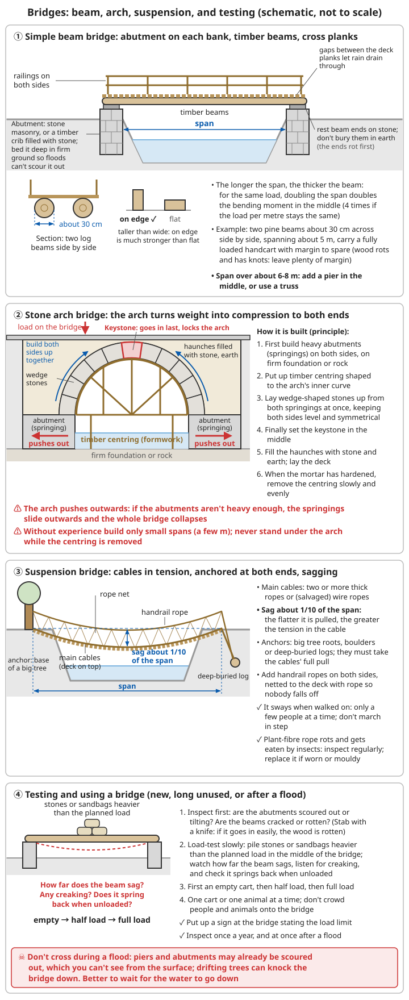
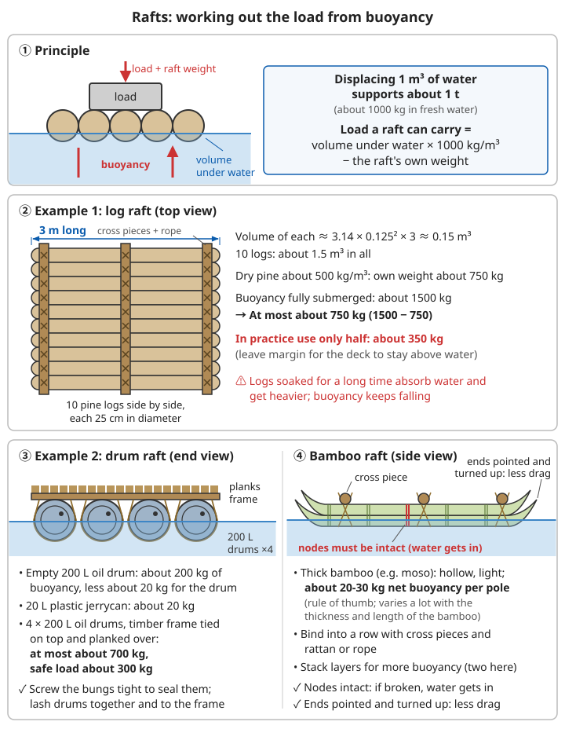

# Vehicles, Boats and Roads

## Contents
- [First, what this chapter covers](#first-what-this-chapter-covers)
- [Use what exists first: bicycles, handcarts and old vehicles](#use-what-exists-first-bicycles-handcarts-and-old-vehicles)
- [Carrying by hand](#carrying-by-hand)
- [Wheels and axles](#wheels-and-axles)
- [Draught animals and harness](#draught-animals-and-harness)
- [Roads](#roads)
- [Bridges](#bridges)
- [On the water: rafts and boats](#on-the-water-rafts-and-boats)
- [Crossing rivers](#crossing-rivers)
- [Comparing ways of transport](#comparing-ways-of-transport)

---

## First, what this chapter covers

Grain has to be brought in from the fields, firewood down from the hills, bricks, lime and ore to the building site, and goods to market. Without lorries and tarmac roads, **transport capacity directly decides how much land a community can farm and how far away the neighbours it can trade with may live**. This chapter covers the carts, roads, bridges and boats that can be made by hand, with the aim of moving more goods with the same effort.

```
⚠️ Safety:
- Downhill is where most vehicle accidents happen: a heavy cart going downhill needs a brake,
  a drag log or a rope holding it back from behind, and nobody may ever stand in front of
  a cart on the downhill side
- When a cart stops on a slope, chock the wheels with stones or wooden wedges
- Animals kick, bite and bolt when frightened: do not stand directly behind a horse, mule
  or donkey, and do not get trapped between an animal and a wall
- Bridges collapse: test new bridges, old bridges and bridges after floods before taking
  heavy carts over them
- ☠️ The greatest danger on the water is drowning: wear a life jacket or carry a float,
  do not overload, and do not go out on the water in floods or strong winds
- Cold water can leave a person unable to save themselves within minutes, even a good swimmer
```

The most realistic course: **salvage first**. Wheels and bearings from bicycles, handcarts and old cars are far easier to obtain than to make; making your own is for long-term replacement and repair.

---

## Use what exists first: bicycles, handcarts and old vehicles

### Bicycles: the most efficient human-powered transport

Riding a bicycle takes only a fraction of the effort of walking the same distance, at 3-4 times walking speed. Unloaded on the flat you ride at about 15-20 km/h, and 50-80 km a day is not hard. **A stock of a few sturdy bicycles with enough spare parts is far more practical than a stock of petrol.**

```
Converting for loads:
✓ Rear rack: choose a steel one welded or bolted to the frame; carries about 20-30 kg
✓ Front basket or front rack: for light items; too heavy and the handlebars are hard to control
✓ Panniers: hang on both sides of the rear rack; low centre of gravity, steadier than piling
  on top of the rack
✓ Trailer: make a small trailer from two old bicycle wheels and hitch it under the saddle or
  to the rear axle; it can pull 30-50 kg; downhill, watch out for the trailer pushing the bike
✓ Pushing: tie a long wooden pole to the handlebars as a push bar and walk alongside;
  one bicycle can carry over 100 kg
  (a common way of moving goods on mountain tracks and bad roads)

⚠️ A loaded bicycle needs a much longer distance to stop: slow down early, and on long
   descents stop now and then to let the brakes cool
```

```
Mending a puncture (holed inner tube):
1. Take one side of the tyre off the rim (with tyre levers or a spoon handle; not a
   screwdriver, which can easily puncture the tube again)
2. Take out the inner tube, pump it up and put it in a basin of water; where bubbles come out
   is the leak; mark it
3. Feel round the inside of the tyre and pull out any thorn, glass or wire stuck in it
   (or the new tube will puncture as soon as it goes in)
4. Roughen the area round the leak with sandpaper and wipe it clean
5. Spread a thin layer of glue, wait until it is no longer tacky (a few minutes), then press
   the patch on firmly
6. When refitting the tube, put a little air in first so it holds its shape and does not get
   pinched by the tyre
7. Pump to the pressure printed on the side of the tyre

Maintenance essentials:
✓ Pressure: as shown on the side of the tyre, commonly about 300-450 kPa; under-inflated
  tyres puncture most easily and damage the rim
✓ Chain: clean it, then apply a little oil and wipe off the excess outside (excess oil picks
  up mud and grit and wears it faster)
✓ Brakes: replace the brake blocks once the grooves have worn away; oil or replace rusty,
  sticky brake cables
✓ Bearings (hubs, bottom bracket, headset): strip, clean and repack with grease once a year
✓ Spares: inner tubes, puncture glue and patches, tyres, chains, brake blocks, brake cables,
  spokes, a pump
```

### Handcarts, flat carts and old vehicles

```
✓ Wheelbarrows (builders' barrows), two-wheeled flat carts, flatbed trailers: collect as many
  as you can; the wheels and bearings are the hardest parts to make yourself
✓ Old cars: the wheels (with hubs and bearings) can be adapted for flat carts and animal carts;
  leaf springs, steel, bolts and bearings are all valuable materials
✓ Pneumatic tyres: store in the dark, away from sunlight and oil; rubber ages and cracks
  over time
✓ Electric bicycles and electric tricycles: can be kept charged and in use where there are
  solar panels, but the batteries have a limited life and are hard to repair when they fail

Fuel goes off:
- Petrol: usually starts to deteriorate after 3-6 months in storage; a fuel stabiliser can
  extend this to about a year; stale petrol leaves gum in the fuel lines and carburettor
  and stops the engine starting
- Diesel: keeps longer, but absorbs water, grows microbes and blocks filters
→ Motor vehicles can only be a stopgap; do not rely on fuel for long-term transport
```

For the rules on storing petrol see [Lighting and Energy – Petrol](../../../docs/07-日常生活技能/06-照明与能源.md#汽油); for solar charging see [Lighting and Energy – Small-scale solar](../../../docs/07-日常生活技能/06-照明与能源.md#小型太阳能).

---

## Carrying by hand

```
Rough loads people can carry (healthy adults, long distances, for several days in a row):
- On the back (back basket, pack frame, rucksack): about 20-30 kg, no more than about 1/3 of
  body weight
- Shoulder pole: a practised carrier about 40-50 kg, balanced at both ends, switching
  shoulders without stopping
- Wheelbarrow: about 100-150 kg on the flat
- Two people carrying between them: about 30-40 kg each
Daily distance: about 20-30 km carrying a load on the flat; much less on mountain tracks
⚠️ Greatly reduce loads for the less fit, the elderly, children and pregnant women;
   long-term overloading damages the back and knees
```

```
Ways to save effort:
✓ Keep heavy loads close to the body and high on the back: back baskets and pack frames put
  the weight on the back and hips rather than the shoulders
✓ Widen and pad the straps; a hip belt transfers part of the weight to the hip bones
✓ Choose a springy bamboo or wooden shoulder pole; matching your stride to the pole's
  bounce makes it much easier
✓ Lifting heavy objects: squat, keep your back straight and rise with your legs;
  do not bend over and lift
✓ Use a walking stick: an extra point of support on mountain tracks, downhill and in water
```

### Why a wheelbarrow saves effort

```
A wheelbarrow is a lever: the wheel is the fulcrum, the load is in the middle, and the person
pushes at the handle end
- The closer the load is to the wheel, the less weight the person carries
- The traditional Chinese wheelbarrow (a big wheel in the middle of the barrow, load on
  both sides):
  the load's centre of gravity is almost directly above the wheel, so the person mainly
  just steadies it and pushes
  → One person can push over 100 kg, even along narrow field banks and mountain tracks
- The common builders' barrow (wheel at the front): the person has to lift a good part of
  the weight; load the heavy items on the side nearest the wheel
✓ The bigger the wheel, the more easily it rolls over stones and holes
✓ Add a shoulder strap between the two handles to take some of the load off your hands
```

For the lever principle see [Physics – Levers](../../../docs/08-基础科学知识/02-物理.md#21-杠杆).


*Figure: The closer the load is to the wheel, the less weight the person carries; with the traditional wheelbarrow the person mainly just steadies it and pushes (schematic, not to scale)*

---

## Wheels and axles

### Why wheels save effort

Dragging something along the ground means overcoming sliding friction; on wheels you only overcome rolling resistance and the friction at the axle, which are much smaller. **The harder and smoother the road, the greater the advantage of wheels**; in deep mud and sand the wheels sink and much of the advantage is lost.

| Method | Pull needed (as a fraction of the weight) | Notes |
|------|----------------------|------|
| Dragging on earth (sliding) | 30%-60% | Short distances only |
| Sledge on snow or ice | 5%-10% | Very useful for winter transport |
| Wheels on soft soil or sand | 10%-30% | Wide tyres sink less |
| Wheels on a gravel road | 2%-5% | |
| Pneumatic tyres on a hard road | About 1%-2% | |
| Iron wheels on iron rails | About 0.2% | Which is why railways carry so much |

```
Example: a flat cart weighing 500 kg with its load
- On a hard road: the pull needed is about 500 × 0.02 ≈ the weight of 10 kg (about 100 N);
  one person pulls it easily
- In deep mud: about 500 × 0.2 = the weight of 100 kg (about 1000 N); hard going even for
  several people
→ Building a good road is like gaining several extra draught animals
```

For the principle of friction see [Physics – Friction](../../../docs/08-基础科学知识/02-物理.md#14-摩擦力).

### Wooden wheels

```
Solid wheel (simplest):
1. Lay 2-3 thick planks (hardwood about 5-8 cm thick) edge to edge
2. Nail or peg a cross batten on each face to hold the planks together (the grain of the
   battens at right angles to the planks)
3. Draw a circle, saw it round, cut an axle hole in the centre, and thicken the area round
   the hole or cover it with sheet iron
Drawbacks: heavy, and splits easily along the grain

Spoked wheel (light and strong, but laborious):
- Hub: a length of thick hardwood (elm, pagoda tree, oak etc.), with an axle hole through
  the middle and mortises for the spokes chiselled round it
- Spokes: straight-grained hardwood, one end set in the hub, the other in the rim
- Rim: several curved wooden segments (felloes) joined into a ring
- Iron tyre: heat the iron hoop (so it expands), fit it round the wooden wheel, then pour
  water on to cool it; it shrinks and binds the whole wheel tight
✓ The larger the wheel, the less effort and the more easily it crosses holes;
  animal carts commonly use about 1-1.5 m
✓ Wooden wheels loosen when they dry out; in the old days carts were soaked in water to
  swell the wood tight
```

For choosing timber and mortise-and-tenon joints see [Woodworking and Tool Maintenance – Timber](../../../docs/07-日常生活技能/09-木工与工具维护.md#木材) and [Simple mortise and tenon: the right-angle joint](../../../docs/07-日常生活技能/09-木工与工具维护.md#简单的榫卯-直角榫); for forging iron tyres see [Metalworking](../../../docs/05-冶金技术/04-金属加工技术.md).

### Axles and bushings

```
Wooden axle in a wooden hole (simplest): a hardwood axle turning in the hub hole;
  wears fast and needs frequent lubrication
Adding a bushing: fit an iron pipe or ring into the hub hole and cover the matching part of
  the axle with sheet iron; iron on iron lasts much longer than wood on wood
Salvaged bearings: ball bearings from cars, motorcycles, bicycles and electric motors have
  the least friction; when fitting them in a wooden hub, make a proper bearing seat and
  seal it with grease to keep out mud and grit

Lubrication:
✓ Animal fat (beef and mutton fat last longest), vegetable oil, used engine oil
✓ Graphite powder (ground pencil lead) mixed into the grease withstands pressure and is not
  easily squeezed out
✓ Check every day before setting out: axle ends hot or squeaking → short of grease
✗ Do not let an axle run dry for long: a wooden axle will wear out and can even overheat
  and smoke
✓ Fit pins or retaining rings at both ends of the axle so the wheels cannot come off
```

For how bearings work see [Engineering Mechanics and Materials – Shafts and bearings](../../../docs/09-进阶科学与工程/01-工程力学与材料.md#111-轴和轴承).


*Figure: Pull compared for dragging, wheels and road surfaces, the construction of two kinds of wooden wheel, and the axle and bushing in cross-section (schematic, not to scale); the figures and methods in the text above take precedence*

### Balancing a two-wheeled cart

```
The axle of a two-wheeled cart is the fulcrum; the load's centre of gravity should be over
the axle or slightly in front of it:
- Slightly in front: a little downward pressure on the handles (shafts), so the person or
  animal controls it easily and the cart does not sway about
- Too far forward: whoever pulls the cart has to carry a lot of extra weight and tires quickly
- Behind the axle: the handles tip up; on a hill the whole cart may tip over backwards,
  and the harness will lift the animal upwards
✓ Once loaded, lift the handles to test: about 5-15 kg of pressure on your hands is right
✓ Going uphill, move the load forward a little; going downhill, move it back a little
✓ Tie the load down firmly so it cannot shift and change the balance on the way
```


*Figure: The axle is the fulcrum; the red dot is the load's centre of gravity (schematic, not to scale)*

---

## Draught animals and harness

One animal working steadily does roughly the work of 5-10 people. But animals need feed, pasture, housing and care, so they pay only once the community is large enough and has enough feed. For keeping cattle, donkeys, horses and mules see [Livestock – Cattle, donkeys and other working animals](../../../docs/04-动植物培育/06-家畜养殖.md#牛驴等役用牲畜); best of all, find someone with experience to learn from.

| Animal | Sustained pull (as a fraction of body weight) | Speed | Pack load | Characteristics |
|------|------------------|------|------|------|
| Ox | 10%-12% | Slow, about 2-3 km/h | Not usually used as a pack animal | Strong, thrives on rough feed, calm temperament; good for ploughing, heavy carts, short trips |
| Horse | 12%-14% | Fast, about 4-5 km/h | About 80-100 kg | Fast, but needs good feed (concentrates) and is more delicate |
| Donkey | 12%-14% | About 3-4 km/h | About 40-60 kg | Small, thrives on rough feed, tolerates drought, easy to keep; suits small households |
| Mule | 12%-14% | About 4 km/h | About 70-100 kg | A horse-donkey cross; great stamina, rarely ill, cannot breed |

```
Rough orders of magnitude:
- A horse or ox of about 500 kg can keep up a pull of about 500-700 N for long periods
  (equivalent to lifting a 50-70 kg weight)
- A horse's sustained power is about 370-750 W; an adult person about 75-100 W
- An ox cart covers about 15-20 km a day; a horse cart on a good road about 30-40 km a day
```

For the power of draught animals see [Thermodynamics and Power Machinery – Animal and human power](../../../docs/09-进阶科学与工程/03-热力学与动力机械.md#83-畜力和人力).

### Harness: letting the animal use its strength

**With badly fitting harness, even the strongest animal cannot pull.** The pull must bear on the solid, bony parts of the animal (shoulders, chest), not press on the throat or soft tissue.

```
Oxen: the yoke (neck yoke)
- A curved timber sits on the back of the ox's neck, in front of the withers (the hump
  behind the neck), and the ox pushes forward with its shoulders
- One for a single ox is a single yoke; one crossbar for two oxen side by side is a double yoke
- The curve of the yoke must fit the ox's neck, the contact surfaces must be smoothed,
  and a rope or wooden bow underneath stops it slipping off

Horses, mules, donkeys:
1. Throat strap (the most primitive; do not use): a strap round the neck; as soon as the horse
   pulls, the strap slides up and presses on the windpipe
   → The harder the horse pulls, the less it can breathe; it can only pull very light carts
2. Breast strap: a wide strap across the horse's chest (below the windpipe), with traces
   attached at each side
   → Does not press on the windpipe; suits light and medium carts; simple to make
3. Collar: a stiff padded ring that sits at the base of the horse's neck, snug against the
   shoulders, with the traces attached at each side; the horse pushes forward with its
   shoulders
   → The force falls entirely on the shoulder bones, so the horse can use all its strength;
     suits heavy carts and ploughing; historically, the spread of the collar greatly
     increased the loads horses could pull

✓ Make each collar to fit the individual horse: too big and it rubs the shoulders sore,
  too small and it presses on the windpipe and blood vessels
  (when fitted, you should just be able to slide a flat hand between the throat and the collar)
✓ Cover the contact surfaces with leather and line them with soft padding; wipe clean after
  every use
✓ The traces should be the same length on both sides, set at a height so the line of pull
  runs from the shoulder back and down at a slant
```

For making and caring for leather see [Textiles, Mending and Tanning – Making leather softer and waterproof](../../../docs/07-日常生活技能/07-纺织缝补与鞣皮.md#让皮子更柔软防水).

### Caring for working animals

```
✓ Hooves: trim them regularly (horses about every 1-2 months); horses and mules working on
  hard and stony roads need shoeing; check the soles for stones and nails at the end of
  every working day
✓ Rest: generally no more than about 6-8 hours' work a day, with breaks for breath and water;
  at least one day's rest a week
✓ Water: after work let the animal get its breath back before it drinks; do not let it gulp
  cold water while dripping with sweat
✓ Do not overload: pack loads generally no more than about 20%-25% of body weight;
  if the cart is too heavy or the hill too steep, make two trips
✓ Each time you unharness, check the shoulders, back and chest for rubs (harness and saddle
  sores); if there is a sore, stop working the animal and treat it, or the wound will be
  rubbed deeper and deeper
✓ Feed: horses doing heavy work need concentrates (grain, pulses); on grass alone they get
  thinner the more they work
❌ Do not beat, shout at or frighten animals: a frightened animal will bolt with the cart,
   which is very dangerous
```

---

## Roads

**Water is a road's worst enemy.** An earth road is firm when dry, but once soaked it turns to mud, and every wheel leaves a deep rut. Most of the work of road-building goes into getting water off the road.

### Choosing the route

```
✓ Keep to high, dry ground: avoid hollows, marshes and river flats (they flood and turn muddy)
✓ Avoid slopes prone to landslides, collapse and rockfall (cracks in the slope, leaning trees,
  seeping water)
✓ Do not make it too steep:
  - Animal-cart roads: long slopes preferably no more than about 5% (5 m rise for every
    100 m travelled), short slopes no more than about 10%
  - Footpaths and pack trails can be steeper, but above about 12%-15% they need steps or
    zigzags
  - If the climb is too steep, go round: ease the gradient with zigzag hairpin roads
    (an inclined plane saves force, not work)
✓ Cross rivers as few times as possible; choose crossings where the channel is narrow,
  both banks are stable and the bed is rock
  (this is for siting a road bridge; wading on foot is the opposite: choose a place where
  the river is wide, shallow and slow)
✓ Setting out the gradient: gradient = height difference ÷ horizontal distance; use a simple
  level to set a peg every 20 m
```

For the method see [Surveying and Mapping – A simple level](../../../docs/08-基础科学知识/08-测量与制图.md#42-简易水准仪) and [Setting out the gradient of a channel](../../../docs/08-基础科学知识/08-测量与制图.md#44-给水渠放坡); for the inclined plane see [Physics – The inclined plane](../../../docs/08-基础科学知识/02-物理.md#23-斜面); for the warning signs of landslides see [Geological Disasters – Landslides](../../../docs/02-灾难应对/01-地质灾害.md#山体滑坡).

### Camber and drainage ditches

```
Camber: the road surface is higher in the middle and lower at the sides, so rain runs off
  to both sides
- Crossfall about 3%-5% (on a 4 m wide road, the middle about 6-10 cm higher than the edges)
- Too flat: rain lies on the road; too steep: carts slide to one side and the road edges
  are washed out

Drainage ditches:
- Dig a side ditch along each side of the road, about 30-50 cm deep, with its bottom below
  the roadbed
- The ditch bottom needs a fall, steeper than an irrigation channel, at least about 0.5%,
  so the water runs away and does not silt up
- At intervals lead the water in the side ditches away from the road (to a natural gully
  lower down); do not let the water run all the way along the road
- Water crossing the road: bury a culvert (clay pipe, stone-built culvert, old concrete pipe,
  hollow log)
- On slopes: bury a stone or wooden strip across the road surface at an angle (a water bar)
  to lead water off the road to the side
```

### Gravel road surfaces

```
Method (lay in layers, compacting each one):
1. Roadbed: dig off the top layer of turf and humus, level and ram the soil beneath,
   and shape the camber
2. Bottom layer: fist-sized stones, about 10-15 cm thick
3. Middle layer: egg-sized broken stone, about 5-10 cm thick
4. Top layer: small broken stone with stone chips and coarse sand, about 3-5 cm thick
5. Wet and compact each layer as it is laid (stone roller, rammer, or let carts run back
   and forth over it)

Key points:
✓ Use angular broken stone, which locks together; rounded river pebbles roll about,
  so mix in broken stone
✓ A dry roadbed matters more than a thick surface: if the roadbed is waterlogged, even
  the thickest gravel will sink
✓ If you have only a little stone: surface the muddiest, lowest stretches first
```

### Fords (water-crossing road surfaces)

For small streams and seasonal gullies where a bridge is not worth building, the road can go straight through the water:

```
1. Choose a place where the water is shallow, the current gentle and the bed firm
2. Pave the section through the water with large stones (or concrete), with gentle ramps at
   both ends so the water does not scour holes
3. Protect the downstream side with large stones or wooden stakes so the surface is not
   undermined
4. Put up marker poles on both sides, marked with water depths

⚠️ If the water is over the mark, the current is fast, or the water is too muddy to see the
   surface, neither people nor vehicles should cross
⚠️ Most vehicles swept away by water are swept away at places like this: a fast current
   about 30 cm deep can push a vehicle off
```

For judging whether water can be waded see [Wading, Flash Floods and Hypothermia in the Wild – Deciding whether you can cross](../../../docs/03-野外生存/08-涉水山洪与野外失温.md#判断能不能过).

### Maintenance

```
✓ Walk the road after every heavy rain: fill holes, clear mud, sand and debris from ditches
  and culverts
✓ Clear all ditches and culverts before the rainy season
✓ Fill ruts as soon as they appear; do not let water run along them (ruts get scoured deeper
  and deeper and turn into gullies)
✓ Cut back branches and bushes overhanging the road so the surface can air and dry
✓ Keep heavy carts off the road when it is muddy; one bout of damage takes a long time to repair
```

---

## Bridges

### Simple ways across

```
Stepping stones:
- In a shallow, gentle stream, lay a row of large stones about a pace apart (about 0.4-0.5 m)
- Choose big, flat stones that sit firm on the bed without rocking, their tops above normal
  water level
✗ Wet, mossy stones are very slippery; do not use them when the water is up

Log bridge:
- A thick, straight tree trunk laid across from bank to bank, its ends resting on firm stones
  or earth platforms, buried or wedged so it cannot roll
- Hew the top flatter to give more footing
✓ Adding a handrail rope or pole greatly reduces falls into the water
```

### Simply supported timber beam bridge

**A beam bridge is the easiest bridge to build: an abutment on each bank, a few timber beams laid across them, and planks laid across the beams.**

```
Key points:
- The longer the span, the thicker the beams must be: for the same load, doubling the span
  doubles the bending moment in the middle (with the same uniform load per metre, a longer
  bridge makes it 4 times)
- A timber beam set "on edge" (taller than it is wide) is much stronger than one laid flat
- Log beams: pine about 30 cm in diameter, span about 5 m, two side by side, will carry a fully
  loaded flat cart with margin to spare
  (estimated at an allowable stress of about 10 MPa; timber rots and has knots, so leave
  ample margin in practice)
- Spans over about 6-8 m: add a pier in the middle, or use a truss instead
- Abutments: build them of stone or as timber cribs filled with stone, founded deep in firm
  ground so floods cannot undermine them
- Rest the ends of the beams on stone; do not bury them directly in soil (the ends rot first)
- Leave gaps between the deck planks so rain drains through; add railings on both sides
```

For calculating timber beams see [Engineering Mechanics and Materials – Estimating how much a timber beam can carry](../../../docs/09-进阶科学与工程/01-工程力学与材料.md#53-估算一根木梁能承受多少); for trusses see [Triangles and trusses](../../../docs/09-进阶科学与工程/01-工程力学与材料.md#六三角形和桁架); for abutment foundations see [Foundations](../../../docs/09-进阶科学与工程/01-工程力学与材料.md#九地基).

### Stone arch bridges

```
Principle: the arch turns the weight on the bridge into compression along the arch, carried
to both ends; stone is very strong in compression, so stone arch bridges can last for
centuries

How it is built (in principle):
1. First build heavy, solid abutments on both sides (the springings), which must sit on firm
   ground or rock
2. Build a wooden arch frame (centring), shaped to the inner curve of the arch
3. Lay wedge-shaped stones upwards from both springings at once, keeping both sides at the
   same height and symmetrical
4. Finally set the keystone in the middle, which "locks" the arch
5. Fill the spandrels above the arch with stone and earth and lay the deck
6. Once the mortar has hardened, remove the centring slowly and evenly

⚠️ An arch pushes outwards on both sides: if the abutments are not heavy enough, the springings
   slide outwards and the whole bridge collapses
⚠️ Without experience, build only small-span (a few m) arch bridges, and do not stand under
   the arch while removing the centring
```

For the forces in an arch see [Engineering Mechanics and Materials – Arches](../../../docs/09-进阶科学与工程/01-工程力学与材料.md#71-拱).

### Rope bridges

```
Principle: ropes or steel cables work only in tension; they are anchored at both ends and sag
in the middle, with the deck hung from them or laid on them
- Main cables: two or more thick ropes or (salvaged) wire ropes
- Sag about 1/10 of the span: the tauter the cable, the greater the tension in it
- Anchorage: anchor both ends to the base of large trees, boulders or deeply buried logs,
  which must take the full tension of the cables
- Add handrail cables on both sides, and lace rope netting between the handrails and the deck
  so nobody can fall off
✓ It sways when people walk on it: limit it to a few people at a time, and do not march in step
✓ Plant-fibre rope rots and is eaten by insects: check it regularly and replace any that is
  worn or mouldy
```

For the forces in suspension cables see [Engineering Mechanics and Materials – Suspension cables and ropes](../../../docs/09-进阶科学与工程/01-工程力学与材料.md#八悬索和绳索); for knots see [Basic Survival Skills – Knots](../../../docs/03-野外生存/00-基础生存技能.md#绳结技能).

### ⚠️ Testing and using bridges

```
New bridges, bridges unused for a long time, bridges after floods:
1. Look first: are the abutments undermined or tilting? Are the beams cracked or rotten
   (stab with a knife: if it goes in easily, the wood is rotten)?
2. Load test, slowly: pile stones or sandbags in the middle of the bridge, heavier than the
   load you plan to take across; watch how far the beams bend and listen for noises, and
   check whether they spring back once unloaded
3. Cross first with an empty cart, then half-loaded, then fully loaded
4. Only one cart or one animal on the bridge at a time; people and animals must not crowd
   onto it

✓ Put up a sign at the end of the bridge stating the weight limit
✓ Inspect once a year, and immediately after floods

☠️ Do not cross bridges in flood: piers and abutments may already be undermined without
   showing it on the surface, and floating trees can smash the bridge. Better to wait for
   the water to go down
```

For the warning signs of flash floods see [Wading, Flash Floods and Hypothermia in the Wild – Flash floods](../../../docs/03-野外生存/08-涉水山洪与野外失温.md#山洪-溪谷里最大的危险).



*Figure: Key construction points of the simple beam bridge, stone arch bridge and rope bridge, and bridge testing (schematic, not to scale); the figures and methods in the text above take precedence*

---

## On the water: rafts and boats

**Moving goods by water takes the least effort.** The water bears the weight and resistance is low at slow speeds; what one person poling a boat can move would take several animals to pull on a road.

```
⚠️ Water safety (follow every time):
✓ Everyone wears a life jacket; if there are none, at least have something to hold on to
  within reach (empty drum, piece of wood, block of foam)
✓ Do not overload: leave enough freeboard between the gunwale and the water
  (at least about 20-30 cm for a small boat)
✓ Stow the load low, steady and tied down, balanced side to side; do not stand up suddenly
  or crowd to one side
☠️ Do not go out on the water in floods, strong winds, thick fog or at night
☠️ Keep away from the downstream side of dams and weirs (the churning backflow traps people),
   waterfalls, sharp bends and fallen trees
✓ Cold water: if you fall into cold water, first get your breathing under control and use
  the first few minutes to save yourself
✓ Before setting off, tell someone on shore where you are going and when you will be back
```

For what to do on falling into cold water see [Wading, Flash Floods and Hypothermia in the Wild – Falling into cold water](../../../docs/03-野外生存/08-涉水山洪与野外失温.md#落入冷水); for rescuing others see [Rescuing a companion from the water](../../../docs/03-野外生存/08-涉水山洪与野外失温.md#救落水的同伴) and [Acute Symptoms – Drowning](../../../docs/01-日常疾病和伤害/05-急性症状.md#溺水).

### Rafts: working out the load from buoyancy

```
Principle: displacing 1 m³ of water supports about 1 t (about 1000 kg in fresh water)
Load a raft can carry = volume under water × 1000 kg/m³ − the raft's own weight

Example 1: log raft
  10 pine logs, each 3 m long and 25 cm in diameter
  Volume of each ≈ 3.14 × 0.125² × 3 ≈ 0.15 m³, about 1.5 m³ in all
  Dry pine about 500 kg/m³: own weight about 750 kg
  Buoyancy fully submerged about 1500 kg → at most about 750 kg
  In practice use only half: about 350 kg (leave margin for the deck to stay above water)
  ⚠️ Logs soaked for a long time absorb water and get heavier; buoyancy keeps falling

Example 2: drum raft
  An empty 200 L oil drum: about 200 kg of buoyancy, less about 20 kg for the drum
  A 20 L plastic jerrycan: about 20 kg of buoyancy
  4 × 200 L oil drums with a timber frame tied on top and planked over: at most about 700 kg,
  safe load about 300 kg
  ✓ Screw the bungs tight to seal them; lash firmly between drums and between drums and frame

Bamboo raft:
  Thick bamboo (such as moso bamboo) is hollow and light; each pole gives about 20-30 kg of
  net buoyancy (a rule of thumb; varies a lot with the thickness and length of the bamboo)
  ✓ The nodes must be intact; if broken, water gets in; trim both ends to a point and turn
    them up to reduce drag
  ✓ Bind the bamboo into a row with cross pieces and rattan or rope; stack several layers for
    more buoyancy
```



*Figure: How to work out the load from buoyancy, with the calculations for examples 1 and 2; the net buoyancy per bamboo pole is a rule of thumb*

For the principle of buoyancy see [Physics – Buoyancy: Archimedes' principle](../../../docs/08-基础科学知识/02-物理.md#45-浮力-阿基米德原理).

### Dugout canoes

```
1. Choose a thick, straight trunk without large knots (softwoods are easy to hollow out,
   such as pine, Chinese fir, poplar)
2. Hew the top flat and mark out the area to be hollowed
3. Hollow it out: chip away bit by bit with axe and chisel; or char the surface and scrape it
   off (burn and scrape again and again, without burning through)
4. Leave the sides about 2-3 cm thick, the bottom a little thicker
5. Shape both ends to a point or a rounded curve to reduce drag

✗ A dugout is narrow and round-bottomed and capsizes very easily: fixing a small float log
  to one side (or both) with cross poles (an outrigger) greatly improves stability
✓ Dry a newly hollowed boat slowly in the shade so it does not crack; store it upside down
  in a shady place when not in use
```

### How a wooden boat is built

```
- Keel: a thick lengthways timber along the middle of the bottom; the boat's "backbone"
- Ribs (frames): a row of curved timbers rising from the keel to each side; they set the
  shape of the boat
- Planks: fastened one by one to the outside of the ribs to form the hull
- Bulkheads: crossways boards divide the hold into compartments, so the boat will not sink
  if one compartment leaks (a traditional Chinese method)
- Caulking: stuff hemp fibre or old cotton wadding into the seams between planks and coat
  them outside with tung-oil lime putty (tung oil mixed with lime), which dries very hard
  and waterproof; without tung oil, pine resin or bitumen can be used instead
✓ Before launching a new boat or one that has been laid up for a long time, soak it for a
  few days so the planks absorb water and swell, closing the seams
✓ Regularly scrape growth off the bottom, re-caulk the seams and re-oil
```

### Oars, rudders and poles

```
Oars: oars rowed on both sides rest in rowlocks on the gunwale; a single short paddle is
  simply held in the hands
Rudder: a board at the stern that can be turned to change the boat's direction; on a small
  boat a long oar at the stern can serve as a rudder
Punting pole: a long bamboo pole pushed against the riverbed to drive the boat forward
  - Suits shallow water up to about 3 m; where it is too deep to reach the bottom,
    change to oars
  - When poling, walk along the side of the boat from bow to stern; do not shove hard in
    the middle of the boat and capsize it
Going downstream takes least effort; going upstream, keep to the slack water near the bank,
or haul the boat with a rope from the bank (towing)
```

---

## Crossing rivers

```
Siting a ferry crossing:
✓ The river wide and the current gentle, with firm, gently sloping landing places on
  both banks
✓ No rapids or dangerous shoals upstream; no waterfalls or weirs for some distance downstream
✓ Build platforms or steps on both banks so animals and carts can get on and off easily

Rope-guided ferry (cable ferry):
1. Stretch a thick rope or steel cable between the banks, above the water, anchored firmly
   at both ends
2. Hang the boat from the cable by rope loops or pulleys (or the people on board pull
   themselves along the cable by hand)
3. Point the bow at an angle upstream, and the current pushes the boat across to the other
   bank without rowing
4. When the water rises, raise the cable or stop the ferry, so floating debris does not
   catch on the cable

☠️ Overloading is the most common cause of ferries capsizing in history: set the maximum
   number of people and weight of goods per boat and post it at the crossing
☠️ Animals on board must be tied, blindfolded or held; a frightened animal thrashing about
   can capsize the boat
❌ Do not tie a rope to a person crossing a river (if they are knocked over, the rope will
   hold them under water)
✓ Always keep life jackets, floats and a bailer on board
```

For wading across on foot see [Wading, Flash Floods and Hypothermia in the Wild – Wading across rivers](../../../docs/03-野外生存/08-涉水山洪与野外失温.md#涉水过河).

---

## Comparing ways of transport

| Method | Load per trip | Distance per day | Suited to |
|------|---------|---------|------|
| Carrying on the back | About 20-30 kg | About 20-25 km | Mountain tracks, paths, short trips |
| Shoulder pole | About 40-50 kg | About 20-30 km | Level paths, fields |
| Wheelbarrow | About 100-150 kg | About 20-30 km | Narrow paths, field banks |
| Bicycle (pushed, loaded) | About 100 kg | About 30-40 km | Wherever there is a road |
| Donkey pack | About 40-60 kg | About 20-30 km | Mountain tracks |
| Mule or horse pack | About 70-100 kg | About 25-35 km | Mountain tracks, long distances |
| Ox cart | About 0.5-1 t | About 15-20 km | Heavy goods, short trips |
| Horse cart (good road) | About 0.5-1 t | About 30-40 km | Level roads, long distances |
| Small wooden boat (2-3 people) | Several t | Tens of km downstream | Along rivers and lakes |

```
Conclusions:
1. For the same human effort: water > cart > pack animal > carrying on back or pole
   It used to be said that a horse towing a barge on a canal could move tens of t,
   but pulling a cart on a road only about 1 t
2. The quality of the road matters more than the quality of the cart: on a gravel road an
   animal can pull several times what it can pull on a muddy track
3. Send heavy, cheap goods (grain, stone, timber, firewood and charcoal) by water wherever
   possible, or produce them close to where they are used
4. Site villages, stores and workshops by rivers or roads where possible; this saves a great
   deal of carrying
```

For calculating work and power see [Physics – Work and power](../../../docs/08-基础科学知识/02-物理.md#31-功和功率).

---

## 📝 Key points of vehicles, boats and roads

```
1. Salvage first: wheels and bearings from bicycles, handcarts and old vehicles are the
   hardest to make; petrol goes off after 3-6 months
2. The bicycle is the most efficient human-powered transport; stock inner tubes, puncture
   glue, chains and brake blocks
3. The traditional wheelbarrow puts the load's centre of gravity right above the wheel,
   so the person only steadies and pushes (a builders' barrow means lifting part of the
   weight; keep heavy goods near the wheel); on a flat cart keep the centre of gravity over
   the axle or slightly in front
4. Grease axles often (animal fat with graphite); a hot axle end means it is short of grease
5. Yokes for oxen, breast straps or collars for horses; never a throat strap that presses on
   the neck; do not overload; check hooves and shoulders
6. Water is a road's worst enemy: camber, side ditches, culverts; long slopes on cart roads
   no steeper than about 5%
7. Beam bridges are the easiest to build; arch bridges need heavy abutments; load-test new
   bridges and bridges after floods
8. Displacing 1 m³ of water supports about 1 t; load a raft to only half of that
9. On the water always wear a life jacket or carry a float, do not overload, and do not go out
   in floods, strong winds or thick fog
10. Water transport takes the least effort; send heavy, cheap goods by water where possible
```

---

**Back**: [Chapter index](../../../docs/07-日常生活技能/README.md) | [Main contents](../../../README.md)
