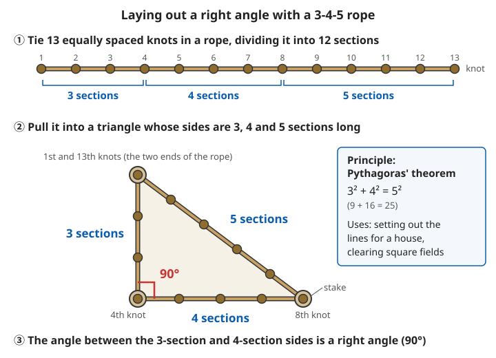

# Measurement and Scientific Method

> **All science and technology begins with "being able to measure accurately" and "being able to test reliably"**

## ⚠️ Why start here

The formulas of mathematics, physics and chemistry are only useful when you can **measure**: if you do not know how long a metre is or how heavy a kilogram is, you cannot mix medicines accurately, smelt iron well or build a straight house.

And the scientific method decides how we know whether something "really works", or worked "by chance", or only "seemed to work". Many wrong treatments in history (bloodletting, folk remedies) were passed down for over a thousand years precisely because nobody used controls or kept records.

**This chapter is the foundation for the other chapters in this part.**

---

## 1. The scientific method

### 1.1 Basic steps

```
1. Observe: notice something happening
   Example: the crops on one plot grow better than elsewhere

2. Form a hypothesis: guess the cause, and the guess must be testable
   Example: plant ash was once piled on this plot

3. Design an experiment: change only one factor, keep everything else the same
   Example: divide a plot in two, spread plant ash on one half and not the other,
       sow the same seed, give the same water

4. Record the results: record them as numbers, not impressions
   Example: how many kg each half of the plot yielded

5. Draw a conclusion, and repeat to check
   Example: do it again on another plot and in another year; it only counts if the result is the same
```

### 1.2 Controlled experiments: the most important rule

```
✓ Have a "control group": everything is exactly the same except the one factor being tested
✓ Change only one factor at a time
   (if you change both the seed and the fertiliser and the harvest improves,
    you cannot tell which one did it)
✓ Use a large enough sample: the result from one tree or one patient proves nothing
✓ Assign at random: do not put all the good land or all the healthy people in one group

Why it matters:
- Many illnesses get better on their own without treatment; without a control
  you will think the "medicine" did it
- Many things are coincidences
```

### 1.3 Records

```
✓ Write down: the date, what you did, how much you used, the conditions
  (temperature, weather) and the result
✓ Record failures too (they are as valuable as successes)
✓ Make records that others can understand and repeat
✓ Keep them safe and pass them on

Human knowledge can accumulate only because it is recorded and passed on.
```

---

## 2. Rebuilding length, mass, volume and time

Without ready-made measuring tools, you can set up new standards using stable things found in nature. **The most important thing is that the whole community uses the same standard**: make one "standard rule" and one "standard weight", and copy every other measuring tool from them.

This section gives the short method; for how to calibrate the second by the stars, the accuracy each method can reach, calibrating electrical and other units, ready-made references in the ruins and keeping the standards, see [Rebuilding measurement standards](09-rebuilding-measurement-standards.md).

### 2.1 Length: the metre (m)

```
Method 1: the seconds pendulum
- The period of a simple pendulum depends only on its length
  (not on the weight of the bob, nor on the size of the swing when the swing is small)
- A pendulum about 0.993 m long takes exactly 1 second to swing from one side to the other
  (this varies slightly with latitude; about 0.992-0.994 m in most of China)
- Method: tie a small weight to one end of a thin cord, adjust the length,
  and count whether 60 swings (one side to the other counts as one)
  take exactly 1 minute
  → pendulum length (from the point of suspension to the centre of the weight) ≈ 1 m
- You first need reliable timekeeping: calibrate it by the sidereal day
  (see "Time" below and Rebuilding measurement standards)

Method 2: any surviving standard rule or tape measure
- Tape measures, steel rules, standard bricks, A4 paper (297 mm long, 210 mm wide),
  bank cards (85.6 mm × 54.0 mm), the 1-yuan coin (old issue 25 mm in diameter,
  2019 issue 22.25 mm) can all serve as references

1 m = 100 cm = 1000 mm
1 km (kilometre) = 1000 m
```

### 2.2 Volume and mass: the litre (L) and the kilogram (kg)

```
Water is the best standard:
- 1 L = the volume of a cube with 10 cm sides
- 1 L of water has a mass of ≈ 1 kg (most exact at 4°C; the error at room temperature is small)
- 1 mL (1 cm³) of water ≈ 1 g

Making a standard weight:
1. Make a square box with inside edges of 10 cm (or use a container of measured volume)
2. Fill it with clean water → this is 1 kg
3. Using a balance (an equal-arm lever), adjust a stone or a piece of metal
   until it weighs the same
4. This stone or piece of metal is your "standard 1 kg"

Balance: a wooden rod hung at its exact middle, with a pan hung from each end
  When the two sides balance → the masses on both sides are equal
  (for the principle see Physics – levers)
```

### 2.3 Time

```
The day:
- When the sun is due south (in the northern hemisphere) it is "noon";
  shadows are at their shortest
- The time from one noon to the next is one day, divided into 24 hours

Sundial:
- Stand a straight pole upright on level ground and watch the direction
  and length of its shadow
- When the shadow is shortest it is local noon

Pendulum clock:
- A pendulum about 1 m long takes about 1 second per swing;
  it can be used to divide time finely

The sidereal day (steadier, used to calibrate clocks):
- The interval between the same star passing the same direction twice in a row
  is about 23 h 56 min 4 s (86164 s), the same every day
- The length of the solar day varies by some tens of seconds over the year;
  only its average over a year is 86400 s

The year:
- A year is about 365.2422 days
- From one winter solstice (the day the noon shadow is longest in the
  northern hemisphere) to the next is one year
```

For calendars and finding direction by the stars see [Physics – astronomy and the Earth](02-physics.md#9-astronomy-and-the-earth).

### 2.4 Temperature

```
The two fixed points of the Celsius scale:
- A mixture of ice and water: 0°C
- Water boiling at sea level: 100°C
  (the higher the altitude, the lower the boiling point:
   roughly 1°C lower for every 300 m of height)

Home-made thermometer: a fine glass tube filled with alcohol or mercury
  (mercury is toxic; use with caution); mark it in ice water and in boiling
  water, and divide the space between into 100 equal steps
```

---

## 3. Common unit conversions

### 3.1 International units

The whole book uses the international symbols in the table below; for the full list of symbols see [Main contents – unit symbols](../../README.md#-unit-symbols).

| Quantity | Unit | Conversion |
|----|------|------|
| Length | metre m | 1 km = 1000 m; 1 m = 100 cm = 1000 mm |
| Area | square metre m² | 1 ha = 10000 m²; 1 km² = 100 ha |
| Volume | cubic metre m³ | 1 m³ = 1000 L; 1 L = 1000 mL |
| Mass | kilogram kg | 1 t = 1000 kg; 1 kg = 1000 g |
| Time | second s | 1 h (hour) = 60 min (minutes) = 3600 s; 1 d (day) = 24 h |
| Temperature | degree Celsius °C | degrees Fahrenheit = degrees Celsius × 1.8 + 32 |
| Force | newton N | the weight of 1 kg ≈ 9.8 N |
| Energy | joule J | 1 cal ≈ 4.18 J; 1 kWh (1 *du* of electricity) = 3600000 J |
| Power | watt W | 1 hp (horsepower) ≈ 735 W |
| Pressure | pascal Pa | 1 atm (standard atmosphere) ≈ 101325 Pa ≈ 10.3 m column of water |

### 3.2 Traditional Chinese and imperial units

| Unit | Conversion |
|------|------|
| 1 *shi chi* (Chinese foot) | 1/3 m (about 33.3 cm); 1 *zhang* = 10 *chi* |
| 1 *li* (Chinese mile) | 500 m |
| 1 *mu* (Chinese unit of land area) | about 666.7 m² (15 *mu* = 1 ha) |
| 1 *shi jin* (Chinese pound, "catty") | 500 g; 1 kg = 2 *shi jin* |
| 1 inch | 2.54 cm |
| 1 foot | 30.48 cm |
| 1 mile | about 1.609 km |
| 1 pound | about 0.4536 kg |
| 1 gallon (US) | about 3.785 L |

### 3.3 Prefixes

```
kilo k = 10³ = 1000            milli m = 10⁻³ = 0.001
mega M = 10⁶ = one million     micro μ = 10⁻⁶ = one millionth
giga G = 10⁹ = one billion     nano n = 10⁻⁹ = one billionth
```

---

## 4. Measuring without instruments

### 4.1 Laying out a right angle: the 3-4-5 rope

```
1. Tie 13 equally spaced knots in a rope, dividing it into 12 sections
2. Pull it into a triangle whose sides are 3, 4 and 5 sections long
3. The angle between the 3-section side and the 4-section side
   is a right angle (90°)

Uses: setting out the lines for a house, clearing square fields
Principle: Pythagoras' theorem 3² + 4² = 5² (see Mathematics – geometry)
```



*Figure: drive a stake at each of the three corners and pull the rope taut; the right angle is between the 3-section and 4-section sides, opposite the 5-section side*

### 4.2 Finding the level

```
Water level (levelling tube):
- Fill a clear flexible tube with water (there must be no air bubbles)
- Raise both ends: the water surfaces at the two ends are always at the same height
- Use it to mark the same height on two walls

Simple level:
- A triangular wooden frame with a plumb line hung from its apex
- Mark the midpoint of the base; when the plumb line lines up with the mark,
  the base is level

Plumb line: a weight tied to a cord; hanging freely, it shows the vertical
```

### 4.3 Measuring heights and widths

```
Measuring the height of a tree or building (shadow method):
1. Stand up a pole of known length and measure the length of its shadow
2. At the same time, measure the length of the tree's shadow
3. Tree height = pole length × (tree's shadow length ÷ pole's shadow length)
Principle: similar triangles

Measuring the width of a river:
1. Stand on the bank at point A, directly facing a target on the far bank
   (such as a tree)
2. Walk along the bank (at right angles to the line of sight from A to the target)
   to point B and plant a ranging pole there, then carry on the same distance
   in the same direction to point C
3. At C, turn 90° and walk away from the river until, at point D, ranging
   pole B and the tree on the far bank are in a straight line
4. The length of CD = the width of the river
Principle: congruent triangles
```

### 4.4 Estimating distance

```
Pacing:
- First walk a known distance (such as 100 m) a few times and count your
  average number of paces
- After that, counting paces lets you estimate distance

Distance of lightning:
- When you see the flash, count the seconds until you hear the thunder
- Seconds ÷ 3 ≈ distance (km) (sound travels about 340 m per second)
```

For protection from lightning see [Weather disasters – lightning](../02-disaster-response/02-weather-disasters.md).

---

## 5. Error and estimation

```
✓ Every measurement has an error: measure several times and take the average
✓ Always write the unit (writing just "5" means nothing: is it 5 m or 5 cm?)
✓ Significant figures: if the smallest division on the rule is 1 mm,
  do not record to 0.01 mm
✓ Estimate before you calculate: if the result is ten times off your estimate,
  you have most likely made a mistake somewhere
✓ When mixing medicines, disinfectants or any chemical, a unit or decimal point
  out by one place makes a tenfold difference; always double-check
```

---

## Related chapters

- ⏭️ [Mathematics](01-mathematics.md) - arithmetic, geometry, trigonometry, logarithms, probability and statistics
- ⏭️ [Physics](02-physics.md) - mechanics, fluids, heat, sound and light, electromagnetism, astronomy
- ⏭️ [Chemistry](03-chemistry.md) - elements, chemical reactions, acids, bases and salts, solution concentration
- 🔗 [Metallurgy Basics – judging temperature](../05-metallurgy/00-metallurgy-basics.md) - judging furnace temperature by colour when there is no thermometer
- 🔗 [Pharmaceutical Basics](../06-pharmaceuticals/00-pharmacy-basics.md) - why doses and concentrations must be exact

---

**Remember: reliable knowledge comes only from accurate measurement and honest records.**
