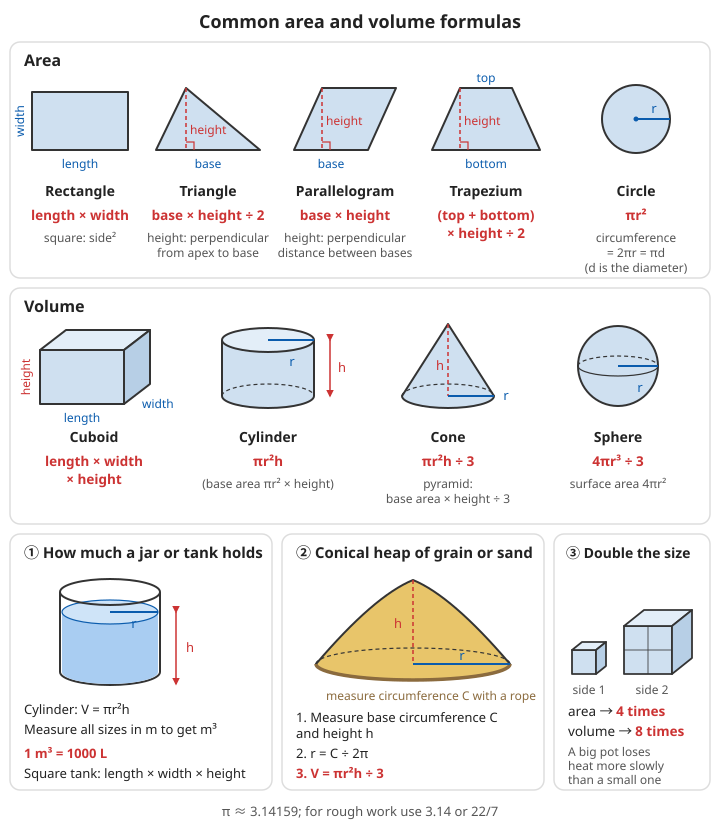

# Mathematics

> **Measuring, building, trade, calendars, engineering: the common language behind all technology**

## ⚠️ What this chapter covers

This chapter collects the mathematics that **has most shaped human society and is most used in rebuilding**, and each item says what it can be used for. It does not aim at completeness or rigorous proof; it aims to let the reader know "this tool exists, and this is how it is used".

```
Learn first (needed for everyday work):
- Place-value counting, the four operations, fractions and percentages
- Proportion (mixing ingredients, mixing medicines, maps)
- Area and volume (fields, granaries, ponds)
- Pythagoras' theorem (building houses, setting out lines)

Next (engineering, astronomy, trade):
- Equations, trigonometry, exponents and logarithms, statistics

After that (advanced science and technology):
- Calculus
```

---

## 1. Numbers and counting

### 1.1 Place value and zero

```
Decimal place value: the same digit in different positions stands for
different amounts
  352 = 3×100 + 5×10 + 2×1

What "0" does: it holds a place
  The difference between 305 and 35 rests entirely on this 0

Why it matters: with place value, any large number can be written with ten
  symbols, and addition, subtraction, multiplication and division can be done
  column by column on paper. Systems without place value, such as Roman
  numerals, make multiplication and division very hard.
```

### 1.2 Fractions, decimals and percentages

```
Fraction: 1/4 means divide a whole into 4 parts and take 1
  Adding and subtracting: first find a common denominator
    1/2 + 1/3 = 3/6 + 2/6 = 5/6
  Multiplying: numerator times numerator, denominator times denominator
    2/3 × 3/4 = 6/12 = 1/2
  Dividing: multiply by the reciprocal  1/2 ÷ 1/4 = 1/2 × 4/1 = 2

Decimal: 0.25 = 25/100 = 1/4

Percentage: 25% = 25/100 = 0.25
  "Increase by 20%" = original × 1.2
  "Decrease by 20%" = original × 0.8
  ⚠️ Going up 20% and then down 20% does not bring you back to where you started:
     100 × 1.2 × 0.8 = 96
```

### 1.3 Negative numbers

```
They stand for amounts in the opposite direction: debts, temperatures below zero,
below sea level
  -3 + 5 = 2
  A negative times a negative is positive: (-2) × (-3) = 6
```

### 1.4 Scientific notation

```
Write very large or very small numbers as a × 10ⁿ (1 ≤ a < 10)
  Speed of light 300000000 m/s = 3 × 10⁸ m/s
  0.000001 = 1 × 10⁻⁶

Multiplying: multiply the front parts, add the exponents
  (2×10³) × (3×10⁴) = 6×10⁷
```

---

## 2. Ratio and proportion

Proportion is the mathematics used most in everyday work: mixing ingredients, mixing medicines, mixing disinfectants, maps, sharing out grain by the number of people.

### 2.1 Proportion

```
a : b = c : d  is the same as  a × d = b × c

Example: 1.5 kg of rice needs 2.25 kg of water to cook;
  how much water does 2.5 kg of rice need?
  1.5 : 2.25 = 2.5 : x
  x = 2.25 × 2.5 ÷ 1.5 = 3.75 kg
```

### 2.2 Mixing ratios and dilution

```
"1:100" usually means 1 part concentrate + 100 parts water
(some sources mean 1/100 of the total; read the instructions carefully)

Dilution formula: concentration₁ × volume₁ = concentration₂ × volume₂
  Example: dilute a 5% disinfectant to 0.05%, making 1 L
  5% × V₁ = 0.05% × 1000 mL
  V₁ = 10 mL of concentrate, topped up with water to 1 L
```

For actually mixing "84" bleach (sodium hypochlorite) see [Infectious disease control at home – mixing household disinfectant](../../../docs/01-日常疾病和伤害/15-传染病家庭防控.md#家用消毒液的配制); for calculating concentrations chemically see [Chemistry – solutions and concentration](../../../docs/08-基础科学知识/03-化学.md#五溶液与浓度).

### 2.3 Map scale

```
A map scale of 1:50000 means 1 cm on the map = 50000 cm = 500 m on the ground
```

---

## 3. Algebra

Use letters for unknown numbers and write the problem as an equation to solve it.

### 3.1 Linear equations in one unknown

```
Example: a rectangular field is 20 m longer than it is wide and its perimeter
  is 200 m. How long and how wide is it?
  Let the width be x; the length is x + 20
  2 × (x + x + 20) = 200
  4x + 40 = 200
  x = 40 (40 m wide, 60 m long)

Method: adding, subtracting, multiplying or dividing both sides of an equation
  by the same number (not dividing by 0) leaves the equation true
```

### 3.2 Simultaneous linear equations in two unknowns

```
Example: chickens and rabbits in one cage, 35 heads and 94 feet in all
  x + y = 35
  2x + 4y = 94
  From the first equation x = 35 - y; substitute into the second:
  70 - 2y + 4y = 94 → y = 12, x = 23
  (23 chickens, 12 rabbits)
```

### 3.3 Quadratic equations

```
ax² + bx + c = 0 (a ≠ 0)

The quadratic formula:
       -b ± √(b² - 4ac)
  x = ─────────────────
             2a

b² - 4ac > 0: two different roots
b² - 4ac = 0: one root
b² - 4ac < 0: no real roots

Example: x² - 5x + 6 = 0 → x = (5 ± √(25-24))/2 → x = 3 or x = 2
```

### 3.4 Useful algebraic identities

```
(a + b)² = a² + 2ab + b²
(a - b)² = a² - 2ab + b²
(a + b)(a - b) = a² - b²
```

---

## 4. Geometry

### 4.1 Pythagoras' theorem

```
In a right-angled triangle, the sum of the squares of the two shorter sides
equals the square of the hypotenuse:
  a² + b² = c²

Common whole-number sets: 3-4-5, 5-12-13, 6-8-10, 8-15-17

Uses:
- Laying out right angles (the 3-4-5 rope, see the measurement chapter)
- Finding the third side from two: a 5 m ladder with its foot 3 m from the wall
  reaches √(25-9) = 4 m high
- Checking that house foundations are square: measure the two diagonals;
  if they are equal, it is a rectangle
```

### 4.2 Angles and triangles

```
- A full turn = 360°, a straight angle = 180°, a right angle = 90°
- The angles of a triangle add up to 180°
- The angles of a polygon add up to (number of sides - 2) × 180°
- Similar triangles: same shape, different size, corresponding sides in proportion
  → measuring heights by shadows and the width of a river
    (see the measurement chapter)
```

### 4.3 Circles and π

```
π (pi) = circumference of a circle ÷ diameter ≈ 3.14159
  Zu Chongzhi's approximation 355/113 ≈ 3.1415929 is very accurate
  For rough work use 3.14 or 22/7

Circumference = 2πr = πd
Area = πr²

Measure π yourself: wrap a cord once round a cylinder (a bucket) to measure the
  circumference, measure the diameter, and divide
```

### 4.4 Area formulas

| Shape | Area | Notes |
|------|------|------|
| Rectangle | length × width | |
| Square | side² | |
| Triangle | base × height ÷ 2 | The height is the perpendicular distance from the apex to the base |
| Triangle (three sides known) | √(p(p-a)(p-b)(p-c)) | Heron's formula, p = (a+b+c)/2 |
| Parallelogram | base × height | |
| Trapezium | (top + bottom) × height ÷ 2 | |
| Circle | πr² | |
| Ellipse | πab | a and b are the two semi-axes |

```
Irregular fields: divide into several triangles, measure the three sides of each,
work out each area with Heron's formula, and add them up
```

### 4.5 Volume formulas

| Solid | Volume | Surface area |
|------|------|--------|
| Cuboid | length × width × height | 2(lw + lh + wh) |
| Cylinder | πr²h | 2πr² + 2πrh |
| Cone | πr²h ÷ 3 | |
| Pyramid | base area × height ÷ 3 | |
| Sphere | 4πr³ ÷ 3 | 4πr² |

```
Uses:
- How much a granary, pond or water jar holds: 1 m³ = 1000 L
- How much grain or sand is in a conical heap: measure the circumference
  of the base and the height,
  r = circumference ÷ 2π, volume = πr²h ÷ 3
- Timber volume, quantities of brick and stone

Note: double the dimensions and the area becomes 4 times, the volume 8 times
  (which is why a big pot loses heat more slowly than a small one, and big animals
   stand cold better than small ones)
```



*Figure: the "height" of a triangle, parallelogram and trapezium is always the perpendicular distance; a cone is 1/3 of a cylinder with the same base and height. Measure the dimensions in m to get m³; 1 m³ = 1000 L. For a conical grain heap, measure the base circumference C and the height h; r = C ÷ 2π*

---

## 5. Trigonometry

In a right-angled triangle, one angle and one side are enough to work out the other sides. Used in surveying, building, navigation and astronomy.

### 5.1 Definitions

```
          hypotenuse
           /|
         /  | opposite
       / θ  |
      ───────
      adjacent

sin θ = opposite / hypotenuse
cos θ = adjacent / hypotenuse
tan θ = opposite / adjacent

sin²θ + cos²θ = 1
```

### 5.2 Special angles

| Angle | sin | cos | tan |
|------|-----|-----|-----|
| 0° | 0 | 1 | 0 |
| 30° | 0.5 | 0.866 | 0.577 |
| 45° | 0.707 | 0.707 | 1 |
| 60° | 0.866 | 0.5 | 1.732 |
| 90° | 1 | 0 | undefined |

### 5.3 Uses

```
Measuring height: standing 20 m from a tree, the angle up to the top of the tree is 30°;
  tree height ≈ 20 × tan30° + eye height = 20 × 0.577 + 1.6 ≈ 13 m

Slope: gradient = height ÷ horizontal distance = tan(angle of slope)
  A 1:3 slope ≈ 18.4°; a 45° slope = 1:1

Law of sines (any triangle): a / sin A = b / sin B = c / sin C
Law of cosines (any triangle): c² = a² + b² - 2ab × cos C
  (when C = 90° this is Pythagoras' theorem)
```

A protractor can be made from a paper protractor template or a semicircular wooden board, marked every 1°.

---

## 6. Coordinates and functions

### 6.1 Coordinates

```
Draw two number lines at right angles on a plane (horizontal axis x,
vertical axis y); any point can then be described by a pair of numbers (x, y)

Uses: drawing maps and charts, turning geometry problems into algebra
```

### 6.2 Direct proportion and straight lines

```
y = kx + b
  k: the slope (how much y increases when x increases by 1)
  b: the value of y when x = 0

Example: 150 kg of fertiliser per hectare plus a base amount of 5 kg
  → total (kg) = 150 × area (ha) + 5
```

### 6.3 Parabolas

```
The graph of y = ax² + bx + c is a parabola
  - A thrown stone or a jet of water follows roughly a parabola
  - A mirror shaped like a paraboloid concentrates sunlight on one point
    (a solar cooker)
```

### 6.4 Drawing charts

```
✓ Draw the recorded data as a chart: time on the horizontal axis,
  yield / temperature / number of cases on the vertical axis
✓ The trend can be seen at a glance; patterns are much easier to spot
  than in a column of numbers
```

---

## 7. Exponents and logarithms

### 7.1 Exponential growth

```
After each period of time the amount is multiplied by the same factor:
  N = N₀ × (1 + r)ⁿ

Examples:
- Bacteria divide once every 20 minutes; 1 bacterium becomes
  2²⁴ ≈ 16.77 million after 8 hours
  (this is why leftovers must be refrigerated: food-poisoning bacteria
   multiply extremely fast)
- Population growth, the rise in cases early in an epidemic
- Compound interest: borrow 50 kg of grain at 10% interest a year;
  after 10 years you owe 50 × 1.1¹⁰ ≈ 130 kg

The "rule of 70": growing at r% per period, the amount doubles in about 70 ÷ r periods
  Growth of 7% a year → doubles in about 10 years
```

### 7.2 Exponential decay and half-life

```
After each period of time the amount halves:
  N = N₀ × (1/2)^(t ÷ T), where T is the half-life

Example: iodine-131 has a half-life of about 8 days;
  after 80 days (1/2)¹⁰ ≈ one thousandth is left
```

For protection from nuclear radiation see [Man-made disasters](../../../docs/02-灾难应对/05-人为灾难.md).

### 7.3 Logarithms

```
The logarithm is the inverse of the exponent: if 10³ = 1000, then lg 1000 = 3
(lg is the logarithm to base 10)

Properties (they turn multiplication and division into addition and subtraction):
  log(a × b) = log a + log b
  log(a ÷ b) = log a - log b
  log(aⁿ) = n × log a

Useful values: lg 2 ≈ 0.301, lg 3 ≈ 0.477, lg 10 = 1

The natural logarithm ln has base e ≈ 2.71828;
change of base: logₐ b = ln b ÷ ln a

Historical importance: before computers, astronomers and engineers used
  log tables and slide rules to turn heavy multiplication and division
  into looking up tables and adding
```

---

## 8. The basic ideas of calculus

Calculus is the foundation of modern physics and engineering. Only the ideas and the most basic formulas are given here.

### 8.1 Derivatives: how fast something changes

```
Derivative = rate of change at an instant
  - The derivative of position with respect to time = velocity
  - The derivative of velocity with respect to time = acceleration
  - The derivative at a point on a curve = the slope of the tangent at that point

Basic formulas:
  (constant)' = 0
  (xⁿ)' = n × xⁿ⁻¹
  (eˣ)' = eˣ
  (ln x)' = 1/x
  (sin x)' = cos x
  (cos x)' = -sin x

Use: finding maximums and minimums (where the derivative equals 0)
  Example: the rectangle of greatest area that a given length of fence
  can enclose → a square
```

### 8.2 Integrals: how much has accumulated

```
Integral = adding up a great many very small parts
  - Velocity integrated over time = distance travelled
  - The area under a curve

Basic formula: ∫ xⁿ dx = xⁿ⁺¹ ÷ (n+1) + C (n ≠ -1)

The fundamental theorem of calculus: integration and differentiation
  are inverse operations

Approximate method (when there is no formula): cut the area into many narrow strips,
  treat each as a trapezium, work out its area and add them up (the trapezium rule)
```

---

## 9. Probability and statistics

Deciding whether a medicine, a seed or a method "really works" depends on statistics.

### 9.1 Describing data

```
Mean: total ÷ number of values
Median: the middle value when they are put in order (not affected by extreme values)
  Example: 5 households hold 50, 60, 65, 75 and 1000 kg of grain
  Mean 250 kg (pulled up by one big household), median 65 kg
  (more typical of an ordinary household)

Standard deviation: how spread out the data are
  s = √[ Σ(each value - mean)² ÷ (number of values - 1) ]
```

### 9.2 The normal distribution

```
Many natural measurements (height, yield, measurement error) follow
a "bell-shaped" distribution:
  - About 68% of values lie within mean ± 1 standard deviation
  - About 95% lie within ± 2 standard deviations
  - About 99.7% lie within ± 3 standard deviations
```

### 9.3 Probability

```
Probability = number of favourable outcomes ÷ number of all possible outcomes
(when every outcome is equally likely)

Two events that do not affect each other both happening: multiply the probabilities
  Two coins both heads = 1/2 × 1/2 = 1/4
One or other of two events that cannot happen together: add the probabilities

Expected value = Σ(each outcome × its probability)
  Used to compare the average return of different choices
```

### 9.4 Common mistakes

```
❌ Sample too small: one person getting better after taking a herb does not
   show that the herb works
❌ Correlation is not causation: ice-cream sales and drownings rise together;
   the cause is summer
❌ Survivorship bias: you only hear from the people who say "this method worked";
   those for whom it failed never get to speak
❌ No control group: many illnesses get better on their own
```

For designing controlled experiments see [Measurement and scientific method – the scientific method](00-measurement-and-scientific-method.md#1-the-scientific-method).

---

## 10. Practical algorithms

### 10.1 Square roots by hand (the Babylonian method)

```
To find √a: first guess any number x, then calculate again and again
  new x = (x + a ÷ x) ÷ 2

Example: √10, guess x = 3
  (3 + 10/3) ÷ 2 = 3.1667
  (3.1667 + 10/3.1667) ÷ 2 = 3.1623
  Already very close to the true value 3.16228
```

### 10.2 Greatest common divisor (Euclid's algorithm)

```
Finding the greatest common divisor of 48 and 18:
  48 ÷ 18 = 2 remainder 12
  18 ÷ 12 = 1 remainder 6
  12 ÷ 6 = 2 remainder 0 → the greatest common divisor is 6

Uses: simplifying fractions, sharing out in proportion
```

### 10.3 Finding primes (the sieve)

```
1. Write out 2 to 100
2. 2 is prime; cross out every multiple of 2
3. The next number not crossed out, 3, is prime; cross out every multiple of 3
4. Repeat; the numbers left are all prime
```

### 10.4 Binary

```
Count using only 0 and 1, carrying at two:
  1 = 1, 2 = 10, 3 = 11, 4 = 100, 13 = 1101 (8+4+1)

Importance: a switch or a circuit has only two states, "on" and "off";
  binary is the basis of every computer
```

---

## Related chapters

- ⏮️ [Measurement and scientific method](00-measurement-and-scientific-method.md) - units, measuring, controlled experiments
- ⏭️ [Physics](02-physics.md) - mathematics applied to mechanics, heat and electricity
- ⏭️ [Chemistry](../../../docs/08-基础科学知识/03-化学.md) - chemical calculations, concentration
- 🔗 [Long-term Housing](../../../docs/07-日常生活技能/05-长期住所.md) - measuring and calculating when building a house

---

**Remember: mathematics is the one kind of knowledge that does not change with time or place. Once you have learned it, you can work out other knowledge again anywhere.**
