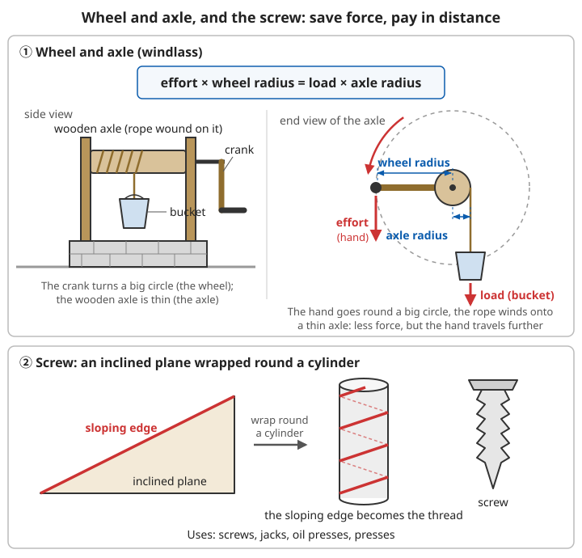
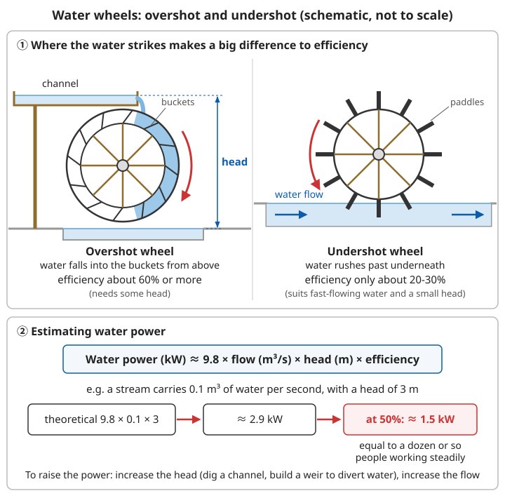

# Physics

> **Levers, waterwheels, steam engines, generators: only by understanding the laws of physics can we put the forces of nature to work**

## ⚠️ What this chapter covers

This chapter collects the laws of physics that have most shaped how people produce and live, with the emphasis on the parts that **can be used directly in production and building**: simple machines, water power, heat and electricity. Each formula is followed by what it can be used for.

```
Learn first:
- Levers, pulleys, inclined planes (moving loads and building with less effort)
- Pressure and air pressure (wells, water pumps, siphons)
- Heat and insulation (heating, cooking, smelting)

Next:
- Work and energy (calculations for waterwheels, windmills, animal power)
- Electricity and magnetism (generating power, batteries, electric motors)
- Astronomy (calendars, finding direction, measuring latitude)
```

In the formulas: m mass (kg), g acceleration due to gravity (about 9.8 m/s²), v velocity (m/s), t time (s), F force (N); for units see [Measurement and scientific method](00-measurement-and-scientific-method.md#3-common-unit-conversions).

---

## 1. Motion and force

### 1.1 Newton's three laws

```
First law (inertia): with no outside force, a body at rest stays at rest,
and a moving body keeps moving in a straight line at constant speed
  → in a sudden stop people are thrown forward; wear a seat belt

Second law: F = m × a
  force = mass × acceleration
  → with the same force, a light object speeds up quickly,
    a heavy object slowly

Third law: action and reaction are equal in size and opposite in direction
  → when rowing, the oar pushes the water back and the water pushes the boat forward;
    a rocket moves forward by blasting gas backwards
```

### 1.2 Gravity

```
Weight G = m × g, g ≈ 9.8 m/s² (use 10 for rough work)
  A 1 kg object weighs about 9.8 N

Universal gravitation: F = G₀ × m₁ × m₂ ÷ r² (G₀ ≈ 6.67 × 10⁻¹¹)
  It explains falling objects, the moon going round the Earth, and the tides
```

### 1.3 Free fall

```
Velocity v = g × t
Height fallen h = ½ × g × t² ≈ 4.9 × t²

Measuring the depth of a well or the height of a cliff: drop a stone and count
the seconds until you hear it land
  2 seconds → about 20 m; 3 seconds → about 44 m
  (when it is deep the sound also takes time to come back up,
   so the real depth is a little less than calculated)
```

### 1.4 Friction

```
f = μ × N
  μ: coefficient of friction (very small on ice, very large for rubber on a dry road)
  N: the force pressing the surfaces together

To increase friction: rough surfaces, more pressing force (non-slip)
To reduce friction: lubricate (oil, wax, soapy water), roll instead of slide
  → wheels and rollers: rolling friction is far smaller than sliding friction;
    putting logs under a heavy load and rolling it makes it much easier to move
```

### 1.5 Circular motion and the pendulum

```
Circular motion needs a centripetal force: F = m × v² ÷ r
  → the sharper the turn and the higher the speed, the more likely a vehicle
    is to overturn or things are to be flung off

Period of a pendulum: T = 2π × √(L ÷ g)
  It depends only on the length → the principle of the pendulum clock
  At a length of about 0.993 m, one swing takes exactly 1 second
  (this varies slightly with latitude; see the measurement chapter)
```

---

## 2. Simple machines

**All simple machines obey the same rule: saving force costs distance, saving distance costs force, and the work done does not get any smaller ("you save force, not work").**

### 2.1 Levers

```
effort × effort arm = load × load arm
  F₁ × L₁ = F₂ × L₂

Example: with a 2 m crowbar, the fulcrum 0.2 m from the load and the hand
1.8 m from the fulcrum
  force at the hand = load × 0.2 ÷ 1.8 ≈ 1/9 of the load

Applications: crowbars, scissors, pliers, steelyards, balances,
  the shadoof (well sweep, for drawing water), wheelbarrows
```

### 2.2 Pulleys

```
Fixed pulley: saves no force, changes the direction of pull
  (pull down to lift something up)
Movable pulley: halves the force, but you pull twice as much rope
Pulley block: pull ≈ weight of the load ÷ number of rope sections carrying the load
  (plus friction and the weight of the pulleys themselves)

Applications: hoisting roof beams, drawing water from a well, loading and unloading heavy goods
```


*Figure: measure each lever arm from the fulcrum to where the force acts; in the pulley block shown, 4 sections of rope carry the load, so the pull is about 1/4 of the weight of the load (plus friction and the weight of the pulleys themselves)*

### 2.3 Inclined planes

```
Pushing an object up a smooth slope: push = weight × height ÷ length of slope
  The longer and gentler the slope, the less force needed

Applications: planks for loading heavy goods onto a cart, zigzag mountain roads,
  wedges, axes
```

### 2.4 Wheel and axle, and the screw

```
Wheel and axle: force × wheel radius = load × axle radius
  Applications: the windlass (for drawing water from a well), winches,
  door handles, steering wheels

Screw: an inclined plane wound round a cylinder
  Applications: screws, jacks, oil presses, presses
```



*Figure: the bigger the circle the crank turns through and the thinner the drum, the less force needed, but the hand has to travel further; wind an inclined plane round a cylinder and its sloping edge becomes the thread*

### 2.5 Gears and transmission

```
Two meshing gears: the ratio of their speeds = the inverse ratio of their numbers of teeth
  A small gear driving a large gear → turns slowly but with great force
  A large gear driving a small gear → turns fast but with little force

Applications: waterwheels and windmills driving millstones; bicycle gears
```

---

## 3. Work, energy and power

### 3.1 Work and power

```
Work W = F × s (force × distance moved in the direction of the force), unit J (joule)
Power P = W ÷ t, unit W (watt)

For reference:
- An adult doing sustained work for a long time: about 75-100 W
- 1 hp (horsepower) ≈ 735 W (the order of power of one horse working steadily)
- Lifting 100 kg to a height of 1 m: about 980 J
```

### 3.2 Energy

```
Kinetic energy = ½ × m × v²
  Double the speed and the kinetic energy becomes 4 times
  → a little more speed makes a crash much more damaging

Gravitational potential energy = m × g × h
  Water held high up and a raised hammer store energy

Conservation of energy: energy is never created out of nothing or destroyed;
it only changes from one form to another
  → there is no such thing as a "perpetual motion machine"
  → the output of any machine is less than its input (part is lost as heat);
    output ÷ input = efficiency
```

### 3.3 Water power: waterwheels and watermills

```
Water power (kW) ≈ 9.8 × flow (m³/s) × head (m) × efficiency

Example: a small stream carries 0.1 m³ of water per second with a head of 3 m
  Theoretical power = 9.8 × 0.1 × 3 ≈ 2.9 kW
  The real efficiency of waterwheels varies a lot: an overshot wheel, where the water
  falls into the buckets from above, about 60% or more;
  an undershot wheel, where the water rushes past underneath, only about 20-30%
  → estimating at 50% gives about 1.5 kW, the same as a dozen or so people
    working steadily

To increase power: increase the head (dig a channel, build a weir to divert water),
  increase the flow
```



*Figure: 0.1 m³ of water per second with a 3 m head gives a theoretical power of about 2.9 kW; at an estimated 50% efficiency, about 1.5 kW*

### 3.4 Momentum

```
Momentum p = m × v
Conservation of momentum: when two objects collide, the total momentum
before and after is the same
  → a hammer needs to be heavy and fast to drive a nail well
```

---

## 4. Pressure and fluids

### 4.1 Pressure

```
Pressure p = F ÷ S (force ÷ area it acts on), unit Pa (pascal)
  For the same force, the smaller the area, the greater the pressure

Applications:
- Sharpened knives, pointed nails → small area, high pressure, cut in easily
- Wide tyres, snowshoes, planks laid over mud → large area, low pressure,
  do not sink in easily
- Foundations must be wide → to spread the weight of the house
```

### 4.2 Pressure in liquids

```
p = ρ × g × h
  ρ: density of the liquid (water 1000 kg/m³)
  h: depth

Every 10 m deeper in water, the pressure rises by about 1 atm
  → a dam must be thicker at the bottom than at the top
  → the higher the water tower, the stronger the flow from the tap
    (about 1 atm more for every 10 m of height)
```

### 4.3 Communicating vessels

```
When several containers joined at the bottom hold the same liquid at rest,
the liquid stands at the same height in all of them

Applications: the water level (levelling tube, see the measurement chapter),
  teapots, canal locks, piped water systems
  (the water tower must be higher than where the water is used)
```

### 4.4 Air pressure: pumps and siphons

```
1 standard atmosphere ≈ 101 kPa ≈ enough to hold up a column of water about 10.3 m high

⚠️ A suction pump can "suck" water up by at most about 10 m
   In practice, because of leaks and friction, usually only 7-8 m
   → for a well whose water table is deeper, put the pump down the well
     to "push" the water up, or lift it with a bucket

Siphon:
1. Fill a tube with water; put one end in the higher tank and the other end
   somewhere lower than the water surface
2. Water keeps flowing from high to low, passing over the high point in between
3. The highest point of the tube must not be more than about 10 m above the water surface
Applications: drawing water out of jars and tanks; bringing water to fields
```

### 4.5 Buoyancy: Archimedes' principle

```
Buoyancy = the weight of the liquid the object displaces
  F = ρ(liquid) × g × V(displaced)

- An object less dense than water → floats (wood, ice, oil)
- An object denser than water → sinks (a lump of iron);
  but shaped like a boat it displaces more water and floats
- Salt water is denser than fresh water → a fresh egg sinks in fresh water
  and floats in strong brine

Measuring density and volume:
- Volume of an irregular object: put it into a container filled to the brim with water;
  the volume of water that overflows is the volume of the object
- Density = mass ÷ volume
  → this can show whether a metal has been adulterated
    (pure gold 19.3 g/cm³, iron 7.9, copper 8.9, aluminium 2.7)
```

For calculating the load a raft can carry see [Vehicles, boats and roads – on the water](../../../docs/07-日常生活技能/18-车船与道路.md#水上-筏和船).

### 4.6 Moving fluids

```
Where a fluid flows faster, its pressure is lower (Bernoulli's principle)
  → when wind blows over a roof, the pressure above the roof drops,
    and a typhoon can "lift" the roof off
  → the taller the chimney and the stronger the wind, the stronger the draught
```

---

## 5. Heat

### 5.1 Temperature and heat

```
Temperature: how hot or cold something is (°C)
Heat: energy being transferred (J)

Calculating heat: Q = c × m × Δt
  c: specific heat capacity (water about 4200 J/(kg·°C),
     the largest of common substances)
  Δt: change in temperature

Example: heating 1 kg of water from 20°C to 100°C takes 4200 × 1 × 80 = 336000 J

Water's high specific heat →
- It warms and cools slowly; the climate by the sea or a lake is mild
- Hot-water bottles and vacuum flasks store heat in water
- Water is used to cool engines and to cool people with a fever
```

### 5.2 Changes of state and latent heat

```
Melting / freezing: ice melts at 0°C; melting 1 kg of ice absorbs about 334000 J
Boiling: turning 1 kg of water at 100°C into steam absorbs about 2260000 J
  (about 7 times the heat needed to bring it from 20°C to 100°C)

Applications:
- Sweating, cooling with a wet cloth: evaporating water carries away a lot of heat
- A scald from steam at 100°C is worse than one from water at 100°C
  (the steam releases a lot of heat as it condenses)
- Keeping food cold with ice: melting ice absorbs heat and stays at 0°C
- Distillation: separating liquids by their different boiling points
  (alcohol 78°C, water 100°C)
```

### 5.3 Boiling point and air pressure

```
The lower the air pressure, the lower the boiling point; the higher the pressure,
the higher the boiling point
- On high plateaus water boils below 100°C and food does not cook through
  → use a pressure cooker
- Inside a pressure cooker water boils at about 120°C: food cooks faster
  and more bacteria are killed
```

For how long to boil drinking water at high altitude see [Basic survival skills – finding and purifying water](../../../docs/03-野外生存/00-基础生存技能.md#水源获取与净化).

### 5.4 Heat transfer

```
Conduction: heat passes through contact (metals conduct heat fast;
  air, wool, wood and straw conduct it slowly)
  → insulating materials all "trap air": cotton wadding, down, straw,
    the air gap in a cavity wall
Convection: moving liquids and gases carry heat away
  → heaters are placed low and the hot air rises;
    keeping out the wind stops heat being lost by convection
Radiation: needs no contact; heat travels as "light"
  → dark objects absorb more heat; pale and shiny surfaces reflect more
  → the aluminium foil of an emergency blanket reflects the body's heat radiation

Heating value of fuels (heat released by burning 1 kg completely, approximate):
  dry firewood about 15 MJ; charcoal about 30 MJ; coal about 20-30 MJ;
  petrol and diesel about 45 MJ; biogas (mainly methane) about 20 MJ/m³
```

For practical insulation see [Long-term housing – insulation](../../../docs/07-日常生活技能/05-长期住所.md#保温).

### 5.5 Thermal expansion

```
Most substances expand when heated and contract when cooled
  → railways, bridges and long concrete floors need expansion joints
  → a metal lid that will not unscrew can be loosened with hot water

⚠️ Water is the exception: it is densest at 4°C, and expands by about 9% when it freezes
  → in winter water pipes and water jars crack in the frost;
    ice floats on the surface, so fish at the bottom survive the winter
```

### 5.6 The gas laws

```
Ideal gas law: p × V = n × R × T
  T is the absolute temperature: T (K) = t (°C) + 273
  R ≈ 8.31

For a fixed amount of gas:
- At constant volume, the higher the temperature, the higher the pressure
  → sealed cans burst when heated; do not leave a lighter in the sun
- At constant temperature, compressing the volume raises the pressure → a bicycle pump
```

### 5.7 The laws of thermodynamics and heat engines

```
First law: conservation of energy (heat is also a form of energy)
Second law: heat flows by itself from a hotter body to a colder one,
  never the other way by itself
  → a heat engine (steam engine, internal combustion engine) can never turn
    all its heat into work

Maximum efficiency of a heat engine = 1 - T(cold) ÷ T(hot) (in kelvin)
  → the hotter the intake and the cooler the exhaust, the higher the efficiency
  Early steam engines were only a few per cent efficient;
  modern power stations reach only about 40%

How a steam engine works: boil water to make high-pressure steam
  → it drives a piston or turbine → which drives machinery
```

---

## 6. Waves, sound and light

### 6.1 Waves

```
Wave speed = frequency × wavelength (v = f × λ)
  Frequency: how many vibrations per second (Hz)
```

### 6.2 Sound

```
Sound needs a medium to travel; it cannot travel through a vacuum
Speed of sound: in air about 340 m/s, in water about 1500 m/s, in steel about 5000 m/s

Applications:
- Distance of lightning: count the seconds from the flash until you hear
  the thunder; seconds ÷ 3 ≈ distance (km)
- Echo ranging: shout at a cliff; time until you hear the echo × 340 ÷ 2 = distance
- With your ear to a railway line you can hear a distant train sooner
```

### 6.3 Reflection and refraction of light

```
Speed of light: about 3 × 10⁸ m/s

Law of reflection: angle of incidence = angle of reflection
  → signalling with a mirror; a concave mirror concentrates sunlight to light
    a fire or make a solar cooker

Refraction: light changes direction when it passes from one substance into another
  n₁ × sin θ₁ = n₂ × sin θ₂
  (n is the refractive index: air 1, water about 1.33, glass about 1.5)
  → things in water look shallower than they are;
    when spearing fish, aim below where you see it
```

### 6.4 Lenses

```
Convex lens (thicker in the middle): brings light together
  - Magnifying glasses, reading glasses (for long sight)
  - Focusing sunlight to light a fire
Concave lens (thinner in the middle): spreads light out
  - Glasses for short sight

Lens formula: 1/f = 1/u + 1/v
  f: focal length; u: distance from object to lens;
  v: distance from image to lens
  Measuring focal length: focus sunlight with the convex lens into the smallest,
  brightest spot; the distance from this spot to the lens is the focal length

Application: two convex lenses together can make a telescope or a microscope
  (the microscope let people see bacteria for the first time,
   and was the starting point of modern medicine)
```

### 6.5 Dispersion

```
White light passing through a prism (or a water droplet) splits into
red, orange, yellow, green, blue, indigo and violet → a rainbow
```

---

## 7. Electricity and magnetism

### 7.1 Basic quantities

| Quantity | Symbol | Unit | Analogy (water pipe) |
|----|------|------|-----------|
| Voltage | U | volt V | Water pressure |
| Current | I | ampere A | Rate of water flow |
| Resistance | R | ohm Ω | Resistance of the pipe |
| Electrical power | P | watt W | |
| Electrical energy | E | kilowatt-hour kWh (commonly called a *du* in Chinese) | |

### 7.2 Ohm's law and electrical power

```
Ohm's law: U = I × R (voltage = current × resistance)

Electrical power: P = U × I = I² × R = U² ÷ R
Electrical energy: E = P × t
  A 1000 W appliance used for 1 hour = 1 kWh = 1 "du" of electricity

Example: a 220 V, 1100 W electric kettle draws a current of 1100 ÷ 220 = 5 A
```

### 7.3 Series and parallel

```
Series (one path): the current is the same everywhere; total resistance = R₁ + R₂ + …
  If one lamp fails, none of them light

Parallel (several paths): every branch has the same voltage;
  1/R(total) = 1/R₁ + 1/R₂ + …
  The appliances in a home are all in parallel and do not affect one another
  ⚠️ The more appliances in parallel, the larger the total current
     → an overloaded extension lead heats up
```


*Figure: Ohm's law, series and parallel; for the voltage law, current law and battery internal resistance shown in the figure see [Electrical engineering and electronics – more on DC circuits](../../../docs/09-进阶科学与工程/02-电气工程与电子学.md#一直流电路进阶)*

### 7.4 Resistance of wires

```
R = ρ × L ÷ S
  ρ: resistivity (copper about 1.7 × 10⁻⁸, aluminium about 2.8 × 10⁻⁸ Ω·m)
  L: length; S: cross-sectional area

→ The longer and thinner the wire, the greater the resistance,
  the more heat and the bigger the voltage loss
→ High-power appliances need thick wires
→ Long-distance transmission uses high voltage: for the same power,
  the higher the voltage the smaller the current,
  and the smaller the loss in the line (I² × R)
```

For safety rules for household electricity see [Household electrical safety](../../../docs/07-日常生活技能/08-家庭用电安全.md).

### 7.5 Batteries

```
Principle: two metals of different reactivity dipped in a solution that conducts
electricity produce a voltage

The voltaic pile (the first battery):
- Stack a zinc plate, a cloth (or card) soaked in salt water or vinegar,
  and a copper plate, in that order, over and over
- Each set gives roughly 1 V; the more sets stacked, the higher the voltage
- It can supply only a very small current

Lead-acid battery (car battery): about 2 V per cell, 6 cells in series = 12 V;
  it can be recharged again and again
```

For using batteries safely see [Lighting and energy – battery safety](../../../docs/07-日常生活技能/06-照明与能源.md#蓄电池安全).

### 7.6 Electricity makes magnetism, magnetism makes electricity

```
An electric current produces a magnetic field (electricity makes magnetism):
- Wind wire into a coil and put an iron core in the middle;
  when current flows it becomes an electromagnet
- Electric motor: a coil carrying current in a magnetic field is pushed round
  → electrical energy becomes mechanical energy

Electromagnetic induction (magnetism makes electricity, discovered by Faraday):
- Move a magnet inside a coil, or turn a coil in a magnetic field,
  and a current is produced in the coil
- Generator: water, wind, steam or human power turns the coil (or the magnet)
  → mechanical energy becomes electrical energy
- The faster it turns, the more turns of wire in the coil and the stronger the magnet,
  the higher the voltage

Transformer: U₁ ÷ U₂ = N₁ ÷ N₂ (ratio of voltages = ratio of turns in the coils)
  It works only with alternating current
```

### 7.7 Magnets and the compass

```
- A magnet has a north and a south pole; like poles repel, unlike poles attract
- The Earth itself is a big magnet, which is why a small magnetic needle
  points north-south
- Home-made compass: stroke a sewing needle with a magnet in the same direction
  a few dozen times and the needle becomes magnetised;
  lay it on a leaf floating on water and it will turn to point north-south
```

For using a compass see [Basic survival skills – navigation and finding direction](../../../docs/03-野外生存/00-基础生存技能.md#导航与定向).

### 7.8 Electrical safety

```
⚠️ China's general safe voltage is below 36 V; household 220 V is enough to kill
⚠️ When the body is wet its resistance falls greatly, and electric shock is more likely
⚠️ Current passing through the heart is the most dangerous
```

---

## 8. Atoms and radiation

### 8.1 Atoms

```
All matter is made of atoms
Atom = nucleus (protons + neutrons) + electrons around it
  The number of protons decides which element it is (see the chemistry chapter)
  Atoms with the same number of protons but different numbers of neutrons
  are called isotopes
```

### 8.2 Radioactivity

```
Some nuclei are unstable and give off radiation, turning into other nuclei:
  Alpha rays: stopped by a sheet of paper, but very harmful once inside the body
  Beta rays: stopped by a few mm of aluminium
  Gamma rays: highly penetrating; need thick lead, thick concrete or a thick layer of earth

Half-life: the time it takes for half the nuclei to decay
  (for the calculation see Mathematics – exponential decay)

Three rules of protection:
- Time: spend less time exposed
- Distance: double the distance and the exposure falls to about 1/4
- Shielding: shelter behind thick walls or in a basement
```

For dealing with a nuclear accident see [Man-made disasters](../../../docs/02-灾难应对/05-人为灾难.md).

### 8.3 Mass–energy equivalence

```
E = m × c²
  A tiny amount of mass can turn into an enormous amount of energy
  → the principle behind nuclear power and why the sun shines
```

---

## 9. Astronomy and the Earth

### 9.1 Days and years

```
- One turn of the Earth on its axis = one day (24 hours relative to the sun)
- One orbit of the Earth round the sun = one year ≈ 365.2422 days
- The Earth's axis is tilted by about 23.4° → over the year the point where the sun
  is directly overhead moves between the tropics → this causes the seasons
  - Summer solstice: longest day in the northern hemisphere, noon sun highest
  - Winter solstice: shortest day in the northern hemisphere, noon sun lowest
  - Spring and autumn equinoxes: day and night equal, sun directly over the equator
```

### 9.2 Calendars

```
Leap-year rules of the solar (Gregorian) calendar:
- A year divisible by 4 is a leap year (February has 29 days)
- But a year divisible by 100 is not
- And a year divisible by 400 is again a leap year
  Examples: 2000 was a leap year, 1900 was not, 2024 was

The moon: the cycle of phases (synodic month) is about 29.53 days
  The Chinese lunisolar calendar (*nongli*) sets its months by the moon's phases
  and adds a leap month about every 3 years to keep in step with the seasons

The 24 solar terms (*jieqi*): each 15° the sun moves through in the year
  marks one solar term; they reflect the seasons and the farming year,
  and guide sowing and harvesting
```

For planning the farming year see [Grain crops](../../../docs/04-动植物培育/02-粮食作物.md).

### 9.3 Measuring latitude and longitude

```
Latitude (in the northern hemisphere):
- The angle of the Pole Star above the horizon ≈ the local latitude
- Or: at noon on the spring or autumn equinox, the sun's angle above the horizon
  = 90° - local latitude

Longitude:
- The Earth turns 15° every hour
- For every 1 hour of difference between local noon and noon at a reference place,
  the longitude differs by 15°
- You need a clock that keeps the reference place's time accurately
```

For finding the Pole Star and telling direction by the sun see [Basic survival skills – navigation and finding direction](../../../docs/03-野外生存/00-基础生存技能.md#导航与定向).

### 9.4 Tides

```
- Caused mainly by the moon's gravity; the sun also has an effect
- Most coasts have two high tides and two low tides a day,
  about 50 minutes later each day
- The tidal range is greatest around new moon and full moon (spring tides)
  and smallest around the first and last quarter (neap tides)
```

---

## 10. Useful physical constants

| Constant | Value |
|------|------|
| Acceleration due to gravity g | about 9.8 m/s² |
| Speed of light c | about 3.0 × 10⁸ m/s |
| Speed of sound in air | about 340 m/s (20°C) |
| Standard atmosphere | about 101 kPa ≈ 10.3 m column of water |
| Density of water | 1000 kg/m³ (1 g/cm³) |
| Specific heat capacity of water | about 4200 J/(kg·°C) |
| Latent heat of fusion of ice | about 334000 J/kg |
| Latent heat of vaporisation of water | about 2260000 J/kg |
| Absolute zero | -273.15°C |
| Gravitational constant | about 6.67 × 10⁻¹¹ N·m²/kg² |
| Gas constant R | about 8.31 J/(mol·K) |

---

## Related chapters

- ⏮️ [Measurement and scientific method](00-measurement-and-scientific-method.md) - units and measuring
- ⏮️ [Mathematics](01-mathematics.md) - the mathematical tools physics calculations need
- ⏭️ [Chemistry](../../../docs/08-基础科学知识/03-化学.md) - the chemical reactions behind combustion, smelting and batteries
- 🔗 [Lighting and Energy](../../../docs/07-日常生活技能/06-照明与能源.md) - generators, solar power and biogas in practice
- 🔗 [Metallurgy Basics](../../../docs/05-冶金技术/00-基础冶金知识.md) - heat and high temperatures in smelting

---

**Remember: the laws of physics are the same everywhere. Understand levers, water power and electromagnetic induction, and you will know how to do the most work with the fewest hands.**
