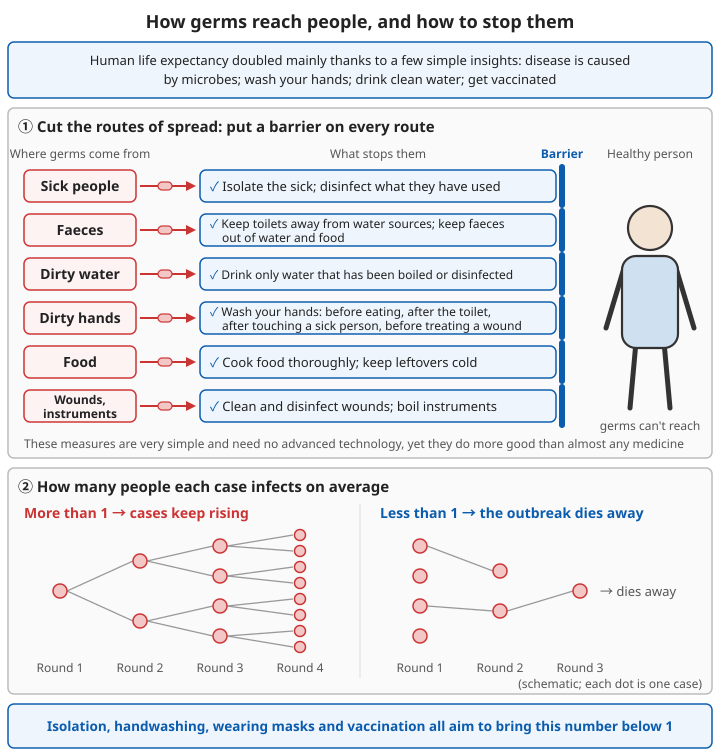

# Biology and Medical Basics

> **Human life expectancy doubled mainly not through advanced medicine but through a few simple insights: disease is caused by invisible microbes; wash your hands; drink clean water; get vaccinated**

## ⚠️ What this chapter is for

This chapter is about **principles**: why people fall ill, why washing hands and boiling work, why vaccines and antibiotics are effective, why seed must be selected and saved. For treating specific illnesses and for first-aid procedures see the [First aid and family health](../01-first-aid-and-family-health/README.md) part; for using medicines see the [Pharmaceuticals](../06-pharmaceuticals/README.md) part.

```
The insights that did most for human lifespan (roughly in order of impact):
1. Many diseases are caused by microbes and are infectious → wash hands,
   disinfect, isolate
2. Faeces contaminating drinking water spread disease → clean water,
   toilets away from water sources
3. Vaccines can prevent infectious disease → smallpox has been eradicated
   and many childhood infections have fallen sharply
4. Some diseases are caused by lack of nutrients → scurvy and beriberi can
   be prevented by diet
5. Antibiotics can treat bacterial infections → but resistance develops,
   so do not misuse them

Most of these insights were established only in the last two or three
hundred years, and before that people spent thousands of years believing
wrong explanations (such as "miasma" or "imbalance of the humours").
```

---

## 1. Cells and microbes

### 1.1 Cells

```
All living things are made of cells, and cells arise only by division of
existing cells
- The human body has several tens of trillions of cells
- A bacterium is a single cell
- Cells are too small to see with the naked eye; you need a microscope

Microscope: a combination of two convex lenses (see Physics – Lenses)
  In the 17th century Leeuwenhoek first saw bacteria with a home-made
  single-lens microscope
```

### 1.2 Microbes and parasites that cause disease

| Type | Size | Examples | Can antibiotics treat it? |
|------|------|------|----------------|
| Bacteria | About 0.001 mm (1 μm); visible with an ordinary light microscope | Tuberculosis, cholera, typhoid, tetanus, pus in wounds | Yes |
| Viruses | Much smaller than bacteria; invisible with an ordinary microscope | Colds, influenza, measles, rabies, hepatitis B | **No** |
| Fungi | Some single-celled (yeasts), some threadlike (moulds) | Athlete's foot, ringworm, thrush | Need antifungal drugs |
| Parasites | From single cells to several m long | Malaria, roundworm, tapeworm, scabies mites, head lice | Need the matching antiparasitic drug |

```
⚠️ The vast majority of microbes are harmless or even useful:
- Gut bacteria help digestion and make vitamins
- Yeast raises bread and makes alcohol; lactic acid bacteria make
  sauerkraut and yoghurt
- Soil microbes break down fallen leaves and dung and make land fertile
```

---

## 2. Germ theory: the insight that changed human destiny

### 2.1 Some key events in history

```
1847 Handwashing: the Hungarian doctor Semmelweis found that when doctors
  delivered babies straight after dissecting corpses without washing their
  hands, large numbers of mothers died of childbed fever; after he required
  handwashing with a chlorine solution, maternal deaths fell from over 10%
  to about 1-2%. Many doctors at the time did not believe him

1854 The well: the English doctor Snow marked the addresses of London
  cholera patients on a map and found the cases clustered around one
  public pump; after the pump handle was removed, the outbreak was brought
  under control
  → this showed that cholera spreads through contaminated water (not
    "miasma")

1860s Pasteur: showed by experiment that food spoilage and fermentation
  are caused by microbes, and that microbes do not arise out of nothing;
  invented pasteurisation

1867 Lister: used carbolic acid to disinfect wounds and instruments in
  surgery; deaths from infection after operations fell sharply

1880s Koch: found the bacteria that cause tuberculosis and cholera, and
  established a method for proving that "a particular bacterium causes a
  particular disease"
```

### 2.2 What follows from it

```
Insight: germs pass from sick people, faeces, dirty water and dirty hands
  to healthy people
What to do:
✓ Wash your hands: before eating, after the toilet, after touching a sick
  person, before treating a wound
✓ Drink only water that has been boiled or disinfected
✓ Keep toilets away from water sources; keep faeces out of water and food
✓ Clean and disinfect wounds; boil instruments
✓ Isolate the sick; disinfect what they have used
✓ Cook food thoroughly; keep leftovers cold

These measures are very simple and need no advanced technology, yet they
do more good than almost any medicine.
```



*Figure: Germs pass from sick people, faeces, dirty water, dirty hands and so on to healthy people, and every route has simple barriers; once each case infects fewer than one other person on average, the outbreak dies away (see Section 9).*

For what to do in practice see [Infectious disease at home](../01-first-aid-and-family-health/15-infectious-disease-at-home.md) and [Sanitation](../07-everyday-living-skills/03-sanitation.md).

### 2.3 How to kill and hold back microbes

| Method | Principle | Effect and limits |
|------|------|-----------|
| Boiling | High temperature denatures microbial proteins | Kills the vast majority of bacteria and viruses; does not kill the spores of some bacteria (e.g. botulism and tetanus bacteria) |
| Pressurised steam (about 121°C, 15 minutes or more) | Higher temperature | Kills spores; the most reliable method of sterilisation |
| Alcohol (70-75%) | Denatures proteins | Effective against most bacteria and viruses; poor against norovirus and spores |
| Chlorine disinfectants, iodine | Oxidise and destroy microbes | Broad-spectrum; corrosive |
| Drying | Microbes need water to multiply | Sun-dried food keeps a long time |
| Strong salt or sugar | "Draws" water out of microbes | Salting, candied fruit |
| Acid | Most disease-causing bacteria cannot multiply in acid conditions | Pickling in vinegar, sauerkraut |
| Cold | Refrigeration slows multiplication, freezing stops it, but neither kills | Microbes multiply again after thawing |
| Sunlight (ultraviolet) | Damages the genetic material of microbes | Only a supplementary measure |

```
⚠️ Botulism spores survive 100°C, and in a sealed, oxygen-free, low-acid
   can they multiply and produce toxin
   → Without a pressure cooker, do not can vegetables or meat at home
```

For preserving food see [Food processing and preservation](../07-everyday-living-skills/01-food-processing-and-preservation.md); for disinfection and sterilisation procedures see [Pharmacy basics](../06-pharmaceuticals/00-pharmacy-basics.md).

---

## 3. Immunity and vaccines

### 3.1 Immunity

```
The body has two lines of defence:
1. Innate defences: skin, mucous membranes, stomach acid, white blood
   cells, fever
   → when the skin is broken (wounds, burns) this line is breached
2. Acquired immunity: the body "remembers" pathogens it has had and can
   destroy them quickly the next time
   → you only catch many infectious diseases once (e.g. measles,
     chickenpox)
```

### 3.2 Vaccines

```
Principle: show the body a "fake" or "weakened" pathogen so that it
  remembers it in advance; when the real pathogen comes it can be
  destroyed quickly, without the person actually getting ill

History:
- Variolation: by the Ming dynasty at the latest, China was using scabs
  from smallpox patients to inoculate against smallpox
  (with some risk: a few of those inoculated fell ill)
- 1796 Jenner: noticed that milkmaids who had had cowpox did not get
  smallpox, and inoculated with cowpox, which was safer
- 1980: the World Health Organization declared smallpox completely
  eradicated — the first time people had wiped out an infectious disease
  with a vaccine

Herd immunity: when enough people are vaccinated, the pathogen cannot find
  enough people to spread through, so those who cannot be vaccinated
  (babies, the sick) are protected too
```

```
⚠️ Vaccines must be made by licensed producers, kept cold in transport as
   required, and given according to schedule
   Home-made "vaccines" are extremely dangerous; they can directly infect
   people or cause severe reactions
✓ Keep the whole family's vaccination records safe
✓ After an animal bite get rabies vaccine; after an injury get tetanus
  vaccine as needed
```

For vaccination see [Infectious disease at home – Vaccines](../01-first-aid-and-family-health/15-infectious-disease-at-home.md#vaccines).

---

## 4. Antibiotics and resistance

```
Antibiotics: drugs that kill bacteria or stop them growing
  Fleming discovered penicillin in 1928; it came into large-scale use in
  the 1940s, and pneumonia, wound infections, childbed fever and the like
  went from deadly to treatable

⚠️ Antibiotics do not work against viruses: colds and flu are mostly
   caused by viruses, and antibiotics do nothing for them

How resistance arises (natural selection, see Section 6):
- When an antibiotic is used, most bacteria are killed, but a few that are
  naturally unaffected by the drug survive
- The survivors multiply, and the whole next generation is unaffected by
  the drug
- Misuse, stopping and starting, and too low a dose all speed up the rise
  of resistant bacteria

So:
✓ Use them only for genuine bacterial infections, and finish the dose and
  course the doctor prescribes
✓ Do not take antibiotics casually as an "anti-inflammatory"
✓ Preventing infection (washing hands, cleaning wounds) matters more than
  treating it
```

For why you cannot make antibiotics at home, and what natural antibacterial substances can and cannot do, see [Antibiotics](../06-pharmaceuticals/02-antibiotics.md).

---

## 5. Nutrition

### 5.1 Nutrients

```
The three sources of energy:
- Carbohydrates (starch): about 4 kcal/g, mainly from grain
- Fat: about 9 kcal/g
- Protein: about 4 kcal/g; builds muscle, blood and immune substances;
  from meat, eggs, milk and beans

Vitamins and minerals: needed only in tiny amounts, but you fall ill
without them
```

### 5.2 How deficiency diseases were discovered

| Disease | Lacking | Historical discovery | Prevention |
|------|--------|-------------|------|
| Scurvy (bleeding gums, wounds that do not heal) | Vitamin C | 1747, Lind ran a controlled trial on board ship: the sailors who ate citrus fruit soon recovered | Fresh fruit and vegetables, bean sprouts |
| Beriberi (weak legs, swelling, heart failure) | Vitamin B1 | Common among people who ate polished white rice, rare among those who ate brown rice | Do not mill rice too white; mixed grains |
| Pellagra (dermatitis, diarrhoea, dementia) | Niacin | Common where maize was the staple and was not treated with alkali | Treat maize with alkali, eat beans |
| Goitre ("big neck disease"), cretinism | Iodine | Common in mountain areas far from the sea | Iodised salt |
| Anaemia | Iron and others | | Meat, animal blood, liver, beans |
| Night blindness | Vitamin A | | Animal liver, dark-coloured vegetables |
| Rickets (bone deformity), osteomalacia | Vitamin D, calcium | Common in children who get little sunlight | Sunshine; fish, egg yolk, soya products |

```
Lind's scurvy trial was one of the earliest controlled clinical trials in
history:
  12 sailors with scurvy were split into 6 groups, each treated a
  different way, and only the group that ate citrus fruit clearly
  improved → the power of the controlled experiment (see Measurement and
  the scientific method)
```

For practical prevention see [Nutrition and deficiency diseases](../07-everyday-living-skills/02-nutrition-and-deficiency-diseases.md).

---

## 6. Heredity and evolution

### 6.1 Heredity

```
Offspring inherit their parents' traits; the hereditary information is
stored in the DNA in the cells

Mendel's pea experiments (1860s):
- Crossing pure-bred tall and pure-bred short pea plants gave a first
  generation that was all tall
- Self-pollinating the first generation gave a second generation of tall
  and short plants in a ratio of about 3 : 1
- Meaning: traits are controlled by paired "hereditary factors" (genes),
  which are dominant or recessive; a recessive trait can skip a
  generation
```

### 6.2 Selecting and breeding

```
People have used the laws of heredity for thousands of years without
knowing how they worked:
✓ Each year save seed from the plants that grew best and resisted disease
  best
✓ Breed from the strongest, most productive livestock
→ Generation after generation the gains add up, and crops and livestock
  get better and better

⚠️ Hybrid seed (F1) is not suitable for saving:
   The first hybrid generation is uniform and high-yielding (hybrid
   vigour), but when its seed is sown, the second generation segregates
   and yield and quality are very uneven
   → For long-term self-sufficiency, stock and grow traditional varieties
     whose seed can be saved
```

For how to save seed see [Grain crops – Seed storage](../04-farming-and-animal-husbandry/02-grain-crops.md#seed-saving).

### 6.3 The harm of inbreeding

```
Close relatives are more likely to carry the same recessive disease
genes, so their offspring are much more likely to show recessive
hereditary diseases
- Livestock: long-term inbreeding makes animals weak, sickly and less
  fertile → bring in breeding stock from outside regularly
- People: Chinese law forbids marriage between lineal blood relatives and
  between collateral blood relatives within three generations
```

### 6.4 Evolution and natural selection

```
- Individuals of the same species differ from one another
- Some of these differences are inherited
- Individuals that survive and reproduce better in their environment leave
  more offspring
- Over generations the changes add up, and living things change

This explains:
- Bacteria becoming resistant to antibiotics
- Pests becoming resistant to pesticides → rotate different pesticides;
  do not keep using one
- The domestication of crops and livestock (artificial selection)
```

---

## 7. Basic facts about the human body

### 7.1 Main systems

| System | Main organs | Function |
|------|---------|------|
| Circulatory | Heart, blood vessels, blood | Carries oxygen and nutrients |
| Respiratory | Lungs, windpipe | Takes in oxygen, gets rid of carbon dioxide |
| Digestive | Stomach, intestines, liver | Digests food, absorbs nutrients |
| Urinary | Kidneys, bladder | Filters the blood, removes waste |
| Nervous | Brain, spinal cord, nerves | Controls and coordinates the whole body |
| Musculoskeletal | Bones, muscles | Support and movement |
| Immune | White blood cells, lymph nodes | Fights pathogens |
| Reproductive | | Produces offspring |

```
Some important facts:
- After 4-6 minutes without oxygen the brain starts to suffer irreversible
  damage → start CPR immediately
- An adult's blood volume is about 7% of body weight (a little over 4 L
  for a 60 kg person);
  losing more than about 30% of it in a short time causes shock → stop
  severe bleeding immediately
- The body is about 60% water; without drinking you last only about 3 days
- Body temperature must stay around 37°C; too high (heatstroke) or too low
  (hypothermia) is life-threatening
```

For normal body temperature and fever grades see [Common illnesses – Fever](../01-first-aid-and-family-health/01-common-illnesses.md#fever); for checking vital signs see [Basic first aid – Assessing vital signs](../01-first-aid-and-family-health/00-basic-first-aid.md#assessing-vital-signs).

### 7.2 Blood groups

```
ABO blood groups: A, B, AB and O; also Rh negative and positive
Transfusing the wrong blood group causes a severe haemolytic reaction,
which can kill

⚠️ Blood transfusion must be done in a medical facility after blood
   grouping and cross-matching; never give a transfusion yourself under
   any circumstances
✓ Know your own and your family's blood groups and write them on the
  medication information card
```

For the medication information card see [Stockpiling medicines for chronic conditions](../01-first-aid-and-family-health/08-chronic-medication-stockpile.md).

---

## 8. Ecology and agricultural biology

### 8.1 Cycles of matter

```
Carbon cycle: plants take in carbon dioxide by photosynthesis → animals
  eat plants → respiration, decay and burning turn the carbon back into
  carbon dioxide

Nitrogen cycle: nitrogen in the air → fixed into a form plants can use
  by root-nodule bacteria on legumes and by lightning → plants → animals
  → dung and carcasses broken down by microbes → back into the soil
  → this is why growing beans and spreading manure both enrich the soil
```

For the chemistry see [Chemistry – Nitrogen fertiliser and ammonia synthesis](03-chemistry.md#410-nitrogen-fertiliser-and-ammonia-synthesis).

### 8.2 Biology in farming

```
Crop rotation: grow the same crop on the same land year after year and
  the pests and diseases of that crop build up, while the nutrients it
  needs run lower and lower → grow different crops in turn, with legumes
  in between

Pollination: many fruit trees and melons and squashes need bees or other
  insects to pollinate them before they set fruit
  → protect bees and do not spray pesticides during flowering; where
    insects are scarce, pollinate by hand

Compost: microbes give off heat as they break down organic matter; the
  centre of a good compost heap can reach above 55°C, killing most
  pathogens and weed seeds
  → faeces must be fully composted or stored for a long time before they
    are spread

Food chain: at each step up, only a small part of the energy (about one
  tenth) is passed on
  → the same land feeds far more people if they eat the grain directly
    than if it grows feed for livestock that are then eaten
```

For using faeces see [Sanitation – Using faeces and urine](../07-everyday-living-skills/03-sanitation.md#using-faeces-and-urine).

---

## 9. Basics of epidemiology

The study of how diseases are distributed and spread among people; the science of controlling infectious disease.

```
1. Record cases: who, when, where, what symptoms
2. Look for what they have in common: did all the patients drink from the
   same well? Eat the same meal? Have contact with the same person?
   (this is how Snow's cholera map found the contaminated water source)
3. Cut the route of spread: close the contaminated water source, isolate
   the sick, disinfect

Some concepts:
- Incubation period: the time from infection to the first symptoms
  → people who have been in contact with a patient must be watched until
    the longest incubation period is over
- Infectious period: the time during which a patient can infect others;
  sometimes it starts before symptoms appear
- How many people each case infects on average:
  more than 1 → cases keep rising; less than 1 → the outbreak dies away
  → isolation, handwashing, wearing masks and vaccination all aim to bring
    this number below 1

Isolation and quarantine:
- Isolation: separating the sick from the healthy
- Quarantine: watching people who may be infected but are not yet ill for
  a period of time
  (the English word "quarantine" comes from the Italian for "forty days":
   medieval Venice made ships from plague areas anchor outside the port
   for forty days)
```

---

## 10. Timeline of major discoveries

| Date | Discovery | Significance |
|------|------|------|
| 1670s | Leeuwenhoek sees microbes through a microscope | The first time anyone saw bacteria |
| Ming dynasty at the latest | China uses variolation to prevent smallpox | One of the earliest methods of immunisation |
| 1747 | Lind shows by controlled trial that citrus fruit cures scurvy | The beginning of controlled clinical trials |
| 1796 | Jenner uses cowpox to prevent smallpox | The beginning of vaccines |
| 1847 | Semmelweis requires doctors to wash their hands | Maternal deaths fall sharply |
| 1854 | Snow shows that cholera spreads through water | The beginning of epidemiology |
| 1860s | Pasteur shows that microbes cause spoilage and fermentation | Germ theory established |
| 1866 | Mendel publishes his pea-crossing experiments | The beginning of genetics |
| 1867 | Lister operates using antisepsis | The beginning of aseptic surgery |
| 1880s | Koch discovers the tuberculosis bacillus and the cholera vibrio | Proof that particular bacteria cause particular diseases |
| 1928 | Fleming discovers penicillin | The beginning of the antibiotic era |
| 1953 | The double-helix structure of DNA is discovered | The beginning of modern molecular biology |
| 1980 | Smallpox declared eradicated | The first infectious disease wiped out by people |

---

## Related chapters

- ⏮️ [Chemistry](03-chemistry.md) - the chemistry of protein denaturation, fermentation and photosynthesis
- ⏮️ [Measurement and the scientific method](00-measurement-and-scientific-method.md) - controlled experiments
- ⏭️ [The periodic table](05-periodic-table.md)
- 🔗 [Infectious disease at home](../01-first-aid-and-family-health/15-infectious-disease-at-home.md) - germ theory in practice
- 🔗 [Nutrition and deficiency diseases](../07-everyday-living-skills/02-nutrition-and-deficiency-diseases.md) - preventing deficiency diseases
- 🔗 [Farming and animal husbandry](../04-farming-and-animal-husbandry/README.md) - selection and breeding, crop rotation, fertilising
- 🔗 [Pharmaceuticals](../06-pharmaceuticals/README.md) - disinfection, antibiotics, medicines

---

**Remember: washing hands, drinking clean water, managing faeces properly and getting vaccinated — these simplest of things have saved more lives than any medicine.**
