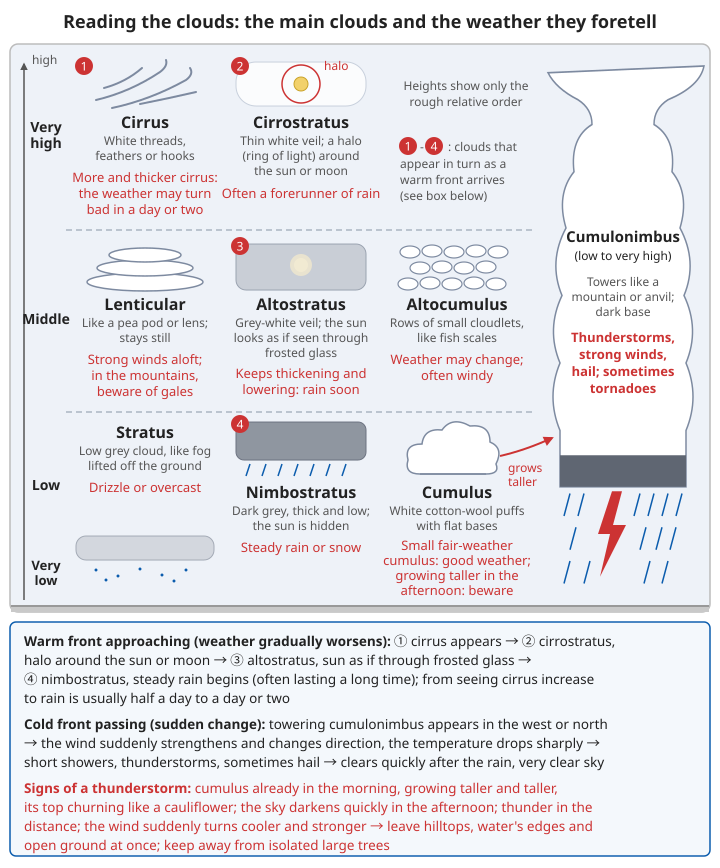

# Weather Observation and Forecasting

> **When there is no weather service, the sky, the wind and a barometer are your forecast. Farming depends on the weather, travel depends on the weather, and disaster prevention depends on it most of all**

## ⚠️ What this chapter covers

This chapter covers ways to judge the weather for the next day or two by your own observation, without relying on the weather service, and how to keep long-term records of local weather patterns.

```
⚠️ Know its limits:
- Your own observations can only roughly judge the weather for the next few hours to a day
  or two; they are far less accurate than professional forecasts
- When official forecasts and warnings are available, follow the official ones (see Disaster
  Response – sources of disaster information)
- If you see signs of danger such as thunderstorms, flash floods or typhoons, take cover early
  rather than late
```

For dealing with the various weather disasters see [Weather Disasters](../../../docs/02-灾难应对/02-气象灾害.md).

---

## 1. How weather forms

```
The sun heats the ground unevenly → air rises when warmed and sinks when cooled
→ differences in air pressure form
Air flows from high pressure to low pressure → wind
Rising air expands and cools → water vapour condenses into cloud → cloud droplets grow
large enough → rain or snow

So:
- Low-pressure areas: air rises; cloudy, rainy
- High-pressure areas: air sinks; mostly clear, few clouds
- Where cold and warm air meet (a front): the weather changes sharply
```

---

## 2. Reading the clouds

### 2.1 The main clouds

| Cloud | What it looks like | Height | What it signals |
|----|------|------|------|
| Cumulus | Separate white cotton-wool heaps with flat bases | Low | Small "fair-weather cumulus" on a clear day means good weather; if they grow taller and taller in the afternoon, be on guard |
| Cumulonimbus | Towering like a mountain or an anvil, dark base | From low to very high | Thunderstorms, strong winds, hail, sometimes tornadoes |
| Cirrus | White fine threads, feathers or hooks | Very high | If cirrus increases and thickens, the weather may turn bad within a day or two |
| Cirrostratus | Thin white veil; a "halo" (ring of light) appears around the sun or moon | Very high | Often a forerunner of rain |
| Altocumulus | Rows of small cloudlets, like fish scales | Middle | The weather may change, often windy |
| Altostratus | Greyish-white sheet; the sun looks as if seen through frosted glass | Middle | The cloud keeps thickening and lowering; rain soon |
| Nimbostratus | Dark grey, thick and low, sun not visible | Low | Steady rain or snow |
| Stratus | Grey low cloud, like fog higher up | Very low | Drizzle or overcast |
| Lenticular | Like a pea pod or a lens, stays in one place | Middle | Very strong winds aloft; in mountains, watch for strong winds |



*Figure: the main clouds arranged by rough height and the weather they signal; ①–④ are the clouds that appear in turn as a warm front approaches, and below are the order of the weather change and the signs of a thunderstorm (see 2.2 and 2.3)*

### 2.2 Typical sequences of weather change

```
A warm front approaching (the weather gradually worsens):
  cirrus appears → cirrostratus, halo around sun or moon → altostratus, sun as if through
  frosted glass → nimbostratus, steady rain begins (often lasting a long time)
  → from seeing cirrus increase to rain is usually half a day to a day or two

A cold front passing (the weather changes suddenly):
  towering cumulonimbus appears in the west or north → the wind suddenly strengthens and
  changes direction, the temperature drops sharply → short showers, thunderstorms, sometimes
  hail → after the rain it clears quickly, the sky is especially clear and it is cooler
```

### 2.3 Signs of a thunderstorm

```
- Cumulus already appears in the morning, and keeps growing taller, its top churning like
  a cauliflower
- In the afternoon the sky darkens quickly; thunder in the distance
- The wind suddenly turns cooler and stronger (the "gust front" before a thunderstorm)
→ Leave hilltops, water's edges and open ground at once; keep away from isolated large trees
```

For staying safe in lightning see [Weather Disasters – Lightning](../../../docs/02-灾难应对/02-气象灾害.md).

---

## 3. Air pressure and wind

### 3.1 Air pressure

```
Pressure falling → the weather will most likely worsen (cloud, rain, wind)
Pressure falling fast (a clear drop within a few hours) → a severe storm or typhoon is possible
Pressure rising → the weather will most likely improve
Pressure steady at a fairly high level → fine weather may last

What matters is the trend, not a single reading
```

### 3.2 Making a simple barometer

```
Bottle barometer:
1. Half fill a glass bottle with water and stand it upside down in a dish or wide cup of water
   (the mouth under water, not touching the bottom)
2. The water level in the bottle neck changes with the outside air pressure: when pressure falls,
   the water level in the bottle falls; when pressure rises, the level rises
3. Stick a paper strip on the bottle and mark the water level at the same time every day
⚠️ Temperature changes also affect the level; keep it where the temperature is steady (a shaded
   spot indoors) and look mainly at the trend

If available: a salvaged barometer, or a watch or mobile phone with a pressure sensor
(no signal needed)
```

### 3.3 Wind

```
Wind direction: a wind is named after the direction it blows from (north wind = wind blowing
from the north)
Rule in the northern hemisphere: stand with your back to the wind, and low pressure is ahead of
you to the left
  → this tells you roughly in which direction the bad weather (the low) lies

Changes of wind direction:
- The wind gradually swings from south-east to north-west and strengthens → often a cold front
  passing; temperature drops
- A warm, moist south or south-east wind keeps blowing and the pressure falls → rain may be coming

Local winds in mountains and by water:
- By day the wind blows from the valley up towards the summit (valley breeze); at night from the
  summit down into the valley (mountain breeze)
- By day the wind blows from the sea (or lake) onto the land; at night the other way round
```

### 3.4 Wind force scale

| Force | Name | Wind speed (m/s) | What you see on land |
|------|------|-----------|------------|
| 0 | Calm | 0-0.2 | Smoke rises straight up |
| 1 | Light air | 0.3-1.5 | Smoke shows the wind direction; wind vane does not move |
| 2 | Light breeze | 1.6-3.3 | Wind felt on the face, leaves rustle |
| 3 | Gentle breeze | 3.4-5.4 | Leaves and twigs in constant motion, flags extend |
| 4 | Moderate breeze | 5.5-7.9 | Raises dust and paper, small branches move |
| 5 | Fresh breeze | 8.0-10.7 | Small trees in leaf sway, small waves on water |
| 6 | Strong breeze | 10.8-13.8 | Large branches move, wires whistle, umbrellas hard to use |
| 7 | Near gale | 13.9-17.1 | Whole trees move, hard to walk into the wind |
| 8 | Gale | 17.2-20.7 | Breaks twigs off trees, strong resistance walking into the wind |
| 9 | Strong gale | 20.8-24.4 | Slight damage to houses (tiles lifted) |
| 10 | Storm | 24.5-28.4 | Trees can be blown down, considerable damage to houses |
| 11 | Violent storm | 28.5-32.6 | Widespread damage |
| 12 | Hurricane (typhoon) | ≥32.7 | Extremely destructive |

---

## 4. Other signs and sayings

Chinese folk tradition has built up a great deal of weather lore. Some of it has a scientific basis; some only holds in particular regions.

| Saying | Reason | Reliability |
|------|------|---------|
| "Red sky in the morning, don't go out; red sky in the evening, travel a thousand *li*" | In China's mid-latitudes most weather systems move from west to east; a red sky in the east in the morning means there is a lot of cloud to the west and bad weather is coming; a red sky in the west in the evening means it is clear to the west | Fairly reliable (mid-latitudes) |
| "Halo round the sun, rain by midnight; halo round the moon, wind by noon" | Solar and lunar halos come from cirrostratus, which is often the cloud ahead of a warm front | Fairly reliable |
| "Hooks in the sky, rain on the ground" | Increasing hooked cirrus means the weather is turning bad | Fairly reliable |
| "Fish-scale sky: if not rain, then gales" | Altocumulus and cirrocumulus signal a change in the weather | Moderate |
| "Swallows flying low means rain" | Before rain the air is moist, insects fly low, and swallows chase them | Moderate |
| "When ants move house, rain comes sooner or later" | Ants are sensitive to humidity | Moderate |
| "Thick fog after a long dry spell brings cloud; thick fog after long rain brings sun" | The fogs form in different ways | Moderate |
| "Heavy dew in the morning, a fine day ahead" | Dew forms only when the night is clear and still and the ground loses heat fast | Fairly reliable |

```
Other signs:
- Distant sounds (trains, bells) sound especially clear, distant hills look especially close
  → the air is moist; rain may be coming
- The outside of a water jar "sweats", the salt jar turns damp → the air is very humid
- Chimney smoke drifts along the ground → low pressure, often before a change in the weather
```

---

## 5. Frost

Frost does great harm to crops, and it most often comes in weather that looks "good".

```
When frost is likely:
- Spring and autumn
- Clear, cloudless nights (the ground loses heat to the sky quickly)
- No wind or a light wind (cold air settles on the ground)
- Dry air
- Low-lying ground and valley bottoms (cold air flows downhill)

Protecting against frost:
✓ When you expect frost in the evening, cover seedlings and vegetables with straw mats,
  plastic sheet or old cloth
✓ Water once (moist soil gives off heat more slowly than dry soil)
✓ Light heaps of damp straw upwind to make smoke (⚠️ take care to prevent fire)
✓ Plant halfway up a slope, not in low hollows where cold air collects
✓ Record the dates of the last spring frost and first autumn frost each year, and plan sowing
  and harvest by them
```

---

## 6. Making your own observations

### 6.1 Simple observation tools

```
Rain gauge: a straight-sided container with an even opening (such as a cylinder), placed in an
  open spot with nothing overhead, mouth about 70 cm above the ground; after rain, the depth
  of water (mm) is the rainfall
  → 1 mm of rainfall = 1 L of water per square metre
Thermometer: hang it in a ventilated, shaded spot about 1.5 m above the ground (ideally in a
  white, ventilated louvred screen), out of direct sun
Wind vane: a rod that turns freely, with one big end and one small end (the big end like a tail);
  the small end points to where the wind is coming from
Barometer: see 3.2
```

For rainfall and calculating rainwater collection see [Water Supply Engineering – Collecting rainwater](../../../docs/07-日常生活技能/10-水源工程与供水.md#收集雨水).

### 6.2 Weather diary

```
Record at fixed times every day (e.g. 8 a.m., 2 p.m., 8 p.m.):
- Date, time
- Temperature, pressure (or water level), wind direction, wind force
- Type and amount of cloud, weather (clear, rain, snow, fog, frost, thunder)
- Rainfall

Keep records for a few years and you can work out the local patterns:
- Roughly when the rainy and dry seasons fall
- The last spring frost and the first autumn frost
- After which clouds and which winds rain usually follows
→ These patterns suit your area better than any saying
```

For the 24 solar terms see [Physics – Calendars](../../../docs/08-基础科学知识/02-物理.md#92-历法); for telling time by the stars see [Advanced Celestial Navigation](../../../docs/09-进阶科学与工程/09-天文导航进阶.md).

---

## 7. China's climate in outline

```
Monsoon climate:
- Summer: the south-east and south-west monsoons bring warm, moist air from the ocean → plenty
  of rain, rain and heat come together, good for farming
- Winter: the north-west monsoon brings cold, dry air from the interior → the north is cold
  and dry
- Each year the rain belt moves roughly from south to north: the early flood season in South
  China → the plum rains (*meiyu*) of the Yangtze–Huai region → the rainy season in North and
  North-East China

Main hazardous weather:
- Typhoons: affect the south-east coast in summer and autumn
- Cold waves: in winter and spring, sudden temperature drops and strong winds
- Rainstorms and floods: summer
- Drought: spring drought is fairly common in the north
```

---

## Related chapters

- ⏮️ [Geology, Minerals and Soil](06-geology-minerals-and-soil.md)
- ⏭️ [Surveying and Mapping](08-surveying-and-mapping.md)
- 🔗 [Weather Disasters](../../../docs/02-灾难应对/02-气象灾害.md) - dealing with typhoons, rainstorms, lightning and cold waves
- 🔗 [Physics – Heat](../../../docs/08-基础科学知识/02-物理.md#五热学) - evaporation, condensation, air pressure
- 🔗 [River Crossing, Flash Floods and Hypothermia](../../../docs/03-野外生存/08-涉水山洪与野外失温.md) - the dangers of mountain weather
- 🔗 [Grain Crops](../../../docs/04-动植物培育/02-粮食作物.md) - the farming calendar

---

**Remember: the sky writes a forecast every day; you just have to learn to read it. When you cannot read it clearly, prepare a little more rather than less.**
