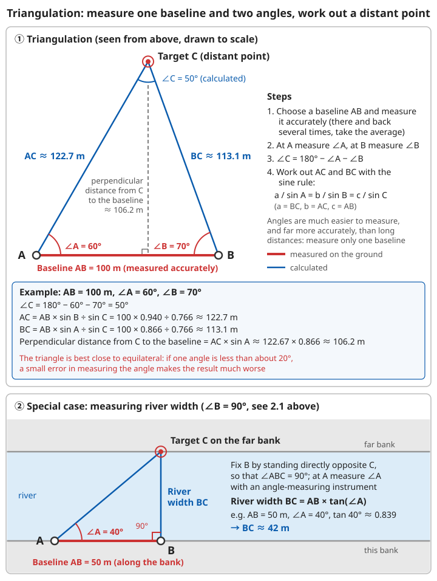
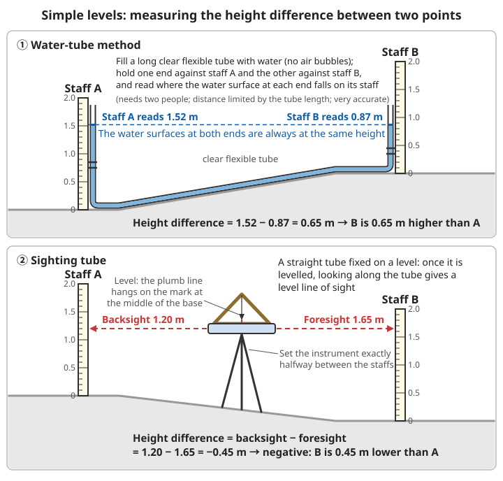

# Surveying and Mapping

> **To build an irrigation channel you must know which end is higher and by how much; to divide land you must know its area and boundaries; to find a place again you need a map – surveying is the skill of turning "roughly" into "exactly"**

## ⚠️ What this chapter covers

[Measurement and the Scientific Method](00-measurement-and-scientific-method.md#4-measuring-without-instruments) covered single techniques such as setting out a right angle, finding level and measuring height. This chapter links them together: how to fix the position of a distant point (triangulation), how to measure the height difference between two places (levelling), how to draw a map, and how to measure land and record boundaries.

```
⚠️ Safety and care:
- Survey in the field with at least two people; watch for steep drops underfoot, water's edges
  and traffic
- Do not climb dangerous heights or go down into deep gullies just to take a measurement
- Boundaries involve people's interests: when measuring land, have every party concerned present,
  and confirm and sign the results on the spot
```

The mathematics you need: [Scale](01-mathematics.md#23-map-scale), [Pythagoras' theorem and area](01-mathematics.md#4-geometry), [Trigonometric functions](01-mathematics.md#5-trigonometry).

---

## 1. Surveying tools

### 1.1 Measuring distance

```
Measuring cord: a rope that does not stretch or shrink easily (soak hemp rope, stretch it, then
  dry it, to reduce stretching), marked every 1 m, with clear marks every 5 m and 10 m
  → calibrate the cord against a salvaged tape measure first; if you have none, use the
    rebuilt metre (see Measurement and the Scientific Method)
Surveyor's chain: links made of iron wire; stretches even less than rope; most surveying in
  history used chains
Pacing: first calibrate your pace over a known distance; error is a few per cent, suitable for
  rough measurement

✓ Pull the cord straight and level when measuring; on slopes measure horizontally in sections
  (lift one end of the cord and use a plumb line to mark the point)
✓ Measure once each way and take the average
```

### 1.2 Setting out a straight line: ranging poles

```
Ranging pole: a straight wooden pole about 2 m long, pointed at the bottom, painted in
  alternating red and white (easy to see from a distance)
Setting out a straight line:
1. Stand one ranging pole at the starting point A and one at the end point B
2. One person stands behind A looking towards B; another carries a third pole and moves it
   in the middle until the three poles line up as one → that point is on the line AB
3. Keep placing poles this way to mark a long straight line on the ground
Plumb line: keeps the poles vertical
```

### 1.3 Measuring angles

```
Compass: measures bearings (the angle measured clockwise from north, 0°-360°)
  ⚠️ A compass points to magnetic north, which differs from true north (magnetic declination);
     nearby iron objects and power lines disturb it

Home-made angle-measuring instrument:
1. Fix a protractor (or a scale you draw yourself on a board) to a level wooden board,
   mounted on a stake driven into the ground
2. At the centre of the scale fit a sighting rule that can turn: at each end stand a fine nail
   or a small plate with a narrow slit; looking through the slit at one end and lining it up
   with the nail at the other end gives the line of sight
3. Aim at one target and read the scale, then turn to another target and read the scale;
   the difference between the two readings is the horizontal angle between the targets
4. Level the board using the methods for finding level (see 1.4)

Measuring elevation angle: use a quadrant – a quarter-circle scale with a plumb line hanging
  from it (see Advanced Celestial Navigation – angle-measuring instruments)
```

For magnetic declination see [Advanced Celestial Navigation – Magnetic declination](../09-advanced-science-and-engineering/09-celestial-navigation.md#24-magnetic-declination); for the quadrant see [Advanced Celestial Navigation – Angle-measuring instruments](../09-advanced-science-and-engineering/09-celestial-navigation.md#5-angle-measuring-instruments).

### 1.4 Finding level

```
Water tube: fill a clear flexible tube with water; the water surfaces at both ends are at the
  same height (high accuracy, suits short distances)
Spirit-level substitute: a triangular wooden frame with a plumb line (see Measurement and the
  Scientific Method – finding level)

A-frame (the most practical tool for building terraces and contour ridges):
1. Nail three wooden battens into a large "A": legs about 2 m long, feet about 2 m apart,
   with a crossbar nailed across the middle
2. Hang a plumb line from the apex
3. Calibrate: stand the A-frame's feet on the ground and mark where the plumb line crosses the
   crossbar; turn the A-frame round 180° on the same spot (the feet swap places) and mark again;
   the point exactly halfway between the two marks is the "level point"
4. Use: keep one foot fixed and move the other foot up or down the slope until the plumb line
   lines up with the level point
   → both feet are at the same height; step forward one frame at a time, and joining the points
     gives a contour line
```

---

## 2. Measuring distance and height indirectly

### 2.1 Measuring distances you cannot reach

```
For the similar- and congruent-triangle methods (measuring river width and tree height) see
Measurement and the Scientific Method

Using trigonometry (needs an angle-measuring instrument):
- River width: on the bank, measure a baseline AB along the river; at A measure the angle
  between the target C on the far bank and AB; at B make ∠ABC = 90° (stand directly opposite C)
  → river width BC = AB × tan(∠A)
  Example: AB = 50 m, ∠A = 40°, tan 40° ≈ 0.839 → BC ≈ 42 m
```

For the basic methods of measuring river width and tree height see [Measurement and the Scientific Method – Measuring height and width](00-measurement-and-scientific-method.md#43-measuring-heights-and-widths).

### 2.2 Measuring height

```
Elevation-angle method:
- Stand at a horizontal distance d from the object and use a quadrant to measure the elevation
  angle θ of its top
- Height = d × tan θ + height of your eyes above the ground
Example: d = 30 m, θ = 35°, tan 35° ≈ 0.700, eye height 1.5 m
  Height ≈ 30 × 0.700 + 1.5 = 22.5 m
```

---

## 3. Triangulation

### 3.1 Principle

```
If you know the length of one side of a triangle and two of its angles, you can work out the
other two sides
→ measure one "baseline" accurately, then measure only angles to find the positions of
  distant points
  (measuring angles is much easier, and much more accurate, than measuring long distances)

Sine rule: a / sin A = b / sin B = c / sin C
```

### 3.2 Steps

```
1. Choose a baseline AB on flat ground and measure its length accurately (measure there and back
   several times and take the average)
2. At A measure the angle ∠A between the target C and the baseline; at B measure ∠B
3. ∠C = 180° - ∠A - ∠B
4. Use the sine rule to work out AC and BC

Example: AB = 100 m, ∠A = 60°, ∠B = 70°
  ∠C = 180° - 60° - 70° = 50°
  AC = AB × sin B ÷ sin C = 100 × 0.940 ÷ 0.766 ≈ 122.7 m
  BC = AB × sin A ÷ sin C = 100 × 0.866 ÷ 0.766 ≈ 113.1 m
  Perpendicular distance from C to the baseline = AC × sin A ≈ 122.67 × 0.866 ≈ 106.2 m

✓ The triangle is best close to equilateral: if one angle is too small (less than about 20°),
  a small error in the angle makes the result much worse
✓ Use AC or BC as a new baseline and carry on to the next point → a triangulation network that
  can cover a very large area
```



*Figure: top, the example from 3.2 (drawn to scale) – red is what is measured on the ground, blue is what is calculated; bottom, the special case of measuring river width from 2.1*

### 3.3 Without calculation: the plane-table intersection method

```
1. Pin white paper to a flat board, mount it on a tripod and level it
2. At A: mark a point a on the paper (standing for A); using a straightedge with sights, aim
   from a at each target and draw a direction line along the edge of the rule
3. Measure the distance AB, and mark b on the AB direction line on the paper to scale
4. Carry the plane table to B and orient it (so that ba on the paper points at A on the ground),
   then aim from b at each target and draw lines
5. Where the two sets of direction lines cross are the positions of the targets on the map
→ survey and draw at the same time, and you get a map directly
```

---

## 4. Levelling

To build irrigation channels, drainage ditches or water pipes you must know the height difference between points along the route: water only flows downhill, and if you misjudge the height difference the channel will not work.

### 4.1 Principle

```
1. Stand a graduated staff at each of A and B (a levelling staff: a wooden pole marked every 1 cm)
2. Between the two points set up an instrument that gives a level line of sight (a level)
3. First look at staff A and read where the level line of sight falls on it (the backsight)
4. Then look at staff B and read it (the foresight)
5. B is higher than A by = backsight - foresight
   (a negative result means B is lower than A)

✓ Setting the instrument exactly halfway between the two staffs cancels the error from the
  instrument not being perfectly level
```

### 4.2 Simple levels

```
- Water-tube method: fill a long clear flexible tube with water, hold one end against staff A and
  the other against staff B, and read where the water surface at each end falls on its staff;
  the difference between the two readings is the height difference
  (needs two people, distance limited by the tube length, very accurate)
- Sighting tube: a straight tube (or a batten with two sighting holes) fixed on a level; once
  levelled, looking along the tube gives a level line of sight
- A salvaged laser level or surveyor's level is better
```



*Figure: the readings are taken from the "station by station" example below; height difference = backsight - foresight, and a negative number means B is lower than A*

### 4.3 Long distances: station by station

```
Over long distances, measure one station at a time and add up the height differences

Example: levelling from A to B with one change point 1 between them
  Station 1: staff A reads 1.52 m, staff at change point 1 reads 0.87 m → difference = +0.65 m
  Station 2: staff at change point 1 reads 1.20 m, staff B reads 1.65 m → difference = -0.45 m
  Total height difference A to B = 0.65 - 0.45 = +0.20 m → B is 0.20 m higher than A

Check: level back from B to A; the height difference should be equal in size and opposite in
sign; if it differs too much, measure again
✓ Record sheet: station number, backsight, foresight, height difference, cumulative difference
```

### 4.4 Setting the gradient of a channel

```
Gradient = height difference ÷ horizontal distance
- Earth channels: water flows at around 1/1000 (a drop of about 0.1 m every 100 m)
- Too gentle: water flows slowly and silts up easily; too steep: the water scours the channel
  bed and banks
- Drainage ditches and sewage ditches should be a little steeper to prevent silting

Steps for setting the gradient:
1. Starting at the water source, fix the level of the channel bed at the start
2. Drive in a wooden stake at intervals (e.g. every 20 m)
3. Use levelling to work out what height the channel bed should be at each stake (0.02 m lower
   than the previous one, i.e. 1/1000)
4. Mark the channel bed position on each stake and dig to the marks
5. Let water in as a test, find where it ponds or scours, and correct those places
```

For how to bring water in see [Water Sources and Water Supply – Conveying and lifting water](../07-everyday-living-skills/10-water-supply.md#carrying-and-lifting-water).

---

## 5. Drawing maps

### 5.1 What every map needs

```
Every map must have:
✓ Scale: e.g. 1:10000 means 1 cm on the map is 100 m on the ground
✓ North arrow: state whether it is true north or magnetic north
✓ Key: what each symbol means (well, road, house, field, river)
✓ Date drawn and who drew it
✓ Contour lines (when the terrain needs to be shown)
```

For converting scales see [Mathematics – Scale](01-mathematics.md#23-map-scale); for reading maps and contour lines see [Trip Preparation and Calling for Help – Reading maps and contour lines](../03-wilderness-survival/07-trip-preparation-and-calling-for-help.md#reading-maps-and-contour-lines).

### 5.2 Traversing: mapping along a route

```
Survey along a route (a road, river, field boundary) one leg at a time:
1. Set a point at each turn of the route (put in a ranging pole): 1, 2, 3...
2. At each point measure the bearing to the next point with a compass, and the distance with
   the measuring cord
3. Record: from → to, bearing, distance
4. On paper, to scale, draw the route leg by leg from the start using the bearings and distances

Closed traverse: go all the way round and return to the start
- The plotted end point should coincide with the start; the gap between them is the
  "closing error"
- If the error is small, share it out among the points in proportion to the length of each leg;
  if it is too large, survey again
```

### 5.3 Mapping an area

```
1. First use triangulation or traversing to set up a "framework" (a few accurately placed
   control points)
2. Then, working out from the control points, survey the surrounding houses, wells, roads and
   fields (distance plus bearing, or plane-table intersection)
3. Terrain: use levelling to find the heights of a set of points and mark them on the map;
   join points of the same height with smooth curves – these are the contour lines
4. Sketch in the field, then draw it up as a proper map when you get back, and make several
   copies to keep
```

### 5.4 Recording positions with coordinates

```
Draw a grid on the map and give each point two numbers (east, north):
- Choose a fixed origin (a large boulder, a well)
- The distance in metres measured east is x; the distance measured north is y
- Distance of a point from the origin = √(x² + y²)

From bearing α and distance d, find the coordinates of the next point:
  x₂ = x₁ + d × sin α
  y₂ = y₁ + d × cos α
Example: starting from (0, 0), bearing 30°, distance 100 m
  x = 100 × sin 30° = 50 m, y = 100 × cos 30° ≈ 86.6 m

Latitude and longitude: found by astronomical methods (see Advanced Celestial Navigation)
```

For measuring latitude and longitude see [Advanced Celestial Navigation – Measuring latitude](../09-advanced-science-and-engineering/09-celestial-navigation.md#3-measuring-latitude); for the mathematics of coordinates see [Mathematics – Coordinates](01-mathematics.md#61-coordinates).

---

## 6. Measuring land and boundaries

### 6.1 Calculating area

```
Regular shapes: see Mathematics – area formulas
  Rectangle = length × width; triangle = base × height ÷ 2;
  trapezium = (top + bottom) × height ÷ 2

Irregular plots: divide into several triangles, work out each area and add them up
  When you have only measured the three sides, use Heron's formula:
  s = (a + b + c) ÷ 2
  Area = √[s × (s - a) × (s - b) × (s - c)]
  Example: sides 30 m, 40 m, 50 m → s = 60 → area = √(60 × 30 × 20 × 10) = 600 m²

When you have the coordinates of each corner (coordinate method):
  List the points in order (x₁, y₁), (x₂, y₂) ... (xₙ, yₙ), then back to the first point
  Area = |Σ(xᵢ × yᵢ₊₁ - xᵢ₊₁ × yᵢ)| ÷ 2
  Example: (0, 0), (40, 0), (50, 30), (10, 40)
    0×0 - 40×0 = 0
    40×30 - 50×0 = 1200
    50×40 - 10×30 = 1700
    10×0 - 0×40 = 0
    Area = (0 + 1200 + 1700 + 0) ÷ 2 = 1450 m²

Units: 1 ha = 10000 m²
Sloping land: state clearly whether horizontal distance or distance along the slope was measured,
and agree on one method for everyone
```

For area formulas see [Mathematics – Area formulas](01-mathematics.md#44-area-formulas).

### 6.2 Marking boundaries

```
✓ Bury a boundary marker at each corner of the plot: stones, large bricks, or marked wooden
  stakes (wooden stakes rot, so stone is best); bury some charcoal or broken porcelain under
  the marker as a hidden sign, so it can be found even if the marker is moved
✓ Use natural features that do not move: large boulders, riverbanks, ridges
✓ Plant trees or shrubs as boundaries
```

### 6.3 Recording boundaries

```
Plot record (one page per plot):
- Plot number, name, location
- Neighbours on four sides: whose land or what feature borders it to the east, south,
  west and north
- Length of each side, bearing (or coordinates) of each corner
- Area
- Sketch (showing the boundary markers)
- Date of measurement, who measured it, signatures of all neighbouring parties

✓ Make several copies and keep them in different places
✓ In a dispute, look for the boundary markers and the records first, rather than relying on memory
```

For community records see [Record-Keeping, Trade and Division of Labour – Community records](../07-everyday-living-skills/13-record-keeping-trade-and-division-of-labour.md#community-records).

---

## 7. Where surveying is used

| Use | Methods used |
|------|-----------|
| Setting out a house | 3-4-5 right angle, finding level, setting out straight lines |
| Building terraces, contour planting | A-frame for contour lines |
| Building irrigation channels, drainage ditches, water pipes | Levelling, setting gradients |
| Dividing land, recording boundaries | Area calculation, boundary markers, plot records |
| Drawing a local map | Traversing, triangulation, plane table |
| Finding a place again (water source, store, ore site) | Coordinates, bearing and distance |
| Measuring bridge spans and river widths | Trigonometry |

For terraces and contour planting see [Geology, Minerals and Soil – Protecting the soil](06-geology-minerals-and-soil.md#55-protecting-the-soil); for setting out a house see [Long-term Shelter](../07-everyday-living-skills/05-long-term-shelter.md).

---

## Related chapters

- ⏮️ [Weather Observation and Forecasting](07-weather-observation-and-forecasting.md)
- ⏭️ [Rebuilding Measurement Standards](09-rebuilding-measurement-standards.md)
- 🔗 [Measurement and the Scientific Method](00-measurement-and-scientific-method.md) - units, right angles, level, measuring height
- 🔗 [Mathematics](01-mathematics.md) - trigonometry, coordinates, area
- 🔗 [Advanced Celestial Navigation](../09-advanced-science-and-engineering/09-celestial-navigation.md) - finding direction, measuring latitude and longitude, angle-measuring instruments
- 🔗 [Water Sources and Water Supply](../07-everyday-living-skills/10-water-supply.md) - irrigation channels
- 🔗 [Trip Preparation and Calling for Help](../03-wilderness-survival/07-trip-preparation-and-calling-for-help.md) - reading maps, using a compass

---

**Remember: measure twice, write it down, and have someone else check it. The value of surveying lies not in how precise your tools are, but in being careful every time and keeping a record of every number.**
