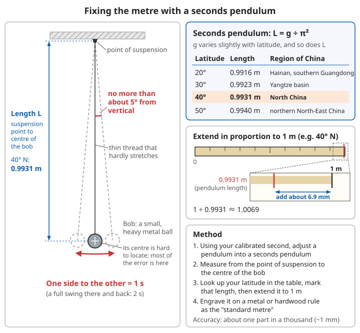

# Rebuilding Measurement Standards

> **"Heat to 200°C", "220 V", "10 mg per kilogram of body weight" – if no one still knows how long 1 m is or how heavy 1 kg is, the thousands of numbers in this book lose all meaning. This chapter shows how to recover the units using only nature and what is left in the ruins**

## ⚠️ What this chapter covers

[Measurement and the Scientific Method](../../../docs/08-基础科学知识/00-度量衡与科学方法.md#二重建长度质量体积时间) gave the basic idea of rebuilding units. This chapter covers it systematically:

- Where each base unit comes from, the most reliable way to rebuild it, and how accurate it can be
- How the other units used in this book (N, J, W, Pa, V, A...) are derived from the base units, how big they really are, and how to calibrate them
- Ready-made reference objects of standard size found in the ruins
- How to make and keep standards, and how to understand the units in old books

```
⚠️ Read these first:
- Rebuilt units always have errors: this chapter tells you "roughly how accurate you can get".
  Where lives are at stake, such as making up medicines, allow a margin for the worst-case error
- Well-preserved measuring tools from the ruins (tape measures, steel rules, electronic scales,
  thermometers, multimeters) are more accurate than any rebuilding method. Find them first,
  protect them, and use them to calibrate your home-made standards
- Within a community, what matters most is not "the same length as the old metre" but
  "everyone uses the same metre"
```

---

## 1. How the units are related

```
Base units (all other units are derived from them):
  length m     mass kg     time s     temperature K (°C)
  electric current A     amount of substance mol    (luminous intensity cd, not used in this book)

Derived units (combinations of base units):
  area m², volume m³ → from length
  speed m/s → from length and time
  force N = kg·m/s²
  energy J = N·m
  power W = J/s
  pressure Pa = N/m²
  voltage V = W/A
  resistance Ω = V/A

So: recover m, kg, s, °C and A, and everything else can be calculated
```

### Order of rebuilding

```
1. Second (s): from the sky; the time the Earth takes to turn once does not change
2. Metre (m): from the second and a pendulum; or from the size of the Earth
3. Kilogram (kg): use the metre to make a 1 L container and fill it with water
4. Degree Celsius (°C): ice and boiling water
5. Ampere (A): from the second and the kilogram, by electrolysis of copper
6. Other units: derived from the above
```

---

## 2. The second: from the stars

### 2.1 The sidereal day is steadier than the solar day

```
Solar day: the time between two successive passes of the sun due south (noon)
  - On average over a year it is 24 h = 86400 s, but the length of each day differs,
    varying by tens of seconds over the year → setting a clock by the sun day after day
    gives fairly large errors
Sidereal day: the time between two successive passes of the same star due south (or through
the same direction)
  - The same every day: about 23 h 56 min 4 s = 86164 s
  - About 4 minutes shorter than the solar day, so the same star reaches the same position
    about 4 minutes earlier each night
```

### 2.2 Timing a star's transit

```
1. Stand a thin vertical pole (checked with a plumb line), and a few m due north (or due south)
   of it stand another
   → the two poles form a true north–south line (for finding north and south see Advanced
     Celestial Navigation)
2. At night, put your eye close to one pole and watch for the moment a bright star is hidden
   by the other pole
   → note that moment
3. The next night, the moment the same star is hidden again is exactly one sidereal day
   (86164 s) after the previous night's

A simpler way: from a fixed observing position, watch when a star disappears behind the
  ridge of a house or a fixed pole (the line of sight only needs to stay the same; it does not
  have to be north–south)
```

For finding true north and south see [Advanced Celestial Navigation – Finding direction precisely](../../../docs/09-进阶科学与工程/09-天文导航进阶.md#二精确定方向).

### 2.3 Calibrating a pendulum by the sidereal day

```
The period of a simple pendulum T = 2π√(L/g) depends only on the pendulum length L
(when the swing is small)

Method 1 (you have a clock that runs, even if it is not accurate):
1. When a star is first hidden, note the clock reading
2. When the same star is hidden the next night, read it again
3. The time the clock has run should be 23 h 56 min 4 s; more means the clock is fast,
   less means it is slow
4. Adjust the pendulum length: fractional time error × 2 = fractional change in pendulum length
   Example: the clock gains 86 s in one sidereal day (0.1% fast) → lengthen the pendulum by 0.2%
   (clock fast → pendulum too short → lengthen; clock slow → pendulum too long → shorten)
5. Repeat for several nights until the error is acceptable

Method 2 (no clock): several people take turns counting swings, moving one abacus bead for every
  100 swings; from the star being hidden one night to its being hidden the next night there
  should be 86164 swings (for a seconds pendulum)
  → hard work, but possible; you can also do it just once to get one accurate pendulum,
    and copy it afterwards

✓ Keep the swing small (no more than about 5° from vertical); a large swing makes the period longer
✓ Use a small, heavy metal ball as the bob, and a thin suspension that does not stretch easily
✓ Seconds pendulum: swings from one side to the other in exactly 1 second (full period 2 seconds)
```

For how a pendulum works see [Physics – Circular motion and the pendulum](../../../docs/08-基础科学知识/02-物理.md#15-圆周运动和单摆).

### 2.4 How accurate it can be

```
- Careful timing of a star's transit is accurate to a few seconds each time; averaging over
  many days brings the error in one day down to about 1 second
  → a relative error of about one in a hundred thousand, quite enough for daily life and
    engineering
- Once you have an accurate second, pendulum clocks, water clocks and hourglasses can all be
  calibrated from it
```

---

## 3. The metre: two independent routes

### 3.1 With a seconds pendulum (recommended)

```
Length of a seconds pendulum (swinging from one side to the other in exactly 1 s): L = g ÷ π²
g (the acceleration due to gravity) varies slightly with latitude, so the length of the seconds
pendulum varies slightly too:
```

| Latitude | Seconds-pendulum length | Approximate region of China |
|------|---------|-------------|
| 20° | 0.9916 m | Hainan, southern Guangdong |
| 30° | 0.9923 m | Yangtze basin |
| 40° | 0.9931 m | North China |
| 50° | 0.9940 m | Northern part of North-East China |

```
Method:
1. Using your calibrated second (see section 2), adjust a pendulum into a seconds pendulum
2. Measure the distance from the point of suspension to the centre of the bob
3. Look up your latitude in the table above: at 40° N, for example, this length is 0.9931 m
   → mark the 0.9931 m position on it, then extend in proportion to 1 m
   (1 ÷ 0.9931 ≈ 1.0069, i.e. add about 6.9 mm)
4. Engrave it on a metal or hardwood rule as the "standard metre"

Accuracy: about one part in a thousand (around 1 mm), mainly from measuring the pendulum length
(the centre of the bob is hard to locate exactly)
For measuring latitude see Advanced Celestial Navigation – measuring latitude
```

For measuring latitude see [Advanced Celestial Navigation – Measuring latitude](../../../docs/09-进阶科学与工程/09-天文导航进阶.md#三测纬度).



*Figure: the pendulum length is measured from the point of suspension to the centre of the bob, not to the bottom of the bob; keep the swing small, for the reason given above under "Calibrating a pendulum by the sidereal day"*

### 3.2 From the size of the Earth (as a check)

```
This is how the metre was first defined: the distance from the North Pole to the equator was
set at 10000 km
→ each 1° of latitude is about 111 km north–south (1′ is about 1852 m, which is 1 nmi)

Method:
1. At two places far apart in the north–south direction, measure the latitude of each precisely
2. Measure the north–south distance between them by surveying (triangulation, measuring cord)
3. 1° ≈ 111 km → work back to the length of the metre

Accuracy: depends on how accurately the latitudes are measured and how far apart the places are
  - Example: latitude measured to 0.05°, places 5° apart (about 555 km) → error about 1%-2%
→ Less accurate than the seconds pendulum, but it does not depend on time at all, so it can be
  used to check the seconds-pendulum result for gross errors
```

For triangulation see [Surveying and Mapping – Triangulation](08-surveying-and-mapping.md#3-triangulation).

### 3.3 Length standards in the ruins (the most realistic)

See the reference-object tables in section 6. If you can find one intact steel tape measure or steel rule, it is more accurate than either of the methods above.

---

## 4. The kilogram: from water

```
1 L = the volume of a cube with sides of 10 cm (0.1 m)
1 L of pure water has a mass of ≈ 1 kg

Method:
1. Using the standard metre, make a square box with inside edges of exactly 10 cm (metal or
   hardwood, inside coated with wax to stop leaks), or make a container, measure its inside
   diameter and depth, and calculate its volume
2. Fill it with clean water (boiled and cooled rainwater, or distilled water, is best) and
   strike the surface level
3. With an equal-arm balance, adjust a piece of metal or stone until it weighs the same as the
   box of water (minus the weight of the empty box)
   → this is your standard 1 kg
```

### 4.1 What affects accuracy

| Factor | How big the effect is | How to reduce it |
|------|-----------|---------|
| Container size | **A 1% error on each side gives a 3% error in volume** | Measure the sides as accurately as possible; make the container larger (e.g. 10 L) so the relative error is smaller |
| Water temperature | 1 L of water ≈ 1.000 kg at 4°C; about 0.998 kg at 20°C; about 0.996 kg at 30°C | Note the water temperature and correct using these figures |
| Water quality | Seawater about 1.025 kg/L; muddy water is heavier | Use clean fresh water |
| Unequal balance arms | Can be off by a few per cent | Use the swap-weighing method (below) |

```
Swap-weighing method (removes the error from unequal balance arms):
1. Object in the left pan, weights in the right pan: read m₁
2. Object in the right pan, weights in the left pan: read m₂
3. True mass ≈ (m₁ + m₂) ÷ 2
```

### 4.2 Dividing into smaller weights

```
Once you have 1 kg, halve it repeatedly on the balance:
- Two pieces of metal that balance each other, and together balance 1 kg → each is 500 g
- Carry on in the same way to make 200 g, 100 g, 50 g, 10 g, 5 g, 1 g
- Weights below a gram: use fine copper wire; weigh a long length and cut pieces by length

✓ A set of weights: 1, 2, 2, 5, 10, 20, 20, 50, 100, 200, 200, 500 g can make up any whole
  number of grams
```

### 4.3 How accurate it can be

```
- Done carefully: a few parts in a thousand
- Making up medicines needs milligram accuracy, which home-made weights and balances can hardly
  achieve
  → for drug doses, see the warnings in the Pharmaceuticals part; as far as possible use the
    original packaging and doses of preserved medicines
```

---

## 5. Temperature: fixed points

### 5.1 0°C and 100°C

```
0°C (freezing point):
- Mix crushed ice and water and keep stirring; when the thermometer reading stops changing,
  that is 0°C
- Both ice and water must be clean; salt water freezes below 0°C

100°C (boiling point):
- The temperature at which pure water boils at 1 standard atmosphere (101.325 kPa)
- The higher the altitude, the lower the boiling point: roughly 1°C lower for every 300 m higher
  → at 1500 m altitude, water boils at about 95°C
- Put the thermometer bulb in the steam above the boiling water (not at the bottom of the water)
  for a steadier reading
```

### 5.2 High-temperature fixed points: melting points of metals

Smelting, pottery and heat treatment need temperatures from several hundred to over a thousand degrees Celsius to be judged. The melting points of pure metals can serve as standards:

| Metal | Melting point |
|------|------|
| Tin | 232°C |
| Lead | 327°C |
| Zinc | about 420°C |
| Aluminium | about 660°C |
| Silver | 962°C |
| Gold | 1064°C |
| Copper | 1085°C |

```
How to use: put a small piece of pure metal in the furnace and see whether it melts
→ tells you whether the furnace has reached that temperature
⚠️ It must be pure metal: solder, brass and aluminium alloys melt at different temperatures
   from the pure metals
⚠️ Lead is toxic; use it only for this test and do not melt it casually
```

For judging temperature by the colour of the fire see [Metallurgy Basics – Judging temperature](../../../docs/05-冶金技术/00-基础冶金知识.md#41-判断温度).

### 5.3 Making a thermometer

```
1. Join a small glass bulb to the lower end of a fine glass tube and fill with coloured alcohol
2. Put it in ice water and mark the liquid level → 0°C
3. Put it in the steam from boiling water and mark the level → 100°C (corrected for altitude)
4. Divide the distance between the two marks into 100 equal parts
⚠️ Do not use mercury: the vapour from a broken one is toxic
```

### 5.4 The kelvin

```
K = °C + 273.15
Absolute zero (0 K = -273.15°C) is the lowest temperature possible in theory
The pressure and volume of a gas are proportional to K (see Physics – Heat)
```

---

## 6. Ready-made references in the ruins

Many industrial products are made to uniform sizes and masses set by national standards. Find them and you have ready-made standards.

### 6.1 Length

| Item | Size | Notes |
|------|------|------|
| Steel tape measure, steel rule, vernier caliper | Graduations | **Most accurate, first priority**; check that they have not been stretched or bent |
| A4 paper | 210 mm × 297 mm | Much printing paper and book paper is this size; A3 is twice A4 |
| Bank card, ID card | 85.6 mm × 54.0 mm | International standard size, very accurate |
| 1-yuan coin | Old version 25 mm diameter; 2019 version 22.25 mm | First check which version it is |
| Standard clay brick | 240 mm × 115 mm × 53 mm | Firing shrinkage causes errors; average several bricks |
| Floor tiles | Commonly 600 mm × 600 mm, 800 mm × 800 mm | Size printed on the packaging |
| Reinforcing bar | Common diameters 6, 8, 10, 12, 16, 20 mm... | The diameter of ribbed bar is often rolled into its surface |
| Bolts, nuts | M6, M8, M10... (the number is the thread diameter in mm) | Metric standard parts |

### 6.2 Mass and volume

| Item | Value | Notes |
|------|------|------|
| Electronic scales, spring balance, steelyard | Graduations | Check against a known mass (e.g. 1 L of water) |
| Packaged food, medicines | "Net content" on the package | Unopened bags of rice, flour, sugar or salt usually have small errors |
| Printing paper | Grammage printed on the pack (e.g. 80 g/m²) | One sheet of 80 g/m² A4 is about 5 g; a ream of 500 sheets is about 2.5 kg |
| Measuring jugs, measuring cylinders, syringes, medicine cups | Graduations | Syringe graduations are fairly accurate |
| Bottled water, drinks | Volume on the label (e.g. 550 mL) | Filled to the brim it holds a little more than stated |

### 6.3 Electricity

| Item | Value | Notes |
|------|------|------|
| Multimeter | — | **Most useful**; keep it safe and check it regularly by the methods below |
| New alkaline batteries (AA, AAA, D) | About 1.5-1.6 V | Used batteries have a lower voltage; rough reference only |
| Lead-acid battery | About 2.1 V per cell (fully charged) | A 12 V battery has 6 cells |
| Mains grid | 220 V, 50 Hz | Only while the grid is still running |

### 6.4 Estimating with your body

```
Everyone is different; measure your own once against a standard rule and remember:
- One hand span (hand spread, thumb tip to middle-finger tip): about 18-22 cm in adults
- One finger width: about 1.5-2 cm
- Width of both arms stretched out ≈ your height
- One pace: about 0.6-0.8 m (calibrate before pacing; see Measurement and the Scientific Method)
- A double handful of water: a few hundred mL, with large errors

Only for estimating; never for making up medicines or for engineering
```

---

## 7. Derived units: how big they are and how to calibrate them

### 7.1 Mechanics and heat

| Unit | Definition | How big it really is | How to calibrate |
|------|------|-----------|---------|
| N (newton) | 1 kg × 1 m/s² | The weight of an object of about 100 g (a small apple) | An object of 1 kg weighs about 9.8 N |
| J (joule) | 1 N × 1 m | Lifting a 1 kg object about 10 cm | Calculated from N and m |
| W (watt) | 1 J/s | A person working for long periods: about 75-100 W | Calculated from J and s |
| hp (horsepower) | About 735 W | What a horse can do over long periods | — |
| Pa (pascal) | 1 N/m² | Very small: a sheet of paper lying flat on a table exerts about 1 Pa | 1 m of water column is about 9.8 kPa |
| atm (atmosphere) | About 101 kPa | About 10.3 m of water column, 760 mm of mercury | Measure with a water- or mercury-column barometer |
| cal (calorie) | About 4.18 J | The heat to raise 1 g of water by 1°C | Heat a known mass of water and measure the temperature rise |
| kcal (kilocalorie) | About 4.18 kJ | Raises 1 kg of water by 1°C; the usual unit for food energy | As above |
| kWh (kilowatt-hour) | 3600000 J | Lifting 1 t about 367 m; commonly called "1 unit (*du*) of electricity" | Calculated from W and h |
| Hz (hertz) | Once per second | A seconds pendulum going there and back (one full period) is 0.5 Hz | Count the vibrations per second |

For measuring air pressure see [Physics – Pressure and fluids](../../../docs/08-基础科学知识/02-物理.md#四压强与流体); for heat calculations see [Physics – Heat](../../../docs/08-基础科学知识/02-物理.md#五热学).

### 7.2 Electricity

Electrical units cannot be "read off" the metre, kilogram and second directly; they have to be calibrated with the help of chemistry and heat.

```
Ampere (A): electrolysis of copper (the most reliable)
Principle: the charge passed is proportional to the mass of metal deposited (Faraday's law)
  A current of 1 A flowing for 1 hour deposits about 1.186 g of copper on the cathode
Method:
1. Put two copper plates in copper sulphate solution and connect them to the power supply and
   the ammeter to be calibrated (in series)
2. First wash, dry and weigh the cathode plate
3. Keep the current steady and pass it for a set time (e.g. 1 hour)
4. Take out the cathode, rinse it gently, dry it and weigh it again; work out how many grams
   it has gained
5. Current (A) = mass of copper deposited (g) ÷ 1.186 ÷ time (h)
   Example: 2.20 g deposited in 2 hours → current = 2.20 ÷ 1.186 ÷ 2 ≈ 0.93 A
6. Compare with the ammeter reading to get a correction
Accuracy: about one per cent if done carefully
⚠️ Copper sulphate is toxic; do not swallow it; if it splashes in the eyes, rinse at once
```

```
Volt (V): two methods
Method 1: the Daniell cell (zinc–copper cell)
- Zinc plate in zinc sulphate solution, copper plate in copper sulphate solution,
  the two solutions separated by an unglazed fired clay pot (ions pass through, the solutions
  do not mix)
- The voltage between the two plates is about 1.10 V (measured with a high-resistance voltmeter
  while drawing no current)
- Accuracy: a few per cent, depending on solution strength and temperature

Method 2: the electrical heating method (more fundamental)
- Using a calibrated ammeter, pass a current I through a length of resistance wire immersed
  in water
- Measure the mass of water m, the temperature rise ΔT and the time t
- Power P = m × 4.18 × ΔT ÷ t (m in g, ΔT in °C, t in s, P in W)
- Voltage V = P ÷ I
- Insulate the container and do not run too long, to reduce heat losses
```

```
Ohm (Ω): calculated from the volt and the ampere, R = V ÷ I
Another convenient standard: copper wire
- At 20°C, pure copper wire 1 m long with a cross-section of 1 mm² has a resistance of
  about 0.0172 Ω
- Copper wire with a cross-section of 1 mm² has a resistance of about 1 Ω at a length of about 58 m
- The copper in salvaged electrical wire is very pure, good for resistance standards;
  resistance rises by about 4% for every 10°C rise in temperature
```

For cells and Faraday's law see [Advanced Chemistry – Electrochemistry](../../../docs/09-进阶科学与工程/05-化学进阶.md#五电化学); for wire resistance see [Physics – Resistance of wires](../../../docs/08-基础科学知识/02-物理.md#74-导线的电阻); for making meters see [Electrical Engineering and Electronics – Electrical measurement](../../../docs/09-进阶科学与工程/02-电气工程与电子学.md#九电气测量); for unglazed fired clay pots see [Pottery, Glass and Papermaking](../../../docs/07-日常生活技能/11-陶瓷玻璃与造纸.md).

### 7.3 Chemistry and atoms

```
mol (mole): the mass in g of 1 mol of a substance equals its relative molecular mass
  Example: 1 mol of carbon = 12 g, 1 mol of water = 18 g, 1 mol of table salt (NaCl) = 58.5 g
  → once you have the kilogram and the atomic masses from the periodic table, you have the mol
  At 0°C and 1 standard atmosphere, 1 mol of any gas occupies about 22.4 L

eV (electronvolt): a unit of energy on the atomic scale, about 1.6 × 10⁻¹⁹ J, used only in
theoretical calculations
```

For atomic masses see [The Periodic Table](../../../docs/08-基础科学知识/05-元素周期表.md).

### 7.4 Units you cannot make

```
Radioactivity and radiation dose (Bq, Sv, mSv):
- Need special detectors and standard radioactive sources; they cannot be recalibrated without
  modern industry
- With a preserved radiation dosimeter you can only trust its original calibration
- A home-made electroscope (metal foil leaves) can show "is there any, and is it a lot", but
  cannot give a value in Sv
→ In a nuclear emergency, act on the principles in the nuclear disaster sections (distance,
  shielding, less time); do not rely on readings from home-made instruments

Other precise quantities (e.g. drug doses in milligrams or micrograms): home-made balances can
  hardly achieve them; rely as far as possible on preserved medicines in their original
  packaging and their leaflets
```

For protection in a nuclear disaster see [Man-Made Disasters](../../../docs/02-灾难应对/05-人为灾难.md) and [Long-Term Collapse Survival – Nuclear disaster](../../../docs/03-野外生存/06-末日求生.md#核灾难).

---

## 8. Making and keeping standards

### 8.1 Copying down the levels

```
Prototype (the highest standard):
- One standard metre rule and one standard kilogram weight
- Use materials that do not rust or deform easily: brass, bronze, stainless steel; stone weights
  are also fine (they do not rust)
- Keep them locked away; never use them for work, only to calibrate the next level down

Working standards (one set for each village and each workshop):
- Copied from the prototype, and brought back regularly (e.g. once a year) to compare with it

Everyday measuring tools (rules, scales, measuring jugs):
- Made from the working standards and calibrated often
```

### 8.2 Points to note

```
Length:
- Engrave two very fine lines on the rule; the distance between them is 1 m (more accurate than
  using the ends of the rule, which wear)
- Metals expand and contract with heat: a brass rule changes by about 0.2 mm per metre for
  every 10°C change in temperature
  → agree to compare at one fixed temperature (e.g. 20°C)
Mass:
- Do not handle weights with bare hands (sweat corrodes them); use a cloth or tongs
- Protect from damp, rust and knocks; recheck any weight that has been dropped
- Iron weights rust and become heavier; they are not suitable as prototypes
How to compare:
- Length: lay the two rules side by side and line up the marks with a magnifying glass
- Mass: equal-arm balance, using the swap-weighing method

✓ Make two or three prototypes and keep them in different places (against fire and loss)
✓ Write down how the prototypes were made, the dates and the comparison results, and keep the
  record with the prototypes
✓ The whole community uses the same set of standards for all trade, engineering and medicines
```

For standard measures and trade see [Record-Keeping, Trade and Division of Labour – Trade](../../../docs/07-日常生活技能/13-记账交易与社会分工.md#交易).

---

## 9. Understanding units in old books and documents

The *chi* (Chinese foot), *jin* (Chinese pound) and *sheng* (Chinese pint) varied greatly from dynasty to dynasty. When reading old books and old prescriptions, do not interpret them in today's *shizhi* (market-system units). The table below gives approximate values (they also changed within dynasties, and scholars disagree):

| Period | 1 *chi* | 1 *jin* | 1 *sheng* |
|------|-----|-----|-----|
| Qin and Han | About 23 cm | About 250 g | About 200 mL |
| Sui and Tang | About 30 cm | About 660-680 g | About 600 mL |
| Song and Yuan | About 31 cm | About 610-640 g | Song about 670-700 mL; Yuan about 950-1000 mL |
| Ming and Qing | About 32 cm | About 590-597 g | About 1-1.04 L |
| *Shizhi* (from 1929; in 1959 changed to 1 *jin* = 10 *liang*) | 1/3 m | 500 g | 1 L |

```
- Before 1959, 1 jin = 16 liang (Chinese ounces); after that, 1 jin = 10 liang
  → this is the origin of the old saying "half a jin is eight liang" (meaning "six of one,
    half a dozen of the other")
- Old Chinese-medicine prescriptions: the "one liang" of different dynasties varied greatly
  (about 15.6 g in the Han, about 37 g in the Ming and Qing);
  modern Chinese medicine usually converts 1 qian ≈ 3 g and 1 liang ≈ 30 g, but the conversion
  for Han-dynasty prescriptions is disputed
  ⚠️ Do not copy the doses of old prescriptions directly; see Herbal Preparations
- Imperial units: see Measurement and the Scientific Method – Chinese market and imperial units
```

For converting Chinese market and imperial units see [Measurement and the Scientific Method – Chinese market and imperial units](../../../docs/08-基础科学知识/00-度量衡与科学方法.md#32-市制和英制); for herbal doses see [Herbal Preparations](../../../docs/06-制药技术/04-中药制剂.md).

---

## 10. Checklist

- [ ] Find and protect steel tape measures, steel rules, electronic scales, thermometers and multimeters in the ruins
- [ ] Calibrate a pendulum clock (or seconds pendulum) by the sidereal day
- [ ] Make a standard metre rule and check it against a rule from the ruins or by the latitude method
- [ ] Make a standard kilogram weight from 1 L of water, correcting for water temperature and using swap weighing
- [ ] Calibrate thermometers with ice water and boiling water (corrected for altitude)
- [ ] Check ammeters by electrolysis of copper
- [ ] Make two or three prototypes, keep them in different places, with written records
- [ ] The whole community uses the same set of standards and calibrates regularly

---

## Related chapters

- ⏮️ [Surveying and Mapping](08-surveying-and-mapping.md)
- 🔗 [Measurement and the Scientific Method](../../../docs/08-基础科学知识/00-度量衡与科学方法.md) - unit conversion, measuring without instruments
- 🔗 [Advanced Celestial Navigation](../../../docs/09-进阶科学与工程/09-天文导航进阶.md) - finding direction, measuring latitude, timekeeping
- 🔗 [Advanced Chemistry – Electrochemistry](../../../docs/09-进阶科学与工程/05-化学进阶.md#五电化学) - cells and electrolysis
- 🔗 [Electrical Engineering and Electronics](../../../docs/09-进阶科学与工程/02-电气工程与电子学.md) - meters
- 🔗 [Main contents – Unit symbols](../../../README.md#-单位符号说明) - the unit symbols used throughout the book

---

**Remember: the stars give the second, the second and the pendulum give the metre, the metre and water give the kilogram. As long as the sky and water remain, the units can be recovered – but only if someone writes the methods down and passes them on.**
