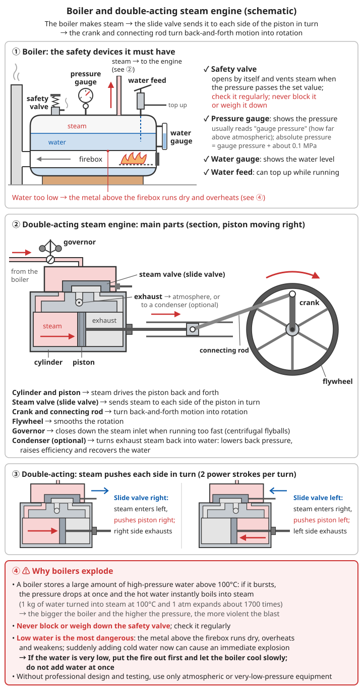
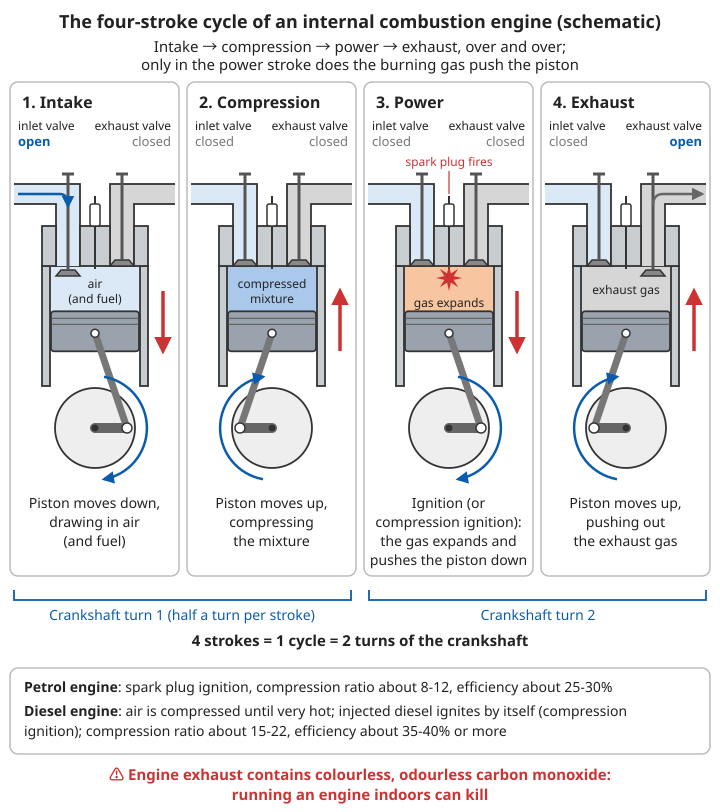

# Thermodynamics and Engines

> **At heart, the Industrial Revolution was humanity learning to turn the heat in fuel into a steady supply of mechanical power**

## ⚠️ Safety first

**Boiler explosions are among the deadliest industrial accidents in history.** When steam engines spread in the 19th century, boiler explosions killed and injured large numbers of people every year.

- 💥 If a boiler full of hot water under high pressure ruptures, a huge amount of it turns to steam in an instant, with the force of a bomb
- ☠️ The carbon monoxide given off by internal combustion engines and wood-gas generators is colourless and odourless; using them indoors can kill
- 🔥 Steam burns are worse than burns from boiling water
- ⚙️ Flywheels, belts and gears can catch clothing, hair and fingers and pull them in

**This chapter explains principles and estimation methods to help you understand engines.** Building and using pressure vessels (boilers) must follow professional design and inspection codes; where that is not possible, use only equipment that works at atmospheric pressure or very low pressure.

For basic heat physics see [Physics – Heat](../../../docs/08-基础科学知识/02-物理.md#五热学).

---

## 1. The laws of thermodynamics

### 1.1 The first law: conservation of energy

```
Increase in the internal energy of a system = heat absorbed - work done on the surroundings
  ΔU = Q - W

→ A heat engine gets heat from fuel; part of it becomes work and the rest of the heat
  is released to the surroundings
→ There is no "perpetual motion machine" that does work without consuming energy
```

### 1.2 The second law: heat cannot all be turned into work

```
Heat flows by itself from hot to cold
Every heat engine must release part of its heat to a cold environment;
it is impossible to turn all the heat into work

Carnot efficiency (the theoretical maximum efficiency):
  η = 1 - T_cold ÷ T_hot (temperatures in kelvin = °C + 273)

Example: steam temperature 180°C (453 K), condensing temperature 40°C (313 K)
  Maximum efficiency = 1 - 313 ÷ 453 ≈ 31%
  Real steam engines fall far short of this (early ones managed only a few per cent)

→ To raise efficiency: raise the temperature of the heat source (higher steam pressure),
  lower the temperature of the cold sink (a condenser)
```

### 1.3 Entropy

```
Entropy is a measure of "disorder"
The entropy of an isolated system can only increase or stay the same → heat spreads out
and mixes by itself; it never gathers together by itself
→ This is why energy is conserved, yet "usable energy" keeps running down as it is used
```

---

## 2. Properties of water and steam

### 2.1 Saturation temperature and pressure

| Absolute pressure (MPa) | Roughly, atm | Boiling point of water (°C) |
|---------------|-----------|-------------|
| 0.1 | 1 | 100 |
| 0.2 | 2 | About 120 |
| 0.5 | 5 | About 152 |
| 1.0 | 10 | About 180 |
| 2.0 | 20 | About 212 |

```
✓ The higher the pressure, the higher the boiling point of water
✓ A pressure gauge usually reads "gauge pressure" (how much above atmospheric pressure);
  absolute pressure = gauge pressure + about 0.1 MPa
```

### 2.2 Why boilers are so dangerous

```
When 1 kg of water turns into steam at 100°C and 1 atm, its volume expands about 1700 times

A boiler holds a large amount of high-pressure hot water above 100°C:
  once the boiler ruptures, the pressure drops suddenly and all that hot water
  flashes into steam in an instant, releasing far more energy than
  the steam that was already in the boiler
→ The bigger the boiler and the higher its pressure, the more violent a rupture
```

---

## 3. Boilers

### 3.1 Safety devices you must have

```
✓ Safety valve: opens automatically to release steam when the pressure goes above
  its set value (check it regularly; never block it or weigh it down)
✓ Pressure gauge: so you can see the pressure at all times
✓ Water-level gauge: so you can see the water level at all times
✓ Feedwater supply: so you can add water while it is running

⚠️ Running short of water is one of the most dangerous situations:
   when the water level is too low, the metal above the firebox runs dry, overheats
   and loses strength; if cold water is suddenly added then, it may explode at once
   → If you find the water is seriously low, put out the fire first and let the
     boiler cool slowly; do not add water straight away
```

### 3.2 Strength of pressure vessels (principle)

```
Hoop stress in the wall of a cylindrical vessel:
  σ = p × D ÷ (2 × t)
  p: internal pressure; D: diameter; t: wall thickness

→ The larger the diameter and the higher the pressure, the thicker the wall must be
→ With the same wall thickness, a small-diameter tube can take a higher pressure than
   a large-diameter drum
   (which is why later water-tube boilers were safer than fire-tube boilers)
→ Real design must also allow for the strength of welded or riveted seams, corrosion,
   loss of strength at high temperature, and fatigue from repeated heating and cooling,
   so the safety factor must be very large
```

### 3.3 Inspection and maintenance

```
✓ After building or repair, do a hydraulic (water-pressure) test: fill it with water,
  pressurise to about 1.5 times the working pressure, and check for leaks and deformation
  (use water, not air: water is almost incompressible, so if it ruptures it will not explode)
✓ Remove scale regularly: scale conducts heat poorly and lets parts of the boiler
  wall overheat
✓ Use soft water or treated water
✓ Check for corrosion, cracks and deformation
✓ Operators must be trained, and someone must watch it while it is running
```

---

## 4. Steam engines

### 4.1 How they developed

```
1712 Newcomen engine: steam enters the cylinder and is condensed by a spray of cold water,
  creating a vacuum, and atmospheric pressure pushes the piston — used for pumping
  water out of mines; extremely inefficient
1769 Watt: added a separate condenser so the cylinder stayed hot all the time,
  greatly cutting fuel consumption; later he also invented double action,
  the centrifugal governor and crank-and-gear drives
About 1800 high-pressure steam engines: no longer relied on a vacuum, compact,
  could be mounted on vehicles and boats

→ When rebuilding, you can start straight away with the "double-acting steam engine
  with a separate condenser"
```

### 4.2 Main parts

```
Boiler → produces steam
Cylinder and piston → steam drives the piston back and forth
Valve gear (slide valve) → sends steam to each side of the piston in turn
Crank and connecting rod → turn back-and-forth motion into rotation
Flywheel → makes the rotation smooth
Governor → automatically closes down the steam supply when the engine runs too fast
  (centrifugal flyballs)
Condenser (optional) → condenses the exhaust steam into water, lowering back-pressure,
  raising efficiency and recovering the water
```


*Figure: a boiler must have a safety valve, a pressure gauge, a water-level gauge and a feedwater supply; the slide valve sends steam to each side of the piston in turn, and the crank and connecting rod turn back-and-forth motion into rotation. If you find the water is seriously low, put out the fire first; do not add water straight away*

### 4.3 Estimating power

```
Power ≈ mean effective pressure × piston area × stroke × working strokes per second

Example: mean effective pressure 0.2 MPa, piston diameter 10 cm, stroke 15 cm,
    120 revolutions per minute, double-acting (2 working strokes per revolution)
  Piston area = π × 0.05² ≈ 0.00785 m²
  Work per stroke = 0.2 × 10⁶ × 0.00785 × 0.15 ≈ 236 J
  Working strokes per second = 120 ÷ 60 × 2 = 4
  Power ≈ 236 × 4 ≈ 940 W, about 1.3 hp (horsepower)
```

### 4.4 Ways to raise efficiency

```
✓ Expansive working: admit steam only for the first part of the stroke, and let the steam
  expand by itself for the rest of the stroke
✓ Insulation: wrap the cylinder and pipes in insulating material
✓ Condenser: lowers the exhaust pressure
✓ Raise steam pressure and temperature (limited by boiler safety)
```

### 4.5 Stirling engines

```
External combustion engine: any heat source (firewood, concentrated sunlight, waste heat)
  heats one end of a sealed cylinder from outside while the other end is cooled;
  the gas inside is repeatedly heated and expands, then cooled and contracts,
  driving the piston

Advantages: can work at low pressure, no risk of boiler explosion, quiet, any fuel will do
Disadvantages: low power, bulky
→ Suits small-scale, low-power uses (pumping water, small-scale power generation)
```

---

## 5. Internal combustion engines

### 5.1 The four-stroke cycle

```
1. Intake: the piston moves down, drawing in air (and fuel)
2. Compression: the piston moves up, compressing the mixture
3. Power: ignition (by spark or by compression); the burning gas expands and drives
   the piston down
4. Exhaust: the piston moves up, pushing out the exhaust gas

The intake valve opens only on the intake stroke and the exhaust valve only on the
exhaust stroke; both are closed during compression and power. The crankshaft turns
half a revolution on each stroke, so four strokes (one cycle) take two revolutions.
Only the power stroke delivers force; the flywheel's inertia carries the engine
through the other three

Petrol engine: spark-plug ignition, compression ratio about 8-12, efficiency about 25-30%
Diesel engine: compresses air until it is very hot, then injects diesel, which ignites
  by itself; compression ratio about 15-22, efficiency about 35-40% or more;
  robust, and less fussy about fuel
```


*Figure: the intake valve is open on intake, the exhaust valve is open on exhaust, and both valves are closed on compression and power; four strokes take two turns of the crankshaft*

### 5.2 Alternative fuels

```
Ethanol: can fuel a petrol engine (the fuel supply needs adjusting; cold starting is harder)
  → made by fermenting grain, sugar cane or tubers and then distilling
    (see Chemistry – fermentation)

Vegetable oil: can be blended into diesel engine fuel, but it is very viscous and
  long-term use builds up carbon deposits;
  usually it is heated to lower its viscosity, or processed into "biodiesel"

Wood gas (producer gas):
  charcoal or wood blocks are burnt incompletely with too little oxygen, producing
  flammable gases such as carbon monoxide and hydrogen, which are cooled and filtered
  and then fed into the engine to burn
  During the Second World War, when fuel was short, many cars and tractors ran on it
  ⚠️ Carbon monoxide is highly toxic: use the gas generator and the engine outdoors only,
     and after stopping, do not let it keep making gas in a closed garage

Biogas: mainly methane; can be used as engine fuel
```

For biogas safety see [Lighting and Energy – Biogas](../../../docs/07-日常生活技能/06-照明与能源.md#沼气); for carbon monoxide poisoning see [Home and Traffic Accidents – Carbon monoxide poisoning](../../../docs/01-日常疾病和伤害/07-居家与交通意外.md#一氧化碳中毒).

---

## 6. Heat-transfer calculations

### 6.1 Conduction

```
Heat lost through a wall (per second, in watts):
  q = k × A × ΔT ÷ d
  k: thermal conductivity; A: area; ΔT: temperature difference between the two sides;
  d: thickness

Thermal resistance R = d ÷ k (for several layers, add the resistances)
  q = A × ΔT ÷ (R₁ + R₂ + …)
```

### 6.2 Thermal conductivity of common materials (W/(m·°C), approximate)

| Material | Thermal conductivity | Notes |
|------|---------|------|
| Copper | About 400 | The best heat conductor among common metals |
| Aluminium | About 200 | |
| Iron and steel | About 50 | |
| Concrete | About 1-1.7 | |
| Glass | About 1 | |
| Brick wall | About 0.6-0.8 | |
| Adobe, rammed earth | About 0.5-1 | Varies with moisture content |
| Wood | About 0.1-0.2 | |
| Dry straw, straw bales | About 0.05-0.08 | Very good insulation |
| Wool, cotton wadding, down | About 0.04 | |
| Still air | About 0.026 | Every insulating material works by "trapping air" |

### 6.3 Calculation: how much good does insulation do

```
Example: a 50 m² brick wall, 30 cm thick, with a 20°C difference between inside and outside
  Brick wall only: thermal resistance = 0.3 ÷ 0.7 ≈ 0.43
    Heat loss = 50 × 20 ÷ 0.43 ≈ 2300 W
  Add a 10 cm layer of straw-bale insulation: thermal resistance = 0.43 + 0.1 ÷ 0.06 ≈ 2.1
    Heat loss = 50 × 20 ÷ 2.1 ≈ 480 W
  → heat loss falls by about 80%, and you can burn much less firewood in winter

✓ The roof often loses the most heat (hot air rises), so insulate the roof first
✓ Draughts through gaps around doors and windows also lose a lot of heat: seal the gaps first
```

For practical insulation methods see [Long-term Shelter – Insulation](../../../docs/07-日常生活技能/05-长期住所.md#保温).

### 6.4 Convection and radiation

```
Convection: the stronger the wind, the faster heat is lost → block the wind, reduce gaps
Radiation: the heat an object radiates is proportional to the fourth power of its
absolute temperature
  → a hot stove loses heat mainly by radiation; the radiant heat from a heated wall
    or a *kang* (heated brick bed) is what makes people feel warm
  → shiny metal surfaces radiate little (the silvered inner flask of a vacuum flask)

Heat exchanger: two fluids exchange heat through a thin wall
  Counterflow (the two fluids flowing in opposite directions) is more efficient than parallel flow
  → recovers heat from waste hot water and hot flue gas
```

---

## 7. Refrigeration

### 7.1 Evaporative cooling (no electricity needed)

```
Evaporating water absorbs a great deal of heat (see Physics – latent heat)

Clay-pot cooler (pot-in-pot cooler):
1. Put a small clay pot inside a large unglazed clay pot
2. Fill the space between the two pots with wet sand
3. Put vegetables and food in the small pot, and cover with a wet cloth
4. Keep it in a shady, well-ventilated place, and add water to the sand every day
→ In hot, dry regions it can noticeably lower the temperature inside and make
  vegetables keep longer
  (it works poorly when the air is humid)

Other methods: wrap a water jar in a wet cloth and hang it in a draught;
sprinkle water on an earth floor
```

### 7.2 Storing ice

```
In winter, cut ice from rivers and lakes into blocks and store it in an underground
ice house, insulated with thick layers of straw and sawdust
→ It can keep until summer (in ancient China this was called *lingyin* (ice store))
As ice melts it absorbs a great deal of heat, and its temperature stays at 0°C
```

### 7.3 Compression refrigeration and heat pumps

```
How fridges and air conditioners work:
1. The compressor compresses the refrigerant gas, and its temperature rises
2. It gives off heat in the condenser and turns into liquid (the warm part at the
   back of a fridge)
3. It passes through an expansion valve, and its pressure drops sharply
4. It evaporates in the evaporator, absorbing heat (the inside of the fridge gets cold)
5. It returns to the compressor, and the cycle repeats

Heat pump: the same principle used the other way round, taking heat from the outdoor air
or the ground and moving it indoors
  For every 1 unit of electricity used, it moves 3-4 units of heat — far cheaper
  than heating directly with electricity

Absorption refrigeration: a heat source (paraffin, gas, solar heat) drives it
instead of a compressor
  → historically there were paraffin-fired fridges; ammonia is often used as the
    working fluid, ⚠️ ammonia is toxic
```

---

## 8. Water, wind and animal power

### 8.1 Water power

```
Water power (kW) ≈ 9.8 × flow (m³/s) × head (m) × efficiency

Types of waterwheel and their efficiency (roughly):
- Undershot (water rushes past underneath): about 20-30%; suits fast flow and small head
- Overshot (water falls into buckets from above): about 60% or more; needs some head
- Impulse turbine (water jets from a nozzle at high speed onto the blades): can exceed 80%;
  suits high head and small flow
```

For a worked example see [Physics – Water power: waterwheels and water mills](../../../docs/08-基础科学知识/02-物理.md#33-水力-水车和水磨).

### 8.2 Wind power

```
Power in the wind = ½ × air density × swept area × wind speed³
  Air density about 1.2 kg/m³

✓ Double the wind speed and the power becomes 8 times as large → choosing the site matters
  most: open, high ground with steady wind
✓ In theory you can capture at most about 59% of the wind's energy (the Betz limit);
  real windmills manage about 20-40%

Example: rotor diameter 2 m (swept area about 3.14 m²), wind speed 6 m/s
  Power in the wind = 0.5 × 1.2 × 3.14 × 216 ≈ 407 W
  At 30% efficiency → about 120 W
```

### 8.3 Animal and human power

```
An adult working steadily for long periods: about 75-100 W
A horse working steadily for long periods: about 0.5-1 hp (about 370-750 W)
Cattle: strong but slow; suited to ploughing and turning millstones

✓ Animal-powered mills and water-lifting wheels: the animal walks in a circle,
  driving the machine through gears
```

### 8.4 Energy storage

```
Ways of storing energy, from easiest to hardest:
- Storing fuel (firewood, charcoal, grain, oil) — the simplest, with the highest energy density
- Raised water (water towers, reservoirs): 1 t of water raised 10 m stores only about 0.03 kWh
  → it stores very little, but it is simple and reliable
- Storage batteries
- Flywheels (for short periods)
```

---

## 9. Comparing energy sources

| Source | Availability | Power scale | Main limits |
|------|-------|---------|---------|
| Human power | Always | About 100 W/person | People must eat; their time is precious |
| Animal power | Needs animals to be kept | Several hundred W per animal | Fodder, pasture |
| Water power | Where rivers have a drop | From a few hundred W to very large | Fixed location; low water in the dry season, freezing |
| Wind power | Open, windy places | From tens of W to several thousand W | Unsteady; needs storage |
| Firewood and charcoal | Where there are forests | Depends on how much is burnt | How fast the forest regrows |
| Solar panels | Salvaged solar panels | About 100-200 W/m² (sunny day) | Night, cloudy days; cannot be made yourself |
| Coal | Where there are coal mines | Large | Mining, transport, pollution |

---

## Related chapters

- ⏮️ [Technology Rebuilding Roadmap](../../../docs/09-进阶科学与工程/00-技术重建路线图.md) - where power fits in the whole picture
- ⏮️ [Engineering Mechanics and Materials](../../../docs/09-进阶科学与工程/01-工程力学与材料.md) - pressure vessels, bearings, flywheels
- ⏮️ [Electrical Engineering and Electronics](../../../docs/09-进阶科学与工程/02-电气工程与电子学.md) - using engines to drive generators
- ⏭️ [Higher Mathematics](../../../docs/09-进阶科学与工程/04-高等数学.md) - differential equations, statistical inference
- 🔗 [Physics – Heat](../../../docs/08-基础科学知识/02-物理.md#五热学)
- 🔗 [Lighting and Energy](../../../docs/07-日常生活技能/06-照明与能源.md) - using fuel, generators and biogas in practice
- 🔗 [Long-term Shelter](../../../docs/07-日常生活技能/05-长期住所.md) - insulation, *kang*, chimneys

---

**Remember: heat can do work, but some of it is always lost; engines can save the labour of hundreds of people, but a boiler's safety valve must never be blocked.**
