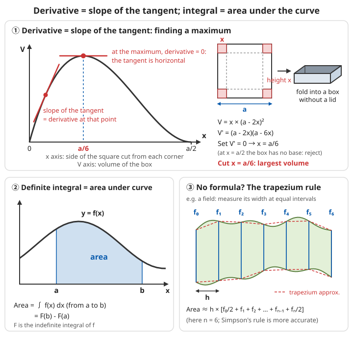

# Higher Mathematics

> **Calculus describes change, linear algebra handles many unknowns at once, and statistical inference tells you whether a result is a fluke: almost all modern science and engineering rests on these three tools**

## ⚠️ What this chapter covers

This chapter carries on from [Basic Science – Mathematics](../08-basic-science/01-mathematics.md) and roughly matches the first-year university mathematics course for science and engineering students. The focus is on **methods and uses**, and every section comes with examples you can work out by hand.

```
Quick guide to uses:
- Finding maxima and minima, areas, volumes, work done        → differentiation and integration
- Working out tables of sin, e and ln by hand                 → series
- Population growth, cooling, vibration, spread of disease    → differential equations
- AC circuit calculations                                     → complex numbers
- Mixing, force and circuit problems with several unknowns    → linear algebra
- Deciding whether a medicine or a seed really works          → statistical inference
```

---

## 1. Limits

```
A limit describes "getting infinitely close": as x gets closer and closer to some value,
what does the value of the function get closer to?

Two important limits:
  As x → 0, sin x ÷ x → 1 (x in radians)
  As n → ∞, (1 + 1/n)ⁿ → e ≈ 2.71828

Where e comes from: a principal of 1 yuan at 100% interest a year,
  compounded once a year gives 2 yuan, monthly about 2.613 yuan, daily about 2.715 yuan;
  compounded infinitely often it tends to e yuan

Radians: 360° = 2π radians, 1 radian ≈ 57.3°
  Trigonometric functions in calculus always use radians
```

---

## 2. Derivatives and differentiation

### 2.1 Rules of differentiation

```
Sum:      (u + v)' = u' + v'
Product:  (u × v)' = u' × v + u × v'
Quotient: (u ÷ v)' = (u' × v - u × v') ÷ v²
Chain rule (composite functions): if y = f(g(x)), then y' = f'(g(x)) × g'(x)
  Example: (sin 3x)' = cos 3x × 3
```

### 2.2 Table of common derivatives

| Function | Derivative |
|------|------|
| Constant C | 0 |
| xⁿ | n × xⁿ⁻¹ |
| eˣ | eˣ |
| aˣ | aˣ × ln a |
| ln x | 1/x |
| sin x | cos x |
| cos x | -sin x |
| tan x | 1/cos²x |

### 2.3 Finding maxima and minima

```
At a maximum or minimum of a function, the derivative is 0 (the tangent is horizontal)

Example: from a square sheet of metal with side a, cut a small square of side x from
         each corner and fold it into an open box. What x gives the largest volume?
  Volume V = x × (a - 2x)²
  V' = (a - 2x)² - 4x(a - 2x) = (a - 2x)(a - 6x)
  Set V' = 0: x = a/6 (x = a/2 leaves the box with no bottom, so discard it)
  → Cutting away 1/6 of the side gives the largest volume

Example: for a cylindrical can made from a given amount of material, the volume is
         largest when the height equals the diameter
```

### 2.4 Newton's method: solving any equation

```
To find a root of f(x) = 0:
  Guess an x₀, then calculate repeatedly
  x_new = x - f(x) ÷ f'(x)

Example: find the root of x³ - 2x - 5 = 0, guessing x₀ = 2
  f(2) = -1, f'(x) = 3x² - 2, f'(2) = 10
  x₁ = 2 - (-1) ÷ 10 = 2.1
  x₂ = 2.1 - 0.061 ÷ 11.23 ≈ 2.0946
  (the true value is about 2.09455; two steps are already very accurate)

The Babylonian method for square roots (see Basic Mathematics) is Newton's method
applied to x² - a = 0
```

### 2.5 Linear approximation

```
Near x₀: f(x) ≈ f(x₀) + f'(x₀) × (x - x₀)

Example: √4.1 ≈ 2 + (1/4) × 0.1 = 2.025 (true value 2.0248)
Example: for small angles, sin x ≈ x and tan x ≈ x (x in radians)
  → This approximation is why a pendulum's period does not depend on its swing
    when the swing is small
```

---

## 3. Integration

### 3.1 Table of common integrals

| Function | Indefinite integral (plus a constant C) |
|------|-------------------|
| xⁿ (n ≠ -1) | xⁿ⁺¹ ÷ (n+1) |
| 1/x | ln \|x\| |
| eˣ | eˣ |
| sin x | -cos x |
| cos x | sin x |

```
Definite integral: the integral from a to b = F(b) - F(a), where F is the indefinite integral
  Geometric meaning: the area under the curve between a and b

Substitution: make the complicated part a new variable
  Example: ∫ 2x × cos(x²) dx, let u = x², du = 2x dx → ∫ cos u du = sin(x²) + C

Integration by parts: ∫ u dv = u × v - ∫ v du
  Example: ∫ x × eˣ dx = x × eˣ - ∫ eˣ dx = (x - 1) × eˣ + C
```

### 3.2 Uses of integration

```
Area: the area between the curve y = f(x) and the x-axis from a to b = ∫ f(x) dx

Volume of a solid of revolution: the curve rotated once about the x-axis
  V = π × ∫ y² dx
  Example: checking the volume of a sphere, x² + y² = r²
  V = π × ∫(from -r to r)(r² - x²) dx = 4πr³ ÷ 3

Work done by a varying force: W = ∫ F dx
  Example: pumping all the water out of a full pond h m deep with base area A m²
  up to its rim
  W = ∫(from 0 to h) ρ × g × A × y dy = ρ × g × A × h² ÷ 2
  → A pond 1 m deep and 10 m²: 1000 × 9.8 × 10 × 1 ÷ 2 ≈ 49000 J

Mean value: the mean of a function over a to b = ∫ f(x) dx ÷ (b - a)
```

### 3.3 Numerical integration: when there is no formula

```
Divide the interval into n equal parts (n even), each of width h, with function
values f₀, f₁, …, fₙ at the points

Trapezium rule: area ≈ h × [f₀/2 + f₁ + f₂ + … + fₙ₋₁ + fₙ/2]

Simpson's rule (more accurate):
  area ≈ h ÷ 3 × [f₀ + 4f₁ + 2f₂ + 4f₃ + … + 4fₙ₋₁ + fₙ]

Uses: measuring an irregular field (measure its width at regular intervals), the
  cross-sectional area of a river, the total volume of water in a day from flow
  rates recorded every hour
```



*Figure: The volume of the folded sheet-metal box is largest where the derivative is 0 (tangent horizontal), when 1/6 of the side is cut away; a definite integral is the area under a curve; with no formula, use the trapezium rule, measuring widths strip by strip to find the area*

---

## 4. Series

### 4.1 Geometric series

```
1 + r + r² + r³ + … = 1 ÷ (1 - r) (when |r| < 1)
Sum of the first n terms = (1 - rⁿ) ÷ (1 - r)
```

### 4.2 Taylor series: computing any function with +, −, × and ÷

```
eˣ = 1 + x + x²/2! + x³/3! + x⁴/4! + …
sin x = x - x³/3! + x⁵/5! - x⁷/7! + …
cos x = 1 - x²/2! + x⁴/4! - x⁶/6! + …
ln(1 + x) = x - x²/2 + x³/3 - x⁴/4 + … (-1 < x ≤ 1)
(1 + x)ⁿ ≈ 1 + n × x (when x is small)

(n! = 1 × 2 × 3 × … × n, e.g. 4! = 24)

Example: e ≈ 1 + 1 + 0.5 + 0.1667 + 0.0417 + 0.0083 + 0.0014 ≈ 2.718
Example: sin 0.5 ≈ 0.5 - 0.02083 + 0.00026 ≈ 0.47943

Uses: compiling trigonometric and logarithm tables without a calculator
⚠️ The larger x is, the more terms you need; use a series only within its range of convergence
```

---

## 5. Differential equations

They describe "how the rate of change relates to the present state" and are the mathematical models used most in physics, engineering, biology and medicine.

### 5.1 Exponential growth and decay

```
dy/dt = k × y   →   y = y₀ × e^(kt)
  k > 0: exponential growth (multiplying bacteria, the early stage of an epidemic,
         compound interest)
  k < 0: exponential decay (radioactive decay, the body clearing a drug)

Relation between a drug's half-life T and k: k = -ln 2 ÷ T ≈ -0.693 ÷ T
```

### 5.2 Newton's law of cooling

```
The rate at which an object's temperature changes is proportional to the difference
between it and its surroundings:
  dT/dt = -k × (T - T_surroundings)
  → T = T_surroundings + (T₀ - T_surroundings) × e^(-kt)

Example: a pot of porridge at 100°C in a room at 20°C falls to 80°C after 10 minutes
  60 = 80 × e^(-10k) → k ≈ 0.0288/min
  Time to fall to 40°C (20°C above the room): 20 = 80 × e^(-kt) → t ≈ 48 min

Uses: estimating how long food takes to cool enough to go into cold storage,
  estimating how well insulation works
```

### 5.3 Limited growth (the logistic model)

```
dP/dt = r × P × (1 - P/K)
  K: the largest number the environment can support
  Growth is roughly exponential at first, slows as P nears K, and finally settles at K

Uses: numbers of fish in a pond, livestock on a pasture, wild animals;
  growth is fastest at P = K/2 → keeping the population at about half when you
  harvest gives the largest sustainable yield
```

### 5.4 Oscillation

```
d²x/dt² = -ω² × x   →   x = A × sin(ωt + φ)
  A weight on a spring, a pendulum at small angles, the current in an LC circuit

With damping (friction, air resistance): the amplitude gradually decreases
With a periodic driving force: if its frequency is close to the natural frequency,
  resonance occurs and the amplitude becomes very large
  → Troops must not march in step across a bridge; machine speeds must avoid
    the resonant frequency of the structure
```

### 5.5 The epidemic model (SIR)

```
Divide the population into: susceptible S, infected I, recovered R; total N
  dS/dt = -β × S × I ÷ N
  dI/dt = β × S × I ÷ N - γ × I
  dR/dt = γ × I

  β: transmission rate; γ: recovery rate (1/γ is roughly the average number of days ill)
  Basic reproduction number R₀ = β ÷ γ (how many people one patient infects on average)

Conclusions:
- When R₀ > 1 the outbreak spreads; when R₀ < 1 it dies out
- Once the immune proportion exceeds 1 - 1/R₀, the outbreak cannot spread
  (the herd immunity threshold)
  Example: with R₀ = 4, about 75% of people need to be immune
```

For the related concepts see [Biology and Medicine Basics – Basic epidemiology](../08-basic-science/04-biology-and-medical-basics.md#9-basics-of-epidemiology).

### 5.6 Euler's method: solving numerically step by step

```
Given dy/dt = f(t, y) and a starting value y₀, take a very small time step h:
  y_next = y + h × f(t, y)

The smaller the step, the more accurate, but the more steps you must calculate
Equations with no analytical solution (most real problems) can all be worked
through step by step like this
```

---

## 6. Complex numbers

```
Imaginary unit i, i² = -1
Complex number z = a + b × i (a is the real part, b the imaginary part)

Arithmetic: as in ordinary algebra; whenever you meet i², replace it with -1
  (2 + 3i)(1 - i) = 2 - 2i + 3i - 3i² = 5 + i

Geometric picture: the point (a, b) in a plane
  Modulus (length) r = √(a² + b²); argument θ: tan θ = b ÷ a
  z = r × (cos θ + i × sin θ)

Euler's formula: e^(iθ) = cos θ + i × sin θ
  → Multiplying complex numbers = multiplying moduli and adding angles

Uses:
- AC circuits: impedance is written as a complex number (engineers often write the
  imaginary unit as j)
  Resistance R, inductive reactance jωL and capacitive reactance 1/(jωC) combine in
  series and parallel just like resistors in a DC circuit
- Quadratic equations with b² - 4ac < 0
- Calculations on oscillations and waves
```

For AC circuits see [Electrical Engineering and Electronics – Alternating current](02-electrical-engineering-and-electronics.md#2-alternating-current).

---

## 7. Linear algebra

### 7.1 Systems of linear equations and Gaussian elimination

```
Example: mix three feeds into one batch that contains exactly 22 units of protein,
         5 of fat and 6.5 of fibre
  Content per kg of feed:   protein   fat   fibre
    Feed A  x kg               10       2      2
    Feed B  y kg               20       5      3
    Feed C  z kg                4       1      6

  10x + 20y + 4z = 22
   2x +  5y +  z =  5
   2x +  3y + 6z = 6.5

Elimination steps:
1. Multiply equation 2 by 5 and subtract equation 1 to eliminate x:
   (10x+25y+5z) - (10x+20y+4z) = 25 - 22
   → 5y + z = 3 …… (A)
2. Subtract equation 3 from equation 2 to eliminate x: 2y - 5z = -1.5 …… (B)
3. From (A), z = 3 - 5y; substitute into (B): 2y - 15 + 25y = -1.5 → y = 0.5
4. Back-substitute: z = 3 - 2.5 = 0.5, x = (5 - 5 × 0.5 - 0.5) ÷ 2 = 1
   → Feed A 1 kg, Feed B 0.5 kg, Feed C 0.5 kg
5. Substitute back into all three original equations to check

⚠️ If you get a negative answer, these feeds cannot meet the requirement exactly;
   change the requirement or the feeds

Key idea: at each step use one equation to eliminate one unknown from the others,
  until only one unknown is left, then back-substitute step by step
```

### 7.2 Matrices

```
Laying out the coefficients of a system of equations as a table gives a matrix;
the system can be written A × x = b

Matrix multiplication: the entry in row i, column j of the result = row i of A
  multiplied term by term with column j of B, then added up

2 × 2 determinant: | a b ; c d | = a × d - b × c
  When the determinant is 0, the system has no unique solution

Uses: the force in each member of a truss, the current in each branch of a complex
  circuit, mixing recipes and coordinate transformations all come down to solving
  systems of linear equations
```

### 7.3 Least squares: fitting a straight line to data

```
Given a set of measurements (x, y), find the straight line y = a + b × x that fits best:
  b = Σ(x - x̄)(y - ȳ) ÷ Σ(x - x̄)²
  a = ȳ - b × x̄
  (x̄ and ȳ are the means)

Examples: the relation between fertiliser rate and yield; calibrating an instrument's
  scale from several measurements
Correlation coefficient r (-1 to 1): the closer to ±1, the stronger the straight-line
  relationship
⚠️ Correlation is not causation
```

---

## 8. Statistical inference: is the result a fluke?

### 8.1 Standard error and confidence intervals

```
A sample mean has its own error, measured by the "standard error":
  standard error = standard deviation ÷ √(sample size)
  → You must quadruple the sample size to halve the error

95% confidence interval ≈ mean ± t × standard error
  Values of t (two-sided 95%):
    sample size 6 (5 degrees of freedom): 2.57
    sample size 10 (9 degrees of freedom): 2.26
    sample size 11 (10 degrees of freedom): 2.23
    sample size 21 (20 degrees of freedom): 2.09
    sample size 31 (30 degrees of freedom): 2.04
    very large sample: 1.96 (about 2)

Example: yields measured on 16 plots average 3750 kg/ha, standard deviation 300 kg/ha
  standard error = 300 ÷ 4 = 75 kg/ha; 95% confidence interval about
  3750 ± 2.13 × 75 ≈ 3590 to 3910 kg/ha
```

### 8.2 The logic of hypothesis testing

```
1. First assume "no effect" (the null hypothesis): the new medicine works no
   differently from the control
2. Calculate: if there really were no effect, how likely is a difference as large as
   the one observed to arise by pure chance (the p-value)?
3. p < 0.05 (under 5%): the difference is unlikely to be chance; the result is "significant"
   p ≥ 0.05: chance cannot be ruled out (this does NOT prove "no effect")
```

### 8.3 Comparing proportions in two groups: the chi-squared test

```
Example: of 50 patients given a new treatment, 20 improved; of 50 given the control
         treatment, 10 improved

                  improved   not improved   total
  new treatment      20           30          50
  control            10           40          50
  total              30           70         100

Expected values (if the groups did not differ): in each group 50 × 30/100 = 15
  should improve and 35 not
Chi-squared = Σ(observed - expected)² ÷ expected
            = 25/15 + 25/35 + 25/15 + 25/35 ≈ 4.76

Critical value (1 degree of freedom, p = 0.05): 3.84
4.76 > 3.84 → the difference is significant and unlikely to be chance
⚠️ Each cell's expected value should preferably be at least 5, otherwise this method
   is inaccurate
```

### 8.4 Comparing means of two groups: the t-test

```
t = (mean₁ - mean₂) ÷ √(SD₁²/n₁ + SD₂²/n₂)
If |t| exceeds the corresponding value in the table above (take the degrees of freedom
as roughly the smaller group's sample size minus 1), the difference is significant

Example: two seed varieties, each sown on 10 plots, average 3900 kg/ha and 3600 kg/ha,
         both with standard deviation 300 kg/ha
  t = 300 ÷ √(9000 + 9000) ≈ 2.24
  About 9 degrees of freedom, critical value 2.26; 2.24 is slightly below 2.26
  → It is not yet certain whether this is chance
  → Sow a few more plots and compare again
```

### 8.5 Points to watch when designing a trial

```
✓ Randomise the groups (draw lots for who gets the new method), so the good plots or
  the milder patients do not all end up in one group
✓ Where possible, "blind" the trial: patients (and even the assessors) do not know who
  got which method
✓ Decide in advance what you will compare and what counts as "effective"; do not pick
  the nice-looking results afterwards
❌ Compare many measures at once and one or two will be "significant" by chance
❌ Too small a sample: even a method that really works may show no difference
```

For the basic idea of controlled experiments see [Measurement and the Scientific Method – The scientific method](../08-basic-science/00-measurement-and-scientific-method.md#1-the-scientific-method).

---

## Related chapters

- ⏮️ [Basic Science – Mathematics](../08-basic-science/01-mathematics.md) - background for this chapter
- ⏮️ [Engineering Mechanics and Materials](01-engineering-mechanics-and-materials.md) - calculations for beams, buckling and so on
- ⏮️ [Electrical Engineering and Electronics](02-electrical-engineering-and-electronics.md) - AC circuits need complex numbers
- ⏭️ [Advanced Chemistry](05-advanced-chemistry.md)
- ⏭️ [Modern Physics](06-modern-physics.md)

---

**Remember: calculus lets us predict change, and statistics keeps us from being fooled by chance. Master these two tools and you can move from experience to science.**
