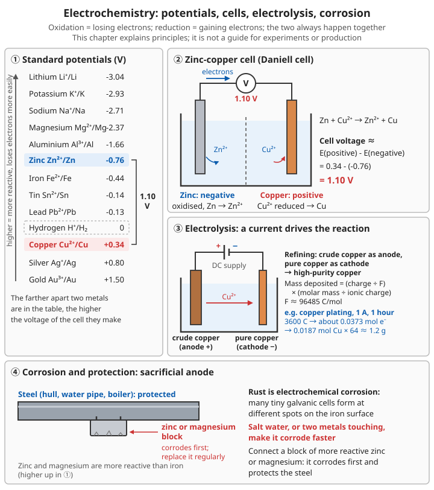

# Advanced Chemistry

> **Basic chemistry tells us "what reactions happen"; advanced chemistry answers "why they happen, how far they go, how fast, and how to control them". This is the key step from the craft workshop to the chemical industry**

## ⚠️ Safety first

**This chapter explains principles. It is not a guide to experiments or production.**

- ☠️ Chemical production involves strong acids, strong alkalis, toxic gases, high temperatures and high pressures; accidents often kill or injure many people at once
- 💥 If an exothermic reaction does not lose its heat fast enough, the hotter it gets the faster it runs, and it "runs away" (boil-over, explosion)
- 💥 Combustible dust such as flour, coal dust, sawdust and metal powder can explode if it is suspended in air and meets a flame
- ☠️ Never store oxidisers (nitrates, chlorates, potassium permanganate, concentrated nitric acid, etc.) together with combustibles (oil, paper, sawdust, sulphur, carbon powder)
- ✓ For any reaction you do not know well: read up first, test a small amount, wear protection and work outdoors

For the basics see [Basic Science – Chemistry](../08-basic-science/03-chemistry.md).

---

## 1. Atomic structure and the periodic law

### 1.1 Electron arrangement

```
Electrons are arranged in shells around the nucleus, and each shell holds a limited
number (2 in the first shell, 8 in the second, 8 in the third at first…)
The number of electrons in the outermost shell (valence electrons) decides an
element's chemical behaviour

An outer shell of 8 electrons (2 for the first shell) is the most stable
  → the noble gases (helium, neon, argon) hardly react at all
Other atoms reach a stable arrangement by gaining, losing or sharing electrons
```

### 1.2 Patterns in the periodic table

```
Elements in the same column (group) have the same number of outer electrons and
behave alike:
  Group 1, alkali metals (lithium, sodium, potassium): 1 outer electron, lost very
    easily; very reactive, react violently with water
  Group 2, alkaline earth metals (magnesium, calcium): lose 2 electrons easily
  Group 17, halogens (fluorine, chlorine, bromine, iodine): 7 outer electrons, gain
    1 electron very easily; toxic and strongly oxidising
  Group 18, noble gases: hardly react

Metals (which lose electrons easily) are on the left of the table, non-metals
(which gain electrons easily) on the right
Going down a group, metallic character increases (potassium is more reactive than sodium)
```

### 1.3 Chemical bonds

```
Ionic bond: one atom loses electrons, the other gains them, and the positive and
  negative ions attract each other
  Example: table salt NaCl; ionic compounds have high melting points and conduct
  electricity when dissolved in water
Covalent bond: two atoms share electrons
  Examples: water H₂O, methane CH₄, all organic compounds
Metallic bond: the outer electrons of metal atoms move freely through the whole piece
  → Metals conduct electricity and heat, are shiny and can be forged

Polarity: shared electrons are pulled towards the atom that attracts them more
  strongly (such as the oxygen in water), so one end of the molecule carries a
  partial negative charge and the other a partial positive charge
  → Water molecules form "hydrogen bonds" with each other, so water boils at a much
    higher temperature than other molecules of the same size, and it dissolves many
    substances ("like dissolves like": polar substances dissolve in water, fats and
    oils in petrol, alcohol and similar)
```

---

## 2. Chemical thermodynamics: can a reaction happen?

### 2.1 Heat of reaction (enthalpy change)

```
Exothermic reactions (ΔH < 0): burning, neutralisation, quicklime meeting water
  Example: complete combustion of methane CH₄ + 2O₂ → CO₂ + 2H₂O releases about
  890 kJ per mole
Endothermic reactions (ΔH > 0): burning lime, electrolysis of water, photosynthesis

Hess's law: the heat of reaction depends only on the start and end points, not on
  how many steps are taken
  → You can add and subtract the heats of known reactions to work out the heat of
    an unknown one
```

### 2.2 Entropy and Gibbs free energy

```
Entropy (S): the degree of disorder; gases have more entropy than liquids, and
  liquids more than solids

Whether a reaction proceeds spontaneously depends on the change in Gibbs free energy:
  ΔG = ΔH - T × ΔS
  ΔG < 0: proceeds spontaneously; ΔG > 0: does not proceed spontaneously

Example: burning lime CaCO₃ → CaO + CO₂
  ΔH ≈ +178 kJ/mol (absorbs heat: unfavourable)
  ΔS ≈ +0.16 kJ/(mol·K) (produces a gas, disorder increases: favourable)
  ΔG = 178 - T × 0.16
  ΔG < 0 when T is above about 1110 K (about 840°C)
  → This is why a lime kiln must reach about 900°C; below that temperature the
    limestone will not decompose however long you burn it
```

### 2.3 The thermodynamics of smelting

```
The more stable a metal oxide, the harder it is to reduce with carbon

Plotting how the stability of various metal oxides and of carbon's oxides changes
with temperature on one chart (the Ellingham diagram) shows that:
- Oxides of copper, lead and tin: charcoal reduces them at fairly low temperatures
- Oxides of iron: need a higher temperature
- Oxides of aluminium, magnesium and calcium: extremely stable; carbon cannot reduce
  them at ordinary furnace temperatures, so electrolysis is needed
→ This explains thermodynamically both the reactivity series of metals and the order
  in which humans came to use metals
```

For the reactivity series see [Chemistry – The reactivity series of metals](../08-basic-science/03-chemistry.md#22-the-reactivity-series-of-metals).

---

## 3. Chemical equilibrium: how far does a reaction go?

### 3.1 Reversible reactions and the equilibrium constant

```
Many reactions do not go to completion; they stop where the forward and reverse
reactions run at the same rate (equilibrium)

  aA + bB ⇌ cC + dD
  Equilibrium constant K = [C]ᶜ × [D]ᵈ ÷ ([A]ᵃ × [B]ᵇ)  ([X] means concentration)
  K very large: reaction almost complete; K very small: almost no reaction
  K changes with temperature
```

### 3.2 Le Chatelier's principle

```
If you change the conditions of an equilibrium, it shifts in the direction that
"counteracts the change":
- Add more reactant, or remove product → shifts towards making product
- Raise the pressure → shifts towards fewer gas molecules
- Raise the temperature → shifts in the endothermic direction

Example: ammonia synthesis N₂ + 3H₂ ⇌ 2NH₃, ΔH ≈ -92 kJ (exothermic)
  - 4 gas molecules become 2 → high pressure favours making ammonia
  - Exothermic → low temperature favours the yield, but the reaction is too slow
    at low temperature
  - Compromise: about 400-500°C, several hundred atm, an iron catalyst, and the
    ammonia continuously condensed and removed
→ This is why the Haber process needs large high-pressure equipment
```

### 3.3 Acid–base equilibrium

```
pH = -lg[H⁺], the negative logarithm of the hydrogen ion concentration
  In water at 25°C, [H⁺] × [OH⁻] = 10⁻¹⁴; when neutral both are 10⁻⁷ and pH = 7

Strong acids (hydrochloric, sulphuric) ionise completely in water; weak acids
(acetic, carbonic) only partly
Buffer solution: a weak acid mixed with its salt; adding a little acid or alkali
  changes the pH very little
  → Human blood is a buffer system, held stable at about pH 7.4
```

### 3.4 Solubility equilibrium

```
Even "insoluble" substances dissolve very slightly in water until equilibrium is reached
  → Adding an ion they already contain makes them even less soluble (the common
    ion effect)
  → Forming precipitates is used to separate and test for ions (see section 7)
```

---

## 4. Reaction rate and catalysis

```
Factors affecting reaction rate:
1. Concentration: the higher the concentration, the faster
2. Temperature: for many reactions, every 10°C rise multiplies the rate by about 2-4
   → why refrigeration slows food spoilage; why exothermic reactions run away
3. Contact area: the finer the particles, the faster
   → Dust explosions: a combustible ground to a fine powder and suspended in air
     burns extremely fast
4. Catalysts: lower the "threshold" a reaction needs (the activation energy) and are
   not used up themselves
   → Iron for ammonia synthesis, vanadium pentoxide for making sulphuric acid

Enzymes: catalysts in living things, which are proteins
  - Extremely efficient and highly specific (one enzyme catalyses only one reaction
    or one type of reaction)
  - Damaged by high temperature and by strong acids and alkalis (they stop working
    once the protein is denatured)
  - Brewing, raising dough, making fermented sauces and digesting food all depend
    on enzymes
```

---

## 5. Electrochemistry

### 5.1 Oxidation and reduction

```
Oxidation: losing electrons (oxidation state rises)
Reduction: gaining electrons (oxidation state falls)
Oxidation and reduction always happen together
  Example: Zn + Cu²⁺ → Zn²⁺ + Cu  zinc is oxidised, the copper ion is reduced
```

### 5.2 Galvanic cells and electrode potentials

| Electrode | Standard electrode potential (V) |
|------|-----------------|
| Lithium Li⁺/Li | -3.04 |
| Potassium K⁺/K | -2.93 |
| Sodium Na⁺/Na | -2.71 |
| Magnesium Mg²⁺/Mg | -2.37 |
| Aluminium Al³⁺/Al | -1.66 |
| Zinc Zn²⁺/Zn | -0.76 |
| Iron Fe²⁺/Fe | -0.44 |
| Tin Sn²⁺/Sn | -0.14 |
| Lead Pb²⁺/Pb | -0.13 |
| Hydrogen H⁺/H₂ | 0 |
| Copper Cu²⁺/Cu | +0.34 |
| Silver Ag⁺/Ag | +0.80 |
| Gold Au³⁺/Au | +1.50 |

```
Cell voltage ≈ potential of the positive electrode - potential of the negative electrode
  Example: zinc–copper cell (Daniell cell) = 0.34 - (-0.76) = 1.10 V
  → The further apart two metals are in the table, the higher the voltage of a cell
    made from them

Discharge reaction of a lead–acid battery:
  Pb + PbO₂ + 2H₂SO₄ → 2PbSO₄ + 2H₂O
  On charging, the reaction runs in reverse
```

### 5.3 Electrolysis and Faraday's law

```
Electrolysis: using an applied current to drive a reaction that would not happen
on its own

Mass deposited = (charge ÷ F) × (molar mass ÷ charge number of the ion)
  F (Faraday constant) ≈ 96485 C/mol
  Charge = current × time (coulombs = amperes × seconds)

Example: copper plating at 1 A for 1 hour
  Charge = 3600 C → 3600 ÷ 96485 ≈ 0.0373 mol of electrons
  Copper is divalent → 0.0187 mol of copper × 64 ≈ 1.2 g of copper

Uses:
- Electroplating: coating iron parts with copper, zinc or nickel against rust and
  for appearance
- Refining copper: crude copper as the anode, pure copper as the cathode, giving
  high-purity copper (needed for wire)
- Making aluminium, caustic soda and chlorine (needs a great deal of electricity)
```

### 5.4 Corrosion and protection

```
Rusting of iron and steel is electrochemical corrosion: many tiny cells form between
different spots on the iron surface
  It is faster in salt water or where two different metals touch

Sacrificial anode protection: connect a piece of more reactive zinc or magnesium to
  the steel (ship hulls, water pipes, boilers), so the zinc or magnesium corrodes
  first and protects the steel (replace it periodically)
```



*Figure: The further apart two metals are in the electrode potential table, the higher the cell voltage (zinc–copper 1.10 V); electrolysis drives a reaction with an applied current, with crude copper as the anode and pure copper as the cathode; more reactive zinc or magnesium corrodes first and protects the steel*

---

## 6. Organic chemistry

### 6.1 Functional groups

| Class | Functional group | Examples | Properties |
|------|--------|------|------|
| Alkanes | Carbon–carbon single bonds only | Methane (biogas), petrol, paraffin wax | Stable, flammable |
| Alkenes | Carbon–carbon double bond | Ethylene (ripens fruit) | Undergo addition and polymerisation |
| Aromatic hydrocarbons | Benzene ring | Benzene, toluene | ⚠️ Benzene is toxic and carcinogenic |
| Alcohols | -OH | Ethanol (alcohol), methanol (⚠️ highly toxic), glycerol | Soluble in water |
| Aldehydes | -CHO | Formaldehyde (⚠️ toxic), acetaldehyde | Easily oxidised |
| Carboxylic acids | -COOH | Acetic acid, fatty acids | Acidic |
| Esters | -COO- | Ethyl acetate, fats and oils | Fragrant; can be hydrolysed |
| Amines | -NH₂ | Part of amino acids | Basic |

### 6.2 Main reaction types

```
Combustion: organic compound + oxygen → carbon dioxide + water
Substitution: one atom (or group) replaces another
Addition: a double bond opens and new atoms attach
Esterification and hydrolysis:
  acid + alcohol ⇌ ester + water
  Fats hydrolysed in alkali → soap + glycerol (saponification)
Oxidation: alcohol → aldehyde → acid
  Ethanol → acetaldehyde → acetic acid (wine turning to vinegar)
  Methanol → formaldehyde → formic acid → this is why methanol poisoning causes
    blindness and death
Polymerisation: many small molecules join into long-chain polymers
  Addition polymerisation: ethylene → polyethylene (plastic bags)
  Condensation polymerisation: nylon, polyester
```

### 6.3 Natural polymers and materials

```
Cellulose: cotton, wood, paper; humans cannot digest it
Starch: grain; enzymes break it down into glucose (the principle behind making
  sugar and brewing)
Protein: wool, silk, leather, meat
Natural rubber: the latex of the rubber tree
  Vulcanisation: heating with a little sulphur forms cross-links between the rubber
  molecules, turning it from sticky and heat-sensitive into elastic and durable
  (tyres, seals)
```

### 6.4 Chemicals from wood and pine resin

```
Dry distillation of wood (heating with air excluded):
  → charcoal (solid)
  → pyroligneous acid (wood vinegar; contains acetic acid, ⚠️ methanol, acetone, etc.)
  → wood tar (preservative, waterproofing)
  → combustible gas
  Historically, acetic acid, methanol and acetone all came from the dry distillation
  of wood
  ⚠️ The methanol in the products is highly toxic; wood vinegar must not be drunk

Distilling pine resin:
  Resin that flows from cuts in pine bark → heat and distil
  → turpentine (solvent, paint thinner)
  → rosin (the solid residue; soldering flux, soap, glue, anti-slip)
```

---

## 7. Analytical chemistry: what is it, and how much?

### 7.1 Flame tests

```
Dip a clean iron wire (first heated in the flame until it gives no colour) in the
sample and hold it in a colourless flame:
  Sodium: yellow (very strong, masks other colours)
  Potassium: pale violet (view through blue glass)
  Calcium: brick red
  Copper: green or blue-green
  Lithium: deep red
  Barium: yellow-green
Use: a rough idea of which metal an ore or salt contains
```

### 7.2 Common tests

| Substance to test for | Method | Result |
|-------------|------|------|
| Carbon dioxide | Bubble through clear limewater | Turns cloudy |
| Oxygen | Glowing splint | Relights |
| Hydrogen | Ignite a small collected sample (away from any large amount of gas) | Faint pop |
| Starch | Add iodine tincture | Turns blue |
| Chloride ions | Add silver nitrate solution | White precipitate |
| Sulphate | Add barium chloride solution | White precipitate |
| Iron ions | Add strong tea or tannin | Turns black (the principle of iron gall ink) |
| Acidity/alkalinity | Red cabbage juice, litmus | Colour change (see Chemistry – pH) |
| Water hardness | Shake with soapy water | Little lather, scum → hard water |

### 7.3 Titration: measuring concentration precisely

```
Add a solution of known concentration drop by drop to the solution being measured
until the reaction is exactly complete (judged by an indicator changing colour)

Example: measuring the acidity of vinegar
  Take 10 mL of vinegar and add a few drops of indicator (phenolphthalein, or red
  cabbage juice)
  Titrate with 0.5 mol/L sodium hydroxide solution; 16 mL is used when the colour
  just changes
  Moles of sodium hydroxide = 0.5 × 0.016 = 0.008 mol
  Acetic acid and sodium hydroxide react 1:1 → 10 mL of vinegar contains 0.008 mol
  of acetic acid
  Concentration = 0.8 mol/L ≈ 48 g/L (about 4.8%)

Needs: an accurate measuring cylinder or burette, a balance, a standard solution of
known concentration
```

### 7.4 Gravimetric analysis

```
Turn the component being measured into a pure precipitate; filter, dry and weigh it,
then calculate the content from the chemical formula
  Example: measuring the content of a metal in an ore
```

---

## 8. Important chemical processes (principles)

```
Soda ash (Solvay process):
  NaCl + NH₃ + CO₂ + H₂O → NaHCO₃↓ + NH₄Cl
  2NaHCO₃ → Na₂CO₃ + H₂O + CO₂↑ (heating)
  The ammonia is recovered with lime and recycled
  Raw materials: salt, limestone; products used for glass, soap and paper

Sulphuric acid (contact process):
  S + O₂ → SO₂
  2SO₂ + O₂ ⇌ 2SO₃ (about 400-450°C, vanadium pentoxide catalyst)
  The sulphur trioxide is absorbed in concentrated sulphuric acid (absorbing it
  directly in water forms an acid mist that is hard to collect), then diluted
  ⚠️ Sulphur dioxide, sulphur trioxide and concentrated sulphuric acid are all
     extremely dangerous

Chlor-alkali industry: electrolysis of saturated brine → sodium hydroxide + chlorine
  + hydrogen (see the Chemistry chapter)

Ammonia synthesis: see section 3 of this chapter

Papermaking: cook wood or rice straw in alkali to dissolve the lignin, leaving
  cellulose fibres
Sugar making: press juice from sugar cane or sugar beet → clarify with lime →
  concentrate and crystallise
Oil refining: fractional distillation by boiling point into petrol, kerosene, diesel,
  lubricating oil and bitumen
```

---

## Related chapters

- ⏮️ [Basic Science – Chemistry](../08-basic-science/03-chemistry.md) - background for this chapter
- ⏮️ [Higher Mathematics](04-higher-mathematics.md) - calculations on equilibrium and rates
- ⏭️ [Modern Physics](06-modern-physics.md) - the physical basis of atomic structure
- 🔗 [Technology Rebuilding Roadmap](00-technology-rebuilding-roadmap.md) - where the chemical industry fits in rebuilding technology
- 🔗 [Metallurgy](../05-metallurgy/README.md) - the chemistry behind smelting
- 🔗 [Pharmaceuticals](../06-pharmaceuticals/README.md) - extraction and purification

---

**Remember: energy decides whether a reaction can happen, equilibrium decides how far it goes, and rate decides how long you wait. Master these three and you can control chemical change.**
