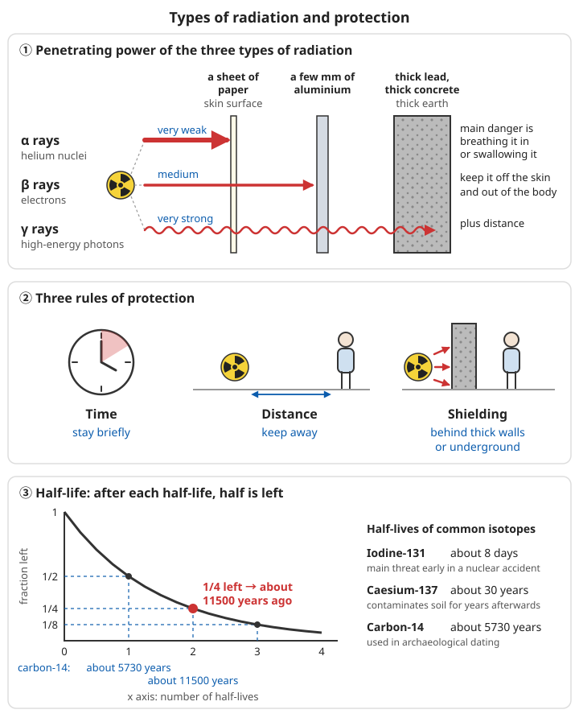

# Modern Physics

> **Semiconductors, lasers, X-rays, nuclear power, satellite positioning: the technologies that changed the world in the 20th century all came from a new understanding of atoms and light**

## ⚠️ What this chapter covers

At the end of the 19th century, people thought physics was nearly finished. Over the following decades, quantum mechanics and relativity completely changed our understanding of the world and brought the electronics industry, nuclear power, medical imaging and other technologies.

```
Purpose of this chapter:
- To understand why modern technology works (why semiconductors can control current,
  why solar panels generate electricity)
- To understand the hazards of radiation and how to protect against them
- To record that this knowledge exists, so later generations have a direction for
  rediscovering it

Note:
- Most of these technologies need a very advanced industrial base and cannot be
  rebuilt in the short term
- The nuclear section covers principles only and contains nothing related to weapons
```

For the basics see [Basic Science – Physics](../../../docs/08-基础科学知识/02-物理.md).

---

## 1. Light: wave or particle?

### 1.1 Light is a wave

```
Interference: light passing through two very narrow parallel slits forms alternating
  bright and dark bands on a screen behind them
  → Only waves add up and cancel out like this
Diffraction: light spreads out around very small obstacles or through tiny holes

Spectrum: white light passed through a prism or diffraction grating splits into a
  continuous band of colours
Electromagnetic spectrum (wavelength from long to short):
  radio waves → microwaves → infrared → visible light (red to violet, about
  0.4-0.7 µm) → ultraviolet → X-rays → γ-rays
```

### 1.2 Light is also a particle

```
The photoelectric effect: light shining on a metal knocks out electrons, but:
  - Whether electrons come out depends only on the colour (frequency) of the light,
    not on its brightness
  - Red light, however bright, knocks out no electrons; even weak ultraviolet does
  → Einstein's explanation: light is made of separate packets, "photons"

Energy of a photon: E = h × f
  h (Planck constant) ≈ 6.63 × 10⁻³⁴ J·s
  The higher the frequency (ultraviolet, X-rays), the more energy each photon carries
  → This is why ultraviolet causes sunburn and X-rays and γ-rays can damage cells,
    while visible light and radio waves do not

Solar cells and the image sensors in digital cameras are all based on the
photoelectric effect
```

### 1.3 Wave–particle duality

```
Not only light: electrons and other particles also behave as waves:
  wavelength λ = h ÷ (mass × velocity) (the de Broglie relation)
→ An electron's wavelength is much shorter than that of visible light → an electron
  microscope can see things much smaller than an optical microscope can (such as viruses)
```

---

## 2. Atomic structure

### 2.1 Discovery of the nucleus

```
Rutherford (1911) fired α particles at gold foil:
  Nearly all passed straight through; a very few bounced back at large angles
  → Almost all the mass of an atom is concentrated in a tiny nucleus at the centre,
    and the rest is almost empty
  (the nucleus is only about one hundred-thousandth of the diameter of the atom)
```

### 2.2 Energy levels and spectra

```
Electrons can only occupy certain specific energy states (energy levels), never in
between two levels
  Energy levels of the hydrogen atom: Eₙ = -13.6 eV ÷ n² (n = 1, 2, 3, …)

When an electron drops from a higher level to a lower one, it emits a photon whose
energy equals the difference between the two levels
  → Every element has its own characteristic set of spectral lines, like a "fingerprint"
  → Spectral analysis: the spectrum an object emits or absorbs tells you which
    elements it contains
    (this is how we know what the Sun and distant stars are made of)
  → The colours of flame tests, neon lights and sodium lamps all come from specific
    spectral lines

1 eV (electronvolt) ≈ 1.6 × 10⁻¹⁹ J, the energy unit commonly used at atomic scale
```

For flame tests see [Advanced Chemistry – Flame tests](../../../docs/09-进阶科学与工程/05-化学进阶.md#71-焰色反应).

### 2.3 Electron arrangement and the periodic table

```
Quantum mechanics worked out how many electrons each shell can hold,
explaining why the periodic table looks the way it does and why elements in the same
group behave alike
(Pauli exclusion principle: no two electrons can be in exactly the same state)
```

---

## 3. Key points of quantum mechanics

```
1. Quantisation: energy, angular momentum and so on can take only certain discrete
   values, not a continuous range
2. Probability: you cannot predict exactly where a single particle will be, only the
   probability of finding it in each place
3. The uncertainty principle: position and momentum cannot both be known exactly
   at the same time
   Δx × Δp ≥ h ÷ (4π)
4. Tunnelling: a particle has some probability of passing through a barrier that
   classical physics says it "cannot get over"
   → Nuclear fusion inside the Sun, some electronic components and the scanning
     tunnelling microscope all depend on it

These rules show clearly only at the scale of atoms and smaller and cannot be felt
in daily life, but all chemical bonds, semiconductors, lasers and nuclear reactions
need them to be explained
```

---

## 4. Solid-state physics and semiconductors

### 4.1 Energy bands

```
In a solid, the energy levels of huge numbers of atoms merge into "energy bands":
  Conductors: electrons move freely → conduct electricity
  Insulators: electrons are bound and would have to cross a large energy gap (the
    band gap) to conduct → do not conduct
  Semiconductors: the band gap is fairly narrow (silicon about 1.1 eV, germanium
    about 0.7 eV)
    → Temperature, light and added impurities can all change their conductivity greatly
```

### 4.2 How semiconductor devices work

```
Doping produces N-type and P-type semiconductors; where they meet they form a PN junction:
- Diode: conducts in one direction only
- Light-emitting diode (LED): electrons crossing the band gap emit photons; the width
  of the gap decides the colour of the light
- Solar cell: photons lift electrons across the band gap, creating a voltage across
  the PN junction
  The theoretical efficiency limit of a single-junction silicon solar cell is about 33%;
  real products reach about 20%
- Transistor: uses a small signal to control a large current
```

For specific devices see [Electrical Engineering and Electronics – Semiconductors and electronics](../../../docs/09-进阶科学与工程/02-电气工程与电子学.md#十半导体和电子学).

### 4.3 Lasers

```
Stimulated emission: a photon passing an atom in a high energy level can "copy"
  itself, producing a photon of exactly the same frequency, direction and phase
Amplified back and forth between two mirrors → laser light: very precisely directed,
  a single colour, highly concentrated energy
Uses: range-finding, cutting and welding, fibre-optic communication, surgery,
  barcode scanning
⚠️ A laser shining straight into the eye causes permanent damage
```

### 4.4 Superconductivity

```
Some materials lose all electrical resistance when cooled to extremely low temperatures
Use: the powerful magnets in hospital magnetic resonance imaging (MRI) machines
```

---

## 5. Relativity

### 5.1 Special relativity

```
Two basic postulates:
1. The laws of physics are the same in every frame of reference moving at constant velocity
2. The speed of light in a vacuum is the same for every observer (about 3 × 10⁸ m/s)

Consequences:
- Moving clocks run slow (time dilation): the factor by which time slows is
  γ = 1 ÷ √(1 - v²/c²)
  It is noticeable only close to the speed of light; at everyday speeds it is
  almost undetectable
- Moving objects are shorter in the direction of motion
- Nothing with mass can reach the speed of light
- Mass–energy equivalence: E = m × c²
```

### 5.2 General relativity

```
Gravity is not an ordinary "force": mass curves spacetime
Consequences:
- The stronger the gravity, the slower time runs
- Light bends as it passes close to a massive body
- It predicted black holes and gravitational waves (both since confirmed by observation)
```

### 5.3 Why satellite positioning needs relativity

```
Satellite positioning (BeiDou, GPS) works out position by precisely measuring the
time signals take to travel from several satellites to the receiver
- The satellites move fast → their clocks run slow by about 7 microseconds a day
  (special relativity)
- The satellites are high up where gravity is weaker → their clocks run fast by about
  45 microseconds a day (general relativity)
- Net: about 38 microseconds fast per day
- Without correction, the position error would build up to about 10 km a day
```

---

## 6. Nuclear physics

### 6.1 The nucleus

```
The nucleus is made of protons and neutrons held tightly together by the "strong
interaction" (the nuclear force)
Isotopes: the same number of protons, different numbers of neutrons (e.g. carbon-12
and carbon-14)

Binding energy: the energy needed to pull a nucleus apart
  Nuclei of medium mass (around iron) are the most stable
  → Splitting a very heavy nucleus into medium ones (fission), or joining very light
    nuclei into heavier ones (fusion), both release enormous energy
```

### 6.2 Radioactive decay

| Decay | Emits | Penetrating power | Protection |
|------|------|--------|------|
| α decay | Helium nucleus (2 protons + 2 neutrons) | Very weak; stopped by a sheet of paper or the outer layer of skin | Main danger is breathing it in or swallowing it |
| β decay | Electron (a neutron turns into a proton) | Moderate; stopped by a few mm of aluminium | Prevent skin contamination and intake into the body |
| γ-rays | High-energy photons | Very strong | Thick lead, thick concrete, a thick layer of earth, plus distance |

### 6.3 Half-life and radioactive dating

Half-life: the time it takes for the amount of a radioactive substance to fall by half; after each half-life, half remains (1/2 → 1/4 → 1/8…).

| Isotope | Half-life | Notes |
|--------|--------|------|
| Iodine-131 | About 8 days | The main threat early in a nuclear accident; concentrates in the thyroid |
| Caesium-137 | About 30 years | Contaminates soil for a long time after a nuclear accident |
| Carbon-14 | About 5730 years | Used for archaeological dating |
| Potassium-40 | About 1.25 billion years | Occurs naturally in the human body and in food |
| Uranium-238 | About 4.5 billion years | Used to date rocks and the age of the Earth |

```
Carbon-14 dating:
  Living things constantly take in carbon from their surroundings, so the proportion
  of carbon-14 in their bodies is the same as in the atmosphere
  After death they take in no more, and the carbon-14 decreases according to its half-life
  Measure the proportion left and you can work out how long ago it died
  Example: 1/4 left → two half-lives have passed → about 11500 years ago
  Works for organic material (wood, bone, seeds) up to about 50000 years old
```

For the calculation see [Mathematics – Exponential decay and half-life](../../../docs/08-基础科学知识/01-数学.md#72-指数衰减和半衰期).

### 6.4 Radiation dose

```
Activity: decays per second, measured in becquerels (Bq)
Effective dose: a measure of harm to the human body, measured in sieverts (Sv),
  often millisieverts (mSv)

For reference:
- Natural background radiation: worldwide average about 2-3 mSv per person per year
  (from rocks, radon in the air, cosmic rays, food)
- One chest X-ray: about 0.02-0.1 mSv
- Above about 1 Sv (1000 mSv) received over a short time: acute radiation sickness
  (nausea, vomiting, falling white blood cell count)
- About 4-5 Sv received over a short time: without treatment, about half of people die

Three principles of protection: time (stay briefly), distance (keep away; doubling
the distance cuts exposure to about 1/4), shielding (shelter behind thick walls,
underground)
```



*Figure: α radiation is stopped by a sheet of paper, β needs a few mm of aluminium, γ needs thick lead, thick concrete or a thick layer of earth; protection relies on time, distance and shielding; after each half-life, half remains*

For responding to nuclear accidents see [Man-made Disasters](../../../docs/02-灾难应对/05-人为灾难.md).

### 6.5 Nuclear fission and nuclear power (principles)

```
A very heavy nucleus such as uranium-235 absorbs a neutron and splits into two
medium-sized nuclei, releasing energy and 2-3 new neutrons, which cause other nuclei
to split → a chain reaction

Nuclear power station: control rods absorb surplus neutrons so the chain reaction runs
  steadily and under control; the heat released boils water into steam, which drives
  a turbine to generate electricity
  - The energy from complete fission of 1 kg of uranium-235 equals burning about
    2700 t of standard coal
  - Cooling must never stop: after shutdown the fuel still gives off a great deal of
    "decay heat", and if cooling is lost the core melts down
  - Spent fuel is intensely radioactive and must be kept isolated for a very long time
```

### 6.6 Nuclear fusion

```
Very light nuclei (such as isotopes of hydrogen) join into helium at extremely high
temperatures, releasing energy
  → the source of the light and heat of the Sun and all stars
  → Humans are researching controlled fusion for electricity; it is not yet in
    commercial use
```

### 6.7 Beneficial uses of radiation

```
✓ X-ray examinations (Röntgen discovered X-rays in 1895) and CT
✓ Radiotherapy for cancer
✓ Irradiation to sterilise medical equipment and preserve food
✓ Radioactive dating
✓ Smoke alarms (contain a small radioactive source; ⚠️ do not take them apart)
```

---

## 7. Particles and the universe

### 7.1 The four fundamental interactions

| Interaction | What it does | Range |
|---------|------|---------|
| Gravity | Motion of celestial bodies, falling objects | Infinite, but very weak |
| Electromagnetism | Chemical bonds, friction, light, electricity and magnetism | Infinite |
| Strong interaction | Binds protons and neutrons into nuclei | Within the nucleus |
| Weak interaction | β decay | Within the nucleus |

```
Protons and neutrons are made of smaller "quarks"; electrons are currently thought
to have no smaller structure
```

### 7.2 The universe

```
- The average distance from the Sun to the Earth is about 1.5 × 10⁸ km (150 million km);
  sunlight takes about 8 minutes to reach the Earth
- The Sun is one ordinary star among several hundred billion in the Milky Way
- The universe is expanding: the more distant a galaxy, the faster it is receding
- The universe began about 13.8 billion years ago in the "Big Bang"
- Stars fuse hydrogen into helium; heavier elements (carbon, oxygen, iron) form inside
  stars and in supernova explosions
  → Most of the atoms in our bodies came from stars long ago
```

---

## 8. Common physical constants (supplement)

| Constant | Value |
|------|------|
| Planck constant h | about 6.63 × 10⁻³⁴ J·s |
| Electron charge e | about 1.60 × 10⁻¹⁹ C |
| Electron mass | about 9.11 × 10⁻³¹ kg |
| Proton mass | about 1.67 × 10⁻²⁷ kg |
| 1 eV | about 1.60 × 10⁻¹⁹ J |
| Boltzmann constant k | about 1.38 × 10⁻²³ J/K |
| Stefan–Boltzmann constant σ | about 5.67 × 10⁻⁸ W/(m²·K⁴) |
| Wien displacement constant | about 2.90 × 10⁻³ m·K |

```
Wien's displacement law: the wavelength at which an object radiates most strongly ×
its absolute temperature ≈ 2.9 × 10⁻³ m·K
  → The hotter it is, the more its light shifts towards bluish white
  → This is the physics behind judging temperature from the colour of a fire or
    red-hot iron
```

For judging temperature by colour see [Metalworking](../../../docs/05-冶金技术/04-金属加工技术.md).

---

## 9. Timeline of major discoveries

| Date | Discovery | Technology it led to |
|------|------|-----------|
| 1895 | Röntgen discovers X-rays | Medical imaging |
| 1896 | Becquerel discovers radioactivity | Nuclear physics, radiation medicine |
| 1897 | Thomson discovers the electron | Electronics |
| 1900 | Planck proposes energy quanta | The beginning of quantum mechanics |
| 1905 | Einstein explains the photoelectric effect and proposes special relativity | Solar cells, E = mc² |
| 1911 | Rutherford discovers the nucleus | |
| 1913 | Bohr's model of the atom | Spectral analysis |
| 1915 | General relativity | Corrections for satellite positioning |
| 1925-1927 | Quantum mechanics established | Theoretical basis of chemistry, materials and semiconductors |
| 1932 | Discovery of the neutron | Nuclear reactions |
| 1938 | Discovery of nuclear fission | Nuclear power |
| 1947 | Invention of the transistor | Computers, the modern electronics industry |
| 1960 | First laser | Fibre-optic communication, precision machining |

---

## Related chapters

- ⏮️ [Basic Science – Physics](../../../docs/08-基础科学知识/02-物理.md) - background for this chapter
- ⏮️ [Advanced Chemistry](../../../docs/09-进阶科学与工程/05-化学进阶.md) - atomic structure and chemical bonds
- ⏮️ [Electrical Engineering and Electronics](../../../docs/09-进阶科学与工程/02-电气工程与电子学.md) - semiconductor devices
- ⏭️ [Advanced Biomedicine](../../../docs/09-进阶科学与工程/07-生物医学进阶.md)
- 🔗 [Man-made Disasters](../../../docs/02-灾难应对/05-人为灾难.md) - responding to nuclear accidents
- 🔗 [Technology Rebuilding Roadmap](../../../docs/09-进阶科学与工程/00-技术重建路线图.md) - where modern technology fits in rebuilding

---

**Remember: the laws of atoms and light cannot be seen or touched, yet they explain everything from chemical bonds to the shining of the Sun. Preserve this knowledge and you leave later generations the key to re-entering the modern world.**
