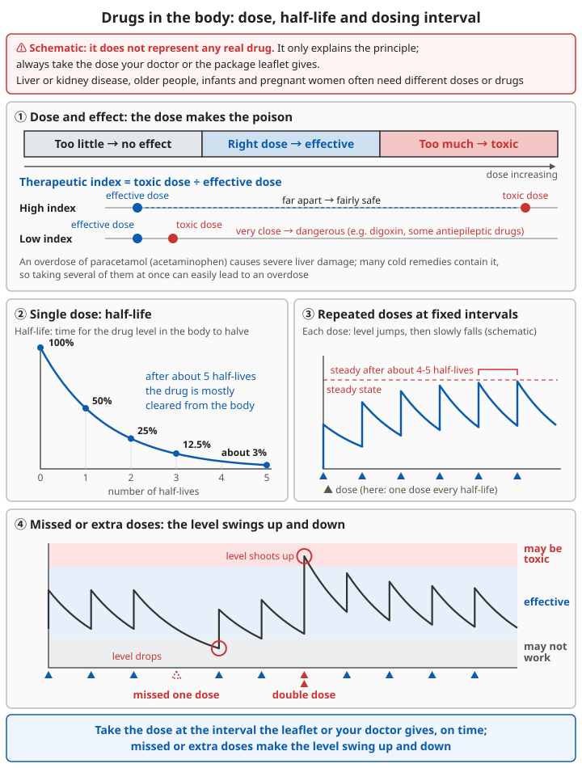

# Advanced Biomedicine

> **The power of modern medicine comes from three things: understanding how the body works (physiology), knowing how drugs act in the body (pharmacology), and using rigorous trials to tell treatments that really work from mere comfort (evidence-based medicine)**

## ⚠️ What this chapter covers

This chapter explains the science behind medicine, to help you understand why doctors diagnose and prescribe as they do, why medicines must be taken at the right dose and for the full course, and how medical knowledge is tested.

```
⚠️ Important:
- This chapter is not a treatment guide and cannot replace a doctor. For handling
  specific illnesses and first aid, see the First Aid and Family Health part
- Drug doses must follow the doctor's instructions or the package leaflet; the
  formulas and examples in this chapter are only for understanding the principles
- Microbial culture is for diagnosis and teaching only; treat every culture as
  pathogenic and sterilise it thoroughly after use
- This handbook does not give methods for making antibiotics, vaccines or injections
  at home (for the reasons see the Pharmaceuticals part)
```

For the basics see [Biology and Medicine Basics](../08-basic-science/04-biology-and-medical-basics.md).

---

## 1. Molecular biology

### 1.1 The central dogma

```
DNA → (transcription) → RNA → (translation) → protein

DNA: carries genetic information; made of a sequence of four "bases" (A, T, G, C)
  in a double helix
  A pairs with T, G pairs with C → one strand can serve as a template for copying the other
RNA: copies one stretch of information (a gene) from the DNA and carries it into the cytoplasm
Protein: built according to the information on the RNA, every 3 bases specifying one
  amino acid, joined into a long chain that folds up
  → Enzymes, antibodies, muscle, hormones, haemoglobin… almost all the work of life
    is done by proteins
```

### 1.2 Mutation

```
DNA is copied wrongly or damaged (ultraviolet light, radiation, certain chemicals),
and the base sequence changes
- Most mutations are harmless or harmful; very few are beneficial
- Mutations in reproductive cells can be passed to offspring → the raw material of evolution
- Accumulated mutations in body cells can lead to cancer
→ This is why radiation, smoking and certain chemicals cause cancer
```

### 1.3 Why viruses are hard to treat

```
A virus has no cell of its own; it is just a piece of DNA or RNA wrapped in a protein coat
It gets into human cells and uses their "machinery" to copy itself
→ It is hard to kill the virus without harming the body's own cells
→ Antibiotics do not work on viruses; there are few antiviral drugs and each is narrowly targeted
→ Prevention (vaccines, isolation, handwashing) matters more than treatment
```

---

## 2. Further immunology

### 2.1 Division of labour in the immune system

```
Innate immunity (inborn, fast, not aimed at any particular pathogen):
  The skin and mucous membrane barriers, phagocytes (which engulf invaders),
  inflammation (redness, swelling, heat, pain), fever

Adaptive immunity (acquired, slower, aimed at a specific pathogen, with memory):
  B cells → produce antibodies, which bind specifically to a pathogen so that it is
    disabled or cleared
  T cells → kill infected cells and coordinate the whole immune response
  Memory cells → respond quickly and strongly when the same pathogen appears again
```

### 2.2 Types of vaccine

| Type | Principle | Examples |
|------|------|------|
| Live attenuated | Live pathogen with weakened virulence | Measles, BCG (tuberculosis) |
| Inactivated | Killed pathogen | Rabies, hepatitis A |
| Toxoid | Bacterial toxin made harmless | Tetanus, diphtheria |
| Subunit/recombinant | A protein from part of the pathogen | Hepatitis B |
| Nucleic acid | Makes the body's own cells produce one protein of the pathogen | Some COVID-19 vaccines |

```
⚠️ Producing vaccines needs strict control of the pathogen's virulence, purity,
   sterility and dose, and must be done by professional institutions; vaccines are
   transported and stored in a cold chain
```

### 2.3 Immune disorders

```
Allergy: the immune system overreacts to harmless substances (pollen, food, drugs)
  The most serious form is anaphylactic shock, which threatens life within minutes
Autoimmune disease: the immune system attacks the body's own tissues (rheumatoid
  arthritis, type 1 diabetes, etc.)
Immunodeficiency: weakened immunity, with repeated infections
```

For handling anaphylactic shock see [Acute Symptoms – Allergic reactions](../01-first-aid-and-family-health/05-acute-symptoms.md#allergic-reactions).

---

## 3. Key points of physiology

### 3.1 Circulation

```
Heart: the right side pumps venous blood to the lungs for gas exchange; the left side
  pumps oxygenated blood round the body
Blood pressure: systolic (when the heart contracts) / diastolic (when it relaxes),
  in mmHg (millimetres of mercury)
  Chinese standard: 140/90 mmHg or above is high blood pressure
Pulse: about 60-100 beats a minute for an adult at rest

Shock: the body's tissues are not getting enough blood
  Causes: heavy bleeding, severe dehydration, severe infection, allergy, heart failure
  Signs: pale, cold, clammy skin; fast, weak pulse; restlessness or apathy; little urine
```

### 3.2 Breathing

```
In the alveoli of the lungs, oxygen enters the blood and carbon dioxide leaves
Breathing rate: about 12-20 breaths a minute for an adult at rest
Blood oxygen saturation (measured with a fingertip pulse oximeter): normally above 95%
  Clearly lower → lack of oxygen; get medical help
The main signal that controls breathing is the carbon dioxide level in the blood
  → Hyperventilation (breathing too fast and too deep) drives carbon dioxide too low,
    causing numb hands and feet and cramps
```

### 3.3 Kidneys and body fluids

```
The kidneys filter the blood, remove waste and excess water and salt, and keep the
body's water and electrolytes in balance
An adult needs about 2-2.5 L of water a day (including water in food), and more in
hot weather, during hard work, fever or diarrhoea
The amount and colour of urine are simple signs of dehydration: little urine,
dark colour → short of water

The main danger of diarrhoea and vomiting is loss of water and salt
Oral rehydration salts: contain glucose and salt in a set ratio; the glucose helps the
  gut absorb sodium and water
  → Far better for rehydration than plain boiled water, and one of the most important
    medical advances of the 20th century
```

For using oral rehydration salts see [Common Illnesses – Diarrhoea](../01-first-aid-and-family-health/01-common-illnesses.md#diarrhoea).

### 3.4 Temperature regulation

```
The hypothalamus works like a "thermostat", keeping body temperature at about 37°C
Fever: during infection the "thermostat" setting is raised; this is part of the
  immune response
  → An ordinary fever does not need to be brought down to normal in a hurry; only a
    very high temperature needs active treatment
Heatstroke: heat produced and absorbed exceeds the body's ability to lose it, and body
  temperature rises out of control (a different mechanism from fever)
```

For fever grades see [Common Illnesses – Fever](../01-first-aid-and-family-health/01-common-illnesses.md#fever).

### 3.5 Blood sugar

```
Insulin lowers blood sugar; glucagon raises it
Diabetes: too little insulin (type 1) or insulin that works less well (type 2), so
  blood sugar stays too high for a long time
Low blood sugar (hypoglycaemia): most common in people with diabetes taking
  glucose-lowering drugs or insulin; in severe cases it causes coma
  If the person is conscious, give sugar at once
```

For handling low blood sugar see [Heart, Stroke and Sudden Illness – Low blood sugar](../01-first-aid-and-family-health/06-heart-stroke-and-sudden-illness.md#hypoglycaemia-low-blood-sugar).

---

## 4. Principles of pharmacology

### 4.1 What happens to a drug in the body

```
Absorption → distribution → metabolism (mainly in the liver) → excretion (mainly via
the kidneys)
→ Doses and choice of drug often need adjusting for people with liver or kidney
  disease, the elderly, infants and young children, and pregnant women
```

### 4.2 Dose and effect

```
Dose too small → no effect
Right dose → effective
Dose too large → poisoning

Therapeutic index = toxic dose ÷ effective dose
  Large therapeutic index → relatively safe (effective and toxic doses far apart)
  Small therapeutic index → dangerous (effective and toxic doses close together, e.g.
    digoxin, some anti-epileptic drugs)

"The dose makes the poison": any substance (including water and salt) is harmful in excess
  An overdose of paracetamol (acetaminophen) causes severe liver damage;
  many cold remedies contain it, so taking several at once easily leads to an overdose
```

### 4.3 Half-life and dosing interval

```
Half-life: the time it takes for the drug concentration in the body to fall by half
  - After about 5 half-lives, the drug is essentially cleared from the body
  - With repeated doses at fixed intervals, the concentration in the body levels off
    after about 4-5 half-lives (the "steady state")

→ The dosing interval is usually linked to the half-life: a drug with a short
  half-life must be taken several times a day
→ Missed doses and extra doses both make the concentration swing up and down
→ For some drugs a larger first "loading dose" is given so they work sooner
```

For calculating half-lives see [Mathematics – Exponential decay and half-life](../08-basic-science/01-mathematics.md#72-exponential-decay-and-half-life).



*Figure: Too small a dose has no effect, too large a dose poisons; each half-life halves the concentration, and with dosing at fixed intervals a steady state is reached after about 4-5 half-lives; missed or extra doses make the concentration swing up and down. Schematic only; it does not represent any particular drug.*

### 4.4 Dosing by body weight

```
Children's doses are often calculated by body weight: dose each time = dose per kg ×
body weight
  Example: a drug at 10 mg/kg per dose, child weighing 15 kg → 150 mg per dose
  ⚠️ Also check the "maximum single dose" and the "maximum number of doses a day";
     never exceed the adult dose
  ⚠️ Check the concentration of the liquid medicine: how many mg in each 5 mL
```

### 4.5 Drug interactions and adverse reactions

```
- One drug can strengthen or weaken the effect of another (e.g. anticoagulants taken
  with certain painkillers raise the risk of bleeding)
- Alcohol is dangerous with many drugs (sedatives, certain antibiotics, paracetamol)
- Allergy: has nothing to do with dose; even a tiny amount can cause a severe reaction;
  always tell the doctor before using a drug you have reacted to before

✓ Take a list of all the medicines you are on to every medical appointment
```

For medication information cards see [Chronic Medication Stockpile](../01-first-aid-and-family-health/08-chronic-medication-stockpile.md).

---

## 5. Microbiology laboratory techniques (diagnosis and teaching)

### 5.1 Microscopes

```
A simple home-made microscope (Leeuwenhoek type):
  Use a very small glass bead (a thin glass rod melted into a ball in a flame) as the
  lens, fix it over a small hole in a metal plate, and hold the sample close on the
  other side
  → Magnifies one to two hundred times, enough to see larger bacteria, yeast, blood
    cells and parasite eggs

Compound microscope (objective + eyepiece) magnification = objective magnification ×
  eyepiece magnification
  Seeing bacteria usually needs about 1000× (oil immersion lens)
```

### 5.2 Aseptic technique

```
✓ Sterilise all equipment and culture media beforehand in a pressure steam steriliser
  (about 121°C, at least 15 minutes)
✓ Work close to a spirit-lamp flame (the rising air above the flame reduces
  contaminants falling in)
✓ Heat the inoculating loop red-hot in the flame before and after each use
✓ Keep containers open as briefly as possible and pass their mouths through the flame
✓ Wipe the work surface with 75% alcohol
```

### 5.3 Culture and staining

```
Culture medium: bacteria need nutrients (broth, peptone) and a suitable temperature
  (about 37°C for human pathogens)
  Adding agar sets it into a solid medium, on which a single bacterium grows into a
  "colony" visible to the naked eye

Gram stain (divides bacteria into two large groups; guides the choice of antibiotic):
  crystal violet stain → iodine to fix → alcohol to decolourise → safranin counterstain
  Gram-positive bacteria: purple; Gram-negative bacteria: red

⚠️ Biosafety:
- Treat samples from patients and any colonies that grow as potentially pathogenic
- Never pipette liquids by mouth; never eat or drink in the work area
- Used cultures and equipment must be autoclaved before they are thrown away or washed
- Do not culture pathogens of unknown origin that could be highly dangerous
```

### 5.4 Simple tests

```
- Blood smear: look at red and white blood cells; in malarial areas, check for
  malaria parasites
- Stool microscopy: parasite eggs (roundworm, hookworm, etc.)
- Urine: colour, cloudiness; test strips can detect sugar, protein and white cells
  in urine
- Acid-fast stain of a sputum smear: tuberculosis bacilli
Reading these tests takes training, and a doctor must interpret the results together
with the symptoms
```

---

## 6. How diagnosis works

```
1. History: when it started, where it hurts, how it has changed, what triggers it,
   past illnesses, medicines, allergies
2. Physical examination: vital signs (temperature, pulse, breathing, blood pressure,
   consciousness); look, feel, tap, listen
3. List several possibilities (differential diagnosis), considering the common and
   the dangerous first
4. Any necessary tests
5. After treatment, watch the effect; if it is not as expected, think again

"Red flag" signs: symptoms that suggest serious illness and need prompt medical care
  (e.g. severe headache with fever and a stiff neck, chest pain, altered consciousness,
  difficulty breathing, blood in the stool)
```

For danger signs of all kinds see "When you must get medical help immediately" in the [First Aid and Family Health](../01-first-aid-and-family-health/README.md) part.

---

## 7. Evidence-based medicine: how do we know a treatment really works?

### 7.1 Levels of evidence (weakest to strongest)

```
1. Personal experience, "so-and-so says it works", single cases
2. Case series (a group of patients given a treatment and what happened, with no control)
3. Observational studies (comparing people who did and did not use it, without random
   allocation)
4. Randomised controlled trials (random allocation, a control group, ideally double-blind)
5. Combined analysis of several randomised controlled trials
```

### 7.2 Why there must be a control

```
- Many illnesses get better on their own (colds, most diarrhoea, mild sprains)
- Placebo effect: believing you are being treated can ease the symptoms
- Regression to the mean: people tend to seek help when they feel worst, and then
  naturally improve somewhat
→ Without a control group, all of these are mistaken for "the treatment working"
```

### 7.3 Key points of a randomised controlled trial

```
✓ Write down in advance: the question, what counts as effective, how many people
  are needed
✓ Random allocation (drawing lots)
✓ Blinding: patients do not know which treatment they get; ideally neither do the
  people assessing the results
✓ The control group gets the best known treatment or a placebo (as far as ethics allow)
✓ Statistical analysis (see Higher Mathematics – Statistical inference)
✓ Ethics: participants give informed consent; the control group must not be denied a
  treatment known to work
```

For statistical methods see [Higher Mathematics – Statistical inference](04-higher-mathematics.md#8-statistical-inference-is-the-result-a-fluke).

### 7.4 Assessing a claim about a treatment

```
Ask yourself:
- Was there a control? Was it randomised?
- How many people took part?
- How was "works" measured?
- Are the side effects clearly stated?
- Were only the good results reported?
```

---

## 8. Inflammation and wound healing

```
Inflammation: the defensive response after tissue injury or infection
  Redness (widened blood vessels), swelling (fluid leaking out), heat, pain, and loss
  of function
  → It is a necessary part of healing, but if it spreads too far or does not settle,
    it suggests infection or another problem

Stages of wound healing:
  stopping bleeding (minutes) → inflammation (a few days) → proliferation, new tissue
  growing (days to weeks) → remodelling (weeks to months; the scar slowly softens
  and fades)

Factors that hinder healing: infection, foreign bodies, poor blood supply,
  malnutrition (protein, vitamin C), diabetes, smoking, repeated rubbing
```

For wound care see [Wound and Injury Care](../01-first-aid-and-family-health/02-wounds-and-injuries.md).

---

## Related chapters

- ⏮️ [Biology and Medicine Basics](../08-basic-science/04-biology-and-medical-basics.md) - background for this chapter
- ⏮️ [Higher Mathematics](04-higher-mathematics.md) - the mathematics of statistical inference and pharmacokinetics
- ⏮️ [Advanced Chemistry](05-advanced-chemistry.md) - enzymes, proteins, organic chemistry
- ⏭️ [Computing and Information](08-computing-and-information.md)
- 🔗 [First Aid and Family Health](../01-first-aid-and-family-health/README.md) - handling specific illnesses
- 🔗 [Pharmaceuticals](../06-pharmaceuticals/README.md) - where medicines come from and their limits

---

**Remember: medical progress comes not from ever more miraculous folk remedies, but from understanding the body, dosing precisely and testing rigorously. The single question "was there a control?" exposes most false claims of cure.**
