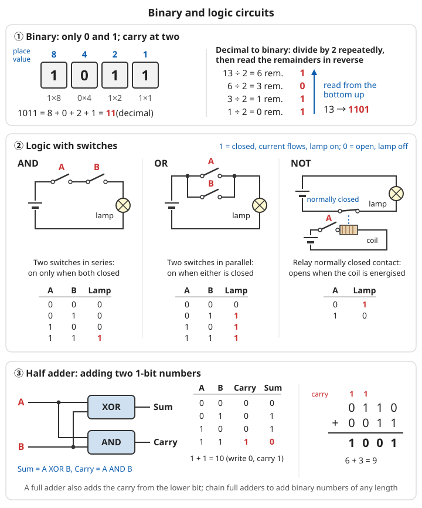

# Computing and Information

> **The core idea of a computer is very simple: represent information with "on" and "off", and build every operation out of a few simple kinds of logic. Once you understand the principle, an abacus, relays or transistors can all be used to compute**

## ⚠️ What this chapter covers

```
Contents of this chapter:
1. Calculating tools that need no electricity: the abacus, the slide rule, tables
2. How computers work: from logic gates to the processor
3. The basic ideas of algorithms and data structures
4. Information theory: how to store and transmit information efficiently and reliably
5. Preserving knowledge: digital data decays within years to decades; important
   knowledge must be printed on paper

The reality: building electronic computers from scratch needs a semiconductor
industry and is impossible in the short term;
but surviving computers, phones and solar panels can be used for many years,
and knowledge of computing principles and algorithms lets later generations walk
this road again
```

For the basics of binary see [Mathematics – Practical algorithms](../../../docs/08-基础科学知识/01-数学.md#十实用算法); for transistor and logic gate circuits see [Electrical Engineering and Electronics – Semiconductors and electronics](../../../docs/09-进阶科学与工程/02-电气工程与电子学.md#十半导体和电子学).

---

## 1. Calculating tools that need no electricity

### 1.1 The abacus

```
Traditional Chinese abacus arithmetic: each upper bead counts 5, each lower bead
counts 1, and each rod is one digit (decimal)
  A skilled user adds and subtracts faster than with an electronic calculator
  Multiplication and division have rhymes to memorise (the times tables, the
  division rhymes)

✓ Simple to make: a wooden frame, bamboo slivers or wire, wooden beads or pierced
  fruit stones
✓ Needs no electricity and does not break down
```

### 1.2 The slide rule

```
Principle: logarithms turn multiplication into addition (lg a + lg b = lg(a×b))
  Two rules marked with logarithmic scales slide against each other to add lengths,
  so you can read off products and quotients
  Accuracy is about 3 significant figures, enough for most engineering calculations

Making one: mark the scale in proportion to lg 1 to lg 10 (0 to 1)
  Example: for a rule 25 cm long, mark the figure 2 at 25 × lg 2 ≈ 7.5 cm,
      and the figure 3 at 25 × 0.477 ≈ 11.9 cm

Before electronic calculators became common, engineers and scientists designed
bridges, aircraft and rockets with slide rules
```

For the properties of logarithms see [Mathematics – Logarithms](../../../docs/08-基础科学知识/01-数学.md#73-对数).

### 1.3 Tables

```
Square root, trigonometric and logarithm tables worked out in advance;
when calculating, look up the table instead of repeating the calculation
They can be compiled by hand using Taylor series (see Higher Mathematics – Series)
```

---

## 2. Binary and how numbers are represented

### 2.1 Number bases

```
Decimal: carry at ten, digits 0-9
Binary: carry at two, digits 0 and 1
  1011 (binary) = 1×8 + 0×4 + 1×2 + 1×1 = 11 (decimal)
Hexadecimal: carry at sixteen, digits 0-9 and A-F (A=10 … F=15)
  Every 4 binary digits correspond to 1 hexadecimal digit, which is more compact
  to write
  1111 1010 (binary) = FA (hexadecimal) = 250 (decimal)

Decimal to binary: divide by 2 repeatedly and write the remainders in reverse order
  13 ÷ 2 = 6 r 1, 6 ÷ 2 = 3 r 0, 3 ÷ 2 = 1 r 1, 1 ÷ 2 = 0 r 1 → 1101
```

### 2.2 Binary arithmetic

```
Addition: 0+0=0, 0+1=1, 1+1=10 (write 0, carry 1)
  0110 + 0011 = 1001 (6 + 3 = 9)

Negative numbers (two's complement): invert every bit of the positive number, then add 1
  In 4 bits, +3 = 0011, -3 = 1101
  → Subtraction becomes adding a negative number, so the circuit only needs to add

Byte: 8 binary digits = 1 byte, which can represent 0-255, 256 states in all
```

### 2.3 Representing everything with numbers

```
Text: give every character a code number (7-8 bits for English letters, 2-4 bytes
  for Chinese characters)
Images: divide the picture into many small squares (pixels) and describe the colour
  and brightness of each with numbers
Sound: measure the height of the sound wave many times a second and record it as a
  string of numbers
→ Everything a computer handles is, at bottom, binary numbers
```

---

## 3. Logic and circuits

### 3.1 Boolean logic

| A | B | A AND B | A OR B | NOT A | A XOR B |
|---|---|--------|--------|------|---------|
| 0 | 0 | 0 | 0 | 1 | 0 |
| 0 | 1 | 0 | 1 | 1 | 1 |
| 1 | 0 | 0 | 1 | 0 | 1 |
| 1 | 1 | 1 | 1 | 0 | 0 |

```
Think of them as switches:
  AND: two switches in series; the lamp lights only if both are closed
  OR: two switches in parallel; the lamp lights if either is closed
  NOT: a relay's normally closed contact, which opens when the coil is energised

NAND gates can be combined to make every other logic gate
```

### 3.2 Adders

```
Half adder (adds two 1-bit numbers):
  sum = A XOR B
  carry = A AND B

Full adder: also adds the carry from the next lower bit
Chain several full adders together and you can add binary numbers of any length
```



*Figure: Binary expands by place values 8, 4, 2, 1; AND is switches in series, OR is switches in parallel, NOT is a relay's normally closed contact; a half adder gets the sum with XOR and the carry with AND*

### 3.3 Memory: the flip-flop

```
Cross-connect two NAND gates (or NOR gates), feeding each output back into the other's
input, and the circuit "remembers" a state (0 or 1) until it is next changed
  → 1 bit of memory
Many flip-flops → registers, memory
```

### 3.4 What logic circuits can be built from

| Device | Speed | Difficulty to make | Notes |
|------|------|---------|------|
| Mechanical (gears, levers) | Very slow | Needs precision machining | Historical mechanical calculators |
| Relays (switches worked by electromagnets) | Slow (tens of operations a second) | Fairly low; needs copper wire, iron, spring strips | The earliest electric computers, 1930s-1940s |
| Vacuum tubes | Fast | Needs glassworking, vacuum, precision metal parts | First-generation electronic computers |
| Transistors, integrated circuits | Extremely fast | Needs a complete semiconductor industry | Modern computers |

---

## 4. How a computer works

### 4.1 Basic structure

```
Memory: holds the program (instructions) and data; every location has a number (address)
Processor:
  Arithmetic unit → does addition, subtraction and logic operations
  Control unit → fetches instructions in order, interprets them and directs every part
Input devices: keyboard, switches, sensors
Output devices: screen, indicator lamps, printer

Program and data are kept in the same memory (the von Neumann architecture)
```

### 4.2 Executing one instruction

```
1. Fetch: take an instruction from memory at the address given by the "program counter"
2. Decode: work out what the instruction is to do (e.g. "add the number at address 10
   to register A")
3. Execute: do the calculation or read/write memory
4. Add 1 to the program counter and return to step 1
  (a jump instruction changes the program counter to another address → this gives
  conditional decisions and loops)

Repeat this process billions of times a second and you have a modern processor
```

### 4.3 Programming

```
Machine language: binary instructions the processor executes directly
Assembly language: short English mnemonics instead of binary (e.g. ADD, MOV, JMP)
High-level languages: closer to human language, translated into machine language by
  a "compiler"

Every program is built from three basic structures:
  Sequence: one step after another
  Selection: if… then… otherwise…
  Loop: repeat until some condition is met
```

---

## 5. Algorithms

An algorithm is a precise set of steps for solving a problem. It does not depend on a computer; it works just as well by hand or with people doing the work.

### 5.1 Searching

```
Sequential search: look through one by one from start to end; at most n checks
Binary search (when the data are already sorted):
  Look at the middle item; if it is larger than what you want, search the first half,
  if smaller, the second half
  Each step rules out half → at most about 10 checks for 1000 records, about 20 for
  1 million
→ Dictionaries, phone books and archives are kept in order precisely so they can be
  searched quickly
```

### 5.2 Sorting

```
Insertion sort (like arranging playing cards in your hand): take them one at a time and
insert each in the right place among those already sorted
  Simple, but slow with a lot of data (work roughly proportional to n²)

Merge sort: split the pile in two, sort each half, then merge them like closing a zip
  Work roughly proportional to n × log n, much faster with a lot of data
  → You can also use this method, in groups, when sorting large numbers of cards or
    records by hand
```

### 5.3 Efficiency of algorithms

```
How the work grows with the amount of data:
  log n: binary search: 1000 times the data needs only about 10 times the work
  n: sequential search
  n × log n: good sorting methods
  n²: simple sorting methods: 10 times the data means 100 times the work
  2ⁿ: trying every combination: with only slightly more data it can never be finished
```

### 5.4 Basic data structures

```
Array: a row of consecutively numbered slots, read directly by number
Linked list: each element remembers where the next one is; easy to insert and delete
Tree: a layered structure (like a directory or a family tree), convenient for sorting
  into categories and searching
Hash table: a calculation rule gives the storage location directly, so lookup is very fast
  (like a library shelving books by the first letter of the title)
```

---

## 6. Information theory

### 6.1 Measuring information

```
1 bit: the information gained by answering one "yes or no" question
  Picking one out of 8 possibilities needs 3 bits (2³ = 8)

Information entropy (the average number of bits needed):
  H = -Σ p × log₂ p
  The harder a message is to predict, the more information it contains
  Example: a fair coin toss gives 1 bit each time; a coin that always lands heads gives 0 bits
```

### 6.2 Compression

```
Give common symbols short codes and rare ones long codes (the idea behind Huffman coding)
  → In Morse code the most common letter, E, is one dot, and T is one dash
Record repeated content once, plus the number of repeats
⚠️ An error in compressed data affects a larger area
```

For Morse code see [Electrical Engineering and Electronics – Morse code](../../../docs/09-进阶科学与工程/02-电气工程与电子学.md#82-莫尔斯电码).

### 6.3 Error detection and correction

```
Every channel has noise; transmission and storage both make errors

Parity check: add 1 bit to each group of data so that the number of 1s is always even
  → If the received group has an odd number of 1s, you know there is an error
    (it only detects a single error)

Checksum: add all the numbers up and send the total with them; recalculate on receipt
  and compare

Error-correcting codes (e.g. Hamming code): add more check bits, so you can not only
  detect an error but find which bit is wrong and correct it
  Example: the Hamming (7,4) code adds 3 check bits to every 4 data bits and can correct
  any single-bit error

Everyday versions:
- Read important numbers (latitude and longitude, drug doses, phone numbers) twice
  and have the other person repeat them back
- Write sums of money in Chinese "capital" numerals (壹贰叁) to prevent alteration
- The last digit of a Chinese ID card number is a check digit
```

### 6.4 Encryption (principles)

```
Substitution cipher: replace each letter with another by a rule (Caesar cipher: shift
  each letter 3 places on)
  → Easily broken using letter frequencies
One-time pad: the key is as long as the message, completely random, and used only once
  → unbreakable in theory
Public-key cryptography: encrypt with a public key, decrypt with a private key you keep;
  based on mathematical problems such as "multiplying two large primes is easy, but
  factorising the product back is extremely hard"
  → the foundation of modern network security
```

---

## 7. Basic ideas of network communication

```
Packet switching: cut the message into small packets, each carrying the destination
  address and a sequence number; each packet finds its own route, and on arrival they
  are put back together in order
  → If one line is cut, packets can go round it; lost packets can be resent

Layering: physical transmission (wire, optical fibre, radio) only carries bits;
  higher layers handle addresses, resending, reassembly and the actual applications
  → Each layer can be replaced and improved independently

The same ideas work without electricity:
  relay posts passing messages on, numbered letters, asking for receipts and read-backs
```

For emergency communication see [Emergency Communication and Family Tracing](../../../docs/02-灾难应对/06-应急通信与寻亲.md).

---

## 8. Preserving knowledge: digital data is unreliable

```
Rough lifetimes of storage media (in good storage conditions; they vary widely):
- Solid-state drives, USB sticks, memory cards: may lose data within a few years if
  left unpowered
- Hard disk drives: a few years to over a decade; the mechanical parts age
- Optical discs: a few years to several decades, depending on quality and storage
- Ordinary paper: decades to over a century
- Acid-free paper or xuan paper, kept dark and dry: several centuries
- Carved in stone, pottery or metal: thousands of years

Also: digital data can only be read with working equipment, electricity and software

So:
✓ Print the most important knowledge on paper and keep several copies in different places
  (this handbook, farming, medical and engineering material)
✓ Seal it in damp-proof boxes or plastic bags, away from fire and water
✓ Back up digital data in several places, check it regularly and copy it onto new media
✓ Store working electronic devices together with solar charging equipment
✓ Teach more people to read, write and do arithmetic: people are the longest-lasting storage
```

For a list of books to preserve first see [Technology Rebuilding Roadmap – Knowledge and items to preserve first](../../../docs/09-进阶科学与工程/00-技术重建路线图.md#七优先保存的知识和物品).

---

## Related chapters

- ⏮️ [Electrical Engineering and Electronics](../../../docs/09-进阶科学与工程/02-电气工程与电子学.md) - transistors, logic gates, the telegraph
- ⏮️ [Higher Mathematics](../../../docs/09-进阶科学与工程/04-高等数学.md) - series, numerical methods
- ⏮️ [Advanced Biomedicine](../../../docs/09-进阶科学与工程/07-生物医学进阶.md)
- ⏭️ [Advanced Celestial Navigation](../../../docs/09-进阶科学与工程/09-天文导航进阶.md)
- 🔗 [Basic Science – Mathematics](../../../docs/08-基础科学知识/01-数学.md) - binary, logarithms
- 🔗 [Technology Rebuilding Roadmap](../../../docs/09-进阶科学与工程/00-技术重建路线图.md) - where electronics fits in rebuilding

---

**Remember: the essence of computing is rules, not machines. The abacus, algorithms and clear records work in any age; and the most reliable storage is words printed on paper and knowledge held in people's minds.**
