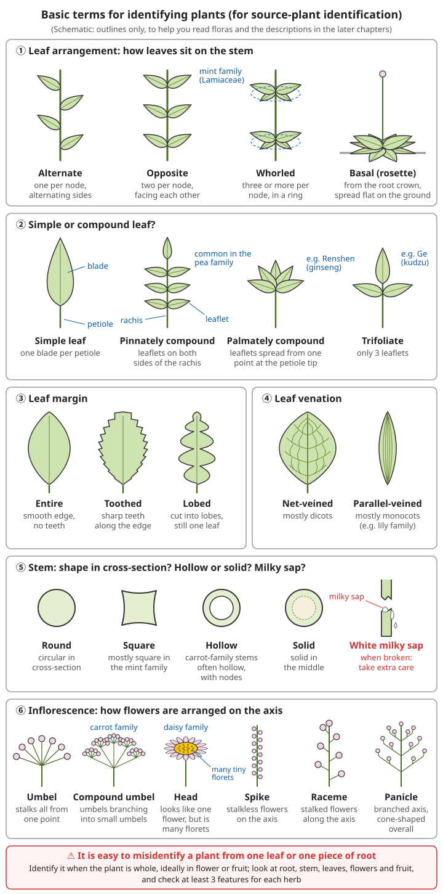
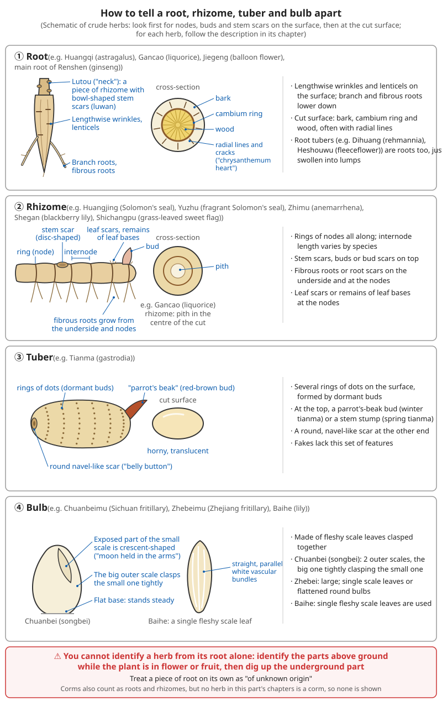
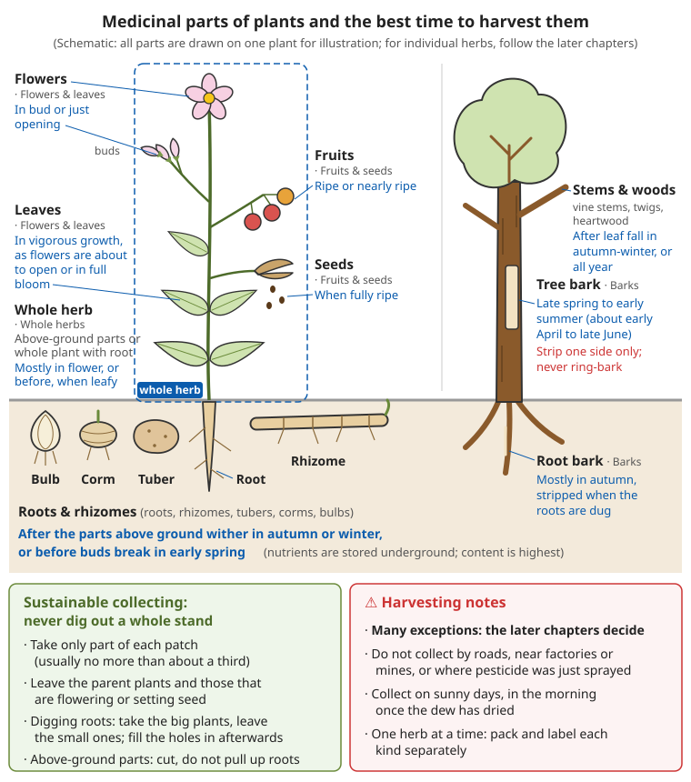
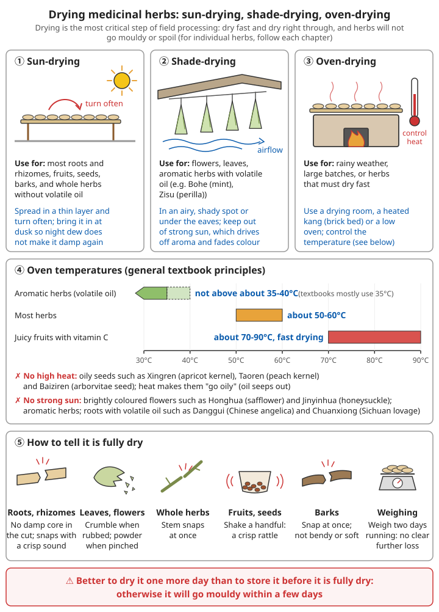
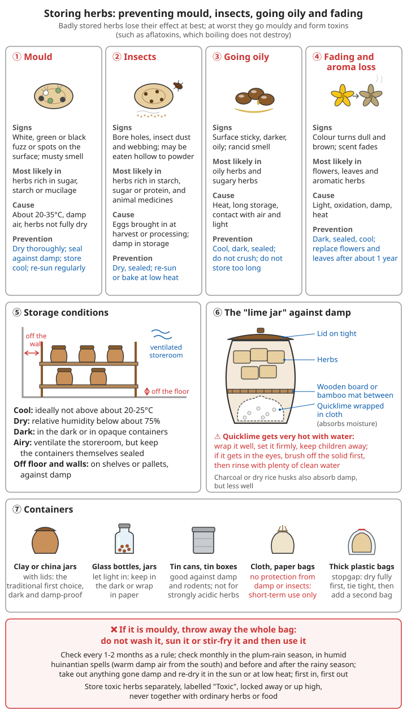

# General Principles of Identifying and Collecting Chinese Medicinal Herbs

> **Identify first, then collect, then process and store — getting one herb wrong is more dangerous than having no medicine at all**

This chapter is the general introduction to Part X, *Identifying and Collecting Chinese Medicinal Herbs*. It does not cover any one herb; it covers the methods common to all of them: how to classify them, how to identify them, when to collect them, how to process and store them after collection, how to understand Pharmacopoeia doses, and which safety and legal lines must never be crossed. The later chapters, which describe the herbs one by one, assume you have read this chapter.

## ⚠️ Read these first

```
1. This part is an identification reference, not a guide to taking medicines:
   when you can see a doctor and can buy proper herbal medicines, see the doctor
   first and buy from a pharmacy;
   use herbs you collect yourself only when medicines cannot be bought; whether to
   use them, and how much, is decided under the guidance of a practitioner of
   Chinese medicine
2. If you cannot identify it with certainty, do not pick it or use it:
   "it looks like it" is not identification; many highly poisonous plants look
   very like common medicinal herbs
   (Gouwen looks like honeysuckle, water hemlock like wild celery, pokeweed root
   like ginseng, thorn apple like vegetables of the nightshade family,
   aconite tubers like taro)
3. Never taste a poisonous plant:
   the "taste" in identification by appearance applies only to herbs already
   confirmed to be non-toxic;
   never put in your mouth any plant you do not know or suspect may be poisonous
4. "Natural" does not mean "non-toxic":
   too much, taking it for a long time, the wrong species, or taking it together
   with Western medicines can all damage the liver and kidneys or even kill
5. Pregnant women, breastfeeding women, children, older people, people with liver
   or kidney disease and people on long-term Western medicines:
   ask a doctor before using any Chinese medicine
6. Do not dig up wild plants under state key protection; do not use, buy or sell
   products of protected animals;
   collecting inside nature reserves is forbidden
7. Numb mouth or tongue, palpitations, irregular heartbeat, violent vomiting,
   seizures, difficulty breathing →
   stop taking it at once, call 120, and take the remaining herbs and the
   decoction dregs to hospital
```

---

## 1. What this part is for and how to use it

### 1.1 How three chapters divide the work

The Chinese-medicine content of the handbook is in three places, linked to one another without repetition:

| Chapter | Focus | What to look up there |
|------|------|------------|
| This part (Part X) | **Identifying and collecting herbs** | What a herb looks like, where to find it, when to collect it, which part to collect, how to dry and store it, Pharmacopoeia doses, contraindications, look-alikes |
| [Medicinal plants: identification and growing guide](../04-farming-and-animal-husbandry/04-medicinal-plants.md) | **Growing herbs** | Growing and propagating mint, honeysuckle, chrysanthemum, liquorice and others; the home herb garden |
| [Traditional Chinese medicine preparations](../06-pharmaceuticals/04-herbal-preparations.md) | **Making and using medicines** | Processing (stir-frying, frying with liquid adjuvants, steaming, calcining), decocting, making pills, powders, pastes and tinctures, formulas for common symptoms |

```
The complete route of a herb from the hillside to the medicine pot:
recognise the plant (this part) → collect at the right time (this part)
  → processing at the place of origin, drying (this part)
  → storage (this part) → processing (TCM preparations)
  → making up the formula, decocting (TCM preparations)
  → taking it under the guidance of a TCM practitioner

Grow whatever can be grown (medicinal plants chapter):
wild resources are limited and species are easily confused;
plants grown at home are the most reliable source
```

### 1.2 How to read the later chapters

Every herb in the later chapters is written up in the same order:

```
Standard name (alternative names)
Source:                       family and genus, plant (animal, mineral) name,
                              part used, according to the 2020 edition of
                              the Chinese Pharmacopoeia
Distribution and habitat:     in which regions and what surroundings it can be found
Key identification features:  form of the plant + appearance of the dried herb
                              (shape, colour, cut surface, smell and taste)
Look-alikes:                  especially poisonous look-alikes
Harvesting and processing:    when to collect, which part, how to dry it
Storage:                      protect against damp, insects, mould and oiling
Actions:                      one sentence
Dose:                         usual Pharmacopoeia dose; use under the guidance
                              of a TCM practitioner
Cautions:                     pregnancy, children, liver and kidney disease,
                              taking with Western medicines, etc.
🛡️ Protection note:           species under state key protection or with restricted digging
```

**How to read the doses**: the doses given in the later chapters are the usual **daily adult** doses of the herb in the Pharmacopoeia of the People's Republic of China (2020 edition) (generally of the dried herb, decocted in water and taken by mouth). They are only there to remind you "do not exceed this"; they are not an invitation to treat yourself (see [7.1](#71-what-the-pharmacopoeia-dose-means) for details). The edition now in force is the 2025 edition; this handbook has not yet been compared item by item with its text, so for actual use the current edition and the advice of a TCM practitioner take precedence.

**How toxic Chinese medicines are written up**: for toxic herbs such as *Wutou* (aconite main root), *Fuzi* (processed aconite lateral root), *Maqianzi* (nux vomica), raw *Banxia* (pinellia tuber), *Tiannanxing* (arisaema tuber), *Leigongteng* (thunder god vine), *Zhusha* (cinnabar) and *Xionghuang* (realgar), this part **only describes how to recognise them, what poison they contain and what poisoning looks like**. It does not give detoxifying processing methods, directions for use or doses — at home you cannot tell whether the toxicity has been removed, so these medicines must only be prescribed by a doctor and obtained from a proper pharmacy.

---

## 2. Classifying Chinese medicinal herbs

### 2.1 Classification by the part used

Chinese medicinal materials come from three main sources — plants, animals and minerals — and plant medicines are the great majority. This part classifies herbs by **the part used**, because herbs from the same part are collected at broadly the same time, processed in the same way and stored with the same precautions, and this is also the easiest way to recognise them in the field.

| Category | What it includes | Common examples | Collection notes |
|------|---------|---------|---------|
| Roots and rhizomes | Roots, rhizomes, tubers, corms, bulbs | *Huangqi* (astragalus root), *Gancao* (liquorice root), *Dangshen* (codonopsis root), *Danggui* (Chinese angelica root), *Tianma* (gastrodia tuber), *Beimu* (fritillary bulb) | Mostly in autumn and winter or early spring |
| Fruits and seeds | Whole fruits, fruit peel, seeds, kernels | *Shanzha* (hawthorn fruit), *Gouqi* (goji berry), *Wuweizi* (schisandra fruit), *Chenpi* (dried tangerine peel), *Suanzaoren* (sour jujube seed) | Ripe or nearly ripe |
| Whole herbs | Aerial parts or the whole plant with roots | *Pugongying* (dandelion), *Cheqiancao* (plantain), *Bohe* (mint), *Yimucao* (Chinese motherwort), *Yuxingcao* (houttuynia) | Mostly at flowering, or before flowering when the stems and leaves are lush |
| Flowers and leaves | Flower buds, flowers, stigmas; leaves | *Jinyinhua* (honeysuckle flower), *Juhua* (chrysanthemum flower), *Honghua* (safflower); *Aiye* (Chinese mugwort leaf), *Sangye* (mulberry leaf) | Flowers in bud or just opening; leaves before or at full flowering |
| Barks | Tree bark, root bark | *Duzhong* (eucommia bark), *Houpo* (magnolia bark), *Huangbai* (phellodendron bark), *Mudanpi* (tree peony root bark), *Rougui* (cassia bark) | Tree bark mostly at the turn of spring and summer; root bark mostly in autumn, stripped when the roots are dug |
| Stems and woods | Climbing stems, stems and twigs, heartwood | *Jixueteng* (spatholobus stem), *Sangzhi* (mulberry twig), *Sumu* (sappan wood), *Jiangxiang* (rosewood heartwood) | Mostly in autumn and winter |
| Fungi, algae and resins | Fungi, algae, lichens; resins | *Fuling* (poria), *Lingzhi* (reishi), *Zhuling* (polyporus); *Haizao* (sargassum seaweed), *Kunbu* (kelp); *Ruxiang* (frankincense), *Moyao* (myrrh) | Each is different |
| Animal medicines | Whole animals, parts of tissues, secretions, processed products | *Dilong* (earthworm), *Chantui* (cicada slough), *Jineijin* (chicken gizzard lining), *Ejiao* (donkey-hide gelatin), honey | Often subject to protection laws |
| Mineral medicines | Natural minerals, processed mineral products, fossils | *Shigao* (gypsum), *Huashi* (talc), *Mangxiao* (mirabilite), *Longgu* (fossil bone) | Some contain mercury, arsenic or lead and are toxic |

```
One plant often has several medicinal parts, with different names and actions.
Do not mix them up:
- Mulberry: Sangye (leaf), Sangzhi (young twig), Sangbaipi (root bark),
  Sangshen (fruit spike)
- Goji: Gouqizi (fruit), Digupi (root bark)
- Lotus: Lianzi (seed), Lianzixin (seed embryo), Lianfang (receptacle),
  Lianxu (stamens), Heye (leaf), Oujie (rhizome node)
- Tangerine: Chenpi (ripe fruit peel), Qingpi (young fruit or unripe fruit peel),
  Juhe (seed), Juluo (fibrous strands of the pith)
- Japanese honeysuckle: Jinyinhua (flower buds or newly opened flowers),
  Rendongteng (stems and twigs)
```

### 2.2 Other ways of classifying

| Method | Basis | Use |
|------|------|------|
| By natural attribute | Plant, animal, mineral | The roughest division |
| By relationship | Plant family and genus (e.g. carrot family, legume family, daisy family) | Recognising plants, finding substitutes, judging the risk of toxicity |
| By action | Exterior-releasing, heat-clearing, tonifying, blood-activating medicines, etc. | Used by practitioners of Chinese medicine to write prescriptions; see [Traditional Chinese medicine preparations](../06-pharmaceuticals/04-herbal-preparations.md) |
| By the part used | Roots, fruits, herbs, flowers and leaves, barks… | Identifying, collecting, processing and storing herbs — used in this part |

**Why it helps to know the family and genus**: plants of the same family often have similar features and chemical constituents. For example, the carrot family (Apiaceae) mostly has compound umbels and an aromatic smell; it includes *Danggui*, *Chaihu* (bupleurum root) and *Fangfeng* (saposhnikovia root), but also the highly poisonous water hemlock. The buttercup family (Ranunculaceae) has *Huanglian* (coptis rhizome) and *Baishao* (white peony root), but also *Wutou* and *Fuzi*. Once you recognise the family and genus, you know which poisonous "close relatives" to watch out for.

---

## 3. Identification methods

Chinese medicinal materials are traditionally identified by four methods: identification by botanical source, identification by appearance, microscopic identification and physical and chemical identification. The last two need a microscope and a laboratory, so at home you rely mainly on the first two, plus a few simple water and fire tests.

### 3.1 Identification by botanical source: look at the whole plant

Identification by botanical source means confirming which plant a herb comes from. When collecting in the wild, **always identify the plant while it is whole, ideally when it has flowers or fruit**. Looking only at a leaf or a piece of root makes mistakes easy.

**Order of observation**:

```
1. Growth habit:     herb or woody plant? Upright, creeping or twining
                     (clockwise or anticlockwise)?
                     Annual or perennial?
2. Stem:             round or four-angled (most of the mint family is
                     four-angled)? Hollow or solid?
                     Any thorns, hairs or latex? (be especially careful
                     with plants that ooze white latex when broken)
3. Leaves:           simple or compound (pinnate, palmate, trifoliate)?
                     Leaf arrangement: alternate, opposite, whorled, basal
                     (rosette)
                     Leaf shape, leaf margin (entire, toothed, lobed),
                     veins (net-veined, parallel)
                     Any smell when crushed?
4. Flowers:          colour, number of petals, symmetry; single or in an
                     inflorescence (umbel, head, spike, raceme, panicle)
5. Fruit:            berry, drupe, capsule, legume (pod), achene, samara…
6. Underground part: taproot or fibrous roots? Any tuberous root, rhizome
                     or bulb? Colour of the cut surface, any latex
7. Habitat:          hillside, under trees, by a stream, field edge, roadside;
                     altitude, shady or sunny slope
```



*Figure: Common morphological terms for identification by botanical source. Leaf arrangement is alternate, opposite, whorled or basal; compound leaves are pinnate, palmate or trifoliate; look at whether the stem is round or four-angled, hollow or solid, and be especially careful with plants that ooze white latex when broken; inflorescences are umbels, compound umbels, heads, spikes, racemes and panicles*

**Some useful family features** (to narrow down the possibilities):

| Family | Typical features | Example herbs | Poisonous members to watch out for |
|----|---------|---------|----------------|
| Mint family (Lamiaceae) | Four-angled stems, opposite leaves, two-lipped flowers, usually aromatic | *Bohe*, *Yimucao*, *Xiakucao* (self-heal), *Danshen* (red sage root), *Huangqin* (Baikal skullcap root) | Few poisonous plants in this family, but still identify with certainty |
| Carrot family (Apiaceae) | Compound umbels, stems often hollow with nodes, usually a distinctive smell | *Danggui*, *Chaihu*, *Fangfeng*, *Chuanxiong* (Sichuan lovage rhizome), *Baizhi* (Dahurian angelica root) | Water hemlock, poison hemlock |
| Daisy family (Asteraceae) | Flower heads (look like one flower but are really many small flowers) | *Juhua*, *Pugongying*, *Aiye*, *Honghua*, *Cangzhu* (atractylodes rhizome) | Some species of *Senecio* (ragwort), cocklebur (fruit is poisonous) |
| Legume family (Fabaceae) | Butterfly-shaped flowers, pods, often pinnate compound leaves | *Gancao*, *Huangqi*, *Gegen* (kudzu root), *Juemingzi* (cassia seed) | Rosary pea (seeds highly poisonous) |
| Buttercup family (Ranunculaceae) | Flower parts free, many stamens and carpels | *Huanglian*, *Baishao*, *Mudanpi*, *Shengma* (bugbane rhizome) | Aconite, buttercup, some species of *Clematis* |
| Arum family (Araceae) | A spathe wrapped round a fleshy flower spike (spadix) | *Banxia*, *Tiannanxing*, *Shichangpu* (grass-leaved sweet flag rhizome) | *Tiannanxing*, raw *Banxia*, giant taro (*Alocasia*) |
| Nightshade family (Solanaceae) | Petals fused into a tube, berries or capsules | *Gouqi* | Thorn apple (*Datura*), deadly nightshade, henbane, unripe fruit of black nightshade |
| Lily family (in the broad sense) | Monocots, parallel veins, often with bulbs or rhizomes | *Beimu*, *Maidong* (ophiopogon tuber), *Yuzhu* (fragrant Solomon's seal rhizome), *Huangjing* (Solomon's seal rhizome) | False hellebore (*Veratrum*), *Chonglou* (paris rhizome, slightly toxic) |

**Using a plant key**:

Floras and identification keys use "dichotomous keys": each step gives two opposing features; you follow whichever one fits, narrowing down step by step to family, genus and species.

```
Example of a key (shows the idea only; not a complete key):
1a. Veins parallel, flower parts mostly in 3s or multiples of 3
    ........ monocots → go to 2
1b. Veins netted, flower parts mostly in 4s or 5s or their multiples
    ........ dicots → go to 3
3a. Stem four-angled, leaves opposite, aromatic, two-lipped flowers
    ........ mint family → continue down to genus
3b. Does not fit → go on to the next pair of opposing features

Key points:
- Look at the whole plant first — root, stem, leaves, flowers and fruit
  (or photograph them) — before using the key
- If a feature is uncertain, follow both paths and see which conclusion holds up
- When you reach an answer, check it point by point against the full
  description and pictures in a flora
- If the key's answer does not match the appearance of the herb,
  give it up rather than guess
```

Today you can compare against the Flora of China (iplant.cn), provincial floras, the Chinese Pharmacopoeia, and textbooks of Chinese materia medica identification (*Zhongyao Jiandingxue*) and medicinal botany (*Yaoyong Zhiwuxue*). Without the internet, keep a local field guide to plants and an atlas of medicinal materials ready in advance. Phone plant-identification apps can only give you leads; **they are not a basis for eating anything or using it as medicine**.

### 3.2 Identification by appearance: look, touch, smell, taste

Identification by appearance means judging herbs that have already been collected and processed (or that you got from someone else). It is an empirical method built up by herbalists over hundreds of years. It covers eight points:

| Point | What to look at | Examples |
|------|------|------|
| Shape | Cylindrical, spindle-shaped, lumpy, flat slices, rolled into tubes | *Tianma* is flattened and long-oval, and winter-dug *Tianma* (*dongma*) has a "parrot's beak" at the top (a reddish-brown to dark brown bud); *Houpo* bark is rolled into a tube |
| Size | Length, diameter, thickness (measure several samples and take the range) | Seeds often need measuring to the millimetre |
| Colour | Colour of the surface and of the cut surface; a change of colour often means damp, spoilage or poor processing | *Huanglian* cut surface bright yellow; *Danshen* surface brick-red; *Xuanshen* (figwort root) cut surface jet black |
| Surface | Smooth or rough, wrinkles, lenticels, hairs, rings, scars | *Huangqi* surface has lengthwise wrinkles; the root head of *Dangshen* has a "lion's head" (many wart-like stem scars) |
| Texture | Light or heavy, soft or hard, tough or brittle, floury, oily, horny, sticky | Floury (*Shanyao*, Chinese yam; *Tianhuafen*, trichosanthes root); horny (*Tianma*); oily (*Danggui*) |
| Cut surface | Easy or hard to break, cut surface flat or fibrous, colour, pattern, oil dots | *Jiegeng* (balloon flower root) cut surface shows "golden well and jade railing" (bark yellowish-white, wood pale yellow); *Mao Cangzhu* (Maoshan atractylodes) cut surface has "cinnabar dots" |
| Smell | Smell directly, or after breaking or rubbing | *Danggui* strongly fragrant, *Bohe* cool, *Yuxingcao* fishy, *Awei* (asafoetida) smells of garlic |
| Taste | Lick with the tip of the tongue (only herbs confirmed non-toxic) | *Huanglian* extremely bitter; *Gancao* sweet; *Wuweizi* has all five tastes; *Wumei* (smoked plum) extremely sour |



*Figure: How to tell root and rhizome herbs apart. Roots have lengthwise wrinkles and lenticels on the surface, and the cut surface shows bark, a cambium ring and wood; rhizomes have rings (nodes), with stem scars and buds on the upper side and fibrous roots growing from the lower side and the nodes; tubers (Tianma) have many rings of dotted marks, a parrot's beak and a round navel-like scar; bulbs are made of fleshy scale leaves wrapped round each other. For the features of each species see [Roots and rhizomes (part 1)](01-roots-and-rhizomes-1.md) and [Roots and rhizomes (part 2)](02-roots-and-rhizomes-2.md)*

```
How to look, touch, smell and taste:
Look:  in natural light, at both the surface and the cut surface;
       look at several samples, do not decide on the basis of one
Touch: feel the weight, test the hardness, snap it and listen to the sound,
       rub the powder between your fingers
Smell: smell it directly first, then after breaking or rubbing it, or after
       soaking in hot water;
       some herbs have a very faint smell — not smelling anything does not
       mean there is none
Taste: only after it has been confirmed non-toxic; put a tiny amount on the
       tip of the tongue,
       spit it out afterwards and rinse your mouth; do not swallow
```

```
⚠️ Never taste:
- Any plant of unknown origin, or whose species you have not yet confirmed
- Herbs known or suspected to be toxic: Wutou, Fuzi, Banxia, Tiannanxing,
  Maqianzi, Leigongteng, pokeweed, Gouwen, thorn apple, false hellebore,
  Badou (croton seed), Banmao (blister beetle), Chansu (toad venom), etc.
- Toxic minerals: cinnabar, realgar, arsenolite, red lead, etc.
- Anything that oozes white latex when broken, has a strong, pungent smell,
  or makes the tongue numb or the throat prickle as soon as you taste it
  (if this happens, spit it out at once, rinse your mouth and watch for
  other symptoms)
- Herbs that are mouldy, insect-damaged or of unknown origin
Many highly poisonous plants can kill in small amounts; "tasting just a little"
is not a safe method of identification.
```

### 3.3 Simple water and fire tests

Some herbs show special changes when put in water or burnt, which can help identification. These are examples often given in textbooks:

| Method | Herb | What happens |
|------|------|------|
| Water test | *Xihonghua* (saffron) | After soaking, the stigmas swell into a trumpet shape and the water is stained yellow, the colour spreading gradually (fakes coloured with dye often turn the water red, or the stigmas do not swell) |
| Water test | *Qinpi* (ash bark) | A hot-water extract shows a blue-green fluorescence in sunlight |
| Water test | *Sumu* (sappan wood) | Put into hot water, it turns the water a vivid peach-red |
| Water test | *Zhizi* (gardenia fruit) | The water extract is bright yellow |
| Water test | *Pangdahai* (malva nut) | Swells rapidly into a sponge in water |
| Water test | *Cheqianzi* (plantain seed), *Tinglizi* (descurainia or lepidium seed) | The seed surface turns slimy when water is added |
| Water test | *Tusizi* (dodder seed) | Boiled in water until the seed coat splits, it exposes a yellowish-white coiled embryo, known as "spitting silk" |
| Fire test | *Haijinsha* (Japanese climbing fern spores) | Sprinkled on a flame, it makes slight crackling sounds and flashes, leaving almost no ash |
| Fire test | *Jiangxiang* | When lit, it gives a strong fragrance and an oily substance seeps out; it leaves white ash when burnt |
| Fire test | *Xuejie* (dragon's blood) | Put the powder on white paper and heat from underneath; when melted it looks bright red against the light, with no oil stain spreading on the paper |
| Fire test | *Qingdai* (natural indigo) | Burnt over a low flame, it gives off purplish-red smoke |

```
Note:
- Water and fire tests are only aids; one test matching does not prove a
  herb is genuine
- Do fire tests in a well-ventilated place, using only a little; do not burn
  toxic herbs or mineral medicines and smell the smoke
  (realgar and cinnabar give off toxic arsenic and mercury fumes when heated)
- To judge whether a herb is genuine, the botanical source, the appearance and
  where it came from must all match in the end
```

### 3.4 General rules of identification

```
✓ Identify the plant when collecting and the appearance after storage —
  pass both steps
✓ Check at least 3 features for each herb; only when all match is it identified
✓ The first time you collect a herb, ideally go with someone experienced
  (a herb grower, a TCM practitioner)
✓ Bag each batch you collect separately and label it at once: name, place
  collected, date
✓ When collecting, photograph the whole plant (flowers, leaves, roots) so you
  can check later
✗ Do not decide on a single feature (only the leaves, only the smell)
✗ Do not dig up underground parts just because "the old folk say so" or
  "the internet says so"
✗ If you cannot recognise it, or cannot tell it from a poisonous plant,
  do not pick it
```

For poisonous look-alikes see [Toxic Chinese herbs and poisonous look-alikes](09-toxic-herbs-and-poisonous-look-alikes.md); for eating wild greens and poisonous mushrooms by mistake see [Poisonous mushrooms and wild plants](../03-wilderness-survival/09-poisonous-mushrooms-and-wild-plants.md).

---

## 4. Principles of collection

The content of active constituents in a herb varies greatly with its stage of growth and the season. Collect at the wrong time and you may bring back nothing but "grass". The traditional saying "In the third month it is *Yinchen*, in the fourth month just wormwood, in the fifth month cut it for firewood" is about exactly this timing.

### 4.1 The best collection time for each part

| Part used | Best collection time | Reason | Examples |
|---------|-----------|------|------|
| Roots and rhizomes | In autumn and winter after the aerial parts have withered, or in early spring before sprouting | Nutrients are stored underground, so content is highest | *Huangqi*, *Dangshen*, *Gegen*, *Tianma* (winter-dug *dongma* is of better quality) |
| Leaves | When the plant is growing vigorously, about to flower or in full flower | Leaves are fully developed, with plenty of products of photosynthesis | *Aiye*, *Daqingye* (isatis leaf), *Zisuye* (perilla leaf); *Sangye* is an exception, collected after frost |
| Flowers | In bud or just opening | Once fully open, the fragrance is lost and petals fall easily | *Jinyinhua*, *Huaimi* (pagoda tree flower bud) (flower buds); *Juhua*, *Honghua* (just opening or in full bloom) |
| Fruits | Ripe or nearly ripe | Active constituents have built up most | *Shanzha*, *Gouqi* (ripe); *Zhishi* (immature bitter orange), *Qingpi* (unripe young fruit) |
| Seeds | Fully ripe | Seeds are plump, content is highest | *Juemingzi*, *Cheqianzi*, *Suanzaoren* |
| Whole herbs | Mostly at flowering, or before flowering when stems and leaves are lush | Aerial parts are growing most strongly | *Yimucao*, *Bohe*, *Cheqiancao*; *Yinchen* (capillary wormwood) at the seedling stage |
| Tree bark | At the turn of spring and summer (about from Qingming to the summer solstice) | Sap flows strongly, bark peels easily and the wound heals easily | *Duzhong*, *Houpo*, *Huangbai* |
| Root bark | Mostly in autumn, stripped when the roots are dug | Same time as the roots | *Mudanpi*, *Digupi* (wolfberry root bark), *Sangbaipi* (mulberry root bark) |
| Stems and woods | In autumn and winter after leaf fall, or all year round | Nutrients have built up | *Jixueteng*, *Sangzhi* |

```
There are many exceptions; follow what the later chapters say:
- Yinchen: seedlings in spring (Mian Yinchen) or at the flower-bud stage
  in autumn
- Sangye: collected after the first frost
- Xiakucao: when the fruit spikes turn brownish-red
- Huaimi (flower buds) and Huaihua (open flowers) are two different medicines
  from the same plant, collected at different times
```



*Figure: General collection times for each part used (schematic, with all parts drawn on one plant); there are many exceptions — follow what the later chapters say*

### 4.2 How to collect

```
Timing:
✓ Sunny days, in the morning after the dew has dried; do not collect straight
  after rain — the herbs hold too much water, are hard to dry and go mouldy
  easily
✓ Collect flowers and aromatic herbs on sunny mornings, when the fragrance is
  strongest

Tools:
- Scissors or secateurs: flowers, leaves, fruits, young twigs
- Small hoe, trowel, long-handled pick: digging roots (dig deep for
  deep-rooted plants such as Gancao and Huangqi — broken roots go mouldy
  easily and are of lower quality)
- Knife: stripping bark
- Cloth bags, bamboo baskets, paper bags for separating herbs; do not keep
  them sealed in airtight plastic bags for long (they heat up and spoil)

Method:
- Roots: dig along the direction the root runs, keeping it as whole as
  possible; shake off the soil, do not soak in water for long
- Leaves: pick them, or cut them off with the stems; do not strip a plant
  of all its leaves
- Flowers: pick by hand or cut, handle gently, do not squash
- Fruits: pick each batch as it ripens; berries picked with their stalks do
  not burst easily
- Seeds: when the fruit is ripe but before it starts to split, cut the whole
  head, spread it on a cloth to dry, then beat to thresh
- Tree bark: do not ring-bark (stripping a full ring kills the tree); strip
  only strips or patches from one side of the trunk,
  or use special techniques such as "ring-barking with regeneration";
  if bark can be taken from pruned branches, do not strip the main trunk
- Whole herbs: cut above ground level (take the roots only when the species
  requires it)

Collect only one kind at a time; bag separately, dry separately and label each.
```

```
Do not collect in these places:
✗ Beside roads (lead and other pollution from vehicle exhaust)
✗ Near factories, mining areas, smelters or rubbish dumps (heavy-metal
  pollution)
✗ Field edges just sprayed with pesticide or herbicide
✗ Beside sewage ditches or septic tanks
✗ Near graveyards or livestock pens (hygiene)
✗ Nature reserves, scenic areas (forbidden by law)
```

### 4.3 Sustainable collection

Wild medicinal herbs are a limited resource. Many of today's protected species (ginseng, liquorice, *Tianma*, *Shihu* (dendrobium) and others) became protected through over-collection. In long-term survival, digging out a patch of herbs completely means cutting off your future medicines.

```
Principles of sustainable collection:
1. Leave seed:   in each patch collect only part (generally no more than
                 about one third),
                 leave the parent plants and plants that are flowering and
                 setting seed; for seed herbs, scatter some of the seed before
                 you leave
2. Take the large, leave the small: when digging roots, take only mature,
                 large plants and leave small ones to keep growing
3. Do not pull everything up by the roots: for herbs that use the aerial
                 parts (whole herbs, leaves, flowers), cut rather than pull up
                 the roots; for rhizome herbs, the crown with buds can be
                 buried again
4. Backfill:     after digging roots, fill the soil back in and tread it
                 down, to reduce soil erosion
5. Rotate:       divide the collection area into several patches and collect
                 from only one each year,
                 letting the others recover (root herbs often need 3-5 years
                 or more to recover)
6. Bring into cultivation: collect wild seed or root cuttings once and take
                 them home to plant;
                 grow at home whatever can be grown (see the medicinal plants
                 chapter)
7. Barks:        prefer bark from pruned branches; on the main trunk strip
                 only one side, never ring-bark
```

---

## 5. Processing at the place of origin

Freshly collected herbs hold a lot of water. If not dealt with promptly, they heat up, rot and change colour within a few days. The purpose of processing at the place of origin is to remove impurities and non-medicinal parts, dry the herbs quickly and make them easy to store and transport; some processing also preserves or improves the herb's effect.

**Do not confuse the two**: processing at the place of origin (this section) is the initial treatment done straight after collection; *paozhi* processing (stir-frying, frying with liquid adjuvants, calcining, detoxifying, etc.) is further processing before use, see [TCM preparations – Methods of processing Chinese herbs](../06-pharmaceuticals/04-herbal-preparations.md#2-processing-chinese-herbs).

### 5.1 Cleaning and sorting

```
1. Pick over:  remove soil and sand, weeds, dead leaves, stones and other
               plants mixed in
               (other plants mixed in may be poisonous — do this step carefully)
2. Remove non-medicinal parts: as each herb requires, remove the root crown,
               fibrous roots, cork, fruit stalks, seed coats, woody core, etc.
3. Remove insect-damaged, mouldy or discoloured parts
4. Wash:       rinse roots and rhizomes quickly in clean water; do not soak
               them for long,
               or the active constituents will dissolve out; flowers, leaves
               and seeds are generally not washed
5. Grade:      sort by size so that they dry evenly
```

### 5.2 Cutting

```
- Thick roots, rhizomes and fruits that do not dry easily are cut into
  slices, sections or pieces while fresh:
  e.g. Gegen and Dahuang (rhubarb root) are sliced, Mugua (Chinese quince)
  is split in half
- Slices are generally about 2-4 mm thick; the thinner they are, the faster
  they dry, but too thin and they break and lose constituents
- Herbs containing volatile oils (such as Danggui and Chuanxiong) should not
  be cut too early;
  once cut, volatile constituents are lost faster, so they are generally
  dried whole and cut when used
- Spread out to dry straight after cutting; do not leave them in a heap
```

### 5.3 Steaming, boiling and scalding

Some herbs are steamed, boiled or scalded in boiling water before drying. The purposes are: to kill cells and enzymes and stop the active constituents breaking down; to gelatinise the starch so that the texture becomes horny and translucent, making drying and storage easier; to make peeling or removing the core easier; and to kill insect eggs.

| Method | Suitable for | Examples | How to judge it is done |
|------|------|------|---------|
| Steaming | Rhizomes rich in starch or mucilage that do not dry easily | *Tianma*, *Huangjing*, *Hongshen* (red ginseng) | Steamed right through, no white core in the cut surface |
| Boiling | Roots that need peeling or gelatinising | *Baishao* (peeled after boiling), *Mingdangshen* (changium root) | Boiled right through |
| Scalding | Fleshy tuberous roots, to stop them spoiling while drying | *Tiandong* (asparagus tuber), *Taizishen* (pseudostellaria root) (briefly scalded in boiling water) | Skin softened, cut surface semi-translucent |

```
Getting steaming, boiling and scalding right: too little and the herb is not
cooked through, and changes colour and goes mouldy easily while drying;
too much and the active constituents are lost. Follow the times given for
each species in the later chapters.
```

### 5.4 Sweating

"Sweating" means piling herbs up, or covering them with wet straw or wet sacking and keeping them closed in, so that water inside seeps out to the surface and certain changes take place: the herb darkens in colour, its fragrance increases, its texture softens and it dries faster.

```
Used for:  Houpo, Duzhong, Xuanshen, Xuduan (teasel root), Fuling, etc.
Method:    pile up or cover tightly, keep closed until the colour inside has
           changed and the surface "sweats",
           then spread out to dry in the sun; this can be repeated several
           times
Note:      sweating is a deliberate process with controlled temperature and
           time;
           it is not the same as "herbs left in a heap heating up and
           rotting" —
           if a mouldy smell or white fuzz appears during sweating, it has
           failed
```

### 5.5 Drying

Drying is the most important step in processing at the place of origin. Only herbs that dry fast and dry thoroughly will not go mouldy or spoil.

| Method | Suitable for | Key points |
|------|---------|------|
| Sun-drying | Most roots and rhizomes, fruits, seeds, barks, and whole herbs without volatile oils | Spread in a thin layer and turn often; bring in at dusk so the night dew does not make them damp again |
| Shade-drying | Flowers, leaves and aromatic herbs containing volatile oils (such as *Bohe* and *Zisu*; for each herb, follow the method given in the later chapters) | Put in a cool, well-ventilated place or under the eaves, out of strong sun, so the fragrance is not lost and the colour does not fade |
| Artificial heat drying | Herbs on rainy days, in large amounts, or that need drying quickly | Use a drying room, a heated *kang* (heated brick bed) or a low-temperature oven, and control the temperature |

**Drying temperatures** (based on the general principles in textbooks such as *Zhongyao Jiandingxue*):

```
- Most herbs: about 50-60°C; for a short time this does not destroy most
  active constituents
- Aromatic herbs containing volatile oils: no more than about 35-40°C
  (textbooks mostly give 35°C),
  or much of the fragrance and active constituents will be lost
- Juicy fruits containing vitamin C: can be dried quickly at about 70-90°C
- Herbs containing glycosides and enzymes: raise the temperature quickly to a
  level that stops the enzymes working,
  so the constituents are not broken down by enzymes during slow air-drying
- Not to be dried in strong sun: brightly coloured flowers (Honghua and
  Jinyinhua change colour in strong sun),
  aromatic herbs, roots containing volatile oils (Danggui and Chuanxiong are
  mostly dried over smoke and fire, or sun-dried then heat-dried)
- Not to be dried at high temperature: oily seeds (Xingren, apricot kernel;
  Taoren, peach kernel; Baiziren, arborvitae seed) — high heat makes them
  "go oily"
```

```
Makeshift methods without a drying room:
- A rack over a heated kang or the stove (watch out for smoke and fire)
- Hang up in a well-ventilated place indoors, with a charcoal brazier below
- Solar drying box: a wooden box with a glass lid, air in at the bottom and
  out at the top
For the details of low-temperature drying see the food processing chapter
(link at the end of this section).
```

**How to tell they are thoroughly dry**:

```
- Roots, rhizomes: no damp core in the cut surface, colour even; those that
  can be snapped make a crisp sound when snapped
- Leaves, flowers: crumble when rubbed in the hand, turn to powder when
  pinched
- Whole herbs: stems snap as soon as they are bent
- Fruits, seeds: a handful rattles crisply when shaken, and is hard when
  bitten (non-toxic ones only) or pressed with a fingernail
- Barks: snap as soon as they are bent, not bendy or soft
- Weight: weigh the same batch on two days in a row; the weight no longer
  falls noticeably

The Pharmacopoeia sets an upper limit for water content for most herbs
(mostly in the low teens of per cent);
at home, judging by feel as above is enough;
better to dry for one more day than to pack them before they are thoroughly
dry — within a few days they will go mouldy.
```

For low-temperature drying on rainy days see [Food processing and preservation – sun-drying and air-drying](../07-everyday-living-skills/01-food-processing-and-preservation.md#sun-drying-and-air-drying).



*Figure: When sun-drying, spread thinly, turn often and bring in at dusk; flowers, leaves and aromatic herbs are shade-dried; when heat-drying, aromatic herbs no more than about 35-40°C, most herbs about 50-60°C, juicy fruits containing vitamin C about 70-90°C; herbs are thoroughly dry only when roots have no damp core in the cut surface and snap with a crisp sound, barks and whole herbs snap as soon as they are bent, leaves and flowers crumble when rubbed, and weighing on two days in a row shows no noticeable loss*

---

## 6. Storage

Badly stored herbs at best lose their effect; at worst they go mouldy and produce toxins (such as aflatoxin, which boiling does not destroy). Spoilage in storage is mainly of four kinds: mould, insect damage, oiling (*fanyou*, "going oily") and loss of colour and fragrance.

### 6.1 Four kinds of spoilage and how to prevent them

| Spoilage | Signs | Most likely in | Cause | Prevention |
|------|------|----------|------|---------|
| Mould | White, green or black fuzz or spots on the surface, mouldy smell | Herbs rich in sugar, starch or mucilage (*Dangshen*, *Tiandong*, *Gouqi*, *Shanyao*, *Danggui*) | Temperature about 20-35°C, damp air, herbs not thoroughly dried | Dry thoroughly, seal against damp, store in a cool place, re-dry in the sun regularly |
| Insect damage | Bore holes, insect powder (frass), silk threads, even eaten away to powder | Herbs rich in starch, sugar or protein (*Dangshen*, *Baizhi*, *Shanyao*, *Yiyiren* (Job's tears seed)) and animal medicines | Insect eggs brought in during collection and processing, damp during storage | Dry and seal; re-dry in the sun or heat at low temperature; store with a protective herb (see below) |
| Oiling (*fanyou*) | Surface sticky, darkened, oozing oil, rancid smell | Oily herbs (*Xingren*, *Taoren*, *Baiziren*, *Danggui*) and sugary herbs (*Gouqi*, *Tiandong*, *Dangshen*) | High temperature, long storage, exposure to air and light | Keep cool, dark and sealed, do not squash; do not store too long |
| Loss of colour and fragrance | Colour dulls and browns, fragrance fades | Flowers, leaves, aromatic herbs (*Jinyinhua*, *Juhua*, *Honghua*, *Bohe*) | Light, oxidation, damp, high temperature | Keep dark, sealed and cool; flowers and leaves generally renewed after about 1 year |

```
Storage conditions for herbs:
- Cool:          as low a temperature as possible; generally best not above
                 about 20-25°C
- Dry:           keep relative humidity below about 75% if possible; take
                 special care in the plum-rain season in southern China and
                 during huinantian (humid spells when walls and floors
                 sweat)
- Dark:          keep in a dark place or in opaque containers
- Ventilated:    the storeroom must be ventilated, but the containers
                 themselves must be sealed
- Off the floor and away from walls: on shelves or pallets, with a gap from
                 both floor and walls, against damp
```



*Figure: Signs and prevention of mould, insect damage, oiling and loss of colour and fragrance; storage must be cool, dry, dark and ventilated, off the floor and away from walls; for the lime jar and how to use different containers see 6.2; throw away a whole bag if it goes mouldy*

### 6.2 Containers

| Container | Suitable for | Notes |
|------|------|------|
| Earthenware jars, porcelain jars (with lids) | Most herbs | The traditional first choice, dark and damp-proof; seal with oiled paper and clay |
| Glass bottles, glass jars | Small amounts of herbs, seeds | Let light through; keep in a dark place or wrap in paper |
| Tinplate tins, tinplate boxes | Flowers, aromatic herbs, herbs that take up damp easily | Good against damp and mice; do not use for strongly acidic herbs |
| Wooden boxes, wooden cabinets (the "hundred-drawer cabinet" of a Chinese pharmacy) | Large amounts of herbs stored in separate compartments | Guard against damp and insects |
| Cloth bags, paper bags | Short-term turnover, herbs needing good air flow | Not damp-proof or insect-proof, not suitable for long-term storage |
| Thick plastic bags | A temporary substitute | Herbs must be thoroughly dry first; tie tightly and put another bag over the outside |

```
The traditional way to keep out damp — the "lime jar":
Put quicklime wrapped in cloth at the bottom of the jar to absorb moisture,
put a layer of wooden board or bamboo mat over it, the herbs on top,
and close the lid tightly.
Quicklime gives off a lot of heat when it meets water; wrap it well,
put it firmly in place, and keep children away from it;
if lime gets in the eyes, brush off the solid first and then rinse with
plenty of clean water.
Charcoal or dry rice husks can also absorb moisture, but less well.
```

### 6.3 Common pests and what to do

Common pests in herb stores include the drugstore beetle, cigarette beetle, lesser grain borer, sawtoothed grain beetle, Indian meal moth and flour mites. Most are brought in as eggs during collection and processing, and multiply rapidly when it is warm and damp.

```
Finding them:
- Small holes, powder (frass) or fine threads (silk spun by moth larvae) on
  the herbs
- Dead insects and insect powder at the bottom of the container
- Flour mites: a layer of fine powder on the surface of the herbs that moves

Dealing with them:
1. Separate the infested herbs from all other herbs at once
2. Lightly damaged: sieve off the insect powder, spread out in strong sun or
   heat at low temperature
   (most herbs can be heated at about 50-60°C for a while;
   aromatic and oily herbs must not be heated — only spread out in a cool,
   ventilated place and picked over)
3. Badly damaged, eaten into powder: throw away
4. Wash the container and dry it in the sun before using it again

The traditional "storing together for mutual protection" (an empirical
practice, only an aid):
- Store Mudanpi with Zexie (water plantain rhizome): Zexie is less likely to
  get insects, Mudanpi less likely to change colour
- Store Huajiao (Sichuan pepper) with animal medicines (such as snakes,
  Lurong) to keep insects away
- A little Huajiao, Xixin or garlic in the container has some effect in
  driving insects away
Chemical fumigants (such as aluminium phosphide) are highly toxic; do not use
them at home.
```

### 6.4 Storage life and regular checks

The table below gives storage lives from experience, for herbs kept dry, sealed, cool and dark:

| Category | Storage life | Problems likely to appear |
|------|--------|-------------|
| Flowers, leaves | About 1 year | Change of colour, loss of fragrance, damp and mould |
| Roots, rhizomes | About 1-2 years | Insect damage, oiling |
| Whole herbs | About 1 year | Change of colour, mould |
| Barks | About 1-2 years | Insect damage, damp |
| Fruits, seeds | About 1 year; shorter for oily seeds | Oiling, mould, insect damage; seeds go rancid easily |
| Herb powders (*san*, powder preparations) | 6 months-1 year | Absorb moisture and cake, go mouldy |

A few herbs such as *Aiye* and *Chenpi* are held to be "better the older they are", and are actually better after 1-3 years of storage (follow what the later chapters say).

```
Checks:
- Normally open and check once every 1-2 months; once a month in the plum-rain
  season, during huinantian and before and after the rainy season
- Take out herbs that have become damp and dry them again in the sun or at
  low temperature
- Each year when new herbs go into store, use up the old ones first
  ("first in, first out")

Do not use herbs that:
❌ Are mouldy: mould spots, mouldy smell, white or green fuzz — throw away
   the whole bag;
   do not wash it, sun it or stir-fry it and then use it
❌ Are badly insect-damaged or turned to powder
❌ Are clearly oily, sticky or smell rancid
❌ Look or smell clearly different from how they were
❌ Have lost their label, so you cannot tell what they are
The active constituents of old herbs decline, but you cannot make up for this
by "taking more" — the risk of an overdose is greater than that of a herb not
working.

Toxic herbs: store separately, clearly labelled "toxic", locked up or put up
high out of children's reach;
do not keep them with ordinary herbs or food.
```

For more detail on storage see [TCM preparations – Storage and shelf life of herbs](../06-pharmaceuticals/04-herbal-preparations.md#83-storing-herbs-and-how-long-they-keep).

---

## 7. Dosage and safety

### 7.1 What the Pharmacopoeia dose means

```
"Administration and dosage" in each herb's entry in the Chinese Pharmacopoeia:
- Generally means the usual adult dose for one day, mostly of the prepared
  slices (yinpian) decocted in water and taken by mouth
- It is a usual range, not "you can take up to the upper limit as you please"
- Some entries say "an appropriate amount for external use", meaning external
  use only or mainly external use
- The general notices of the Pharmacopoeia say: when necessary, the dose may
  be increased or reduced as the doctor advises —
  the decision to "increase or reduce" lies with the doctor, not the patient

When reading the doses in the later chapters, note:
1. They are the amount of a single herb within one prescription, not an
   amount to take on its own in large quantity
2. Children, older people and frail people take smaller doses, decided by a
   doctor
3. With toxic herbs, poisoning can happen even within the Pharmacopoeia range
   (people differ greatly) —
   this part gives no doses for toxic Chinese medicines
4. Fresh and dried herbs differ; Pharmacopoeia doses generally mean the dried
   herb (except where fresh herb is specified)
5. "Use under the guidance of a TCM practitioner" — this
   counts every time it appears
```

**Editions of the Pharmacopoeia**: the Chinese Pharmacopoeia is revised about every 5 years. The 2025 edition was issued in March 2025 by the National Medical Products Administration and the National Health Commission, came into force on 1 October 2025 and replaced the 2020 edition. Volume I (Chinese medicines) of the 2025 edition contains 3069 monographs: 28 new, 420 revised and 19 no longer included (all of those dropped are Chinese patent medicines, none are herbs). For herbs and prepared slices, the main changes are standardised names and sources, added test items for prepared slices, and stricter tests for pesticide residues and other external contaminants. The sources, doses and toxicity notes for each herb in this handbook were checked against the 2020 edition, and the names, scientific names or doses of individual herbs may have been revised; **for actual use, the text of the current Pharmacopoeia and the advice of a TCM practitioner take precedence**.

### 7.2 "Natural" does not mean "non-toxic"

```
Herbs can harm people too. Common situations:
1. The wrong species: taking Gouwen for Jinyinhua, pokeweed for ginseng,
   or mixing up "Mutong" and "Fangji" herbs that contain aristolochic acid
   with the safe ones
2. Toxic in themselves: the aconites (Fuzi, Chuanwu, Caowu), Maqianzi,
   Leigongteng,
   raw Banxia, raw Tiannanxing, pokeweed, thorn apple, Cang'erzi (cocklebur
   fruit), Xixin, etc.
3. Too much or for too long: Gancao in large amounts over a long time causes
   high blood pressure, low blood potassium and oedema;
   Heshouwu (fleeceflower root) causes liver damage; too much Kuxingren
   (bitter apricot kernel) or Taoren causes cyanide poisoning
4. Poor processing or storage: mould produces aflatoxin;
   herbs collected from polluted places contain heavy metals and pesticides
5. Individual differences: people prone to allergies (especially to the daisy
   family), pregnant women, people with liver or kidney disease
6. Interactions with Western medicines (see 7.5)
```

### 7.3 The eighteen incompatibilities and nineteen antagonisms (combinations to avoid)

The "eighteen incompatibilities" (*shiba fan*) and "nineteen antagonisms" (*shijiu wei*) are the traditional combination prohibitions of Chinese medicine: certain medicines used together may produce or increase toxicity or reduce effectiveness. For the full lists see [TCM preparations – the eighteen incompatibilities and nineteen antagonisms](../06-pharmaceuticals/04-herbal-preparations.md#61-the-eighteen-incompatibilities-and-nineteen-antagonisms-combinations-to-avoid); only the general idea is given here:

```
The eighteen incompatibilities (using together may produce or increase toxic
side effects):
- Gancao is incompatible with Gansui, Daji, Yuanhua, Haizao
- Wutou is incompatible with Banxia, Gualou, Beimu, Bailian, Baiji
- Lilu (false hellebore) is incompatible with Renshen, Shashen, Danshen,
  Xuanshen, Xixin, Shaoyao

The nineteen antagonisms (generally avoid using together):
Liuhuang (sulphur) and Puxiao (crude mirabilite), Shuiyin (mercury) and
Pishuang (arsenic trioxide), Langdu and Mituoseng (litharge), Badou and
Qianniuzi (morning glory seed), Dingxiang (clove) and Yujin, Chuanwu and
Caowu and Xijiao (rhinoceros horn), Yaxiao (refined mirabilite) and Sanleng,
Guangui (cassia bark) and Shizhi (halloysite), Renshen and Wulingzhi

What this means: do not combine herbs you have collected yourself;
if you are not sure whether they can be used together, do not decoct them
together — ask a TCM practitioner
```

### 7.4 Herbs forbidden or to be used with caution in pregnancy

The Chinese Pharmacopoeia divides herbs that affect pregnant women into categories such as "forbidden in pregnancy", "to be avoided in pregnancy" and "use with caution in pregnancy"; the later chapters note this for each herb.

```
Broad categories:
- Forbidden (mostly strongly toxic or drastic in action): e.g. Badou,
  Qianniuzi, Daji, Gansui, Yuanhua,
  pokeweed, Banmao, Shuizhi (leech), Sanleng, Ezhu (zedoary rhizome),
  Maqianzi, Chuanwu, Caowu, realgar, cinnabar, Shexiang (musk), etc.
- Use with caution (blood-activating, qi-moving, purgative, pungent and hot
  herbs): e.g. Honghua, Taoren, Niuxi (achyranthes root), Yimucao,
  Dahuang, Mangxiao, Zhishi, Fuzi, Rougui, etc.

Principles:
- In pregnancy, use any Chinese medicine only under the guidance of a
  TCM practitioner or a doctor; avoid medicines as far as
  possible in the first 3 months
- Breastfeeding: most medicines pass into breast milk; ask a doctor before
  using them
- Vaginal bleeding, abdominal pain, headache with blurred vision, worsening
  swelling or reduced fetal movements in pregnancy →
  see a doctor at once; do not delay by relying on herbs to "calm the fetus"
```

For more on medicines in pregnancy see [TCM preparations – contraindications in pregnancy](../06-pharmaceuticals/04-herbal-preparations.md#62-contraindications-in-pregnancy).

### 7.5 Taking herbs with Western medicines

```
- People on long-term blood-pressure medicines, diabetes medicines,
  anticoagulants (warfarin), antiplatelet medicines, digoxin,
  diuretics, steroids, antiepileptics or immunosuppressants: ask a doctor or
  pharmacist before using Chinese medicines
- Do not reduce or stop your Western medicines yourself because you have
  started taking Chinese medicine
- Examples: Gancao in large amounts over a long time can cause low blood
  potassium, with a greater risk when taken with diuretics or digoxin;
  Danggui, Danshen, Sanqi, Yinxingye (ginkgo leaf) and others may increase
  the risk of bleeding with anticoagulants
- When you see a doctor, tell them about all the Chinese medicines, medicinal
  wines and health supplements you are taking
```

For details see [Medicinal plants – taking them with Western medicines](../04-farming-and-animal-husbandry/04-medicinal-plants.md#taking-herbs-with-western-medicines) and [TCM preparations – taking them with Western medicines](../06-pharmaceuticals/04-herbal-preparations.md#65-taking-them-with-western-medicines).

### 7.6 Risk of liver and kidney damage

```
Known to possibly damage the liver (examples): Heshouwu (especially raw
  Heshouwu), Leigongteng, Qianliguang (Senecio scandens), Tusanqi
  (Gynura japonica, Ju Sanqi, contains pyrrolizidine alkaloids and is often
  mistaken for Sanqi), Cang'erzi, Chuanlianzi (Sichuan chinaberry fruit),
  Huangyaozi (air potato tuber), etc.
Known to possibly damage the kidneys (examples): Guanmutong, Guangfangji,
  Qingmuxiang, Madouling and Tianxianteng, which contain aristolochic acid;
  Leigongteng; mineral medicines containing mercury, arsenic or lead
  (cinnabar, realgar, red lead)

Prevention:
- Do not take any herb yourself for long periods, even for "balancing" or
  "health maintenance"
- People who already have liver or kidney disease: ask a doctor before using
  any medicine
- If during treatment you get tiredness, poor appetite, nausea, yellowing of
  the skin or the whites of the eyes, urine as dark as strong tea,
  clearly less urine, or swelling → stop the medicine, see a doctor, and have
  your liver and kidney function checked
- Do not collect yourself any plant with "Mutong" or "Fangji" in its name;
  do not take "Tusanqi" for Sanqi
```

### 7.7 What to do in case of poisoning

```
1. Stop taking it at once; call 120 or get to hospital as fast as possible
2. Take the remaining herbs, decoction dregs and liquid with you, or
   photograph them; tell the doctor what was taken, how much and when
3. Unresponsive and not breathing → CPR
❌ Do not use mung bean soup, Gancao water or other folk remedies to
   "detoxify" and then watch at home
```

For the principles of treatment see [General principles of treating poisoning](../01-first-aid-and-family-health/12-poisoning.md#general-principles-for-handling-poisoning).

---

## 8. Law and resource protection

Collecting herbs is not just a technical matter; it is also a legal one. Wild resources of many common Chinese medicinal herbs have become scarce, and the state protects them with dedicated regulations.

### 8.1 Regulations on the Protection and Management of Wild Medicinal Resources

The *Regulations on the Protection and Management of Wild Medicinal Resources*, issued by the State Council in 1987, divide wild medicinal species under state key protection into three classes:

| Class | Meaning | Management |
|------|------|------|
| Class I | Rare and precious wild medicinal species on the verge of extinction | **Collecting and hunting forbidden** |
| Class II | Important wild medicinal species whose range has shrunk and whose resources are being exhausted | Collected, hunted and purchased according to a state-approved plan; a collecting permit is required |
| Class III | Major, commonly used wild medicinal species whose resources have been severely reduced | As Class II, collected, hunted and purchased according to plan |

```
The regulations also provide that:
- Collecting and hunting are forbidden in closed areas and closed seasons,
  and forbidden tools must not be used
- Collecting and hunting Class II and III species requires a collecting
  permit, and must follow the approved species, quantities, places and
  periods
- Provincial governments can add local protected species beyond the national
  list
- The accompanying List of Wild Medicinal Species under State Key Protection
  includes wild Renshen, Gancao, Huanglian, Duzhong, Houpo and Huangbai,
  as well as common herbs such as Chuanbeimu, Huangqin, Longdan (gentian
  root), Fangfeng, Yuanzhi, Roucongrong (cistanche), Xixin,
  Wuweizi, Shihu, Lianqiao (forsythia fruit) and Qianghuo (the text of the
  list takes precedence)
```

### 8.2 List of Wild Plants under State Key Protection

In September 2021, the National Forestry and Grassland Administration and the Ministry of Agriculture and Rural Affairs published a new *List of Wild Plants under State Key Protection*, covering 455 species and 40 groups of plants in Class I and Class II protection. Many of them are wild sources of common medicinal herbs.

```
Key points:
- Collecting, selling or buying wild plants under state key protection
  requires a permit by law;
  digging up protected wild plants without a permit is illegal, and large
  quantities can be a crime
- The list includes many medicinal plants and medicinal fungi (Dongchong
  Xiacao, cordyceps, is under Class II protection),
  and the wild forms of many familiar herbs are on it
- Cultivated plants of the same species are not restricted, but you must be
  able to show where they came from
- The list is updated; before digging any wild plant, check the latest list
  published by the local forestry and grassland authority
- Each province also has its own list of protected wild plants
```

### 8.3 Wildlife Protection Law

```
- The Wildlife Protection Law of the People's Republic of China (revised in
  2022) protects wild animals under state key protection,
  and forbids illegally hunting, killing, selling, buying or using them
- Trade in and medicinal use of tiger bone and rhinoceros horn have been
  banned since 1993
- The pangolin is now a Class I protected wild animal;
  the 2020 edition of the Chinese Pharmacopoeia no longer includes pangolin
  scales,
  and the 2025 edition no longer includes a group of Chinese patent medicines
  whose formulas contain endangered animal materials
- Musk deer, bears, hawksbill turtles, saiga antelopes and others are also
  protected animals;
  the use of their products is strictly restricted and must come only from
  legal captive breeding or approved sources
- For these animal medicines, this part gives only legal reminders and notes
  on substitutes, not how to obtain them
```

For the bans and legal substitutes for each protected animal medicine see [Animal and mineral medicines – protected animal medicines](08-animal-and-mineral-medicines.md#3-protected-animal-medicines-bans-and-substitutes).

### 8.4 The collector's bottom lines

```
✗ Do not dig up wild plants under national or local key protection
✗ Do not hunt, buy, sell or use protected animals or their products
✗ Do not collect in nature reserves, scenic areas or forest parks
✗ Do not collect in closed seasons; do not use destructive methods (setting
  fires, digging out whole patches, ring-barking trees)
✓ Prefer buying herbs from proper pharmacies, and prefer cultivated sources
✓ Grow what you can at home; collect wild seed or root cuttings once and take
  them home to propagate
✓ When unsure whether something is protected, treat it as protected
```

Even when social order has collapsed and no one enforces the law, these principles still apply — the exhaustion of resources caused by over-collection ultimately harms the collectors themselves and their descendants.

---

## 9. Overview of the herbs in this part

This part is divided by the part used into the following chapters (they can also be reached from the [contents of this part](README.md)):

| Chapter | Content | Coverage |
|------|------|---------|
| 00 General principles | This chapter | Classification, identification, collection, processing, storage, safety, law |
| 01 Roots and rhizomes (part 1) | Tonic and commonly used root herbs | E.g. *Renshen*, *Huangqi*, *Gancao*, *Danggui*, *Chuanxiong*, *Sanqi*, *Huanglian*, *Chaihu*, *Tianma* |
| 02 Roots and rhizomes (part 2) | The remaining roots, rhizomes, tubers and bulbs | E.g. *Maidong*, *Huangjing*, *Dahuang*, *Beimu*, *Yuanzhi* (polygala root), *Baiji* (bletilla tuber) |
| 03 Fruits and seeds | Fruits, fruit peel, seeds | E.g. *Shanzha*, *Gouqi*, *Wuweizi*, *Chenpi*, *Suanzaoren* |
| 04 Whole herbs | Aerial parts or whole plant used | E.g. *Pugongying*, *Cheqiancao*, *Bohe*, *Yimucao*, *Yuxingcao* |
| 05 Flowers and leaves | Flower buds, flowers, leaves | E.g. *Jinyinhua*, *Juhua*, *Honghua*, *Aiye*, *Sangye* |
| 06 Barks, stems and woods | Tree bark, root bark, climbing stems, wood | E.g. *Duzhong*, *Houpo*, *Huangbai*, *Mudanpi*, *Jixueteng* |
| 07 Fungi, algae, resins and others | Fungi, algae, resins, processed products | E.g. *Fuling*, *Lingzhi*, *Zhuling*, *Haizao*, *Ruxiang* |
| 08 Animal and mineral medicines | Animal medicines, mineral medicines | Common non-protected animal medicines and mineral medicines; for protected animals only legal reminders |
| 09 Toxic Chinese herbs and poisonous look-alikes | Recognising and avoiding toxic species | *Wutou*, *Maqianzi*, *Leigongteng*, *Gouwen*, pokeweed, thorn apple, etc.; only identification and signs of poisoning |

(The species under "Coverage" above are illustrative; each chapter's actual contents take precedence.)

```
Suggested order of study:
1. Read this chapter (general principles) first
2. Then read 09 (Toxic Chinese herbs and poisonous look-alikes) — first learn
   what must not be touched
3. Then start with the commonest and easiest to recognise around you:
   04 Whole herbs, 05 Flowers and leaves
4. Then study 03 Fruits and seeds, 01-02 Roots and rhizomes (be sure of the
   identification before digging roots)
5. Look up 06, 07 and 08 as needed
```

---

## 10. Self-check list

Before collecting a herb, confirm each point:

- [ ] I can name the plant's standard name, family and genus, and the part used
- [ ] I have checked at least 3 identification features (plant + appearance), and all match
- [ ] I know which poisonous plants it is most easily confused with, and can tell them apart
- [ ] Now is the right collection time for this part
- [ ] The collection site is away from roads, factories, mining areas and fields sprayed with pesticide, and is not in a nature reserve
- [ ] It is not a wild plant under national or provincial key protection
- [ ] I will collect only part and leave the parent plants and seed
- [ ] I know how to dry it, how to tell it is thoroughly dry and how to store it
- [ ] I know its usual Pharmacopoeia dose and who must not take it
- [ ] Before using it I will ask a TCM practitioner or a doctor to confirm

| Stage | Difficulty | Risk of error |
|------|------|----------|
| Recognising common non-toxic whole herbs, flowers and leaves (*Pugongying*, *Aiye*, *Jinyinhua*) | ⭐⭐ | ☠️☠️ (confusion with poisonous plants) |
| Recognising roots and rhizomes (looking only at the underground part) | ⭐⭐⭐⭐ | ☠️☠️☠️☠️ (pokeweed, aconite, etc.) |
| Collection and drying | ⭐⭐ | ☠️ (mould) |
| Long-term storage | ⭐⭐⭐ | ☠️☠️ (mould toxins) |
| Using toxic Chinese medicines | Not suitable for the home | ☠️☠️☠️☠️☠️ |

---

## Related chapters

- ⏭️ [Toxic Herbs and Poisonous Look-alikes](09-toxic-herbs-and-poisonous-look-alikes.md) - first learn what to avoid
- 🔗 [Medicinal Plants: Identification and Growing Guide](../04-farming-and-animal-husbandry/04-medicinal-plants.md) - growing medicinal plants and the home herb garden
- 🔗 [Traditional Chinese Medicine Preparations](../06-pharmaceuticals/04-herbal-preparations.md) - processing, decocting, formulas and safe use
- 🔗 [Poisonous Mushrooms and Wild Plants](../03-wilderness-survival/09-poisonous-mushrooms-and-wild-plants.md) - the risks of foraging in the wild
- 🔗 [Poisoning](../01-first-aid-and-family-health/12-poisoning.md) - dealing with eating poisonous plants and medicine overdoses
- 🔗 [Food Processing and Preservation](../07-everyday-living-skills/01-food-processing-and-preservation.md) - drying and preventing mould

---

**Remember: if you cannot identify it, do not pick it; if it is poisonous, do not taste it; dry it thoroughly before storing it; ask a doctor before using it — a herb collector's first skill is not harming anyone!**
