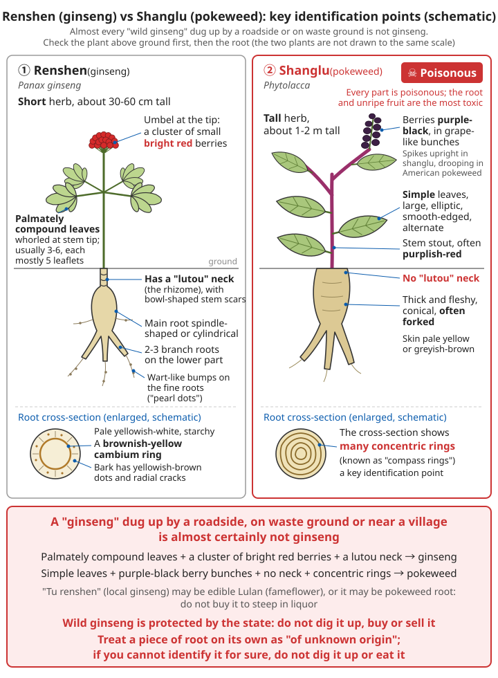

# Roots and Rhizomes (1)

> **Know the whole plant before you dig the root. The underground part is the hardest to identify: pokeweed passed off as ginseng and *Gynura* passed off as *Sanqi* both start with "just looking at the root"**

This chapter covers the 30 most commonly used root and rhizome medicines, grouped roughly by action into five sets: tonics; blood-tonifying and blood-activating herbs; heat-clearing herbs; exterior-releasing and wind-dispelling herbs; and damp-resolving, wind-calming, phlegm-resolving and yin-nourishing herbs. For each herb it says how to recognise it, where to find it, when to collect it, how to process and store it, the Pharmacopoeia dose and the contraindications. General methods for identification, harvesting, drying and storage are in the [General principles](00-general-principles.md) and are not repeated here. The remaining root and rhizome medicines (*Zhimu*, *Maidong*, *Dahuang*, *Beimu* and others) are in [Roots and Rhizomes (2)](02-roots-and-rhizomes-2.md).

## ⚠️ Read these first

```
1. You cannot identify a root medicine from the root alone: identify the
   above-ground part while the plant is in flower or fruit, then dig the
   underground part. If all you have is a piece of root, treat it as
   "of unknown origin"
2. The two most dangerous mix-ups:
   - Pokeweed root passed off as ginseng (almost every "wild ginseng" dug
     by a roadside or on waste ground is not ginseng)
   - Gynura (Juxanqi, "Tusanqi") passed off as Sanqi (long-term use can
     cause severe liver damage)
   See Chapter 09, "Toxic Herbs and Poisonous Look-alikes"
3. Heshouwu can cause liver damage: do not take it long term or in large
   amounts, do not use raw Heshouwu "to darken hair" or "for health",
   and do not use it if you have liver disease
4. The wild populations of many herbs in this chapter are protected by the state:
   Renshen, Sanqi (wild), Gancao, Huanglian, Tianma, Qianghuo, Sichuan Dangshen,
   Shanhucai (Beishashen) and others,
   as well as herbs such as Huangqin and Fangfeng that are on the
   "List of Wild Medicinal Species under State Key Protection".
   Almost everything on sale is cultivated; do not dig wild plants
5. Doses are the usual adult daily doses in the Chinese Pharmacopoeia
   (2020 edition) (prepared slices, decocted in water; the current edition
   is 2025 — the wording of the current edition prevails).
   They are only there to warn you "do not exceed this"; whether to use
   a herb, and how much, is decided under the guidance of a TCM practitioner
6. Renshen, Dangshen, Danshen, Baishao, Chishao, Nanshashen, Beishashen and
   Xiyangshen should not be used together with Lilu (Veratrum);
   Gancao should not be used together with Gansui, Jingdaji, Hongdaji,
   Yuanhua or Haizao
7. Pregnant women, children, people with liver or kidney disease, and people
   on long-term blood-pressure, diabetes or anticoagulant medicines:
   ask a doctor before using any of these herbs
```

---

## Quick reference to the herbs in this chapter

The "Toxicity/protection" column gives toxicity noted in the Pharmacopoeia, this book's risk warnings, and the protection status of wild populations. For protection levels the published state lists prevail; this table is only a reminder.

| Herb | Part used | Main action | Toxicity/protection | See |
|------|---------|---------|----------|-----|
| *Renshen* (ginseng) | Root and rhizome | Greatly tonifies primal *qi* | 🛡️ Wild ginseng protected by the state; ⚠️ beware pokeweed substitutes | [1.1](#11-renshen-ginseng) |
| *Xiyangshen* (American ginseng) | Root | Tonifies *qi* and nourishes yin | 🛡️ Wild plants occur only in North America, CITES Appendix II; cultivated in China | [1.2](#12-xiyangshen-american-ginseng) |
| *Dangshen* (codonopsis) | Root | Tonifies spleen and lung *qi* | 🛡️ Wild Sichuan *Dangshen* protected | [1.3](#13-dangshen-codonopsis-root) |
| *Huangqi* (astragalus) | Root | Tonifies *qi* and raises yang | Wild Mongolian astragalus is scarce | [1.4](#14-huangqi-astragalus-root) |
| *Gancao* (liquorice) | Root and rhizome | Tonifies spleen and *qi*, harmonises other herbs | 🛡️ Wild liquorice protected; long-term large doses cause low potassium | [1.5](#15-gancao-liquorice-root) |
| *Baizhu* (white atractylodes) | Rhizome | Strengthens spleen, tonifies *qi* | — | [1.6](#16-baizhu-white-atractylodes-rhizome) |
| *Shanyao* (Chinese yam) | Rhizome | Tonifies spleen, nourishes stomach | Mucus of fresh yam irritates skin | [1.7](#17-shanyao-chinese-yam) |
| *Danggui* (Chinese angelica) | Root | Tonifies and activates blood | Caution in pregnancy | [2.1](#21-danggui-chinese-angelica-root) |
| *Baishao* (white peony root) | Root | Nourishes blood, softens the liver | — | [2.2](#22-baishao-white-peony-root) |
| *Chishao* (red peony root) | Root | Clears heat, cools blood, disperses stasis | — | [2.3](#23-chishao-red-peony-root) |
| *Chuanxiong* (Sichuan lovage) | Rhizome | Activates blood, moves *qi* | Caution in pregnancy | [2.4](#24-chuanxiong-sichuan-lovage-rhizome) |
| *Dihuang* (rehmannia) | Root tuber | Raw: clears heat, cools blood; prepared: tonifies blood | — | [2.5](#25-dihuang-rehmannia-root) |
| *Heshouwu* (fleeceflower root) | Root tuber | Prepared: tonifies liver and kidney | ⚠️ Risk of liver damage | [2.6](#26-heshouwu-fleeceflower-root) |
| *Danshen* (red sage) | Root and rhizome | Activates blood, removes stasis | Raises bleeding risk with anticoagulants | [2.7](#27-danshen-red-sage-root) |
| *Sanqi* (notoginseng) | Root and rhizome | Disperses stasis, stops bleeding | 🛡️ Wild plants protected; ⚠️ beware *Gynura* substitutes | [2.8](#28-sanqi-notoginseng) |
| *Huanglian* (coptis) | Rhizome | Clears heat, dries damp, purges fire | 🛡️ Wild *Coptis* species protected | [3.1](#31-huanglian-coptis-rhizome) |
| *Huangqin* (Baikal skullcap) | Root | Clears heat, dries damp | 🛡️ On the key protected wild medicinal species list | [3.2](#32-huangqin-baikal-skullcap-root) |
| *Banlangen* (isatis root) | Root | Clears heat, removes toxins, cools blood, soothes throat | — | [3.3](#33-banlangen-isatis-root) |
| *Gegen* (kudzu root) | Root | Releases the muscles, brings down fever, generates fluids | — | [4.1](#41-gegen-kudzu-root) |
| *Chaihu* (bupleurum) | Root | Disperses and brings down fever, soothes the liver | ⚠️ Beware toxic *Bupleurum longiradiatum* mixed in | [4.2](#42-chaihu-bupleurum-root) |
| *Fangfeng* (saposhnikovia) | Root | Dispels wind, releases the exterior | 🛡️ On the key protected wild medicinal species list | [4.3](#43-fangfeng-saposhnikovia-root) |
| *Qianghuo* (notopterygium) | Rhizome and root | Releases the exterior, dispels cold, dispels wind and damp | 🛡️ Wild *Qianghuo* protected | [4.4](#44-qianghuo-notopterygium-rhizome) |
| *Duhuo* (pubescent angelica) | Root | Dispels wind and damp, relieves pain | — | [4.5](#45-duhuo-pubescent-angelica-root) |
| *Baizhi* (Dahurian angelica) | Root | Releases the exterior, dispels cold, relieves pain | Carrot family: beware water hemlock | [4.6](#46-baizhi-dahurian-angelica-root) |
| *Shengma* (cimicifuga) | Rhizome | Releases the exterior, vents rashes, raises yang | Buttercup family; overdose causes adverse effects | [4.7](#47-shengma-cimicifuga-rhizome) |
| *Cangzhu* (atractylodes) | Rhizome | Dries damp, strengthens spleen | — | [5.1](#51-cangzhu-atractylodes-rhizome) |
| *Tianma* (gastrodia) | Tuber | Calms wind, stops spasms | 🛡️ Wild *Tianma* protected | [5.2](#52-tianma-gastrodia-tuber) |
| *Jiegeng* (platycodon) | Root | Opens the lungs, expels phlegm, soothes throat | Large doses can cause vomiting | [5.3](#53-jiegeng-platycodon-root) |
| *Nanshashen* (adenophora) | Root | Nourishes yin, clears the lungs, resolves phlegm | — | [5.4](#54-nanshashen-adenophora-root) |
| *Beishashen* (glehnia) | Root | Nourishes yin, clears the lungs, benefits the stomach, generates fluids | 🛡️ Wild *Shanhucai* (glehnia) protected | [5.5](#55-beishashen-glehnia-root) |

---

## 1. Tonics

This group contains the most commonly used *qi* tonics. They have very low toxicity themselves, but "tonics" are the herbs people most often take on their own, long term and in large amounts, and the most expensive ones (*Renshen*, *Xiyangshen*) are also the ones most often faked.

### 1.1 Renshen (ginseng)

- **Renshen (Yuanshen, Linxia Shanshen, Bangchui)**: Chinese 人参; *Panax ginseng* C. A. Mey.
- **Source**: The dried root and rhizome of *Panax ginseng* C. A. Mey. (Araliaceae, ivy family). Cultivated ginseng is traditionally called *yuanshen* ("garden ginseng"); ginseng sown in mountain forest and left to grow naturally is called *linxia shanshen* ("forest-grown mountain ginseng")
- **Distribution and habitat**: Grows wild in the northeast, around the Changbai Mountains and the Lesser Khingan Range, at altitudes from a few hundred to over a thousand metres, under mixed conifer and broadleaf forest, in shady, damp places with thick humus. Today almost all the medicine comes from plantations in Jilin, Liaoning and Heilongjiang
- **Key identification features**:
  - Plant: Perennial herb about 30-60 cm tall; **palmately compound leaves in a whorl at the top of the stem** (the older the plant, the more compound leaves, usually 3-6), each compound leaf usually with 5 leaflets; a terminal umbel, which in summer produces a cluster of **bright red** flattened-round small berries
  - Crude drug: Main root spindle-shaped or cylindrical, greyish-yellow, with coarse broken cross-wrinkles on the upper part and 2-3 branch roots below; at the top is the **"reed head"** (*lutou*, the rhizome), bearing bowl-shaped stem scars (*luwan*, "reed bowls"); the fine roots carry tiny wart-like bumps ("pearl dots")
  - Cross-section: Pale yellowish-white, powdery, with **a ring of brownish-yellow cambium**; the bark part has scattered yellowish-brown dots and radiating cracks; a distinctive aroma, taste slightly bitter and sweet
- **Look-alikes**: **Pokeweed root** (*Shanglu*) is the most dangerous: forked, thick roots dug by roadsides, on waste ground or near villages are often taken for "wild mountain ginseng" and steeped in liquor or stewed in soup. Pokeweed is a tall herb with simple leaves and purple-black, grape-like fruit spikes; a cross-section of its root shows many concentric rings, and it has no reed head. For a comparison see [Pokeweed vs ginseng](09-toxic-herbs-and-poisonous-look-alikes.md#44-shanglu-pokeweed-vs-renshen-ginseng). Fakes are also made by processing *Jiegeng* (platycodon), *Huashanshen* (Physochlaina, toxic), *Lulan* (Talinum, "earth ginseng") and others
- **Harvesting and processing**: Cultivated garden ginseng is usually dug in autumn after 5-6 years of growth, washed and sun-dried or oven-dried as "sun-dried ginseng" (*shengshaishen*); steamed and then dried it becomes "red ginseng" (*hongshen*, a separate Pharmacopoeia entry)
- **Storage**: High in sugar and starch, so it easily absorbs moisture, moulds and is attacked by insects; seal it and keep it in a cool, dry place; small amounts can be kept in the fridge
- **Actions**: Greatly tonifies primal *qi*, restores the pulse and rescues from collapse, tonifies the spleen and benefits the lungs, generates fluids and nourishes blood, calms the mind and benefits intelligence
- **Dose**: 3-9 g, decocted separately and added to the decoction; or ground to powder and swallowed, 2 g a time, twice a day (Chinese Pharmacopoeia, 2020 edition; use under the guidance of a TCM practitioner)
- **Cautions**: Do not use together with *Lilu* (Veratrum) or *Wulingzhi* (flying squirrel droppings); not suitable for fever, excess patterns, or yin deficiency with flaring fire; people with high blood pressure or insomnia, or who are taking diabetes medicines or anticoagulants such as warfarin, should ask a doctor before use; do not give children tonics on your own initiative
- 🛡️ **Protection note**: Wild ginseng is a Class II species on the "List of Wild Medicinal Species under State Key Protection", and wild species of the genus *Panax* are also on the 2021 "List of Wild Plants under State Key Protection" (the wording of the lists prevails for the class). **Wild ginseng must not be dug or traded**; what proper pharmacies sell is garden ginseng or forest-grown mountain ginseng, and that is enough



*Figure: Ginseng and pokeweed compared. Ginseng has palmately compound leaves, a cluster of small bright red berries and a reed head at the top of the root; pokeweed has simple leaves, strings of purple-black berries, no reed head on the root and many concentric rings in a cross-section. Do not dig or eat "wild ginseng" found by the roadside*

### 1.2 Xiyangshen (American ginseng)

- **Xiyangshen (Huaqishen, Yangshen)**: Chinese 西洋参; *Panax quinquefolium* L.
- **Source**: The dried root of *Panax quinquefolium* L. (Araliaceae). The Pharmacopoeia states that all of it is cultivated
- **Distribution and habitat**: Native to deciduous forest in North America (Canada, eastern United States); introduced and cultivated in China in Jilin, Shandong, Beijing, Shaanxi and elsewhere
- **Key identification features**:
  - Plant: Very similar to ginseng: palmately compound leaves in a whorl at the stem top, red berries; hard to tell apart by the plant alone, but you will not meet wild American ginseng in the field
  - Crude drug: Spindle-shaped, cylindrical or conical, 3-12 cm long; light yellowish-brown or yellowish-white, with **fine, dense cross-rings** and line-like, lenticel-like bumps
  - Cross-section: Firm and solid, flat, pale yellowish-white, slightly powdery, with a brownish-yellow cambium ring and yellowish-brown dots in the bark; a faint but distinctive smell, taste slightly bitter and sweet
- **Look-alikes**: Smaller garden ginseng (sun-dried ginseng) is often processed and sold as American ginseng. In experience, American ginseng is heavier and denser, its cross-rings are finer and denser and its cross-section flatter; ginseng often has a longer reed head and more branch roots. The fake does no harm, but the prices are very different; if unsure, buy from a proper pharmacy
- **Harvesting and processing**: Dug in autumn after 3-4 years of cultivation, washed, sun-dried or dried at low temperature
- **Storage**: As for ginseng, easily attacked by insects and damp; seal and keep out of light
- **Actions**: Tonifies *qi* and nourishes yin, clears heat and generates fluids
- **Dose**: 3-6 g, decocted separately and added to the decoction (Chinese Pharmacopoeia, 2020 edition; use under the guidance of a TCM practitioner)
- **Cautions**: Do not use together with *Lilu* (Veratrum); it is cool in nature, so not suitable for people with a cold, weak spleen and stomach or diarrhoea; ask a doctor before using it with diabetes medicines or anticoagulants
- 🛡️ **Protection note**: Wild American ginseng occurs only in North America and is listed in Appendix II of the Convention on International Trade in Endangered Species of Wild Fauna and Flora (CITES); in China only cultivated plants exist

### 1.3 Dangshen (codonopsis root)

- **Dangshen (Lu Dangshen, Wendang, Taidang)**: Chinese 党参; *Codonopsis pilosula* (Franch.) Nannf., *C. pilosula* var. *modesta* (Nannf.) L. T. Shen, *C. tangshen* Oliv.
- **Source**: The dried root of *Codonopsis pilosula* (Franch.) Nannf., *C. pilosula* var. *modesta* (Nannf.) L. T. Shen (Suhua *Dangshen*) or *C. tangshen* Oliv. (Sichuan *Dangshen*) (Campanulaceae, bellflower family)
- **Distribution and habitat**: Forest edges, scrub and stream banks in the mountains of Shanxi, Gansu, Shaanxi, Sichuan, the northeast and elsewhere; the medicine comes mainly from cultivation
- **Key identification features**:
  - Plant: Perennial **twining herbaceous vine**; the whole plant gives **white milky sap** when broken and has a distinctive smell when crushed; leaves ovate, opposite or alternate; flowers single, **bell-shaped, yellowish-green with purple spots**; root fleshy
  - Crude drug: Long and cylindrical, slightly curved, 10-35 cm long; greyish-yellow to greyish-brown; the root head has many wart-like stem scars and buds, traditionally called **"lion's coiled head"** (*shizi pantou*); below the root head are dense ring-shaped cross-wrinkles
  - Cross-section: Fairly flat, with cracks or radiating lines; bark pale brownish-yellow, wood pale yellow; a distinctive aroma, taste slightly sweet
- **Look-alikes**: Roots of related plants in the same family, such as *Yangru* (Codonopsis lanceolata, "four-leaf ginseng") and *Codonopsis tubulosa*, have been mixed in. There are many twining vines in the wild; confirm only after seeing the bell-shaped flowers, the milky sap and the "lion's coiled head"
- **Harvesting and processing**: Dug in autumn after 2-3 years of cultivation, washed and sun-dried; traditionally, when half-dry the roots are rubbed and rolled several times so that the skin sticks tightly to the flesh and does not puff up hollow, then dried completely
- **Storage**: High in sugar, so it is **prone to damp, mould, insect damage and oiling (turning soft and sticky)**; seal once fully dry, keep somewhere cool and check often
- **Actions**: Strengthens the spleen and benefits the lungs, nourishes blood and generates fluids
- **Dose**: 9-30 g (Chinese Pharmacopoeia, 2020 edition; use under the guidance of a TCM practitioner)
- **Cautions**: Do not use together with *Lilu* (Veratrum); not suitable on its own for excess or heat patterns
- 🛡️ **Protection note**: Wild Sichuan *Dangshen* is on the 2021 "List of Wild Plants under State Key Protection" (the wording of the list prevails); do not dig wild *Dangshen*. For growing it see [Medicinal plants](../04-farming-and-animal-husbandry/04-medicinal-plants.md)

### 1.4 Huangqi (astragalus root)

- **Huangqi (Huangqi [黄耆], Mianqi, Beiqi)**: Chinese 黄芪; *Astragalus membranaceus* (Fisch.) Bge. var. *mongholicus* (Bge.) Hsiao, *A. membranaceus* (Fisch.) Bge.
- **Source**: The dried root of *Astragalus membranaceus* (Fisch.) Bge. var. *mongholicus* (Bge.) Hsiao (Mongolian astragalus) or *A. membranaceus* (Fisch.) Bge. (membranous astragalus) (Fabaceae, pea family)
- **Distribution and habitat**: Sunny hillsides, grassland and forest edges in Shanxi, Inner Mongolia, Gansu, Heilongjiang, Hebei and elsewhere; commercial supply is mainly cultivated or semi-wild cultivated
- **Key identification features**:
  - Plant: Perennial herb 50-100 cm tall; **odd-pinnate compound leaves** with many pairs of elliptic leaflets; racemes of pea-like flowers, **pale yellow**; pods papery and **inflated like small air bags**
  - Crude drug: Long and cylindrical, some branched, 30-90 cm long; pale brownish-yellow or pale brown, with irregular lengthwise wrinkles
  - Cross-section: Hard and tough, does not break easily; **strongly fibrous when broken (like cotton wadding)**; bark yellowish-white, wood pale yellow, with radiating lines and cracks (traditionally called a "chrysanthemum heart"); faint smell, taste slightly sweet, and **a beany taste when chewed**
- **Look-alikes**: In the past, roots of *Caragana* (pea shrub), alfalfa (*Medicago sativa*), *Malva rotundifolia* (round-leaf mallow) and others have been sold as *Huangqi*; their cross-section and taste differ (no beany taste and no "chrysanthemum heart"). *Astragalus* and the related genus *Oxytropis* include some "locoweed" plants that poison livestock that eat them — **do not dig unfamiliar wild *Astragalus* plants as a substitute**
- **Harvesting and processing**: Dug in spring and autumn; remove fine roots and the root head, sun-dry; cultivated plants are usually grown for 2-3 years or more
- **Storage**: Easily moulds in damp and is attacked by insects; tie in bundles and keep somewhere ventilated and dry
- **Actions**: Tonifies *qi* and raises yang, consolidates the exterior and stops sweating, promotes urination and reduces swelling, generates fluids and nourishes blood, moves stagnation and unblocks painful obstruction, draws out toxins and expels pus, closes sores and promotes healing
- **Dose**: 9-30 g (Chinese Pharmacopoeia, 2020 edition; use under the guidance of a TCM practitioner)
- **Cautions**: Not suitable for fever from external infection, early-stage hot toxic sores, or yin deficiency with flaring fire; people with autoimmune disease, or taking immunosuppressants after organ transplant, should ask a doctor before use

### 1.5 Gancao (liquorice root)

- **Gancao (Guolao, Tiancao, Tiangenzi)**: Chinese 甘草; *Glycyrrhiza uralensis* Fisch., *G. inflata* Bat., *G. glabra* L.
- **Source**: The dried root and rhizome of *Glycyrrhiza uralensis* Fisch., *G. inflata* Bat. or *G. glabra* L. (Fabaceae)
- **Distribution and habitat**: Dry steppe, sandy ground and river banks in the northwest and north of China — Inner Mongolia, Xinjiang, Gansu, Ningxia and elsewhere; drought-tolerant and binds sand
- **Key identification features**:
  - Plant: Perennial herb 30-120 cm tall, the whole plant covered in short hairs and glandular dots, sticky to the touch; odd-pinnate compound leaves; pea-like flowers **purple or pale purple**, crowded into racemes; **pods curved like a sickle or a ring, densely covered in bristly hairs**
  - Crude drug: Root cylindrical, 25-100 cm long; outer bark reddish-brown or greyish-brown, with clear lengthwise wrinkles and lenticels; the rhizome has bud scars on its surface and pith in the centre of its cross-section
  - Cross-section: Yellowish-white, powdery, with a clear cambium ring and radiating lines; **taste sweet and distinctive** — one of the easiest medicines to confirm by taste
- **Look-alikes**: Generally not easily confused; note that "*Gancao* tablets" on sale may be cut liquorice slices or Western cough tablets containing liquorice liquid extract — the two are different
- **Harvesting and processing**: Dug in spring and autumn, fine roots removed, sun-dried; cultivated plants are usually grown for 3-4 years
- **Storage**: Easily attacked by insects and damp; keep somewhere dry
- **Actions**: Tonifies the spleen and *qi*, clears heat and removes toxins, expels phlegm and stops cough, relieves spasm and pain, harmonises the other herbs
- **Dose**: 2-10 g (Chinese Pharmacopoeia, 2020 edition; use under the guidance of a TCM practitioner)
- **Cautions**: Do not use together with *Haizao* (Sargassum), *Jingdaji* (Euphorbia pekinensis), *Hongdaji* (Knoxia), *Gansui* (Euphorbia kansui) or *Yuanhua* (Daphne genkwa). **Long-term or large-dose use can cause oedema, raised blood pressure and low blood potassium** (in severe cases muscle weakness and abnormal heart rhythm); people with high blood pressure, heart disease, kidney disease or low potassium should use it with caution; ask a doctor before using it with diuretics, digoxin or steroids. Pregnant women should not take it long term or in large amounts
- 🛡️ **Protection note**: *Gancao* is a Class II species on the "List of Wild Medicinal Species under State Key Protection", and wild liquorice (*G. uralensis*, *G. inflata*, *G. glabra*) is also on the 2021 "List of Wild Plants under State Key Protection"; in 2000 the State Council issued a specific notice to stop indiscriminate digging of liquorice (which turns grassland into desert). **Do not dig wild liquorice**; most of what is on sale is cultivated

### 1.6 Baizhu (white atractylodes rhizome)

- **Baizhu (Yuzhu, Dongzhu)**: Chinese 白术; *Atractylodes macrocephala* Koidz.
- **Source**: The dried rhizome of *Atractylodes macrocephala* Koidz. (Asteraceae, daisy family)
- **Distribution and habitat**: Produced mainly in Zhejiang, Anhui, Hunan, Hubei and elsewhere; commercial supply is essentially all cultivated. Wild plants (the "*Yuzhu*" of the Yuqian area of Zhejiang) are now extremely rare
- **Key identification features**:
  - Plant: Perennial herb 30-80 cm tall; leaves long-stalked, often 3-lobed, with spiny fine teeth on the margin; **flower heads single at the branch tips, purplish-red, surrounded by a ring of deeply pinnately divided leaf-like bracts**
  - Crude drug: **Irregular, fat, fleshy lumps**, 3-13 cm long; greyish-yellow or greyish-brown, with knobbly bumps and broken lengthwise wrinkles; the top has remains of the stem base and bud scars
  - Cross-section: Hard; yellowish-white to pale brown, **with scattered brownish-yellow dot-like oil cavities**; oven-dried pieces have a horny cross-section; **a fresh, clean aroma, taste sweet and slightly pungent, slightly sticky when chewed**
- **Look-alikes**: *Cangzhu*, in the same genus (see [5.1](#51-cangzhu-atractylodes-rhizome)). *Baizhu* is in large, fat lumps with fewer oil dots in the cross-section and a light aroma; *Cangzhu* is in knotty long pieces, with many "cinnabar dots" in the cross-section and a strong aroma
- **Harvesting and processing**: Dig in winter when the lower leaves have turned yellow and withered and the upper leaves have become brittle; remove soil, oven-dry or sun-dry, then remove the fine roots
- **Storage**: **Prone to oiling and insect damage**; keep somewhere cool and dry, away from heat
- **Actions**: Strengthens the spleen and tonifies *qi*, dries damp and promotes urination, stops sweating, calms the foetus
- **Dose**: 6-12 g (Chinese Pharmacopoeia, 2020 edition; use under the guidance of a TCM practitioner)
- **Cautions**: Use with caution in yin deficiency with dryness and thirst, or depleted body fluids; "calming the foetus" must also be judged by a doctor — bleeding or abdominal pain in pregnancy needs a doctor first

### 1.7 Shanyao (Chinese yam)

- **Shanyao (Huaishan, Huai Shanyao, Shuyu)**: Chinese 山药; *Dioscorea opposita* Thunb.
- **Source**: The dried rhizome of *Dioscorea opposita* Thunb. (Dioscoreaceae, yam family)
- **Distribution and habitat**: Grows wild in most of the country, on hillsides, forest edges and in scrub; cultivated on a large scale in Jiaozuo, Henan (the old Huaiqing prefecture, hence "*Huai Shanyao*") and elsewhere, and also a common vegetable
- **Key identification features**:
  - Plant: **Twining herbaceous vine**, stem often purplish-red; leaves **opposite or in whorls of three** (occasionally alternate lower down), triangular-ovate to halberd-shaped, heart-shaped at the base; **bulbils ("yam beans", *lingyuzi*) often grow in the leaf axils**
  - Crude drug: "Hairy *Shanyao*" is roughly cylindrical, curved and slightly flattened, yellowish-white or pale yellow, with lengthwise grooves and fine-root scars; "smooth *Shanyao*" is evenly cylindrical with a smooth white surface; "*Shanyao* slices" are roughly round or irregular thick slices cut while fresh
  - Cross-section: White, **very powdery**; faint smell, taste bland and slightly sour, **sticky when chewed**
- **Look-alikes**: ***Huangdu*** (air potato, *Dioscorea bulbifera*; its tuber is the medicine *Huangyaozi*, which is toxic to the liver), in the same genus — its leaves are **alternate** and broadly heart-shaped, its bulbils are large and spherical, and its underground tuber is almost spherical with a yellow cross-section, unlike the long, cylindrical white rhizome of *Shanyao*. Cassava slices and slices of winged yam (*Dioscorea alata*) are also passed off as *Shanyao* slices. If you dig wild *Dioscorea* plants you must check the leaf arrangement and the shape of the rhizome
- **Harvesting and processing**: Dig in winter after the stems and leaves have withered; cut off the root head, wash, remove the skin and fine roots, then dry ("hairy *Shanyao*"); or cut into thick slices while fresh and dry ("*Shanyao* slices"). The mucus of fresh yam can make the hands itch; wear gloves when peeling
- **Storage**: Rich in starch, so **very easily attacked by insects and mould**; seal once fully dry
- **Actions**: Tonifies the spleen and nourishes the stomach, generates fluids and benefits the lungs, tonifies the kidneys and secures essence
- **Dose**: 15-30 g (Chinese Pharmacopoeia, 2020 edition; use under the guidance of a TCM practitioner); eating it as food in normal everyday amounts is safe
- **Cautions**: Do not use much in cases of excess damp with abdominal fullness, or food stagnation; avoid if allergic to yam

---

## 2. Blood-tonifying and blood-activating herbs

This group is mostly related to menstruation, bleeding and blood stasis. **Blood-activating herbs increase the risk of bleeding**: pregnant women, women with heavy periods, people who bleed easily, and anyone taking anticoagulant or antiplatelet drugs such as warfarin, aspirin or clopidogrel must all ask a doctor first. In this group *Heshouwu* and *Sanqi* (and its substitute *Gynura*) involve liver damage and need special care.

### 2.1 Danggui (Chinese angelica root)

- **Danggui (Qingui, Mingui, Xi Danggui)**: Chinese 当归; *Angelica sinensis* (Oliv.) Diels
- **Source**: The dried root of *Angelica sinensis* (Oliv.) Diels (Apiaceae, carrot family)
- **Distribution and habitat**: Produced mainly around Min County and Weiyuan in Gansu, and in cold, damp, shady mountain areas at about 2000-3000 m in Yunnan, Sichuan, Hubei and elsewhere; commercial supply is almost all cultivated
- **Key identification features**:
  - Plant: Perennial herb 40-100 cm tall, stem tinged purple; leaves 2-3 times pinnately compound, the base of the leaf stalk swollen into a sheath; **compound umbels of white flowers**; the whole plant has a strong, distinctive aroma
  - Crude drug: Roughly cylindrical, with 3-5 or more branch roots below, 15-25 cm long; the root head (*guitou*) has rings and the remains of purple or yellowish-green leaf sheaths, the main root (*guishen*) is uneven, and the branch roots (*guiwei*) taper downwards
  - Cross-section: Soft and pliable; yellowish-white or pale yellowish-brown, with a thick bark and many brown dot-like secretory cavities, and a yellowish-brown cambium ring; **strong aroma, taste sweet, pungent and slightly bitter**. The Pharmacopoeia states: roots that are woody, dried out without oil, or greenish-brown in cross-section must not be used as medicine
- **Look-alikes**: Lovage (*Levisticum officinale*, an introduced Western spice plant), Japanese angelica (*Angelica acutiloba*), *Duhuo* and others have been mixed in; their aroma and taste differ. ***Danggui* belongs to the carrot family — do not dig unfamiliar carrot-family plants in the wild**: highly toxic plants such as water hemlock look similar; see [Water hemlock vs water dropwort and wild carrot](09-toxic-herbs-and-poisonous-look-alikes.md#43-duqin-water-hemlock-vs-shuiqin-water-dropwort-and-yehuluobo-wild-carrot)
- **Harvesting and processing**: Dig at the end of autumn, remove fine roots and soil, let some of the moisture evaporate, tie into small bundles, put them on racks and dry them slowly over smoke from a fire
- **Storage**: **Prone to oiling, insect damage and mould**; seal and keep somewhere cool and dry, and check often in summer
- **Actions**: Tonifies and activates blood, regulates menstruation and relieves pain, moistens the intestines and relieves constipation
- **Dose**: 6-12 g (Chinese Pharmacopoeia, 2020 edition; use under the guidance of a TCM practitioner)
- **Cautions**: Not suitable for diarrhoea or excess damp with abdominal fullness; use with caution in heavy periods or a tendency to bleed; pregnant women use only under a doctor's guidance; using it together with anticoagulants such as warfarin may increase the risk of bleeding

### 2.2 Baishao (white peony root)

- **Baishao (Hang Baishao, Bo Baishao, Chuan Baishao)**: Chinese 白芍; *Paeonia lactiflora* Pall.
- **Source**: The dried root of *Paeonia lactiflora* Pall. (Chinese peony; Ranunculaceae, buttercup family)
- **Distribution and habitat**: Grows wild on grassy hillsides and forest edges in the northeast, north and northwest; the medicine is mainly cultivated in Zhejiang, Bozhou in Anhui, Sichuan and elsewhere (the ornamental garden peony is the same species)
- **Key identification features**:
  - Plant: Perennial herb 40-70 cm tall; leaves twice ternately compound, leaflets narrowly ovate; **flowers large and beautiful, single at the stem top, white, pink or red**, like tree peony (*mudan*), but Chinese peony is a herb and dies back above ground in winter
  - Crude drug: Cylindrical, straight or slightly curved, **cut flat at both ends**, 5-18 cm long, 1-2.5 cm across; surface **off-white or pale brownish-red and smooth** (peeled), occasionally with remnants of brown outer bark
  - Cross-section: Firm and solid, fairly flat, off-white or slightly brownish-red, with a clear cambium ring and radiating rays; faint smell, taste slightly bitter and sour
- **Look-alikes**: Comes from the same plant as *Chishao*; the difference is in processing: *Baishao* is **peeled and boiled**, with a smooth off-white surface; *Chishao* is neither peeled nor boiled, with a rough brown surface
- **Harvesting and processing**: In summer and autumn dig the roots of plants cultivated for 3-4 years, wash, remove the head, tail and fine roots, boil in boiling water and then peel (or peel and then boil), and sun-dry
- **Storage**: Protect from damp and insects; keep somewhere dry
- **Actions**: Nourishes blood and regulates menstruation, preserves yin and stops sweating, softens the liver and relieves pain, calms liver yang
- **Dose**: 6-15 g (Chinese Pharmacopoeia, 2020 edition; use under the guidance of a TCM practitioner)
- **Cautions**: Do not use together with *Lilu* (Veratrum); use with caution for abdominal pain from deficiency cold, or diarrhoea

### 2.3 Chishao (red peony root)

- **Chishao (Chishaoyao, Caoshaoyao)**: Chinese 赤芍; *Paeonia lactiflora* Pall., *Paeonia veitchii* Lynch
- **Source**: The dried root of *Paeonia lactiflora* Pall. or *Paeonia veitchii* Lynch (Ranunculaceae)
- **Distribution and habitat**: *P. lactiflora* grows wild on grassy hillsides in Inner Mongolia, the northeast, Hebei and elsewhere; *P. veitchii* grows on wooded hillsides and in scrub in Sichuan, Gansu, Qinghai, Tibet and elsewhere. Commercial *Chishao* is mainly wild-collected
- **Key identification features**:
  - Plant: For *P. lactiflora* see [2.2](#22-baishao-white-peony-root); the leaflets of *P. veitchii* are deeply pinnately divided, and its purplish-red or pink flowers often grow several together at the stem top and in the leaf axils
  - Crude drug: Cylindrical, slightly curved, 5-40 cm long; surface **brown and rough**, with lengthwise grooves, wrinkles and transverse lenticel-like bumps; in some the outer bark flakes off easily
  - Cross-section: Hard and brittle, breaks easily; cross-section **pinkish-white or pink**, with narrow bark and clear radiating lines in the wood; faintly aromatic, taste slightly bitter, sour and astringent. In experience, roots whose bark flakes off easily and whose cross-section is very powdery (*zaopi fenzha*, "rotten bark, powdery dregs") are the best
- **Look-alikes**: The buttercup family contains many toxic plants (aconite, buttercups and others); **never dig the root of an unfamiliar buttercup-family plant**; see [Toxic herbs – aconites](09-toxic-herbs-and-poisonous-look-alikes.md#21-chuanwu-caowu-fuzi-aconite)
- **Harvesting and processing**: Dig in spring and autumn, remove the rhizome, fine roots and soil, sun-dry (not peeled, not boiled)
- **Storage**: Protect from damp and insects
- **Actions**: Clears heat and cools blood, disperses stasis and relieves pain
- **Dose**: 6-12 g (Chinese Pharmacopoeia, 2020 edition; use under the guidance of a TCM practitioner)
- **Cautions**: Do not use together with *Lilu* (Veratrum); not suitable for absent periods due to blood cold; pregnant women, women with heavy periods and people who bleed easily use only under a doctor's guidance
- 🛡️ **Protection note**: Most commercial *Chishao* is wild-collected, and wild stocks in Inner Mongolia and other producing areas have clearly declined; do not dig out whole patches, and follow local rules when digging

### 2.4 Chuanxiong (Sichuan lovage rhizome)

- **Chuanxiong (Xiongqiong, Fuxiong)**: Chinese 川芎; *Ligusticum chuanxiong* Hort.
- **Source**: The dried rhizome of *Ligusticum chuanxiong* Hort. (Apiaceae)
- **Distribution and habitat**: Exists only in cultivation, not in the wild; produced mainly around Dujiangyan and Pengzhou in Sichuan, propagated from stem nodes (*lingzi*)
- **Key identification features**:
  - Plant: Perennial herb 40-60 cm tall; stems clustered, **stem nodes swollen into discs**; leaves 2-3 times pinnately compound; compound umbels of white flowers; the whole plant is strongly aromatic
  - Crude drug: **Irregular, knotty, fist-shaped lumps**, 2-7 cm across; greyish-brown or brown, rough and shrivelled, with many parallel raised rings, and a sunken roundish stem scar at the top
  - Cross-section: Firm and solid; yellowish-white or greyish-yellow, with scattered yellowish-brown oil cavities and **a wavy cambium ring**; **strong aroma**, taste bitter and pungent, slightly numbing on the tongue, with a faint sweet aftertaste
- **Look-alikes**: *Gaoben* (Ligusticum sinense) and *Fuxiong* (*Chaxiong*) in the same genus are sometimes mixed in; their form and aroma are similar, so buying through proper channels is enough. *Chuanxiong* cannot be collected in the wild; do not dig similar carrot-family plants you see in the wild as *Chuanxiong*
- **Harvesting and processing**: Dig in summer when the node discs on the stems stand out clearly and turn slightly purple; remove soil, sun-dry then oven-dry, and then remove the fine roots
- **Storage**: Contains volatile oil, so it is **prone to oiling and insect damage**, and the aroma fades; seal and keep somewhere cool
- **Actions**: Activates blood and moves *qi*, dispels wind and relieves pain
- **Dose**: 3-10 g (Chinese Pharmacopoeia, 2020 edition; use under the guidance of a TCM practitioner)
- **Cautions**: Use with caution in yin deficiency with flaring fire, heavy periods or a tendency to bleed; use with caution in pregnancy, and only if a doctor decides; for recurrent headaches or a sudden severe headache see a doctor first to find the cause — do not rely on *Chuanxiong* for pain relief alone

### 2.5 Dihuang (rehmannia root)

- **Dihuang (Huai Dihuang)**: Chinese 地黄; *Rehmannia glutinosa* Libosch. By processing it is divided into fresh *Dihuang* (*xian dihuang*), raw *Dihuang* (*sheng dihuang*, *shengdi*) and prepared *Dihuang* (*shu dihuang*, *shudi*)
- **Source**: The fresh or dried root tuber of *Rehmannia glutinosa* Libosch. (Scrophulariaceae, figwort family). Prepared *Dihuang* is raw *Dihuang* processed by stewing in wine or steaming (a separate Pharmacopoeia entry)
- **Distribution and habitat**: Grows wild on hillsides, roadsides, waste ground, field banks and at the foot of walls in the north, northwest and east of China, and is very common in the north; the medicine is mainly cultivated around Wen County and Wuzhi in Henan (the old Huaiqing prefecture)
- **Key identification features**:
  - Plant: Small perennial herb 10-30 cm tall, **the whole plant densely covered with long greyish-white soft hairs and glandular hairs, sticky to the touch**; leaves mostly basal in a rosette, obovate, toothed at the margin, wrinkled; **flowers tubular, somewhat two-lipped, purplish-red outside, yellow with purple lines inside** (children in the north call it "honey pot" and suck the nectar)
  - Fresh *Dihuang*: Spindle-shaped or strip-shaped, with thin, light reddish-yellow skin; the bark in cross-section is pale yellowish-white, with orange-red oil dots visible
  - Raw *Dihuang*: Irregular lumps or oblong; surface **brownish-black or brownish-grey, very shrivelled**; heavy, fairly soft and tough; cross-section **brownish-black or jet black, glossy and sticky**; faint smell, taste slightly sweet
  - Prepared *Dihuang*: Irregular pieces, **glossy jet black and very sticky**, soft and pliable, taste sweet
- **Look-alikes**: Generally not easily confused; note that "*shengdi*" means dried raw *Dihuang*, not fresh *Dihuang* — their doses differ
- **Harvesting and processing**: Dig in autumn, remove the reed head, fine roots and soil, and use fresh (fresh *Dihuang*); or bake slowly until about 80% dry (raw *Dihuang*). Steaming to make prepared *Dihuang* is a processing (*paozhi*) step; see [Traditional Chinese medicine preparations](../06-pharmaceuticals/04-herbal-preparations.md)
- **Storage**: Keep fresh *Dihuang* buried in sandy soil; raw and prepared *Dihuang* are high in sugar and **easily absorb moisture, mould and turn sticky** — seal and keep somewhere cool and dry
- **Actions**: Fresh *Dihuang* clears heat and generates fluids, cools blood and stops bleeding; raw *Dihuang* clears heat and cools blood, nourishes yin and generates fluids; prepared *Dihuang* tonifies blood and nourishes yin, benefits essence and fills the marrow
- **Dose**: Fresh *Dihuang* 12-30 g; raw *Dihuang* 10-15 g; prepared *Dihuang* 9-15 g (Chinese Pharmacopoeia, 2020 edition; use under the guidance of a TCM practitioner)
- **Cautions**: Not suitable for spleen deficiency with damp stagnation, abdominal fullness and loose stools; prepared *Dihuang* is rich and cloying and affects digestion, so use it with caution if you have poor appetite and abdominal bloating

### 2.6 Heshouwu (fleeceflower root)

- **Heshouwu (Shouwu, Chi Shouwu, Yejiaoteng root)**: Chinese 何首乌; *Polygonum multiflorum* Thunb. After processing it is prepared *Heshouwu* (*zhi heshouwu*)
- **Source**: The dried root tuber of *Polygonum multiflorum* Thunb. (Polygonaceae, knotweed family). The stem vine is "*Shouwuteng*" (see [Barks and stems – *Shouwuteng*](06-barks-stems-and-woods.md#36-shouwuteng-fleeceflower-stem)); prepared *Heshouwu* is a processed product (a separate Pharmacopoeia entry)
- **Distribution and habitat**: Widespread in east, central, south and southwest China; very common on hillsides, in scrub, rock crevices, by streams and near villages; also cultivated
- **Key identification features**:
  - Plant: Perennial **twining vine**, stem reddish-brown and hollow; leaves alternate, **ovate-heart-shaped**, untoothed; at the base of the leaf stalk is a **papery sheath (ocrea)** (a feature of the knotweed family); in autumn it bears small white flowers in large panicles; achenes three-angled
  - Crude drug: Lumpy or irregularly spindle-shaped, 6-15 cm long; surface **reddish-brown or reddish-tan**, shrivelled and uneven, with shallow grooves and transverse lenticel-like bumps
  - Cross-section: Heavy, firm and solid; pale yellowish-brown or pale reddish-brown, powdery; **the bark has 4-11 roundish anomalous vascular bundles arranged in a ring, forming a "cloud brocade pattern"**; faint smell, taste slightly bitter, then sweet and astringent
- **Look-alikes**: "Human-shaped *Heshouwu*" on the market is mostly grown in moulds or carved from other root tubers — do not believe in it, and do not pay high prices for it; "white *Shouwu*" (*bai shouwu*) is the root tuber of milkweed-family plants (*Cynanchum auriculatum* and others), a different medicine; the two cannot replace each other
- **Harvesting and processing**: Dig in autumn and winter when the leaves have withered; cut off both ends, wash, cut large ones into pieces, and dry
- **Storage**: Protect from damp and insects; keep somewhere dry
- **Actions**: Raw *Heshouwu* removes toxins, reduces abscesses, stops malaria attacks, moistens the intestines and relieves constipation; prepared *Heshouwu* tonifies the liver and kidneys, benefits essence and blood, darkens the hair and beard, strengthens sinews and bones, resolves turbidity and lowers blood lipids
- **Dose**: *Heshouwu* 3-6 g; prepared *Heshouwu* 6-12 g (Chinese Pharmacopoeia, 2020 edition; use under the guidance of a TCM practitioner)
- **Cautions**:

```
⚠️ Heshouwu (including prepared Heshouwu) can cause liver damage:
- The national drug regulator has repeatedly issued warnings about the
  risk of liver damage from oral Heshouwu and its preparations
- Raw Heshouwu carries a higher risk; people steeping raw Heshouwu in water,
  grinding it to powder or soaking it in liquor "to darken hair" or
  "to stay healthy" is exactly how harm commonly happens
- Do not take it long term, do not exceed the dose, and do not take it
  with other drugs that may harm the liver
- People with liver disease or abnormal liver function must not use it;
  older people, children, pregnant and breastfeeding women must not take
  it on their own initiative
- If during use you develop fatigue, poor appetite, nausea, aversion to
  greasy food, dark urine (the colour of strong tea), or yellow skin or
  yellow whites of the eyes → stop at once and see a doctor for liver tests
- Raw Heshouwu is laxative; not suitable for people with loose stools
```

### 2.7 Danshen (red sage root)

- **Danshen (Zi Danshen, Honggen, Xueshen)**: Chinese 丹参; *Salvia miltiorrhiza* Bge.
- **Source**: The dried root and rhizome of *Salvia miltiorrhiza* Bge. (Lamiaceae, mint family)
- **Distribution and habitat**: Found in most of the country, on hillsides, in grass under trees and beside streams in valleys; cultivated on a large scale in Sichuan, Shandong, Henan, Shaanxi and elsewhere
- **Key identification features**:
  - Plant: Perennial herb 30-80 cm tall; **stem square**, the whole plant densely covered in soft hairs; **odd-pinnate compound leaves with 3-7 leaflets**, ovate, toothed; whorls of flowers arranged in racemes, **two-lipped flowers bluish-purple**
  - Crude drug: A short, thick rhizome with several long cylindrical roots below, 10-20 cm long, 0.3-1 cm across; surface **brownish-red or dark brownish-red**, rough, with lengthwise wrinkles; on old roots the outer bark is loose, purplish-brown and often peels off in scales. Cultivated roots are thicker and sturdier, with tightly attached bark
  - Cross-section: Hard and brittle; loose with cracks; bark brownish-red, wood greyish-yellow or purplish-brown, with yellowish-white vessel bundles arranged radially; faint smell, taste slightly bitter and astringent
- **Look-alikes**: Other *Salvia* species such as *Salvia przewalskii* and *Salvia bowleyana* (*Nan Danshen*) have been used as local substitutes; they are all red-rooted mint-family plants of low toxicity, but they cannot replace the genuine herb. To identify it, hold on to "square stem, pinnate compound leaves, bluish-purple two-lipped flowers, red outer bark on the root"
- **Harvesting and processing**: Dig in spring and autumn, remove soil, dry
- **Storage**: Protect from damp and mould; keep somewhere dry
- **Actions**: Activates blood and removes stasis, unblocks the channels and relieves pain, clears the heart and relieves restlessness, cools blood and reduces abscesses
- **Dose**: 10-15 g (Chinese Pharmacopoeia, 2020 edition; use under the guidance of a TCM practitioner)
- **Cautions**: Do not use together with *Lilu* (Veratrum); use with caution in pregnancy, heavy periods or a tendency to bleed; **using it together with anticoagulant or antiplatelet drugs such as warfarin or aspirin may increase the risk of bleeding**; people with coronary heart disease or chest pain must not use *Danshen* in place of hospital treatment — if chest pain starts, call 120 at once

### 2.8 Sanqi (notoginseng)

- **Sanqi (Tianqi, Shen Sanqi, Jinbuhuan)**: Chinese 三七; *Panax notoginseng* (Burk.) F. H. Chen
- **Source**: The dried root and rhizome of *Panax notoginseng* (Burk.) F. H. Chen (Araliaceae). The branch roots are traditionally called *jintiao* ("tendon strips") and the rhizome *jiankou* ("cut mouth")
- **Distribution and habitat**: Produced mainly around Wenshan in Yunnan and Baise in Guangxi, cultivated under shade structures; wild *Sanqi* is now extremely hard to find
- **Key identification features**:
  - Plant: Perennial herb 30-60 cm tall; **3-4 palmately compound leaves in a whorl at the stem top**, each with 5-7 finely serrated leaflets; a terminal umbel of small pale yellowish-green flowers; **berries bright red** — a close relative of ginseng in the same genus, and very similar in appearance
  - Crude drug: Main root roughly conical or cylindrical, 1-6 cm long, 1-4 cm across; greyish-brown or greyish-yellow, with broken lengthwise wrinkles and branch-root scars, and knobbly bumps around the top (commonly called "monkey head" or "lion head")
  - Cross-section: **Heavy, firm and solid**, does not shatter easily when struck; cross-section **greyish-green, yellowish-green or greyish-white**, wood slightly radiating; faint smell, **taste bitter with a sweet aftertaste**
- **Look-alikes**:

```
⚠️ Gynura (Juxanqi, "Tusanqi") is the most dangerous:
- Gynura japonica (Juxanqi) is a plant of the daisy family; the "Sanqi",
  "Tusanqi" or "Xuesanqi" grown in many people's yards and flowerpots is this plant
- Leaves alternate, deeply pinnately divided, often tinged purple; small
  yellow or orange-yellow pompom-like flowers
  (true Sanqi has palmately compound leaves in a whorl and red berries)
- It contains pyrrolizidine alkaloids; steeped in liquor, stewed in soup or
  taken as powder long term or in large amounts, it can after weeks to
  months cause hepatic sinusoidal obstruction syndrome: abdominal swelling,
  ascites, jaundice, and in severe cases liver failure
- Do not steep home-grown "Sanqi" in liquor, stew it in soup or eat it powdered
In addition, "Jingtian Sanqi" (Sedum aizoon, Feicai) of the stonecrop family
is also called "Tusanqi"; it is not the same plant as Gynura.
The market also has fakes made by processing root tubers of Ezhu (zedoary),
Jianghuang (turmeric) and others — it is best to buy Sanqi powder from a proper pharmacy
```

For a detailed comparison see [Gynura (Tusanqi) vs *Sanqi*](09-toxic-herbs-and-poisonous-look-alikes.md#45-jusanqi-tusanqi-gynura-vs-sanqi-notoginseng).

- **Harvesting and processing**: Grown for 3 years or more and dug in autumn before flowering; wash, separate main root, branch roots and rhizome, dry
- **Storage**: Hard, and keeps fairly well; protect from damp and insects. Keep *Sanqi* powder sealed; do not leave it open for long
- **Actions**: Disperses stasis and stops bleeding, reduces swelling and relieves pain
- **Dose**: 3-9 g; ground to powder and swallowed, 1-3 g a time; an appropriate amount for external use (Chinese Pharmacopoeia, 2020 edition; use under the guidance of a TCM practitioner)
- **Cautions**: **Use with caution in pregnancy**; using it with anticoagulant or antiplatelet drugs such as warfarin may affect clotting; major bleeding (vomiting blood, blood in the stool, heavy bleeding from an injury) needs a doctor at once — do not rely on *Sanqi* alone to stop it
- 🛡️ **Protection note**: Wild species of the genus *Panax* are on the 2021 "List of Wild Plants under State Key Protection" (the wording of the list prevails for the class); all *Sanqi* on sale is cultivated

---

## 3. Heat-clearing herbs

All the herbs in this group are very bitter and cold in nature. The common warning: **people with a cold, weak spleen and stomach, who usually feel the cold or get diarrhoea easily, should not use much of them, nor take them long term**; fever, sore throat and infections cannot be solved with "heat-clearing herbs" — a high fever that does not come down, difficulty breathing or a person who is listless and unwell needs a doctor.

### 3.1 Huanglian (coptis rhizome)

- **Huanglian (Weilian, Yalian, Yunlian, Chuanlian)**: Chinese 黄连; *Coptis chinensis* Franch., *C. deltoidea* C. Y. Cheng et Hsiao, *C. teeta* Wall.
- **Source**: The dried rhizome of *Coptis chinensis* Franch., *C. deltoidea* C. Y. Cheng et Hsiao or *C. teeta* Wall. (Ranunculaceae), traditionally called *Weilian*, *Yalian* and *Yunlian* respectively
- **Distribution and habitat**: Shady, damp places under forest in the mountains at about 1000-2000 m and above, in Shizhu (Chongqing), Lichuan (Hubei), Emei (Sichuan), northwest Yunnan and elsewhere; commercial supply is mainly *Weilian* cultivated under shade structures or under forest
- **Key identification features**:
  - Plant: Small evergreen perennial herb about 20-30 cm tall, with no above-ground stem; **leaves basal, divided into three**, the central segment stalked and further deeply pinnately divided, with sharp teeth on the margin and a glossy surface; flowers small, yellowish-green; the rhizome and fine roots are **bright yellow in cross-section**
  - Crude drug (*Weilian*): **Many branches gathered in a cluster, often curved, shaped like a chicken's foot**; each branch 3-6 cm long, greyish-yellow or yellowish-brown, with knotty bumps and remains of fine roots; some internodes are smooth like a stalk, traditionally called "bridges" (*guoqiao*)
  - Cross-section: Hard; cross-section uneven, **bark orange-red or dark brown, wood bright yellow or orange-yellow**, radiating; **taste extremely bitter**, lasting a long time
- **Look-alikes**: The same family has many toxic plants; in the wild do not dig a plant just because "the root is yellow". In some places plants with yellow, bitter rhizomes such as *Thalictrum* (meadow-rue) and *Mahonia* are called "*tu huanglian*" ("local *Huanglian*"); they are not *Huanglian*
- **Harvesting and processing**: Dug in autumn after 4-6 years of cultivation; remove fine roots and soil, dry, and knock off the remaining fine roots
- **Storage**: Keeps fairly well; protect from damp
- **Actions**: Clears heat and dries damp, purges fire and removes toxins
- **Dose**: 2-5 g; an appropriate amount for external use (Chinese Pharmacopoeia, 2020 edition; use under the guidance of a TCM practitioner)
- **Cautions**: Very bitter and very cold — must not be used in a cold, weak spleen and stomach; do not take it long term; **newborns and children with glucose-6-phosphate dehydrogenase deficiency (favism) must not be given** *Huanglian* or medicines containing *Huanglian* or berberine (haemolysis has been reported); pregnant women use only under a doctor's guidance
- 🛡️ **Protection note**: *Huanglian* is a Class II species on the "List of Wild Medicinal Species under State Key Protection", and all wild species of the genus *Coptis* are on the 2021 "List of Wild Plants under State Key Protection". **Do not dig wild *Huanglian***; what is on sale is cultivated

### 3.2 Huangqin (Baikal skullcap root)

- **Huangqin (Tiaoqin, Kuqin, Shanchagen)**: Chinese 黄芩; *Scutellaria baicalensis* Georgi
- **Source**: The dried root of *Scutellaria baicalensis* Georgi (Lamiaceae)
- **Distribution and habitat**: Sunny, dry hillsides, grassland and roadsides in Hebei, Shanxi, Inner Mongolia, Shandong, the northeast and elsewhere; commercial supply is now mainly cultivated
- **Key identification features**:
  - Plant: Perennial herb 30-60 cm tall; **stem square**, much branched at the base; **leaves opposite, lance-shaped, untoothed, almost stalkless**, with black glandular dots on the underside; racemes turned to one side, **two-lipped flowers bluish-purple**
  - Crude drug: Conical, twisted, 8-25 cm long, 1-3 cm across; brownish-yellow or deep yellow, the upper part rough with twisted lengthwise wrinkles, the lower part with straight lines; cultivated roots are thinner and longer, often branched, with tightly attached bark
  - Cross-section: Hard and brittle, breaks easily; **cross-section yellow, reddish-brown in the centre**; the centre of old roots is often decayed or hollow and dark brown or brownish-black (traditionally called "*kuqin*", "withered *Qin*"); faint smell, taste bitter
- **Look-alikes**: Other *Scutellaria* species, such as *S. amoena*, *S. viscidula* and *S. rehderiana*, are used as local substitutes where they grow; they are of low toxicity but are not the genuine herb. In experience, *Huangqin* **easily turns green in cold water**, which shows its active constituents are breaking down; do not soak the medicine in cold water for long
- **Harvesting and processing**: Dig in spring and autumn (after 2-3 years of cultivation), remove fine roots and soil, sun-dry, knock off the coarse bark, then sun-dry completely. Keep it out of rain and damp
- **Storage**: Protect from damp; when damp it easily turns green and moulds
- **Actions**: Clears heat and dries damp, purges fire and removes toxins, stops bleeding, calms the foetus
- **Dose**: 3-10 g (Chinese Pharmacopoeia, 2020 edition; use under the guidance of a TCM practitioner)
- **Cautions**: Not suitable for a cold, weak spleen and stomach with poor appetite and loose stools; "calming the foetus" must be judged by a doctor — bleeding or abdominal pain in pregnancy needs a doctor first; liver damage and allergy have occasionally been reported — stop if you feel unwell while using it
- 🛡️ **Protection note**: *Huangqin* is a Class III species on the "List of Wild Medicinal Species under State Key Protection"; digging wild plants requires a permit as the rules state; use cultivated plants first. For growing it see [Medicinal plants](../04-farming-and-animal-husbandry/04-medicinal-plants.md)

### 3.3 Banlangen (isatis root)

- **Banlangen (Bei Banlangen, Songlangen, Dianqinggen)**: Chinese 板蓝根; *Isatis indigotica* Fort.
- **Source**: The dried root of *Isatis indigotica* Fort. (woad; Brassicaceae, cabbage family). The leaf of the same plant is *Daqingye* (see [Flowers and leaves – *Daqingye*](05-flowers-and-leaves.md#43-daqingye-isatis-leaf))
- **Distribution and habitat**: Native to northern China; cultivated on a large scale in Anguo (Hebei), Anhui, Jiangsu, Gansu, Heilongjiang and elsewhere; occasionally found escaped into the wild
- **Key identification features**:
  - Plant: Biennial herb 40-100 cm tall, the whole plant **bluish-green (glaucous) and smooth**; basal leaves in a rosette, oblong; **stem leaves arrow-shaped at the base and clasping the stem**; **small yellow four-petalled (cross-shaped) flowers** in panicles; the short silicle (pod) is flat, oblong and winged at the margin, purplish-brown and hanging down when ripe
  - Crude drug: Cylindrical, slightly twisted, 10-20 cm long, 0.5-1 cm across; pale greyish-yellow or pale brownish-yellow, with lengthwise wrinkles and transverse lenticel-like bumps; **the root head is slightly swollen, with dark green or dark brown leaf-stalk remains arranged in rings and dense wart-like bumps**
  - Cross-section: Somewhat soft; bark yellowish-white, wood yellow; faint smell, taste slightly sweet then bitter and astringent
- **Look-alikes**: "*Nan Banlangen*" (southern *Banlangen*) is the rhizome and root of *Baphicacanthus cusia* (Acanthaceae), a separate Pharmacopoeia entry; the two cannot simply be swapped. The cabbage family generally has no highly toxic species, but still confirm only after seeing the arrow-shaped clasping leaves and the yellow flowers
- **Harvesting and processing**: Dig in autumn, remove soil, sun-dry
- **Storage**: Easily attacked by insects and damp; keep somewhere dry
- **Actions**: Clears heat and removes toxins, cools blood and soothes the throat
- **Dose**: 9-15 g (Chinese Pharmacopoeia, 2020 edition; use under the guidance of a TCM practitioner)
- **Cautions**: Use with caution in a cold, weak spleen and stomach; **do not drink it long term as a "cold-prevention" drink**; allergic reactions occasionally occur. *Banlangen* cannot replace vaccines or antiviral treatment; people at high risk from influenza (older people, pregnant women, people with chronic disease) who develop a fever should see a doctor promptly

---

## 4. Exterior-releasing and wind-dispelling herbs

This group is used for colds with fever, headache and body aches, rheumatic pain and the like. **Apart from *Gegen* (pea family) and *Shengma* (buttercup family), all of them are carrot-family plants** — and the carrot family includes the deadly water hemlock and poison hemlock. Before digging any of these herbs in the wild, you must first read [Water hemlock vs water dropwort and wild carrot](09-toxic-herbs-and-poisonous-look-alikes.md#43-duqin-water-hemlock-vs-shuiqin-water-dropwort-and-yehuluobo-wild-carrot).

### 4.1 Gegen (kudzu root)

- **Gegen (Yege, Chaige, Getenggen)**: Chinese 葛根; *Pueraria lobata* (Willd.) Ohwi
- **Source**: The dried root of *Pueraria lobata* (Willd.) Ohwi (kudzu; Fabaceae), traditionally called "*Yege*" ("wild kudzu"). The starch-rich root of *Pueraria thomsonii* (*Gangeteng*) is "*Fenge*" ("starchy kudzu"), a separate Pharmacopoeia entry
- **Distribution and habitat**: Widespread throughout China except Xinjiang and Tibet, on hillsides, roadsides, forest edges and in scrub, often covering whole areas; very easy to find
- **Key identification features**:
  - Plant: **A stout twining vine**, reaching 10 m or more, **the whole plant densely covered in long, stiff yellowish-brown hairs**; **leaves with three leaflets (trifoliate)**, the end leaflet broadly ovate or diamond-ovate, sometimes shallowly 3-lobed; racemes of pea-like flowers, **purplish-red** and fragrant; pods flat, densely covered in long stiff yellow hairs
  - Crude drug: Rectangular thick slices cut lengthwise, or small cubes; outer bark pale brown to brown, rough, with lengthwise wrinkles
  - Cross-section: Cut surface yellowish-white to pale yellowish-brown, some with concentric rings; **tough and strongly fibrous**; faint smell, taste slightly sweet
- **Look-alikes**: The kudzu plant is easy to recognise, but do not confuse it with other toxic pea-family vines — for example rosary pea, whose seeds are deadly (even-pinnate compound leaves, seeds red and black; see [Rosary pea](09-toxic-herbs-and-poisonous-look-alikes.md#414-xiangsizi-rosary-pea)); hold on to "three leaflets + yellow hairs all over + purplish-red flowers"
- **Harvesting and processing**: Dig in autumn and winter, cut into thick slices or small pieces while fresh, and dry (large roots are extremely hard to cut once dry)
- **Storage**: Contains starch, so it is **easily attacked by insects and mould**; seal once fully dry
- **Actions**: Releases the muscles and brings down fever, generates fluids and quenches thirst, vents rashes, raises yang and stops diarrhoea, unblocks the channels and collaterals, relieves alcohol intoxication
- **Dose**: 10-15 g (Chinese Pharmacopoeia, 2020 edition; use under the guidance of a TCM practitioner)
- **Cautions**: Use with caution in stomach cold or spleen-deficiency diarrhoea; people taking blood-pressure or diabetes medicines should ask a doctor before use. Eating kudzu starch as food in normal everyday amounts is safe

### 4.2 Chaihu (bupleurum root)

- **Chaihu**: Chinese 柴胡; *Bupleurum chinense* DC., *B. scorzonerifolium* Willd. By appearance it is divided into *Bei Chaihu* (northern *Chaihu*, "hard *Chaihu*") and *Nan Chaihu* (southern *Chaihu*, "soft *Chaihu*", "red *Chaihu*")
- **Source**: The dried root of *Bupleurum chinense* DC. or *B. scorzonerifolium* Willd. (Apiaceae), traditionally called "*Bei Chaihu*" and "*Nan Chaihu*" respectively
- **Distribution and habitat**: *Bei Chaihu* grows on sunny hillsides, roadsides and in grass in the northeast, north, northwest and east of China; *Nan Chaihu* grows on dry steppe and sunny hillsides in the northeast, the north and parts of the northwest and east; both are now widely cultivated
- **Key identification features**:
  - Plant: Perennial herb 40-80 cm tall; **unlike most carrot-family plants, *Chaihu* has simple, untoothed leaves with parallel lengthwise veins, like grass leaves**; the upper stem is much branched and slightly zigzag; compound umbels small, **flowers yellow**
  - *Bei Chaihu*: Root cylindrical or long-conical, 6-15 cm long, the root head swollen, with 3-15 stem bases or short fibrous leaf bases at the top; surface blackish-brown or light brown; **hard and tough, fibrous in cross-section**; faintly aromatic, taste slightly bitter
  - *Nan Chaihu*: Root thinner, conical, with many fine hair-like withered leaf fibres at the top; surface reddish-brown or blackish-brown, with tight rings near the root head; somewhat soft, breaks easily, cross-section fairly flat; **has a "rancid oil" smell**
- **Look-alikes**: The rhizome of ***Bupleurum longiradiatum*** (*Dayechaihu*, "large-leaf *Chaihu*") **is toxic**, and the Pharmacopoeia expressly forbids using it as *Chaihu* — its rhizome is **densely ringed with nodes**, and its leaves are broader, clasping the stem at the base. Other species of the same genus (such as *B. marginatum* and *B. bicaule*) are mixed in in some places. The biggest danger is still digging other toxic carrot-family plants by mistake — *Chaihu*'s "grass-like, untoothed simple leaves + small yellow flowers" is the key
- **Harvesting and processing**: Dig in spring and autumn, remove stems, leaves and soil, dry
- **Storage**: Protect from damp and insects
- **Actions**: Disperses and brings down fever, soothes the liver and relieves depression, raises yang *qi*
- **Dose**: 3-10 g (Chinese Pharmacopoeia, 2020 edition; use under the guidance of a TCM practitioner)
- **Cautions**: Must not be used, or use with caution, in yin deficiency with yang hyperactivity, internal stirring of liver wind, yin deficiency with flaring fire, or counterflow (rising) *qi*; do not take it long term or in large amounts; allergic reactions have been reported to *Chaihu* injection and other preparations — never use them on your own

### 4.3 Fangfeng (saposhnikovia root)

- **Fangfeng (Guan Fangfeng, Dong Fangfeng, Pingfeng)**: Chinese 防风; *Saposhnikovia divaricata* (Turcz.) Schischk.
- **Source**: The dried root of *Saposhnikovia divaricata* (Turcz.) Schischk. (Apiaceae)
- **Distribution and habitat**: Steppe, hills and dry hillsides in Heilongjiang, Jilin, Inner Mongolia, Hebei, Shanxi and elsewhere; plants from the northeast are traditionally called "*Guan Fangfeng*" and are of the best quality; now mostly cultivated
- **Key identification features**:
  - Plant: Perennial herb 30-80 cm tall; **a single stem that forks repeatedly in twos from the base**, with many spreading branches, so the whole plant looks like a broom; basal leaves clustered, twice or almost three times deeply pinnately divided, with narrow segments; **compound umbels of white flowers**
  - Crude drug: Long-conical or long-cylindrical, 15-30 cm long; greyish-brown or brown, rough, with lengthwise wrinkles and many transverse lenticel-like bumps; **the root head has clear, dense rings, some with remains of brown hair-like leaf bases** (traditionally called an "earthworm head")
  - Cross-section: **Light, loose, breaks easily**; cross-section uneven, bark brownish-yellow to brown with cracks (a "chrysanthemum heart"), wood yellow; distinctive smell, taste slightly sweet
- **Look-alikes**: In the past roots of many carrot-family plants, such as *Shui Fangfeng*, *Chuan Fangfeng* and *Yun Fangfeng*, have been mixed in; even more important is not to dig water hemlock and similar plants by mistake in the wild. After flowering and fruiting the root becomes woody and hollow and is no good as medicine
- **Harvesting and processing**: In spring and autumn dig the roots of plants that **have not yet sent up a flowering stem**; remove fine roots and soil, sun-dry
- **Storage**: Easily attacked by insects; keep somewhere dry
- **Actions**: Dispels wind and releases the exterior, overcomes damp and relieves pain, stops spasms
- **Dose**: 5-10 g (Chinese Pharmacopoeia, 2020 edition; use under the guidance of a TCM practitioner)
- **Cautions**: Not suitable for yin and blood deficiency, or stirring of wind in febrile disease; convulsions such as from tetanus need a doctor at once — do not rely on *Fangfeng* to "stop spasms"
- 🛡️ **Protection note**: *Fangfeng* is a Class III species on the "List of Wild Medicinal Species under State Key Protection", and its wild stocks have clearly declined through overharvesting; digging wild plants requires a permit as the rules state; use cultivated plants first

### 4.4 Qianghuo (notopterygium rhizome)

- **Qianghuo (Canqiang, Zhujieqiang, Datouqiang)**: Chinese 羌活; *Notopterygium incisum* Ting ex H. T. Chang, *N. franchetii* H. de Boiss.
- **Source**: The dried rhizome and root of *Notopterygium incisum* Ting ex H. T. Chang or *N. franchetii* H. de Boiss. (broad-leaf *Qianghuo*) (Apiaceae)
- **Distribution and habitat**: High-mountain forest edges, scrub and valleys at about 2000-4000 m in western Sichuan, Qinghai, Gansu, eastern Tibet and elsewhere; commercial supply long depended on wild plants, and cultivation has now begun
- **Key identification features**:
  - Plant: Perennial herb 60-120 cm tall, with a strong, distinctive aroma; stem tinged purple; leaves ternate, 2-3 times pinnately compound; compound umbels of white flowers
  - Crude drug (*Qianghuo*): A cylindrical, slightly curved rhizome, brown to blackish-brown, yellow where the outer bark has come off; **pieces with short internodes, tightly raised into rings like a silkworm, are traditionally called "silkworm *Qiang*"** (*canqiang*); pieces with long internodes, like bamboo joints, are called "bamboo-joint *Qiang*" (*zhujieqiang*); the nodes carry many dot-like or wart-like root scars
  - Cross-section: **Light and brittle**; the cross-section has many cracks, bark yellowish-brown to dark brown, **oily, with brown oil dots**, wood yellowish-white, pith yellow to yellowish-brown; **aromatic**, taste slightly bitter and pungent
- **Look-alikes**: In producing areas rhizomes of other carrot-family plants are mixed in; there are so many kinds of high-mountain carrot-family plants that a layperson can hardly tell them apart in the field — **do not dig it yourself**
- **Harvesting and processing**: Dig in spring and autumn, remove fine roots and soil, sun-dry
- **Storage**: Contains volatile oil, so it is **prone to oiling and insect damage**, and the aroma fades; seal and keep somewhere cool
- **Actions**: Releases the exterior and dispels cold, dispels wind and damp, relieves pain
- **Dose**: 3-10 g (Chinese Pharmacopoeia, 2020 edition; use under the guidance of a TCM practitioner)
- **Cautions**: Use with caution in yin and blood deficiency, or headache from yin deficiency; large doses easily cause vomiting — people with a weak spleen and stomach should not use much
- 🛡️ **Protection note**: *Qianghuo* is a Class III species on the "List of Wild Medicinal Species under State Key Protection", and wild *Notopterygium incisum* and *N. franchetii* are also on the 2021 "List of Wild Plants under State Key Protection" (the wording of the list prevails). Stocks recover very slowly; **do not dig wild *Qianghuo***

### 4.5 Duhuo (pubescent angelica root)

- **Duhuo (Chuan Duhuo, Xiang Duhuo, Ziqiu Duhuo)**: Chinese 独活; *Angelica pubescens* Maxim. f. *biserrata* Shan et Yuan
- **Source**: The dried root of *Angelica pubescens* Maxim. f. *biserrata* Shan et Yuan (Apiaceae)
- **Distribution and habitat**: Under forest, at forest edges and in grass in the mountains of Sichuan, Hubei, Chongqing, Shaanxi and elsewhere; cultivated in Ziqiu (Hubei), Wuxi (Chongqing) and elsewhere
- **Key identification features**:
  - Plant: Tall perennial herb 1-2 m tall; stem hollow, often tinged purple; leaves ternate, 2-3 times pinnately compound, leaflets doubly serrated, leaf-stalk base forming a broad sheath; large compound umbels of white flowers
  - Crude drug: Root roughly cylindrical, with 2-3 or more branches below, 10-30 cm long; **the root head is swollen, conical, with many cross-wrinkles**; surface greyish-brown or brown, with lengthwise wrinkles and transverse lenticel-like bumps
  - Cross-section: Fairly hard, **turns soft when damp**; bark greyish-white **with many scattered brown oil cavities**, wood greyish-yellow to yellowish-brown, cambium ring brown; **a distinctive aroma, taste bitter and pungent, slightly numbing on the tongue**
- **Look-alikes**: Many plants are called "*Duhuo*" in different places (such as *Heracleum* species like *Niuwei Duhuo*, and *Angelica* species); in some places *Jiuyan Duhuo* (Aralia, ivy family) is used as *Duhuo*; similar-looking toxic carrot-family plants must also be guarded against
- **Harvesting and processing**: Dig in early spring when the shoots have just come up, or in late autumn when stems and leaves have withered; remove fine roots and soil, oven-dry until half-dry, pile up for 2-3 days until soft, then oven-dry completely
- **Storage**: **Prone to oiling, insect damage and softening in damp**; seal and keep somewhere cool and dry
- **Actions**: Dispels wind and damp, unblocks painful obstruction and relieves pain
- **Dose**: 3-10 g (Chinese Pharmacopoeia, 2020 edition; use under the guidance of a TCM practitioner)
- **Cautions**: Use with caution in yin deficiency with dry blood; it contains furanocoumarins, so avoid strong sunlight while using it (photosensitivity reactions are possible); red, swollen, hot, painful joints, fever, or long-lasting joint pain need a doctor first to find the cause

### 4.6 Baizhi (Dahurian angelica root)

- **Baizhi (Chuan Baizhi, Hang Baizhi, Yu Baizhi, Qi Baizhi)**: Chinese 白芷; *Angelica dahurica* (Fisch. ex Hoffm.) Benth. et Hook. f., *A. dahurica* var. *formosana* (Boiss.) Shan et Yuan
- **Source**: The dried root of *Angelica dahurica* (Fisch. ex Hoffm.) Benth. et Hook. f. or *A. dahurica* var. *formosana* (Boiss.) Shan et Yuan (*Hang Baizhi*) (Apiaceae)
- **Distribution and habitat**: *Baizhi* grows wild under forest, at forest edges and by streams in the northeast and north; the medicine is essentially all cultivated in Suining (Sichuan), Zhejiang, Yuzhou (Henan), Anguo (Hebei) and elsewhere
- **Key identification features**:
  - Plant: Tall perennial herb 1-2.5 m tall; stem stout and hollow, often tinged purple; leaves 2-3 times pinnately divided, **the leaf-stalk base swollen into a bag-like sheath**; large compound umbels of white flowers; a distinctive aroma
  - Crude drug: Long-conical, 10-25 cm long, 1.5-2.5 cm across; greyish-brown or yellowish-brown, with many **transverse lenticel-like bumps, in some arranged in four lengthwise rows** (traditionally called "*geda ding*", "knobs"); root head bluntly four-angled or nearly round
  - Cross-section: Firm and solid; cross-section **white or greyish-white, powdery**, cambium ring brown and **nearly square or nearly round**, bark with many scattered brown oil dots; **aromatic**, taste pungent and slightly bitter
- **Look-alikes**: Wild *Baizhi* looks close to *Duhuo*, other *Angelica* plants and toxic carrot-family plants such as water hemlock — **do not dig it in the wild**; use cultivated plants
- **Harvesting and processing**: Dig between summer and autumn when the leaves turn yellow; remove fine roots and soil, sun-dry or dry at low temperature
- **Storage**: Very powdery, so it is **very easily attacked by insects and mould**; traditionally one of the hardest medicines to store — seal once fully dry and check often
- **Actions**: Releases the exterior and dispels cold, dispels wind and relieves pain, opens the nose, dries damp and stops vaginal discharge, reduces swelling and expels pus
- **Dose**: 3-10 g (Chinese Pharmacopoeia, 2020 edition; use under the guidance of a TCM practitioner)
- **Cautions**: Must not be used in yin deficiency with blood heat; **it contains photosensitising furanocoumarins — after taking it or applying it, avoid strong sunlight** to prevent photosensitive dermatitis; recurrent headaches or sinusitis need a doctor to find the cause

### 4.7 Shengma (cimicifuga rhizome)

- **Shengma (Lü Shengma, Guan Shengma, Chuan Shengma)**: Chinese 升麻; *Cimicifuga heracleifolia* Kom., *C. dahurica* (Turcz.) Maxim., *C. foetida* L.
- **Source**: The dried rhizome of *Cimicifuga heracleifolia* Kom., *C. dahurica* (Turcz.) Maxim. or *C. foetida* L. (Ranunculaceae)
- **Distribution and habitat**: *C. heracleifolia* and *C. dahurica* come from the northeast and north; *C. foetida* from the southwest and northwest; mostly in mountain forest, at forest edges, in scrub and meadows
- **Key identification features**:
  - Plant: Tall perennial herb 1-2 m tall; leaves 2-3 times ternately compound, leaflets coarsely toothed; **large panicles or racemes densely packed with many small white flowers**, like white spikes; *C. dahurica* has a distinctive unpleasant smell
  - Crude drug: **Irregular elongated lumps, much branched and knotty**, 10-20 cm long; blackish-brown or brown, rough and uneven, with hard remains of fine roots; **the upper side has several round, hole-like stem-base scars, with net-like grooves on the inner walls of the holes**
  - Cross-section: **Light but hard**, does not break easily; cross-section uneven, with cracks, fibrous, **yellowish-green or pale yellowish-white**; faint smell, taste slightly bitter and astringent
- **Look-alikes**: In some places rhizomes of daisy-family, saxifrage-family and other plants are used as "*Shengma*"; the buttercup family has many toxic plants — in the wild, **do not take the rhizome of an unfamiliar buttercup-family plant for *Shengma***
- **Harvesting and processing**: Dig in autumn, remove soil, sun-dry until the fine roots are dry, singe off or remove the fine roots, then sun-dry completely
- **Storage**: Protect from damp and insects
- **Actions**: Releases the exterior and vents rashes, clears heat and removes toxins, raises yang *qi*
- **Dose**: 3-10 g (Chinese Pharmacopoeia, 2020 edition; use under the guidance of a TCM practitioner)
- **Cautions**: Must not be used once a measles rash has fully come out, or in yin deficiency with flaring fire or liver-yang hyperactivity; **overdose can cause adverse effects such as headache, nausea and vomiting, and dizziness** — do not exceed the dose; pregnant women use only under a doctor's guidance

---

## 5. Damp-resolving, wind-calming, phlegm-resolving and yin-nourishing herbs

### 5.1 Cangzhu (atractylodes rhizome)

- **Cangzhu**: Chinese 苍术; *Atractylodes lancea* (Thunb.) DC., *A. chinensis* (DC.) Koidz. By origin and source it is divided into *Mao Cangzhu* (*Nan Cangzhu*, southern *Cangzhu*) and *Bei Cangzhu* (northern *Cangzhu*)
- **Source**: The dried rhizome of *Atractylodes lancea* (Thunb.) DC. (*Mao Cangzhu*) or *A. chinensis* (DC.) Koidz. (*Bei Cangzhu*) (Asteraceae)
- **Distribution and habitat**: *Mao Cangzhu* comes from Jiangsu (most famous from around Maoshan in Jurong), Hubei, Henan, Anhui and elsewhere; *Bei Cangzhu* from the north, northeast and northwest; both grow in grass on hillsides, under forest and in scrub
- **Key identification features**:
  - Plant: Perennial herb 30-80 cm tall; **leaves fairly stiff, almost leathery, with spiny fine teeth on the margin**; flower heads single at the branch tips, surrounded by a ring of deeply pinnately divided, spiny leaf-like bracts, **flowers white** (*Baizhu*'s are purplish-red)
  - *Mao Cangzhu*: **Irregular, bead-like or knotty cylinders**, 3-10 cm long; greyish-brown, with wrinkles, transverse curved lines and remains of fine roots; firm and solid, cross-section yellowish-white or greyish-white, **with many scattered orange-yellow or brownish-red oil cavities (traditionally called "cinnabar dots")**; when the cross-section is exposed for a while, fine white needle-like crystals may form (traditionally called "frosting", *qishuang*); **strong, distinctive aroma**, taste slightly sweet, pungent and bitter
  - *Bei Cangzhu*: Lumpy or knotty cylinders, blackish-brown; looser in texture, oil cavities in the cross-section yellowish-brown; lighter aroma, taste pungent and bitter
- **Look-alikes**: In the same genus as *Baizhu*; for the difference see [1.6](#16-baizhu-white-atractylodes-rhizome). In the wild it looks like other spiny daisy-family plants (thistles) — check the aroma of the rhizome and the "cinnabar dots"
- **Harvesting and processing**: Dig in spring and autumn, remove soil, sun-dry, knock off the fine roots
- **Storage**: Contains volatile oil, so it is **prone to oiling** and the aroma fades; seal and keep somewhere cool
- **Actions**: Dries damp and strengthens the spleen, dispels wind and cold, brightens the eyes
- **Dose**: 3-9 g (Chinese Pharmacopoeia, 2020 edition; use under the guidance of a TCM practitioner)
- **Cautions**: Warm and drying in nature; must not be used in yin deficiency with internal heat, heavy sweating, or a dry mouth and tongue

### 5.2 Tianma (gastrodia tuber)

- **Tianma (Chijian, Ming Tianma, Dingfengcao)**: Chinese 天麻; *Gastrodia elata* Bl. Tubers dug in winter are called "winter *Tianma*" (*dongma*), those dug in spring "spring *Tianma*" (*chunma*)
- **Source**: The dried tuber of *Gastrodia elata* Bl. (Orchidaceae, orchid family)
- **Distribution and habitat**: Grows wild in most mountain areas of the country at about 400-3200 m, in shady, damp places under forest and at forest edges with thick humus; it has no chlorophyll and **lives off the honey fungus (*Armillaria mellea*)**. Commercial supply is essentially all cultivated in Hanzhong (Shaanxi), Zhaotong (Yunnan), Hubei, Guizhou, Anhui and elsewhere
- **Key identification features**:
  - Plant: For most of the year there is only the underground tuber; in summer it sends up **a single upright yellowish-brown or orange-red flowering stem, 30-100 cm tall, without green leaves** (only papery sheaths), like an arrow stuck in the ground — hence its old name "red arrow" (*chijian*); a raceme at the top, flowers yellowish-brown
  - Crude drug: Elliptic or elongated, slightly flattened, shrivelled and slightly curved, 3-15 cm long; yellowish-white to yellowish-brown, with **many rings of cross-lines formed by dormant buds** (traditionally called "dotted rings"), sometimes with brownish fungal strands (rhizomorphs) visible; **at one end is a reddish-brown to dark brown parrot-beak-shaped bud (winter *Tianma*) or the remains of a stem base (spring *Tianma*), and at the other end a round navel-like scar** (traditionally "parrot beak and navel")
  - Cross-section: Hard, does not break easily; cross-section fairly flat, yellowish-white to pale brown, **horny and translucent**; faint smell, taste sweet. Winter *Tianma* is plump and firm, and of better quality
- **Look-alikes**: *Tianma* is fairly expensive, and the market has seen fakes processed from **four-o'clock root** (*Mirabilis jalapa*), dahlia tubers, edible canna (*Canna edulis*), potato, *Cacalia* tubers and others. The fakes lack the set of features "many rings of dots + parrot beak + navel"; **four-o'clock root is toxic** and taken by mistake can cause abdominal pain and diarrhoea. Do not buy *Tianma* from roadside stalls or sources you do not know
- **Harvesting and processing**: Dig from the start of winter (*Lidong*) to before *Qingming* the following year; wash at once, **steam right through**, then spread out and dry at low temperature (if not steamed through it easily moulds or goes hollow)
- **Storage**: Protect from damp and insects; keep somewhere dry
- **Actions**: Calms wind and stops spasms, calms liver yang, dispels wind and unblocks the collaterals
- **Dose**: 3-10 g (Chinese Pharmacopoeia, 2020 edition; use under the guidance of a TCM practitioner)
- **Cautions**: Do not eat it long term in large amounts as a health food; **dizziness, headache, numbness of the limbs and convulsions can be signs of serious emergencies such as high blood pressure, stroke or epilepsy** — see a doctor first, do not rely on *Tianma* alone; for a sudden drooping mouth, weakness on one side of the body or slurred speech, call 120 at once
- 🛡️ **Protection note**: Wild *Tianma* is on the 2021 "List of Wild Plants under State Key Protection" (Class II; the wording of the list prevails). **Do not dig wild *Tianma***; all that is on sale is cultivated

### 5.3 Jiegeng (platycodon root)

- **Jiegeng (Ku Jiegeng, Lingdanghua, Baofuhua)**: Chinese 桔梗; *Platycodon grandiflorum* (Jacq.) A. DC.
- **Source**: The dried root of *Platycodon grandiflorum* (Jacq.) A. DC. (balloon flower; Campanulaceae)
- **Distribution and habitat**: Found across north and south China, on sunny hillsides, grassland, in scrub and at forest edges; cultivated on a large scale in Anhui, Shandong, Hebei, Inner Mongolia, the northeast and elsewhere, and eaten as a vegetable (pickled) in the northeast and among the Korean ethnic group
- **Key identification features**:
  - Plant: Perennial herb 20-120 cm tall, **the whole plant has white milky sap**; leaves mostly whorled or opposite, ovate, serrated; **the flower bud swells like a small balloon and opens into a large bell-shaped flower, bluish-purple (sometimes white), 5-lobed** — very easy to recognise
  - Crude drug: Cylindrical or slightly spindle-shaped, tapering below, 7-20 cm long; **peeled roots are pale yellowish-white**, unpeeled ones yellowish-brown to greyish-brown; with lengthwise twisted grooves and transverse lenticel-like marks, cross-lines on the upper part, and a half-moon stem scar (reed head) at the top
  - Cross-section: **Brittle**; cross-section uneven, **cambium ring brown, bark yellowish-white with cracks, wood pale yellow** (traditionally called "golden well, jade railing", *jinjing yulan*); faint smell, **taste slightly sweet, then bitter**
- **Look-alikes**: Roots of *Shashen*, *Dangshen* and others in the same family are similar, and all have milky sap; in the past *Jiegeng* has been used to fake ginseng (*Jiegeng* has no reed bowls or pearl dots, and no brownish-yellow resin-canal dots in its cross-section). *Jiegeng* itself is not highly toxic, but many toxic plants grow in the same habitats — identify the flower before digging the root
- **Harvesting and processing**: Dig in spring and autumn, wash, remove fine roots, peel while fresh or leave unpeeled, and dry
- **Storage**: Easily attacked by insects and damp; keep somewhere dry
- **Actions**: Opens the lungs, soothes the throat, expels phlegm, expels pus
- **Dose**: 3-10 g (Chinese Pharmacopoeia, 2020 edition; use under the guidance of a TCM practitioner)
- **Cautions**: **Too large a dose can cause nausea and vomiting**; not suitable for long-standing cough from yin deficiency or coughing up blood; use with caution with a stomach ulcer. A cough lasting more than 3 weeks, coughing up blood, chest pain or shortness of breath needs a doctor

### 5.4 Nanshashen (adenophora root)

- **Nanshashen (Shashen, Paoshen, Kong Shashen)**: Chinese 南沙参; *Adenophora tetraphylla* (Thunb.) Fisch., *A. stricta* Miq.
- **Source**: The dried root of *Adenophora tetraphylla* (Thunb.) Fisch. (whorled-leaf *Shashen*) or *A. stricta* Miq. (ladybell; Campanulaceae)
- **Distribution and habitat**: *A. tetraphylla* is widespread on grassy hillsides, forest edges and in scrub in the northeast, north, east, south and southwest; *A. stricta* is found mainly in the east and central regions; commercial supply is mostly wild-collected, some cultivated
- **Key identification features**:
  - Plant: Perennial herb 50-150 cm tall, **with white milky sap**; *A. tetraphylla* has **stem leaves in whorls of 3-6**, *A. stricta* has alternate leaves; **flowers bluish-purple, bell-shaped, nodding, with the style sticking out beyond the corolla**, arranged in long, narrow panicles
  - Crude drug: Conical or cylindrical, slightly curved, 7-27 cm long, 0.8-3 cm across; yellowish-white or pale brownish-yellow, often with remnants of coarse bark in hollows, **deep, broken, ring-like cross-lines on the upper part**, lengthwise lines and grooves on the lower part; 1-2 rhizomes at the top
  - Cross-section: **Light, loose and spongy, breaks easily**; cross-section uneven, yellowish-white, **with many cracks**; faint smell, taste slightly sweet
- **Look-alikes**: Its name is close to *Beishashen*, but ***Nanshashen* belongs to the bellflower family and *Beishashen* to the carrot family** — the two cannot be swapped; the genus *Adenophora* has many species, and usage varies from place to place
- **Harvesting and processing**: Dig in spring and autumn, remove fine roots, wash, scrape off the coarse bark while fresh, wash again and dry
- **Storage**: Loose in texture, so it is **easily attacked by insects and damp**; keep somewhere dry
- **Actions**: Nourishes yin and clears the lungs, benefits the stomach and generates fluids, resolves phlegm, tonifies *qi*
- **Dose**: 9-15 g (Chinese Pharmacopoeia, 2020 edition; use under the guidance of a TCM practitioner)
- **Cautions**: Do not use together with *Lilu* (Veratrum); not suitable for wind-cold cough, copious thin phlegm, or a cold, weak spleen and stomach

### 5.5 Beishashen (glehnia root)

- **Beishashen (Laiyangshen, Haishashen, Liaoshashen)**: Chinese 北沙参; *Glehnia littoralis* Fr. Schmidt ex Miq.
- **Source**: The dried root of *Glehnia littoralis* Fr. Schmidt ex Miq. (*Shanhucai*, "coral vegetable"; Apiaceae)
- **Distribution and habitat**: Grows wild on **sandy beaches by the sea** along the coasts of Liaoning, Hebei, Shandong, Jiangsu, Zhejiang, Fujian, Taiwan and Guangdong; the medicine is mainly cultivated in Laiyang (Shandong), Hebei, Inner Mongolia and elsewhere
- **Key identification features**:
  - Plant: Small perennial herb 5-20 cm tall, **the whole plant covered in white soft hairs**, with a long, thin root reaching deep into the sand; leaves mostly basal, **thick**, ternately divided, segments serrated; compound umbels of white flowers; fruit nearly spherical, **densely covered in long brown soft hairs, with corky wing-like ridges**
  - Crude drug: **Long, thin and cylindrical**, occasionally branched, 15-45 cm long, 0.4-1.2 cm across; pale yellowish-white, slightly rough (peeled), the whole length with fine lengthwise wrinkles and grooves and brownish-yellow dot-like fine-root scars; slightly thinner at the top, a little thicker in the middle, tapering below
  - Cross-section: **Brittle, breaks easily**; bark light yellowish-white, wood yellow; distinctive smell, taste slightly sweet
- **Look-alikes**: Different family from *Nanshashen* (see [5.4](#54-nanshashen-adenophora-root)); in the wild it occurs only on sandy seashores — do not collect "*Beishashen*" found inland
- **Harvesting and processing**: Dig in summer and autumn, remove fine roots, wash, let dry a little, scald in boiling water, then peel and dry; or wash and dry directly
- **Storage**: Easily attacked by insects and damp; keep somewhere dry
- **Actions**: Nourishes yin and clears the lungs, benefits the stomach and generates fluids
- **Dose**: 5-12 g (Chinese Pharmacopoeia, 2020 edition; use under the guidance of a TCM practitioner)
- **Cautions**: Do not use together with *Lilu* (Veratrum); not suitable for wind-cold cough, a cold, weak spleen and stomach, or heavy phlegm-damp
- 🛡️ **Protection note**: Wild *Shanhucai* (glehnia) is a wild plant under state key protection (the wording of the 2021 list prevails), and destruction of beach habitat has left very few wild populations. **Do not dig wild *Shanhucai***; what is on sale is cultivated

---

## 6. Chapter summary

### 6.1 Summary of look-alikes and risks

| Herb in this chapter | Main risk | How to avoid it |
|---------|---------|---------|
| *Renshen* | Pokeweed root passed off as ginseng (toxic) | Look for palmately compound leaves, red fruit, reed head; do not dig or buy roadside "wild ginseng" |
| *Sanqi* | *Gynura* (*Tusanqi*) passed off as *Sanqi* (liver damage) | Look for palmately compound leaves, red fruit; do not steep home-grown "*Tusanqi*" in liquor or grind it to powder |
| *Heshouwu* | Can itself cause liver damage | Do not take it long term, do not use raw *Heshouwu* as a health tonic, do not use with liver disease |
| *Gancao* | Long-term large doses cause low potassium and high blood pressure | Do not drink it alone, steeped in water, long term |
| *Chaihu* | Toxic *Bupleurum longiradiatum* mixed in | Check whether the rhizome has dense rings of nodes; buy through proper channels |
| *Tianma* | Fakes made from four-o'clock root and others | Look for the rings, parrot beak and navel |
| *Shanyao* | Confusion with *Huangdu* (*Huangyaozi*, liver damage) | Check the leaf arrangement (*Shanyao* opposite or in whorls of three, occasionally alternate lower down) and the shape of the rhizome |
| *Danggui*, *Chaihu*, *Fangfeng*, *Qianghuo*, *Duhuo*, *Baizhi*, *Beishashen* | Carrot family: water hemlock and the like may be dug by mistake in the wild | Do not dig unfamiliar carrot-family plants |
| *Baishao*, *Chishao*, *Huanglian*, *Shengma* | Buttercup family: many toxic relatives | Do not dig unfamiliar buttercup-family plants |
| *Danshen*, *Sanqi*, *Danggui*, *Chuanxiong*, *Chishao* | Increase the risk of bleeding | People on anticoagulants, pregnant women and women with heavy periods ask a doctor first |

### 6.2 Self-check

Before digging a root medicine, confirm each point:

- [ ] I identified the above-ground part while the plant was in flower or fruit, not just the root
- [ ] I know which toxic plant it is most easily confused with, and I checked the differences
- [ ] It is not a protected wild species such as *Renshen*, *Sanqi*, *Gancao*, *Huanglian*, *Tianma*, *Qianghuo* or *Shanhucai*
- [ ] The digging site is not in a nature reserve, and is away from roads, factories and pesticide-sprayed fields
- [ ] I dug only part of the stand, filled in the holes, and left mother plants and seed
- [ ] I know how to dry this medicine and whether it is prone to oiling or insect damage
- [ ] I know the Pharmacopoeia dose and the contraindications, and will ask a TCM practitioner before use

| Step | Difficulty | Risk of getting it wrong |
|------|------|----------|
| Recognising cultivated medicines (*Renshen*, *Huangqi*, *Gancao*, *Danggui* slices) | ⭐⭐ | ☠️ (buying a fake) |
| Recognising common species in the wild (*Gegen*, *Jiegeng*, *Danshen*, *Dihuang*, *Shanyao*) | ⭐⭐⭐ | ☠️☠️ (confusion with *Huangdu* and others) |
| Recognising carrot-family root medicines in the wild (*Chaihu*, *Fangfeng*, *Baizhi* and others) | ⭐⭐⭐⭐⭐ | ☠️☠️☠️☠️ (water hemlock and others) |
| Telling ginseng from pokeweed, and *Sanqi* from *Gynura* | ⭐⭐⭐ | ☠️☠️☠️☠️ (poisoning, liver damage) |
| Taking *Heshouwu* or *Gancao* on your own long term | Not recommended | ☠️☠️☠️ (liver damage, low potassium) |

## 📝 Key points of this chapter

```
□ For root medicines identify the above-ground part first; if all you have
  is a piece of root, do not use it
□ Roadside "wild ginseng" is mostly pokeweed; "Tusanqi" in the yard is mostly
  Gynura — eat neither
□ Heshouwu harms the liver: do not take it long term, do not use raw
  Heshouwu as a health tonic
□ Long-term large doses of Gancao can cause oedema, high blood pressure and
  low potassium
□ Carrot-family herbs (Danggui, Chaihu, Fangfeng, Qianghuo, Duhuo, Baizhi):
  in the wild it is very easy to dig water hemlock by mistake
□ Wild Renshen, Sanqi, Gancao, Huanglian, Tianma, Qianghuo, Shanhucai and
  others are protected — use cultivated plants
□ Renshen, Dangshen, Danshen, peony roots and Shashen-type herbs are not
  used together with Lilu (Veratrum)
□ Blood-activating herbs increase the risk of bleeding — people on
  anticoagulants ask a doctor first
```

---

## Related chapters

- ⏮️ [General Principles of Identifying and Collecting Chinese Medicinal Herbs](00-general-principles.md) - general methods for identification, harvesting, processing, storage, safety and the law
- ⏭️ [Roots and Rhizomes (Part 2)](02-roots-and-rhizomes-2.md) - *Zhimu*, *Maidong*, *Dahuang*, *Beimu*, *Yanhusuo* and the other root and rhizome medicines (Chapter 02)
- 🔗 [Toxic Herbs and Poisonous Look-alikes](09-toxic-herbs-and-poisonous-look-alikes.md) - identifying pokeweed, *Gynura*, water hemlock, aconite and others, and the signs of poisoning
- 🔗 [Medicinal Plants: Identification and Growing Guide](../04-farming-and-animal-husbandry/04-medicinal-plants.md) - growing *Huangqi*, *Gancao*, *Danshen* and others, and the home herb garden
- 🔗 [Traditional Chinese Medicine Preparations](../06-pharmaceuticals/04-herbal-preparations.md) - processing (prepared *Dihuang*, prepared *Heshouwu* and others), decoction and safe use

---

**Root medicines are the hardest to identify and the easiest to get wrong — know the whole plant, look at the cross-section, smell it, and if in doubt, do not dig it and do not eat it.**
