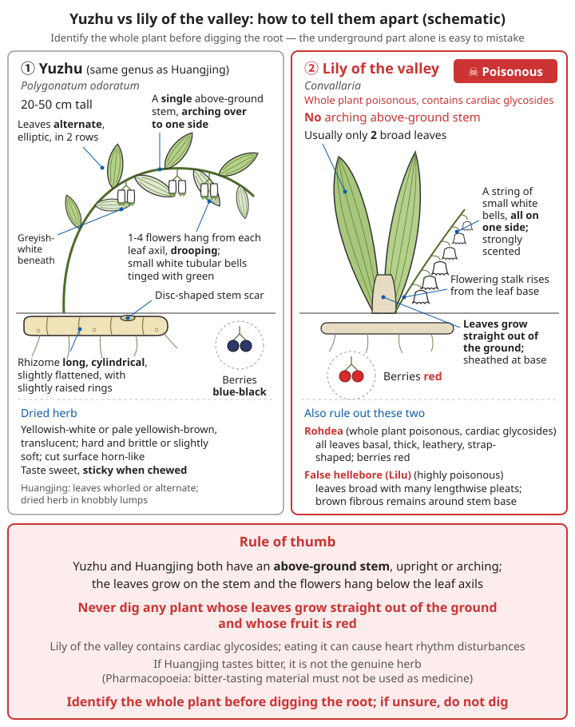

# Roots and Rhizomes (Part 2)

> **Roots and rhizomes grow underground, and once dug up all that is left is a piece of "wood". Half the skill of identifying root medicines lies in recognising the plant above ground before you dig; the other half lies in looking at the cut surface and smelling it afterwards.** This chapter covers 36 root and rhizome medicines that nourish yin, tonify the liver and kidneys, invigorate blood and move qi, clear heat and promote urination, resolve phlegm and soothe the throat, and dispel wind-damp.

This chapter continues Chapter 01, "Roots and Rhizomes (Part 1)". General methods for identification, harvesting, drying and storage are in the [General principles](../../../docs/10-中药材识别与采集/00-总论.md); each entry here describes only what is particular to that herb and does not repeat the general principles.

## ⚠️ Read these first

```
1. This chapter is an identification reference, not a guide to using medicines.
   The amounts are the usual daily adult amounts in the Chinese Pharmacopoeia
   (2020 edition) (the current edition is the 2025 edition; the current text
   takes precedence), given only as a reminder "not to take too much".
   Whether to use a herb and how much: decide under the guidance of a
   practitioner of Chinese medicine

2. Identify the whole plant before you dig the root: looking only at the
   underground part is the easiest way to get it wrong.
   Huangjing and Yuzhu must be told apart from lily of the valley, Rohdea
   and false hellebore (Lilu);
   "Fangji" must be told apart from Guangfangji, which contains aristolochic acid;
   "Muxiang" must be told apart from Qingmuxiang, which contains aristolochic acid

3. In this chapter Shandougen and Xianmao are marked "toxic";
   Dahuang, Ezhu, Niuxi, Chuanniuxi, Huzhang, Yanhusuo, Yujin and other
   blood-invigorating and purgative herbs are forbidden or to be used with
   caution in pregnancy. Do not use toxic herbs on your own

4. Wild Chuanbeimu, Baiji, Gouji (Cibotium), Tiandong, Yuanzhi, Qinjiao,
   Muxiang and others are legally protected or scarce:
   do not dig them from the wild; use cultivated material

5. Beimu and Baiji with the aconite group (Chuanwu, Caowu, Fuzi) belong to the
   "eighteen incompatibilities", and so do Xuanshen with Lilu:
   do not combine them yourself

6. Numbness of the mouth and tongue, palpitations, severe vomiting and
   diarrhoea, convulsions, difficulty breathing →
   stop at once, call 120, and take the remaining herb and the dregs to hospital
```

---

## Quick reference table for this chapter

"Toxicity/protection" column: "toxic" follows the Chinese Pharmacopoeia (2020 edition); 🛡️ means the wild plant is protected by national law or scarce, so do not dig it from the wild.

| Herb | Part used | Main actions | Toxicity/protection | See |
|------|---------|---------|----------|-----|
| Zhimu | Rhizome | Clears heat and drains fire, nourishes yin and moistens dryness | — | [1.1](#11-zhimu-anemarrhena-rhizome) |
| Xuanshen | Root | Clears heat and cools blood, nourishes yin and resolves toxicity | Incompatible with Lilu | [1.2](#12-xuanshen-figwort-root) |
| Maidong | Root tuber | Nourishes yin and moistens the lungs, benefits the stomach and generates fluids | — | [1.3](#13-maidong-dwarf-lilyturf-tuber) |
| Tiandong | Root tuber | Nourishes yin and moistens dryness, clears the lungs and generates fluids | 🛡️ | [1.4](#14-tiandong-chinese-asparagus-tuber) |
| Yuzhu | Rhizome | Nourishes yin and moistens dryness, generates fluids and relieves thirst | Easily confused with lily of the valley and others | [1.5](#15-yuzhu-fragrant-solomons-seal-rhizome) |
| Huangjing | Rhizome | Tonifies qi and nourishes yin, strengthens the spleen, moistens the lungs and benefits the kidneys | Easily confused with Rohdea and others | [1.6](#16-huangjing-polygonatum-rhizome) |
| Baihe | Fleshy bulb scales | Nourishes yin and moistens the lungs, clears the heart and calms the mind | — | [1.7](#17-baihe-lily-bulb) |
| Niuxi | Root | Dispels stasis and unblocks menstruation, tonifies the liver and kidneys and strengthens sinews and bones | Use with caution in pregnancy | [2.1](#21-niuxi-achyranthes-root) |
| Chuanniuxi | Root | Dispels stasis and unblocks menstruation, frees the joints | Use with caution in pregnancy | [2.2](#22-chuanniuxi-cyathula-root) |
| Xuduan | Root | Tonifies the liver and kidneys, strengthens sinews and bones, mends fractures | — | [2.3](#23-xuduan-teasel-root) |
| Gouji | Rhizome | Dispels wind-damp, tonifies the liver and kidneys, strengthens the lower back and knees | 🛡️ Cibotium is Class II protected | [2.4](#24-gouji-cibotium-rhizome) |
| Gusuibu | Rhizome | Heals injuries and relieves pain, tonifies the kidneys and strengthens bones | — | [2.5](#25-gusuibu-drynaria-rhizome) |
| Yanhusuo | Tuber | Invigorates blood, moves qi, relieves pain | — | [3.1](#31-yanhusuo-corydalis-tuber) |
| Yujin | Root tuber | Invigorates blood and relieves pain, moves qi and relieves depression | Antagonised by Dingxiang (clove) | [3.2](#32-yujin-curcuma-root-tuber) |
| Jianghuang | Rhizome | Breaks up blood stasis and moves qi, unblocks menstruation and relieves pain | Pregnant women should not use it on their own | [3.3](#33-jianghuang-turmeric) |
| Ezhu | Rhizome | Moves qi and breaks up blood stasis, disperses accumulations and relieves pain | Forbidden in pregnancy | [3.4](#34-ezhu-zedoary-rhizome) |
| Xiangfu | Rhizome | Soothes the liver and relieves depression, regulates qi and menstruation | — | [3.5](#35-xiangfu-nutgrass-rhizome) |
| Muxiang | Root | Moves qi and relieves pain, strengthens the spleen and aids digestion | 🛡️ Easily confused with Qingmuxiang | [3.6](#36-muxiang-costus-root) |
| Wuyao | Root tuber | Moves qi and relieves pain, warms the kidneys and dispels cold | — | [3.7](#37-wuyao-lindera-root) |
| Dahuang | Root and rhizome | Purges accumulations, clears heat and drains fire, dispels stasis | Use with caution in pregnancy; not for long-term use | [4.1](#41-dahuang-rhubarb-root) |
| Huzhang | Rhizome and root | Drains damp and relieves jaundice, clears heat and resolves toxicity, disperses stasis | Use with caution in pregnancy | [4.2](#42-huzhang-giant-knotweed-rhizome) |
| Baimaogen | Rhizome | Cools blood and stops bleeding, clears heat and promotes urination | — | [4.3](#43-baimaogen-cogongrass-rhizome) |
| Lugen | Rhizome | Clears heat and drains fire, generates fluids and relieves thirst | — | [4.4](#44-lugen-reed-rhizome) |
| Zexie | Tuber | Promotes urination and drains damp, drains heat | — | [4.5](#45-zexie-water-plantain-tuber) |
| Shichangpu | Rhizome | Opens the orifices and clears phlegm, restores consciousness and sharpens the mind | — | [5.1](#51-shichangpu-grass-leaved-sweet-flag-rhizome) |
| Chuanbeimu | Bulb | Clears heat and moistens the lungs, resolves phlegm and stops cough | 🛡️ Incompatible with aconite | [5.2](#52-chuanbeimu-sichuan-fritillary-bulb) |
| Zhebeimu | Bulb | Clears heat and resolves phlegm, dissipates nodules and reduces abscesses | Incompatible with aconite | [5.3](#53-zhebeimu-zhejiang-fritillary-bulb) |
| Shegan | Rhizome | Clears heat and resolves toxicity, resolves phlegm and soothes the throat | — | [5.4](#54-shegan-blackberry-lily-rhizome) |
| Shandougen | Root and rhizome | Clears heat and resolves toxicity, reduces swelling and soothes the throat | **Toxic** | [5.5](#55-shandougen-vietnamese-sophora-root) |
| Yuanzhi | Root | Calms the mind and sharpens the intellect, expels phlegm | 🛡️ | [5.6](#56-yuanzhi-polygala-root) |
| Ganjiang, Shengjiang | Rhizome | Warms the middle and dispels cold; releases the exterior and dispels cold | — | [6.1](#61-ganjiang-and-shengjiang-dried-and-fresh-ginger) |
| Weilingxian | Root and rhizome | Dispels wind-damp, unblocks the channels | — | [6.2](#62-weilingxian-chinese-clematis-root) |
| Qinjiao | Root | Dispels wind-damp, clears damp-heat, relieves deficiency heat | 🛡️ | [6.3](#63-qinjiao-large-leaf-gentian-root) |
| Fenfangji | Root | Dispels wind and relieves pain, promotes urination and reduces swelling | Easily confused with Guangfangji | [6.4](#64-fenfangji-stephania-root) |
| Baiji | Tuber | Astringes and stops bleeding, reduces swelling and promotes healing | 🛡️ Incompatible with aconite | [6.5](#65-baiji-bletilla-tuber) |
| Xianmao | Rhizome | Tonifies kidney yang, strengthens sinews and bones, dispels cold-damp | **Toxic** | [6.6](#66-xianmao-golden-eye-grass-rhizome) |

---

## 1. Yin-nourishing and moistening herbs (mostly lily family)

Most of this group are rhizomes, root tubers and bulbs of plants in the lily family (in the broad sense). They tend to be oily and sticky, and **their worst enemies are damp, mould, oil seepage and discolouration**; for storage see [General principles – Four kinds of spoilage and how to prevent them](../../../docs/10-中药材识别与采集/00-总论.md#61-四种变质与防止办法). The broad lily family also contains poisonous plants such as false hellebore (Lilu), lily of the valley and Rohdea, so always identify the above-ground parts before digging.

### 1.1 Zhimu (anemarrhena rhizome)

- **Pinyin (aliases in Pinyin)**: Zhimu (Maozhimu, Zhimurou, Feizhimu); Chinese 知母; Anemarrhena asphodeloides Bge.
- **Source**: the dried rhizome of *Anemarrhena asphodeloides* Bge., lily family
- **Distribution and habitat**: Hebei (the "Xiling Zhimu" from around Yi County is the best known), Shanxi, Inner Mongolia, Shaanxi and the North-east; dry sunny hillsides, grassland, low hills
- **Identification**:
  - Plant: all leaves grow from the base, long, narrow and grass-like; the flowering stalk rises above the leaves and carries a long spike-like raceme of small pale purplish-red or white flowers that open in the evening
  - Dried herb: long, flattened-cylindrical, slightly curved, 3-15 cm long; one end has pale yellow remains of leaf scars, traditionally called *jinbaotou* ("gold-wrapped head"); the upper side has a groove, with close-set rings, and the rings are densely covered with yellowish-brown hair-like remains of leaf bases; the underside has dot-like root scars
  - Hard; cut surface yellowish-white; faint smell; taste slightly sweet and a little bitter, **sticky when chewed**
- **Harvesting and processing**: dig in spring and autumn, remove the fibrous roots and soil, and sun-dry to get "Maozhimu"; peel while fresh and sun-dry to get "Zhimurou"
- **Storage**: in a ventilated, dry place; protect from damp and insects
- **Actions**: clears heat and drains fire, nourishes yin and moistens dryness. Used for high fever with restlessness and thirst, dry cough from lung heat, steaming-bone tidal fever, wasting-thirst from internal heat, and constipation from dry intestines
- **Amount**: 6-12 g (use under the guidance of a practitioner of Chinese medicine)
- **Cautions**: cold in nature; not suitable for people with a cold, weak spleen and stomach or loose stools (traditional experience)

### 1.2 Xuanshen (figwort root)

- **Pinyin (aliases in Pinyin)**: Xuanshen (Yuanshen, Heishen); Chinese 玄参; Scrophularia ningpoensis Hemsl.
- **Source**: the dried root of *Scrophularia ningpoensis* Hemsl., figwort family
- **Distribution and habitat**: mainly Zhejiang (one of the "Eight Zhejiang Herbs"), also Sichuan, Hubei, Hunan, Guizhou and elsewhere; mostly cultivated; wild by streams, on hillsides under woodland, and in grassy places
- **Identification**:
  - Plant: 1-1.5 m tall, **stem square in cross-section**, leaves opposite, ovate, with finely toothed edges; terminal cymose panicles of small brownish-purple, pot-shaped flowers
  - Dried herb: roughly cylindrical, slightly thicker in the middle or thicker at the top and thinner at the bottom, 6-20 cm long; surface greyish-yellow or greyish-brown with irregular lengthwise furrows and horizontal lenticels
  - Firm, hard to break; **cut surface jet black, faintly glossy**; distinctive smell, like burnt sugar; taste sweet and slightly bitter
- **Harvesting and processing**: dig in winter when the stems and leaves have withered; remove the rhizome, young buds, fibrous roots and soil; sun-dry or oven-dry until half dry, pile up for 3-6 days to "sweat", and repeat several times until dry; only then does the inside turn black (for sweating see [General principles – Sweating](../../../docs/10-中药材识别与采集/00-总论.md#54-发汗))
- **Storage**: in a ventilated, dry place; protect from mould and insects
- **Actions**: clears heat and cools blood, nourishes yin and lowers fire, resolves toxicity and dissipates nodules. Used for yin damaged by febrile disease, sore throat, scrofula, abscesses and sores, and similar
- **Amount**: 9-15 g (use under the guidance of a practitioner of Chinese medicine)
- **Cautions**: do not use with Lilu (eighteen incompatibilities, see [General principles 7.3](../../../docs/10-中药材识别与采集/00-总论.md#73-十八反十九畏配伍禁忌)); cold in nature, not suitable for people with a weak spleen and loose stools

### 1.3 Maidong (dwarf lilyturf tuber)

- **Pinyin (aliases in Pinyin)**: Maidong (Maimendong, Cundong); Chinese 麦冬; Ophiopogon japonicus (L. f) Ker-Gawl.
- **Source**: the dried root tuber of *Ophiopogon japonicus* (L. f) Ker-Gawl., lily family
- **Distribution and habitat**: mainly Zhejiang ("Hangmaidong") and Mianyang in Sichuan ("Chuanmaidong"); wild in damp shady places under woodland on hillsides and by streams; widely planted as ground cover in urban landscaping (do not pick from planted strips: they are often sprayed with pesticides)
- **Identification**:
  - Plant: evergreen clump-forming herb, leaves basal, long and narrow; flowering stalk shorter than the leaves, raceme of small pale purple or white flowers; **berries round, blue-black when ripe**
  - The middle or tip of the fibrous roots swells into a small spindle-shaped tuber
  - Dried herb: spindle-shaped, both ends slightly pointed, 1.5-3 cm long, 0.3-0.6 cm in diameter; surface pale yellow or greyish-yellow with fine lengthwise lines; supple and tough; cut surface yellowish-white, translucent, **with a thin woody core in the centre**; faintly fragrant; taste sweet, slightly bitter
- **Look-alikes**: the tubers of *Liriope* species (Hubei maidong, short-stalked liriope) are a different medicine, "Shanmaidong", listed separately in the Pharmacopoeia; their tubers are larger and harder
- **Harvesting and processing**: dig in summer and wash; sun-dry hard and pile up repeatedly until 70-80% dry, remove the fibrous roots, and dry
- **Storage**: high in sugar, **very prone to damp, mould, oil seepage and discolouration**; once fully dry, seal and keep in a cool place
- **Actions**: nourishes yin and generates fluids, moistens the lungs and clears the heart. Used for dry cough from lung dryness, thirst from damaged fluids, restlessness and insomnia, and constipation from dry intestines
- **Amount**: 6-12 g (use under the guidance of a practitioner of Chinese medicine)
- **Cautions**: not suitable for diarrhoea from a cold, weak spleen and stomach, or for cough from a wind-cold common cold (traditional experience)

### 1.4 Tiandong (Chinese asparagus tuber)

- **Pinyin (aliases in Pinyin)**: Tiandong (Tianmendong); Chinese 天冬; Asparagus cochinchinensis (Lour.) Merr.
- **Source**: the dried root tuber of *Asparagus cochinchinensis* (Lour.) Merr., lily family
- **Distribution and habitat**: Guizhou, Sichuan, Guangxi, Yunnan, Zhejiang and elsewhere; hillsides, roadsides, open woodland, valleys
- **Identification**:
  - Plant: climbing herb, **stems with hard spines**; the true leaves are reduced to scales, and what look like leaves are flat, slightly sickle-shaped "leaf-like branches" (cladodes), often in clusters of 3; flowers small, pale green; berries round, red when ripe
  - Each plant has several to dozens of spindle-shaped tubers clustered underground
  - Dried herb: long spindle-shaped, slightly curved, 5-18 cm long, 0.5-2 cm in diameter; surface yellowish-white to pale yellowish-brown, **translucent**, smooth or with lengthwise wrinkles; hard or supple, sticky; cut surface horn-like, central cylinder yellowish-white; faint smell; taste sweet, slightly bitter
- **Look-alikes**: the root tubers of Baibu (stemona, stemona family, slightly toxic) are also spindle-shaped, but bitter, not sweet; the plant is a vine or upright herb with broad leaves and curved veins, and has no leaf-like branches
- **Harvesting and processing**: dig in autumn and winter, wash, remove the stem base and fibrous roots, boil or steam until cooked through, peel while hot, wash and dry
- **Storage**: easily absorbs moisture, softens and moulds; keep sealed and dry
- **Actions**: nourishes yin and moistens dryness, clears the lungs and generates fluids. Used for dry cough from lung dryness, dry throat and thirst, and constipation from dry intestines
- **Amount**: 6-12 g (use under the guidance of a practitioner of Chinese medicine)
- **Cautions**: cold in nature; not suitable for people with a weak spleen and loose stools or with wind-cold cough (traditional experience)
- 🛡️ **Protection note**: Tiandong is a Class III protected species in the *List of Wild Medicinal Species under Key State Protection* (the original text of the list takes precedence). Digging wild plants requires a herb-collecting permit and must follow the harvesting plan; for household use buy cultivated material or grow your own

### 1.5 Yuzhu (fragrant Solomon's seal rhizome)

- **Pinyin (aliases in Pinyin)**: Yuzhu (Weirui, written two ways); Chinese 玉竹; Polygonatum odoratum (Mill.) Druce
- **Source**: the dried rhizome of *Polygonatum odoratum* (Mill.) Druce, lily family
- **Distribution and habitat**: North-east, North, East and Central China; under woodland, in thickets, on shady hillsides; grown in large quantities in Hunan, Guangdong and elsewhere
- **Identification**:
  - Plant: 20-50 cm tall, **with a single above-ground stem that arches over to one side**; leaves alternate, elliptic, arranged in two rows along the stem, greyish-white underneath; 1-4 flowers hang from each leaf axil, **drooping**, small white tubular bells tinged with green; berries blue-black
  - Dried herb: long cylindrical, slightly flattened, seldom branched, 4-18 cm long, 0.3-1.6 cm in diameter; surface yellowish-white or pale yellowish-brown, translucent, with lengthwise wrinkles and slightly raised rings, white dot-like root scars and disc-shaped stem scars
  - Hard and brittle or slightly soft; cut surface horn-like or granular; faint smell; taste sweet, **sticky when chewed**
- **Look-alikes** (important):
  - **Lily of the valley** (the whole plant is poisonous, contains cardiac glycosides, and eating it can cause heart rhythm disturbances): has no arching above-ground stem; usually **only 2 broad leaves grow straight out of the ground**, sheathed at the base; the flowering stalk rises from the base of the leaves, with a string of small white bells **all on one side**, strongly scented; berries red
  - **Rohdea** (the whole plant is poisonous, contains cardiac glycosides): all leaves basal, thick and leathery, strap-shaped, evergreen; flowers crowded in a short spike; berries red
  - **False hellebore (Lilu)** (highly poisonous): leaves broad with many lengthwise pleats; brown fibrous remains around the stem base; see [Lilu](../../../docs/10-中药材识别与采集/09-有毒中药与易混淆有毒植物.md#218-藜芦)
  - Rule of thumb: **Yuzhu and Huangjing both have an above-ground stem, upright or arching; the leaves grow on the stem and the flowers hang below the leaf axils.** Never dig any plant whose leaves grow straight out of the ground and whose fruit is red
- **Harvesting and processing**: dig in autumn, remove the fibrous roots, wash, sun-dry until soft, then knead and sun-dry repeatedly until there is no hard core, and sun-dry; or steam through, knead until translucent, and sun-dry
- **Storage**: high in sugar, prone to damp, mould and oil seepage; keep sealed in a cool place
- **Actions**: nourishes yin and moistens dryness, generates fluids and relieves thirst. Used for damaged lung and stomach yin, dry-heat cough, dry throat and thirst, and wasting-thirst from internal heat
- **Amount**: 6-12 g (use under the guidance of a practitioner of Chinese medicine)
- **Cautions**: not suitable for people with a weak spleen, damp phlegm or loose stools (traditional experience)



*Figure: Yuzhu compared with lily of the valley. Yuzhu has an arching above-ground stem, its flowers hang below the leaf axils and its berries are blue-black; the leaves of lily of the valley grow straight out of the ground, a string of small bells hangs to one side of the flowering stalk, and its berries are red. Never dig any plant whose leaves grow straight out of the ground and whose fruit is red*

### 1.6 Huangjing (polygonatum rhizome)

- **Pinyin (aliases in Pinyin)**: Huangjing (Jitouhuangjing, Jiangxinghuangjing, Dahuangjing); Chinese 黄精; Polygonatum kingianum Coll. et Hemsl., P. sibiricum Red., P. cyrtonema Hua
- **Source**: the dried rhizome of *Polygonatum kingianum* Coll. et Hemsl. (Dian huangjing), *P. sibiricum* Red. (huangjing) or *P. cyrtonema* Hua (many-flowered huangjing), lily family. According to shape they are traditionally called "Dahuangjing" ("large Huangjing"), "Jitouhuangjing" ("chicken-head Huangjing") and "Jiangxinghuangjing" ("ginger-shaped Huangjing")
- **Distribution and habitat**: *P. sibiricum* grows in the North-east, North and North-west; *P. cyrtonema* south of the Yangtze; *P. kingianum* in Yunnan, Guizhou and Sichuan; under woodland, in thickets, on damp shady hillsides
- **Identification**:
  - Plant: same genus as Yuzhu; it too has a single above-ground stem, with drooping tubular flowers in the leaf axils
  - *P. sibiricum* (chicken-head Huangjing) and *P. kingianum* have **leaves in whorls** of 4-6, linear-lanceolate, **with the tips curled into a hook**; *P. cyrtonema* has alternate leaves, with 2-7 flowers hanging from each leaf axil
  - Dried herb: thick, fleshy, knobbly lumps; surface pale yellow to yellowish-brown with rings; the upper side of each knob has a disc-shaped stem scar (like a "chicken's eye"); chicken-head Huangjing swells at one end like a chicken's head, ginger-shaped Huangjing has short thick branches like ginger
  - Hard and tough; cut surface horn-like, pale yellow to yellowish-brown; faint smell; taste sweet, sticky when chewed. **The Pharmacopoeia states: material that tastes bitter must not be used as medicine**
- **Look-alikes**: as for Yuzhu, rule out lily of the valley, Rohdea and false hellebore (see [1.5](#15-yuzhu-fragrant-solomons-seal-rhizome)); the genus *Polygonatum* also includes some bitter species (such as long-stalked huangjing and other local kinds); if it tastes bitter, it is not the genuine herb
- **Harvesting and processing**: dig in spring and autumn, remove the fibrous roots, wash, blanch briefly in boiling water or steam until cooked through, and dry
- **Storage**: easily absorbs moisture, moulds and is attacked by insects; keep sealed and dry
- **Actions**: tonifies qi and nourishes yin, strengthens the spleen, moistens the lungs, benefits the kidneys. Used for weak spleen and stomach qi, fatigue and lack of strength, dry cough from weak lungs, insufficient essence and blood, and wasting-thirst from internal heat
- **Amount**: 9-15 g (use under the guidance of a practitioner of Chinese medicine)
- **Cautions**: raw Huangjing irritates the throat, so the medicine mostly uses processed forms such as wine-processed Huangjing (for processing see [Chinese herbal preparations](../../../docs/06-制药技术/04-中药制剂.md)); not suitable for people with a weak spleen and excess damp, or with cough and a lot of phlegm (traditional experience)

### 1.7 Baihe (lily bulb)

- **Pinyin (aliases in Pinyin)**: Baihe; Chinese 百合; Lilium lancifolium Thunb., L. brownii F. E. Brown var. viridulum Baker, L. pumilum DC.
- **Source**: the dried fleshy bulb scales of *Lilium lancifolium* Thunb. (tiger lily), *L. brownii* F. E. Brown var. *viridulum* Baker (baihe) or *L. pumilum* DC. (coral lily), lily family
- **Distribution and habitat**: cultivated in many parts of China (Longshan in Hunan, Yixing in Jiangsu, Lanzhou in Gansu and elsewhere); wild in grass on hillsides and at woodland edges
- **Identification**:
  - Plant: bulb underground, stem upright, leaves scattered; the tiger lily has **purple-black bulbils** in the leaf axils and orange-red flowers with purple-black spots whose tepals curl back; *L. brownii* has large white trumpet flowers; the coral lily has narrow linear leaves and bright red, drooping, curled-back flowers
  - The bulb is made up of many **separate, thick white scales** loosely clasped together, with no papery outer skin
  - Dried herb: single long-elliptic scales, 2-5 cm long, 1-2 cm wide; surface yellowish-white to pale brownish-yellow, some faintly purple, **with several straight, parallel, lengthwise white vascular strands**; edges thin, slightly wavy, curving slightly inwards; hard and brittle; cut surface horn-like; faint smell; taste slightly bitter
- **Look-alikes**:
  - **Red spider lily and narcissus** (amaryllis family; bulbs poisonous, eating them causes violent vomiting and diarrhoea): the bulb is wrapped in a brown papery skin; cut open, it has **concentric layers** like an onion, and the cut oozes slimy sap; lily bulb scales come apart one by one
  - The name "wild lily" (*ye baihe*) is also used for a plant in the rattlepod genus *Crotalaria* of the pea family (it contains pyrrolizidine alkaloids, which damage the liver) that has nothing to do with lilies; names are not reliable
- **Harvesting and processing**: dig in autumn, wash, strip off the scales, blanch briefly in boiling water, and dry
- **Storage**: easily attacked by insects and discoloured by damp; keep sealed and dry
- **Actions**: nourishes yin and moistens the lungs, clears the heart and calms the mind. Used for dry cough from yin deficiency, chronic cough with blood, restlessness and palpitations from deficiency, and insomnia with much dreaming
- **Amount**: 6-12 g (use under the guidance of a practitioner of Chinese medicine)
- **Cautions**: not suitable for wind-cold cough or for people with a weak spleen and loose stools (traditional experience)

---

## 2. Herbs that tonify the liver and kidneys and strengthen sinews and bones

### 2.1 Niuxi (achyranthes root)

- **Pinyin (aliases in Pinyin)**: Niuxi (Huainiuxi); Chinese 牛膝; Achyranthes bidentata Bl.
- **Source**: the dried root of *Achyranthes bidentata* Bl., amaranth family
- **Distribution and habitat**: mainly around Jiaozuo in Henan (one of the "Four Great Huai Herbs"), mostly cultivated; wild under woodland on hillsides, by roadsides and ditches
- **Identification**:
  - Plant: 30-100 cm tall, stem square, **the nodes swollen like a cow's knees** (hence the name, "cow knee"); leaves opposite, elliptic; flower spikes, and after flowering the flowers bend down and press against the spike axis; the bracts of the fruit are spiny and easily stick to clothing
  - Dried herb: **long and thin, cylindrical**, straight or slightly curved, 15-70 cm long, 0.4-1 cm in diameter; surface greyish-yellow or pale brown, with fine lengthwise wrinkles and horizontal lenticel-like bumps
  - **Hard and brittle, breaks easily** (softens when damp); cut surface pale brown, somewhat horn-like and oily; the central wood is yellowish-white, surrounded by many small yellowish-white dots (vascular bundles) in 2-4 broken rings; faint smell; taste slightly sweet, a little bitter and astringent
- **Look-alikes**: wild relatives in the same genus, "Tuniuxi" (willow-leaf achyranthes, coarse-haired achyranthes and others), have shorter, much-branched roots; they are local medicines and cannot be used as Niuxi. For Chuanniuxi see [2.2](#22-chuanniuxi-cyathula-root)
- **Harvesting and processing**: dig in winter when the stems and leaves have withered, remove the fibrous roots and soil, tie into small bundles, sun-dry until shrivelled, trim the tops level, and sun-dry
- **Storage**: prone to damp, mould, oil seepage and insects; keep dry and sealed
- **Actions**: dispels stasis and unblocks menstruation, tonifies the liver and kidneys, strengthens sinews and bones, promotes urination and relieves painful urination, guides blood downwards. Used for absent periods, painful periods, aching lower back and knees, weak sinews and bones, painful urination disorders, oedema and similar
- **Amount**: 5-12 g (use under the guidance of a practitioner of Chinese medicine)
- **Cautions**: **use with caution in pregnancy** (invigorates blood and promotes menstruation); not suitable for people with heavy periods

### 2.2 Chuanniuxi (cyathula root)

- **Pinyin (aliases in Pinyin)**: Chuanniuxi (Tianniuxi); Chinese 川牛膝; Cyathula officinalis Kuan
- **Source**: the dried root of *Cyathula officinalis* Kuan, amaranth family
- **Distribution and habitat**: Sichuan, Yunnan, Guizhou; mostly cultivated; wild at woodland edges and in grassy places at high altitude
- **Identification**:
  - Plant: stem upright, much branched, leaves opposite; flowers crowded into round balls
  - Dried herb: nearly cylindrical, slightly twisted, tapering downwards or with a few branches, 30-60 cm long, 0.5-3 cm in diameter, **much thicker than Huainiuxi**; surface yellowish-brown or greyish-brown, with lengthwise wrinkles and many horizontal lenticel-like bumps
  - **Tough, hard to break**; cut surface pale yellow or brownish-yellow, with dot-like vascular bundles in several concentric rings; faint smell, **sweet taste**
- **How to tell the two kinds of Niuxi apart**: Huainiuxi is long and thin, hard and brittle, breaks easily, tastes slightly sweet, a little bitter and astringent; Chuanniuxi is thick, tough, hard to break, and tastes sweet
- **Look-alikes**: Maniuxi (the root of *Cyathula capitata*, a relative in the same genus) tastes bitter and numbs the tongue; it cannot be used as Chuanniuxi
- **Harvesting and processing**: dig in autumn and winter, remove the root crown, fibrous roots and soil, oven-dry or sun-dry until half dry, pile up to let the moisture even out, then oven-dry or sun-dry
- **Storage**: protect from damp and insects
- **Actions**: dispels stasis and unblocks menstruation, frees the joints, promotes urination and relieves painful urination. Used for absent periods, knocks and falls, rheumatic pain in the lower back and knees, blood in the urine, and painful urination with blood
- **Amount**: 5-10 g (use under the guidance of a practitioner of Chinese medicine)
- **Cautions**: **use with caution in pregnancy**; not suitable for people with heavy periods

### 2.3 Xuduan (teasel root)

- **Pinyin (aliases in Pinyin)**: Xuduan (Chuanxuduan, Chuanduan); Chinese 续断; Dipsacus asper Wall. ex Henry
- **Source**: the dried root of *Dipsacus asper* Wall. ex Henry, teasel family
- **Distribution and habitat**: Sichuan, Hubei, Hunan, Guizhou, Yunnan; grassy hillsides, woodland edges, field margins and roadsides
- **Identification**:
  - Plant: up to 2 m tall, **stem ridged, with hard backward-hooked prickles on the ridges**; leaves opposite, deeply pinnately lobed; flower heads round, flowers white or pale yellow, the bracts below them tipped with hard spines
  - Dried herb: cylindrical, slightly flattened, slightly curved, 5-15 cm long, 0.5-2 cm in diameter; surface greyish-brown or yellowish-brown, with twisted lengthwise wrinkles and grooves and transverse lenticel-like marks
  - Soft, hardening with time; cut surface uneven, **bark dark green or brown**, wood yellowish-brown, with vessel bundles arranged radially; faintly fragrant; taste bitter, slightly sweet, then astringent
- **Harvesting and processing**: dig in autumn, remove the root head and fibrous roots, dry over a low fire until half dry, pile up to "sweat" until the inside turns green, then oven-dry
- **Storage**: protect from damp and insects
- **Actions**: tonifies the liver and kidneys, strengthens sinews and bones, mends fractures, stops uterine bleeding. Used for sore, weak lower back and knees, rheumatic pain, knocks and falls, injured sinews and broken bones, abnormal uterine bleeding, and bleeding in pregnancy
- **Amount**: 9-15 g (use under the guidance of a practitioner of Chinese medicine)
- **Cautions**: for a fracture, first immobilise it as in [Bone injuries](../../../docs/01-日常疾病和伤害/03-骨骼损伤.md) and see a doctor; herbs are only an aid

### 2.4 Gouji (cibotium rhizome)

- **Pinyin (aliases in Pinyin)**: Gouji (Jinmaogouji, Jinmaogou); Chinese 狗脊; Cibotium barometz (L.) J. Sm.
- **Source**: the dried rhizome of *Cibotium barometz* (L.) J. Sm. (golden chicken fern), Dicksoniaceae
- **Distribution and habitat**: Fujian, Guangdong, Guangxi, Sichuan, Guizhou, Yunnan, Zhejiang and other southern regions; acid soil at the foot of hills, by gullies, in damp shade under woodland
- **Identification**:
  - Plant: a large fern, up to 2-3 m tall; fronds in a cluster, three times pinnately divided; **the thick rhizome and the bases of the leaf stalks are densely covered with long, glossy golden hairs**, so that the whole lump looks like a little golden-haired dog
  - Dried herb: irregular long lumps, 10-30 cm long, 2-10 cm in diameter; surface dark brown with remains of golden hairs; several reddish-brown woody leaf stalks on top, remains of thin black roots underneath; very hard, difficult to break
  - Slices (raw Gouji slices): cut surface pale brown, **with a raised brownish-yellow woody ring 1-4 mm in from the edge**; steamed (processed) slices are blackish-brown
- **Harvesting and processing**: dig in autumn and winter, remove the soil, and dry; or remove the hard roots, leaf stalks and golden hairs, cut into thick slices and dry
- **Storage**: protect from damp and mould
- **Actions**: dispels wind-damp, tonifies the liver and kidneys, strengthens the lower back and knees. Used for rheumatic pain, sore and weak lower back and knees, and weakness of the legs
- **Amount**: 6-12 g (use under the guidance of a practitioner of Chinese medicine)
- **Cautions**: not suitable for people with heat signs such as difficult urination or a bitter mouth and dry tongue (traditional experience)
- 🛡️ **Protection note**: *Cibotium barometz* (genus *Cibotium*) is a **Class II nationally protected wild plant** (2021 *List of Wild Plants under Key State Protection*) and is also listed in Appendix II of the Convention on International Trade in Endangered Species (CITES). **Do not dig wild plants**; digging or selling them without a permit is illegal, see [General principles – List of Wild Plants under Key State Protection](../../../docs/10-中药材识别与采集/00-总论.md#82-国家重点保护野生植物名录). For medicine use only legal material from regular channels

### 2.5 Gusuibu (drynaria rhizome)

- **Pinyin (aliases in Pinyin)**: Gusuibu (Hujue, Houjiang, Shenjiang); Chinese 骨碎补; Drynaria fortunei (Kunze) J. Sm.
- **Source**: the dried rhizome of *Drynaria fortunei* (Kunze) J. Sm., polypody family
- **Distribution and habitat**: Zhejiang, Fujian, Hunan, Hubei, Guangdong, Guangxi, Sichuan, Guizhou, Yunnan; **grows on old tree trunks or on rocks**
- **Identification**:
  - Plant: an epiphytic fern; the rhizome is fleshy, creeping, densely covered with brownish-yellow scales; it has two kinds of fronds: **withered-looking yellow-brown, stalkless "sterile fronds" shaped like oak leaves** that press against the rhizome (they collect fallen leaves and humus), and green, deeply pinnately lobed "fertile fronds" with round spore clusters on the underside on both sides of the midrib
  - Dried herb: flat, long strips, often curved and branched, 5-15 cm long, 1-1.5 cm wide; surface densely covered with small dark brown scales, soft like hair (brownish where singed); round leaf scars on both sides and on top
  - Light, brittle, breaks easily; **cut surface reddish-brown, with yellow dot-like vascular bundles arranged in a ring**; faint smell; taste bland, slightly astringent
- **Harvesting and processing**: can be gathered all year; remove the soil and dry, or also singe off the hairs (scales)
- **Storage**: protect from damp and insects
- **Actions**: heals injuries and relieves pain, tonifies the kidneys and strengthens bones; used externally to dispel wind and clear blemishes. Used for sprains and knocks, injured sinews and broken bones, lower back pain from kidney deficiency, ringing in the ears and deafness, and loose teeth
- **Amount**: 3-9 g (use under the guidance of a practitioner of Chinese medicine)
- **Cautions**: not suitable for people with internal heat from yin deficiency (traditional experience)
- **Collecting note**: Drynaria grows very slowly; once all of it on a tree has been stripped it takes many years to recover. Take only part of the rhizome and leave most of it to keep growing

---

## 3. Herbs that invigorate blood and move qi

Most of this group invigorate blood or move qi, and **many are forbidden or to be used with caution in pregnancy** (for general notes see [General principles – Forbidden or to be used with caution in pregnancy](../../../docs/10-中药材识别与采集/00-总论.md#74-孕妇禁用慎用)). Yujin, Jianghuang and Ezhu of the ginger family come from the same genus, and even from different parts of the same plant, so keep them apart.

### 3.1 Yanhusuo (corydalis tuber)

- **Pinyin (aliases in Pinyin)**: Yanhusuo (Yuanhu, Xuanhu); Chinese 延胡索; Corydalis yanhusuo W. T. Wang
- **Source**: the dried tuber of *Corydalis yanhusuo* W. T. Wang, poppy family
- **Distribution and habitat**: mainly Dongyang and Pan'an in Zhejiang (one of the "Eight Zhejiang Herbs"), also cultivated in Jiangsu, Anhui, Shaanxi and elsewhere; wild in grassland on low hills and at woodland edges
- **Identification**:
  - Plant: a small herb, 10-30 cm tall, coming up in early spring and dying back in early summer; leaves twice divided into three; terminal raceme of purplish-red flowers, **the base of the petals extending backwards into a long "spur"**
  - Dried herb: irregular flattened balls, 0.5-1.5 cm in diameter; surface yellow or yellowish-brown, with irregular net-like wrinkles; a slightly sunken stem scar at the top, often a knobbly bump at the bottom
  - Hard and brittle; **cut surface yellow, horn-like, with a waxy lustre**; faint smell; bitter taste
- **Look-alikes**: there are many *Corydalis* species, many containing alkaloids and poisonous, with tubers of similar appearance; do not dig and use "Yuanhu" found in the wild yourself; use the genuine cultivated herb
- **Harvesting and processing**: dig in early summer when the stems and leaves have withered, remove the fibrous roots, wash, boil until no white core remains, take out and sun-dry
- **Storage**: protect from damp and insects
- **Actions**: invigorates blood, moves qi, relieves pain. Used for pain in the chest, flanks and abdomen, chest obstruction with heart pain, absent or painful periods, stasis after childbirth, and swelling and pain from knocks and falls
- **Amount**: 3-10 g; ground to powder and swallowed, 1.5-3 g each time (use under the guidance of a practitioner of Chinese medicine)
- **Cautions**: pregnant women should ask a doctor before use; do not combine it yourself with sedatives, sleeping pills or painkillers (all depress the central nervous system); for severe or persistent abdominal pain see a doctor first to find the cause, and do not mask it with painkillers

### 3.2 Yujin (curcuma root tuber)

- **Pinyin (aliases in Pinyin)**: Yujin (Wenyujin, Huangsiyujin, Guiyujin, Lüsiyujin); Chinese 郁金; Curcuma wenyujin Y. H. Chen et C. Ling, C. longa L., C. kwangsiensis S. G. Lee et C. F. Liang, C. phaeocaulis Val.
- **Source**: the **dried root tubers** of *Curcuma wenyujin* Y. H. Chen et C. Ling, *C. longa* L. (turmeric), *C. kwangsiensis* S. G. Lee et C. F. Liang (Guangxi zedoary) or *C. phaeocaulis* Val. (zedoary), ginger family. The first two are traditionally called "Wenyujin" and "Huangsiyujin" respectively; the others, according to their appearance, are called "Guiyujin" or "Lüsiyujin"
- **Distribution and habitat**: Rui'an in Zhejiang (Wenyujin), Sichuan (Huangsiyujin), Guangxi (Guiyujin); all cultivated
- **Identification**:
  - Plant: tall herbs of the ginger family with large, long-elliptic leaves; **the tips of the fibrous roots swell into spindle-shaped tubers**, and these tubers are Yujin
  - Wenyujin: oblong or ovoid, slightly flattened, tapering at both ends, 3.5-7 cm long; surface greyish-brown or greyish-tan with lengthwise wrinkles; firm; **cut surface greyish-brown, horn-like**, endodermis ring distinct; faintly fragrant; taste slightly bitter
  - Huangsiyujin: spindle-shaped, **cut surface orange-yellow**, the outer part brownish-yellow to brownish-red; aromatic; taste pungent and hot
- **Same plant, different medicines**: the rhizome of turmeric is "Jianghuang", its root tuber is "Huangsiyujin"; the rhizome of *C. wenyujin* is "Ezhu" (Wen'ezhu) or "Pianjianghuang", its root tuber is "Wenyujin"
- **Harvesting and processing**: dig in winter after the stems and leaves have withered, remove the soil and fine roots, steam or boil until cooked through, and dry
- **Storage**: protect from damp and insects, and from loss of aroma
- **Actions**: invigorates blood and relieves pain, moves qi and relieves depression, clears the heart and cools blood, benefits the gallbladder and relieves jaundice. Used for stabbing pain in the chest and flanks, absent or painful periods, clouded consciousness in febrile disease, and jaundice with dark urine
- **Amount**: 3-10 g (use under the guidance of a practitioner of Chinese medicine)
- **Cautions**: **do not use with Dingxiang (clove) or Mudingxiang (mother clove)** (nineteen antagonisms); pregnant women should ask a doctor before use
- Among the nineteen antagonisms, "Dingxiang antagonises Yujin"; for Dingxiang see [Flowers and leaves – Dingxiang](../../../docs/10-中药材识别与采集/05-花叶类.md#35-丁香)

### 3.3 Jianghuang (turmeric)

- **Pinyin (aliases in Pinyin)**: Jianghuang; Chinese 姜黄; Curcuma longa L.
- **Source**: the dried rhizome of *Curcuma longa* L., ginger family
- **Distribution and habitat**: Sichuan, Fujian, Guangdong, Guangxi, Yunnan, Taiwan; cultivated. It is also the main ingredient of curry powder
- **Identification**:
  - Plant: 1-1.5 m tall, leaves large, long-elliptic, in two rows from the base; flower spikes emerge from the leaf sheaths; the underground rhizomes are well developed, clumped and much branched, **with a bright orange-yellow cut surface**, and some fibrous roots swell at the tips into tubers
  - Dried herb: irregular ovoid, cylindrical or spindle-shaped, often curved, some with short forked branches, 2-5 cm long, 1-3 cm in diameter; surface deep yellow, rough, with wrinkles and distinct rings
  - Firm; **cut surface brownish-yellow to golden yellow, horn-like, with a waxy lustre**, endodermis ring distinct; distinctive fragrance; taste bitter and pungent; stains hands and cloth yellow
- **Harvesting and processing**: dig in winter when the stems and leaves have withered, wash, boil or steam until cooked through, sun-dry, and remove the fibrous roots
- **Storage**: protect from damp and insects; keep out of light (the colour fades)
- **Actions**: breaks up blood stasis and moves qi, unblocks menstruation and relieves pain. Used for stabbing pain in the chest and flanks, chest obstruction with heart pain, painful or absent periods, rheumatic pain in the shoulders and arms, and swelling and pain from knocks and falls
- **Amount**: 3-10 g; an appropriate amount for external use (use under the guidance of a practitioner of Chinese medicine)
- **Cautions**: a stasis-breaking herb; **pregnant women must not use it on their own**; people taking anticoagulants (warfarin) or antiplatelet drugs should not take large amounts of turmeric or curcumin supplements; ordinary amounts used as a spice in cooking are not included in this

### 3.4 Ezhu (zedoary rhizome)

- **Pinyin (aliases in Pinyin)**: Ezhu (Peng'ezhu, Wen'ezhu, Gui'ezhu); Chinese 莪术; Curcuma phaeocaulis Val., C. kwangsiensis S. G. Lee et C. F. Liang, C. wenyujin Y. H. Chen et C. Ling
- **Source**: the dried rhizome of *Curcuma phaeocaulis* Val., *C. kwangsiensis* S. G. Lee et C. F. Liang or *C. wenyujin* Y. H. Chen et C. Ling, ginger family. The last is traditionally called "Wen'ezhu"
- **Distribution and habitat**: Sichuan, Guangxi, Zhejiang, Fujian, Guangdong; cultivated
- **Identification**:
  - Plant: tall herbs of the ginger family; *C. phaeocaulis* **has a purplish-red band along both sides of the leaf midrib**, which makes it fairly easy to recognise
  - Dried herb: ovoid, long-ovoid, conical or long spindle-shaped, the top mostly bluntly pointed, the base bluntly rounded, 2-8 cm long, 1.5-4 cm in diameter; surface greyish-yellow to greyish-brown, the upper part with raised rings and round, slightly sunken root scars
  - **Heavy and firm**; cut surface greyish-brown to bluish-brown, waxy, often dusted with greyish-brown powder; the cortex separates easily from the central cylinder; faintly fragrant; taste slightly bitter and pungent
- **Harvesting and processing**: dig in winter after the stems and leaves have withered, wash, steam or boil until cooked through, sun-dry or dry at low temperature, then remove the fibrous roots and debris
- **Storage**: protect from damp and insects
- **Actions**: moves qi and breaks up blood stasis, disperses accumulations and relieves pain. Used for abdominal masses, absent periods from blood stasis, chest obstruction with heart pain, and bloating and pain from food stagnation
- **Amount**: 6-9 g (use under the guidance of a practitioner of Chinese medicine)
- **Cautions**: **forbidden in pregnancy**; not suitable for people with heavy periods or a tendency to bleed

### 3.5 Xiangfu (nutgrass rhizome)

- **Pinyin (aliases in Pinyin)**: Xiangfu (Xiangfuzi, Suocaogen); Chinese 香附; Cyperus rotundus L.
- **Source**: the dried rhizome of *Cyperus rotundus* L. (nutgrass), sedge family
- **Distribution and habitat**: most of China; waste ground, roadsides, fields, riverbanks; a very common field weed and easy to find
- **Identification**:
  - Plant: 15-50 cm tall; **stem triangular** (triangular in cross-section; you can feel the edges when you roll it between your fingers); leaves long and narrow, basal; several leaf-like bracts at the top of the stem, with the flower heads spreading out like rays below them; spikelets linear, reddish-brown
  - Underground there are long thin runners whose tips swell into small spindle-shaped tubers; these are Xiangfu
  - Dried herb: spindle-shaped, 2-3.5 cm long, 0.5-1 cm in diameter; surface brownish-black or blackish-brown, with 6-10 slightly raised rings bearing brown hairs
  - Hard; after steaming or boiling the cut surface is yellowish-brown or reddish-brown and horn-like; if simply sun-dried, the cut surface is white and starchy; **fragrant**; taste slightly bitter
- **Harvesting and processing**: dig in autumn, singe off the hairs, boil briefly in water or steam through and then sun-dry, or sun-dry directly after singeing
- **Storage**: protect from damp and from loss of aroma
- **Actions**: soothes the liver and relieves depression, regulates qi and relaxes the middle, regulates menstruation and relieves pain. Used for distending pain in the flanks, fullness and distending pain in the upper abdomen, irregular periods, and absent or painful periods
- **Amount**: 6-10 g (use under the guidance of a practitioner of Chinese medicine)
- **Cautions**: not suitable for people with qi deficiency and no stagnation, or with yin deficiency and blood heat (traditional experience)
- **Collecting note**: Xiangfu in fields is often sprayed with herbicide; do not collect it in fields or along roadsides that have just been sprayed

### 3.6 Muxiang (costus root)

- **Pinyin (aliases in Pinyin)**: Muxiang (Yunmuxiang, Guangmuxiang); Chinese 木香; Aucklandia lappa Decne.
- **Source**: the dried root of *Aucklandia lappa* Decne., daisy family
- **Distribution and habitat**: native to the region around India; it was formerly imported through Guangzhou and called "Guangmuxiang"; now produced mainly in Yunnan (called "Yunmuxiang"), also in Sichuan, and **almost entirely cultivated**
- **Identification**:
  - Plant: 1.5-2 m tall; basal leaves very large, triangular-ovate, with winged leaf stalks; flower heads dark purple
  - Dried herb: cylindrical or half-cylindrical, 5-10 cm long, 0.5-5 cm in diameter; surface yellowish-brown to greyish-brown, with distinct wrinkles, lengthwise furrows and side-root scars
  - Firm, hard to break; cut surface greyish-brown to dark brown, greyish-yellow around the edge, cambium ring brown, with radiating lines and **scattered brown dot-like oil cavities**; **distinctive fragrance**; taste slightly bitter
- **Look-alikes** (important): **Qingmuxiang** is the root of *Aristolochia* (Dutchman's pipe family); it contains aristolochic acid, damages the kidneys and causes cancer, and its standard as a medicine was withdrawn from 2004. The names differ by one character but they are completely different things; see [Herbs containing aristolochic acid](../../../docs/10-中药材识别与采集/09-有毒中药与易混淆有毒植物.md#三含马兜铃酸的药材). Tumuxiang (elecampane, daisy family) and Chuanmuxiang (daisy family) are other medicines listed separately in the Pharmacopoeia and cannot be substituted for one another
- **Harvesting and processing**: dig in autumn and winter, remove the soil and fibrous roots, cut into sections, split large ones lengthwise, dry, and then knock off the rough bark
- **Storage**: contains volatile oil, **prone to oil seepage and loss of aroma**; keep sealed in a cool place
- **Actions**: moves qi and relieves pain, strengthens the spleen and aids digestion. Used for distending pain in the chest, flanks and abdomen, diarrhoea or dysentery with straining, undigested food, and loss of appetite
- **Amount**: 3-6 g (use under the guidance of a practitioner of Chinese medicine)
- **Cautions**: not suitable for people with yin deficiency and depleted fluids or with excess fire (traditional experience)
- 🛡️ **Protection note**: the wild population of the source plant in its native range is very small; it is listed in CITES Appendix I and international trade is strictly restricted. For medicine always use material cultivated in China

### 3.7 Wuyao (lindera root)

- **Pinyin (aliases in Pinyin)**: Wuyao (Taiwuyao, Tiantaiwuyao); Chinese 乌药; Lindera aggregata (Sims) Kosterm.
- **Source**: the dried root tuber of *Lindera aggregata* (Sims) Kosterm., laurel family
- **Distribution and habitat**: Zhejiang (that from Tiantai is called "Taiwuyao"), Hunan, Anhui, Jiangxi, Guangdong, Guangxi; thickets on sunny hillsides, woodland edges
- **Identification**:
  - Plant: evergreen shrub or small tree, up to 5 m tall; leaves alternate, leathery, ovate, with a long pointed tip, **three distinct main veins arising from the base of the leaf**, underside greyish-white and hairy; crushed, the leaves have the fragrance typical of the laurel family; flowers small, yellowish-green; fruit ovoid, black when ripe
  - Dried herb: mostly spindle-shaped, slightly curved, some constricted in the middle **like a string of beads**, 6-15 cm long, 1-3 cm in diameter; surface yellowish-brown or tan, with lengthwise wrinkles
  - Very hard; cut surface of slices yellowish-white or pale yellowish-brown, with radiating rays and visible growth rings; **fragrant; taste slightly bitter and pungent, with a cooling sensation**
  - Old, straight roots that are not spindle-shaped must not be used as medicine
- **Harvesting and processing**: can be gathered all year; remove the fine roots, wash, slice while fresh and sun-dry, or sun-dry whole
- **Storage**: protect from damp and from loss of aroma
- **Actions**: moves qi and relieves pain, warms the kidneys and dispels cold. Used for distending pain in the chest and abdomen from cold and qi stagnation, rebellious qi with wheezing, cold and deficient bladder, bed-wetting and frequent urination, hernia pain, and abdominal pain from cold during periods
- **Amount**: 6-10 g (use under the guidance of a practitioner of Chinese medicine)
- **Cautions**: not suitable for people with qi and blood deficiency and internal heat (traditional experience)

---

## 4. Heat-clearing, purgative and diuretic herbs

### 4.1 Dahuang (rhubarb root)

- **Pinyin (aliases in Pinyin)**: Dahuang (Chuanjun, Jiangjun, Jinwen); Chinese 大黄; Rheum palmatum L., R. tanguticum Maxim. ex Balf., R. officinale Baill.
- **Source**: the dried root and rhizome of *Rheum palmatum* L. (Chinese rhubarb), *R. tanguticum* Maxim. ex Balf. (Tangut rhubarb) or *R. officinale* Baill. (medicinal rhubarb), knotweed family
- **Distribution and habitat**: *R. palmatum* and *R. tanguticum* grow in the cold high mountains of Gansu, Qinghai, Tibet and north-western Sichuan ("Xidahuang", western rhubarb); *R. officinale* grows in Sichuan, Hubei and Shaanxi ("Nandahuang", southern rhubarb); mostly cultivated now
- **Identification**:
  - Plant: a tall herb, 1.5-2 m; **basal leaves very large, palmately lobed shallowly to deeply**, with thick leaf stalks; stem hollow; large panicles of small purplish-red or yellowish-white flowers; achenes three-angled, winged
  - Dried herb: roughly cylindrical, conical or irregular lumps, 3-17 cm long, 3-10 cm in diameter; with the bark fully removed the surface is yellowish-brown to reddish-brown, with whitish net-like markings; often with holes for threading on string
  - Firm; cut surface pale reddish-brown or yellowish-brown, granular; **the pith of the rhizome has "star spots"** (dark anomalous vascular bundles, in a ring or scattered); fresh fragrance; taste bitter and slightly astringent, **sticks to the teeth when chewed, with a gritty feel**, and turns saliva yellow
- **Look-alikes**: the "mountain rhubarb" and "earth rhubarb" (*shan dahuang*, *tu dahuang*), such as North China rhubarb, Tibetan-border rhubarb and Hetao rhubarb, have **no star spots** on the cross-section of the rhizome and contain rhaponticin (bright blue-violet fluorescence under an ultraviolet lamp); the Pharmacopoeia states that it must not be detected in the genuine herb. The roots of docks in the genus *Rumex* (knotweed family), such as Yangti and patience dock, are also called "Tudahuang"; none of these can be used as Dahuang
- **Harvesting and processing**: dig in late autumn when the stems and leaves have withered, or in the following spring before the buds open; remove the fine roots, scrape off the bark, cut into pieces or sections, thread on string and dry, or dry directly (dry large pieces slowly in the shade or over a low fire, to stop the inside from rotting)
- **Storage**: protect from damp and insects
- **Actions**: purges accumulations, clears heat and drains fire, cools blood and resolves toxicity, dispels stasis and unblocks menstruation, drains damp and relieves jaundice. Used for constipation from excess heat and accumulation, red eyes and swollen throat, abscesses, boils and sores, absent periods from blood stasis, knocks and falls, and damp-heat jaundice; used externally for burns and scalds
- **Amount**: 3-15 g; for purging do not boil it for long; an appropriate amount for external use, ground to powder and applied to the affected area (use under the guidance of a practitioner of Chinese medicine)
- **Cautions**:
  - The Pharmacopoeia states: **use with caution in pregnancy, during periods and while breastfeeding**. Dahuang purges and invigorates blood and can cause uterine contractions and bleeding, so **pregnant women must not use it on their own**; taken while breastfeeding it can give the baby diarrhoea
  - **Not for long-term use**: Dahuang is a stimulant laxative; taken for a long time, the bowel becomes dependent on it and constipation gets worse after stopping; it can cause pigmentation of the colon lining (melanosis coli); repeated diarrhoea loses potassium and other electrolytes, causing weakness and heart rhythm disturbances
  - Many "slimming teas", "detox teas" and "laxative teas" contain Dahuang or senna leaf; **do not drink them as tea long-term**; for long-standing constipation, look for the cause first (fluid intake, dietary fibre, physical activity), see [Common illnesses](../../../docs/01-日常疾病和伤害/01-常见疾病.md)
  - Not suitable for frail people or people with a cold, weak spleen and stomach; use with caution in older people and children; do not take a laxative yourself for abdominal pain of unknown cause (it may be appendicitis or bowel obstruction)

### 4.2 Huzhang (giant knotweed rhizome)

- **Pinyin (aliases in Pinyin)**: Huzhang (Huabanzhu, Suantonggan, Yinyanglian); Chinese 虎杖; Polygonum cuspidatum Sieb. et Zucc.
- **Source**: the dried rhizome and root of *Polygonum cuspidatum* Sieb. et Zucc., knotweed family
- **Distribution and habitat**: East, Central, South and South-west China, also Shaanxi and Gansu; by streams in valleys, roadsides, damp ground at woodland edges, often in large stands
- **Identification**:
  - Plant: a robust perennial herb, 1-2 m tall; **stems hollow and jointed like bamboo, scattered with red or purplish-red spots** (like tiger-skin markings, hence the name "tiger stick"); leaves alternate, broadly ovate; papery stipule sheaths at the nodes; panicles of small white flowers; fruit three-angled, enclosed in winged tepals
  - The young stems taste sour and in some places are eaten as a wild vegetable (only a small amount of the young stems)
  - Dried herb: mostly short cylindrical sections or irregular thick slices, 1-7 cm long, 0.5-2.5 cm in diameter; bark brownish-black, with lengthwise wrinkles and root scars; on the cut surface the bark is fairly thin and **the wood broad and brownish-yellow**, with radiating rays, and the bark separates fairly easily from the wood; the pith of the rhizome is partitioned or hollow
  - Very hard; faint smell; taste slightly bitter and astringent
- **Harvesting and processing**: dig in spring and autumn, remove the fibrous roots, wash, cut into short sections or thick slices while fresh, and sun-dry
- **Storage**: protect from damp and mould
- **Actions**: drains damp and relieves jaundice, clears heat and resolves toxicity, disperses stasis and relieves pain, stops cough and resolves phlegm. Used for damp-heat jaundice, cloudy urine and vaginal discharge, rheumatic pain, abscesses and sores, burns and scalds, absent periods, knocks and falls, and cough from lung heat
- **Amount**: 9-15 g; an appropriate amount for external use, made into a decoction or ointment and applied (use under the guidance of a practitioner of Chinese medicine)
- **Cautions**: **use with caution in pregnancy**; it contains anthraquinones, which are laxative, so it is not suitable for people with a weak spleen and loose stools; for jaundice, see a doctor first to find the cause

### 4.3 Baimaogen (cogongrass rhizome)

- **Pinyin (aliases in Pinyin)**: Baimaogen (Maogen, Simaogen); Chinese 白茅根; Imperata cylindrica Beauv. var. major (Nees) C. E. Hubb.
- **Source**: the dried rhizome of *Imperata cylindrica* Beauv. var. *major* (Nees) C. E. Hubb. (cogongrass), grass family
- **Distribution and habitat**: throughout China; roadsides, hillsides, waste ground, field banks, riverbanks; extremely common, often in large stands
- **Identification**:
  - Plant: 30-80 cm tall; leaves linear, flat; **flower heads cylindrical, densely covered with long snow-white silky hairs**, so that a stand looks white from a distance; the young flower heads in spring (*maozhen*, "cogon needles") can be chewed and eaten
  - The underground rhizome is white, long and thin, creeping, with distinct nodes; slightly sweet when chewed
  - Dried herb: long cylindrical, 30-60 cm long, **0.2-0.4 cm in diameter**; surface yellowish-white or pale yellow, slightly glossy, with lengthwise wrinkles; nodes slightly raised, internodes 1.5-3 cm long
  - Light, somewhat brittle; on the cut surface the bark is white, often with radiating cracks, the central cylinder pale yellow and easily separated from the bark; faint smell; taste slightly sweet
- **Harvesting and processing**: dig in spring and autumn, wash, sun-dry, remove the fibrous roots and papery leaf sheaths, and tie into small bundles; also often used fresh
- **Storage**: protect from damp, mould and insects
- **Actions**: cools blood and stops bleeding, clears heat and promotes urination. Used for vomiting blood, nosebleeds and blood in the urine from blood heat, restlessness and thirst in febrile disease, damp-heat jaundice, oedema with scanty urine, and hot, painful urination
- **Amount**: 9-30 g (use under the guidance of a practitioner of Chinese medicine)
- **Cautions**: cold in nature; not suitable for people with a cold, weak spleen and stomach, or with copious urine and no thirst; **for blood in the urine or vomiting blood, see a doctor first to find the cause**
- **Collecting note**: Baimaogen beside highways or sprayed fields may contain heavy metals and pesticide residues; collect it on waste hillsides away from pollution

### 4.4 Lugen (reed rhizome)

- **Pinyin (aliases in Pinyin)**: Lugen (Weigen, Lumaogen); Chinese 芦根; Phragmites communis Trin.
- **Source**: the fresh or dried rhizome of *Phragmites communis* Trin. (common reed), grass family
- **Distribution and habitat**: throughout China; shallow water and wetlands of rivers, lakes, ponds and marshes, growing in large stands
- **Identification**:
  - Plant: a tall grass, 1-3 m; stems hollow and jointed; leaves broadly linear; in autumn large terminal panicles ("reed flowers"), purplish-brown to greyish-white
  - Dried herb (fresh Lugen): long cylindrical, 1-2 cm in diameter; surface yellowish-white, glossy, the outer skin loose and peelable; nodes ring-shaped, with remains of roots and bud scars
  - Light, tough, hard to break; **cut surface hollow**, wall 1-2 mm thick, with small holes arranged in a ring; faint smell; sweet taste
- **How it differs from Baimaogen**: Lugen is thick (1-2 cm in diameter), hollow and grows by water; Baimaogen is thin (0.2-0.4 cm in diameter), solid and grows on dry land
- **Harvesting and processing**: can be dug all year; remove the buds, fibrous roots and papery leaves; use fresh or sun-dry
- **Storage**: dried material: protect from damp and mould; fresh material can be kept for a while buried in damp sand
- **Actions**: clears heat and drains fire, generates fluids and relieves thirst, relieves restlessness, stops vomiting, promotes urination. Used for restlessness and thirst in febrile disease, cough from lung heat, lung abscess with coughing of pus, vomiting and retching from stomach heat, and hot, painful urination
- **Amount**: 15-30 g; double the amount for fresh material, or pound and use the juice (use under the guidance of a practitioner of Chinese medicine)
- **Cautions**: not suitable for people with a cold, weak spleen and stomach
- **Collecting note**: reeds accumulate heavy metals and pollutants from the water; **do not collect reeds downstream of factory outfalls, in sewage ditches, or beside black, foul-smelling water**

### 4.5 Zexie (water plantain tuber)

- **Pinyin (aliases in Pinyin)**: Zexie (Jianzexie, Chuanzexie); Chinese 泽泻; Alisma orientale (Sam.) Juzep., A. plantago-aquatica Linn.
- **Source**: the dried tuber of *Alisma orientale* (Sam.) Juzep. (oriental water plantain) or *A. plantago-aquatica* Linn. (water plantain), water plantain family
- **Distribution and habitat**: Fujian ("Jianzexie"), Sichuan ("Chuanzexie"), Jiangxi; cultivated in paddy fields; wild in marshes, shallow water and by ditches
- **Identification**:
  - Plant: an aquatic or marsh herb; all leaves basal, long-elliptic to broadly ovate, **with curved veins**, on long stalks held above the water; flowering stalk tall, **branches arranged in successive whorls** forming a large panicle; flowers white, with 3 petals
  - Dried herb: roughly spherical, elliptic or ovoid, 2-7 cm long, 2-6 cm in diameter; surface pale yellow to pale yellowish-brown, with irregular shallow transverse ring-like grooves and many small raised root scars
  - Firm; **cut surface yellowish-white, starchy, with many small holes**; faint smell; taste slightly bitter
- **Look-alikes**: poisonous plants such as water hemlock also grow by water. Zexie leaves are whole, undivided, long-elliptic and curve-veined; never touch any waterside plant with pinnately divided leaves and a celery-like or other strong smell, see [Water hemlock](../../../docs/10-中药材识别与采集/09-有毒中药与易混淆有毒植物.md#43-毒芹-vs-水芹野胡萝卜)
- **Harvesting and processing**: dig in winter when the stems and leaves begin to wither, wash, dry, and remove the fibrous roots and rough skin
- **Storage**: very starchy, **easily attacked by insects and damaged by damp**; keep sealed against insects
- **Actions**: promotes urination and drains damp, drains heat, resolves turbidity and lowers lipids. Used for difficult urination, oedema and abdominal distension, diarrhoea with scanty urine, dizziness from phlegm and fluid retention, hot, painful urination, and high blood lipids
- **Amount**: 6-10 g (use under the guidance of a practitioner of Chinese medicine)
- **Cautions**: not suitable for people without damp-heat or with kidney deficiency and spermatorrhoea (traditional experience); oedema has many causes (heart, liver and kidney disease), so **see a doctor first to find the cause**; do not combine it yourself with diuretics
