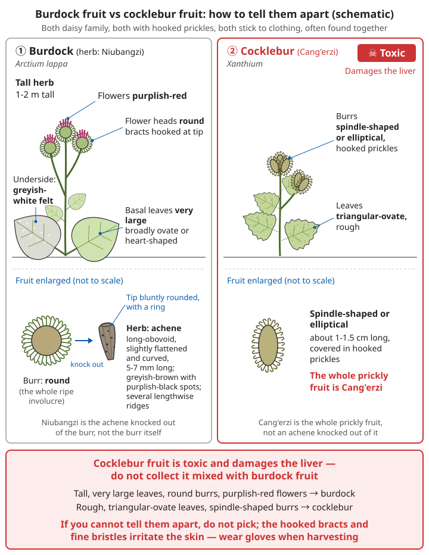

# Fruits and Seeds

> **Fruits and seeds are the herbs most easily "snacked on" – bitter apricot kernel, peach kernel, white hyacinth bean, toosendan fruit and areca nut all hide their toxicity in a very ordinary-looking grain**

This chapter covers 43 commonly used fruit and seed herbs, roughly grouped by action into eight groups: tonics; astringents and calming herbs; qi-regulating and digestive herbs; heat-clearing, surface-releasing and throat-soothing herbs; damp-resolving and diuretic herbs; interior-warming herbs; cough-relieving and laxative herbs; and anthelmintics (worm-expelling herbs). For each herb it describes how to recognise it, where to find it, when to collect it, how to process and store it, the Pharmacopoeia dose and the contraindications. General methods of identification, harvesting, drying and storage are in the [General Principles](00-general-principles.md) chapter and are not repeated here.

## ⚠️ Read these first

```
1. Many fruit and seed herbs are also foods (goji berry, hawthorn fruit, jujube,
   lotus seed, coix seed, Sichuan pepper). "Food and medicine from the same source"
   does not mean you can eat as much as you like; for medicinal use, follow the
   Pharmacopoeia dose and use them under the guidance of a TCM practitioner
2. Herbs that poison you if eaten raw:
   - Bitter apricot kernel and peach kernel (contain amygdalin; eaten raw in excess
     they release cyanide; a dozen or so can severely poison a child)
   - White hyacinth bean (raw or undercooked beans contain lectins, which cause
     vomiting and diarrhoea)
   - Do not crack open and eat raw the kernels of mume plum, peach, apricot, plum
     or loquat stones
3. Toxic in themselves; do not use them yourself:
   toosendan fruit (and the even more toxic chinaberry fruit), evodia fruit;
   cocklebur fruit, which looks similar (toxic, damages the liver), must not be
   collected mixed with burdock fruit
4. Areca nut: chewing areca nut is a proven cause of oral cancer, and the
   International Agency for Research on Cancer classifies areca nut as a
   Group 1 carcinogen; medicinal use to expel worms is a different matter, and
   even then only short-term under a doctor's guidance
5. Psoralea fruit can cause liver damage and photosensitive dermatitis (red patches
   and blisters when you go into the sun after using it);
   do not drink cassia seed as a tea long-term (long-term laxative effect)
6. Seeds are rich in oil, and in storage they are the most prone to "going oily"
   (turning sticky, rancid smell) and insect damage;
   do not use mouldy or rancid seeds – mouldy seeds may contain aflatoxin
7. Use with caution in pregnancy: immature bitter orange, bitter orange, green
   tangerine peel, peach kernel, coix seed, areca nut, etc.;
   pregnant women, children, people with liver or kidney disease, and people on
   long-term anticoagulants or other Western medicines must ask a doctor before
   using any of them
```

---

## Quick reference table for this chapter

The "Toxicity/protection" column gives the toxicity noted in the Pharmacopoeia, this book's risk warnings and the protection status of wild stocks. For protection levels, the text of the officially published national list is authoritative; this table is only a reminder.

| Herb | Part used | Main actions | Toxicity/protection | See |
|------|---------|---------|----------|-----|
| *Gouqizi* (goji berry) | Ripe fruit | Nourishes liver and kidney, benefits essence, brightens the eyes | Beware of dyed and sulphur-fumigated goods; care with warfarin | [1.1](#11-gouqizi-goji-berry) |
| *Nüzhenzi* (glossy privet fruit) | Ripe fruit | Nourishes liver and kidney, brightens the eyes, darkens hair | — | [1.2](#12-nüzhenzi-glossy-privet-fruit) |
| *Tusizi* (dodder seed) | Ripe seed | Tonifies liver and kidney, secures essence, calms the foetus | Beware of fake pellets made of mud and sand | [1.3](#13-tusizi-dodder-seed) |
| *Buguzhi* (psoralea fruit) | Ripe fruit | Warms the kidney and assists yang, warms the spleen and stops diarrhoea | ⚠️ Liver damage; photosensitivity | [1.4](#14-buguzhi-psoralea-fruit) |
| *Dazao* (jujube) | Ripe fruit | Tonifies the middle and boosts qi, nourishes blood and calms the mind | — | [1.5](#15-dazao-jujube) |
| *Baibiandou* (white hyacinth bean) | Ripe seed | Strengthens the spleen and resolves damp, harmonises the middle and relieves summer heat | ⚠️ Poisonous if eaten raw | [1.6](#16-baibiandou-white-hyacinth-bean) |
| *Shanzhuyu* (cornus fruit) | Ripe fruit flesh | Tonifies liver and kidney, astringes and prevents collapse | Name close to *Wuzhuyu*; do not confuse | [2.1](#21-shanzhuyu-cornus-fruit) |
| *Wuweizi* (schisandra berry) | Ripe fruit | Astringes and secures, boosts qi and generates fluids | 🛡️ On the list of key protected wild medicinal species; affects tacrolimus and other drugs | [2.2](#22-wuweizi-schisandra-berry) |
| *Wumei* (smoked plum) | Nearly ripe fruit | Astringes the lung and intestines, generates fluids, calms roundworms | Do not eat the kernel raw | [2.3](#23-wumei-smoked-plum) |
| *Jinyingzi* (Cherokee rose hip) | Ripe fruit | Secures essence and reduces urination, astringes the intestines and stops diarrhoea | Inner hairs irritate the throat | [2.4](#24-jinyingzi-cherokee-rose-hip) |
| *Fupenzi* (Chinese raspberry) | Fruit | Boosts the kidney, secures essence, reduces urination | — | [2.5](#25-fupenzi-chinese-raspberry) |
| *Lianzi* (lotus seed) | Ripe seed | Tonifies the spleen and stops diarrhoea, boosts the kidney, nourishes the heart | — | [2.6](#26-lianzi-lotus-seed) |
| *Qianshi* (euryale seed) | Ripe kernel | Boosts the kidney and secures essence, tonifies the spleen and stops diarrhoea | Harvested in water; take care | [2.7](#27-qianshi-euryale-seed) |
| *Suanzaoren* (sour jujube seed) | Ripe seed | Nourishes heart and liver, calms the mind | Beware of fake *Lizaoren*; increases drowsiness with sleeping pills | [2.8](#28-suanzaoren-sour-jujube-seed) |
| *Chenpi* (dried tangerine peel) | Ripe peel | Regulates qi and strengthens the spleen, dries damp and resolves phlegm | Home-made: watch for pesticide residues and wax | [3.1](#31-chenpi-dried-tangerine-peel) |
| *Qingpi* (green tangerine peel) | Young fruit or unripe peel | Soothes the liver and breaks up qi, dispels accumulation | Caution in pregnancy | [3.2](#32-qingpi-green-tangerine-peel) |
| *Zhishi* (immature bitter orange) | Young fruit | Breaks up qi and dispels accumulation, resolves phlegm and relieves fullness | Caution in pregnancy | [3.3](#33-zhishi-immature-bitter-orange) |
| *Zhiqiao* (bitter orange) | Unripe fruit | Regulates qi and loosens the middle, moves stagnation and relieves bloating | Caution in pregnancy | [3.4](#34-zhiqiao-bitter-orange) |
| *Shanzha* (hawthorn fruit) | Ripe fruit | Aids digestion and strengthens the stomach, moves qi and disperses stasis | Caution with excess stomach acid or stomach ulcer | [3.5](#35-shanzha-hawthorn-fruit) |
| *Laifuzi* (radish seed) | Ripe seed | Aids digestion and relieves bloating, descends qi and resolves phlegm | — | [3.6](#36-laifuzi-radish-seed) |
| *Chuanlianzi* (toosendan fruit) | Ripe fruit | Soothes the liver and drains heat, moves qi and relieves pain | ☠️ Slightly toxic; beware of chinaberry fruit (more toxic) | [3.7](#37-chuanlianzi-toosendan-fruit) |
| *Zhizi* (gardenia fruit) | Ripe fruit | Drains fire and relieves irritability, clears heat and drains damp | Not for long-term use | [4.1](#41-zhizi-gardenia-fruit) |
| *Lianqiao* (forsythia fruit) | Fruit | Clears heat and removes toxins, disperses wind-heat | 🛡️ On the list of key protected wild medicinal species | [4.2](#42-lianqiao-forsythia-fruit) |
| *Juemingzi* (cassia seed) | Ripe seed | Clears heat and brightens the eyes, moistens the intestines and relieves constipation | ⚠️ Not as a long-term tea; beware of coffee senna seed (toxic) | [4.3](#43-juemingzi-cassia-seed) |
| *Niubangzi* (burdock fruit) | Ripe fruit | Disperses wind-heat, removes toxins and soothes the throat | ⚠️ Do not collect mixed with cocklebur fruit | [4.4](#44-niubangzi-burdock-fruit) |
| *Manjingzi* (vitex fruit) | Ripe fruit | Disperses wind-heat, clears the head and eyes | — | [4.5](#45-manjingzi-vitex-fruit) |
| *Luohanguo* (monk fruit) | Fruit | Clears heat and moistens the lung, soothes the throat and restores the voice | — | [4.6](#46-luohanguo-monk-fruit) |
| *Pangdahai* (malva nut) | Ripe seed | Clears heat and moistens the lung, soothes the throat and restores the voice | Do not steep and drink long-term | [4.7](#47-pangdahai-malva-nut) |
| *Sharen* (amomum fruit) | Ripe fruit | Resolves damp and opens the appetite, warms the spleen and stops diarrhoea | Beware of "local *Sharen*" | [5.1](#51-sharen-amomum-fruit) |
| *Doukou* (round cardamom) | Ripe fruit | Resolves damp and moves qi, warms the middle and stops vomiting | Do not confuse with nutmeg | [5.2](#52-doukou-round-cardamom) |
| *Caoguo* (tsaoko fruit) | Ripe fruit | Dries damp and warms the middle, checks malaria and dispels phlegm | — | [5.3](#53-caoguo-tsaoko-fruit) |
| *Yiyiren* (coix seed) | Ripe kernel | Promotes urination and drains damp, strengthens the spleen and stops diarrhoea | Caution in pregnancy; do not use if mouldy | [5.4](#54-yiyiren-coix-seed) |
| *Cheqianzi* (plantain seed) | Ripe seed | Clears heat and promotes urination, drains damp and stops diarrhoea | — | [5.5](#55-cheqianzi-plantain-seed) |
| *Mugua* (Chinese flowering quince) | Nearly ripe fruit | Relaxes the sinews and frees the channels, harmonises the stomach and resolves damp | Not the papaya fruit | [5.6](#56-mugua-chinese-flowering-quince) |
| *Wuzhuyu* (evodia fruit) | Nearly ripe fruit | Dispels cold and relieves pain, descends counterflow and stops vomiting | ☠️ Slightly toxic, damages the liver | [6.1](#61-wuzhuyu-evodia-fruit) |
| *Xiaohuixiang* (fennel fruit) | Ripe fruit | Dispels cold and relieves pain, regulates qi and harmonises the stomach | Beware of toxic star anise relatives mixed in | [6.2](#62-xiaohuixiang-fennel-fruit) |
| *Huajiao* (Sichuan pepper) | Ripe peel | Warms the middle and relieves pain, kills parasites and relieves itching | — | [6.3](#63-huajiao-sichuan-pepper) |
| *Kuxingren* (bitter apricot kernel) | Ripe seed | Descends qi, stops cough and calms wheezing, moistens the intestines | ☠️ Slightly toxic; cyanide poisoning if eaten raw in excess | [7.1](#71-kuxingren-bitter-apricot-kernel) |
| *Taoren* (peach kernel) | Ripe seed | Activates blood and dispels stasis, moistens the intestines and relieves constipation | ⚠️ Contains cyanogenic glycoside; caution in pregnancy | [7.2](#72-taoren-peach-kernel) |
| *Zisuzi* (perilla fruit) | Ripe fruit | Descends qi and resolves phlegm, stops cough and calms wheezing | — | [7.3](#73-zisuzi-perilla-fruit) |
| *Huomaren* (hemp seed) | Ripe fruit | Moistens the intestines and relieves constipation | Can poison in large amounts; growing cannabis plants is controlled | [7.4](#74-huomaren-hemp-seed) |
| *Shijunzi* (rangoon creeper fruit) | Ripe fruit | Kills worms and dispels accumulation | Overdose causes hiccups and vomiting; avoid strong tea | [8.1](#81-shijunzi-rangoon-creeper-fruit) |
| *Binglang* (areca nut) | Ripe seed | Kills worms and dispels accumulation, moves qi and promotes urination | ☠️ Chewing causes oral cancer (Group 1 carcinogen) | [8.2](#82-binglang-areca-nut) |

---

## 1. Tonics

Most herbs in this group are "both food and medicine", and they are the most likely to be eaten in large amounts over long periods as health supplements. *Buguzhi* is toxic to the liver and causes photosensitivity, and *Baibiandou* is poisonous raw: do not treat them like goji berries or jujubes.

### 1.1 Gouqizi (goji berry)

- **Gouqizi (Gouqi, Ningxia Gouqi, Xigouqi)**: Chinese 枸杞子; *Lycium barbarum* L.
- **Source**: the dried ripe fruit of *Lycium barbarum* L. (Ningxia wolfberry), Solanaceae
- **Distribution and habitat**: mainly Ningxia, Gansu, Qinghai, Xinjiang and Inner Mongolia; widely cultivated. The related Chinese wolfberry *L. chinense* is common on field banks, roadsides and around villages throughout China; its fruit, commonly called "local goji", is not the Pharmacopoeia herb
- **Key identification features**:
  - Plant: shrub with long, thin, drooping branches **bearing spines**; leaves alternate or clustered, lanceolate; flowers pale purple, corolla 5-lobed; berries **red**, ovoid
  - Crude herb: roughly spindle-shaped or elliptical, 6-20 mm long, 3-10 mm across; surface **red or dark red**, with a small raised style scar at the tip and a white stalk scar at the base; skin tough and wrinkled, flesh soft and moist; 20-50 seeds, kidney-shaped; **tastes sweet**
- **Look-alikes/fakes**: "local goji" fruits are smaller with thinner flesh, sweet and then slightly bitter. There are also **dyed and sulphur-fumigated** goji berries – do not buy any that are an unnaturally bright, even colour, lose colour when rubbed, turn water red at once when soaked, or have a sharp, sour smell
- **Harvesting and processing**: pick in summer and autumn when the fruit is red; dry with hot air, then remove the stalks; or air until the skin wrinkles, then sun-dry and remove the stalks
- **Storage**: high in sugar, **very prone to going oily (sticky and black), insect damage and mould**; seal and keep in a cool place; refrigerate small amounts
- **Actions**: nourishes liver and kidney, benefits essence and brightens the eyes
- **Dose**: 6-12 g (Chinese Pharmacopoeia, 2020 edition; use under the guidance of a TCM practitioner); eating small amounts as food every day is generally safe
- **Cautions**: people with a fever from an external illness or with diarrhoea from spleen deficiency should not eat much; **in people taking warfarin**, goji has been reported to raise the risk of bleeding (raised INR) – ask a doctor first; people with diabetes should watch the sugar content
- For the root bark, *Digupi*, see [Barks, stems and woods – Digupi](06-barks-stems-and-woods.md#22-digupi-goji-root-bark)

### 1.2 Nüzhenzi (glossy privet fruit)

- **Nüzhenzi (Nüzhenshi, Dongqingzi)**: Chinese 女贞子; *Ligustrum lucidum* Ait.
- **Source**: the dried ripe fruit of *Ligustrum lucidum* Ait. (glossy privet), Oleaceae
- **Distribution and habitat**: the Yangtze basin and southwards; widely planted as a street tree and hedge, very common in cities
- **Key identification features**:
  - Plant: evergreen tree; leaves **opposite**, leathery, ovate, glossy; small white flowers in panicles in summer, strongly scented; drupes kidney-shaped or long-elliptical, **blue-black with a white bloom** when ripe in winter
  - Crude herb: ovoid, elliptical or kidney-shaped, 6-8.5 mm long, 3.5-5.5 mm across; surface blackish-purple or greyish-black, wrinkled; light; outer skin thin, middle layer fairly soft and easily peeled, inner layer woody, yellowish-brown with lengthwise ridges; usually 1 seed, kidney-shaped, purplish-black, oily; tastes sweet, slightly bitter and astringent
- **Look-alikes**: related privets such as Chinese privet and Japanese privet have similar fruit; other city trees (such as camphor) also bear small black fruit. Check for "opposite, leathery leaves and kidney-shaped fruit with a white bloom". **Fruit from street trees may be contaminated by vehicle exhaust and sprayed pesticides; do not collect it**
- **Harvesting and processing**: pick in winter when the fruit is ripe, remove twigs and leaves, steam briefly or scald briefly in boiling water, then dry; or dry directly
- **Storage**: keep dry; protect from mould and insects
- **Actions**: nourishes liver and kidney, brightens the eyes and darkens the hair
- **Dose**: 6-12 g (Chinese Pharmacopoeia, 2020 edition; use under the guidance of a TCM practitioner)
- **Cautions**: cool in nature; not suitable for people with a cold, weak digestion or diarrhoea

### 1.3 Tusizi (dodder seed)

- **Tusizi (Tusizi written 吐丝子, Huangsizi)**: Chinese 菟丝子; *Cuscuta australis* R. Br., *C. chinensis* Lam.
- **Source**: the dried ripe seed of *Cuscuta australis* R. Br. (southern dodder) or *C. chinensis* Lam. (Chinese dodder), Convolvulaceae
- **Distribution and habitat**: throughout China; **parasitic** on soya beans, lucerne, plants of the daisy family and shrubs; a common parasitic weed of farmland
- **Key identification features**:
  - Plant: annual parasitic herb with **no leaves and no green colour**; stems **yellow and thread-like**, twining round the host and drawing nutrients through suckers; flowers small, white, clustered; capsules round
  - Crude herb: roughly spherical, 1-2 mm across; surface greyish-brown to dark brown, rough; hard, not easily crushed with a fingernail; faint smell, bland taste
  - Water test: after soaking in boiling water the surface turns sticky; when boiled until the seed coat splits, a **yellowish-white, coiled embryo emerges, like a spat-out thread** (traditionally called "spitting silk"). This is the simplest test for the genuine herb
- **Look-alikes/fakes**: fake granules made from mud, sand or clay (they fall apart and cloud the water, and do not "spit silk"); other small seeds may also be mixed in. The related Japanese dodder (large dodder) has larger seeds and is a local substitute
- **Harvesting and processing**: in autumn when the fruit is ripe, collect the plants, sun-dry, thresh out the seeds and remove impurities. Do not collect from hosts that have been sprayed with pesticide or are themselves poisonous
- **Storage**: keep dry; the seeds are tiny, so protect them from damp
- **Actions**: tonifies liver and kidney, secures essence and reduces urination, calms the foetus, brightens the eyes, stops diarrhoea; externally, dispels wind and removes skin blemishes
- **Dose**: 6-12 g; an appropriate amount externally (Chinese Pharmacopoeia, 2020 edition; use under the guidance of a TCM practitioner)
- **Cautions**: use with caution in people with yin deficiency with excess fire or dry, hard stools; "calming the foetus" must be decided by a doctor – with bleeding or abdominal pain in pregnancy, see a doctor first

### 1.4 Buguzhi (psoralea fruit)

- **Buguzhi (Poguzhi, Heiguzi)**: Chinese 补骨脂; *Psoralea corylifolia* L.
- **Source**: the dried ripe fruit of *Psoralea corylifolia* L. (psoralea), Fabaceae
- **Distribution and habitat**: cultivated in Henan, Sichuan, Anhui, Shaanxi and elsewhere; rare in the wild
- **Key identification features**:
  - Plant: annual herb, 0.5-1.5 m tall, the whole plant covered with white soft hairs and **blackish-brown glandular dots**; simple alternate leaves, broadly ovate with coarsely toothed edges; flowers pale purple or white, in dense, almost head-like racemes; pods ovoid, not splitting
  - Crude herb: **kidney-shaped**, slightly flattened, 3-5 mm long, 2-4 mm wide; surface **black, blackish-brown or greyish-brown** with a fine net of wrinkles; hard; skin thin and not easily separated from the seed; 1 seed, cotyledons yellowish-white and oily; **aromatic smell**, pungent and slightly bitter taste
- **Look-alikes**: small seeds of other legumes have been mixed in; check for the kidney shape, black colour, net of wrinkles and aroma
- **Harvesting and processing**: in autumn when the fruit is ripe, cut the fruiting heads, sun-dry, rub out the fruit and remove impurities
- **Storage**: keep dry; protect from going oily and from insects
- **Actions**: warms the kidney and assists yang, helps the kidney grasp qi and calms wheezing, warms the spleen and stops diarrhoea; externally, dispels wind and removes skin blemishes
- **Dose**: 6-10 g; externally, a 20%-30% tincture painted on the affected area (Chinese Pharmacopoeia, 2020 edition; use under the guidance of a TCM practitioner)
- **Risks** (important):
  - **Liver damage**: *Buguzhi* and patent medicines containing it (preparations for osteoporosis, vitiligo, hair loss, etc.) have been reported to cause liver damage, and the national drug regulator has issued a risk warning about it. Do not take it long-term; people with liver disease must not use it; if tiredness, poor appetite, dark urine or yellowing of the skin or whites of the eyes appear while taking it, stop at once and see a doctor
  - **Photosensitivity**: it contains psoralen and other furanocoumarins; going into the sun after taking it or applying it can cause **solar dermatitis**: red patches, burning pain, blisters and pigmentation. Avoid sunlight while using it externally or internally
- **Cautions**: do not use in people with yin deficiency with excess fire or with constipation; pregnant women and children must not use it on their own

### 1.5 Dazao (jujube)

- **Dazao (Hongzao, Ganzao)**: Chinese 大枣; *Ziziphus jujuba* Mill.
- **Source**: the dried ripe fruit of *Ziziphus jujuba* Mill. (jujube), Rhamnaceae
- **Distribution and habitat**: cultivated in most of China; the main producing areas are Xinjiang, Hebei, Shandong, Shanxi, Henan and Shaanxi
- **Key identification features**:
  - Plant: deciduous small tree with stipular spines on the branches; leaves alternate, ovate, **with three main veins from the base**; flowers small, yellowish-green; drupes oblong, red when ripe
  - Crude herb: elliptical or spherical, 2-3.5 cm long, 1.5-2.5 cm across; surface **dark red**, slightly glossy, irregularly wrinkled; flesh brownish-yellow or light brown, soft, **sugary and moist**; stone spindle-shaped, sharply pointed at both ends, very hard; tastes sweet
- **Look-alikes**: not easily confused; watch for mould, insect damage, and fruit soaked in sugar water or dyed
- **Harvesting and processing**: pick in autumn when the fruit is ripe; sun-dry
- **Storage**: high in sugar, **prone to mould, insect damage and going oily**; seal once thoroughly dry and keep in a cool, dry place
- **Actions**: tonifies the middle and boosts qi, nourishes blood and calms the mind
- **Dose**: 6-15 g (Chinese Pharmacopoeia, 2020 edition; use under the guidance of a TCM practitioner); everyday eating as food is safe
- **Cautions**: people with heavy damp, abdominal bloating or a lot of phlegm should not eat much; people with diabetes should watch the sugar content. **Jujube stones are sharp and hard: remove the stone before giving jujubes to young children**, to prevent choking or injury to the digestive tract

### 1.6 Baibiandou (white hyacinth bean)

- **Baibiandou (Biandou, Baimeidou)**: Chinese 白扁豆; *Dolichos lablab* L.
- **Source**: the dried ripe seed of *Dolichos lablab* L. (hyacinth bean), Fabaceae
- **Distribution and habitat**: cultivated throughout China as a vegetable and medicine; for medicinal use, the variety with white flowers and white seeds is taken
- **Key identification features**:
  - Plant: annual twining climber; **leaves with three leaflets**, leaflets broadly triangular-ovate; racemes of white pea-like flowers (there are also purple varieties); pods flat, sickle-shaped or half-moon-shaped
  - Crude herb: flattened elliptical or flattened ovoid, 8-13 mm long, 6-9 mm wide, about 7 mm thick; surface pale yellowish-white or pale yellow, smooth, slightly glossy; **along one edge runs a raised, white, eyebrow-like aril** (the most obvious feature); hard; beany smell when chewed
- **Look-alikes**: the seeds of purple-flowered hyacinth bean are black or purplish-black and are not used as *Baibiandou*; other white beans have no "white eyebrow"
- **⚠️ Poisonous raw**: the beans and pods of hyacinth bean (including hyacinth bean pods, green beans and other kidney-bean-type beans) contain **plant lectins** and saponins, and **raw or undercooked** ones cause poisoning: nausea, vomiting, abdominal pain, diarrhoea and dizziness from tens of minutes to a few hours after eating – common in canteens. To prevent it, **boil thoroughly until completely cooked** (the pods have lost their raw green colour and there is no beany smell). Do not eat them raw in salads and do not just blanch them. If symptoms are severe, vomiting and diarrhoea persist, or a child is poisoned, see a doctor
- **Harvesting and processing**: in autumn and winter, pick the ripe fruit, sun-dry, take out the seeds and sun-dry again
- **Storage**: prone to insect damage (bean weevils); seal and keep dry
- **Actions**: strengthens the spleen and resolves damp, harmonises the middle and relieves summer heat
- **Dose**: 9-15 g (Chinese Pharmacopoeia, 2020 edition; use under the guidance of a TCM practitioner); boil long enough when decocting, and always cook thoroughly when used as food
- **Cautions**: avoid in people allergic to beans

---

## 2. Astringents and calming herbs

Astringent herbs are used for conditions where things "slip out and cannot be held", such as excessive sweating, chronic diarrhoea, bedwetting and seminal emission. **They are generally not used when there is fever, a cold, or diarrhoea that has just started (which may be an infection)**, so as not to "shut the door with the thief inside". Chronic diarrhoea, bedwetting and night sweats may themselves be signs of disease: see a doctor first to find the cause.

### 2.1 Shanzhuyu (cornus fruit)

- **Shanzhuyu (Shanyurou, Zaopi, Yurou)**: Chinese 山茱萸; *Cornus officinalis* Sieb. et Zucc.
- **Source**: the dried ripe **fruit flesh** of *Cornus officinalis* Sieb. et Zucc. (Asiatic cornelian cherry), Cornaceae
- **Distribution and habitat**: hillsides and forest edges in Zhejiang, Henan, Anhui, Shaanxi and elsewhere; mostly cultivated
- **Key identification features**:
  - Plant: deciduous small tree; leaves opposite, ovate, side veins **arching** towards the leaf tip; **in early spring it flowers before the leaves come out**, with umbels of small yellow flowers; drupes long-elliptical, **bright red** when ripe in autumn
  - Crude herb: irregular flakes or pouches, 1-1.5 cm long, 0.5-1 cm wide; surface **purplish-red to purplish-black**, wrinkled, glossy; some have a round calyx scar at the tip and a stalk scar at the base; soft; tastes sour, astringent and slightly bitter
- **Look-alikes/fakes**: stones mixed in (the Pharmacopoeia sets a limit); dyed grape skins, hawthorn skins or sour jujube skins passed off as the herb – fakes lack the particular gloss and sour, astringent taste of *Shanzhuyu*. **Its Chinese name differs by only one character from *Wuzhuyu*, an entirely different herb** (*Wuzhuyu* is toxic; see [6.1](#61-wuzhuyu-evodia-fruit)) – check when buying herbs
- **Harvesting and processing**: at the end of autumn or start of winter, when the skin turns red, pick the fruit; bake over a gentle fire or scald briefly in boiling water, **remove the stones promptly**, then dry
- **Storage**: high in sugar, prone to mould, insect damage and sticking together in lumps; seal and keep in a cool, dry place
- **Actions**: tonifies liver and kidney, astringes and prevents collapse
- **Dose**: 6-12 g (Chinese Pharmacopoeia, 2020 edition; use under the guidance of a TCM practitioner)
- **Cautions**: not suitable for people with damp-heat or difficult, painful urination

### 2.2 Wuweizi (schisandra berry)

- **Wuweizi (Bei Wuweizi, Liao Wuweizi)**: Chinese 五味子; *Schisandra chinensis* (Turcz.) Baill.
- **Source**: the dried ripe fruit of *Schisandra chinensis* (Turcz.) Baill. (schisandra), Magnoliaceae, traditionally called "northern *Wuweizi*". The fruit of the related *S. sphenanthera* is "southern *Wuweizi*", which has its own entry in the Pharmacopoeia
- **Distribution and habitat**: forest edges, thickets and valleys in the mountains of north-east and north China; cultivated in the north-east
- **Key identification features**:
  - Plant: deciduous **woody climber**; leaves alternate, broadly elliptical; flowers unisexual, milky white or pink; after flowering the receptacle lengthens into a **hanging spike of berries**, the small berries round and **red** when ripe
  - Crude herb: irregularly spherical or flattened spherical, 5-8 mm across; surface **red, purplish-red or dark red**, wrinkled, looking oily; some are blackish-red or have a "white frost"; flesh soft; 1-2 seeds, kidney-shaped, brownish-yellow and glossy
  - Smell and taste: the flesh tastes sour; the crushed seeds are aromatic and taste pungent and slightly bitter – hence the name "five flavours"
- **Look-alikes**: southern *Wuweizi* is small, brownish-red to dark brown, shrivelled and thin-fleshed; the two have similar actions but must not be passed off as each other
- **Harvesting and processing**: pick in autumn when the fruit is ripe; sun-dry, or steam then sun-dry; remove stalks and impurities
- **Storage**: prone to going oily and mould; seal and keep in a cool place
- **Actions**: astringes and secures, boosts qi and generates fluids, tonifies the kidney and calms the heart
- **Dose**: 2-6 g (Chinese Pharmacopoeia, 2020 edition; use under the guidance of a TCM practitioner)
- **Cautions**: not suitable for people with a fever from an external illness, a cough that has just started, or internal excess heat. **Schisandra affects how the body metabolises tacrolimus and other drugs** (raising blood levels); people taking immunosuppressants after an organ transplant, and anyone on other long-term prescription medicines, must ask a doctor first
- 🛡️ **Protection note**: *Wuweizi* is on the List of Wild Medicinal Species under Key State Protection (grade III; the text of the list is authoritative). Leave seed and vines on wild plants; do not pull up whole vines; use cultivated material first

### 2.3 Wumei (smoked plum)

- **Wumei (Suanmei, Xunmei)**: Chinese 乌梅; *Prunus mume* (Sieb.) Sieb. et Zucc.
- **Source**: the dried nearly ripe fruit of *Prunus mume* (Sieb.) Sieb. et Zucc. (mume plum), Rosaceae
- **Distribution and habitat**: cultivated in Sichuan, Zhejiang, Fujian, Hunan, Yunnan and elsewhere
- **Key identification features**:
  - Plant: deciduous small tree; flowers in early spring before the leaves, white or pink, fragrant; leaves ovate with a drawn-out tip; drupes nearly round, grooved lengthwise, yellow when ripe, **flesh clinging to the stone**
  - Crude herb: roughly spherical or flattened spherical, 1.5-3 cm across; surface **black or brownish-black**, wrinkled; stone hard, elliptical, brownish-yellow, **pitted on the surface**; seed flattened ovoid, pale yellow; **tastes extremely sour**
- **Look-alikes/fakes**: apricots, plums and other fruit smoked black and passed off as *Wumei*; the stones of fakes lack the dense pits of a mume stone, and the sourness is different
- **Harvesting and processing**: pick in summer when the fruit is nearly ripe, dry at low heat, then **keep covered until it turns black**
- **Storage**: keep dry; protect from mould
- **Actions**: astringes the lung and the intestines, generates fluids, calms roundworms
- **Dose**: 6-12 g (Chinese Pharmacopoeia, 2020 edition; use under the guidance of a TCM practitioner)
- **Cautions**: not suitable for people with an external pathogen (a cold with fever) or internal excess heat and accumulation; people with excess stomach acid should use little. **The kernel inside the stone contains amygdalin: do not crack it open and eat it raw**

### 2.4 Jinyingzi (Cherokee rose hip)

- **Jinyingzi (Tangguanzi, Cilizi, Shanshiliu)**: Chinese 金樱子; *Rosa laevigata* Michx.
- **Source**: the dried ripe fruit of *Rosa laevigata* Michx. (Cherokee rose), Rosaceae
- **Distribution and habitat**: sunny hillsides, field edges and thickets in east, south and south-west China
- **Key identification features**:
  - Plant: evergreen climbing shrub with **hooked prickles** on the branches; compound leaves usually with **3 leaflets**, leathery and glossy; flowers large, solitary, **white**, 5 petals; fruit pear-shaped or obovoid, **densely covered in bristles**, reddish-yellow when ripe
  - Crude herb: obovoid, 2-3.5 cm long, 1-2 cm across; surface reddish-yellow or reddish-brown, with raised brown dots (the bases of fallen bristles); disc-shaped calyx remains at the tip; hard; cut open, the wall is 1-2 mm thick, **with many hard small achenes inside; the inner wall and the achenes are covered in pale yellow hairs**; tastes sweet and slightly astringent
- **Look-alikes**: the fruit of related roses such as multiflora rose and chestnut rose (*Cili*); chestnut rose fruit is flattened-round and densely prickly, and is eaten as a fruit
- **Harvesting and processing**: pick in October–November when the fruit is ripe and red, dry, and remove the bristles. Before use, cut lengthwise and remove all the achenes and hairs (this is called "*Jinyingzi* flesh") – **the hairs irritate the throat, and if not removed completely they cause coughing and an itchy throat**
- **Storage**: keep dry; protect from mould and insects
- **Actions**: secures essence and reduces urination, stops uterine bleeding and vaginal discharge, astringes the intestines and stops diarrhoea
- **Dose**: 6-12 g (Chinese Pharmacopoeia, 2020 edition; use under the guidance of a TCM practitioner)
- **Cautions**: not suitable for people with excess fire or damp-heat; wear gloves when picking, to guard against the prickles and bristles

### 2.5 Fupenzi (Chinese raspberry)

- **Fupenzi (Huadong Fupenzi, Zhangye Fupenzi)**: Chinese 覆盆子; *Rubus chingii* Hu
- **Source**: the dried fruit of *Rubus chingii* Hu (palm-leaf raspberry), Rosaceae
- **Distribution and habitat**: hillsides, forest edges and roadside thickets in Zhejiang, Fujian, Jiangxi, Anhui and elsewhere
- **Key identification features**:
  - Plant: deciduous shrub with prickles on the branches; simple leaves, **deeply palmately 5-lobed**; flowers white, solitary; aggregate fruit nearly round, red and edible when ripe
  - Crude herb: an aggregate of many small drupelets forming a **cone or flattened cone**, 0.6-1.3 cm high, 0.5-1.2 cm across; surface yellowish-green or light brown, tip bluntly rounded, base hollowed in the centre; the drupelets come off easily, each half-moon-shaped, **densely covered on the back with greyish-white down**, with a clear net pattern on both sides; light, hard; tastes slightly sour and astringent
- **Look-alikes**: there are many *Rubus* species, and most wild "wild berries" are edible but are not the Pharmacopoeia herb; the "raspberry" fruit sold in supermarkets is the European red raspberry, a different species from the herb *Fupenzi*. The herb is collected **unripe**, not as fully ripe red fruit
- **Harvesting and processing**: in early summer, when the fruit turns from green to greenish-yellow, pick it, remove stalks and leaves, scald briefly in boiling water or steam briefly, take out and dry
- **Storage**: keep dry; protect from mould and insects
- **Actions**: boosts the kidney, secures essence and reduces urination, nourishes the liver and brightens the eyes
- **Dose**: 6-12 g (Chinese Pharmacopoeia, 2020 edition; use under the guidance of a TCM practitioner)
- **Cautions**: not suitable for people with scanty dark urine or damp-heat

### 2.6 Lianzi (lotus seed)

- **Lianzi (Lianrou, Lianmi)**: Chinese 莲子; *Nelumbo nucifera* Gaertn.
- **Source**: the dried ripe seed of *Nelumbo nucifera* Gaertn. (sacred lotus), Nymphaeaceae
- **Distribution and habitat**: ponds and lakes throughout China; widely cultivated in Hunan (Xiang lotus), Fujian (Jian lotus), Jiangxi, Hubei and elsewhere
- **Key identification features**:
  - Plant: perennial aquatic herb; leaves round and shield-like, held above the water; flowers large, pink or white; the receptacle swells into a **lotus seed head** with one seed in each hole
  - Crude herb: roughly elliptical or nearly spherical, 1.2-1.8 cm long, 0.8-1.4 cm across; surface **reddish-brown**, with fine lengthwise lines and broader vein lines; a nipple-like bump at the centre of one end, often split; hard, seed coat thin and not easily peeled; 2 cotyledons, yellowish-white and thick, with the green **lotus plumule** in the middle (or already removed, leaving a small hole at the bottom); tastes sweet and slightly astringent, the plumule bitter
- **Look-alikes**: not easily confused. Different parts of the lotus are different herbs: lotus plumule, lotus seed head, lotus stamen, lotus leaf (see [Flowers and leaves – Heye](05-flowers-and-leaves.md#44-heye-lotus-leaf)) and lotus rhizome node; the old ripe fruit with a hard black shell is called "*Shilianzi*"
- **Harvesting and processing**: in autumn when the fruit is ripe, cut the seed heads, take out the fruits, remove the fruit wall and dry; or remove the plumule and then dry
- **Storage**: prone to insect damage and mould; seal and keep dry
- **Actions**: tonifies the spleen and stops diarrhoea, stops vaginal discharge, boosts the kidney and secures essence, nourishes the heart and calms the mind
- **Dose**: 6-15 g (Chinese Pharmacopoeia, 2020 edition; use under the guidance of a TCM practitioner); everyday eating as food is safe
- **Cautions**: people with dry, hard stools or abdominal bloating should not eat much

### 2.7 Qianshi (euryale seed)

- **Qianshi (Jitoumi, Jitoushi)**: Chinese 芡实; *Euryale ferox* Salisb.
- **Source**: the dried ripe kernel of *Euryale ferox* Salisb. (prickly water lily), Nymphaeaceae
- **Distribution and habitat**: ponds, lakes and marshes in Jiangsu, Shandong, Hunan, Hubei, Anhui and elsewhere; cultivated as food around Suzhou
- **Key identification features**:
  - Plant: large annual aquatic herb; leaves float on the water, **round and huge, up to more than 1 m across, prickly on both sides, purple underneath with raised veins**; flowers purple; fruit round, **densely covered in hard prickles, with the persistent calyx at the tip, shaped like a chicken's head**
  - Crude herb: roughly spherical, mostly broken pieces, whole ones 5-8 mm across; surface covered by a **brownish-red or reddish-brown inner seed coat**, one end yellowish-white (about 1/3), with a pitted hilum scar; white once the inner coat is removed; fairly hard, white and **starchy** inside; bland taste
- **Look-alikes**: not easily confused; watch for mould and pellets made from other starches
- **Harvesting and processing**: at the end of autumn or start of winter, collect the ripe fruit, remove the fruit wall, take out the seeds, wash, remove the hard shell (outer seed coat) and sun-dry. Both fruit and leaves have hard prickles: wear gloves. **Harvesting is done in the water: beware of drowning, and never go into the water alone**
- **Storage**: rich in starch, prone to insect damage and mould
- **Actions**: boosts the kidney and secures essence, tonifies the spleen and stops diarrhoea, removes damp and stops vaginal discharge
- **Dose**: 9-15 g (Chinese Pharmacopoeia, 2020 edition; use under the guidance of a TCM practitioner)
- **Cautions**: not suitable for people with difficult urination or bowel movements, food stagnation with bloating, or constipation

### 2.8 Suanzaoren (sour jujube seed)

- **Suanzaoren (Zaoren, Shanzaoren)**: Chinese 酸枣仁; *Ziziphus jujuba* Mill. var. *spinosa* (Bunge) Hu ex H. F. Chou
- **Source**: the dried ripe seed of *Ziziphus jujuba* Mill. var. *spinosa* (Bunge) Hu ex H. F. Chou (sour jujube), Rhamnaceae
- **Distribution and habitat**: sunny, dry hillsides, low hills and roadsides in Hebei, Shaanxi, Liaoning, Henan, Shanxi, Shandong and elsewhere
- **Key identification features**:
  - Plant: shrub or small tree with **stipular spines on the branches, one long and straight, one short and hooked**; leaves small with three main veins from the base; drupes small, nearly round, reddish-brown when ripe, **flesh thin and sour**
  - Crude herb: flattened round or flattened elliptical, 5-9 mm long, 5-7 mm wide, about 3 mm thick; surface **purplish-red or purplish-brown, smooth and glossy**; **one side fairly flat with 1 raised line running down the middle**, the other side slightly convex; a linear hilum in a hollow at one end; seed coat fairly brittle, cotyledons pale yellow and oily; faint smell, bland taste
- **Look-alikes/fakes**: the commonest is ***Lizaoren*** (seed of the Indian jujube, *Ziziphus mauritiana*): larger, yellowish-brown, and the flat side has **no** raised line; there are also dyed seeds of Japanese raisin tree and lentils passed off as the herb
- **Harvesting and processing**: at the end of autumn or start of winter, collect the ripe fruit, remove the flesh and the stone shell, collect the seeds and sun-dry
- **Storage**: rich in oil, **prone to going oily and insect damage**; seal, keep in a cool place, do not store for long
- **Actions**: nourishes the heart and tonifies the liver, calms the mind, stops sweating, generates fluids
- **Dose**: 10-15 g (Chinese Pharmacopoeia, 2020 edition; use under the guidance of a TCM practitioner)
- **Cautions**: use with caution in people with excess pathogens or pent-up fire; **taken with sleeping pills or sedatives it can increase drowsiness** – ask a doctor first. Long-term insomnia needs a doctor to find the cause

---

## 3. Qi-regulating and digestive herbs

Qi-regulating herbs are mostly pungent, aromatic and dispersing, and are used for abdominal bloating, belching and food stagnation. **Those with a strong "qi-breaking" action (*Zhishi*, *Qingpi*) must be used with caution in pregnancy**, and people who are weak and tired should not use them for long. *Chuanlianzi* is toxic in itself; it is placed at the end of this group with its own warning.

### 3.1 Chenpi (dried tangerine peel)

- **Chenpi (Jupi, Guang Chenpi, Xinhuipi)**: Chinese 陈皮; *Citrus reticulata* Blanco
- **Source**: the dried ripe peel of *Citrus reticulata* Blanco (mandarin orange) and its cultivars, Rutaceae. The herb is divided into "*Chenpi*" and "*Guang Chenpi*" (the peel of the Chachi mandarin from the Xinhui area of Guangdong)
- **Distribution and habitat**: widely cultivated south of the Yangtze
- **Key identification features**:
  - *Chenpi*: usually peeled into several segments joined at the base, or irregular pieces, 1-4 mm thick; **outer surface orange-red or reddish-brown, with fine wrinkles and sunken dot-like oil glands**; inner surface pale yellowish-white, rough, with yellowish-white or yellowish-brown stringy vascular bundles attached; fairly hard and brittle; **aromatic smell, pungent and bitter taste**
  - *Guang Chenpi*: usually 3 segments joined together, regular in shape and even in thickness, about 1 mm; the dot-like oil glands are larger and **clearly translucent when held up to the light**; fairly soft
- **Look-alikes/fakes**: pomelo or orange peel passed off as *Chenpi* (thick peel, small oil glands, different aroma); expensive "Xinhui *Chenpi*" is faked by dyeing and artificial ageing
- **Harvesting and processing**: pick ripe fruit, peel, and sun-dry or dry at low heat. "*Chen*" means "aged": peel stored for many years is considered best
- **Making your own**: you can make it from left-over tangerine peel, but the peel of fruit bought in shops may have **pesticide residues and wax**; choose home-grown fruit or fruit you know is unwaxed, wash it, then dry it; do not use peel that has gone mouldy
- **Storage**: prone to damp, mould and insect damage; dry thoroughly, seal, keep in a ventilated, dry place, and air it in the sun from time to time
- **Actions**: regulates qi and strengthens the spleen, dries damp and resolves phlegm
- **Dose**: 3-10 g (Chinese Pharmacopoeia, 2020 edition; use under the guidance of a TCM practitioner)
- **Cautions**: use with caution in people with qi deficiency, a dry cough from yin deficiency, or vomiting of blood

### 3.2 Qingpi (green tangerine peel)

- **Qingpi (Ge Qingpi, Sihua Qingpi)**: Chinese 青皮; *Citrus reticulata* Blanco
- **Source**: the dried young fruit, or the peel of the unripe fruit, of *Citrus reticulata* Blanco (mandarin orange) and its cultivars, Rutaceae
- **Distribution and habitat**: as for *Chenpi*
- **Key identification features**:
  - *Ge Qingpi* (young fruit that has dropped by itself): roughly spherical, 0.5-2 cm across; surface **greyish-green or blackish-green**, with fine, dense, sunken oil glands; hard; in cross-section the peel is yellowish-white, 0.1-0.2 cm thick, with 8-10 segments; fresh fragrant smell, tastes sour, bitter and pungent
  - *Sihua Qingpi* (peel of unripe fruit): the peel is cut into **4 lobes** joined at the base, the lobes long-elliptical, 4-6 cm long; outer surface greyish-green or blackish-green with dense oil glands; inner surface whitish or yellowish-white, with small strings attached
- **Look-alikes**: looks similar to *Zhishi* (both are young citrus fruits); *Zhishi* is bigger, with a thick peel and a broad middle layer on the cut surface (see [3.3](#33-zhishi-immature-bitter-orange))
- **Harvesting and processing**: in May–June, collect young fruit that has dropped by itself and sun-dry (*Ge Qingpi*); in July–August, pick unripe fruit, cut the peel lengthwise into four down to the base, remove all the flesh and sun-dry (*Sihua Qingpi*)
- **Storage**: keep dry; protect from mould
- **Actions**: soothes the liver and breaks up qi, dispels accumulation and stagnation
- **Dose**: 3-10 g (Chinese Pharmacopoeia, 2020 edition; use under the guidance of a TCM practitioner)
- **Cautions**: strong qi-breaking action; use with caution in people with qi deficiency or heavy sweating; **use with caution in pregnancy**

### 3.3 Zhishi (immature bitter orange)

- **Zhishi (Jiang Zhishi, E'yan Zhishi)**: Chinese 枳实; *Citrus aurantium* L., *C. sinensis* Osbeck
- **Source**: the dried **young fruit** of *Citrus aurantium* L. (bitter orange) and its cultivars, or of *C. sinensis* Osbeck (sweet orange), Rutaceae
- **Distribution and habitat**: cultivated in Jiangxi, Sichuan, Hunan, Hubei, Zhejiang and elsewhere
- **Key identification features**:
  - Plant: evergreen small tree with thorny branches; leaf stalks **winged**; flowers white and fragrant; fruit round, orange-yellow when ripe, sour and bitter
  - Crude herb: **hemispherical**, a few spherical, 0.5-2.5 cm across; outer skin blackish-green or dark brown, with granular bumps and wrinkles; **on the cut surface the middle layer of the peel is slightly raised, yellowish-white or yellowish-brown, 0.3-1.2 cm thick**, with 1-2 rows of oil glands at the edge; the segments dark brown; very hard; fresh fragrant smell, tastes bitter and slightly sour
- **Look-alikes**: the young fruit of trifoliate orange (*Poncirus trifoliata*), once called "green-coated *Zhishi*", has fine soft hairs on the surface and is not the Pharmacopoeia herb
- **Harvesting and processing**: in May–June, collect fruit that has dropped by itself, remove impurities, cut across the middle into two halves, and sun-dry or dry at low heat; dry small ones whole
- **Storage**: keep dry; protect from mould and insects
- **Actions**: breaks up qi and dispels accumulation, resolves phlegm and relieves fullness
- **Dose**: 3-10 g (Chinese Pharmacopoeia, 2020 edition; use under the guidance of a TCM practitioner)
- **Cautions**: **use with caution in pregnancy**; use with caution in people with weak digestion. *Zhishi* contains synephrine and similar substances, which can raise blood pressure and speed up the heart; **people with high blood pressure or heart disease must ask a doctor first**, and must not take slimming products containing "bitter orange extract"

### 3.4 Zhiqiao (bitter orange)

- **Zhiqiao (Jiang Zhiqiao, Chuan Zhiqiao)**: Chinese 枳壳; *Citrus aurantium* L.
- **Source**: the dried **unripe fruit** of *Citrus aurantium* L. (bitter orange) and its cultivars, Rutaceae
- **Distribution and habitat**: as for *Zhishi*
- **Key identification features**:
  - Crude herb: hemispherical, 3-5 cm across (**bigger than *Zhishi***); outer skin dark brown to brown, with granular bumps, each with a pitted oil gland at the top; on the cut surface the middle layer of the peel is yellowish-white, smooth and slightly raised, 0.4-1.3 cm thick, with 1-2 rows of scattered oil glands at the edge; 7-12 segments, the juice sacs shrivelled and dark brown; very hard; fresh fragrant smell, tastes bitter and slightly sour
- **Difference from *Zhishi***: same plant, **different harvest time**: young fruit that drops by itself in May–June is *Zhishi* (small, strong action); unripe fruit still green in July is *Zhiqiao* (large, milder action)
- **Harvesting and processing**: pick in July while the peel is still green, cut across the middle into two halves, and sun-dry or dry at low heat
- **Storage**: keep dry; protect from mould and insects
- **Actions**: regulates qi and loosens the middle, moves stagnation and relieves bloating
- **Dose**: 3-10 g (Chinese Pharmacopoeia, 2020 edition; use under the guidance of a TCM practitioner)
- **Cautions**: **use with caution in pregnancy**; use with caution in people with weak digestion; for high blood pressure and heart disease, as for *Zhishi*

### 3.5 Shanzha (hawthorn fruit)

- **Shanzha (Bei Shanzha, Shanlihong, Hongguo)**: Chinese 山楂; *Crataegus pinnatifida* Bge. var. *major* N. E. Br., *C. pinnatifida* Bge.
- **Source**: the dried ripe fruit of *Crataegus pinnatifida* Bge. var. *major* N. E. Br. (large-fruited Chinese hawthorn) or *C. pinnatifida* Bge. (Chinese hawthorn), Rosaceae
- **Distribution and habitat**: Shandong, Hebei, Henan, Liaoning, Shanxi and elsewhere; mostly cultivated; wild on hillsides and forest edges
- **Key identification features**:
  - Plant: deciduous tree with thorny branches (the large-fruited variety has few or no thorns); leaves broadly ovate, **deeply pinnately lobed**; flowers white in flat-topped clusters; pomes nearly round, deep red, **with pale spots on the skin**
  - Crude herb: round slices, wrinkled, 1-2.5 cm across, 0.2-0.4 cm thick; skin **red** with small greyish-white spots; flesh deep yellow to light brown; cross-sections from the middle show 5 pale yellow stones (mostly fallen out); faint fresh fragrance, **tastes sour and slightly sweet**
- **Look-alikes**: the fruit of wild hawthorn (*Crataegus cuneata*) is smaller and is traditionally called "southern *Shanzha*", a local substitute in some areas; apple slices and crabapple slices are also passed off as the herb (no greyish-white spots and no hard stones)
- **Harvesting and processing**: pick in autumn when the fruit is ripe; slice and dry
- **Storage**: prone to insect damage and mould
- **Actions**: aids digestion and strengthens the stomach, moves qi and disperses stasis, resolves turbidity and lowers blood lipids
- **Dose**: 9-12 g (Chinese Pharmacopoeia, 2020 edition; use under the guidance of a TCM practitioner)
- **Cautions**: **people with excess stomach acid or a stomach ulcer should not eat much**, nor eat a lot on an empty stomach; pregnant women should not eat large amounts; **eating large amounts of hawthorn together with persimmons on an empty stomach has been reported to cause stomach stones (bezoars)**. People taking statins to lower cholesterol must not replace them with hawthorn or add hawthorn on their own

### 3.6 Laifuzi (radish seed)

- **Laifuzi (Luobozi, written 萝卜子 or 萝卜籽)**: Chinese 莱菔子; *Raphanus sativus* L.
- **Source**: the dried ripe seed of *Raphanus sativus* L. (radish), Brassicaceae
- **Distribution and habitat**: cultivated throughout China
- **Key identification features**:
  - Plant: radish, with pale purple or white four-petalled cross-shaped flowers; pods cylindrical, constricted between the seeds **like a string of beads**, not splitting
  - Crude herb: roughly ovoid or elliptical, slightly flattened, 2.5-4 mm long, 2-3 mm wide; surface yellowish-brown, reddish-brown or greyish-brown; a dark brown round hilum at one end and several lengthwise grooves on one side; cotyledons yellowish-white and oily; bland taste, slightly bitter and pungent
- **Look-alikes**: other cabbage-family seeds (mustard seed, rapeseed) are mostly round and smaller; when buying vegetable seed, watch out for **seed coatings** (seeds dyed red, blue or green have been treated with pesticide or fungicide and must not be used as medicine or eaten)
- **Harvesting and processing**: in summer when the fruit is ripe, cut the plants, sun-dry, rub out the seeds, remove impurities and sun-dry again
- **Storage**: prone to going oily and insect damage
- **Actions**: aids digestion and relieves bloating, descends qi and resolves phlegm
- **Dose**: 5-12 g (Chinese Pharmacopoeia, 2020 edition; use under the guidance of a TCM practitioner)
- **Cautions**: use with caution in people with qi deficiency and no food stagnation or phlegm; traditional experience holds that it should not be used together with *Renshen* (ginseng)

### 3.7 Chuanlianzi (toosendan fruit)

- **Chuanlianzi (Jinlingzi, Chuanlianshi)**: Chinese 川楝子; *Melia toosendan* Sieb. et Zucc.
- **Source**: the dried ripe fruit of *Melia toosendan* Sieb. et Zucc. (Sichuan chinaberry), Meliaceae
- **Distribution and habitat**: Sichuan, Yunnan, Guizhou, Hubei, Hunan and elsewhere; plains, low hills and around villages
- **Key identification features**:
  - Plant: deciduous tree; **leaves two- to three-times odd-pinnate**; flowers pale purple, in panicles; drupes nearly round, yellow when ripe, hanging on the tree in winter
  - Crude herb: roughly spherical, **2-3.2 cm across**; surface golden-yellow to brownish-yellow, slightly glossy, with small dark brown dots; outer skin leathery, often with a gap between it and the flesh; flesh soft and spongy, pale yellow; stone round or ovoid, very hard, with 6-8 lengthwise ridges and 6-8 chambers inside; peculiar smell, tastes sour and bitter
- **Look-alikes**: the related **chinaberry** *Melia azedarach* is extremely common in towns and villages all over China; its fruit, "*Kulianzi*", is **smaller (about 1.5 cm long), elliptical and more toxic**. It must not replace *Chuanlianzi*, let alone be eaten
- **Toxicity** (important):
  - The Pharmacopoeia marks it "**slightly toxic**". The main toxic constituent is toosendanin and related compounds
  - Signs of poisoning: nausea, vomiting, abdominal pain, diarrhoea, dizziness, drowsiness, blurred vision, **liver damage**; in severe cases irregular heartbeat and respiratory paralysis. There are reports of children eating chinaberry fruit by mistake, and of adults dying after taking an overdose themselves
- **Harvesting and processing**: pick in winter when the fruit is ripe, remove impurities and dry
- **Storage**: store separately, label it "toxic", and keep it out of reach of children
- **Actions**: soothes the liver and drains heat, moves qi and relieves pain, kills parasites
- **Dose**: the Pharmacopoeia specifies 5-10 g; an appropriate amount externally. **It is toxic: do not use it yourself** – only on a prescription from a TCM practitioner, with the herb obtained from a regular pharmacy
- **Cautions**: do not take it long-term or increase the dose; pregnant women, children and people with liver disease must not use it; use with caution in people with a cold, weak digestion. **Teach children not to pick and eat chinaberry fruit**. If signs of poisoning appear, call 120 at once; see [General management of poisoning](09-toxic-herbs-and-poisonous-look-alikes.md#5-general-handling-of-poisoning)

---

## 4. Heat-clearing, surface-releasing and throat-soothing herbs

Most herbs in this group are cool in nature and are used for fever, sore throat, red eyes, sores and swellings. **Cold herbs taken for a long time harm the digestion**; people with a cold, weak digestion who get diarrhoea easily should not use them for long. If a fever lasts more than three days, or a sore throat comes with difficulty swallowing or a high fever, see a doctor first.

### 4.1 Zhizi (gardenia fruit)

- **Zhizi (Shanzhi, Huangzhizi, Shanzhizi)**: Chinese 栀子; *Gardenia jasminoides* Ellis
- **Source**: the dried ripe fruit of *Gardenia jasminoides* Ellis (gardenia), Rubiaceae
- **Distribution and habitat**: hillside thickets and forest edges in Jiangxi, Hunan, Hubei, Zhejiang, Fujian, Sichuan and elsewhere; widely cultivated (it is the gardenia flower)
- **Key identification features**:
  - Plant: evergreen shrub; leaves **opposite**, leathery, glossy; flowers large, **white, strongly scented**; fruit ovoid, **with 5-9 wing-like lengthwise ridges and long, strap-shaped persistent sepals at the tip**, orange-red when ripe
  - Crude herb: long-ovoid or elliptical, 1.5-3.5 cm long, 1-1.5 cm across; surface **reddish-yellow or brownish-red**, with 6 wing-like lengthwise ridges; sepal remains at the tip; skin thin and brittle; many flattened ovoid seeds inside, clumped together, deep red or reddish-yellow; tastes slightly sour and bitter
  - Water test: soak a little in water and the water turns **bright yellow** (gardenia is a traditional yellow dye)
- **Look-alikes**: "*Shuizhizi*" (large-fruited gardenia) has large, long fruit with high ridges; it is mainly used as a dye, not as medicine
- **Harvesting and processing**: in September–November, when the fruit is ripe and reddish-yellow, pick it, remove the stalks and impurities, steam until the steam rises or scald briefly in boiling water, take out and dry
- **Storage**: keep dry; protect from mould
- **Actions**: drains fire and relieves irritability, clears heat and drains damp, cools the blood and removes toxins; externally, reduces swelling and relieves pain
- **Dose**: 6-10 g; externally, an appropriate amount of the raw herb ground to powder and applied as a paste (Chinese Pharmacopoeia, 2020 edition; use under the guidance of a TCM practitioner)
- **Cautions**: cold in nature; not suitable for people with spleen deficiency and loose stools. **Not for long-term use**: mesenteric phlebosclerotic colitis has been reported after taking preparations containing gardenia for a long time (several years)

### 4.2 Lianqiao (forsythia fruit)

- **Lianqiao (Qingqiao, Laoqiao, Huangqiao)**: Chinese 连翘; *Forsythia suspensa* (Thunb.) Vahl
- **Source**: the dried fruit of *Forsythia suspensa* (Thunb.) Vahl (weeping forsythia), Oleaceae
- **Distribution and habitat**: hillside thickets and forest edges in Shanxi, Henan, Shaanxi, Hebei, Shandong and elsewhere; often planted in cities as an early-spring ornamental shrub
- **Key identification features**:
  - Plant: deciduous shrub with arching, drooping branches; **stems hollow**; flowers in early spring before the leaves, **yellow, corolla deeply 4-lobed**; leaves opposite, simple or with three leaflets; capsules ovoid with scattered warty dots
  - Crude herb: long-ovoid to ovoid, slightly flattened, 1.5-2.5 cm long, 0.5-1.3 cm across; surface with irregular lengthwise wrinkles and many small raised spots, **1 clear lengthwise groove on each face**; tip sharply pointed
    - ***Qingqiao*** ("green *Lianqiao*"): mostly not split open, surface greenish-brown; many seeds, yellowish-green, long and thin, winged on one side
    - ***Laoqiao*** ("old *Lianqiao*"): split open from the tip or into two halves, surface yellowish-brown or reddish-brown, inner surface smooth with one lengthwise partition; most seeds have fallen out
  - Faintly fragrant smell, bitter taste
- **Look-alikes**: other shrubs with yellow flowers in early spring include **winter jasmine** (green, four-angled stems, corolla 5-6-lobed, usually no fruit) and golden-bell forsythia (*Forsythia viridissima*; pith in plates, stems not hollow). Check for "hollow stems and a 4-lobed corolla"
- **Harvesting and processing**: in autumn, when the fruit is just ripe and still greenish, pick it, remove impurities, **steam it through and sun-dry** (*Qingqiao*); when the fruit is fully ripe, pick and sun-dry (*Laoqiao*)
- **Storage**: keep dry
- **Actions**: clears heat and removes toxins, reduces swelling and dissipates lumps, disperses wind-heat
- **Dose**: 6-15 g (Chinese Pharmacopoeia, 2020 edition; use under the guidance of a TCM practitioner)
- **Cautions**: use with caution in people with a cold, weak digestion or fever from qi deficiency
- 🛡️ **Protection note**: *Lianqiao* is on the List of Wild Medicinal Species under Key State Protection (grade III; the text of the list is authoritative). *Qingqiao* fetches a high price, and "rushing the green" – picking too early – damages the resource; do not harvest before the proper season, and pick only part of the fruit

### 4.3 Juemingzi (cassia seed)

- **Juemingzi (Caojueming, Mati Jueming)**: Chinese 决明子; *Cassia obtusifolia* L., *C. tora* L.
- **Source**: the dried ripe seed of *Cassia obtusifolia* L. (sicklepod) or *C. tora* L. (sickle senna, "small *Jueming*"), Fabaceae
- **Distribution and habitat**: wild or cultivated south of the Yangtze; also cultivated in the north
- **Key identification features**:
  - Plant: annual, half-shrubby herb, 1-2 m tall; **even-pinnate leaves with 3 pairs of leaflets**, obovate; flowers yellow; **pods long and thin, nearly four-angled, up to 15 cm long**
  - Crude herb (*Cassia obtusifolia*): **roughly rhomboid or short-cylindrical, with the two ends cut obliquely and parallel**, 3-7 mm long, 2-4 mm wide; surface **greenish-brown or dark brown, smooth and glossy**; 1 raised ridge on each of the back and front, with 1 paler, oblique, symmetrical linear groove on each side of the ridge; very hard; slightly bitter taste
  - Small *Jueming*: short-cylindrical, smaller; on each side of the ridge there is 1 broad, pale yellowish-brown band
- **Look-alikes**: **coffee senna seed** (seed of *Cassia occidentalis*, **toxic**) is often mixed in or picked by mistake: flattened ovoid, greyish-green or greyish-brown, **with an elliptical hollow in the centre of each face** – clearly different from the "rhomboid column" of *Juemingzi*. The two plants often grow together; when harvesting, identify the whole plant (coffee senna has 4-5 pairs of leaflets and flat, strap-like pods)
- **Harvesting and processing**: in autumn, collect the ripe fruit, sun-dry, thresh out the seeds and remove impurities
- **Storage**: keep dry; protect from mould and insects
- **Actions**: clears heat and brightens the eyes, moistens the intestines and relieves constipation
- **Dose**: 9-15 g (Chinese Pharmacopoeia, 2020 edition; use under the guidance of a TCM practitioner)
- **⚠️ Do not drink it as a tea long-term**: *Juemingzi* contains anthraquinones, which are laxative. Drinking large amounts steeped in water for a long time can cause **diarrhoea, abdominal pain and electrolyte disturbance**; long-term use of anthraquinone laxatives is linked to melanosis coli; isolated cases of liver damage have also been reported. Claims that it "lowers blood pressure, aids weight loss and improves eyesight" are no substitute for proper treatment
- **Cautions**: not suitable for people with spleen deficiency and loose stools, or low blood pressure; pregnant women should not drink it long-term

### 4.4 Niubangzi (burdock fruit)

- **Niubangzi (Dalizi, Shunianzi, Eshi)**: Chinese 牛蒡子; *Arctium lappa* L.
- **Source**: the dried ripe fruit of *Arctium lappa* L. (greater burdock), Asteraceae
- **Distribution and habitat**: hillsides, roadsides, villages and forest edges throughout China; cultivated in the north-east, Zhejiang and elsewhere (the root is eaten as the vegetable "burdock")
- **Key identification features**:
  - Plant: large biennial herb, 1-2 m tall; **basal leaves very large, broadly ovate or heart-shaped, with greyish-white felt underneath**; flower heads round, **the bracts hooked at the tip**, flowers purplish-red; when the fruiting head is ripe, the whole round involucre is like a hooked burr that sticks to clothing
  - Crude herb: the achenes knocked out of the burrs, **long-obovoid**, slightly flattened, slightly curved, 5-7 mm long, 2-3 mm wide; surface **greyish-brown with purplish-black spots**, with several lengthwise ridges; tip bluntly rounded with a ring; cotyledons pale yellowish-white and oily; tastes bitter, then slightly pungent and a little numbing on the tongue
- **Look-alikes**: ⚠️ **cocklebur fruit** (*Cang'erzi*, toxic, damages the liver) – also in the daisy family, also with hooked prickles, also sticking to clothing, and often found alongside burdock in the wild. The difference: burdock is a tall plant with very large leaves, its burrs are **round** and its flowers purplish-red; cocklebur burrs are **spindle-shaped or elliptical**, about 1-1.5 cm long, and the whole prickly fruit is the herb; its leaves are triangular-ovate and rough. See [Cocklebur seedlings and cocklebur fruit](09-toxic-herbs-and-poisonous-look-alikes.md#410-canger-seedlings-and-cangerzi-cocklebur)
- **Harvesting and processing**: in autumn when the fruit is ripe, collect the fruiting heads, sun-dry, knock out the fruit, remove impurities and sun-dry again. The hooked bracts and fine bristles irritate the skin: wear gloves
- **Storage**: prone to going oily and insect damage
- **Actions**: disperses wind-heat, opens the lung and brings out rashes, removes toxins and soothes the throat
- **Dose**: 6-12 g (Chinese Pharmacopoeia, 2020 edition; use under the guidance of a TCM practitioner)
- **Cautions**: cold in nature and loosens the bowels; use with caution in people with spleen deficiency and loose stools



*Figure: Burdock is a tall plant with very large basal leaves (greyish-white felt underneath), round flower heads with bracts hooked at the tip and purplish-red flowers; the herb is the long-obovoid achene knocked out of the round burr. Cocklebur (toxic, damages the liver) has triangular-ovate, rough leaves and spindle-shaped or elliptical burrs, and the whole prickly fruit is cocklebur fruit. If you cannot tell them apart, do not pick*

### 4.5 Manjingzi (vitex fruit)

- **Manjingzi (Jingzi, Wanjingzi)**: Chinese 蔓荆子; *Vitex trifolia* L. var. *simplicifolia* Cham., *V. trifolia* L.
- **Source**: the dried ripe fruit of *Vitex trifolia* L. var. *simplicifolia* Cham. (simple-leaf chaste tree) or *V. trifolia* L. (three-leaf chaste tree), Verbenaceae
- **Distribution and habitat**: simple-leaf chaste tree grows on **sandy beaches by the sea** in Shandong, Jiangsu, Zhejiang, Fujian, Guangdong and elsewhere; three-leaf chaste tree is found in south China
- **Key identification features**:
  - Plant: simple-leaf chaste tree is a **creeping** shrub whose stems spread over the sand and root as they go; simple opposite leaves, obovate, **densely greyish-white downy underneath**; flowers **pale purple** in panicles; the whole plant is aromatic
  - Crude herb: spherical, 4-6 mm across; surface greyish-black or blackish-brown, covered with greyish-white frost-like down, with 4 shallow lengthwise grooves; **a greyish-white persistent calyx at the base**, 1/3-2/3 the length of the fruit, densely downy; light, tough; 4 chambers in cross-section; **peculiar aromatic smell**, bland and slightly pungent taste
- **Look-alikes**: the fruits of the related *Huangjing* (*Vitex negundo*) and *Mujing* (*Vitex negundo* var. *cannabifolia*) – common shrubs on hillsides – are smaller; they are local substitutes and cannot replace *Manjingzi*
- **Harvesting and processing**: pick in autumn when the fruit is ripe, remove impurities and sun-dry
- **Storage**: keep dry; protect from mould
- **Actions**: disperses wind-heat, clears the head and eyes
- **Dose**: 5-10 g (Chinese Pharmacopoeia, 2020 edition; use under the guidance of a TCM practitioner)
- **Cautions**: use with caution for headache and dizziness caused by blood deficiency; repeated severe headaches need a doctor to find the cause first

### 4.6 Luohanguo (monk fruit)

- **Luohanguo (Lahanguo, Jiakugua)**: Chinese 罗汉果; *Siraitia grosvenorii* (Swingle) C. Jeffrey ex A. M. Lu et Z. Y. Zhang
- **Source**: the dried fruit of *Siraitia grosvenorii* (Swingle) C. Jeffrey ex A. M. Lu et Z. Y. Zhang (monk fruit), Cucurbitaceae
- **Distribution and habitat**: the main producing area is around Guilin (Yongfu, Lingui) in Guangxi, almost all cultivated; wild in mountain forests of south China
- **Key identification features**:
  - Plant: perennial herbaceous climber with tendrils; leaves heart-shaped to ovate; male and female plants separate; fruit round or elliptical, with yellow soft hairs
  - Crude herb: ovoid, elliptical or spherical, 4.5-8.5 cm long, 3.5-6 cm across; surface **brown, yellowish-brown or greenish-brown**, with darker patches and yellow soft hairs; **light, brittle, the skin thin and easily broken**; pulp spongy, light brown; many seeds, flattened round, light red to brownish-red, grooved at the edge; **tastes sweet**
- **Look-alikes**: not easily confused; choose fruit that is large, whole, does not rattle when shaken, and is undamaged and free of mould
- **Harvesting and processing**: pick in autumn when the fruit turns from light green to deep green, air for a few days, then dry at low heat
- **Storage**: the skin is thin and brittle, so handle gently; prone to mould when damp; seal and keep dry
- **Actions**: clears heat and moistens the lung, soothes the throat and restores the voice, lubricates the intestines and relieves constipation
- **Dose**: 9-15 g (Chinese Pharmacopoeia, 2020 edition; use under the guidance of a TCM practitioner)
- **Cautions**: use with caution in people with a cold, weak digestion or diarrhoea

### 4.7 Pangdahai (malva nut)

- **Pangdahai (Annanzi, Dahaizi, Tongdahai)**: Chinese 胖大海; *Sterculia lychnophora* Hance
- **Source**: the dried ripe seed of *Sterculia lychnophora* Hance (malva nut tree), Sterculiaceae
- **Distribution and habitat**: mainly Vietnam, Thailand, Cambodia, Indonesia and other countries of South-East Asia, and most of the herb on the market is imported; small amounts are grown in Hainan and Guangxi
- **Key identification features**:
  - Crude herb: **spindle-shaped or elliptical**, 2-3 cm long, 1-1.5 cm across; tip bluntly rounded, base slightly pointed and skewed; surface **brown or dark brown**, slightly glossy, with irregular shrinkage wrinkles; the outer seed coat is very thin and falls off easily; the middle seed coat is fairly thick, blackish-brown, loose and crumbly, and **swells into a sponge in water**; bland taste, slimy when chewed
  - Water test: put in hot water, it swells quickly to several times its volume, forming a brown, translucent, spongy mass – one that does not swell is fake or old
- **Look-alikes**: seeds of other plants in the same genus have been passed off as it (they swell poorly)
- **Harvesting and processing**: collect the seeds when the fruit is ripe and splits open; sun-dry
- **Storage**: keep dry; protect from mould and insects
- **Actions**: clears heat and moistens the lung, soothes the throat and restores the voice, moistens the intestines and relieves constipation
- **Dose**: 2-3 seeds, steeped in boiling water and drunk, or decocted (Chinese Pharmacopoeia, 2020 edition; use under the guidance of a TCM practitioner)
- **Cautions**: **do not drink it as a tea long-term**: it is cold in nature and loosens the bowels, and long-term use can cause diarrhoea and loss of appetite, especially in people with a cold, weak digestion; allergic reactions have been reported. Not suitable for a sore throat or hoarseness caused by a wind-cold common cold. **If hoarseness has not improved after 2 weeks, go to hospital to have your larynx examined** – do not keep relying on *Pangdahai*

---

## 5. Damp-resolving and diuretic herbs

*Sharen*, *Doukou* and *Caoguo* are aromatic fruits of the ginger family, and **their smell is the key to identifying them and judging their quality** – a faint aroma means they have been stored too long and lost their volatile oil. *Yiyiren* and *Cheqianzi* promote urination and drain damp, and *Mugua* relaxes the sinews and resolves damp; they are placed in this group.

### 5.1 Sharen (amomum fruit)

- **Sharen (Yangchunsha, Chunsharen, Suosharen)**: Chinese 砂仁; *Amomum villosum* Lour., *A. villosum* Lour. var. *xanthioides* T. L. Wu et Senjen, *A. longiligulare* T. L. Wu
- **Source**: the dried ripe fruit of *Amomum villosum* Lour. (Yangchun amomum), *A. villosum* Lour. var. *xanthioides* T. L. Wu et Senjen (green-shell amomum) or *A. longiligulare* T. L. Wu (Hainan amomum), Zingiberaceae
- **Distribution and habitat**: Yangchun in Guangdong, Guangxi, Yunnan, Hainan and elsewhere; shady, damp places under forest in valleys; mostly cultivated
- **Key identification features**:
  - Plant: perennial herb, 1.5-3 m tall, with creeping rhizomes; leaves in two rows, lanceolate, like ginger leaves; **flower spikes rise from the rhizome, close to the ground**; capsules elliptical with soft spines
  - Crude herb (Yangchun and green-shell amomum): elliptical or ovoid, faintly three-angled, 1.5-2 cm long, 1-1.5 cm across; surface dark brown, **densely covered with spine-like bumps**; skin thin and soft; seeds clumped in a mass, divided into 3 sections by white membranes, 5-26 seeds per section; seeds irregular polyhedra, 2-3 mm across, brownish-red or dark brown, wrapped in a light brown membranous aril; **strong aromatic smell, pungent and cooling, slightly bitter taste**
  - Hainan amomum: long-elliptical, **clearly three-angled**, with flaky, branched soft spines; skin thick and hard; smell and taste somewhat weaker
- **Look-alikes/fakes**: fruits of *Alpinia* species ("local *Sharen*"), red-shell *Sharen* and others are passed off as it, with a weaker or different smell. When buying, break one open, smell it, and check that the seed mass is divided into 3 sections
- **Harvesting and processing**: pick in summer and autumn when the fruit is ripe; sun-dry or dry at low heat
- **Storage**: contains volatile oil; **seal to stop the aroma escaping**; do not store for long
- **Actions**: resolves damp and opens the appetite, warms the spleen and stops diarrhoea, regulates qi and calms the foetus
- **Dose**: 3-6 g, **added near the end** (Chinese Pharmacopoeia, 2020 edition; use under the guidance of a TCM practitioner)
- **Cautions**: use with caution in people with yin deficiency with dry blood or strong internal fire-heat; "calming the foetus" must be decided by a doctor

### 5.2 Doukou (round cardamom)

- **Doukou (Baidoukou, Baikou, Zikou)**: Chinese 豆蔻; *Amomum kravanh* Pierre ex Gagnep., *A. compactum* Soland ex Maton
- **Source**: the dried ripe fruit of *Amomum kravanh* Pierre ex Gagnep. (Siam cardamom) or *A. compactum* Soland ex Maton (Java cardamom), Zingiberaceae. By origin it is divided into "original *Doukou*" and "Indonesian white *Doukou*"
- **Distribution and habitat**: mainly Thailand, Cambodia and Indonesia, and most of the herb on the market is imported; introduced to Yunnan and Hainan
- **Key identification features**:
  - Original *Doukou*: **roughly spherical**, 1.2-1.8 cm across; surface **yellowish-white to pale yellowish-brown**, with 3 fairly deep lengthwise grooves and light brown hairs at both ends; the shell is light and brittle and splits easily lengthwise, with 3 chambers inside and about 10 seeds per chamber; seeds irregular polyhedra, 3-4 mm across, dark brown; **aromatic smell, pungent and cooling taste, a little like camphor**
  - Indonesian white *Doukou*: slightly smaller, surface yellowish-white, some slightly purplish-brown; shell thinner, seeds thin and shrivelled; weaker smell and taste
- **Look-alikes**: several herbs have "*kou*" in their names, and they cannot replace one another:
  - **Nutmeg** (*Roudoukou*; Myristicaceae; the kernel, ovoid with a net of grooves on the surface): a different herb, **toxic in large amounts** (can cause hallucinations and palpitations); do not use large amounts as a spice
  - *Caodoukou* (the seed mass of an *Alpinia* species, ginger family) and *Hongdoukou* (galangal fruit): both are different herbs
- **Harvesting and processing**: pick when the fruit is ripe; sun-dry
- **Storage**: as for *Sharen*: seal so the aroma does not escape
- **Actions**: resolves damp and moves qi, warms the middle and stops vomiting, opens the appetite and aids digestion
- **Dose**: 3-6 g, **added near the end** (Chinese Pharmacopoeia, 2020 edition; use under the guidance of a TCM practitioner)
- **Cautions**: use with caution in people with yin deficiency and dry blood

### 5.3 Caoguo (tsaoko fruit)

- **Caoguo (Caoguoren, Laokou)**: Chinese 草果; *Amomum tsao-ko* Crevost et Lemaire
- **Source**: the dried ripe fruit of *Amomum tsao-ko* Crevost et Lemaire (tsaoko), Zingiberaceae
- **Distribution and habitat**: shady, damp places under forest in valleys in Yunnan, Guangxi and Guizhou; mostly cultivated; also a common spice
- **Key identification features**:
  - Plant: perennial clump-forming herb, 2-3 m tall; leaves in two rows, long-elliptical; flower spikes rise from the rhizome; capsules densely clustered in spikes, red when ripe
  - Crude herb: **long-elliptical with three blunt angles**, 2-4 cm long, 1-2.5 cm across; surface **greyish-brown to reddish-brown**, with lengthwise grooves and ridge lines, and a round raised style base at the tip; shell tough, tears easily lengthwise; inside, yellowish-brown membranes divide the seed mass into 3 sections, mostly 8-11 seeds per section; seeds conical polyhedra, about 5 mm across, reddish-brown, wrapped in a greyish-white membranous aril; **peculiar aroma**, pungent and slightly bitter taste
- **Look-alikes**: much bigger than *Sharen* and *Doukou*, not easily confused; watch for mould
- **Harvesting and processing**: pick in autumn when the fruit is ripe, remove impurities, and sun-dry or dry at low heat
- **Storage**: seal against damp and loss of aroma
- **Actions**: dries damp and warms the middle, checks malaria and dispels phlegm
- **Dose**: 3-6 g (Chinese Pharmacopoeia, 2020 edition; use under the guidance of a TCM practitioner)
- **Cautions**: use with caution in people with yin deficiency, blood deficiency, or no cold-damp. "Checking malaria" is an ancient use: **malaria must be treated by a doctor with antimalarial drugs**; *Caoguo* will not cure it

### 5.4 Yiyiren (coix seed)

- **Yiyiren (Yimi, Yiren, Liugumi)**: Chinese 薏苡仁; *Coix lacryma-jobi* L. var. *ma-yuen* (Roman.) Stapf
- **Source**: the dried ripe kernel of *Coix lacryma-jobi* L. var. *ma-yuen* (Roman.) Stapf (cultivated Job's tears), Poaceae
- **Distribution and habitat**: cultivated in Guizhou, Guangxi, Fujian, Zhejiang, Yunnan and elsewhere; wild relatives (wild Job's tears, "grass beads") grow by streams and in wetlands
- **Key identification features**:
  - Plant: stout annual herb, 1-2 m tall, like a maize seedling; leaf blades broad and linear; the fruit is enclosed in a **bony, glossy involucre** (in wild Job's tears the involucre is very hard and white, grey or black, and children often thread them as beads; in cultivated coix the involucre is thinner and breaks easily)
  - Crude herb: broadly ovoid or long-elliptical, 4-8 mm long, 3-6 mm wide; surface **milky white**, smooth, sometimes with remnants of yellowish-brown seed coat; one end bluntly rounded, the other broader and slightly hollowed, with a light brown dot-like hilum; **1 broad, deep lengthwise groove on the front face**; hard, white and starchy inside; tastes slightly sweet
- **Look-alikes/fakes**: processed pearl barley or sorghum grains passed off as it (they lack the broad, deep groove); the kernels of wild Job's tears are smaller and are not used as *Yiyiren*
- **Harvesting and processing**: in autumn when the fruit is ripe, cut the plants, sun-dry, thresh out the fruit, sun-dry again, remove the husks, the yellowish-brown seed coat and impurities, and collect the kernels
- **Storage**: rich in starch, **very prone to insect damage and mould**; **do not eat any that is mouldy, yellowed or smells musty** (it may contain aflatoxin, which damages the liver and causes cancer)
- **Actions**: promotes urination and drains damp, strengthens the spleen and stops diarrhoea, relieves painful obstruction, expels pus, removes toxins and dissipates lumps
- **Dose**: 9-30 g (Chinese Pharmacopoeia, 2020 edition; use under the guidance of a TCM practitioner); eating small amounts as a grain is generally safe
- **Cautions**: **use with caution in pregnancy**; people short of body fluids or with dry, hard stools should not use much

### 5.5 Cheqianzi (plantain seed)

- **Cheqianzi (Cheqianshi, Fengyan Qianren)**: Chinese 车前子; *Plantago asiatica* L., *P. depressa* Willd.
- **Source**: the dried ripe seed of *Plantago asiatica* L. (Asian plantain) or *P. depressa* Willd. (depressed plantain), Plantaginaceae
- **Distribution and habitat**: roadsides, field banks, grassland and around houses throughout China; extremely common
- **Key identification features**:
  - Plant: herb, **all leaves basal in a rosette**, ovate or elliptical, with **5-7 arching veins** (tear the leaf stalk and you can see the stringy veins); flower spikes long, thin and upright; when ripe the capsule **splits around the middle and the top half comes off like a lid**. Asian plantain has many fibrous roots; depressed plantain has a straight taproot and narrower leaves
  - Crude herb: elliptical, irregularly oblong or triangular-oblong, slightly flattened, about 2 mm long and 1 mm wide; surface **yellowish-brown to blackish-brown**, finely wrinkled, with a greyish-white pitted hilum on one face; hard; bland taste
  - Water test: put in water, the surface quickly produces **mucilage**, and a transparent layer of mucilage forms around each seed
- **Look-alikes**: other small seeds such as *Tinglizi* (descurainia seed) and *Jingjiezi* (schizonepeta seed); the one that produces mucilage in water and has a greyish-white hilum is *Cheqianzi*
- **Harvesting and processing**: in summer and autumn when the seeds are ripe, collect the spikes, sun-dry, rub out the seeds and remove impurities. Plantain by the road may be contaminated by exhaust, dust and herbicides; collect in clean places
- **Storage**: the seeds are tiny and easily mixed with soil and sand; keep dry
- **Actions**: clears heat, promotes urination and relieves painful urination, drains damp and stops diarrhoea, brightens the eyes, dispels phlegm
- **Dose**: 9-15 g, **wrapped in cloth for decoction** (put in a gauze bag before boiling; otherwise the mucilage makes the decoction thick and it burns easily) (Chinese Pharmacopoeia, 2020 edition; use under the guidance of a TCM practitioner)
- **Cautions**: use with caution in people with kidney deficiency and seminal emission, or no damp-heat; people taking diuretics should ask a doctor first. With frequent or painful urination or blood in the urine, see a doctor first. For the whole plant, see [Whole herbs – Cheqiancao](04-whole-herbs.md#32-cheqiancao-plantain)

### 5.6 Mugua (Chinese flowering quince)

- **Mugua (Zhoupi Mugua, Xuan Mugua, Tiegeng Haitang)**: Chinese 木瓜; *Chaenomeles speciosa* (Sweet) Nakai
- **Source**: the dried nearly ripe fruit of *Chaenomeles speciosa* (Sweet) Nakai (Chinese flowering quince), Rosaceae
- **Distribution and habitat**: cultivated in Anhui (Xuancheng, "*Xuan Mugua*"), Hubei, Sichuan, Zhejiang and elsewhere; also often grown as an ornamental shrub in gardens
- **Key identification features**:
  - Plant: deciduous shrub with thorny branches; flowers in early spring, **scarlet or pale red, pressed tight against the branch** (hence the name "*Tiegeng*", "stalk pressed close"); pomes round or ovoid, yellow or tinged red, fragrant
  - Crude herb: oblong, **mostly cut lengthwise into halves**, 4-9 cm long, 2-5 cm wide; outer surface **purplish-red or reddish-brown, with irregular deep wrinkles**; the cut edges curl inwards, flesh reddish-brown, the centre sunken and brownish-yellow; very hard; faint fresh fragrance, **sour taste**
- **Look-alikes**: "smooth-skinned *Mugua*" (the fruit of Chinese quince, *Pseudocydonia sinensis*) has a smooth, unwrinkled surface and is a different herb; the fruit sold in supermarkets as "*mugua*" is **papaya** (Caricaceae), which has nothing to do with the herb *Mugua*
- **Harvesting and processing**: in summer and autumn when the fruit is greenish-yellow, pick it, scald in boiling water until the skin turns greyish-white, cut in half lengthwise and sun-dry (the skin wrinkles as it dries)
- **Storage**: keep dry; protect from mould and insects
- **Actions**: relaxes the sinews and frees the channels, harmonises the stomach and resolves damp
- **Dose**: 6-9 g (Chinese Pharmacopoeia, 2020 edition; use under the guidance of a TCM practitioner)
- **Cautions**: not suitable for people with pent-up internal heat or scanty dark urine; use with caution in people with excess stomach acid

---

## 6. Interior-warming herbs

Interior-warming herbs are warm or hot and pungent, and are used for cold pain in the abdomen and vomiting. **People with yin deficiency with excess fire (dry mouth, hot palms and soles, prone to "internal heat") and pregnant women should not use much**. *Wuzhuyu* is slightly toxic; do not use it yourself. *Xiaohuixiang* and *Huajiao* are everyday spices, and the amounts used as spices are generally safe.

### 6.1 Wuzhuyu (evodia fruit)

- **Wuzhuyu (Wuyu, Chala, Lazi)**: Chinese 吴茱萸; *Euodia rutaecarpa* (Juss.) Benth., *E. rutaecarpa* (Juss.) Benth. var. *officinalis* (Dode) Huang, *E. rutaecarpa* (Juss.) Benth. var. *bodinieri* (Dode) Huang
- **Source**: the dried nearly ripe fruit of *Euodia rutaecarpa* (Juss.) Benth. (evodia), *E. rutaecarpa* (Juss.) Benth. var. *officinalis* (Dode) Huang or *E. rutaecarpa* (Juss.) Benth. var. *bodinieri* (Dode) Huang, Rutaceae
- **Distribution and habitat**: open mountain woods and forest edges in Guizhou, Guangxi, Hunan, Zhejiang, Jiangxi, Sichuan and elsewhere; mostly cultivated
- **Key identification features**:
  - Plant: shrub or small tree; **odd-pinnate leaves, opposite**; held up to the light, the leaflets show **translucent oil dots**, and they smell strongly when crushed; cymose panicles at the ends of shoots; fruit purplish-red with coarse glandular dots
  - Crude herb: **spherical or slightly five-angled flattened spheres**, 2-5 mm across; surface dark yellowish-green to brown, rough, with many raised or sunken dot-like oil glands; **a five-pointed star-shaped split at the tip**, and at the base the remains of a stalk covered in yellow hairs; hard and brittle; **strong aromatic smell, pungent, hot and bitter taste**
- **Look-alikes**: **its Chinese name differs by only one character from *Shanzhuyu***: one is toxic, the other a tonic (see [2.1](#21-shanzhuyu-cornus-fruit)) – always check when buying herbs or writing prescriptions. Fruits of other plants in the same genus are also mixed in
- **Toxicity** (important):
  - The Pharmacopoeia marks it "**slightly toxic**". Modern research has confirmed it is **toxic to the liver**, mainly through evodiamine and other alkaloids and the volatile oil
  - Signs of overdose: severe abdominal pain, diarrhoea, vomiting, headache, dizziness, chest tightness, visual disturbance, illusions, rashes; severe liver damage
- **Harvesting and processing**: in August–November, before the fruit splits, cut the fruiting branches, sun-dry or dry at low heat, and remove twigs, leaves, stalks and other impurities
- **Storage**: store separately, label it "toxic", keep it out of reach of children; seal so the aroma does not escape
- **Actions**: dispels cold and relieves pain, descends counterflow and stops vomiting, assists yang and stops diarrhoea
- **Dose**: the Pharmacopoeia specifies 2-5 g; an appropriate amount externally. **It is toxic: do not use it yourself** – only on a prescription from a TCM practitioner, with the herb obtained from a regular pharmacy
- **Cautions**: do not take it long-term or increase the dose; do not use in people with yin deficiency with heat; pregnant women, children and people with liver disease must not use it. If signs of poisoning appear, see a doctor at once; see [General management of poisoning](09-toxic-herbs-and-poisonous-look-alikes.md#5-general-handling-of-poisoning)

### 6.2 Xiaohuixiang (fennel fruit)

- **Xiaohuixiang (Huixiang, Guhuixiang, Xiaohui)**: Chinese 小茴香; *Foeniculum vulgare* Mill.
- **Source**: the dried ripe fruit of *Foeniculum vulgare* Mill. (fennel), Apiaceae
- **Distribution and habitat**: cultivated throughout China; the young stems and leaves are eaten as the vegetable "fennel greens"
- **Key identification features**:
  - Plant: herb, 0.4-2 m tall, the whole plant with a strong fennel smell; **leaves finely divided many times into thread-like segments**; compound umbels of yellow flowers
  - Crude herb: a double fruit (cremocarp), **cylindrical**, some slightly curved, 4-8 mm long, 1.5-2.5 mm across; surface yellowish-green or pale yellow, both ends slightly pointed, with a raised yellowish-brown style base at the tip; each half-fruit long-elliptical, **with 5 lengthwise ridges on the back**, the joining face flat and fairly broad; **peculiar aroma, tastes slightly sweet and pungent**
- **Look-alikes**:
  - Dill seed (flat, winged at the edge), cumin and other spice seeds have a different smell
  - **"*Dahuixiang*" (star anise) is a different herb**. Watch out for **Japanese star anise, red star anise** and other toxic *Illicium* fruits mixed into star anise: the toxic ones have more than 8 follicles, with pointed tips **curved like a bird's beak**, and a weak or wrong smell; eating them by mistake can cause vomiting and convulsions
  - The fruits of poisonous plants of the carrot family (water hemlock, etc.) also look similar – **use only cultivated fennel whose smell you have confirmed**, and do not collect carrot-family fruits in the wild
- **Harvesting and processing**: in autumn when the fruit is just ripe, cut the plants, sun-dry, thresh out the fruit and remove impurities
- **Storage**: seal; protect from loss of aroma and from insects
- **Actions**: dispels cold and relieves pain, regulates qi and harmonises the stomach
- **Dose**: 3-6 g (Chinese Pharmacopoeia, 2020 edition; use under the guidance of a TCM practitioner)
- **Cautions**: use with caution in people with yin deficiency with excess fire. A hernia or a painful, swollen testicle needs a doctor first to rule out an emergency (such as testicular torsion or a strangulated hernia)

### 6.3 Huajiao (Sichuan pepper)

- **Huajiao (Chuanjiao, Shujiao, Qinghuajiao)**: Chinese 花椒; *Zanthoxylum schinifolium* Sieb. et Zucc., *Z. bungeanum* Maxim.
- **Source**: the dried ripe **peel** of *Zanthoxylum schinifolium* Sieb. et Zucc. (green Sichuan pepper) or *Z. bungeanum* Maxim. (red Sichuan pepper), Rutaceae
- **Distribution and habitat**: Sichuan, Shaanxi, Gansu, Hebei, Shandong, Shanxi and elsewhere; mostly cultivated
- **Key identification features**:
  - Plant: shrub or small tree, **with prickles on the trunk, branches and leaf axes**; odd-pinnate leaves, leaflets finely toothed with translucent oil dots between the teeth; fruit round, red (red Sichuan pepper) or green (green Sichuan pepper) when ripe, with warty oil dots on the surface
  - Red Sichuan pepper herb: follicles mostly single, 4-5 mm across; outer surface **purplish-red or brownish-red**, with many scattered **warty raised oil dots**, translucent when held up to the light; inner surface pale yellow; **strong aroma, numbing, hot taste that lasts**
  - Green Sichuan pepper herb: mostly 2-3 small follicles separate at the top, 3-4 mm across; outer surface **greyish-green or dark green**, with a raised net of wrinkles; remaining seeds ovoid, black and glossy; aromatic smell, tastes slightly sweet and pungent
- **Look-alikes**: the peel of related plants such as wild Sichuan pepper and bamboo-leaf pepper is less numbing or smells different; these are mostly local substitutes. The black seeds are called "*Jiaomu*", a different herb, and are removed before medicinal use
- **Harvesting and processing**: pick ripe fruit in autumn, sun-dry, and remove the seeds and impurities. Wear gloves when picking, to guard against the prickles
- **Storage**: seal; protect from loss of aroma and from damp
- **Actions**: warms the middle and relieves pain, kills parasites and relieves itching
- **Dose**: 3-6 g; externally, an appropriate amount, decocted for fumigating and washing (Chinese Pharmacopoeia, 2020 edition; use under the guidance of a TCM practitioner)
- **Cautions**: use with caution in people with yin deficiency with excess fire; pregnant women should not use much. When fumigating and washing, take care not to scald yourself; do not use on broken skin

---

## 7. Cough-relieving and laxative herbs

All the herbs in this group are oil-rich seeds that moisten the intestines and relieve constipation; *Kuxingren*, *Taoren* and *Zisuzi* also stop cough and calm wheezing. **Bitter apricot kernel and peach kernel contain amygdalin, and eaten raw in excess they cause cyanide poisoning**; because the seeds are oil-rich, all of them must be protected from going oily in storage.

### 7.1 Kuxingren (bitter apricot kernel)

- **Kuxingren (Beixingren, Xingren)**: Chinese 苦杏仁; *Prunus armeniaca* L. var. *ansu* Maxim., *P. sibirica* L., *P. mandshurica* (Maxim.) Koehne, *P. armeniaca* L.
- **Source**: the dried ripe seed of *Prunus armeniaca* L. var. *ansu* Maxim. (ansu apricot), *P. sibirica* L. (Siberian apricot), *P. mandshurica* (Maxim.) Koehne (Manchurian apricot) or *P. armeniaca* L. (apricot), Rosaceae
- **Distribution and habitat**: hillsides and low hills in north, north-west and north-east China; wild or cultivated
- **Key identification features**:
  - Crude herb: **flattened heart-shaped**, 1-1.9 cm long, 0.8-1.5 cm wide, 0.5-0.8 cm thick; surface yellowish-brown to deep brown; one end pointed, the other bluntly rounded and plump, **asymmetrical left to right**; a short linear hilum beside the pointed end, and many deep brown veins running up from the chalaza at the rounded end; seed coat thin, 2 cotyledons, milky white and oily; **bitter taste**
- **Look-alikes**: the snack "sweet apricot kernel" (southern apricot kernel) is larger and flatter and not bitter; "American big apricot kernels" are actually almonds. **Peach kernel** looks similar but is flatter and longer, with granular bumps on the surface (see [7.2](#72-taoren-peach-kernel))
- **Toxicity** (important):
  - The Pharmacopoeia marks it "**slightly toxic**". It contains **amygdalin**, which breaks down in the body to release **hydrocyanic acid (cyanide)**
  - Signs of poisoning (half an hour to a few hours after eating): bitter, astringent taste in the mouth, drooling, nausea, vomiting, dizziness, headache, palpitations, rapid breathing, and in severe cases loss of consciousness, convulsions and breathing stopping. **A dozen or so raw bitter apricot kernels can severely poison a child**
  - For details see [Bitter apricot kernel](09-toxic-herbs-and-poisonous-look-alikes.md#412-kuxingren-bitter-apricot-kernel)
- **Harvesting and processing**: in summer, collect ripe fruit, remove the flesh and the stone shell, take out the seeds and sun-dry
- **Storage**: rich in oil, **very prone to going oily and insect damage**; keep cool, dark and sealed, and do not store for long; store separately, out of reach of children
- **Actions**: descends qi, stops cough and calms wheezing, moistens the intestines and relieves constipation
- **Dose**: 5-10 g; when the raw herb is used in a decoction, **add it towards the end** (Chinese Pharmacopoeia, 2020 edition; use under the guidance of a TCM practitioner). **Do not take too much internally**
- **Cautions**: **do not eat it raw**, and do not crack apricot stones yourself to eat the kernels; babies and children must not use it on their own; use with caution in pregnant women and people with loose stools. If the symptoms above appear after eating it by mistake, call 120 at once

### 7.2 Taoren (peach kernel)

- **Taoren (Maotaoren, Shantaoren)**: Chinese 桃仁; *Prunus persica* (L.) Batsch, *P. davidiana* (Carr.) Franch.
- **Source**: the dried ripe seed of *Prunus persica* (L.) Batsch (peach) or *P. davidiana* (Carr.) Franch. (David's peach), Rosaceae
- **Distribution and habitat**: peach is cultivated throughout China; David's peach grows wild on hillsides and in valleys in north and north-west China
- **Key identification features**:
  - *Taoren*: **flattened long-ovoid**, 1.2-1.8 cm long, 0.8-1.2 cm wide, 0.2-0.4 cm thick; surface yellowish-brown to reddish-brown, **densely covered with granular bumps**; one end pointed, the middle swollen, the other end bluntly rounded and slightly skewed, edges fairly thin; 2 cotyledons, whitish, oily; slightly bitter taste
  - *Shantaoren* (David's peach kernel): roughly ovoid, smaller and plumper, about 0.9 cm long, 0.7 cm wide and 0.5 cm thick
- **Difference from *Kuxingren***: apricot kernel is **heart-shaped, fairly thick and fairly smooth**; peach kernel is **flat and long, fairly thin, with granular bumps on the surface**. Both contain amygdalin, and neither may be eaten raw in excess
- **⚠️ Risk of cyanogenic glycoside poisoning**: peach kernel also contains amygdalin, and **eaten raw in excess it can cause cyanide poisoning**, with the same signs as bitter apricot kernel (see [7.1](#71-kuxingren-bitter-apricot-kernel) and [Bitter apricot kernel](09-toxic-herbs-and-poisonous-look-alikes.md#412-kuxingren-bitter-apricot-kernel)); children must not crack peach stones to eat the kernels
- **Harvesting and processing**: after the fruit is ripe, collect it, remove the flesh and the stone shell, take out the seeds and sun-dry
- **Storage**: as for *Kuxingren*, very prone to going oily; keep cool, dark and sealed
- **Actions**: activates blood and dispels stasis, moistens the intestines and relieves constipation, stops cough and calms wheezing
- **Dose**: 5-10 g (Chinese Pharmacopoeia, 2020 edition; use under the guidance of a TCM practitioner)
- **Cautions**: **use with caution in pregnancy** (it activates blood); people with heavy periods, a tendency to bleed, or taking anticoagulants or antiplatelet drugs should ask a doctor first; not suitable for people with loose stools

### 7.3 Zisuzi (perilla fruit)

- **Zisuzi (Suzi, Heisuzi)**: Chinese 紫苏子; *Perilla frutescens* (L.) Britt.
- **Source**: the dried ripe fruit of *Perilla frutescens* (L.) Britt. (perilla), Lamiaceae
- **Distribution and habitat**: cultivated throughout China, also escaped into the wild; the leaves are a common flavouring vegetable
- **Key identification features**:
  - Plant: annual herb, **stems square**, leaves opposite, **purple on both sides or underneath**, with a distinctive aroma; whorls of flowers forming racemes, flowers pale purple (features of the mint family)
  - Crude herb: **ovoid or roughly spherical**, about 1.5 mm across; surface greyish-brown or dark greyish-brown, with a slightly raised **dark purple net pattern**; base slightly pointed, with a greyish-white dot-like stalk scar; shell thin and brittle, easily crushed; seed yellowish-white, cotyledons whitish and oily; **aromatic when crushed**, slightly pungent taste
- **Look-alikes**: the seeds of *Baisu* (the green-leaved variety) are larger and greyish-white, traditionally called "*Baisuzi*", and are not used as *Zisuzi*; other mint-family nutlets smell different
- **Harvesting and processing**: pick in autumn when the fruit is ripe, remove impurities and sun-dry
- **Storage**: rich in oil, **prone to going oily** and turning rancid; seal, keep cool and dark
- **Actions**: descends qi and resolves phlegm, stops cough and calms wheezing, moistens the intestines and relieves constipation
- **Dose**: 3-10 g (Chinese Pharmacopoeia, 2020 edition; use under the guidance of a TCM practitioner)
- **Cautions**: use with caution in people with spleen deficiency and loose stools. With wheezing or difficulty breathing, see a doctor first
- For the leaf, *Zisuye*, see [Flowers and leaves – Zisuye](05-flowers-and-leaves.md#42-zisuye-perilla-leaf)

### 7.4 Huomaren (hemp seed)

- **Huomaren (Maziren, Damaren, Huomazi)**: Chinese 火麻仁; *Cannabis sativa* L.
- **Source**: the dried ripe fruit of *Cannabis sativa* L. (hemp), Moraceae
- **Distribution and habitat**: historically grown everywhere for fibre and seed; today **growing cannabis plants is strictly controlled by the state**
- **Key identification features**:
  - Crude herb: **ovoid**, 4-5.5 mm long, 2.5-4 mm across; surface **greyish-green or greyish-yellow**, with a fine white or brown net pattern, ridged on both sides, tip slightly pointed, a round stalk scar at the base; shell thin, brittle and easily broken; seed coat green, 2 cotyledons, milky white and oily; bland taste
- **Look-alikes**: not easily confused; watch for mould and a rancid smell
- **Legal reminder**: cannabis is a source plant of illegal drugs. Under the Narcotics Control Law and other regulations, **growing plants of the genus Cannabis without a licence is illegal** (industrial hemp requires a licence); buy medicinal *Huomaren* from a regular pharmacy and **do not grow cannabis yourself**
- **Harvesting and processing**: pick in autumn when the fruit is ripe, remove impurities and sun-dry
- **Storage**: rich in oil, **very prone to going oily**; seal, keep cool and dark
- **Actions**: moistens the intestines and relieves constipation
- **Dose**: 10-15 g (Chinese Pharmacopoeia, 2020 edition; use under the guidance of a TCM practitioner)
- **Cautions**: **do not eat large amounts**: eating a large amount of hemp seed at once (especially roasted with the shell on) has been reported to cause poisoning, with nausea, vomiting, diarrhoea, numbness of the limbs, restlessness or drowsiness, and in severe cases coma. Not suitable for people with spleen deficiency and diarrhoea. Long-term constipation needs a doctor to find the cause

---

## 8. Anthelmintics

**If you suspect worms, see a doctor first for a stool test to find out which worm it is**. Modern deworming drugs (such as albendazole and praziquantel) work reliably and are simple to use; use them first when you can get them. With traditional anthelmintics the dose is close to the toxic dose, so children in particular must use them only under a doctor's guidance.

### 8.1 Shijunzi (rangoon creeper fruit)

- **Shijunzi (Liuqiuzi, Shijunzi written 史君子)**: Chinese 使君子; *Quisqualis indica* L.
- **Source**: the dried ripe fruit of *Quisqualis indica* L. (rangoon creeper), Combretaceae
- **Distribution and habitat**: Sichuan, Fujian, Guangdong, Guangxi, Yunnan and elsewhere; hillside and roadside thickets; also grown as an ornamental climber
- **Key identification features**:
  - Plant: climbing shrub; leaves opposite, ovate; **flowers with a long, thin tube, the petals white when they first open, later turning pale red to red**, so that one cluster has flowers of different shades; fragrant; fruit 5-angled
  - Crude herb: **elliptical or ovoid, with 5 lengthwise ridges**, 2.5-4 cm long, about 2 cm across; surface **blackish-brown to purplish-black**, smooth, slightly glossy; tip narrowly pointed, base bluntly rounded; very hard; **the cross-section is usually a five-pointed star**, with a roughly round hollow in the middle; seed long-elliptical or spindle-shaped, about 2 cm long, surface dark brown with lengthwise wrinkles; cotyledons yellowish-white, oily; faintly fragrant smell, slightly sweet taste
- **Look-alikes**: its shape is distinctive (five ridges, purplish-black), so it is not easily confused
- **Harvesting and processing**: pick in autumn when the skin turns purplish-black, remove impurities and dry
- **Storage**: prone to going oily and insect damage; store separately, out of reach of children (the kernels taste sweet, so children easily eat too many)
- **Actions**: kills worms and dispels accumulation
- **Dose**: *Shijunzi* 9-12 g, crushed and decocted; *Shijunzi* kernel 6-9 g, mostly in pills and powders or used alone, taken in 1-2 doses. Children: 1-1.5 kernels per year of age, roasted until fragrant and chewed, **total no more than 20 kernels a day** (Chinese Pharmacopoeia, 2020 edition; use under the guidance of a TCM practitioner)
- **Cautions**: **do not drink strong tea while taking it** (taken together they easily cause hiccups). **An overdose** can cause hiccups (that will not stop), dizziness, nausea, vomiting and diarrhoea, and in severe cases convulsions; do not eat much, and do not eat large amounts of the raw kernels. Before deworming a child, see a doctor for a diagnosis

### 8.2 Binglang (areca nut)

- **Binglang (Dafuzi, Binglangzi, Hainanzi)**: Chinese 槟榔; *Areca catechu* L.
- **Source**: the dried ripe seed of *Areca catechu* L. (areca palm, betel palm), Arecaceae
- **Distribution and habitat**: cultivated in Hainan, Yunnan and Taiwan; widely grown in South-East and South Asia
- **Key identification features**:
  - Plant: evergreen tree, trunk straight and unbranched, **with clear ring-shaped leaf scars**, looking like a coconut palm but thinner and taller; pinnate leaves clustered at the top of the trunk; fruit ovoid, orange-yellow when ripe
  - Crude herb: **flattened spherical or conical**, 1.5-3.5 cm high, 1.5-3 cm across at the base; surface pale yellowish-brown or pale reddish-brown, with a slightly sunken net of grooves and a round sunken micropyle in the centre of the base; very hard, not easily broken; **the cut surface shows a marble-like pattern of brown seed coat and white endosperm**; astringent, slightly bitter taste
- **Related herbs**: the fruit wall is a different herb, "*Dafupi*"; the "betel nut" that people chew is mostly processed from the unripe fruit and is not the same thing as the herb
- **⚠️ Group 1 carcinogen**: the International Agency for Research on Cancer (IARC) classifies **areca nut** as a **Group 1 carcinogen** (definitely causes cancer in humans). **Chewing areca nut regularly (with or without tobacco) causes oral submucous fibrosis (difficulty opening the mouth), oral leukoplakia and oral cancer**; arecoline can also speed up the heart, raise blood pressure and cause addiction. **Do not chew areca nut**; if you already chew it and develop white patches in the mouth, ulcers that do not heal within two weeks, or difficulty opening your mouth, see a dentist or oral specialist as soon as possible
- **Harvesting and processing**: from late spring to early autumn, collect ripe fruit, boil in water and dry, remove the fruit wall, take out the seeds and dry
- **Storage**: prone to insect damage and mould; keep dry
- **Actions**: kills worms, dispels accumulation, moves qi, promotes urination, checks malaria
- **Dose**: 3-10 g; for expelling tapeworms and fasciolopsis (giant intestinal fluke), 30-60 g (Chinese Pharmacopoeia, 2020 edition; **must be used under a doctor's guidance**). The large deworming dose may be used only for a short time, never long-term
- **Cautions**: overdose can cause drooling, vomiting, diarrhoea, a slow heartbeat and convulsions; **pregnant women and children must not use it on their own**; not suitable for people with spleen deficiency and loose stools or sinking qi from qi deficiency; use with caution in people with heart disease or asthma

---

## 9. Chapter summary

### 9.1 Look-alikes and risks at a glance

| Herb in this chapter | Main risk | How to avoid it |
|---------|---------|---------|
| *Kuxingren*, *Taoren*, kernels of mume plum, apricot, peach and plum stones | Cyanide poisoning if eaten raw in excess | Do not eat raw, do not crack stones to eat the kernels; take special care with children |
| *Baibiandou* (and hyacinth bean pods, green beans) | Poisoning if eaten raw or undercooked | Cook thoroughly; do not eat in raw salads or just blanched |
| *Chuanlianzi* | Slightly toxic; chinaberry fruit is more toxic | Do not use yourself; teach children not to pick and eat chinaberry fruit |
| *Wuzhuyu* | Slightly toxic, damages the liver; name close to *Shanzhuyu* | Do not use yourself; check the name when buying herbs |
| *Niubangzi* | Cocklebur fruit (damages the liver) collected by mistake | Check for round burrs and large leaves; cocklebur burrs are spindle-shaped |
| *Juemingzi* | Diarrhoea from long-term use as tea; coffee senna seed (toxic) mixed in | Do not drink long-term; check the seed shape |
| *Buguzhi* | Liver damage, photosensitive dermatitis | Do not take long-term; avoid sunlight while using it |
| *Binglang* | Chewing causes oral cancer | Do not chew; medicinal use only short-term under a doctor's guidance |
| *Zhishi*, *Zhiqiao*, *Qingpi*, *Taoren*, *Yiyiren*, *Binglang* | Caution in pregnancy | In pregnancy, always ask a doctor first |
| *Xiaohuixiang*, star anise | Toxic *Illicium* fruits (Japanese star anise) mixed in | Use only cultivated, smell-confirmed fennel; do not collect wild carrot-family fruits |
| *Gouqizi*, *Shanzhuyu*, *Wuweizi*, *Huomaren*, *Kuxingren* and other sugary or oily herbs | Going oily, insect damage, mould | Keep cool, dark and sealed; do not use if mouldy or rancid |
| *Huomaren* | Poisoning in large amounts; growing cannabis is illegal | Buy from a regular pharmacy; do not grow it yourself |

### 9.2 Self-check

Before collecting or using a fruit or seed herb, confirm each point:

- [ ] I have identified the whole plant (leaves, flowers, fruit), not judged from a handful of seeds alone
- [ ] I know which poisonous plant it is most easily confused with (cocklebur fruit, chinaberry fruit, coffee senna seed, Japanese star anise, etc.) and have checked the differences
- [ ] I will cook thoroughly anything that needs it (*Baibiandou*); I will not eat *Kuxingren* or *Taoren* raw
- [ ] I will not use toxic herbs such as *Chuanlianzi* and *Wuzhuyu* myself
- [ ] The fruit comes from a clean place, not from street trees, roadsides or sprayed fields
- [ ] I know whether it goes oily or attracts insects easily and how to store it; I will throw away anything mouldy
- [ ] It is not a herb with protected wild stocks such as *Lianqiao* or *Wuweizi*, or I have picked only part and left the parent plant
- [ ] I know the Pharmacopoeia dose and contraindications, and will ask a TCM practitioner before using it; pregnant women, children, people with liver or kidney disease and people on long-term medication will ask a doctor first

| Task | Difficulty | Risk if you get it wrong |
|------|------|----------|
| Recognising cultivated and food herbs (*Gouqizi*, *Dazao*, *Shanzha*, *Lianzi*, *Yiyiren*, *Huajiao*) | ⭐ | ☠️ (buying dyed, sulphur-fumigated or mouldy goods) |
| Recognising common wild herbs (*Cheqianzi*, *Nüzhenzi*, *Jinyingzi*, *Suanzaoren*) | ⭐⭐ | ☠️☠️ (contamination, weed seeds mixed in) |
| Telling *Niubangzi* from cocklebur fruit and *Juemingzi* from coffee senna seed in the field | ⭐⭐⭐ | ☠️☠️☠️ (liver damage, poisoning) |
| Handling *Kuxingren*, *Taoren* and *Baibiandou* safely | ⭐⭐ | ☠️☠️☠️☠️ (cyanide poisoning, lectin poisoning) |
| *Chuanlianzi*, *Wuzhuyu*, large deworming doses of *Binglang* | Not suitable for self-use | ☠️☠️☠️☠️ |

## 📝 Key points

```
□ Do not eat Kuxingren or Taoren raw; do not crack open and eat the kernels of
  mume plum, apricot, peach, plum or loquat stones
□ Always cook Baibiandou and green beans thoroughly
□ Chuanlianzi and Wuzhuyu are toxic – do not use them yourself; chinaberry fruit
  is even more toxic
□ Niubangzi and cocklebur fruit both have hooked prickles; cocklebur fruit is toxic
  and damages the liver – do not collect them mixed together
□ Areca nut is a Group 1 carcinogen – do not chew it
□ Buguzhi damages the liver and causes photosensitivity; do not drink Juemingzi
  or Pangdahai as a tea long-term
□ Shanzhuyu (tonic) and Wuzhuyu (toxic) differ by one character in Chinese –
  check when buying herbs
□ Seed herbs are the most prone to going oily, insect damage and mould;
  never eat anything mouldy
□ Use Zhishi, Zhiqiao, Qingpi, Taoren, Yiyiren and Binglang with caution in pregnancy
```

---

## Related chapters

- ⏮️ [Roots and Rhizomes (Part 2)](02-roots-and-rhizomes-2.md) - *Zhimu*, *Maidong*, *Dahuang*, *Beimu*, *Yanhusuo* and other root and rhizome herbs (Chapter 02)
- ⏭️ [Whole Herbs](04-whole-herbs.md) - *Bohe*, *Pugongying*, *Yuxingcao*, *Cheqiancao*, *Yimucao* and other whole-herb medicines
- 🔗 [General Principles of Identifying and Collecting Chinese Medicinal Herbs](00-general-principles.md) - general methods for identification, harvesting, processing, storage (preventing going oily and insect damage), safety and the law
- 🔗 [Toxic Herbs and Poisonous Look-alikes](09-toxic-herbs-and-poisonous-look-alikes.md) - identification and poisoning signs of bitter apricot kernel, cocklebur fruit, ginkgo seed and others
- 🔗 [Medicinal Plants: Identification and Growing Guide](../04-farming-and-animal-husbandry/04-medicinal-plants.md) - growing medicinal plants and the family herb garden
- 🔗 [Traditional Chinese Medicine Preparations](../06-pharmaceuticals/04-herbal-preparations.md) - processing (stir-frying, roasting with liquids), decoction (adding towards the end, decocting wrapped), formulas and safe use
- 🔗 [Poisoning](../01-first-aid-and-family-health/12-poisoning.md) - what to do after eating a poisonous plant or taking too much medicine

---

**A single seed can kill – do not eat bitter almonds raw, cook beans through, do not use toxic fruits yourself, and if you are not sure what something is, do not pick it and do not eat it.**
