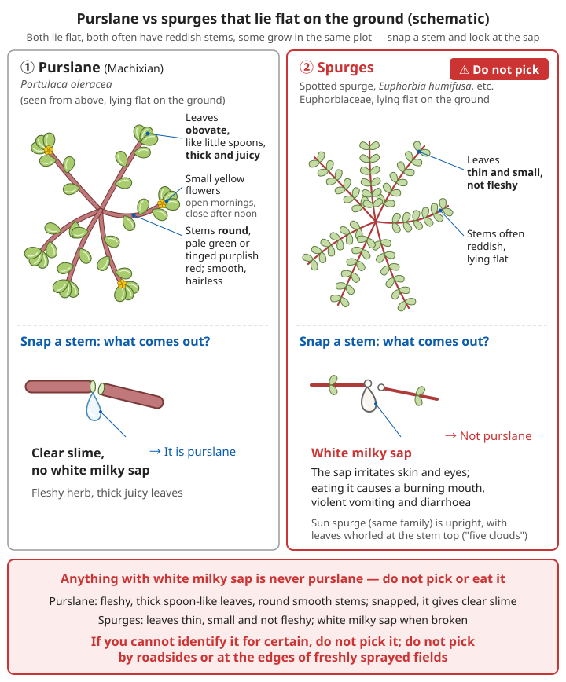

# Whole Herbs

> **Whole herbs are the herbs you are most likely to collect in the wild. They grow by roads, on field banks and on riverbanks, so they are quick to recognise and just as quick to mistake. Crushing a leaf and smelling it, or snapping a stem to see whether it bleeds white sap, is more useful than remembering the name**

This chapter covers 32 common whole-herb medicines (the part used is the whole plant, the aerial parts, the stems and leaves, or a fleshy stem with scale leaves; *Xiakucao* uses the fruit spike and *Xixin* only the root and rhizome, but by custom both are placed here). They are roughly grouped by action into five groups: exterior-releasing and aromatic; heat-clearing and detoxifying; damp-draining and jaundice-relieving; blood-moving and bleeding-stopping; and wind-dispelling, tonic and others. General methods for identification, harvesting, drying and storage are in the [General Principles](../../../docs/10-中药材识别与采集/00-总论.md) and are not repeated here. How to grow mint, dandelion, houttuynia, plantain, purslane, self-heal and motherwort is already covered in [Medicinal Plants: Identification and Growing](../../../docs/04-动植物培育/04-药用植物.md); this chapter covers only identification and collection.

## ⚠️ Read these first

```
1. The most common mistake with whole herbs is "picking the wrong plant":
   check at least 3 features before you pick
   (stem shape, leaf arrangement, flowers, smell, whether the broken
   surface bleeds milky sap).
   If any one does not match, do not pick
2. Distinctions you must remember:
   - Mint: crushed, it has a clear, cooling mint smell; do not pick a
     "wild mint" without this smell
   - Purslane: leaves are fleshy and the broken stem gives clear slime;
     plants that lie flat on the ground and bleed white milky sap when
     snapped are spurges such as spotted spurge or sun spurge. Do not pick
   - Dandelion: one flower stalk carries only one flower at its tip;
     plants with branched stems carrying several flowers are sow thistle,
     Oriental hawksbeard and the like. Most are not poisonous, but they
     are not the Pharmacopoeia's dandelion
3. Ephedra: strictly controlled by the state (ephedrine is a raw material
   for making illegal drugs).
   Do not collect, buy, transport or use it yourself; people with high
   blood pressure or heart disease must not use it
4. Asarum (Xixin): use only the root and rhizome (the aerial parts contain
   more aristolochic acid).
   It is slightly toxic and the dose is very small; do not collect or use
   it yourself
5. Qinghao cannot replace antimalarial drugs: artemisinin is extracted and
   purified from sweet wormwood;
   a decoction of Qinghao contains extremely little. Malaria must be
   treated by a doctor
6. Wild Dendrobium (Shihu), Cistanche (Roucongrong) and similar herbs are
   protected by the state;
   almost everything on sale is cultivated. Do not dig up wild plants
7. Pregnant women must not use blood-moving herbs such as motherwort
   (Yimucao) and Zelan;
   people taking anticoagulants or antiplatelet drugs such as warfarin or
   aspirin must ask a doctor before using any blood-moving or
   bleeding-stopping herb
8. Doses are the usual adult daily doses in the Chinese Pharmacopoeia
   (2020 edition) (prepared slices, decocted in water;
   the current edition is 2025; the current edition's text prevails).
   They are given only as a reminder "not to exceed"; whether to use a
   herb and how much is decided under the guidance of a TCM practitioner
9. Whole herbs by roads and field edges easily pick up pesticides, heavy
   metals and vehicle exhaust;
   collect away from roads, factories and fields that have just been sprayed
```

---

## Quick reference to this chapter

The "Toxicity / protection" column gives toxicity noted in the Pharmacopoeia, this book's risk warnings, and the protection status of wild resources. Protection grades follow the text of the lists published by the state; this table is only a reminder.

| Herb | Part used | Main actions | Toxicity / protection | See |
|------|---------|---------|----------|-----|
| Bohe (mint) | Aerial parts | Disperses wind-heat | Beware "false mint" | [1.1](#11-bohe-mint) |
| Guanghuoxiang (patchouli) | Aerial parts | Aromatically transforms turbidity, stops vomiting | — | [1.2](#12-guanghuoxiang-patchouli) |
| Jingjie (schizonepeta) | Aerial parts | Releases the exterior, disperses wind | — | [1.3](#13-jingjie-schizonepeta) |
| Xiangru (mosla) | Aerial parts | Induces sweating to release the exterior, transforms damp | Not for those with exterior deficiency and heavy sweating | [1.4](#14-xiangru-mosla) |
| Peilan (fortune's boneset) | Aerial parts | Aromatically transforms damp | Contains pyrrolizidine alkaloids; do not take in large amounts for long | [1.5](#15-peilan-fortunes-boneset) |
| Mahuang (ephedra) | Herbaceous stem | Induces sweating to dispel cold, relieves wheezing | ⚠️ State-controlled; forbidden with high blood pressure or heart disease | [1.6](#16-mahuang-ephedra) |
| Pugongying (dandelion) | Whole plant | Clears heat and detoxifies, reduces swelling and dissipates lumps | Beware mixing in sow thistle and similar | [2.1](#21-pugongying-dandelion) |
| Zihuadiding (Yedo violet) | Whole plant | Clears heat and detoxifies, cools the blood and reduces swelling | — | [2.2](#22-zihuadiding-yedo-violet) |
| Yuxingcao (houttuynia) | Whole plant or aerial parts | Clears heat and detoxifies, reduces abscesses and expels pus | — | [2.3](#23-yuxingcao-houttuynia) |
| Baijiangcao (patrinia) | Whole plant | Clears heat and detoxifies, reduces abscesses and expels pus | Not in the Pharmacopoeia; different plants under the same name in north and south | [2.4](#24-baijiangcao-patrinia) |
| Machixian (purslane) | Aerial parts | Clears heat and detoxifies, cools the blood and stops dysentery | ⚠️ Beware mixing in spurges (white milky sap) | [2.5](#25-machixian-purslane) |
| Chuanxinlian (andrographis) | Aerial parts | Clears heat and detoxifies, cools the blood | Extremely bitter, harms the stomach | [2.6](#26-chuanxinlian-andrographis) |
| Baihuasheshecao (oldenlandia) | Whole plant | Clears heat and detoxifies, drains damp | Not in the Pharmacopoeia; cannot replace cancer treatment | [2.7](#27-baihuasheshecao-oldenlandia) |
| Banzhilian (barbed skullcap) | Whole plant | Clears heat and detoxifies, resolves stasis and promotes urination | Not advisable in pregnancy | [2.8](#28-banzhilian-barbed-skullcap) |
| Xiakucao (self-heal spike) | Fruit spike | Clears the liver and drains fire, dissipates lumps | — | [2.9](#29-xiakucao-self-heal-spike) |
| Danzhuye (lophatherum) | Stems and leaves | Clears heat and relieves restlessness, promotes urination | Not bamboo leaves | [2.10](#210-danzhuye-lophatherum) |
| Qinghao (sweet wormwood) | Aerial parts | Clears deficiency heat, checks malaria | ⚠️ Cannot replace antimalarial drugs | [2.11](#211-qinghao-sweet-wormwood) |
| Yinchen (capillary wormwood) | Aerial parts | Clears damp-heat, relieves jaundice | Jaundice must be seen by a doctor | [3.1](#31-yinchen-capillary-wormwood) |
| Cheqiancao (plantain) | Whole plant | Clears heat and promotes urination, expels phlegm | — | [3.2](#32-cheqiancao-plantain) |
| Jinqiancao (lysimachia) | Whole plant | Drains damp and relieves jaundice, relieves painful urination and expels stones | Many different plants under the same name | [3.3](#33-jinqiancao-lysimachia) |
| Yimucao (motherwort) | Aerial parts | Moves blood and regulates menstruation, promotes urination | ⚠️ Not in pregnancy; not with poor kidney function | [4.1](#41-yimucao-motherwort) |
| Zelan (bugleweed) | Aerial parts | Moves blood and regulates menstruation, drains water | Not in pregnancy; do not confuse with Peilan | [4.2](#42-zelan-bugleweed) |
| Xianhecao (hairy agrimony) | Aerial parts | Astringes and stops bleeding | — | [4.3](#43-xianhecao-hairy-agrimony) |
| Xiaoji (field thistle) | Aerial parts | Cools the blood and stops bleeding | — | [4.4](#44-xiaoji-field-thistle) |
| Daji (Japanese thistle) | Aerial parts | Cools the blood and stops bleeding | — | [4.5](#45-daji-japanese-thistle) |
| Mohanlian (eclipta) | Aerial parts | Nourishes liver and kidney, cools the blood and stops bleeding | — | [4.6](#46-mohanlian-eclipta) |
| Shenjincao (clubmoss) | Whole plant | Dispels wind and damp, relaxes the sinews | Use with caution in pregnancy; beware mixing in toothed clubmoss | [5.1](#51-shenjincao-clubmoss) |
| Shihu (dendrobium) | Stem | Benefits the stomach and generates fluids, nourishes yin and clears heat | 🛡️ All wild *Dendrobium* species are state-protected | [5.2](#52-shihu-dendrobium) |
| Yinyanghuo (epimedium) | Leaf | Tonifies kidney yang, strengthens sinews and bones | Liver injury has been reported | [5.3](#53-yinyanghuo-epimedium) |
| Roucongrong (cistanche) | Fleshy stem with scale leaves | Tonifies kidney yang, moistens the intestines to relieve constipation | 🛡️ Wild cistanche is protected | [5.4](#54-roucongrong-cistanche) |
| Suoyang (cynomorium) | Fleshy stem | Tonifies kidney yang, moistens the intestines to relieve constipation | Wild resources are scarce | [5.5](#55-suoyang-cynomorium) |
| Xixin (asarum) | Root and rhizome | Releases the exterior and dispels cold, relieves pain | ⚠️ Slightly toxic; aerial parts contain aristolochic acid | [5.6](#56-xixin-asarum) |

---

## 1. Exterior-releasing and aromatic herbs

Most herbs in this group are aromatic plants of the mint family (Lamiaceae) and the daisy family (Asteraceae); **crushing a leaf and smelling it** is the quickest way to recognise them. They contain volatile oils, so they do not stand long boiling or long storage. *Mahuang* is the exception: it is not a "fragrant herb" but a state-controlled plant, listed here only so that readers can recognise and avoid it.

### 1.1 Bohe (mint)

- **Bohe (Subohe, Nanbohe, Yebohe)**: Chinese 薄荷(苏薄荷、南薄荷、野薄荷); mint
- **Source**: the dried aerial parts of mint, *Mentha haplocalyx* Briq. (Lamiaceae)
- **Distribution and habitat**: grows wild in most of China, by streams and ditches and in damp grassland; grown on a large scale in Jiangsu, Anhui, Jiangxi and elsewhere
- **Identification**:
  - Plant: perennial herb, 30-60 cm tall; **square stem**; **opposite leaves**, oblong-lanceolate or ovate, with toothed edges; **whorls of flowers in the leaf axils**, ring after ring of small pale purple or white flowers; creeping underground stems
  - Dried herb: stems square, purplish brown or pale green, hairy on the angles; broken surface white, pith hollow; leaves mostly shrivelled, upper surface dark green, lower surface grey-green, with sunken gland dots visible against the light
  - Smell: **rubbed, it gives off a strong, distinctive cooling fragrance**; taste pungent and cool. This is the most important confirming feature
- **Look-alikes ("false mint")**:
  - **Spearmint** (*Liulanxiang*, also called green mint or *xianghuacai*): also a *Mentha* species, but its smell is sweeter and **has no clear cooling feel**, and its flowers are crowded in long spikes at the stem tips (mint's flowers are in whorls in the leaf axils); not poisonous, but not the Pharmacopoeia's mint
  - **Pennyroyal** (European mint, *M. pulegium*): sometimes grown as an ornamental or to repel mosquitoes; its smell is sharp. It contains pulegone, **which can damage the liver; swallowing the essential oil can kill**. Do not use any "mint" you do not know as medicine or tea
  - In the wild there are many mint-family plants with square stems, opposite leaves and a scent (Korean mint, schizonepeta, perilla, *Mosla* and others); mistaking one for another rarely causes poisoning. What you really need to avoid is **taking a wild plant without the cooling mint smell for mint**
- **Harvesting and processing**: in summer and autumn, when stems and leaves are lush or the flowers have opened to the third whorl, cut on sunny days in several rounds; dry in the sun or in the shade. Shade-drying keeps the scent better
- **Storage**: contains volatile oil, so **the scent fades the longer it is kept**; seal, keep out of light, store in a cool place, and generally keep no longer than 1 year
- **Actions**: disperses wind-heat, clears the head and eyes, benefits the throat, vents rashes, soothes the liver and moves *qi*
- **Dose**: 3-6 g, **added near the end** (put it in when the other herbs are almost done and boil for only a few minutes) (Chinese Pharmacopoeia, 2020 edition; use under the guidance of a TCM practitioner)
- **Cautions**: not advisable for weak people who sweat a lot; **do not apply peppermint oil or cooling balm near the nostrils of babies and young children** (it can cause laryngeal spasm and difficulty breathing); taking large amounts while breastfeeding may reduce milk (experience)
- For growing, see [Medicinal Plants – Mint](../../../docs/04-动植物培育/04-药用植物.md#薄荷)

### 1.2 Guanghuoxiang (patchouli)

- **Guanghuoxiang (Huoxiang, Zhixiang)**: Chinese 广藿香(藿香、枝香); patchouli
- **Source**: the dried aerial parts of patchouli, *Pogostemon cablin* (Blanco) Benth. (Lamiaceae)
- **Distribution and habitat**: native to South-East Asia, grown in Guangdong, Hainan, Guangxi and elsewhere in China; it seldom flowers in China and is practically never found wild
- **Identification**:
  - Plant: perennial aromatic herb or subshrub, 30-100 cm tall; stem upright and much branched, **densely covered in soft hairs**; leaves opposite, broadly ovate, with coarse blunt teeth, **grey-white felt on both sides**, soft to the touch
  - Dried herb: stem roughly square, covered in soft hairs; old stems nearly round, grey-brown; pith in the middle of the broken surface; leaves shrivelled into clumps, ovate when flattened, grey-white felt on both sides
  - Smell: **a distinctive, strong scent**; taste slightly bitter
- **Look-alikes**: the "*Huoxiang*" usually meant in northern China is mostly **Korean mint** (*Tuhuoxiang*, *Agastache rugosa*, Lamiaceae), common in the wild and in gardens. Its stem is square with few hairs, its leaves heart-shaped to ovate, its flowers purple spikes, and **it has a sweet, aniseed-like scent**. It is not poisonous and is used as *Huoxiang* locally, but it is not the Pharmacopoeia's patchouli
- **Harvesting and processing**: cut when the branches and leaves are lush; **sun by day and sweat by night** (spread in the sun during the day, heap it up and cover it at night), repeating until dry
- **Storage**: contains volatile oil; seal and keep in a cool, dry place to stop the scent escaping
- **Actions**: aromatically transforms turbidity, harmonises the middle and stops vomiting, releases the exterior and relieves summer heat
- **Dose**: 3-10 g (Chinese Pharmacopoeia, 2020 edition; use under the guidance of a TCM practitioner)
- **Cautions**: not advisable with yin deficiency and excess fire; for vomiting and diarrhoea with fever and thirst in summer, replace fluids first (see [Diarrhoeal infectious diseases](../../../docs/01-日常疾病和伤害/15-传染病家庭防控.md#腹泻类传染病)); dehydration, high fever or listlessness need a doctor

### 1.3 Jingjie (schizonepeta)

- **Jingjie (Xiangjingjie, Jiasu)**: Chinese 荆芥(香荆芥、假苏); schizonepeta
- **Source**: the dried aerial parts of schizonepeta, *Schizonepeta tenuisfolia* Briq. (Lamiaceae); the flower spikes used alone are called "*Jingjiesui*"
- **Distribution and habitat**: mainly from Jiangsu, Zhejiang, Jiangxi, Hebei and elsewhere, mostly cultivated; occasionally wild on hillsides and by roads
- **Identification**:
  - Plant: annual herb, 60-100 cm tall; stem square, with short soft hairs; **leaves opposite, pinnately divided deep into 3-5 lobes, the lobes narrow and strap-like** (clearly different from mint and Korean mint); **spikes of whorled flowers at the branch tips**, small pale purple flowers
  - Dried herb: stem square, branched in the upper part, pale yellowish green or pale purplish red, with short soft hairs; broken surface whitish; leaves mostly fallen; flower spikes 2-9 cm long
  - Smell: **aromatic**; taste slightly astringent, pungent and cool
- **Look-alikes**: **catnip** (*Nepeta cataria*), in the same family, has a similar Chinese name, but its leaves are ovate and not deeply lobed; it is not the Pharmacopoeia's *Jingjie*. Mixing it up with other fragrant mint-family plants rarely causes poisoning, but the actions differ
- **Harvesting and processing**: in summer and autumn, cut **when flowering has reached the top and the spikes are still green**; remove impurities and dry in the sun
- **Storage**: contains volatile oil; seal and keep in a cool, dry place
- **Actions**: releases the exterior and disperses wind, vents rashes, disperses sores
- **Dose**: 5-10 g (Chinese Pharmacopoeia, 2020 edition; use under the guidance of a TCM practitioner)
- **Cautions**: not advisable for spontaneous sweating from exterior deficiency or for headache from yin deficiency; a rash with fever, difficulty breathing or facial swelling needs a doctor

### 1.4 Xiangru (mosla)

- **Xiangru (Qingxiangru, Jiangxiangru)**: Chinese 香薷(青香薷、江香薷); Chinese mosla
- **Source**: the dried aerial parts of *Mosla chinensis* Maxim. or *M. chinensis* 'Jiangxiangru' (Lamiaceae). The first is traditionally called "*Qingxiangru*", the second "*Jiangxiangru*"
- **Distribution and habitat**: *Mosla chinensis* grows wild on grassy hillsides and in rock crevices in East, South and South-West China; 'Jiangxiangru' is mainly cultivated in Jiangxi
- **Identification**:
  - Plant: upright annual herb, 10-40 cm tall ('Jiangxiangru' can exceed 50 cm); stem square, **covered in long white soft hairs**; **leaves opposite, narrowly lanceolate, with sparse shallow teeth, gland dots on both sides**; terminal racemes of small pale purplish-red flowers
  - Dried herb: densely covered all over in white hairs; stem square, purplish red at the base, yellowish green above; leaves mostly shrivelled or fallen
  - Smell: **a clear, strong fragrance**; taste slightly pungent and cool
- **Look-alikes**: other plants called "*Xiangru*" locally include *Elsholtzia* species such as *Haizhou xiangru* and *Elsholtzia ciliata* (also called *Tuxiangru*), with broad ovate leaves and flower spikes leaning to one side; generally not poisonous, but not the Pharmacopoeia herb
- **Harvesting and processing**: in summer, when stems and leaves are lush and in full flower, cut on a sunny day, remove impurities and **dry in the shade**
- **Storage**: contains volatile oil; seal and keep in a cool place
- **Actions**: induces sweating to release the exterior, transforms damp and harmonises the middle
- **Dose**: 3-10 g (Chinese Pharmacopoeia, 2020 edition; use under the guidance of a TCM practitioner)
- **Cautions**: it is a fairly strong sweating herb; **do not use it for exterior deficiency with heavy sweating, or for heat illness with profuse sweating**. In heat illness with dizziness, weakness, very high body temperature or confusion, cool the person, replace fluids and get to a doctor first; do not rely on *Xiangru* alone

### 1.5 Peilan (fortune's boneset)

- **Peilan (Xingtoucao, Lancao)**: Chinese 佩兰(省头草、醒头草、兰草); fortune's boneset
- **Source**: the dried aerial parts of *Eupatorium fortunei* Turcz. (Asteraceae)
- **Distribution and habitat**: roadsides, thickets and streamsides south of the Yangtze; also cultivated
- **Identification**:
  - Plant: perennial herb, 40-100 cm tall; **stem round** (not square), often tinged purplish red; leaves opposite, the middle leaves often **divided right to the base into 3**, the lobes long-elliptic with toothed edges; **small flower heads in flat-topped clusters, flowers white or tinged pale red**
  - Dried herb: stem round, yellowish brown or yellowish green, with clear nodes and lengthwise ridges; pith white or hollow; leaves mostly shrivelled and broken, greenish brown
  - Smell: **aromatic**; taste slightly bitter
- **Look-alikes**: **Zelan** (see [4.2](#42-zelan-bugleweed)) has a similar name, but *Zelan* is in the mint family, **with a square stem** and flowers in whorls in the leaf axils; the two have different actions. Many wild species in the same genus (*Eupatorium*) look similar
- **Harvesting and processing**: cut twice in summer and autumn, remove impurities and dry in the sun
- **Storage**: seal and keep in a cool, dry place to stop the scent escaping
- **Actions**: aromatically transforms damp, awakens the spleen and opens the appetite, releases the exterior and relieves summer heat
- **Dose**: 3-10 g (Chinese Pharmacopoeia, 2020 edition; use under the guidance of a TCM practitioner)
- **Cautions**: research has found that *Peilan* contains **pyrrolizidine alkaloids** (which can damage the liver; the same class as the toxic constituents of *Gynura japonica*, *Jusanqi*), so **do not take it for long or in large amounts**; do not substitute other wild *Eupatorium* species; people with liver disease and pregnant women must not use it

### 1.6 Mahuang (ephedra)

- **Mahuang (Caomahuang, Mahuangcao)**: Chinese 麻黄(草麻黄、麻黄草); ephedra
- **Source**: the dried herbaceous stems of *Ephedra sinica* Stapf, *E. intermedia* Schrenk et C. A. Mey. or *E. equisetina* Bge. (Ephedraceae)
- **Distribution and habitat**: dry steppe, desert and sand dunes in Inner Mongolia, Shanxi, Hebei, Ningxia, Gansu, Xinjiang and elsewhere
- **Identification** (only so that you can recognise and avoid it):
  - Plant: small shrub, 20-40 cm tall; **it seems to have almost no leaves**, just tufts of **thin, long, green, jointed herbaceous stems**, with tiny papery scale leaves at the nodes; female plants bear red fleshy "fruits" (bracts)
  - Dried herb: long, thin and cylindrical, with fine lengthwise ridges, slightly rough to the touch; nodes clear; **pith reddish brown in the broken surface** (traditionally called the "rose heart"); smell faintly fragrant, taste astringent and slightly bitter
  - Difference from horsetails (*Equisetum*): horsetail stems are hollow, each node has a ring of sheath teeth, and the stem can be pulled apart at a node and pushed back in; ephedra has reddish-brown pith and cannot be pulled apart and rejoined like this
- **Harvesting and processing**: harvested to plan only by licensed organisations; individuals do not collect it
- **Actions**: induces sweating and dispels cold, opens the lungs and relieves wheezing, promotes urination and reduces swelling
- **Dose**: **only on a doctor's prescription, dispensed by a proper pharmacy; never use it yourself** (this book gives no self-use dose)
- **Cautions**: ephedra contains **ephedrine**, which can raise blood pressure, speed up the heart and cause heart rhythm problems and sleeplessness. **People with high blood pressure, coronary heart disease or other heart disease, an overactive thyroid, glaucoma, or an enlarged prostate with difficulty passing urine must not use it**; not for weak people who sweat a lot; not for people taking blood pressure medicines or antidepressants (especially monoamine oxidase inhibitors); athletes should note that ephedrine is a banned stimulant
- ⚠️ **Legal reminder**: ephedrine, ephedra extract and the like are **Category 1 precursor chemicals**. In 2000 the State Council issued a specific notice to stop the reckless digging of liquorice and ephedra, and every region licenses the collection, purchase and transport of ephedra; buying or transporting it without a licence leads to seizure and prosecution. **Do not collect, buy, transport or use ephedra yourself**. "*Mahuanggen*" (ephedra root, used to stop sweating) is a different herb; do not collect it yourself either

---

## 2. Heat-clearing and detoxifying herbs

This group contains the commonest weeds by roads and fields, and many of them are also wild vegetables. Most are cold in nature and bitter in taste, so **people with a cold, weak digestion who often have diarrhoea should not use them much or for long**. "Clearing heat and detoxifying" is not the same as an anti-inflammatory drug: a wound whose redness and swelling is spreading, red streaks, fever, pus-forming infections, appendicitis and pneumonia must all be seen by a doctor.

### 2.1 Pugongying (dandelion)

- **Pugongying (Popoding, Huanghuadiding, Naizhicao)**: Chinese 蒲公英(婆婆丁、黄花地丁、奶汁草); dandelion
- **Source**: the dried whole plant of *Taraxacum mongolicum* Hand.-Mazz., *T. borealisinense* Kitam. or several other species of the same genus (Asteraceae)
- **Distribution and habitat**: roadsides, field banks, grassland, riverbanks and courtyards all over China; extremely common
- **Identification**:
  - Plant: perennial herb **with no stem above ground**; all leaves grow from the root crown and lie flat in a rosette, oblanceolate, **deeply pinnately lobed, the lobes often pointing back towards the leaf base ("backward-pointing lobes")**; the whole plant **bleeds white milky sap when broken**
  - Flower: **the flower stalk is hollow and unbranched, with only one yellow flower head at the top of each stalk**; after flowering it forms a white fluffy ball (the "dandelion clock")
  - Dried herb: shrivelled, curled clumps; root conical, much bent, brown, with brown or yellowish-white hairs at the crown; leaves greenish brown, mostly shrivelled and broken; 1 to several flower stalks, flower heads yellowish brown or pale yellowish white; smell faint, taste slightly bitter
- **Look-alikes**:
  - **Sow thistle** (*Kucai*, *Sonchus oleraceus*) and **field sow thistle** (*Qumaicai*): also yellow-flowered with white milky sap, but **with a clear, branching stem above ground**; the stem leaves clasp the stem at the base, and one plant bears several flowers
  - **Oriental hawksbeard** (*Huangancai*, *Youngia japonica*): also has a rosette of leaves, but from its centre rise **much-branched flowering stems topped with many small yellow flowers less than 1 cm across**
  - *Ixeridium sonchifolium*, wild lettuce and others are similar. Most of these are traditional wild vegetables and generally not poisonous, but they are not the Pharmacopoeia's dandelion; just check the three points "no stem, single flower, hollow flower stalk"
  - What you really need to avoid is taking **yellow-flowered buttercups** (leaves palmately divided, petals with a waxy shine, no milky sap; poisonous) or **groundsel** (*Senecio*, *Qianliguang*, which contains pyrrolizidine alkaloids) for dandelion
- **Harvesting and processing**: from spring to autumn, **when the flowers first open**, dig up the whole plant with its root, remove impurities, wash and dry in the sun; young leaves can be picked at any time as a wild vegetable
- **Storage**: easily gets damp and mouldy; once thoroughly dry, keep in a ventilated, dry place
- **Actions**: clears heat and detoxifies, reduces swelling and dissipates lumps, promotes urination and relieves painful urination
- **Dose**: 10-15 g (Chinese Pharmacopoeia, 2020 edition; use under the guidance of a TCM practitioner)
- **Cautions**: too large a dose can cause diarrhoea; not for people allergic to daisy-family plants; a red, hot, painful, swollen breast with fever (mastitis) or a lump that does not go down needs a doctor
- For growing, see [Medicinal Plants – Dandelion](../../../docs/04-动植物培育/04-药用植物.md#蒲公英)

### 2.2 Zihuadiding (Yedo violet)

- **Zihuadiding (Diding, Jiantoucao, Litoucao)**: Chinese 紫花地丁(地丁、箭头草、犁头草); Yedo violet
- **Source**: the dried whole plant of *Viola yedoensis* Makino (Violaceae)
- **Distribution and habitat**: fields, roadsides, waste ground, grassy slopes and woodland edges in most of China; flowers in early spring
- **Identification**:
  - Plant: small perennial herb, 4-14 cm tall, **with no stem above ground**; leaves all basal in a rosette, oblong or tongue-shaped to lanceolate, the base cut straight across or slightly heart-shaped, **the upper part of the leaf stalk narrowly winged**; the leaf looks like an arrowhead or a ploughshare
  - Flower: a thin, long flower stalk rises from the leaves; **the flower is violet, symmetrical only left to right, with 5 petals, the lowest drawn back into a thin, tube-like "spur"**; the capsule is elliptic and splits into 3 valves when ripe
  - Dried herb: mostly shrivelled into clumps; main root long and conical, pale yellowish brown; leaves grey-green; capsules elliptic or split into three valves, with many seeds; smell faint, taste slightly bitter and a little sticky
- **Look-alikes**: several plants are called "*Diding*": related violets such as *Viola prionantha* are often mixed in (not poisonous, but not the Pharmacopoeia herb); **Kudiding** (*Corydalis bungeana*, poppy family) is a different herb that contains alkaloids, with leaves finely divided several times and pale purple, long, narrow, tube-shaped flowers; *Mikoudai* (*Tiandiding*, a legume) has purple pea flowers and pinnate leaves. Check "leaf not divided, flower with a spur, capsule splitting in three"
- **Harvesting and processing**: collect the whole plant in spring and autumn, remove impurities and dry in the sun
- **Storage**: keep in a ventilated, dry place; protect from damp
- **Actions**: clears heat and detoxifies, cools the blood and reduces swelling
- **Dose**: 15-30 g (Chinese Pharmacopoeia, 2020 edition; use under the guidance of a TCM practitioner)
- **Cautions**: use with caution in people with a cold, weak constitution; boils and abscesses with spreading redness and swelling, red streaks or fever need a doctor (they may need to be cut and drained and treated with antibiotics)

### 2.3 Yuxingcao (houttuynia)

- **Yuxingcao (Jicai, Zheergen, Ceergen)**: Chinese 鱼腥草(蕺菜、折耳根、侧耳根); houttuynia, fish mint
- **Source**: the fresh whole plant or dried aerial parts of *Houttuynia cordata* Thunb. (Saururaceae)
- **Distribution and habitat**: shady, damp ditch sides, field banks, woodland floors and streamsides in the Yangtze basin and southwards; grown on a large scale as a vegetable in South-West China
- **Identification**:
  - Plant: perennial herb, 15-50 cm tall; underground stem white and jointed, rooting at the nodes; **leaves alternate, heart-shaped**, often purplish red underneath, with fine gland dots; stipules papery, joined to the leaf stalk to form a sheath
  - Flower: a terminal flower spike **with 4 white, petal-like bracts at its base**, so that from a distance it looks like one small white flower
  - Smell: **crushed, it has a strong fishy smell**. This is the confirming feature
  - Dried herb: stem flattened-cylindrical, twisted, yellowish brown, with lengthwise ridges and clear nodes; leaves rolled and shrivelled, heart-shaped when flattened, upper surface dull yellowish green to dark brown, lower surface grey-green; rubbed, it smells fishy; taste astringent
- **Look-alikes**: **Chinese lizard's tail** (*Sanbaicao*), in the same family, also grows by water, but its leaves are long-ovate, the leaves next to the flower spike turn white, and **it has no fishy smell**; do not pick a "*Yuxingcao*" that does not smell fishy
- **Harvesting and processing**: the fresh herb can be cut all year; for the dried herb, cut in summer when stems and leaves are lush and there are many flower spikes, remove impurities and dry in the sun
- **Storage**: protect the dried herb from damp and seal it; the fishy smell gradually fades
- **Actions**: clears heat and detoxifies, reduces abscesses and expels pus, promotes urination and relieves painful urination
- **Dose**: 15-25 g, **not boiled for long**; double the dose for the fresh herb, decocted or taken as juice; for external use, a suitable amount, pounded and applied, or boiled for steaming and washing (Chinese Pharmacopoeia, 2020 edition; use under the guidance of a TCM practitioner)
- **Cautions**: people with deficiency-cold should not take much; **severe allergic reactions have been reported with houttuynia injections**, which are different from oral slices; never use any injection yourself; a cough with high fever, shortness of breath, or pus or blood in the sputum needs a doctor
- For growing, see [Medicinal Plants – Houttuynia](../../../docs/04-动植物培育/04-药用植物.md#鱼腥草折耳根)

### 2.4 Baijiangcao (patrinia)

- **Baijiangcao (Baijiang, Huanghuabaijiang, Kucai)**: Chinese 败酱草(败酱、黄花败酱、苦菜); patrinia
- **Source**: **not included in Volume I of the 2020 edition of the Chinese Pharmacopoeia**; according to local standards and traditional use: the dried whole plant of **yellow patrinia** *Patrinia scabiosifolia* Fisch. ex Trev. or **white patrinia** *P. villosa* (Thunb.) Juss. (Valerianaceae; merged into Caprifoliaceae in newer classifications). **In many parts of northern China, field sow thistle (*Qumaicai*, Asteraceae) is customarily used as "*Baijiangcao*" (*Beibaijiang*, northern Baijiang)**; the two are completely different plants
- **Distribution and habitat**: yellow and white patrinia grow on grassy hillsides, woodland edges, roadsides and in thickets in most of China
- **Identification**:
  - Plant (yellow patrinia): perennial herb up to 1-2 m tall; basal leaves in a cluster, stem leaves **opposite, pinnately divided deeply or right to the midrib**; **large, flat-topped terminal clusters densely packed with many small yellow flowers** (white patrinia has white flowers and leaves mostly undivided or 3-lobed)
  - Smell: **the root and rhizome have a stale, rotten soy-paste smell** (hence the name), stronger when dried
  - Dried herb: rhizome jointed, with fibrous roots; stem round, yellowish green to yellowish brown, with clear nodes; leaves mostly shrivelled and broken; a distinctive stale soy-paste smell; taste slightly bitter
- **Look-alikes**: northern *Baijiang* (field sow thistle) has yellow strap-shaped flowers, white milky sap and alternate leaves, so it is easy to tell from yellow patrinia, which has the "soy-paste smell", opposite leaves and flat clusters of small yellow flowers. Which one to use follows the custom of local TCM practitioners
- **Harvesting and processing**: dig up the whole plant in summer and autumn, wash and dry in the sun
- **Storage**: keep in a ventilated, dry place; protect from damp
- **Actions**: clears heat and detoxifies, reduces abscesses and expels pus, dispels stasis and relieves pain (according to traditional use)
- **Dose**: usually 6-15 g (not in the Pharmacopoeia; from textbooks and experience; use under the guidance of a TCM practitioner)
- **Cautions**: use with caution in weak digestion or diarrhoea; **pain in the lower right abdomen with fever (suspected appendicitis) must be seen by a doctor**; do not rely on *Baijiangcao*

### 2.5 Machixian (purslane)

- **Machixian (Machicai, Changshoucai, Guazicai)**: Chinese 马齿苋(马齿菜、长寿菜、瓜子菜); purslane
- **Source**: the dried aerial parts of purslane, *Portulaca oleracea* L. (Portulacaceae)
- **Distribution and habitat**: vegetable plots, field edges, roadsides and the foot of walls all over China; extremely common in summer and autumn, and a traditional wild vegetable
- **Identification**:
  - Plant: annual **fleshy** herb; stems lying flat or rising at an angle, much branched, **round, pale green or tinged purplish red, smooth and hairless**; leaves alternate or nearly opposite, **obovate, shaped like a horse's tooth or a little spoon, thick and juicy**; small yellow flowers that open in the morning and close after noon
  - Broken surface: **snapped, it gives clear slime, never white milky sap**
  - Dried herb: mostly shrivelled and curled into clumps; stems yellowish brown with clear lengthwise grooves; leaves break easily, whole leaves obovate, greenish brown; fruit conical, containing many tiny black seeds; smell faint, taste slightly sour
- **Look-alikes (important)**: **spurges** (Euphorbiaceae) such as spotted spurge, *Euphorbia humifusa*, sun spurge and asthma weed also often lie flat on the ground with reddish stems, sometimes in the same plot. **They bleed white milky sap when broken**, and their leaves are thin, small and not fleshy (sun spurge stands upright, with its leaves in a whorl at the top of the stem, the "five clouds"). Spurge sap irritates the skin and eyes, and eating it causes burning pain in the mouth and violent vomiting and diarrhoea. **Anything with white milky sap is never purslane**
- **Harvesting and processing**: collect in summer and autumn, remove root remnants and impurities, wash, **then steam briefly or scald in boiling water before drying in the sun** (it is fleshy and juicy, so it is very hard to dry directly and rots easily)
- **Storage**: the dried herb easily gets damp and mouldy; seal once thoroughly dry
- **Actions**: clears heat and detoxifies, cools the blood and stops bleeding, stops dysentery
- **Dose**: 9-15 g; for external use, a suitable amount, pounded and applied to the affected area (Chinese Pharmacopoeia, 2020 edition; use under the guidance of a TCM practitioner); eating it as a wild vegetable in everyday amounts is safe
- **Cautions**: cold in nature; people with a cold, weak digestion or diarrhoea should eat little; pregnant women should not eat large amounts or use it as medicine; it contains a fair amount of oxalic acid, so people with kidney stones should not eat much; diarrhoea with high fever, pus and blood in the stool or severe dehydration needs a doctor
- For growing and eating, see [Medicinal Plants – Purslane](../../../docs/04-动植物培育/04-药用植物.md#马齿苋)



*Figure: Purslane is a fleshy herb with round, smooth, hairless stems and thick, juicy, obovate leaves shaped like little spoons; snapped, it gives clear slime. Spurges such as spotted spurge and Euphorbia humifusa also lie flat on the ground with reddish stems, but their leaves are thin, small and not fleshy, and they bleed white milky sap when broken. Anything with white milky sap is never purslane; do not pick it*

### 2.6 Chuanxinlian (andrographis)

- **Chuanxinlian (Yijianxi, Lanhelian, Kudancao)**: Chinese 穿心莲(一见喜、榄核莲、苦胆草); andrographis
- **Source**: the dried aerial parts of *Andrographis paniculata* (Burm. f.) Nees (Acanthaceae)
- **Distribution and habitat**: native to South Asia, grown in Guangdong, Guangxi, Fujian, Hainan and elsewhere in China, rare in the north; plants met in the wild are mostly garden escapes
- **Identification**:
  - Plant: annual herb, 50-80 cm tall; **stem square, nodes slightly swollen**; leaves opposite, ovate-lanceolate or lanceolate, smooth-edged or slightly wavy; flowers small, white with purple markings, two-lipped; **capsule long-elliptic, like an olive stone**
  - Dried herb: stem square, much branched, nodes slightly swollen, brittle and easily snapped; leaves mostly shrivelled and crumbly, upper surface green, lower surface grey-green
  - Taste: **extremely bitter** (the leaves most of all); one lick of a leaf fragment confirms it; smell faint
- **Look-alikes**: many plants have square stems and opposite leaves, but none is anything like as bitter. If it is not bitter, it is not *Chuanxinlian*
- **Harvesting and processing**: cut in early autumn when stems and leaves are lush and dry in the sun; the leaves contain more active constituents than the stems, so keep as many leaves as possible when harvesting
- **Storage**: the leaves crumble easily, so handle gently; keep in a dry place
- **Actions**: clears heat and detoxifies, cools the blood, reduces swelling
- **Dose**: 6-9 g; for external use, a suitable amount (Chinese Pharmacopoeia, 2020 edition; use under the guidance of a TCM practitioner)
- **Cautions**: bitter and cold, it harms the stomach, so **do not take much or for long**; not advisable with a cold, weak digestion; it can cause rashes and other allergic reactions, and severe allergic reactions have been reported with andrographis-type injections; use with caution in pregnancy

### 2.7 Baihuasheshecao (oldenlandia)

- **Baihuasheshecao (Sheshecao, Eryelü)**: Chinese 白花蛇舌草(蛇舌草、二叶葎); oldenlandia, spreading hedyotis
- **Source**: **not included in Volume I of the 2020 edition of the Chinese Pharmacopoeia**; according to local standards: the dried whole plant of *Hedyotis diffusa* Willd. (Rubiaceae) (some local standards also include *Hedyotis tenelliflora*)
- **Distribution and habitat**: field banks, paddy edges, damp open ground and roadsides south of the Yangtze
- **Identification**:
  - Plant: annual, **slender, sprawling** herb, 20-50 cm tall, branching from the base; **leaves opposite, stalkless, linear**, 1-3 cm long and only 1-3 mm wide, the stipules joined at the base
  - Flower: **small white flowers, single or in pairs in the leaf axils, on very short stalks or almost none**; corolla 4-lobed; capsule flattened-globose, with the persistent calyx teeth on top
  - Dried herb: tangled into clumps, grey-green or greyish brown; stems thin and curled, brittle and easily snapped; smell faint, taste bland
- **Look-alikes**: ***Shuixiancao*** (*H. corymbosa*) looks extremely similar and is the most common substitute. Its flowers are **in groups of 2-5 in a flat-topped cluster, on a clear common stalk**; other *Hedyotis* species are also often mixed in. Mixing them up generally does not poison, but they are not the same herb
- **Harvesting and processing**: collect the whole plant in summer and autumn, wash and dry in the sun
- **Storage**: keep in a ventilated, dry place; protect from damp
- **Actions**: clears heat and detoxifies, drains damp and relieves painful urination, reduces abscesses (according to traditional use)
- **Dose**: usually 15-30 g (not in the Pharmacopoeia; from local standards and experience; use under the guidance of a TCM practitioner)
- **Cautions**: use with caution in pregnancy; people with a cold, weak digestion should not take it for long. **It is popularly called an "anti-cancer herb", but it cannot replace surgery, chemotherapy, radiotherapy or other proper treatment**. Do not let it delay seeing a doctor

### 2.8 Banzhilian (barbed skullcap)

- **Banzhilian (Xiayehanxincao, Bingtoucao)**: Chinese 半枝莲(狭叶韩信草、并头草); barbed skullcap
- **Source**: the dried whole plant of *Scutellaria barbata* D. Don (Lamiaceae)
- **Distribution and habitat**: paddy edges, streamsides and damp grassland from North China southwards
- **Identification**:
  - Plant: perennial herb, 12-35 cm tall; stem square, hairless or sparsely short-haired near the top; leaves opposite, triangular-ovate or ovate-lanceolate, with sparse, shallow, blunt teeth
  - Flower: **single flowers in the upper leaf axils, all turned to one side**, like half a flowering branch (hence "*Banzhilian*", "half-branch lotus"); corolla blue-violet, two-lipped, about 1 cm long; **a small round shield-like bump on the back of the calyx** (a feature of the skullcap genus, *Scutellaria*)
  - Dried herb: 15-35 cm long, hairless or sparsely hairy on the flower axis; stems square, in clusters, dark purple or brownish green; leaves mostly shrivelled; fruit flattened-globose, light brown; smell faint, taste slightly bitter
- **Look-alikes**: related species such as ***Hanxincao*** (*Scutellaria indica*) are often mixed in, with broader, heart-shaped to ovate leaves hairy on both sides. **Its Chinese name differs by only one character from "*Banbianlian*" (*Lobelia chinensis*, bellflower family, slightly toxic)**: they are two different herbs; do not substitute one for the other by name
- **Harvesting and processing**: dig up in summer and autumn when stems and leaves are lush, wash and dry in the sun
- **Storage**: keep in a ventilated, dry place
- **Actions**: clears heat and detoxifies, resolves stasis and promotes urination
- **Dose**: 15-30 g (Chinese Pharmacopoeia, 2020 edition; use under the guidance of a TCM practitioner)
- **Cautions**: not advisable in pregnancy (it resolves stasis); use with caution in blood deficiency. Like *Baihuasheshecao*, **it cannot replace proper cancer treatment**

### 2.9 Xiakucao (self-heal spike)

- **Xiakucao (Xiakuqiu, Bangchuicao, Tiesecao)**: Chinese 夏枯草(夏枯球、棒槌草、铁色草); self-heal
- **Source**: the dried **fruit spike** (not the whole plant) of self-heal, *Prunella vulgaris* L. (Lamiaceae)
- **Distribution and habitat**: roadsides, waste slopes, grassland, woodland edges and field banks in most of China
- **Identification**:
  - Plant: perennial herb, 20-30 cm tall; **stem square, often tinged purplish red**; leaves opposite, ovate or ovate-lanceolate; **a short, thick terminal flower spike like a small club**, with purple or blue-violet flowers in whorl after whorl; **around the summer solstice the spike turns brown as if withered** ("*xiaku*", "withered in summer")
  - Dried herb: cylindrical fruit spike, slightly flattened, 1.5-8 cm long and 0.8-1.5 cm across, pale brown to reddish brown; made up of several to a dozen or more whorls of **persistent calyces and bracts**, each whorl with 2 opposite fan-shaped bracts ending in a pointed tail, with clear veins and white hairs outside; each bract holds 3 flowers, and each persistent calyx holds 4 nutlets; light; smell faint, taste bland
- **Look-alikes**: the flower spikes of other mint-family plants (such as wild *Clinopodium* or bugle, *Ajuga*) have a different shape; check "short, thick club shape, fan-shaped bracts with a pointed tail, turning brown in summer"
- **Harvesting and processing**: collect in summer when the fruit spikes turn reddish brown, remove impurities and dry in the sun
- **Storage**: keep in a ventilated, dry place; protect from damp and insects
- **Actions**: clears the liver and drains fire, brightens the eyes, dissipates lumps and reduces swelling
- **Dose**: 9-15 g (Chinese Pharmacopoeia, 2020 edition; use under the guidance of a TCM practitioner)
- **Cautions**: cold in nature; use with caution with a weak digestion; **if you feel a lump in the neck or breast, do not treat it yourself with a "lump-dissipating" herb; go to hospital first to find out what it is**; it has been reported to lower blood pressure, so people taking blood pressure medicines should ask a doctor first
- For growing and more on identification in the wild, see [Medicinal Plants – Self-heal](../../../docs/04-动植物培育/04-药用植物.md#夏枯草)

### 2.10 Danzhuye (lophatherum)

- **Danzhuye (Zhuyemaidong, Shanjimi)**: Chinese 淡竹叶(竹叶麦冬、山鸡米); lophatherum
- **Source**: the dried stems and leaves of *Lophatherum gracile* Brongn. (Poaceae). **It is a grass, not the leaf of a bamboo**; the leaves of bamboos (such as *Phyllostachys*) are a different herb called "*Zhuye*"
- **Distribution and habitat**: hillside woodland floors and shady, damp roadsides and ditch sides from the Yangtze basin southwards
- **Identification**:
  - Plant: perennial herb, 40-80 cm tall; the fibrous roots often swell in the middle into **small spindle-shaped root tubers** (like small *Maidong*, ophiopogon); leaf blade lanceolate, 6-20 cm long and 1.5-2.5 cm wide
  - Key feature: **between the parallel veins of the leaf there are small cross-veins; held against the light, they show as rows of little rectangles**, clearer on the underside. This is the best way to tell it from other grasses
  - Dried herb: stem round, jointed, pale yellowish green, hollow when broken; leaf sheaths split; leaf blades light green or yellowish green, with a rectangular grid of veins; light, soft and tough; smell faint, taste bland
- **Look-alikes**: other grasses and sedges on the woodland floor do not have the "rectangular grid"; Asiatic dayflower (commonly called "*Zhuyecai*", "bamboo-leaf vegetable") is a different plant and cannot replace it
- **Harvesting and processing**: cut in summer **before the flower spikes appear** and dry in the sun
- **Storage**: keep in a ventilated, dry place
- **Actions**: clears heat and drains fire, relieves restlessness and thirst, promotes urination and relieves painful urination
- **Dose**: 6-10 g (Chinese Pharmacopoeia, 2020 edition; use under the guidance of a TCM practitioner)
- **Cautions**: not advisable for weak people with cold; use with caution in pregnancy (experience); frequent, painful urination with fever, back pain or blood in the urine needs a doctor

### 2.11 Qinghao (sweet wormwood)

- **Qinghao (Huanghuahao, Chouhao, Caohao)**: Chinese 青蒿(黄花蒿、臭蒿、草蒿); sweet wormwood
- **Source**: the dried aerial parts of **sweet wormwood** (*Huanghuahao*), *Artemisia annua* L. (Asteraceae). Note: the plant source of the Pharmacopoeia's "*Qinghao*" is sweet wormwood; botanically there is another plant called "*Qinghao*" (*Xianghao*, *A. carvifolia*), which **contains almost no artemisinin** and is not the Pharmacopoeia's *Qinghao*
- **Distribution and habitat**: roadsides, waste ground, hillsides and riverbanks all over China; extremely common
- **Identification**:
  - Plant: annual herb, 1-2 m tall; stem upright, much branched; **leaves 3 times pinnately divided, the lobes tiny, like carrot leaves**; **flower heads extremely numerous, very small (1.5-2.5 mm across), round and yellow**, arranged in large pyramid-shaped clusters; **crushed, it has a strong, distinctive scent**
  - How *Xianghao* differs: its flower heads are larger (3.5-4 mm across) and hemispherical, and its leaf lobes are broader
  - Dried herb: stem round, much branched above, yellowish green or brownish yellow, with lengthwise ridges; fairly hard, with pith in the middle of the broken surface; leaves dark green or brownish green, curled and crumbly; a distinctive scent; taste slightly bitter
- **Look-alikes**: there are very many *Artemisia* species (mugwort, *Yinchen*, *Artemisia lavandulifolia* and others), with different leaf shapes and flower clusters, and most are not poisonous. But avoid **carrot-family plants with carrot-like leaves and white umbrella-shaped flower heads** (they may be water hemlocks and their relatives; see [Water hemlock vs water dropwort and wild carrot](../../../docs/10-中药材识别与采集/09-有毒中药与易混淆有毒植物.md#43-毒芹-vs-水芹野胡萝卜)). *Artemisia* has small yellowish-green ball-shaped flowers, not white umbrellas
- **Harvesting and processing**: cut in autumn **in full flower**, remove old stems and **dry in the shade** (artemisinin does not stand high temperatures; do not dry in strong sun or by baking)
- **Storage**: seal and keep in a cool, dry place
- **Actions**: clears deficiency heat, relieves steaming-bone fever, relieves summer heat, checks malaria, relieves jaundice
- **Dose**: 6-12 g, **added near the end** (Chinese Pharmacopoeia, 2020 edition; use under the guidance of a TCM practitioner)
- **Cautions**: use with caution with a weak digestion or diarrhoea
- ⚠️ **Cannot replace antimalarial drugs**: the antimalarial drug artemisinin is **extracted and purified** from sweet wormwood and then made into artemisinin-class medicines (artesunate, artemether and others), which must be used together with other antimalarial drugs. **A decoction of Qinghao contains extremely little artemisinin, and what it contains is unstable; it cannot treat malaria**. Fever and chills after being in a malaria area must be seen by a doctor as soon as possible for a blood test

---

## 3. Damp-draining and jaundice-relieving herbs

This group is used for jaundice, difficulty passing urine, urinary stones and the like. **Jaundice, urinary stones and painful urination with fever are all illnesses whose cause must be found**: yellow skin and whites of the eyes (possibly hepatitis, bile duct obstruction or haemolysis), renal colic, blood in the urine, and fever with back pain must be seen by a doctor first. Do not rely only on herbs to "relieve jaundice" or "expel stones".

### 3.1 Yinchen (capillary wormwood)

- **Yinchen (Mianyinchen, Huayinchen, Yinchenhao)**: Chinese 茵陈(绵茵陈、花茵陈、茵陈蒿); capillary wormwood
- **Source**: the dried aerial parts of *Artemisia scoparia* Waldst. et Kit. or *A. capillaris* Thunb. (Asteraceae). The herb collected in spring is traditionally called "*Mianyinchen*" (soft *Yinchen*), and that cut in autumn "*Huayinchen*" (flowering *Yinchen*)
- **Distribution and habitat**: roadsides, riverbanks, sandy ground, hillsides and waste ground in most of China
- **Identification**:
  - Spring seedlings: 6-10 cm tall, **densely covered all over in grey-white silky hairs, soft as felt to the touch**, leaves finely divided; this is when "*Mianyinchen*" is collected, and it is also an early-spring wild vegetable
  - Mature plant: subshrub-like or perennial herb, 40-100 cm tall; leaves 1-3 times pinnately divided to the midrib, **the lobes as fine as threads**; in autumn it bears masses of **very small, egg-shaped to round flower heads** in large pyramid-shaped clusters
  - Dried herb (*Mianyinchen*): mostly curled into clumps, grey-white or grey-green, densely covered all over in white hairs, soft as felt; leaves 1-3 times pinnately divided when flattened, the small lobes ovate or slightly oblanceolate or strap-shaped; **a clear, fresh scent**; taste slightly bitter
- **Look-alikes**: seedlings of other *Artemisia* species (mugwort, *A. lavandulifolia*, sweet wormwood and others) are often mixed in, and most are not poisonous; *Yinchen* seedlings stand out by **finely divided leaves plus a coat of grey-white hairs**. The folk saying "in the third month it is *Yinchen*, in the fourth it is just wormwood, in the fifth and sixth it is only firewood" refers to the harvest time
- **Harvesting and processing**: collect in spring when the seedlings are 6-10 cm tall, or cut in autumn from when the flower buds are formed until the flowers first open; remove impurities and old stems and dry in the sun
- **Storage**: *Mianyinchen* is light and soft and easily gets damp, cakes and goes mouldy; keep in a dry place and do not crush it
- **Actions**: clears damp-heat, benefits the gallbladder and relieves jaundice
- **Dose**: 6-15 g; for external use, a suitable amount, boiled for steaming and washing (Chinese Pharmacopoeia, 2020 edition; use under the guidance of a TCM practitioner)
- **Cautions**: use with caution for a sallow yellow complexion from blood deficiency; **jaundice must be seen by a doctor to find its cause**; do not give newborns with jaundice a *Yinchen* decoction yourself

### 3.2 Cheqiancao (plantain)

- **Cheqiancao (Chegulucai, Hamacao)**: Chinese 车前草(车轱辘菜、蛤蟆草); plantain
- **Source**: the dried whole plant of *Plantago asiatica* L. or *P. depressa* Willd. (Plantaginaceae). The ripe seeds are a separate herb, "*Cheqianzi*"; see [Fruits and seeds – Cheqianzi](../../../docs/10-中药材识别与采集/03-果实种子类.md#55-车前子)
- **Distribution and habitat**: roadsides, field banks, grassland, courtyards and ditch sides all over China; extremely common and tolerant of trampling
- **Identification**:
  - Plant: perennial herb (*P. depressa* is annual or biennial) **with no stem above ground**; all leaves grow from the root crown and lie flat in a rosette; leaf blade ovate or elliptic, **with 5-7 thick veins curving from the leaf base to the tip**; **pull the leaf stalk apart and white threads stretch out**
  - Flower: several upright, **thin, long flower spikes** rise from the leaves, with tiny pale green flowers; the capsule opens by a lid when ripe; seeds tiny, blackish brown
  - Difference between the two: *P. asiatica* has fibrous roots; *P. depressa* has a clear, cylindrical taproot
  - Dried herb: roots clustered and fibrous (*P. asiatica*) or with a taproot (*P. depressa*); leaves long-stalked, shrivelled, ovate-elliptic or broadly ovate when flattened, grey-green or dull green, with 5-7 clear curving veins; several flower spikes; smell faintly fragrant, taste slightly bitter
- **Look-alikes**: generally hard to mistake. Watch for two poisonous plants that also have curving parallel veins: **false hellebore** (*Veratrum*, *Lilu*: it has a stem above ground, clearly pleated leaves lengthwise, and brown net-like fibres at the stem base; see [Veratrum](../../../docs/10-中药材识别与采集/09-有毒中药与易混淆有毒植物.md#218-藜芦)) and **lily of the valley** (northern woodland floors; usually 2 leaves whose bases wrap into a sheath, and a string of white bell-shaped flowers). Neither grows in a flat rosette on the ground, and neither has thin, long green flower spikes
- **Harvesting and processing**: dig up the whole plant in summer, remove soil and dry in the sun
- **Storage**: keep in a ventilated, dry place; protect from damp
- **Actions**: clears heat, promotes urination and relieves painful urination, expels phlegm, cools the blood, detoxifies
- **Dose**: 9-30 g (Chinese Pharmacopoeia, 2020 edition; use under the guidance of a TCM practitioner)
- **Cautions**: it promotes urination, so pregnant women, people with poor kidney function and people taking diuretics should ask a doctor first; frequent, painful urination with fever, back pain or blood in the urine needs a doctor
- For growing and more on identification in the wild, see [Medicinal Plants – Plantain](../../../docs/04-动植物培育/04-药用植物.md#车前草)

### 3.3 Jinqiancao (lysimachia)

- **Jinqiancao (Guoluhuang, Dajinqiancao, Duizuocao)**: Chinese 金钱草(过路黄、大金钱草、对座草); Christina loosestrife
- **Source**: the dried whole plant of *Lysimachia christinae* Hance (Primulaceae)
- **Distribution and habitat**: hillside roadsides, ditch sides and damp woodland edges in the Yangtze basin and southwards; Sichuan is the main producer
- **Identification**:
  - Plant: perennial **creeping** herb; stems weak, running flat along the ground, 20-60 cm long, rooting at the lower nodes; **leaves opposite**, ovate, nearly round or kidney-round, smooth-edged; **small yellow flowers in pairs in the leaf axils, on long stalks**
  - Key feature: **soak a leaf soft in water and hold it against the light: you can see short black or brown streaks (gland streaks)**
  - Dried herb: often tangled into clumps, hairless or sparsely soft-haired; stems twisted, brown or dark reddish brown, solid when broken; leaves opposite, broadly ovate or heart-shaped when flattened, leaf stalk 1-4 cm long; some with flowers, yellow, single in the leaf axils, on long stalks; capsule round; smell faint, taste bland
- **Look-alikes (many different plants share the name)**:
  - ***Guangjinqiancao*** (*Desmodium styracifolium*, legume family, a separate entry in the Pharmacopoeia): an upright or sprawling, small shrub-like herb, with round simple leaves or 3 leaflets, **densely covered in white hairs underneath**
  - ***Lianqiancao*** (ground ivy, *Glechoma longituba*, mint family, a separate entry in the Pharmacopoeia): **square stem, fragrant when crushed**, pale purple two-lipped flowers
  - ***Jiangxi jinqiancao*** (*Dichondra*, *Matijin*, bindweed family), ***Xiaojinqiancao*** (*Hydrocotyle sibthorpioides*, *Tianhusui*, carrot family) and others: alternate, kidney-shaped or round leaves, used by local custom
  - These generally do not poison, but their actions differ; get the herb by the name on the prescription
- **Harvesting and processing**: collect in summer and autumn, remove impurities and dry in the sun
- **Storage**: keep in a ventilated, dry place
- **Actions**: drains damp and relieves jaundice, promotes urination and relieves painful urination, detoxifies and reduces swelling
- **Dose**: 15-60 g (Chinese Pharmacopoeia, 2020 edition; use under the guidance of a TCM practitioner)
- **Cautions**: use with caution in diarrhoea from spleen deficiency. **Renal colic with fever, little or no urine, a large stone, or only one kidney must be seen by a doctor**; do not rely on drinking *Jinqiancao* to "pass the stone". Obstruction with infection can quickly become life-threatening

---

## 4. Blood-moving and bleeding-stopping herbs

This group relates to menstruation, bleeding and blood stasis. **Blood-moving herbs increase the risk of bleeding, and bleeding-stopping herbs cannot hide the cause of bleeding**: pregnant women, people with heavy periods or a bleeding tendency, and people taking anticoagulant or antiplatelet drugs such as warfarin, aspirin or clopidogrel must ask a doctor before use; vomiting blood, blood in the stool (black stools), coughing up blood, blood in the urine and very heavy menstrual bleeding must be seen by a doctor first.

### 4.1 Yimucao (motherwort)

- **Yimucao (Kuncao, Chongwei, Yimuai)**: Chinese 益母草(坤草、茺蔚、益母艾); motherwort
- **Source**: the fresh or dried aerial parts of *Leonurus japonicus* Houtt. (Lamiaceae). The ripe fruits are a separate herb, "*Chongweizi*"
- **Distribution and habitat**: fields, roadsides, waste ground, grassy hillsides and riversides all over China
- **Identification**:
  - Plant: annual or biennial herb, 0.5-1 m tall; **stem square**, leaves opposite; **leaf shape varies a lot**: the basal leaves of seedlings are nearly round with shallowly lobed edges, the middle and lower stem leaves are **palmately divided deep into 3**, the leaves get narrower further up, and the top leaves are nearly strap-shaped
  - Flower: **in rings in the upper leaf axils**, corolla pink to pale purple, two-lipped; **the calyx has 5 spiny points, prickly when dry**
  - Dried herb: stem grey-green or yellowish green, light and tough, with pith in the middle of the broken surface; leaves grey-green, mostly shrivelled, broken and easily shed; whorls of flowers in the leaf axils, small flowers pale purple; smell faint, taste slightly bitter
- **Look-alikes**: the related ***Xiyeyimucao*** (*Leonurus sibiricus*, with narrower leaf lobes) is often used in its place; ***Xiazhicao*** (*Lagopsis supina*) and ***Zancai*** (*Leonurus pseudomacranthus*), both in the mint family, look similar but have white flowers or leaves that are not deeply divided. The seedling leaves are nearly round, so take care to tell them from seedlings of poisonous **buttercups**: buttercups have round stems, alternate leaves and yellow flowers with a waxy shine
- **Harvesting and processing**: for the fresh herb, cut from the seedling stage in spring until early summer before flowering; for the dried herb, cut in summer **when stems and leaves are lush and the flowers are not yet open or just opening**, and dry in the sun, or cut into sections and dry in the sun
- **Storage**: keep in a ventilated, dry place; protect from damp
- **Actions**: moves blood and regulates menstruation, promotes urination and reduces swelling, clears heat and detoxifies
- **Dose**: 9-30 g; fresh herb 12-40 g (Chinese Pharmacopoeia, 2020 edition; use under the guidance of a TCM practitioner)
- **Cautions**: **not in pregnancy** (the Pharmacopoeia says "use with caution in pregnancy"; it stimulates the uterus, so this book is stricter); not for people with heavy periods or a bleeding tendency; **kidney damage has been reported with large or long-term use, so people with poor kidney function must not use it**; not for people taking anticoagulant or antiplatelet drugs; heavy bleeding, fever or abdominal pain after childbirth needs a doctor
- For growing and more on identification in the wild, see [Medicinal Plants – Motherwort](../../../docs/04-动植物培育/04-药用植物.md#益母草)

### 4.2 Zelan (bugleweed)

- **Zelan (Diguaermiao, Disun)**: Chinese 泽兰(地瓜儿苗、地笋); shiny bugleweed
- **Source**: the dried aerial parts of *Lycopus lucidus* Turcz. var. *hirtus* Regel (Lamiaceae)
- **Distribution and habitat**: marshes, watersides, ditch sides and damp grassland in most of China
- **Identification**:
  - Plant: perennial herb, 0.6-1.7 m tall; **underground it has white, thick, creeping rhizomes ("*Disun*", "ground shoots", edible)**; **stem square**, usually unbranched, often hairy at the nodes; leaves opposite, lanceolate, with sharp teeth, almost stalkless
  - Flower: **small white flowers clustered in the leaf axils, ring after ring**
  - Dried herb: stem square, little branched, with shallow lengthwise grooves on all four sides, yellowish green or tinged purple, the nodes clearly purple, with white hairs; broken surface yellowish white, pith hollow; leaves blackish green above and grey-green below, densely gland-dotted, short-haired on both sides; flowers clustered in rings in the leaf axils, corollas mostly fallen; smell faint, taste bland
- **Look-alikes**: **Peilan** (daisy family, round stem, flower heads; see [1.5](#15-peilan-fortunes-boneset)) has a similar name, and old texts often confuse the two; check "square stem, flowers in rings in the leaf axils, white *Disun* underground"
- **Harvesting and processing**: cut in summer and autumn when stems and leaves are lush and dry in the sun
- **Storage**: keep in a ventilated, dry place
- **Actions**: moves blood and regulates menstruation, dispels stasis and reduces abscesses, drains water and reduces swelling
- **Dose**: 6-12 g (Chinese Pharmacopoeia, 2020 edition; use under the guidance of a TCM practitioner)
- **Cautions**: **not in pregnancy** (it moves blood); use with caution in blood deficiency without stasis; people taking anticoagulants should ask a doctor first. Eating *Disun* as a vegetable in everyday amounts is safe

### 4.3 Xianhecao (hairy agrimony)

- **Xianhecao (Longyacao, Tuolicao, Huanglongwei)**: Chinese 仙鹤草(龙芽草、脱力草、黄龙尾); hairy agrimony
- **Source**: the dried aerial parts of *Agrimonia pilosa* Ledeb. (Rosaceae)
- **Distribution and habitat**: hillsides, roadsides, grassland, woodland edges and streamsides all over China
- **Identification**:
  - Plant: perennial herb, 30-120 cm tall, covered all over in soft white hairs; **odd-pinnate compound leaves with large and small leaflets alternating** (very small leaflets sit between the pairs of large ones). This is the easiest feature to recognise; stipules sickle-shaped
  - Flowers and fruit: **thin, long spikes of small yellow flowers with 5 petals**; fruit inverted-conical, **with a ring of hooked bristles at the top**, which often stick to clothes and trouser legs
  - Dried herb: covered all over in soft white hairs; stem round and reddish brown below, square above with all four sides slightly sunken, greenish brown, with lengthwise grooves and ridges, hollow when broken; pinnate leaves dark green, shrivelled and curled, with large and small leaflets alternating along the leaf axis; smell faint, taste slightly bitter
- **Look-alikes**: other rose-family plants such as herb bennet (*Geum*, *Shuiyangmei*) also have pinnate leaves, yellow flowers and hooked fruits, but not "large and small leaflets alternating" or thin, long flower spikes; generally not poisonous
- **Harvesting and processing**: cut in summer and autumn when stems and leaves are lush, remove impurities and dry
- **Storage**: keep in a ventilated, dry place
- **Actions**: astringes and stops bleeding, checks malaria, stops dysentery, detoxifies, tonifies deficiency
- **Dose**: 6-12 g; for external use, a suitable amount (Chinese Pharmacopoeia, 2020 edition; use under the guidance of a TCM practitioner)
- **Cautions**: heavy bleeding, repeated bleeding and bleeding of unknown cause (such as black stools, coughing up blood or blood in the urine) must be seen by a doctor; "checking malaria" likewise cannot replace antimalarial drugs. For stopping bleeding from injuries, see [Wound and Injury Care](../../../docs/01-日常疾病和伤害/02-外伤处理.md)

### 4.4 Xiaoji (field thistle)

- **Xiaoji (Ciercai, Cicai, Qingqingcai)**: Chinese 小蓟(刺儿菜、刺菜、青青菜); field thistle
- **Source**: the dried aerial parts of *Cirsium setosum* (Willd.) MB. (Asteraceae)
- **Distribution and habitat**: fields, roadsides and waste ground all over China; a common farmland weed whose young shoots are also a traditional wild vegetable
- **Identification**:
  - Plant: perennial herb, 30-80 cm tall; **long creeping roots, so it often grows in patches**; leaves alternate, elliptic or long-elliptic to lanceolate, **smooth-edged or shallowly toothed, with fine, close spines along the edge**, not deeply divided
  - Flower: **flower heads single or several at the stem tips, purplish red, all tubular florets**; involucre bell-shaped, with many layers of bracts; male and female flowers on separate plants
  - Dried herb: stem round, grey-green or tinged purple, with lengthwise ridges and soft white hairs, hollow when broken; leaves shrivelled or broken, long-elliptic or oblong-lanceolate when flattened, spines at the tips of the teeth, soft white hairs on both sides; involucre bell-shaped, bracts in 5-8 layers, yellowish green; flowers purplish red; smell faint, taste slightly bitter
- **Look-alikes**: *Daji* (see [4.5](#45-daji-japanese-thistle)). The equally prickly **cocklebur** (*Xanthium*) has broad, triangular, heart-shaped leaves and small jujube-stone-shaped fruits covered in hooked spines; its seedlings and fruits are poisonous; see [Cocklebur seedlings and Cang'erzi](../../../docs/10-中药材识别与采集/09-有毒中药与易混淆有毒植物.md#410-苍耳幼苗和苍耳子)
- **Harvesting and processing**: cut in summer and autumn when in flower, remove impurities and dry in the sun
- **Storage**: keep in a ventilated, dry place
- **Actions**: cools the blood and stops bleeding, disperses stasis, detoxifies and reduces abscesses
- **Dose**: 5-12 g (Chinese Pharmacopoeia, 2020 edition; use under the guidance of a TCM practitioner)
- **Cautions**: use with caution with a cold, weak digestion or no stasis; **blood in the urine or stool, or repeated nosebleeds, must be seen by a doctor to find the cause**

### 4.5 Daji (Japanese thistle)

- **Daji (Ji, Maji, Huji)**: Chinese 大蓟(蓟、马蓟、虎蓟); Japanese thistle
- **Source**: the dried aerial parts of *Cirsium japonicum* Fisch. ex DC. (Asteraceae)
- **Distribution and habitat**: hillsides, grassland, roadsides and woodland edges in most of China
- **Identification**:
  - Plant: perennial herb, 0.5-1 m tall; roots clustered, with spindle-shaped root tubers; stem upright, ridged lengthwise and hairy; **leaves pinnately divided deeply, the lobes edged with large, hard spines**, the basal leaves larger
  - Flower: **flower heads fairly large (about 3-4 cm across), purplish red**, single or several at the branch tips
  - Difference from *Xiaoji*: *Daji* is a bigger plant, **with deeply pinnately divided leaves and hard, thick spines**, and has root tubers; *Xiaoji* has mostly undivided leaves with fine, close spines and creeping roots, and grows in patches
  - Dried herb: stem round, greenish brown or brown, with several lengthwise ridges, covered in cobweb-like hairs; broken surface greyish white, pith loose or hollow; leaves shrivelled, mostly broken, deeply pinnately divided, edged with spines of unequal length; flower heads round or elliptic, involucre yellowish brown, bracts lanceolate, pappus feathery, greyish white; smell faint, taste bland
- **Look-alikes**: plumeless thistle (*Carduus*, *Feilian*) and other *Cirsium* species are often mixed in; generally not poisonous. The difference from cocklebur is as above
- **Harvesting and processing**: cut the aerial parts in summer and autumn when in flower, remove impurities and dry in the sun
- **Storage**: keep in a ventilated, dry place
- **Actions**: cools the blood and stops bleeding, disperses stasis, detoxifies and reduces abscesses
- **Dose**: 9-15 g (Chinese Pharmacopoeia, 2020 edition; use under the guidance of a TCM practitioner)
- **Cautions**: as for *Xiaoji*

### 4.6 Mohanlian (eclipta)

- **Mohanlian (Hanliancao, Lichang, Mozhicao)**: Chinese 墨旱莲(旱莲草、鳢肠、墨汁草); eclipta
- **Source**: the dried aerial parts of *Eclipta prostrata* L. (Asteraceae)
- **Distribution and habitat**: field edges, ditch sides, roadsides and wet paddy ground in most of China
- **Identification**:
  - Plant: annual herb, 15-60 cm tall, stem upright or rising at an angle, **the whole plant covered in coarse white hairs**; leaves opposite, lanceolate, nearly stalkless; **flower heads small (6-8 mm across), white**; achenes flattened, blackish brown
  - Key feature: **break a stem or leaf and the sap that comes out turns blue-black within a few minutes** (hence "*Mozhicao*", "ink herb")
  - Dried herb: covered all over in white hairs; stem round, ridged lengthwise, greenish brown or dark green; leaves opposite, long-lanceolate when flattened, smooth-edged or shallowly toothed, dark green; flower heads 2-6 mm across; achenes elliptic and flattened, brown or light brown; smell faint, taste slightly salty
- **Look-alikes**: many daisy-family plants with small white flowers grow at field edges (for example beggarticks, *Bidens*: pinnate compound leaves, achenes with barbed spines at the top); **if the sap does not turn black, it is not *Mohanlian***
- **Harvesting and processing**: cut when in flower and dry in the sun
- **Storage**: keep in a ventilated, dry place
- **Actions**: nourishes and tonifies liver and kidney, cools the blood and stops bleeding
- **Dose**: 6-12 g (Chinese Pharmacopoeia, 2020 edition; use under the guidance of a TCM practitioner)
- **Cautions**: use with caution with a cold, weak digestion or loose stools; for any bleeding, find the cause first

---

## 5. Wind-dispelling, tonic and other herbs

This group comes from mixed sources: *Shenjincao* is a fern ally, *Shihu* is an orchid that grows on trees and rocks, *Roucongrong* and *Suoyang* are parasitic desert plants, and *Xixin* uses only the root. **Wild *Shihu* and *Roucongrong* are protected by the state, and the kidney-yang tonics are often taken for long periods as "virility supplements"**. These are the two points that need most attention in this group.

### 5.1 Shenjincao (clubmoss)

- **Shenjincao (Shisong, Guoshanlong, Kuanjinteng)**: Chinese 伸筋草(石松、过山龙、宽筋藤); clubmoss
- **Source**: the dried whole plant of *Lycopodium japonicum* Thunb. (Lycopodiaceae)
- **Distribution and habitat**: hillside woodland floors, thickets and woodland edges south of the Yangtze and in North-East China; prefers acid soil
- **Identification**:
  - Plant: perennial evergreen fern ally (clubmoss), **with no flowers**; **creeping stems thin and long, running along the ground, up to 2 m**, sending up upright branches; **leaves tiny, needle- or awl-shaped, densely spiralled around the stem**, so that the plant looks like a row of small pine twigs; the upright branches carry 2-8 **cylindrical spore cones** at their tips, which shed large amounts of yellow powder when ripe (lycopodium powder, extremely flammable)
  - Dried herb: creeping stems thin and round, slightly bent, with fine yellowish-white roots underneath; upright stems forking in two; leaves dense, spiralled, shrivelled and curved, linear or needle-shaped, yellowish green to pale yellowish brown, tip bristle-like; soft; broken surface with a light yellow outer layer and a whitish woody core; smell faint, taste bland
- **Look-alikes**: **toothed clubmoss** (*Huperzia serrata*, *Qiancengta*) is also a clubmoss, but it **stands upright in clumps, has no long creeping stems, and has broader, lanceolate leaves with toothed edges**. It contains huperzine A, and taking too much by mistake can cause nausea, sweating and a slow heartbeat; do not let it get mixed in. *Palhinhaea cernua* (*Pudiwugong*), common in the south, is also often used as *Shenjincao*
- **Harvesting and processing**: collect in summer and autumn when stems and leaves are lush, remove impurities and dry in the sun; cut only some of the creeping stems; do not strip a whole patch
- **Storage**: keep in a ventilated, dry place
- **Actions**: dispels wind and damp, relaxes the sinews and frees the channels
- **Dose**: 3-12 g (Chinese Pharmacopoeia, 2020 edition; use under the guidance of a TCM practitioner)
- **Cautions**: use with caution in pregnancy; joints that are red, hot, painful and swollen, swelling or deformity after an injury, and back or leg pain with numbness or weakness in the legs need a doctor

### 5.2 Shihu (dendrobium)

- **Shihu (Jinchaishihu, Huangcao, Diaolanhua)**: Chinese 石斛(金钗石斛、黄草、吊兰花); dendrobium
- **Source**: the fresh or dried stems of **cultivated** *Dendrobium nobile* Lindl., *D. huoshanense* C. Z. Tang et S. J. Cheng, *D. chrysotoxum* Lindl. or *D. fimbriatum* Hook. (Orchidaceae) and closely related species of the same genus. *Tiepi shihu* (*D. officinale*, processed into the spiral "*Tiepi fengdou*") is a separate entry in the Pharmacopoeia
- **Distribution and habitat**: grows wild in Yunnan, Guizhou, Guangxi, Sichuan, Anhui and elsewhere, **attached to tree trunks or rocks in shady, damp forest**; the herb now comes mainly from greenhouse cultivation and from semi-wild cultivation on trees and rocks
- **Identification**:
  - Plant: perennial epiphytic herb; **stems in clumps, with clear joints**, like sections of bamboo cane; leaves leathery, alternate in two rows, often shed in the second year; flowers large and beautiful (*D. nobile*: white with purplish-red tips)
  - Dried herb (*D. nobile*): **flattened-cylindrical**, 20-40 cm long, internodes 2.5-3 cm long; golden yellow or yellow with green, with deep lengthwise grooves; hard and brittle, broken surface fairly loose; smell faint, taste bitter
  - Dried herb (*D. chrysotoxum*): **thick and spindle-shaped**, 1-3 cm across in the middle, with 3-7 joints; golden yellow, with clear raised ridges; light, loose and brittle, broken surface spongy; taste bland, **sticky when chewed**
  - Fresh *Shihu*: round or flattened-cylindrical, yellowish green, with papery leaf sheaths at the nodes; fleshy and juicy, easily snapped; taste slightly bitter then sweet, sticky when chewed
- **Look-alikes**: the market has stems of other orchids, such as *Flickingeria* and *Pholidota*, sold as *Shihu*; most are not poisonous but have no effect. Expensive "wild *Shihu*" and "*Huoshan shihu*" are the most often faked. Buy cultivated herb from a proper pharmacy
- **Harvesting and processing**: can be harvested all year (cultivated plants). For fresh use, remove roots and soil; for dried use, remove impurities, scald briefly in boiling water or warm until soft, then rub while drying by heat or in the sun until the leaf sheaths are rubbed off, and dry
- **Storage**: protect the dried herb from damp and insects; fresh *Shihu* can be kept planted in damp sand
- **Actions**: benefits the stomach and generates fluids, nourishes yin and clears heat
- **Dose**: 6-12 g; fresh herb 15-30 g (Chinese Pharmacopoeia, 2020 edition; use under the guidance of a TCM practitioner)
- **Cautions**: not advisable with a thick, greasy tongue coating, abdominal bloating or loose stools; not advisable at the start of a warm-febrile disease before body fluids are damaged
- 🛡️ **Protection reminder**: the 2021 *List of Wild Plants under Special State Protection* puts **all wild species of the genus *Dendrobium*** under Class II state protection, with *D. flexicaule* and *D. huoshanense* under Class I; all orchids are also listed in CITES Appendix II; and *Shihu* is also on the *List of Wild Medicinal Species under Special State Protection* (grades as given in the text of the lists). **Do not dig up, buy or sell wild *Shihu***, including plants picked "while you happen to be passing" from trees or rock faces

### 5.3 Yinyanghuo (epimedium)

- **Yinyanghuo (Xianlingpi, Sanzhijiuyecao)**: Chinese 淫羊藿(仙灵脾、三枝九叶草); epimedium, horny goat weed
- **Source**: the dried leaves of *Epimedium brevicornu* Maxim., *E. sagittatum* (Sieb. et Zucc.) Maxim., *E. pubescens* Maxim. or *E. koreanum* Nakai (Berberidaceae) (the 2020 edition of the Pharmacopoeia uses only the leaves; *Wushan yinyanghuo* is a separate entry)
- **Distribution and habitat**: hillside woodland floors, thickets and shady, damp places in Shaanxi, Gansu, Shanxi, Sichuan, Hubei, North-East China and elsewhere
- **Identification**:
  - Plant: perennial herb, 20-60 cm tall, with a hard rhizome; **stem leaves mostly twice-ternate, 9 leaflets in all ("three branches, nine leaves")**, while *E. sagittatum* is once-ternate; **leaflets ovate or arrow-shaped with a heart-shaped base; the bases of the side leaflets are clearly lopsided (the outer side ear-like)**, the edges finely toothed with bristle-like teeth, nearly leathery; flowers small, spurred, white or pale yellow
  - Dried herb: leaflets ovate, 3-8 cm long, the tip slightly pointed; terminal leaflet heart-shaped at the base, side leaflets lopsidedly heart-shaped; edges with yellow bristle-like fine teeth; upper surface yellowish green, lower surface grey-green, 7-9 main veins, network of veins clear; nearly leathery; smell faint, taste slightly bitter
- **Look-alikes**: other species of the same genus are often used in its place; some poisonous plants in the barberry and buttercup families also have leaves divided in threes (such as some buttercup-family plants). Check "leathery leaflets, lopsided bases, bristle-toothed edges"
- **Harvesting and processing**: collect in summer and autumn when stems and leaves are lush; dry in the sun or in the shade
- **Storage**: keep in a dry place; protect from damp and mould
- **Actions**: tonifies kidney yang, strengthens sinews and bones, dispels wind-damp
- **Dose**: 6-10 g (Chinese Pharmacopoeia, 2020 edition; use under the guidance of a TCM practitioner)
- **Cautions**: not advisable with yin deficiency and excess fire; **liver injury has been reported with epimedium and with Chinese patent medicines containing it**, so do not take it for long or in large amounts, and people with liver disease must not use it; do not take it for long periods as a "virility supplement"; sexual problems can be a sign of diabetes or cardiovascular disease, so see a doctor first

### 5.4 Roucongrong (cistanche)

- **Roucongrong (Dayun, Congrong, Shamorenshen)**: Chinese 肉苁蓉(大芸、苁蓉、沙漠人参); cistanche
- **Source**: the dried fleshy stems with scale leaves of *Cistanche deserticola* Y. C. Ma or *C. tubulosa* (Schenk) Wight (Orobanchaceae)
- **Distribution and habitat**: deserts and sandy land in Inner Mongolia, Ningxia, Gansu and Xinjiang. ***C. deserticola* parasitises the roots of saxaul (*Haloxylon*, *Suosuo*), and *C. tubulosa* parasitises the roots of tamarisk (*Chengliu*, red willow)**; the herb now comes mainly from cultivation by artificial inoculation
- **Identification**:
  - Plant: **a parasitic herb with no green leaves**; fleshy stem thick and cylindrical, mostly buried in the sand, **covered in overlapping scale leaves**; in spring it emerges above ground, topped by a thick flower spike, with tubular bell-shaped corollas, pale yellowish white tinged purple, or pale purple
  - Dried herb (*C. deserticola*): flattened-cylindrical, slightly bent, 3-15 cm long and 2-8 cm across; brown or greyish brown, densely covered in overlapping fleshy scale leaves; heavy, hard, slightly flexible; **broken surface brown, with pale brown dot-like vascular bundles arranged in a wavy ring**; smell faint, taste sweet and slightly bitter
  - Dried herb (*C. tubulosa*): roughly spindle-shaped or flattened spindle-shaped; broken surface granular, greyish brown to greyish dark brown, **with dot-like vascular bundles scattered throughout**
- **Look-alikes**: *Suoyang* (see [5.5](#55-suoyang-cynomorium)), the related *C. salsa* and *C. sinensis*, and *Boschniakia rossica* (*Caocongrong*) and broomrapes (*Orobanche*, *Liedang*) of the broomrape family are often passed off as cistanche; the arrangement of vascular bundles in the broken surface differs. Buy through proper channels
- **Harvesting and processing**: dig up in spring just as the shoots break the ground, or in autumn before the ground freezes; remove the stem tip, cut into sections and dry in the sun
- **Storage**: high in sugar, so it **easily absorbs moisture, goes mouldy and gets insect-eaten**; seal once thoroughly dry
- **Actions**: tonifies kidney yang, benefits essence and blood, moistens the intestines to relieve constipation
- **Dose**: 6-10 g (Chinese Pharmacopoeia, 2020 edition; use under the guidance of a TCM practitioner)
- **Cautions**: not advisable with yin deficiency and excess fire or diarrhoea; not advisable for constipation from excess heat; do not take it for long periods as a "virility supplement"
- 🛡️ **Protection reminder**: wild cistanche is on the 2021 *List of Wild Plants under Special State Protection* and on the *List of Wild Medicinal Species under Special State Protection* (grades as given in the text of the lists). **Digging up wild cistanche is illegal and also destroys the saxaul woodland that holds the sand in place**; choose cultivated herb when buying

### 5.5 Suoyang (cynomorium)

- **Suoyang (Dimaoqiu, Xiutiebang)**: Chinese 锁阳(地毛球、锈铁棒); cynomorium
- **Source**: the dried fleshy stems of *Cynomorium songaricum* Rupr. (Cynomoriaceae)
- **Distribution and habitat**: deserts and saline-alkaline land in Xinjiang, Gansu, Qinghai, Inner Mongolia and Ningxia; **it parasitises the roots of *Nitraria* (*Baici*) and similar plants**
- **Identification**:
  - Plant: **a parasitic herb with no green leaves**; stem cylindrical, dark purplish red, mostly buried in the sand, with scattered scale leaves; in spring it emerges above ground, **topped by a club-shaped fleshy flower spike packed with small dark purplish-red flowers**, like a purplish-red club stuck in the sand
  - Dried herb: flattened-cylindrical, slightly bent, 5-15 cm long and 1.5-5 cm across; brown or dark brown, rough, with clear lengthwise grooves and irregular hollows, some with remnants of triangular blackish-brown scales; heavy, hard and difficult to snap; **broken surface light brown or brown, with yellow triangular vascular bundles**; smell faint, taste sweet and astringent
- **Look-alikes**: the difference from cistanche: cistanche is densely covered in overlapping scale leaves and has vascular bundles in a wavy ring or scattered as dots in the broken surface; *Suoyang* is rough with lengthwise grooves, has few scales, and has triangular vascular bundles in the broken surface
- **Harvesting and processing**: dig up in spring, remove the flower spike, cut into sections and dry in the sun
- **Storage**: protect from damp and insects
- **Actions**: tonifies kidney yang, benefits essence and blood, moistens the intestines to relieve constipation
- **Dose**: 5-10 g (Chinese Pharmacopoeia, 2020 edition; use under the guidance of a TCM practitioner)
- **Cautions**: not advisable with yin deficiency and excess fire, diarrhoea from spleen deficiency, or constipation from excess heat; do not take it yourself for long periods "for virility"
- 🛡️ **Resource reminder**: wild *Suoyang* has declined through over-digging, and digging it also destroys desert vegetation; some regions have local protection rules. Digging wild plants is not encouraged; use cultivated herb or herb from proper channels

### 5.6 Xixin (asarum)

- **Xixin (Liaoxixin, Beixixin, Huaxixin)**: Chinese 细辛(辽细辛、北细辛、华细辛); asarum, Chinese wild ginger
- **Source**: the dried **root and rhizome** of *Asarum heterotropoides* Fr. Schmidt var. *mandshuricum* (Maxim.) Kitag., *A. sieboldii* Miq. var. *seoulense* Nakai or *A. sieboldii* Miq. (Aristolochiaceae). The first two are traditionally called "*Liaoxixin*"
- **Distribution and habitat**: *A. heterotropoides* var. *mandshuricum* and *A. sieboldii* var. *seoulense* grow in North-East China; *A. sieboldii* grows in Shaanxi, Hubei, Sichuan, Zhejiang and elsewhere; they grow in shady, damp places on woodland floors and in mountain gullies with thick leaf mould
- **Identification** (only so that you can recognise it; **do not collect or use it yourself**):
  - Plant: **a small herb growing flat against the ground**; usually 1-2 leaves, **heart- or kidney-shaped, on long stalks**; **flowers single at the base of the leaf stalks, pressed against the ground, purplish brown, pot- or bell-shaped**, often hidden under fallen leaves; the whole plant has a pungent smell
  - Dried herb: often curled into clumps; rhizome horizontal, irregularly cylindrical, with ring-like nodes and bowl-shaped stem scars at the branch tips; roots thin and long, dense on the nodes, 10-20 cm long and about 0.1 cm across, greyish yellow; brittle, broken surface yellowish white or white; **pungent, fragrant smell; taste pungent and numbing on the tongue**
- **Look-alikes**: related species such as *Duheng* (*A. forbesii*) and *Tuxixin* are often used as *Xixin*; other plants of the birthwort family (climbing *Aristolochia* species) also contain aristolochic acid. **"*Xixin*" collected in the mountains is often the whole plant with leaves, and may be another species**
- **Why only the root**: aristolochic acid is concentrated in the aerial parts (the leaves), so from the 2005 edition of the Pharmacopoeia the part used for *Xixin* was changed to the root and rhizome only, and the 2020 edition keeps this. Aristolochic acid can cause irreversible kidney damage and cancer; see [Xixin: use only the root and rhizome](../../../docs/10-中药材识别与采集/09-有毒中药与易混淆有毒植物.md#33-细辛-只用根和根茎) and [Herbs containing aristolochic acid](../../../docs/10-中药材识别与采集/09-有毒中药与易混淆有毒植物.md#三含马兜铃酸的药材)
- **Harvesting and processing**: dig up in summer when the fruits are ripe or in early autumn, **remove all aerial parts** and soil, and dry in the shade
- **Storage**: contains volatile oil; seal and keep in a cool, dry place
- **Actions**: releases the exterior and dispels cold, dispels wind and relieves pain, opens the nasal passages, warms the lungs and transforms fluid retention
- **Dose**: 1-3 g; as a powder, 0.5-1 g per dose; for external use, a suitable amount (Chinese Pharmacopoeia, 2020 edition). **The dose is very small; it may only be prescribed by a TCM practitioner, never used on your own**. The ancients long warned that *Xixin* must not be used in large amounts; overdose can cause headache, vomiting, restlessness, convulsions and depressed breathing
- **Cautions**: **the Pharmacopoeia marks it as slightly toxic**; do not use it together with *Lilu* (veratrum); not for pregnant or breastfeeding women, children or people with kidney disease; not for weak people who sweat a lot, headache from yin deficiency, or dry cough without phlegm; do not use the whole *Xixin* plant with leaves; if the poisoning symptoms above appear, call 120 at once
- 🛡️ **Protection reminder**: *Xixin* is on the *List of Wild Medicinal Species under Special State Protection* (grade as given in the text of the list); do not dig up wild plants

---

## 6. Look-alike summary and self-check

### 6.1 Summary of look-alikes and risks

| Herb in this chapter | Main risk | How to avoid it |
|---------|---------|---------|
| Mint | "False mints" such as pennyroyal (liver damage); wild plants with no mint smell | Crushed, it must have a cooling mint smell; do not use any "mint" you do not know as medicine or tea |
| Purslane | Spurges such as spotted spurge and sun spurge (white milky sap) | Snap it and look at the sap: only clear slime means purslane |
| Dandelion | Sow thistle and Oriental hawksbeard mixed in; buttercup and groundsel picked by mistake | No stem above ground, hollow flower stalk, one flower per stalk, white milky sap |
| Qinghao | Used as an antimalarial | Malaria must be seen by a doctor; a decoction cannot treat malaria |
| Xiakucao | Used to "dissipate lumps", delaying a check of the lump | If you feel a lump, go to hospital first |
| Plantain | False hellebore, lily of the valley (curving parallel veins) | Flat rosette on the ground, long leaf stalks, thin, long green flower spikes |
| Jinqiancao, Baijiangcao, Diding | Many different plants under the same name | Get the herb by the name on the prescription and by local custom |
| Peilan, Yinyanghuo | Large amounts taken for long may damage the liver | Do not take them yourself for long; not with liver disease |
| Motherwort, Zelan, Banzhilian | Can cause miscarriage in pregnancy; increase bleeding risk | Not in pregnancy; people taking anticoagulants should ask a doctor first |
| Shenjincao | Toothed clubmoss (*Huperzia serrata*) mixed in | Check for long creeping stems and needle-shaped leaves |
| Ephedra | Raises blood pressure, heart rhythm problems; state-controlled | Do not collect, buy, transport or use it yourself |
| Xixin | Kidney damage from aristolochic acid; poisoning from overdose | Use only root and rhizome from a proper pharmacy, as a doctor directs |
| Shihu, cistanche, Suoyang | Wild resources protected or scarce | Use only cultivated herb |
| Baihuasheshecao, Banzhilian | Used as "anti-cancer herbs", delaying treatment | Cannot replace surgery, chemotherapy or radiotherapy |

### 6.2 Self-check

Before collecting whole herbs, confirm each point:

- [ ] I checked at least 3 features: round or square stem, opposite or alternate leaves, flower shape and colour, smell, milky sap or not
- [ ] I have ruled out the poisonous plants most easily confused with this group (spurges, buttercups, the carrot family, false hellebore and others)
- [ ] The collecting site is away from roads, factories, mines and fields that have just been sprayed with pesticide
- [ ] It is not a controlled or protected plant such as ephedra, Xixin, Shihu or cistanche
- [ ] I cut only part of the aerial parts and left the roots and seed plants
- [ ] After bringing it back I spread it out to dry; those with volatile oils (mint, Huoxiang, Jingjie, Xiangru, Qinghao) are dried in the shade, not in strong sun
- [ ] I know the Pharmacopoeia dose and cautions; pregnant women, children, people with liver or kidney disease and people taking anticoagulants ask a doctor first

| Task | Difficulty | Risk of getting it wrong |
|------|------|----------|
| Recognising common whole herbs (dandelion, plantain, purslane, houttuynia) | ⭐⭐ | ☠️☠️ (spurges and others mixed in) |
| Recognising fragrant mint-family herbs (mint, Jingjie, Huoxiang, Xiangru) | ⭐⭐⭐ | ☠️ (different actions; poisoning very rare) |
| Telling apart different plants under the same name (Jinqiancao, Baijiangcao, Diding) | ⭐⭐⭐⭐ | ☠️ (wrong herb) |
| Recognising desert parasites and epiphytic orchids (cistanche, Suoyang, Shihu) | ⭐⭐⭐ | Illegally digging protected wild plants |
| Using ephedra or Xixin yourself | Not allowed | ☠️☠️☠️☠️ (heart rhythm problems, kidney damage) |
| Using whole herbs instead of proper treatment (malaria, cancer, stones, jaundice) | Not allowed | ☠️☠️☠️☠️☠️ (delayed treatment) |

## 📝 Key points of this chapter

```
□ Before picking a whole herb, check 3 features: stem shape, leaf
  arrangement, flowers, smell, milky sap
□ Mint must have a cooling smell; do not pick a "wild mint" without it
□ Purslane gives clear slime when snapped; white milky sap means a spurge.
  Do not pick
□ Dandelion: one hollow flower stalk carries only one flower
□ Ephedra is state-controlled: do not collect or use it; forbidden with
  high blood pressure or heart disease
□ Xixin: use only the root and rhizome; slightly toxic; the aerial parts
  contain aristolochic acid; do not collect or use it yourself
□ A Qinghao decoction cannot treat malaria; malaria must be seen by a doctor
□ Wild Shihu and cistanche are state-protected; use only cultivated herb
□ Motherwort and Zelan: not in pregnancy; people taking anticoagulants
  ask a doctor before using blood-moving or bleeding-stopping herbs
□ Jaundice, stones, lumps, bleeding: find the cause first; do not rely
  only on herbs
```

---

## Related chapters

- ⏮️ [Fruits and Seeds](../../../docs/10-中药材识别与采集/03-果实种子类.md) - goji berries, hawthorn, schisandra, aged tangerine peel, plantain seed and other fruit, peel and seed herbs
- ⏭️ [Flowers and Leaves](../../../docs/10-中药材识别与采集/05-花叶类.md) - honeysuckle, chrysanthemum, mugwort leaf, mulberry leaf, perilla leaf and other flower and leaf herbs
- 🔗 [General Principles of Identifying and Collecting Chinese Medicinal Herbs](../../../docs/10-中药材识别与采集/00-总论.md) - general methods for identification, harvesting, processing, storage, safety and the law
- 🔗 [Toxic Herbs and Poisonous Look-alikes](../../../docs/10-中药材识别与采集/09-有毒中药与易混淆有毒植物.md) - identification and poisoning signs of herbs containing aristolochic acid, water hemlock, datura and others
- 🔗 [Medicinal Plants: Identification and Growing](../../../docs/04-动植物培育/04-药用植物.md) - growing mint, dandelion, houttuynia, plantain, purslane, self-heal and motherwort, and the home herb garden
- 🔗 [Traditional Chinese Medicine Preparations](../../../docs/06-制药技术/04-中药制剂.md) - processing, decoction, common formulas and safe use
- 🔗 [Poisonous Mushrooms and Wild Plant Poisoning](../../../docs/03-野外生存/09-毒蘑菇与野菜误食.md) - the risks of gathering wild vegetables and weeds, and what to do after eating the wrong thing

---

**Whole herbs are the closest to hand and the easiest to pull up and use without thinking: rub, smell, snap, and pick only when all three match. If in doubt, do not use it.**
