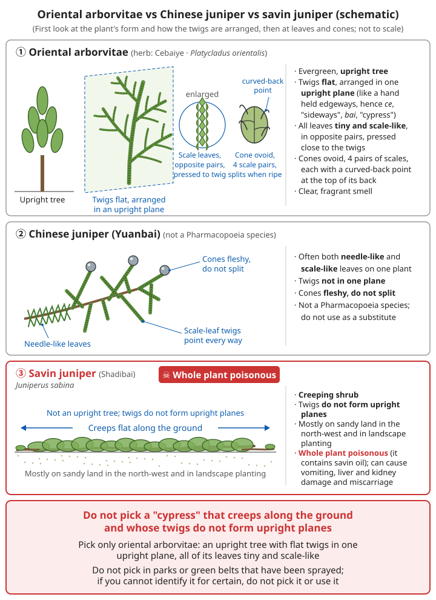

# Flowers and Leaves

> **Flowers and leaves are the "best-looking" herbs, and precisely because they look good and sell well they have the most fakes and dyed goods. With flowers, look at the shape, smell the scent and soak them in water to see the colour; with leaves, look at the veins, feel the hairs and crush them to smell. A bright colour alone does not prove a good herb**

This chapter covers 23 common flower and leaf herbs (the part used is the flower bud, the open flower, the flower head, the stigma, the pollen, the leaf or the leafy twig tip). They are roughly grouped by action into six groups: heat-clearing and detoxifying flowers; blood-moving and *qi*-regulating flowers; phlegm-resolving, orifice-opening, mind-calming and interior-warming flowers; dispersing and heat-clearing leaves; cough-stopping, bleeding-stopping and channel-warming leaves; and leaves that need special care. General methods for identification, harvesting, drying and storage are in the [General Principles](./00-general-principles.md) and are not repeated here. How to grow honeysuckle, chrysanthemum and mugwort is already covered in [Medicinal Plants: Identification and Growing](../04-farming-and-animal-husbandry/04-medicinal-plants.md); this chapter covers only identification and collection.

## ⚠️ Read these first

```
1. Flower herbs are expensive, light and attractively coloured, which makes
   them a prime target for dyeing and weight-adding fraud:
   - Saffron (Xihonghua) and safflower (Honghua): often faked with dyed
     corn silk, paper-pulp threads or lotus stamens,
     or bulked up with sugar, salt, alum or oil
   - Screen them first with a "water test": put them in clean water and
     see whether and how the colour comes out (see 2.2)
2. Honeysuckle vs Gouwen (heartbreak grass, Gelsemium): both are twining
   vines with opposite leaves and yellow flowers;
   a few leaves of Gouwen can kill. If the flowers are not "in pairs,
   two-lipped, a mix of yellow and white",
   do not pick the flowers, do not pick the leaves, do not touch the vine
3. Ornamental flowers, florists' cut flowers and the flowers and leaves of
   park and street trees have mostly been sprayed with pesticide:
   do not use them as medicine or tea; almost all "rose" cut flowers are
   actually Chinese roses (Yuejihua)
4. Senna leaf (Fanxieye) is a stimulant laxative: use it only briefly and
   occasionally;
   long-term use causes dependence, low blood potassium and dark
   discolouration of the colon (melanosis coli); never use it to lose
   weight;
   forbidden in pregnancy, while breastfeeding and during menstruation
5. Fresh ginkgo leaves contain ginkgolic acids (allergenic and toxic);
   proper preparations have them specially removed; do not pick the
   leaves yourself to make tea
6. Pregnant women must not use safflower or saffron, and must use
   blood-moving herbs such as cattail pollen (Puhuang) and Chinese rose
   flower only with caution;
   people taking anticoagulant or antiplatelet drugs such as warfarin or
   aspirin must ask a doctor before use
   (the same applies to ginkgo leaf and Danshen-type herbs)
7. The Pharmacopoeia marks mugwort leaf (Aiye) as "slightly toxic": do not
   take large amounts by mouth; with moxibustion beware of burns and smoke
8. Coltsfoot flower (Kuandonghua) contains pyrrolizidine alkaloids (which
   damage the liver): do not take large amounts for long;
   not for pregnant women, breastfeeding women or children
9. Doses are the usual adult daily doses in the Chinese Pharmacopoeia
   (2020 edition) (prepared slices, decocted in water;
   the current edition is 2025; the current edition's text prevails).
   They are given only as a reminder "not to exceed"; whether to use a
   herb and how much is decided under the guidance of a TCM practitioner
```

---

## Quick reference to this chapter

The "Toxicity / protection" column gives toxicity noted in the Pharmacopoeia, this book's risk warnings, and the protection status of wild resources. Protection grades follow the text of the lists published by the state; this table is only a reminder.

| Herb | Part used | Main actions | Toxicity / protection | See |
|------|---------|---------|----------|-----|
| Jinyinhua (honeysuckle flower) | Flower bud or flower just opening | Clears heat and detoxifies, disperses wind-heat | ⚠️ Beware picking Gouwen (heartbreak grass) by mistake | [1.1](#11-jinyinhua-honeysuckle-flower) |
| Juhua (chrysanthemum) | Flower head | Disperses wind and clears heat, calms the liver and brightens the eyes | Ornamental chrysanthemums are not medicine | [1.2](#12-juhua-chrysanthemum) |
| Yejuhua (wild chrysanthemum) | Flower head | Clears heat and detoxifies, drains fire and calms the liver | Bitter; use with caution if the spleen and stomach are cold and weak | [1.3](#13-yejuhua-wild-chrysanthemum) |
| Huaihua (pagoda tree flower) | Flower and flower bud (Huaimi) | Cools the blood and stops bleeding, clears the liver and drains fire | Do not confuse with black locust flowers | [1.4](#14-huaihua-pagoda-tree-flower) |
| Honghua (safflower) | Flower | Moves blood and unblocks menstruation, disperses stasis and relieves pain | ⚠️ Not in pregnancy; many dyed and weighted goods | [2.1](#21-honghua-safflower) |
| Xihonghua (saffron) | Stigma | Moves blood and resolves stasis, cools the blood and detoxifies, relieves constraint and calms the mind | ⚠️ Not in pregnancy; very many fakes | [2.2](#22-xihonghua-saffron) |
| Yuejihua (Chinese rose flower) | Flower | Moves blood and regulates menstruation, soothes the liver and relieves constraint | Use with caution in pregnancy | [2.3](#23-yuejihua-chinese-rose-flower) |
| Meiguihua (rugosa rose bud) | Flower bud | Moves *qi* and relieves constraint, harmonises the blood and relieves pain | Florists' cut flowers are not medicine | [2.4](#24-meiguihua-rugosa-rose-bud) |
| Puhuang (cattail pollen) | Pollen | Stops bleeding, resolves stasis, relieves painful urination | Use with caution in pregnancy | [2.5](#25-puhuang-cattail-pollen) |
| Xinyi (magnolia flower bud) | Flower bud | Disperses wind-cold, opens the nasal passages | Wrapped in cloth for decoction | [3.1](#31-xinyi-magnolia-flower-bud) |
| Kuandonghua (coltsfoot flower) | Flower bud | Moistens the lungs and descends *qi*, stops cough and resolves phlegm | Contains pyrrolizidine alkaloids; not for long-term use | [3.2](#32-kuandonghua-coltsfoot-flower) |
| Xuanfuhua (inula flower) | Flower head | Descends *qi* and dissolves phlegm, moves water and stops vomiting | Wrapped in cloth for decoction | [3.3](#33-xuanfuhua-inula-flower) |
| Hehuanhua (silk tree flower) | Flower cluster or flower bud | Relieves constraint and calms the mind | — | [3.4](#34-hehuanhua-silk-tree-flower) |
| Dingxiang (clove) | Flower bud | Warms the middle and descends rebellious *qi*, tonifies the kidney and assists yang | Not to be used with Yujin; not the garden lilac | [3.5](#35-dingxiang-clove) |
| Sangye (mulberry leaf) | Leaf | Disperses wind-heat, clears the lungs and moistens dryness, clears the liver and brightens the eyes | — | [4.1](#41-sangye-mulberry-leaf) |
| Zisuye (perilla leaf) | Leaf (or with tender twigs) | Releases the exterior and dispels cold, moves *qi* and harmonises the stomach | — | [4.2](#42-zisuye-perilla-leaf) |
| Daqingye (isatis leaf) | Leaf | Clears heat and detoxifies, cools the blood and fades rashes | Many different plants under the same name | [4.3](#43-daqingye-isatis-leaf) |
| Heye (lotus leaf) | Leaf | Clears summer heat and transforms damp, cools the blood and stops bleeding | Do not drink it long term as a slimming tea | [4.4](#44-heye-lotus-leaf) |
| Pipaye (loquat leaf) | Leaf | Clears the lungs and stops cough, descends rebellious *qi* and stops vomiting | The hairs irritate the throat | [5.1](#51-pipaye-loquat-leaf) |
| Cebaiye (oriental arborvitae leaf) | Twig tips and leaves | Cools the blood and stops bleeding, resolves phlegm and stops cough | Beware mixing in savin juniper (poisonous) | [5.2](#52-cebaiye-oriental-arborvitae-leaf) |
| Aiye (mugwort leaf) | Leaf | Warms the channels and stops bleeding, dispels cold and relieves pain | ⚠️ Marked "slightly toxic" in the Pharmacopoeia | [5.3](#53-aiye-mugwort-leaf) |
| Fanxieye (senna leaf) | Leaflets | Drains heat and moves stagnation, relieves constipation | ⚠️ Stimulant laxative; forbidden in pregnancy, while breastfeeding and during menstruation | [6.1](#61-fanxieye-senna-leaf) |
| Yinxingye (ginkgo leaf) | Leaf | Moves blood and resolves stasis, unblocks the collaterals and relieves pain, astringes the lungs and calms wheezing | ⚠️ Fresh leaves contain ginkgolic acids; do not pick them yourself for tea | [6.2](#62-yinxingye-ginkgo-leaf) |

---

## 1. Heat-clearing and detoxifying flowers

The flowers in this group are mostly harvested in summer and autumn. The rule is "pick the buds, not the fully open flowers", and after picking they must be dried quickly so they do not lose colour. Honeysuckle and pagoda tree flowers can both be found in the wild and around villages, but each has a dangerous or common look-alike: with honeysuckle beware *Gouwen*, with pagoda tree flowers beware black locust.

### 1.1 Jinyinhua (honeysuckle flower)

- **Jinyinhua (Rendonghua, Shuanghua, Erbaohua)**: Chinese 金银花; *Lonicera japonica* Thunb.
- **Source**: the dried flower buds or flowers just opening of Japanese honeysuckle, *Lonicera japonica* Thunb. (Caprifoliaceae)
- **Distribution and habitat**: grows wild in most of China, in thickets on hillsides, at forest edges, by roads and on village fences; grown on a large scale in Shandong, Henan, Hebei and elsewhere
- **Key identification features**:
  - Plant: semi-evergreen twining vine, young twigs softly hairy; **opposite leaves**, ovate to oblong, often softly hairy on both sides; **two flowers together on one flower stalk**, in the leaf axils; the corolla is **two-lipped** (upper lip with 4 shallow lobes, lower lip a single piece), the stamens stick out beyond the corolla; **white when first open, later turning yellow**, so yellow and white flowers are often found together on the same plant; berries round, black when ripe
  - Dried herb: buds **club-shaped, thicker above and thinner below**, slightly curved, 2-3 cm long; surface yellowish-white or greenish-white, **densely covered with short soft hairs**; occasionally open flowers are present, with a tubular corolla that is two-lipped at the tip
  - Smell: clear, fragrant smell; taste bland, slightly bitter
- **Look-alikes**:
  - **Gouwen (heartbreak grass, *Gelsemium*)**: also a twining vine with opposite leaves and yellow flowers, and **extremely poisonous**; its leaves are smooth and hairless, its flowers grow several together in a cluster, are **funnel-shaped with 5 even lobes, and only yellow**. For a detailed comparison see [Gouwen vs honeysuckle](09-toxic-herbs-and-poisonous-look-alikes.md#42-gouwen-heartbreak-grass-vs-jinyinhua-honeysuckle)
  - **Shanyinhua (mountain honeysuckle)**: the flower buds of *Lonicera macranthoides*, *L. hypoglauca*, *L. confusa* and *L. fulvotomentosa*. The Pharmacopoeia lists it separately as *Shanyinhua*; its actions are similar, but it cannot be used as *Jinyinhua*; most of its buds are longer, less hairy or have glandular hairs
  - In the trade you occasionally find flowers fumigated with sulphur or bulked up with sugar or alum water: do not take any that are unusually bright, smell sour or feel sticky
- **Harvesting and processing**: in early summer, **before the flowers open** (when the buds turn from green to white and swell at the top), pick in the early morning; spread thinly to dry in the air or dry at a low temperature. **Do not turn them or rub them with your hands before they are dry**, or they turn black
- **Storage**: easily absorbs moisture, loses colour and is attacked by insects; seal it and keep it in a cool, dry place
- **Actions**: clears heat and detoxifies, disperses wind-heat
- **Dose**: 6-15 g (Chinese Pharmacopoeia, 2020 edition; use under the guidance of a TCM practitioner)
- **Cautions**: use with caution if the spleen and stomach are cold and weak or the stools are loose (experience)
- For growing, see [Medicinal Plants – Honeysuckle](../04-farming-and-animal-husbandry/04-medicinal-plants.md#jinyinhua-honeysuckle); for the vine stem *Rendongteng* see [Barks, Stems and Woods – Rendongteng](06-barks-stems-and-woods.md#35-rendongteng-honeysuckle-stem)

### 1.2 Juhua (chrysanthemum)

- **Juhua (Boju, Chuju, Gongju, Hangju, Huaiju)**: Chinese 菊花; *Chrysanthemum morifolium* Ramat. (the names in brackets are grades by place of origin and processing)
- **Source**: the dried flower heads of florist's chrysanthemum, *Chrysanthemum morifolium* Ramat. (Asteraceae)
- **Distribution and habitat**: cultivated; the main producing areas are Anhui (Bozhou, Chuzhou, She County), Zhejiang (Tongxiang), Henan (Jiaozuo) and elsewhere; there is no truly wild "medicinal chrysanthemum"
- **Key identification features**:
  - Plant: perennial herb, stem woody at the base; alternate leaves, ovate, shallowly or half pinnately lobed, with short white soft hairs underneath; flowers in autumn
  - Dried herb: flower head with several outer layers of **ray florets** (white, off-white or yellow) and **disc florets** in the centre (yellow, mostly hidden); involucre dish-shaped, with 3-4 layers of hairy bracts. *Boju* and *Chuju* have looser flower heads; *Gongju* and *Hangju* have tighter, flatter flower heads
  - Smell: **clear, fragrant smell**; taste sweet, slightly bitter
- **Look-alikes**:
  - **Ornamental and potted chrysanthemums**: different varieties, and mostly sprayed with pesticide; do not use them as medicine or tea
  - **Yejuhua (wild chrysanthemum)** (see 1.3): much smaller flower heads, yellow, and much more bitter
  - **Chrysanthemum fumigated with sulphur**: unusually pure white and bright, with a sharp, sour smell; avoid buying it
- **Harvesting and processing**: harvest in several rounds from September to November when the flowers are in full bloom; dry in the shade or over gentle heat, or fumigate or steam and then sun-dry (methods differ between producing areas)
- **Storage**: easily gets damp, loses colour and is attacked by insects; seal, keep cool and out of light
- **Actions**: disperses wind and clears heat, calms the liver and brightens the eyes, clears heat and detoxifies
- **Dose**: 5-10 g (Chinese Pharmacopoeia, 2020 edition; use under the guidance of a TCM practitioner)
- **Cautions**: use less if the spleen and stomach are cold and weak (experience); people allergic to the daisy family (for example to mugwort or ragweed) may be allergic to it
- For growing, see [Medicinal Plants – Chrysanthemum](../04-farming-and-animal-husbandry/04-medicinal-plants.md#juhua-chrysanthemum)

### 1.3 Yejuhua (wild chrysanthemum)

- **Yejuhua (Kuyi, Yehuangju)**: Chinese 野菊花; *Chrysanthemum indicum* L.
- **Source**: the dried flower heads of wild chrysanthemum, *Chrysanthemum indicum* L. (Asteraceae)
- **Distribution and habitat**: widespread throughout China, in grassland on hillsides, thickets, by rivers, at field edges and by roads
- **Key identification features**:
  - Plant: perennial herb, 25-100 cm tall; alternate leaves, ovate or long-ovate, **half to shallowly pinnately lobed**, stalked; in autumn several **small yellow daisies** open at the top, about 1.5-2.5 cm across, **with yellow ray florets in only 1 layer**
  - Dried herb: flower heads roughly round, about 0.3-1 cm across, brownish-yellow; involucral bracts in 4-5 layers, the outer ones ovate with membranous edges; ray florets in 1 ring, yellow to brownish-yellow, shrivelled and curled; disc florets many
  - Smell: aromatic smell; **taste bitter** (much more bitter than chrysanthemum)
- **Look-alikes**: **Ganju** (*Yanxiangju*, *Yeganju*, *C. lavandulifolium*), **Xuanfuhua** (inula flower, see 3.3) and various daisy-family weeds with small yellow flowers. *Ganju* has twice pinnately, deeply divided leaves and even smaller flowers; *Xuanfuhua* has long, thin ray florets and strap-shaped bracts. Most are not poisonous, but they are not the Pharmacopoeia's *Yejuhua*
- **Harvesting and processing**: in autumn and winter, pick **when the flowers are just opening**; sun-dry, or steam and then sun-dry
- **Storage**: protect from damp and insects; seal
- **Actions**: clears heat and detoxifies, drains fire and calms the liver
- **Dose**: 9-15 g; for external use, a suitable amount, boiled for washing or made into an ointment and applied (Chinese Pharmacopoeia, 2020 edition; use under the guidance of a TCM practitioner)
- **Cautions**: bitter and cold; use with caution if the spleen and stomach are cold and weak, and do not drink it as tea for long periods (experience); use with caution if allergic to the daisy family

### 1.4 Huaihua (pagoda tree flower)

- **Huaihua (Huaimi)**: Chinese 槐花 (open flowers), 槐米 (flower buds); *Sophora japonica* L.
- **Source**: the dried flowers and flower buds of the Japanese pagoda tree, *Sophora japonica* L. (Fabaceae); the former are traditionally called *Huaihua*, the latter *Huaimi*
- **Distribution and habitat**: widely planted throughout China; most common by villages and roads and in courtyards in the north (commonly called *guohuai*, "native pagoda tree")
- **Key identification features**:
  - Plant: deciduous tree, **no thorns on the branches**, twigs green; odd-pinnate compound leaves with 7-15 ovate-oblong leaflets; **flowers in high summer (July-August)**, in panicles at the branch tips, pale yellowish-white, pea-shaped; pods fleshy, **constricted like a string of beads** (these are *Huaijiao*, pagoda tree pods)
  - Dried herb: **Huaimi** ovate or elliptic, 2-6 mm long, yellowish-green, with several lengthwise lines on the calyx at the lower end; **Huaihua** shrivelled and curled, the petals mostly fallen; whole flowers have a bell-shaped, yellowish-green calyx and 5 yellow or yellowish-white petals, 1 of them larger (the standard petal)
  - Smell: faint smell; taste slightly bitter
- **Look-alikes**:
  - **Black locust (*Cihuai*, *Yanghuai*)** *Robinia pseudoacacia*: in many places the "pagoda tree flowers" cooked with rice or steamed and eaten are really black locust flowers. Differences: black locust has **paired stipular thorns on the branches**, **flowers in spring (April-May)**, with white, strongly scented flowers hanging in clusters, and flat pods. The flowers can be eaten as a wild vegetable, but **the bark, leaves and seeds are poisonous**; it is not the Pharmacopoeia's *Huaihua*
  - *Huaihua* is often dyed or bulked up with flower stalks or sand; avoid buying any of an unusually bright yellowish-green
- **Harvesting and processing**: in summer, pick *Huaimi* **when the flower buds have formed** and *Huaihua* **when the flowers open**; dry promptly and remove stalks and impurities. For medicine *Huaimi* is better (higher in rutin)
- **Storage**: protect from damp and mould; seal
- **Actions**: cools the blood and stops bleeding, clears the liver and drains fire
- **Dose**: 5-10 g (Chinese Pharmacopoeia, 2020 edition; use under the guidance of a TCM practitioner)
- **Cautions**: use with caution if the spleen and stomach are cold and weak (experience); for blood in the stool or bleeding piles, the cause must be found first; do not rely on *Huaihua* alone to stop bleeding

---

## 2. Blood-moving and qi-regulating flowers

Most of this group are **not to be used, or to be used with caution, in pregnancy**; people with a tendency to bleed, heavy periods or who take anticoagulants must also ask a doctor first. Safflower and saffron are expensive and have the most fakes, which makes them good examples for practising the "water test"; for the general method of water testing see [General Principles – Simple water and fire tests](./00-general-principles.md#33-simple-water-and-fire-tests).

### 2.1 Honghua (safflower)

- **Honghua (Caohonghua, Honglanhua)**: Chinese 红花; *Carthamus tinctorius* L.
- **Source**: the dried flowers of safflower, *Carthamus tinctorius* L. (Asteraceae)
- **Distribution and habitat**: cultivated; grown in Xinjiang, Henan, Sichuan, Yunnan, Gansu and elsewhere; it does not grow wild
- **Key identification features**:
  - Plant: annual herb, 30-100 cm tall; alternate leaves, long-elliptic, **with spiny teeth on the edges**, and the involucral bracts are spiny too; the flower heads are made only of disc florets, which turn from yellow to orange-red as they bloom
  - Dried herb: tubular florets without the ovary, 1-2 cm long; **reddish-yellow or red**; the corolla tube is long and thin, with 5 narrow strap-shaped lobes at the tip; 5 stamens, the anthers joined into a yellowish-white tube; soft
  - Smell: faintly fragrant; taste slightly bitter
  - Water test: soaked in water, **the water turns golden yellow** (what dissolves is the safflower yellow pigment; the red pigment does not dissolve in water, so the flowers themselves stay red)
- **Look-alikes / fakes**:
  - **Dyed goods**: poor safflower or other flower threads dyed red with pigment; when soaked, the water turns **red** or colour runs out heavily and quickly, and the dye comes off on your fingers
  - **Weighted goods**: mixed with sugar, salt, alum, sand or vegetable oil; sticky and heavy when squeezed, tasting salty or sweet, or leaving oily marks
  - Safflower is also often dyed and passed off as saffron (see 2.2)
- **Harvesting and processing**: in summer, pick in the early morning **when the flowers turn from yellow to red** (while the dew is on them the bract spines are soft and do not prick); dry in the shade or the sun, but do not leave them in strong sun too long
- **Storage**: keep out of light, protect from damp and insects, seal; once damp it easily goes mouldy and darkens
- **Actions**: moves blood and unblocks menstruation, disperses stasis and relieves pain
- **Dose**: 3-10 g (Chinese Pharmacopoeia, 2020 edition; use under the guidance of a TCM practitioner)
- **Cautions**: **the Pharmacopoeia says "use with caution in pregnancy"**; this book advises pregnant women not to use it; not for people with heavy periods or a tendency to bleed; people taking anticoagulant or antiplatelet drugs ask a doctor first

### 2.2 Xihonghua (saffron)

- **Xihonghua (Fanhonghua, Zanghonghua)**: Chinese 西红花; *Crocus sativus* L.
- **Source**: the dried stigmas of saffron crocus, *Crocus sativus* L. (Iridaceae)
- **Distribution and habitat**: native to the Mediterranean coast and Iran (Iran is the largest producer); it reached inland China via Tibet, hence the common name *Zanghonghua*, "Tibetan red flower" — **Tibet does not produce it**; in China it is grown at Chongming in Shanghai, Jiande in Zhejiang and elsewhere (the corms are mostly brought indoors to flower and be harvested)
- **Key identification features**:
  - Plant: perennial herb from a corm, leaves thin and linear; pale purple flowers in autumn; the style in the centre of the flower splits at the tip into **3 deep red stigmas**, which are the medicine. Each flower has only 3, and it takes about 150,000 flowers to get 1 kg, which is why it is so expensive
  - Dried herb: **thread-like, branching into three**, about 3 cm long, **dark red**; the upper part is wider and slightly flattened, **the tip has an irregular toothed edge and a short slit on the inner side** (opening out like a trumpet), and the lower end sometimes keeps a short piece of yellow style; light, loose and soft, without an oily sheen; brittle and easily broken when dry
  - Smell: distinctive smell, slightly pungent; taste slightly bitter
  - **Water test** (the most useful on-the-spot method): put a little in clean water; you will see **orange-yellow colour spreading downwards in a straight line**, and the water gradually turns **yellow**, with no sediment; after soaking up water the stigma swells into a **long trumpet shape with a short slit on one side**, and does not break easily when poked with a needle
- **Fakes** (very common on the market):
  - **Dyed corn silk, lotus stamens, paper-pulp threads or synthetic fibres**: they lack the "three-branched trumpet mouth"; after soaking they are still single thin threads or fall apart into pulp
  - **Dyed safflower or chrysanthemum ray florets**: after soaking you can see corolla tubes, petals and other structures
  - Fakes and dyed goods usually **quickly release red colour** (not yellow) when soaked, or leave sediment or oil floating on the water
  - **Weighted with oil or glycerine**: the surface is shiny with oil and leaves oily marks when pressed on white paper
  - In a word: **"cheap Tibetan saffron" is almost always fake**
- **Harvesting and processing**: during flowering in autumn, pick the flowers early every morning, remove the stigmas and dry them over low heat or in the shade
- **Storage**: **keep out of light** (light breaks down both the colour and the active constituents), seal, keep cool and dry
- **Actions**: moves blood and resolves stasis, cools the blood and detoxifies, relieves constraint and calms the mind
- **Dose**: 1-3 g, decocted or steeped in boiling water (Chinese Pharmacopoeia, 2020 edition; use under the guidance of a TCM practitioner)
- **Cautions**: **the Pharmacopoeia says "use with caution in pregnancy"**; it clearly makes the uterus contract, and this book advises pregnant women not to use it; people with a tendency to bleed or taking anticoagulants ask a doctor first; taking a large amount at once (several grams or more) can cause poisoning (experience)
- **One more danger**: the garden plant "autumn crocus" (*Colchicum*, called *qiushuixian* in Chinese) looks like saffron crocus and **the whole plant is extremely poisonous**; do not steep any crocus-like flower from a garden in water and drink it

### 2.3 Yuejihua (Chinese rose flower)

- **Yuejihua (Yueyuehong, Sijihua)**: Chinese 月季花; *Rosa chinensis* Jacq.
- **Source**: the dried flowers of Chinese rose, *Rosa chinensis* Jacq. (Rosaceae)
- **Distribution and habitat**: widely planted throughout China, in courtyards, parks and roadside planting
- **Key identification features**:
  - Plant: evergreen or semi-evergreen shrub; **prickles fairly sparse, hooked**; pinnate compound leaves with **3-5 leaflets**, **leaf surface smooth and glossy**; **flowers several times a year** (hence *yueyuehong*, "red every month")
  - Dried herb: roughly round, 1.5-2.5 cm across; **receptacle oblong**; 5 sepals, dark green, with tail-like tips; petals overlapping like tiles, purplish-red or pale purplish-red, with clear veins
  - Smell: clear, fragrant smell; taste bland, slightly bitter
- **Look-alikes**: **Meiguihua (rugosa rose bud)** (see 2.4); the two are often used interchangeably, but the Pharmacopoeia lists them separately and their actions differ. Tell them apart by the receptacle: oblong in Chinese rose, hemispherical in rugosa rose
- **Harvesting and processing**: can be harvested all year; pick **when the flowers are slightly open**; dry in the shade or at a low temperature
- **Storage**: protect from damp and insects, keep out of light
- **Actions**: moves blood and regulates menstruation, soothes the liver and relieves constraint
- **Dose**: 3-6 g (Chinese Pharmacopoeia, 2020 edition; use under the guidance of a TCM practitioner)
- **Cautions**: use with caution in pregnancy; do not use large doses, as too much can cause loose stools and diarrhoea (experience); **Chinese roses in parks and florists have mostly been sprayed with pesticide: do not pick them**

### 2.4 Meiguihua (rugosa rose bud)

- **Meiguihua (Paihuaihua, Cimeihua)**: Chinese 玫瑰花; *Rosa rugosa* Thunb.
- **Source**: the dried flower buds of rugosa rose, *Rosa rugosa* Thunb. (Rosaceae)
- **Distribution and habitat**: cultivated in Shandong (Pingyin), Gansu (Kushui), Beijing and elsewhere; a little grows wild in the northeast and on the Shandong coast
- **Key identification features**:
  - Plant: deciduous shrub; **stems densely covered with prickles and bristles**; **5-9 leaflets**, **leaf surface clearly wrinkled** (the species name *rugosa* means "wrinkled"), softly hairy underneath; **flowers only once a year** (late spring to early summer), with purplish-red, strongly fragrant flowers
  - Dried herb: roughly hemispherical or an irregular ball, 0.7-1.5 cm across; **receptacle hemispherical**, joined to the base of the calyx; 5 sepals, lanceolate, yellowish-green or brownish-green, covered with fine soft hairs; petals mostly shrivelled, purplish-red, some yellowish-brown
  - Smell: **strong, rich fragrance**; taste slightly bitter and astringent
- **Look-alikes**: the "roses" sold as cut flowers by florists are **almost all hybrid varieties of Chinese rose**, with high pesticide residues; do not use them as medicine. For how to tell **Yuejihua (Chinese rose flower)** apart, see 2.3
- **Harvesting and processing**: in late spring and early summer, pick in several rounds **when the flowers are about to open**; **dry promptly at a low temperature** (high heat drives off the fragrance and darkens the colour)
- **Storage**: seal, keep out of light, protect from damp; the fragrance gradually fades, so generally keep no longer than 1 year
- **Actions**: moves *qi* and relieves constraint, harmonises the blood, relieves pain
- **Dose**: 3-6 g (Chinese Pharmacopoeia, 2020 edition; use under the guidance of a TCM practitioner)
- **Cautions**: use with caution in pregnancy (experience); not to be used much by people with yin deficiency and flaring fire

### 2.5 Puhuang (cattail pollen)

- **Puhuang (Pubang Huafen, Puhua)**: Chinese 蒲黄; *Typha angustifolia* L., *Typha orientalis* Presl
- **Source**: the dried pollen of narrow-leaved cattail, *Typha angustifolia* L., oriental cattail, *Typha orientalis* Presl, or other species of the same genus (Typhaceae)
- **Distribution and habitat**: ponds, lake shores, marshes and the shallow water of ditches throughout China
- **Key identification features**:
  - Plant: aquatic herb, 1-3 m tall; strap-shaped leaves, like wide Chinese chive leaves; in summer a cylindrical "**cattail**" grows at the top of the stem, with the male flower spike above (yellow, shedding pollen) and the female flower spike below (which later becomes the brown "cattail"); **in narrow-leaved cattail there is a gap between the male and female spikes; in oriental cattail they touch**
  - Dried herb: **yellow powder**, light, **floats on the surface when put in water**; feels smooth and slippery between the fingers and sticks to them easily
  - Smell: faint smell; taste bland
- **Fakes**: mixed with yellow earth, cornflour, starch, other pollens or dyed weighting powders — **whatever sinks in water is adulterant**; if it turns blue with iodine solution, it contains starch
- **Harvesting and processing**: in summer, cut off the **yellow male flower spikes** at the top of the cattails, dry them in the sun, crush them and sieve out the pollen; the coarse powder containing male flowers is traditionally called *Caopuhuang*
- **Storage**: very easily absorbs moisture, cakes and is attacked by insects; seal and keep in a dry place
- **Actions**: stops bleeding, resolves stasis, relieves painful urination
- **Dose**: 5-10 g, **wrapped in cloth for decoction** (the pollen floats on the decoction and is hard to strain out); for external use, a suitable amount applied to the affected area (Chinese Pharmacopoeia, 2020 edition; use under the guidance of a TCM practitioner)
- **Cautions**: **use with caution in pregnancy**; do not collect cattail pollen from polluted water (factory outlets, wastewater ponds from livestock or fish farming); for heavy bleeding from an injury, first press on the wound to stop the bleeding and get the person to hospital; do not just sprinkle on cattail pollen

---

## 3. Phlegm-resolving, orifice-opening, mind-calming and interior-warming flowers

*Xinyi* and *Xuanfuhua* **are hairy**, so when decocting them wrap them in gauze (wrapped in cloth for decoction), or the hairs irritate the throat and cause coughing; with *Kuandonghua* beware of the pyrrolizidine alkaloids; *Dingxiang* (clove) must be kept apart from the garden "lilac" (also called *dingxiang* in Chinese).

### 3.1 Xinyi (magnolia flower bud)

- **Xinyi (Mubihua, Wangchunhua, Maobitou)**: Chinese 辛夷; *Magnolia biondii* Pamp., *M. denudata* Desr., *M. sprengeri* Pamp.
- **Source**: the dried flower buds of *Magnolia biondii* Pamp., Yulan magnolia, *Magnolia denudata* Desr., or *Magnolia sprengeri* Pamp. (Magnoliaceae)
- **Distribution and habitat**: Henan (Nanzhao), Hubei, Shaanxi, Anhui, Sichuan and elsewhere; Yulan magnolia is widely planted everywhere as an ornamental tree
- **Key identification features**:
  - Plant: deciduous tree; **in early spring it flowers before the leaves come out**, with large flowers, white or purplish-red on the outside; in winter the flower buds at the branch tips **look like the tip of a writing brush**, wrapped in furry bracts
  - Dried herb: **long-ovoid, like the tip of a writing brush**, 1.2-2.5 cm long, often with a short stalk at the base; bracts in 2-3 layers, **the outer surface densely covered with long, glossy greyish-white or greyish-green hairs**, the inner surface hairless; peeled open, it shows many layers of tepals and many stamens and pistils
  - Smell: **aromatic smell**; taste pungent, cool and slightly bitter
- **Look-alikes**: the flower buds of other species of the same genus look similar, such as lily magnolia, saucer magnolia and southern magnolia (*Guangyulan*, bull bay, evergreen); southern magnolia buds are large, with rusty-brown hairs on the bracts. Most have no obvious toxicity, but they are not Pharmacopoeia species
- **Harvesting and processing**: harvest **in late winter and early spring before the flowers open**, remove stalks, dry in the shade
- **Storage**: contains volatile oil; seal, keep cool, protect from damp and insects
- **Actions**: disperses wind-cold, opens the nasal passages
- **Dose**: 3-10 g, **wrapped in cloth for decoction**; for external use, a suitable amount (Chinese Pharmacopoeia, 2020 edition; use under the guidance of a TCM practitioner)
- **Cautions**: use with caution in yin deficiency with flaring fire (experience); long-lasting nasal blockage, thick pus-like discharge or repeated nosebleeds need a check by an ear, nose and throat specialist; do not rely on *Xinyi* alone

### 3.2 Kuandonghua (coltsfoot flower)

- **Kuandonghua (Donghua, Kuandong)**: Chinese 款冬花; *Tussilago farfara* L.
- **Source**: the dried flower buds of coltsfoot, *Tussilago farfara* L. (Asteraceae)
- **Distribution and habitat**: north China, the northwest and the southwest, including Henan, Gansu, Shanxi, Shaanxi and Inner Mongolia; grows by streams in valleys, on sandy riverbanks and at damp forest edges
- **Key identification features**:
  - Plant: perennial herb; **in early spring it flowers first and puts out leaves later**: flowering stalks come up from the ground, covered in white woolly hairs and bearing scale-like bracts, each topped by a single **yellow flower head**; only after flowering do the basal leaves appear, **heart-shaped or broadly heart-shaped**, with sparse wavy teeth on the edges and **densely covered with white woolly hairs underneath**
  - Dried herb: **long club-shaped**, single or 2-3 joined at the base, 1-2.5 cm long, 0.5-1 cm across; thicker at the top, tapering below or with a short stalk; covered with **many fish-scale-like bracts**, **purplish-red or pale red** on the outside, the inner surface densely covered with white cottony hairs; light; torn open, white hairs show
  - Smell: fragrant smell; taste slightly bitter and pungent
- **Look-alikes**: the flower buds and leaves of **butterbur** (*Petasites*) look like coltsfoot and also contain pyrrolizidine alkaloids; they cannot be used as a substitute
- **Harvesting and processing**: **in December or before the ground freezes, while the flowers have not yet come above ground**, dig up the flower buds, remove the stalks and soil, and **dry in the shade**; do not wash them in water or dry them in the sun, or they lose colour and open
- **Storage**: easily attacked by insects, goes mouldy and loses colour; seal and keep cool
- **Actions**: moistens the lungs and descends *qi*, stops cough and resolves phlegm
- **Dose**: 5-10 g (Chinese Pharmacopoeia, 2020 edition; use under the guidance of a TCM practitioner)
- **Cautions**: it contains **pyrrolizidine alkaloids** such as senkirkine; long-term or large-dose use may damage the liver (hepatic veno-occlusive disease); **do not use it long term; not for pregnant women, breastfeeding women, children or people with liver disease** (experience; some countries already restrict coltsfoot taken by mouth); a cough lasting more than 3 weeks, coughing up blood or fever needs a doctor

### 3.3 Xuanfuhua (inula flower)

- **Xuanfuhua (Jinfeihua, Liuyueju, Jinqianhua)**: Chinese 旋覆花; *Inula japonica* Thunb., *Inula britannica* L.
- **Source**: the dried flower heads of Japanese inula, *Inula japonica* Thunb., or British yellowhead, *Inula britannica* L. (Asteraceae)
- **Distribution and habitat**: the northeast, north, east and central China and elsewhere, on river flats, field banks, roadsides and damp grassland
- **Key identification features**:
  - Plant: perennial herb, 30-70 cm tall; alternate leaves, oblong or lanceolate, **the base slightly clasping the stem**, sparsely hairy underneath; in summer and autumn **golden-yellow flower heads** open at the top, 2.5-4 cm across, **with one ring of long, thin ray florets**
  - Dried herb: flower heads **flattened-round or roughly round**, 1-2 cm across; **involucral bracts in many layers, overlapping like tiles**, lanceolate or strap-shaped, greyish-yellow; ray florets in 1 row, yellow, mostly curled; disc florets many, brownish-yellow; some small achenes with white pappus may be visible; light, falls apart easily
  - Smell: faint smell; taste slightly bitter
- **Look-alikes**: **Yejuhua (wild chrysanthemum)** (1.3), the flower heads of **dandelion** and other yellow-flowered daisy-family plants; *Xuanfuhua* has long, thin ray florets in only 1 ring and strap-shaped bracts. Its aerial parts are called *Jinfeicao*, which is a different medicine
- **Harvesting and processing**: harvest in summer and autumn **when the flowers are open**, remove impurities, dry in the shade or the sun
- **Storage**: falls apart easily; protect from damp and insects
- **Actions**: descends *qi*, dissolves phlegm, moves water, stops vomiting
- **Dose**: 3-9 g, **wrapped in cloth for decoction** (the pappus and hairs irritate the throat) (Chinese Pharmacopoeia, 2020 edition; use under the guidance of a TCM practitioner)
- **Cautions**: use with caution for cough from yin-deficiency consumption or dry cough from damaged fluids (experience)

### 3.4 Hehuanhua (silk tree flower)

- **Hehuanhua (Yehehua, Ronghua, Hehuanmi)**: Chinese 合欢花; *Albizia julibrissin* Durazz. (the flower buds are traditionally called *Hehuanmi*, 合欢米)
- **Source**: the dried flower clusters or flower buds of the silk tree, *Albizia julibrissin* Durazz. (Fabaceae); the former are traditionally called *Hehuanhua*, the latter *Hehuanmi*
- **Distribution and habitat**: widespread from north to south China; a common street and courtyard tree, also wild on hillsides
- **Key identification features**:
  - Plant: deciduous tree; **twice-pinnate compound leaves**, the leaflets tiny and sickle-shaped, **folding together in pairs at night** (hence *yehe*, "closing at night"); in summer it bears **pink pompom-like flowers**; the "fluff" you see is actually the long, thin stamens
  - Dried herb: *Hehuanhua* is a flower head shrivelled into a ball; main flower stalk 3-4 cm long; flowers long, thin and curved, 0.7-1 cm long, pale yellow or yellowish-brown, the corolla tubular with 5 lobes at the tip; **many stamens with long, thin filaments**, yellowish-brown to tawny. *Hehuanmi* is club-shaped, pale yellow to yellowish-brown
  - Smell: faintly fragrant; taste bland
- **Look-alikes**: other trees of the same family such as **falcata (*Nanyangying*) and *Shanhehuan* (*Albizia kalkora*)** (white flowers, larger leaflets); **the bark, *Hehuanpi*, is a different medicine**, see [Hehuanpi](06-barks-stems-and-woods.md#16-hehuanpi-silk-tree-bark)
- **Harvesting and processing**: in summer, harvest on a sunny day **when the flowers are open**, or harvest *Hehuanmi* when the flower buds have formed; dry in the sun promptly
- **Storage**: protect from damp and insects
- **Actions**: relieves constraint and calms the mind
- **Dose**: 5-10 g (Chinese Pharmacopoeia, 2020 edition; use under the guidance of a TCM practitioner)
- **Cautions**: use with caution in pregnancy (experience); anyone who has had insomnia or low mood for more than two weeks should see a doctor to check for depression; do not rely only on mind-calming herbs; flowers from street trees may carry exhaust fumes and pesticide: do not pick them

### 3.5 Dingxiang (clove)

- **Dingxiang (Gongdingxiang, Dingzixiang)**: Chinese 丁香; *Eugenia caryophyllata* Thunb.
- **Source**: the dried flower buds of the clove tree, *Eugenia caryophyllata* Thunb. (Myrtaceae)
- **Distribution and habitat**: native to the Maluku Islands of Indonesia; grown on a large scale in East Africa (Zanzibar), Madagascar and elsewhere; a little is grown in Hainan and Guangdong in China
- **Key identification features**:
  - Plant: evergreen tree, opposite leaves, leathery, with oil-gland dots; grows only in the tropics, so you will not see it in the wild in China
  - Dried herb: roughly **pestle-shaped (like a small nail)**, 1-2 cm long; at the top is the round corolla, 0.3-0.5 cm across, with 4 petals overlapping like tiles, brown; the lower part is the cylindrical **calyx tube**, reddish-brown or brown, with **4 triangular sepals spreading in a cross** at its top; hard and firm, **rich in oil**: scratch the calyx tube with a fingernail and oil seeps out
  - Smell: **strong aromatic smell, pungent taste that numbs the tongue**
  - Water test: good cloves are rich in oil and **sink vertically in water with the calyx tube pointing down**; those that float, or float on their side, are mostly poor goods whose oil has already been extracted
- **Look-alikes**:
  - **Garden "lilac"** (common lilac, white lilac; *Syringa*, olive family; also called *dingxianghua* in Chinese): the shrub common in the north with small purple or white flowers in spring is **a completely different plant from the clove herb**; it is not used as medicine
  - **Mudingxiang (mother clove)**: the nearly ripe fruit of the same plant, listed separately in the Pharmacopoeia; elliptic and larger
  - **Cloves with the oil extracted**: darker colour, weak fragrance, do not sink in water
- **Harvesting and processing**: pick the flower buds **when they turn from green to red**, dry in the sun
- **Storage**: seal, keep cool and out of light; the fragrance fades the longer it is kept
- **Actions**: warms the middle and descends rebellious *qi*, tonifies the kidney and assists yang
- **Dose**: 1-3 g, taken by mouth or ground to powder and applied externally (Chinese Pharmacopoeia, 2020 edition; use under the guidance of a TCM practitioner)
- **Cautions**: **not to be used together with Yujin** (one of the nineteen antagonisms, see [General Principles – The eighteen incompatibilities and nineteen antagonisms](./00-general-principles.md#73-the-eighteen-incompatibilities-and-nineteen-antagonisms-combinations-to-avoid); for *Yujin* see [Chapter 02](./02-roots-and-rhizomes-2.md#32-yujin-curcuma-root-tuber)); not for febrile illness or internal heat from yin deficiency; **clove oil is very irritant: do not give it to children by mouth**; clove oil applied for toothache is only a short-term emergency measure, see a dentist afterwards

---

## 4. Dispersing and heat-clearing leaves

Leaf herbs shrivel and break when dried. To identify them, **soak them soft and flatten them out** before looking: leaf shape, leaf edge, veins, hairs and colour on both sides, leaf stalk; then crush and smell them.

### 4.1 Sangye (mulberry leaf)

- **Sangye (Shuangsangye, Dongsangye)**: Chinese 桑叶; *Morus alba* L.
- **Source**: the dried leaves of white mulberry, *Morus alba* L. (Moraceae)
- **Distribution and habitat**: throughout China, by villages, at field edges and on hillsides; grown on a large scale in the silkworm-raising areas of Jiangsu, Zhejiang, Guangdong, Sichuan and elsewhere
- **Key identification features**:
  - Plant: deciduous tree or shrub; **a snapped leaf stalk or young twig bleeds white milky sap**; alternate leaves, ovate or broadly ovate, toothed on the edges, some irregularly lobed; the fruit is a multiple fruit, purple-black or white when ripe (mulberries)
  - Dried herb: mostly shrivelled and broken; whole leaves are stalked and, flattened out, ovate or broadly ovate, 8-15 cm long and 7-13 cm wide; tip tapering, base squared-off, rounded or heart-shaped, edges toothed; upper surface yellowish-green or light yellowish-brown, some with small wart-like bumps; lower surface slightly paler, **the veins raised with a network of small veins**, sparsely hairy on the veins, **with tufts of hairs in the vein angles**; brittle
  - Smell: faint smell; taste bland, slightly bitter and astringent
- **Look-alikes**: **paper mulberry leaves** (same family, also with white milky sap; leaves rough on both sides, densely hairy, often deeply divided into 3-5 lobes), and the leaves of *Morus australis* and *Morus cathayana*; most are not poisonous, but they are not the Pharmacopoeia's *Sangye*
- **Harvesting and processing**: harvest **after the first frost** (hence *shuangsangye*, "frost mulberry leaf"), remove impurities, dry in the sun
- **Storage**: protect from damp and mould; breaks easily, so store with only light pressure
- **Actions**: disperses wind-heat, clears the lungs and moistens dryness, clears the liver and brightens the eyes
- **Dose**: 5-10 g (Chinese Pharmacopoeia, 2020 edition; use under the guidance of a TCM practitioner)
- **Cautions**: not suitable for a wind-cold common cold (feeling cold, clear runny nose) (experience); people with diabetes must not use mulberry leaf in place of their diabetes medicines
- For the root bark "[Sangbaipi](06-barks-stems-and-woods.md#23-sangbaipi-white-mulberry-root-bark)" and the young twigs "[Sangzhi](06-barks-stems-and-woods.md#32-sangzhi-mulberry-twig)" see Barks, Stems and Woods

### 4.2 Zisuye (perilla leaf)

- **Zisuye (Suye, Chisu)**: Chinese 紫苏叶; *Perilla frutescens* (L.) Britt.
- **Source**: the dried leaves (or leaves with tender twigs) of perilla, *Perilla frutescens* (L.) Britt. (Lamiaceae)
- **Distribution and habitat**: widely cultivated throughout China; often escaped and growing wild by villages and garden edges
- **Key identification features**:
  - Plant: annual herb, 0.3-2 m tall; **square stem**, with long soft hairs; **opposite leaves**, broadly ovate, coarsely toothed on the edges, **purple on both sides or green above and purple below**; whorls of flowers forming racemes that lean to one side, flowers white to purplish-red
  - Dried herb: leaves mostly shrivelled, curled and broken; whole leaves flattened out are ovate-round, 4-11 cm long and 2.5-9 cm wide, with a long-pointed or abruptly pointed tip and round-toothed edges; purple on both sides, or green on the upper surface and purple on the lower, sparsely covered with greyish-white hairs, **the lower surface with many sunken, dot-like glandular scales**; leaf stalk 2-7 cm long, purple or purplish-green; brittle
  - Smell: **clear, fragrant smell** (the distinctive perilla scent); taste slightly pungent
- **Look-alikes**:
  - **Baisu (green perilla)**: the green-leaved form of the same species, with a weaker scent; used interchangeably in some areas
  - **Coleus** (*Coleus*): also in the mint family, with purple or variegated leaves, often grown in pots, but **without the perilla scent**
  - **Mosla scabra (*Shijizhu*), wild *Xiangru* and similar**: much smaller leaves; most are not poisonous
  - Remember: **do not pick purple leaves that do not smell of perilla when crushed**
- **Harvesting and processing**: harvest in summer **when the branches and leaves are lush**, remove impurities, dry in the shade or at a low temperature (strong sun drives off the scent)
- **Storage**: contains volatile oil; seal, keep cool, and generally keep no longer than 1 year
- **Actions**: releases the exterior and dispels cold, moves *qi* and harmonises the stomach
- **Dose**: 5-10 g, do not boil for long (Chinese Pharmacopoeia, 2020 edition; use under the guidance of a TCM practitioner)
- **Cautions**: use with caution in exterior deficiency with heavy sweating (experience). The folk use of perilla to "relieve fish and crab poisoning" refers to mild stomach and bowel upset after eating fish or crab; **if, after eating seafood, someone develops a rash, a tight throat or difficulty breathing (allergy), or violent vomiting and diarrhoea, get medical help at once**
- For the seed *Zisuzi* see [Chapter 03 – Zisuzi](./03-fruits-and-seeds.md#73-zisuzi-perilla-fruit)

### 4.3 Daqingye (isatis leaf)

- **Daqingye (Songlanye, Lanye)**: Chinese 大青叶; *Isatis indigotica* Fort.
- **Source**: the dried leaves of woad, *Isatis indigotica* Fort. (Brassicaceae)
- **Distribution and habitat**: cultivated; grown in Hebei, Jiangsu, Anhui, Gansu, Heilongjiang and elsewhere; its root is *Banlangen*
- **Key identification features**:
  - Plant: biennial herb, 40-100 cm tall, the whole plant smooth with a whitish bloom; basal leaves oblong, stalked; **stem leaves oblong-lanceolate, arrow-shaped at the base, half-clasping the stem**; in spring it bears **small yellow cross-shaped flowers**; seed pods flat, oblong, winged at the edges, hanging down
  - Dried herb: mostly shrivelled and curled, some broken; whole leaves flattened out are **long-elliptic to oblong-oblanceolate**, 5-20 cm long and 2-6 cm wide; upper surface dark greyish-green, some with darker, slightly raised small dots; tip blunt, edges entire or slightly wavy, **the base narrowing and running down the leaf stalk as a wing**; leaf stalk 4-10 cm long, light brownish-yellow; brittle
  - Smell: faint smell; taste slightly sour, bitter and astringent
- **Look-alikes (many different plants under the same name)**:
  - **Liaodaqingye**: the leaves of Chinese indigo (*Polygonum tinctorium*, knotweed family), listed separately in the Pharmacopoeia; leaves ovate, bluish-green
  - **Malanye**: the leaves of Assam indigo (*Malan*, acanthus family; its root is "southern *Banlangen*"), with opposite leaves
  - **Lubianqing**: the leaves of *Daqing* (*Clerodendrum cyrtophyllum*, verbena family, now placed in the mint family), called *Daqingye* in parts of the south
  - These have similar actions but different constituents; the Pharmacopoeia's *Daqingye* means woad leaf only
- **Harvesting and processing**: harvest 2-3 times in summer and autumn, remove impurities, dry in the sun
- **Storage**: protect from damp and mould
- **Actions**: clears heat and detoxifies, cools the blood and fades rashes
- **Dose**: 9-15 g (Chinese Pharmacopoeia, 2020 edition; use under the guidance of a TCM practitioner)
- **Cautions**: bitter and cold; use with caution if the spleen and stomach are cold and weak (experience); it cannot replace vaccines or antiviral drugs
- For the root *Banlangen* see [Chapter 01 – Banlangen](./01-roots-and-rhizomes-1.md#33-banlangen-isatis-root)

### 4.4 Heye (lotus leaf)

- **Heye (Lianye)**: Chinese 荷叶; *Nelumbo nucifera* Gaertn.
- **Source**: the dried leaves of the lotus, *Nelumbo nucifera* Gaertn. (Nymphaeaceae)
- **Distribution and habitat**: cultivated or wild in ponds, lakes and paddy fields throughout China
- **Key identification features**:
  - Plant: perennial aquatic herb; leaves **round and peltate** (the leaf stalk joins the middle of the blade), up to 70 cm across, **the surface waxy, so water rolls off in beads**; leaf stalks with small prickles
  - Dried herb: semicircular or folded-fan-shaped, roughly round when opened out, 20-50 cm across, edges entire or slightly wavy; upper surface dark green or yellowish-green, fairly rough; lower surface pale greyish-brown, fairly smooth, with **21-22 thick veins radiating from the centre**; a raised remnant of the leaf stalk in the centre; brittle, breaks easily
  - Smell: slightly fragrant; taste slightly bitter
- **Look-alikes**: **water lily leaves** (float on the water, with one deep notch, not peltate) and **euryale leaves** (wrinkled surface, prickly); both are easy to tell apart
- **Harvesting and processing**: harvest in summer and autumn; dry in the sun until 70-80% dry, remove the leaf stalks, fold into semicircles or folded fans, and finish drying
- **Storage**: breaks and moulds easily; keep in a dry, ventilated place
- **Actions**: clears summer heat and transforms damp, raises clear yang, cools the blood and stops bleeding
- **Dose**: 3-10 g; charred lotus leaf 3-6 g (Chinese Pharmacopoeia, 2020 edition; use under the guidance of a TCM practitioner)
- **Cautions**: **do not drink "lotus leaf slimming tea" long term as a weight-loss drug**: commercial slimming teas are often mixed with senna leaf (see 6.1), and some have been found to contain illegally added Western drugs; not suitable for weak or thin people (experience); do not pick lotus leaves from rivers or ponds polluted with heavy metals (downstream of factories, near urban sewage outlets)

---

## 5. Cough-stopping, bleeding-stopping and channel-warming leaves

Loquat leaf, oriental arborvitae leaf and mugwort leaf come from evergreen trees or common weeds and can be picked readily all year or in summer; the things to guard against are mixing in poisonous junipers with arborvitae, mixing other wormwoods in with mugwort, and taking large amounts of mugwort leaf by mouth.

### 5.1 Pipaye (loquat leaf)

- **Pipaye (Paye)**: Chinese 枇杷叶; *Eriobotrya japonica* (Thunb.) Lindl.
- **Source**: the dried leaves of loquat, *Eriobotrya japonica* (Thunb.) Lindl. (Rosaceae)
- **Distribution and habitat**: widely planted in the Yangtze basin and everywhere south of it, in courtyards, orchards and by villages
- **Key identification features**:
  - Plant: small evergreen tree; twigs, leaf undersides and flower clusters all densely covered with **rusty or greyish-brown woolly hairs**; leaves large, leathery, oblong; **white flowers in autumn and winter**, yellow fruit in early summer
  - Dried herb: oblong or obovate, 12-30 cm long and 4-9 cm wide; tip pointed, base wedge-shaped, **edges sparsely toothed, entire near the base**; upper surface greyish-green, yellowish-brown or reddish-brown, fairly smooth; **lower surface densely covered with yellow woolly hairs**, the midrib strongly raised on the lower surface, side veins pinnate; leaf stalk very short, covered with brownish-yellow hairs; **leathery but brittle**, snaps easily
  - Smell: faint smell; taste slightly bitter
- **Look-alikes**: southern magnolia leaves (rusty hairs underneath, but edges entire and thicker), Chinese photinia leaves (hairless underneath) and other evergreen leathery leaves; most are not poisonous
- **Harvesting and processing**: can be harvested all year; dry in the sun until 70-80% dry, tie into small bundles and dry fully in the sun; before use, **brush off the hairs on the underside**
- **Storage**: protect from damp; keep in a ventilated, dry place
- **Actions**: clears the lungs and stops cough, descends rebellious *qi* and stops vomiting
- **Dose**: 6-10 g (Chinese Pharmacopoeia, 2020 edition; use under the guidance of a TCM practitioner); if the hairs have not been brushed off completely, wrap it in cloth for decoction, or the hairs irritate the throat and make the cough worse
- **Cautions**: not suitable for wind-cold cough (thin, white phlegm, feeling cold) (experience); **loquat seeds (stones) contain amygdalin: do not eat them**, see also [Kuxingren (bitter apricot kernel)](09-toxic-herbs-and-poisonous-look-alikes.md#412-kuxingren-bitter-apricot-kernel)

### 5.2 Cebaiye (oriental arborvitae leaf)

- **Cebaiye (Baiye, Bianbaiye)**: Chinese 侧柏叶; *Platycladus orientalis* (L.) Franco
- **Source**: the dried twig tips and leaves of oriental arborvitae, *Platycladus orientalis* (L.) Franco (Cupressaceae)
- **Distribution and habitat**: most of China, on sunny mountain slopes and limestone hills; planted in large numbers in cemeteries, temples and parks
- **Key identification features**:
  - Plant: evergreen tree; **the twigs are flat and arranged in one plane, and this plane stands upright** (like a hand held edgeways, hence *ce*, "sideways", *bai*, "cypress"); all the leaves are **tiny and scale-like, in opposite pairs, pressed close to the twigs**; cones ovoid, with 4 pairs of cone scales, **each with a curved-back point at the top of its back**, splitting open when ripe
  - Dried herb: much branched, twigs flat; leaves tiny, scale-like, in opposite pairs, pressed against the twigs, dark green or yellowish-green; brittle, snaps easily
  - Smell: **clear, fragrant smell**; taste bitter, astringent and slightly pungent
- **Look-alikes**:
  - **Chinese juniper (*Yuanbai*, *Guibai*)**: often has **two kinds of leaf, needle-like and scale-like, on the same plant**; the twigs are not arranged in a plane; the cones are fleshy and do not split open. Not a Pharmacopoeia species
  - **Savin juniper (*Chazi Yuanbai*, *Shadibai*)** *Juniperus sabina*: a creeping shrub, mostly found on sandy land in the northwest and in landscape planting; **the whole plant is poisonous** (it contains savin oil) and can cause vomiting, liver and kidney damage and miscarriage; **do not pick a "cypress" that creeps along the ground and whose twigs do not form upright planes**
  - The seed kernel of oriental arborvitae, *Baiziren*, is a different medicine
- **Harvesting and processing**: mostly harvested in summer and autumn, **dried in the shade**
- **Storage**: contains volatile oil; protect from damp, keep cool
- **Actions**: cools the blood and stops bleeding, resolves phlegm and stops cough, promotes hair growth and darkens hair
- **Dose**: 6-12 g; for external use, a suitable amount (Chinese Pharmacopoeia, 2020 edition; use under the guidance of a TCM practitioner)
- **Cautions**: long-term, large-dose use can cause stomach discomfort and loss of appetite (experience); coughing up blood, blood in the stool or blood in the urine must all have their cause found first



*Figure: Oriental arborvitae is an upright tree whose flat twigs are arranged in upright planes; all its leaves are tiny and scale-like, in opposite pairs; its cones are ovoid, each cone scale with a curved-back point at the top of its back. Chinese juniper often has needle-like and scale-like leaves on the same plant, its twigs are not arranged in planes, and its cones are fleshy. Savin juniper (Shadibai) creeps along the ground and the whole plant is poisonous. Do not pick a "cypress" that creeps along the ground and whose twigs do not form upright planes*

### 5.3 Aiye (mugwort leaf)

- **Aiye (Ai, Jia'ai, Qi'ai)**: Chinese 艾叶; *Artemisia argyi* Lévl. et Vant.
- **Source**: the dried leaves of Chinese mugwort, *Artemisia argyi* Lévl. et Vant. (Asteraceae)
- **Distribution and habitat**: most of China, on waste ground, by roads and rivers and on hillsides; the "*Qi'ai*" of Qichun in Hubei is the best known, and it is cultivated in many places
- **Key identification features**:
  - Plant: perennial herb, 0.5-1.5 m tall, the whole plant **densely covered with greyish-white woolly hairs**; alternate leaves, **deeply pinnately divided**, the lobes elliptic-lanceolate with coarsely toothed edges; **the upper side of the leaf is greyish-green with gland dots, the underside densely covered with greyish-white woolly hairs** (turned over, it looks white); rubbed, it has **a strong mugwort smell**
  - Dried herb: mostly shrivelled and broken, with short stalks; whole leaves flattened out are ovate-elliptic, deeply pinnately divided, the lobes with irregular coarse teeth on the edges; upper surface greyish-green or dark yellowish-green, with sparse soft hairs and gland dots; **lower surface densely covered with greyish-white woolly hairs**; soft
  - Smell: **clear, fragrant smell**; taste bitter
- **Look-alikes**: **wild mugwort (*Yeaihao*), *Wuyue'ai*, Mongolian wormwood, *Kuihao*** and other *Artemisia* species look similar and also have white hairs on the leaf underside; they are often used as "mugwort" in various places. Most of them can be used for moxibustion, but **they are not the Pharmacopoeia's *Aiye***. **Qinghao and Yinchen** are also *Artemisia* species (see [Whole Herbs](./04-whole-herbs.md)), but their leaves are more finely divided and not white underneath. Take care not to confuse it with **ragweed** (an invasive alien weed whose pollen is strongly allergenic; leaf underside not white, no mugwort smell)
- **Harvesting and processing**: pick **in summer before the flowers open** (around the Dragon Boat Festival), remove impurities, dry in the sun; moxa wool is made from aged mugwort leaves (stored for over 1 year)
- **Storage**: protect from damp and mould; keep in a ventilated, dry place
- **Actions**: warms the channels and stops bleeding, dispels cold and relieves pain; externally, dispels damp and relieves itching
- **Dose**: 3-9 g; for external use, a suitable amount, for moxibustion or fumigation and washing (Chinese Pharmacopoeia, 2020 edition; use under the guidance of a TCM practitioner)
- **Cautions**: **the Pharmacopoeia marks it "slightly toxic"**: large amounts of mugwort volatile oil taken by mouth can cause nausea and vomiting, liver damage, nervous excitement and even convulsions; **do not take large amounts by mouth and do not drink mugwort essential oil**; pregnant women must use mugwort only under a doctor's guidance; with **moxibustion**, guard against burns and blisters (especially in people with diabetes or reduced sensation), **open the windows** indoors, and people with asthma or COPD should keep away from moxa smoke
- For growing, see [Medicinal Plants – Mugwort](../04-farming-and-animal-husbandry/04-medicinal-plants.md#aicao-chinese-mugwort)

---

## 6. Leaves that need special care

Senna leaf and ginkgo leaf can both be bought easily on the market and are often brewed at home as "laxative tea" or "health tea" — which is exactly where the trouble comes from.

### 6.1 Fanxieye (senna leaf)

- **Fanxieye (Xieye, Paozhuye)**: Chinese 番泻叶; *Cassia angustifolia* Vahl, *Cassia acutifolia* Delile
- **Source**: the dried leaflets of Tinnevelly senna, *Cassia angustifolia* Vahl, or Alexandrian senna, *Cassia acutifolia* Delile (Fabaceae)
- **Distribution and habitat**: native to tropical Africa and India; Tinnevelly senna comes mainly from India and Alexandrian senna mainly from Egypt; a little is grown in Hainan and Yunnan, and it is not found in the wild in China
- **Key identification features**:
  - Plant: shrub, even-pinnate compound leaves with 4-8 pairs of leaflets; racemes of yellow flowers; pods flat
  - Dried herb: **Tinnevelly senna** leaflets long-ovate or ovate-lanceolate, 1.5-5 cm long and 0.4-2 cm wide, edges entire, **tip abruptly pointed, base slightly asymmetrical**; upper surface yellowish-green, lower surface pale yellowish-green, hairless or nearly so, veins slightly raised; leathery. **Alexandrian senna** is lanceolate or long-ovate, slightly curled, the tip shortly pointed or with a tiny point, the base asymmetrical, with fine short hairs on both sides
  - Smell: weak, distinctive smell; taste slightly bitter, a little sticky
- **Look-alikes**: **Avaram senna leaf** (*Cassia auriculata*) is often mixed in: its leaflets are ovate-round, **the tip blunt-rounded or slightly notched with a short spiny point**, both sides densely covered with long hairs, and it has almost no laxative effect
- **Harvesting and processing**: pick the leaves before flowering or when the fruit is ripe, dry in the sun (mostly imported goods)
- **Storage**: protect from damp and mould, keep out of light
- **Actions**: drains heat and moves stagnation, relieves constipation, promotes urination
- **Dose**: 2-6 g, **added near the end**, or steeped in boiling water (Chinese Pharmacopoeia, 2020 edition; use under the guidance of a TCM practitioner)
- **Cautions**:
  - The Pharmacopoeia says "use with caution in pregnancy"; this book follows the usual contraindications: **forbidden in pregnancy, while breastfeeding and during menstruation** (it can cause pelvic congestion and uterine bleeding, and while breastfeeding its constituents can pass into the milk)
  - It is a **stimulant laxative** (it contains sennosides, which stimulate the bowel to move), and **can only be used briefly and occasionally** (generally no longer than 1 week); long-term use leads to **dependence, so that constipation gets worse the more you use it**, and causes **low blood potassium, dehydration** and melanosis coli
  - Too large a dose can cause severe abdominal pain, vomiting and diarrhoea, and even bleeding from the digestive tract
  - **Never use it to lose weight**; forbidden for children, frail elderly people, bowel obstruction and abdominal pain of unknown cause; people taking digoxin or diuretics are more at risk from low blood potassium
  - Constipation with **blood in the stool, weight loss or a sudden change in bowel habits** (especially over the age of 40) needs a doctor to rule out a bowel tumour

### 6.2 Yinxingye (ginkgo leaf)

- **Yinxingye (Baiguoye)**: Chinese 银杏叶; *Ginkgo biloba* L.
- **Source**: the dried leaves of ginkgo, *Ginkgo biloba* L. (Ginkgoaceae)
- **Distribution and habitat**: widely planted throughout China as street trees and in courtyards and temples; Pizhou in Jiangsu, Tancheng in Shandong and elsewhere have large ginkgo plantations for leaves and nuts
- **Key identification features**:
  - Plant: large deciduous tree; leaves **fan-shaped**, long-stalked, in clusters on short shoots and alternate on long shoots; **the veins are parallel and fork in two again and again** (the only such tree in the world); the leaves turn golden yellow in autumn
  - Dried herb: mostly creased or broken; whole leaves fan-shaped, 3-12 cm long and 5-15 cm wide; yellowish-green or light brownish-yellow, the upper edge irregularly wavy, some notched in the middle, the deepest notches reaching 4/5 of the leaf length; **the forking parallel veins are fine and dense**, smooth and hairless, **tears easily lengthwise**; leaf base wedge-shaped, leaf stalk 2-8 cm long; light
  - Smell: faint smell; taste slightly bitter
- **Look-alikes**: the leaf shape is unique and almost impossible to mistake; what to guard against is **street-tree leaves contaminated with exhaust fumes or pesticide**, and fallen yellow leaves passed off as the herb
- **Harvesting and processing**: harvest **in autumn while the leaves are still green**, dry promptly
- **Storage**: protect from damp and mould
- **Actions**: moves blood and resolves stasis, unblocks the collaterals and relieves pain, astringes the lungs and calms wheezing, transforms turbidity and lowers lipids
- **Dose**: 9-12 g (Chinese Pharmacopoeia, 2020 edition; use under the guidance of a TCM practitioner)
- **Cautions**:
  - The Pharmacopoeia says "not to be used by those with excess pathogens"
  - **Fresh leaves contain ginkgolic acids**, which can cause allergic dermatitis and stomach and bowel reactions and are somewhat toxic to cells; proper ginkgo leaf extracts and preparations have the ginkgolic acids specially removed and strictly limited, so **picking leaves yourself to make "ginkgo leaf tea" is not recommended**
  - Ginkgo leaf has an antiplatelet effect; used together with **warfarin, aspirin, clopidogrel** and similar drugs it can increase the risk of bleeding; **tell your doctor before surgery or a tooth extraction**; not for pregnant women or people with a tendency to bleed (experience)
  - The Pharmacopoeia marks ginkgo seeds (*Baiguo*) "toxic"; see [Baiguo (ginkgo seed) eaten raw or in excess](09-toxic-herbs-and-poisonous-look-alikes.md#411-baiguo-ginkgo-seed-eaten-raw-or-in-quantity)

---

## 7. Look-alike summary and self-check

### 7.1 Summary of look-alikes and risks

| Genuine herb | Easily confused with | How to tell them apart | Risk |
|------|-----------|---------|------|
| Honeysuckle | Gouwen (heartbreak grass) | Honeysuckle: flowers in pairs, two-lipped, yellow and white together, leaves hairy; Gouwen: several flowers in a cluster, funnel-shaped with 5 even lobes, only yellow, leaves smooth | ☠️☠️☠️☠️☠️ |
| Oriental arborvitae leaf | Savin juniper (Shadibai) | Arborvitae: upright tree, twigs in upright planes; savin juniper: creeping shrub | ☠️☠️☠️ |
| Saffron | Dyed corn silk, paper threads, lotus stamens, safflower | Water test: genuine saffron sends orange-yellow colour straight down, stigma a three-branched trumpet; fakes release red colour and have no trumpet mouth | Money wasted; dyes are harmful |
| Safflower | Dyed and weighted goods | Water test: water turns golden yellow, not red; not sticky when squeezed, colour does not rub off | Dyes and alum are harmful |
| Pagoda tree flower | Black locust flowers | Pagoda tree: no thorns, flowers in high summer; black locust: stipular thorns, flowers in spring, strongly scented flowers | ☠️ (black locust bark and seeds are poisonous) |
| Clove | Garden lilac (common lilac) | The clove herb is the pestle-shaped flower bud of a tropical tree, strongly pungent; garden lilac is the small flower of a northern shrub | Wrong herb |
| Coltsfoot flower | Butterbur | Coltsfoot flowers before the leaves, bracts purplish-red; both contain pyrrolizidine alkaloids | ☠️☠️ (liver damage) |
| Isatis leaf | Liaodaqingye, Malanye, Lubianqing | Woad leaf long-elliptic, base running down as a wing, leaf stalk long | Wrong herb |
| Senna leaf | Avaram senna leaf | Avaram senna leaf: tip blunt-rounded with a spiny point, densely covered with long hairs | Ineffective |
| Mugwort leaf | Wild mugwort and other *Artemisia* species | Mugwort leaf: underside densely covered with white woolly hairs, strong mugwort smell | Wrong herb |
| Rugosa rose bud | Chinese rose flower, florists' cut flowers | Rugosa rose: receptacle hemispherical, leaf surface wrinkled; Chinese rose: receptacle oblong, leaf surface smooth | Pesticide residues |

### 7.2 Self-check

Before collecting flower and leaf herbs, confirm each point:

- [ ] Flowers: I looked at the structure of the flower (two-lipped or funnel-shaped, how many together, spiny or not), not just the colour
- [ ] Leaves: I soaked them soft, flattened them and looked at leaf shape, veins and hairs on both sides, and crushed them to smell
- [ ] For a twining vine with yellow flowers, I have ruled out Gouwen
- [ ] The collecting site is away from roads, factories and polluted water; I do not pick flowers and leaves from parks, florists or green belts that have been sprayed
- [ ] When buying saffron, safflower or cattail pollen I did a water test, and I do not buy anything ridiculously cheap
- [ ] After bringing them back I spread them out to dry promptly; flower buds are not rubbed or turned, and those containing volatile oil (perilla leaf, Xinyi, rugosa rose bud) are dried in the shade or at a low temperature
- [ ] Senna leaf only for short-term use; ginkgo leaves not picked for tea; mugwort leaf not taken by mouth in large amounts
- [ ] I know the Pharmacopoeia dose and cautions; pregnant women, children, people with liver or kidney disease and people taking anticoagulants ask a doctor first

| Task | Difficulty | Risk of getting it wrong |
|------|------|----------|
| Recognising common flowers and leaves (honeysuckle, chrysanthemum, mulberry leaf, lotus leaf, mugwort leaf) | ⭐⭐ | ☠️ (different actions; poisoning very rare) |
| Telling honeysuckle from Gouwen | ⭐⭐⭐ | ☠️☠️☠️☠️☠️ (picking Gouwen by mistake can kill) |
| Telling genuine from fake saffron and safflower | ⭐⭐⭐ | ☠️ (money wasted, dyes eaten) |
| Telling apart different plants under the same name (isatis leaf, clove, rugosa rose and Chinese rose) | ⭐⭐⭐⭐ | ☠️ (wrong herb) |
| Taking senna leaf yourself long term for constipation or weight loss | Not allowed | ☠️☠️☠️ (dependence, low blood potassium) |
| Picking ginkgo leaves yourself for tea, taking large amounts of mugwort leaf by mouth | Not advised | ☠️☠️ (allergy, liver damage, bleeding) |

## 📝 Key points of this chapter

```
□ For flowers look at the structure; for leaves soak them soft, flatten
  them and look at the veins and hairs; do not look only at the colour
□ Honeysuckle: flowers in pairs, two-lipped, yellow and white together;
  Gouwen is funnel-shaped, only yellow, extremely poisonous
□ Saffron: in the water test orange-yellow colour falls in a straight
  line, stigma a three-branched trumpet; cheap saffron is almost all fake
□ Safflower turns water golden yellow; if the water turns red it is
  mostly a dyed fake
□ Huaihua comes from the pagoda tree (no thorns, summer flowers), not
  black locust (thorns, spring flowers)
□ The clove herb is a tropical flower bud, not the lilac of northern
  gardens; not to be used with Yujin
□ Xinyi and Xuanfuhua are hairy: wrap in cloth for decoction; brush the
  hairs off loquat leaf
□ Coltsfoot flower contains pyrrolizidine alkaloids: not for long-term use
□ Senna leaf only short term; forbidden in pregnancy, while breastfeeding
  and during menstruation; never for weight loss
□ Fresh ginkgo leaves contain ginkgolic acids: do not pick them for tea;
  not for people taking anticoagulants
□ Mugwort leaf is slightly toxic: no large amounts by mouth; with
  moxibustion guard against burns and ventilate the room
□ Pregnant women must not use safflower or saffron; use blood-moving
  herbs such as cattail pollen and Chinese rose flower only with caution
```

---

## Related chapters

- ⏮️ [Whole Herbs](04-whole-herbs.md) - mint, dandelion, houttuynia, sweet wormwood, motherwort and other whole-herb medicines
- ⏭️ [Barks, Stems and Woods](06-barks-stems-and-woods.md) - Huangbai, Duzhong, cinnamon bark, Hehuanpi, Sangbaipi, Rendongteng and other bark and vine-stem herbs
- 🔗 [General Principles of Identifying and Collecting Chinese Medicinal Herbs](00-general-principles.md) - general methods for identification, harvesting, processing, storage, safety and the law
- 🔗 [Toxic Herbs and Poisonous Look-alikes](09-toxic-herbs-and-poisonous-look-alikes.md) - identification and poisoning signs of Gouwen, Baiguo, Naoyanghua, Yangjinhua (datura flower) and others
- 🔗 [Medicinal Plants: Identification and Growing Guide](../04-farming-and-animal-husbandry/04-medicinal-plants.md) - growing honeysuckle, chrysanthemum and mugwort, and the home herb garden
- 🔗 [Traditional Chinese Medicine Preparations](../06-pharmaceuticals/04-herbal-preparations.md) - processing, decoction (wrapping in cloth, adding near the end), common formulas and safe use
- 🔗 [Fruits and Seeds](03-fruits-and-seeds.md) - Zisuzi, Kuxingren and other fruits and seeds from the same plants

---

**With flowers and leaves, the worst mistake is to pick or buy because something "looks right and has the right colour": look at the structure, smell it, soak it in water, and use it only when all three match. Be extra wary of yellow flowers on a twining vine, cheap "Tibetan saffron" and laxative leaf tea drunk every day.**
