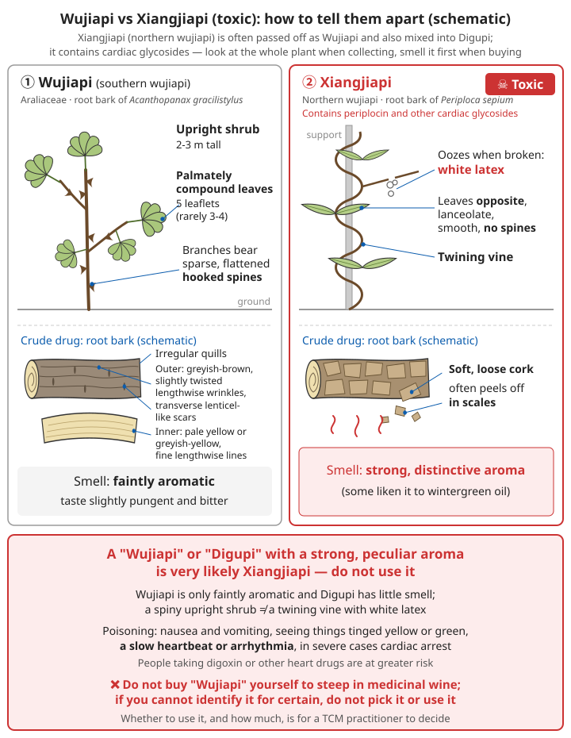

# Barks, Stems and Woods

> **Tree bark, root bark, vine stems and wood are the medicines that look most "like" one another: once dried, they are all brown rolls, sections and chunks. You tell them apart by the broken surface, the smell and a few small tricks (the white threads of *Duzhong*, the blue glow of *Qinpi*, the red water of *Sumu*, the oil of *Jiangxiang*). And the most important rule for collecting them: do not strip a tree to death**

This chapter covers 26 commonly used bark and stem/wood medicines, in five groups: tree barks; root barks; twigs and vine stems; stem pith and bamboo shavings; and heartwood and resinous wood. The parts used include tree bark (trunk bark and branch bark), root bark, young twigs, vine stems, stems with hooks, stem pith, the middle layer of a culm, heartwood and wood containing resin. General methods for identification, harvesting, drying and storage are in the [General principles](00-general-principles.md) and are not repeated here. *Digupi* is the root bark of the goji plant; for growing goji see [Medicinal plants – goji](../../../docs/04-动植物培育/04-药用植物.md#枸杞). *Rendongteng* comes from the honeysuckle plant; for growing it see [Medicinal plants – honeysuckle](../../../docs/04-动植物培育/04-药用植物.md#金银花忍冬).

## ⚠️ Read these first

```
1. Never ring-bark a tree: strip a full ring round the trunk and the tree
   will die.
   Strip only strips or patches from one side of the trunk ("strip
   peeling", "half-ring peeling"),
   and use branches and trunks from pruning and thinning first; wild
   Duzhong, Houpo and Huangbo are protected by the state
2. Always tell the "Mutong" herbs apart: Guanmutong (birthwort family,
   contains aristolochic acid) lost its medicinal standard in 2003;
   it can cause irreversible kidney failure and urinary tract cancer.
   The Chuanmutong in this chapter is a Clematis (buttercup family);
   never collect any herb with "Mutong" in its name yourself; get it only
   from a proper pharmacy on prescription
3. Always tell the "Wujiapi" herbs apart: Xiangjiapi (northern Wujiapi,
   the root bark of Chinese silk vine) contains cardiac glycosides;
   too much can cause heart rhythm problems or even cardiac arrest.
   Do not use any "Wujiapi" with a strong, peculiar fragrance, and do not
   steep it in liquor
4. When collecting vine stems, identify the whole plant: Gouwen
   (heartbreak grass) and Leigongteng (thunder god vine, "Huangteng")
   are both vines that grow in the same forest-edge scrub as
   Rendongteng and Jixueteng, and are highly poisonous;
   if you do not recognise the whole plant, do not take a single
   section of the vine
5. Chenxiang, Jiangxiang and Tanxiang are expensive and often faked:
   the genus Aquilaria is listed in CITES Appendix II, and Tuchenxiang
   (Aquilaria sinensis) and fragrant rosewood (Dalbergia odorifera) are
   class II wild plants under state protection; do not fell wild trees.
   Most "old agarwood" and "Hainan huanghuali" you can buy is not genuine
6. Doses are the usual adult daily doses in the Chinese Pharmacopoeia
   (2020 edition) (prepared slices, decocted in water;
   the current edition is 2025 — the wording of the current edition
   prevails).
   They are only there to warn you "do not exceed this"; whether to use
   a herb, and how much, is decided under the guidance of a TCM
   practitioner
7. Rougui, Sumu, Mudanpi, Daxueteng, Tongcao and others: use with caution
   in pregnancy;
   people taking anticoagulant or antiplatelet drugs such as warfarin or
   aspirin should ask a doctor before using blood-activating herbs
```

---

## Quick reference to the herbs in this chapter

The "Toxicity/protection" column gives toxicity noted in the Pharmacopoeia, this book's risk warnings, and the protection status of wild populations. For protection levels the published state lists prevail; this table is only a reminder.

| Herb | Part used | Main action | Toxicity/protection | See |
|------|---------|---------|----------|-----|
| *Duzhong* (eucommia bark) | Tree bark | Tonifies liver and kidney, strengthens sinews and bones, calms the foetus | 🛡️ Wild plants protected; do not ring-bark | [1.1](#11-duzhong-eucommia-bark) |
| *Houpo* (magnolia bark) | Trunk bark, root bark, branch bark | Dries damp and resolves phlegm, sends *qi* down and relieves fullness | 🛡️ Wild *Houpo* is class II under state protection | [1.2](#12-houpo-magnolia-bark) |
| *Huangbo* (phellodendron bark) | Tree bark | Clears heat and dries damp, purges fire | 🛡️ Wild *Phellodendron* is class II under state protection | [1.3](#13-huangbo-phellodendron-bark) |
| *Rougui* (cassia bark) | Tree bark | Replenishes fire and assists yang, dispels cold and relieves pain | Caution in pregnancy and with a tendency to bleed | [1.4](#14-rougui-cassia-bark) |
| *Qinpi* (ash bark) | Branch bark or trunk bark | Clears heat and dries damp, stops dysentery, brightens the eyes | — | [1.5](#15-qinpi-ash-bark) |
| *Hehuanpi* (silk tree bark) | Tree bark | Relieves depression and calms the mind, activates blood and reduces swelling | — | [1.6](#16-hehuanpi-silk-tree-bark) |
| *Mudanpi* (tree peony root bark) | Root bark | Clears heat and cools blood, activates blood and resolves stasis | Caution in pregnancy; wild tree peonies protected | [2.1](#21-mudanpi-tree-peony-root-bark) |
| *Digupi* (goji root bark) | Root bark | Cools blood and relieves steaming bone, clears the lungs and lowers fire | Beware *Xiangjiapi* mixed in | [2.2](#22-digupi-goji-root-bark) |
| *Sangbaipi* (white mulberry root bark) | Root bark | Drains the lungs and calms wheezing, promotes urination and reduces swelling | — | [2.3](#23-sangbaipi-white-mulberry-root-bark) |
| *Baixianpi* (dittany root bark) | Root bark | Clears heat and dries damp, dispels wind and removes toxins | ⚠️ Liver damage reported | [2.4](#24-baixianpi-dittany-root-bark) |
| *Wujiapi* (acanthopanax root bark) | Root bark | Dispels wind and damp, tonifies liver and kidney | ⚠️ Beware *Xiangjiapi* (toxic) used in its place | [2.5](#25-wujiapi-acanthopanax-root-bark) |
| *Guizhi* (cassia twig) | Young twig | Induces sweating and releases the muscles, warms and unblocks the channels | Caution in pregnancy | [3.1](#31-guizhi-cassia-twig) |
| *Sangzhi* (mulberry twig) | Young twig | Dispels wind and damp, benefits the joints | — | [3.2](#32-sangzhi-mulberry-twig) |
| *Jixueteng* (spatholobus stem) | Vine stem | Activates and tonifies blood, relaxes the sinews and unblocks the collaterals | Beware *Daxueteng* and *Shanjixueteng* used in its place | [3.3](#33-jixueteng-spatholobus-stem) |
| *Daxueteng* (sargentodoxa stem) | Vine stem | Clears heat and removes toxins, activates blood | Caution in pregnancy | [3.4](#34-daxueteng-sargentodoxa-stem) |
| *Rendongteng* (honeysuckle stem) | Stem and branches | Clears heat and removes toxins, unblocks the collaterals | ⚠️ Beware picking *Gouwen* (heartbreak grass) by mistake | [3.5](#35-rendongteng-honeysuckle-stem) |
| *Shouwuteng* (fleeceflower stem) | Vine stem | Nourishes blood and calms the mind, dispels wind and unblocks the collaterals | May cause liver damage; do not take long term | [3.6](#36-shouwuteng-fleeceflower-stem) |
| *Gouteng* (uncaria stem with hooks) | Stem and branches with hooks | Calms wind and stops convulsions, clears heat and calms the liver | Added near the end | [3.7](#37-gouteng-uncaria-stem-with-hooks) |
| *Luoshiteng* (star jasmine stem) | Vine stem with leaves | Dispels wind and unblocks the collaterals, cools blood and reduces swelling | Beware climbing fig used in its place | [3.8](#38-luoshiteng-star-jasmine-stem) |
| *Chuanmutong* (clematis stem) | Vine stem | Promotes urination and relieves painful urination, unblocks menstruation and promotes milk flow | ⚠️ Beware *Guanmutong* (aristolochic acid) used in its place; caution in pregnancy | [3.9](#39-chuanmutong-clematis-stem) |
| *Tongcao* (rice-paper plant pith) | Stem pith | Clears heat and promotes urination, frees the *qi* and promotes milk flow | Caution in pregnancy | [4.1](#41-tongcao-rice-paper-plant-pith) |
| *Zhuru* (bamboo shavings) | Middle layer of the culm | Clears heat and resolves phlegm, relieves restlessness and stops vomiting | — | [4.2](#42-zhuru-bamboo-shavings) |
| *Sumu* (sappanwood) | Heartwood | Activates blood and removes stasis, reduces swelling and relieves pain | Caution in pregnancy | [5.1](#51-sumu-sappanwood) |
| *Jiangxiang* (dalbergia heartwood) | Heartwood | Resolves stasis and stops bleeding, regulates *qi* and relieves pain | 🛡️ *Dalbergia odorifera* is class II under state protection | [5.2](#52-jiangxiang-dalbergia-heartwood) |
| *Tanxiang* (sandalwood) | Heartwood | Moves *qi* and warms the middle, opens the appetite and relieves pain | Many fakes | [5.3](#53-tanxiang-sandalwood) |
| *Chenxiang* (agarwood) | Wood containing resin | Moves *qi* and relieves pain, warms the middle and stops vomiting, helps the kidneys grasp *qi* and calms wheezing | 🛡️ CITES Appendix II; *Tuchenxiang* class II under state protection | [5.4](#54-chenxiang-agarwood) |

---

## 1. Tree barks

Tree-bark medicines come from the trunks and branches of trees. The layer that lies tight against the inside of the bark (the phloem and cambium) is where the tree carries nutrients and grows new tissue: **strip a full ring round the trunk ("ring-barking") and the roots no longer get the nutrients made by the leaves, so the tree dies within one or two years**. The heavy decline of wild *Duzhong*, *Houpo* and *Huangbo* in the past was largely caused by "stripping the bark and felling the tree".

```
Sustainable bark stripping (taking Duzhong, Houpo and Huangbo as examples):

1. First strip bark from branches and trunks cut in pruning, thinning
   or felling: this is the best source
2. On a living tree strip only one side: take one lengthwise strip or a
   few patches, no wider than 1/3-1/2 of the trunk's circumference
   ("strip peeling", "half-ring peeling"), so the bark left behind can
   keep carrying nutrients;
   once the wound has healed and grown new bark (usually after 2-3
   years), strip the other side
3. Choose the turn of spring and summer, when the sap flows strongly
   (mostly April-June): the bark comes away easily and the wound heals
   easily; choose an overcast day or the evening of a sunny day; avoid
   rainy days
4. Cut only as deep as the surface of the wood, without damaging the
   wood; after stripping, do not touch the exposed wood with your hands
5. After stripping, wrap the wound for a while in plastic film or
   similar, to protect it from strong sun, drying out, disease and
   insects
6. The special "ring-stripping and regeneration" technique used in
   plantations is very demanding (timing, weather and wrapping all
   matter), and if it fails the tree dies; do not try it without
   experience, and never ring-bark a wild tree
```

"Sweating" (*fahan*) is a processing step at the place of origin peculiar to *Duzhong* and *Houpo*: freshly stripped bark is piled up and covered tightly so that it heats up and regains moisture by itself; once the inner surface has changed colour it is sun-dried. For the method see [General principles – Sweating](00-general-principles.md#54-sweating).

### 1.1 Duzhong (eucommia bark)

- **Duzhong (Sizhong, Silianpi, Chesipi)**: Chinese 杜仲; *Eucommia ulmoides* Oliv.
- **Source**: The dried tree bark of *Eucommia ulmoides* Oliv. (Eucommiaceae)
- **Distribution and habitat**: A plant unique to China and the only species in its family; Shaanxi, Sichuan, Guizhou, Hunan, Hubei, Henan and elsewhere, growing wild in mountain forest; now widely cultivated everywhere
- **Key identification features**:
  - Plant: Deciduous tree up to 20 m tall; leaves alternate, elliptic or ovate, toothed at the edge; **snap a leaf, a piece of bark or a fruit gently and pull the halves slowly apart, and many silvery-white, elastic fine threads join the broken ends** (eucommia gum) — this is the most distinctive feature of *Duzhong*; fruit a flat, long-elliptic winged fruit (samara)
  - Crude drug: Flat pieces, or with both sides curled slightly inwards, 3-7 mm thick; outer surface pale brown or greyish-brown, with clear wrinkles or lengthwise cracks and grooves, some with the coarse outer bark scraped off; inner surface dark purple and smooth; brittle, snaps easily; **the broken surface is joined by fine, dense, silvery-white, elastic rubber threads**; faint smell, taste slightly bitter
- **Look-alikes/fakes**:
  - The bark of **winterberry euonymus** (*Euonymus maackii*, spindle-tree family) and similar plants ("*Tuduzhong*", "local *Duzhong*"): also shows a few white threads when snapped, but **the threads are sparse, not very elastic and break as soon as they are pulled**
  - The bark of **Duzhongteng** (a climbing plant of the oleander family, commonly called "red *Duzhong*"): few white threads on the broken surface, with little elasticity; plants of the oleander family are often toxic, so do not use it in its place
  - How to tell: genuine *Duzhong* has **dense, plentiful white threads that do not break even when pulled out to more than 1 cm**
- **Harvest and processing**: Strip in April-June, scrape off the coarse outer bark, pile up to "sweat" until the inner bark turns purplish-brown, and sun-dry; for the stripping method see the start of this section — **do not ring-bark**
- **Storage**: Does not spoil easily; keep in a ventilated, dry place, away from damp
- **Actions**: Tonifies liver and kidney, strengthens sinews and bones, calms the foetus
- **Dose**: 6-10 g (Chinese Pharmacopoeia, 2020 edition; use under the guidance of a TCM practitioner)
- **Contraindications**: Use with caution in yin deficiency with flaring fire (experience); if abdominal pain or vaginal bleeding occurs during pregnancy, you must first go to hospital to find the cause, and not rely only on "foetus-calming herbs"; *Duzhong* lowers blood pressure somewhat, so people taking blood-pressure medicines should ask a doctor first
- 🛡️ **Protection note**: Wild *Duzhong* is on the "List of Wild Medicinal Species under Key State Protection" (the wording of the list prevails for the class); almost all the medicine now comes from cultivation; do not collect from wild trees

### 1.2 Houpo (magnolia bark)

- **Houpo (Chuanpo, Ziyou Houpo, Wenpo)**: Chinese 厚朴; *Magnolia officinalis* Rehd. et Wils., *M. officinalis* var. *biloba* Rehd. et Wils.
- **Source**: The dried trunk bark, root bark and branch bark of *Magnolia officinalis* Rehd. et Wils. or *M. officinalis* var. *biloba* Rehd. et Wils. (notched-leaf *Houpo*) (Magnoliaceae, magnolia family) (newer classifications place *Houpo* in the genus *Houpoea*)
- **Distribution and habitat**: Mountain forest in Sichuan, Hubei, Hunan, Guizhou, Zhejiang, Jiangxi, Fujian and elsewhere; mainly from cultivation
- **Key identification features**:
  - Plant: Deciduous tree; **leaves very large**, 20-45 cm long, obovate, clustered at the branch tips like an umbrella; in early summer it opens **large white flowers** 10-15 cm across, fragrant; in notched-leaf *Houpo* the leaf tip is notched into two blunt, rounded shallow lobes
  - Crude drug: Trunk bark rolled into single or double tubes (traditionally called "tube *Houpo*", *tongpo*); trunk bark from near the root opens out at one end like a trumpet ("boot-leg *Houpo*", *xuetongpo*); outer surface greyish-brown or greyish-tan, rough, with elliptic lenticels; **inner surface purplish-brown or deep purplish-tan, fairly smooth, showing an oily mark when scratched with a fingernail**; broken surface granular, outer layer greyish-brown, inner layer purplish-tan or brown, **oily, some with many small bright specks visible**; **fragrant smell, taste pungent and hot, slightly bitter**
- **Look-alikes/fakes**: The bark of *Magnolia sprengeri*, *M. sargentiana*, *M. biondii* and other plants of the same family is often passed off as *Houpo* ("*Tuhoupo*", "local *Houpo*"); most have a paler inner surface, less oil and weaker fragrance and pungency. Look for "purple, oily, fragrant, pungent"
- **Harvest and processing**: Strip in April-June; dry root bark and branch bark in the shade; boil trunk bark briefly in boiling water, then pile it in a shady, damp place to "sweat" until the inner surface turns purplish-tan or brownish-tan, steam it soft, take it out, roll it into tubes and dry; for the stripping method see the start of this section
- **Storage**: Contains volatile oil; keep in a cool, dry place so the fragrance does not escape
- **Actions**: Dries damp and resolves phlegm, sends *qi* down and relieves fullness
- **Dose**: 3-10 g (Chinese Pharmacopoeia, 2020 edition; use under the guidance of a TCM practitioner)
- **Contraindications**: Use with caution in pregnancy; not suitable for weak people or those short of body fluids (experience); the flower of *Houpo* ("*Houpohua*") is a separate medicine
- 🛡️ **Protection note**: *Houpo* (including notched-leaf *Houpo*) is class II on the 2021 "List of Wild Plants under Key State Protection", and wild *Houpo* is also on the "List of Wild Medicinal Species under Key State Protection"; **do not strip wild trees**; use only cultivated bark

### 1.3 Huangbo (phellodendron bark)

- **Huangbo (Chuan Huangbo, Huangbopi)**: Chinese 黄柏; *Phellodendron chinense* Schneid.
- **Source**: The dried tree bark of *Phellodendron chinense* Schneid. (Rutaceae, rue family), traditionally called "*Chuan Huangbo*" (Sichuan *Huangbo*). The bark of the northeastern Amur cork tree, *P. amurense* Rupr., is listed separately in the Pharmacopoeia as "*Guan Huangbo*"; its appearance and use are similar
- **Distribution and habitat**: *Chuan Huangbo* comes from Sichuan, Guizhou, Hubei, Yunnan and elsewhere; *Guan Huangbo* from the northeast and north China; grows in mixed mountain forest; now mostly cultivated
- **Key identification features**:
  - Plant: Deciduous tree; **odd-pinnately compound leaves, opposite**, with 7-15 leaflets, a distinctive smell when crushed; male and female flowers on separate trees; drupes round, blue-black when ripe; old Amur cork trees have a very thick **cork layer** that you can dent with a finger
  - Crude drug: Flat pieces or shallow troughs, 1-6 mm thick; outer surface yellowish-brown or yellowish-tan, flat or with lengthwise furrows, some showing lenticel scars and remnants of greyish-brown coarse bark; **inner surface dark yellow or pale brown**; light but hard; **broken surface fibrous, splitting into layers like flakes, deep yellow**; faint smell, **taste extremely bitter, sticky when chewed, and it stains the saliva yellow**
- **Look-alikes**: Other species of the same genus, and the stem bark of *Shidagonglao* (mahonia), barberry and other plants locally called "*Huangbo*", also contain berberine and are also yellow on the broken surface, but they are not the Pharmacopoeia herb; look for "flat pieces, broken surface separating layer by layer, extremely bitter, sticky when chewed"
- **Harvest and processing**: Strip the bark, remove the coarse outer bark and sun-dry; for the stripping method see the start of this section — **do not ring-bark**
- **Storage**: Keep in a ventilated, dry place, away from damp and mould
- **Actions**: Clears heat and dries damp, purges fire and relieves steaming bone, removes toxins and treats sores
- **Dose**: 3-12 g; for external use, a suitable amount (Chinese Pharmacopoeia, 2020 edition; use under the guidance of a TCM practitioner)
- **Contraindications**: Cold in nature and bitter in taste, so **not suitable for people with a cold, weak spleen and stomach, poor appetite and diarrhoea**; contains berberine, so use with caution in people with glucose-6-phosphate dehydrogenase deficiency (favism) and in newborns
- 🛡️ **Protection note**: *Phellodendron amurense* and *P. chinense* are both class II on the 2021 "List of Wild Plants under Key State Protection", and wild *Huangbo* is also on the "List of Wild Medicinal Species under Key State Protection"; **do not strip wild trees**; use only cultivated bark

### 1.4 Rougui (cassia bark)

- **Rougui (Yugui, Mugui, Guipi)**: Chinese 肉桂; *Cinnamomum cassia* Presl
- **Source**: The dried tree bark of *Cinnamomum cassia* Presl (Lauraceae, laurel family)
- **Distribution and habitat**: Guangxi, Guangdong, Yunnan, Fujian and elsewhere, mainly cultivated; likes the warm, humid southern subtropics
- **Key identification features**:
  - Plant: Evergreen tree; leaves alternate or nearly opposite, leathery, long-elliptic, **with three clear main veins arising slightly above the leaf base**; the whole plant has a rich cassia smell
  - Crude drug: Troughs or rolled tubes, 0.2-0.8 cm thick; outer surface greyish-brown, slightly rough, with irregular fine wrinkles and raised transverse lenticels; inner surface reddish-brown, fairly flat, **showing an oily mark when scratched with a fingernail**; hard and brittle, snaps easily; **broken surface uneven, outer layer brown and rougher, inner layer reddish-brown and oily, with one yellowish-brown line between the two layers**; **strong fragrant smell, taste sweet and hot**
- **Look-alikes**: The "*guipi*" used as a kitchen spice is often the bark of related species such as *Cinnamomum burmanni*, *C. japonicum* or *C. wilsonii*, with a weaker smell, a taste that is not sweet or is bitter, and less oil; Ceylon cinnamon (*C. verum*, used in Western cooking) is not the Pharmacopoeia species. For medicine look for "oily, sweet and hot, with a yellowish-brown line on the broken surface"
- **Harvest and processing**: Usually stripped in autumn and dried in the shade; likewise strip only from branches and trunks pruned or thinned in plantations — **do not ring-bark**
- **Storage**: Contains volatile oil; **seal, keep out of light and store somewhere cool**; the fragrance fades the longer it is kept
- **Actions**: Replenishes fire and assists yang, guides fire back to its source, dispels cold and relieves pain, warms and unblocks the channels
- **Dose**: 1-5 g (Chinese Pharmacopoeia, 2020 edition; use under the guidance of a TCM practitioner)
- **Contraindications**: **Use with caution in people with a tendency to bleed and in pregnancy; should not be used together with *Chishizhi* (red halloysite)** (Pharmacopoeia); do not use in yin deficiency with flaring fire or with fever (experience); cassia-type barks contain coumarin, and eating large amounts for a long time (including as a spice or health supplement) may harm the liver

### 1.5 Qinpi (ash bark)

- **Qinpi (Bailashupi, Cenpi)**: Chinese 秦皮; *Fraxinus rhynchophylla* Hance, *F. chinensis* Roxb., *F. szaboana* Lingelsh., *F. stylosa* Lingelsh.
- **Source**: The dried branch bark or trunk bark of *Fraxinus rhynchophylla* Hance, *F. chinensis* Roxb. (Chinese ash), *F. szaboana* Lingelsh. or *F. stylosa* Lingelsh. (Oleaceae, olive family)
- **Distribution and habitat**: Mixed mountain forest from the northeast, north and northwest down to the Yangtze basin; Chinese ash is also a common street tree and the tree on which Chinese wax insects are raised
- **Key identification features**:
  - Plant: Deciduous tree; **odd-pinnately compound leaves, opposite**, with 5-7 leaflets; fruit a single-winged, oblanceolate samara (like a small paddle)
  - Crude drug: Rolled tubes or troughs, 1.5-3 mm thick; outer surface greyish-white, greyish-brown to blackish-brown, or blotched with these colours, flat or slightly rough, with greyish-white dot-like lenticels and fine slanting wrinkles; inner surface yellowish-white or brown, smooth; hard and brittle, broken surface fibrous, yellowish-white; faint smell, taste bitter
  - **Water test**: Soak a little bark in hot water: **in daylight the liquid shows a sky-blue fluorescence** — this is the classic identifying feature of *Qinpi*
- **Look-alikes**: The bark of Manchurian walnut (*Hutaoqiu*) is often mixed in as *Qinpi*; **its liquid has no blue fluorescence**
- **Harvest and processing**: Strip in spring and autumn and sun-dry; strip bark from pruned branches first
- **Storage**: Keep in a ventilated, dry place
- **Actions**: Clears heat and dries damp, astringes and stops dysentery, stops vaginal discharge, brightens the eyes
- **Dose**: 6-12 g; for external use, a suitable amount, decocted and used to wash the affected area (Chinese Pharmacopoeia, 2020 edition; use under the guidance of a TCM practitioner)
- **Contraindications**: Not suitable for people with a cold, weak spleen and stomach (experience); red, swollen, painful eyes or failing eyesight need a doctor first — do not wash your eyes with a herbal liquid on your own

### 1.6 Hehuanpi (silk tree bark)

- **Hehuanpi (Yehepi, Ronghuashupi)**: Chinese 合欢皮; *Albizia julibrissin* Durazz.
- **Source**: The dried tree bark of *Albizia julibrissin* Durazz. (Persian silk tree; Fabaceae, legume family)
- **Distribution and habitat**: Widespread from north to south China; grows wild on hillsides and is often planted as a street or garden tree in cities
- **Key identification features**:
  - Plant: Deciduous tree; **twice-pinnately compound leaves**, the leaflets tiny and sickle-shaped, **folding together in pairs at night**; in summer it opens **pink, pompom-like flowers** (actually long stamens); pods flat and strap-shaped
  - Crude drug: Curled tubes or half-tubes, 0.1-0.3 cm thick; outer surface greyish-brown to greyish-tan, with slight lengthwise wrinkles, some with shallow cracks, **densely covered in clear, elliptic, transverse lenticels, brown or reddish-brown**; inner surface pale yellowish-brown or yellowish-white, smooth; hard and brittle, snaps easily, broken surface fibrous and flaky, pale yellowish-brown or yellowish-white; faintly fragrant, taste bland, slightly astringent, a little prickly on the tongue, followed by discomfort in the throat
- **Look-alikes**: The bark of the related *Shanhehuan* (*A. kalkora*, flowers white or yellowish-white) is sometimes mixed in; it is not the Pharmacopoeia species
- **Harvest and processing**: Strip in summer and autumn and sun-dry; street trees in cities are managed by the parks department — do not strip their bark at will
- **Storage**: Keep in a ventilated, dry place
- **Actions**: Relieves depression and calms the mind, activates blood and reduces swelling
- **Dose**: 6-12 g; for external use, a suitable amount, ground to powder, mixed and applied (Chinese Pharmacopoeia, 2020 edition; use under the guidance of a TCM practitioner)
- **Contraindications**: Use with caution in pregnancy (experience); insomnia or low mood lasting more than two weeks needs a doctor — "mind-calming herbs" cannot replace treatment for depression or anxiety; *Hehuanhua* (silk tree flower) is a separate medicine

---

## 2. Root barks

Root-bark medicines are the bark stripped from roots after digging, with the woody core in the middle removed. Digging the root harms the whole plant, so **dig only cultivated plants, or take the bark when plants are being transplanted, thinned or renewed anyway**; every wild shrub dug up is one fewer. The most dangerous confusion among root barks is **Xiangjiapi**: it is often passed off as *Wujiapi*, is also mixed in with *Digupi*, and it contains cardiac glycosides.

### 2.1 Mudanpi (tree peony root bark)

- **Mudanpi (Danpi, Fendanpi, Fengdanpi)**: Chinese 牡丹皮; *Paeonia suffruticosa* Andr.
- **Source**: The dried root bark of *Paeonia suffruticosa* Andr. (tree peony; Ranunculaceae, buttercup family)
- **Distribution and habitat**: Medicinal tree peony is mainly cultivated in Anhui (Tongling, Bozhou), Shandong, Henan, Sichuan and elsewhere; ornamental tree peonies are found everywhere
- **Key identification features**:
  - Plant: Small deciduous shrub 1-2 m tall, **with woody stems** (this distinguishes it from the herbaceous Chinese peony); leaves twice ternately compound; large flowers in spring
  - Crude drug: Tubes or half-tubes, split open lengthwise, curled slightly inwards, 0.1-0.4 cm thick; outer surface greyish-brown or yellowish-brown, with many transverse lenticel-like bumps and fine root scars, pink where the cork has fallen off; **inner surface pale greyish-yellow or light brown, with clear fine lengthwise lines, often with shiny crystals** (paeonol coming out, traditionally called "bright silver stars", *liang yinxing*); hard and brittle, snaps easily, broken surface fairly flat, **powdery**, pale pink; **aromatic smell, taste slightly bitter and astringent**
- **Look-alikes**: The root bark of Chinese peony (the source plant of *Baishao* and *Chishao*) and of wild tree peonies of the same genus is occasionally mixed in; *Baishao* and *Chishao* use the whole root, see [Roots and Rhizomes (1) – Baishao](01-roots-and-rhizomes-1.md#22-baishao-white-peony-root)
- **Harvest and processing**: Dig the roots in autumn, remove the fine roots and soil, strip the root bark and sun-dry ("*Liandanpi*"); or scrape off the coarse outer bark, remove the woody core and sun-dry ("*Guadanpi*")
- **Storage**: Contains paeonol, which evaporates easily; **seal and keep in a cool, dry place**
- **Actions**: Clears heat and cools blood, activates blood and resolves stasis
- **Dose**: 6-12 g (Chinese Pharmacopoeia, 2020 edition; use under the guidance of a TCM practitioner)
- **Contraindications**: **Use with caution in pregnancy** (Pharmacopoeia); not suitable for heavy periods (experience); people taking anticoagulants should ask a doctor first
- 🛡️ **Protection note**: Wild tree peonies of the genus *Paeonia*, such as *P. rockii*, *P. ostii*, *P. qiui* and *P. ludlowii*, are on the 2021 "List of Wild Plants under Key State Protection" (the wording of the list prevails for the class); use only cultivated tree peony for the medicine — **do not dig wild tree peonies in the mountains**

### 2.2 Digupi (goji root bark)

- **Digupi (Gouqi Genpi)**: Chinese 地骨皮; *Lycium chinense* Mill., *L. barbarum* L.
- **Source**: The dried root bark of *Lycium chinense* Mill. (Chinese boxthorn) or *L. barbarum* L. (Ningxia goji) (Solanaceae, nightshade family)
- **Distribution and habitat**: Chinese boxthorn grows wild in most of China, on hillsides, field banks, roadsides and the edges of villages; Ningxia goji is mainly cultivated in Ningxia, Gansu, Qinghai, Xinjiang and elsewhere
- **Key identification features**:
  - Plant: Much-branched shrub with long, thin, arching branches **bearing thorns**; leaves alternate or clustered, ovate or lanceolate; flowers pale purple; berries red (these are goji berries, see [Fruits and Seeds – Gouqizi](03-fruits-and-seeds.md#11-gouqizi-goji-berry))
  - Crude drug: Tubes or troughs, 3-10 cm long, 0.1-0.3 cm thick; **outer surface greyish-yellow to brownish-yellow, rough, with irregular lengthwise cracks, easily flaking off in scales**; inner surface yellowish-white to greyish-yellow, fairly flat, with fine lengthwise lines; light and brittle, snaps easily; broken surface uneven, outer layer yellowish-brown, inner layer greyish-white; faint smell, taste slightly sweet, then bitter. In experience this is summed up as "rotten bark, white inside" (*zaopi baili*)
- **Look-alikes**: **Xiangjiapi** (root bark of Chinese silk vine, toxic) also has a soft, loose cork that flakes off in scales, and is sometimes mixed in as *Digupi*; the difference is that **Xiangjiapi has a strong, peculiar fragrance**, while *Digupi* has only a faint smell. For details see [Xiangjiapi vs Wujiapi](../../../docs/10-中药材识别与采集/09-有毒中药与易混淆有毒植物.md#46-香加皮-vs-五加皮)
- **Harvest and processing**: Dig the roots in early spring or after autumn, wash, strip the root bark and sun-dry; dig only cultivated plants or old plants removed in renewal
- **Storage**: Keep in a ventilated, dry place, away from damp
- **Actions**: Cools blood and relieves steaming bone, clears the lungs and lowers fire
- **Dose**: 9-15 g (Chinese Pharmacopoeia, 2020 edition; use under the guidance of a TCM practitioner)
- **Contraindications**: Not suitable for fever from an external wind-cold illness, or for loose stools from a cold, weak spleen and stomach (experience); a long-lasting low fever, night sweats and weight loss need checking first for tuberculosis and other causes

### 2.3 Sangbaipi (white mulberry root bark)

- **Sangbaipi (Sanggen Baipi, Sangpi)**: Chinese 桑白皮; *Morus alba* L.
- **Source**: The dried root bark of *Morus alba* L. (white mulberry; Moraceae, mulberry family)
- **Distribution and habitat**: All over China, wild or cultivated (planted in large numbers in silkworm-raising areas)
- **Key identification features**:
  - Plant: Deciduous tree or shrub; **broken twigs and leaves give white milky sap**; leaves ovate, coarsely toothed at the edge, sometimes lobed; mulberries turn from green to red and then purplish-black
  - Crude drug: Twisted rolled tubes, troughs or flat pieces, 1-4 mm thick; **outer surface white or pale yellowish-white**, fairly flat, some with remnants of orange-yellow or brownish-yellow scaly coarse bark; inner surface yellowish-white or greyish-yellow, with fine lengthwise lines; light, tough, **very fibrous, hard to snap, easily torn lengthwise, giving off dust as it tears**; faint smell, taste slightly sweet
- **Look-alikes**: The root bark of related plants such as *Morus australis*, *M. cathayana* and paper mulberry (*Goushu*, *Chushu*) is occasionally mixed in; they are not the Pharmacopoeia species
- **Harvest and processing**: Dig the roots from late autumn when the leaves fall until before the buds open the next spring, **scrape off the yellowish-brown coarse bark**, split lengthwise, strip the root bark and sun-dry; take it only from old mulberry trees dug out when a cultivated mulberry field is renewed
- **Storage**: Easily absorbs moisture, moulds and is attacked by insects; keep in a ventilated, dry place
- **Actions**: Drains the lungs and calms wheezing, promotes urination and reduces swelling
- **Dose**: 6-12 g (Chinese Pharmacopoeia, 2020 edition; use under the guidance of a TCM practitioner)
- **Contraindications**: Not suitable for lung deficiency without fire, or for wind-cold cough (experience); wheezing with a tight chest, blue lips or worsening swelling must be seen by a doctor; mulberry leaf, mulberry twig and mulberry fruit are each separate medicines

### 2.4 Baixianpi (dittany root bark)

- **Baixianpi (Baixianpi 白藓皮, Baguniu, Beixianpi)**: Chinese 白鲜皮; *Dictamnus dasycarpus* Turcz.
- **Source**: The dried root bark of *Dictamnus dasycarpus* Turcz. (Chinese dittany; Rutaceae, rue family)
- **Distribution and habitat**: Northeast, north, east and northwest China; grows in grassland on hillsides, at forest edges and in open woodland
- **Key identification features**:
  - Plant: Perennial herb 40-100 cm tall, **the whole plant with a strong, peculiar smell** (like a billy goat); odd-pinnately compound leaves, with translucent oil dots in the leaf blade; flowers large, in racemes, pale purplish-red or white, **with purplish-red lines on the petals**; capsule splits into 5
  - Crude drug: Rolled tubes, 5-15 cm long, 1-2 cm across, 0.2-0.5 cm thick; outer surface greyish-white or pale greyish-yellow, with fine lengthwise wrinkles and fine root scars, often with raised granular dots; inner surface off-white, with fine lengthwise lines; brittle, giving off dust when snapped; broken surface uneven, slightly layered; peel off the outer layer and, held against the light, small glittering bright specks can be seen; **goat-like smell, taste slightly bitter**
- **Note**: If the plant (especially the flowers and fruit) touches your skin and the skin is then exposed to sunlight, it can cause **photosensitive dermatitis** (red patches and blisters); wear gloves and long sleeves when digging
- **Harvest and processing**: Dig the roots in spring and autumn, remove soil and coarse bark, strip the root bark and dry
- **Storage**: Keep in a ventilated, dry place, away from damp
- **Actions**: Clears heat and dries damp, dispels wind and removes toxins
- **Dose**: 5-10 g; for external use, a suitable amount, as a decoction for washing or as a powder to apply (Chinese Pharmacopoeia, 2020 edition; use under the guidance of a TCM practitioner)
- **Contraindications**: **There are many reports from China and abroad of liver damage caused by taking *Baixianpi* (and Chinese patent medicines containing it) by mouth**; people with liver disease must not use it; do not take it yourself long term or in large amounts; if tiredness, poor appetite, dark urine or yellow skin or eyes appear while taking it, stop at once and see a doctor; not suitable for people with a cold, weak spleen and stomach

### 2.5 Wujiapi (acanthopanax root bark)

- **Wujiapi (Nan Wujiapi, Xizhu Wujiapi)**: Chinese 五加皮; *Acanthopanax gracilistylus* W. W. Smith
- **Source**: The dried root bark of *Acanthopanax gracilistylus* W. W. Smith (Araliaceae, ivy family) (newer name *Eleutherococcus nodiflorus*)
- **Distribution and habitat**: Central, east, south and southwest China; grows at forest edges, in scrub, on hillsides and by roads
- **Key identification features**:
  - Plant: Shrub 2-3 m tall; **branches with scattered flattened, hooked prickles**; **palmately compound leaves with 5 leaflets** (occasionally 3-4), alternate on long shoots and clustered on short shoots; umbels of yellowish-green flowers; fruit black when ripe
  - Crude drug: Irregular rolled tubes, 5-15 cm long, 0.4-1.4 cm across, about 0.2 cm thick; outer surface greyish-brown, with slightly twisted lengthwise wrinkles and transverse lenticel-like marks; inner surface pale yellow or greyish-yellow, with fine lengthwise lines; light and brittle, snaps easily; broken surface uneven, greyish-white; **faintly fragrant, taste slightly hot and bitter**
- **Look-alikes (important)**: **Xiangjiapi** (northern *Wujiapi*) is the root bark of Chinese silk vine, *Periploca sepium*, a climbing plant of the milkweed family (newer classifications place it in the oleander family); it **contains periplocin and other cardiac glycosides and is toxic**, and the Pharmacopoeia lists it as a separate medicine marked "toxic". For identification only:
  - Plant: **A twining vine that gives white milky sap when broken**, with opposite, lanceolate, smooth leaves and no prickles; *Wujia* is **an upright shrub with prickles and palmately compound leaves**
  - Crude drug: *Xiangjiapi* has **a soft, loose cork that often flakes off in scales**, and **a strong, peculiar fragrance** (some describe it as like wintergreen oil); *Wujiapi* is only faintly fragrant
  - Poisoning signs: Nausea and vomiting, seeing things tinged yellow or green, **a very slow heartbeat or heart rhythm problems**, and in severe cases cardiac arrest; the risk is higher in people taking digoxin or other heart-strengthening medicines
  - For a comparison table see [Xiangjiapi vs Wujiapi](../../../docs/10-中药材识别与采集/09-有毒中药与易混淆有毒植物.md#46-香加皮-vs-五加皮). **Do not buy "*Wujiapi*" yourself to steep in medicinal liquor**; much of the "*Wujiapi*" in northern markets is in fact *Xiangjiapi*
- **Harvest and processing**: Dig the roots in summer and autumn, wash, strip the root bark and sun-dry
- **Storage**: Keep in a ventilated, dry place, away from damp and insects
- **Actions**: Dispels wind and damp, tonifies liver and kidney, strengthens sinews and bones, promotes urination and reduces swelling
- **Dose**: 5-10 g (Chinese Pharmacopoeia, 2020 edition; use under the guidance of a TCM practitioner)
- **Contraindications**: Use with caution in yin deficiency with flaring fire (experience); *Ciwujia* (Siberian ginseng, *Eleutherococcus senticosus*) is a separate medicine, using the root and rhizome or the stem



*Figure: Wujia is an upright shrub with flattened, hooked prickles and palmately compound leaves; Chinese silk vine is a twining vine with white milky sap and opposite leaves. For the crude drug the key is the smell — the one with a strong, peculiar fragrance is Xiangjiapi: do not use it, and do not steep it in liquor*

---

## 3. Twigs and vine stems

This group is young twigs with their bark and woody vine stems, mostly collected in autumn and winter after the leaves fall and sliced while fresh. Once dried, slices of vine stem all look much alike, so **identify a vine when you collect it, by looking at the whole plant: leaves, flowers, fruit, milky sap, smell**. The forest-edge scrub also holds the highly poisonous **Gouwen (heartbreak grass)** and **Leigongteng (thunder god vine)** ("*Huangteng*"), both vines or climbing shrubs; see [Gouwen vs Jinyinhua](../../../docs/10-中药材识别与采集/09-有毒中药与易混淆有毒植物.md#42-钩吻-vs-金银花) and [Leigongteng](../../../docs/10-中药材识别与采集/09-有毒中药与易混淆有毒植物.md#214-雷公藤). If you do not recognise the whole plant, do not take a single section of the vine.

### 3.1 Guizhi (cassia twig)

- **Guizhi (Liugui, Nen Guizhi)**: Chinese 桂枝; *Cinnamomum cassia* Presl
- **Source**: The dried young twigs of *Cinnamomum cassia* Presl (Lauraceae, laurel family)
- **Distribution and habitat**: As for [Rougui](#14-rougui-cassia-bark): cultivated in Guangxi, Guangdong and elsewhere
- **Key identification features**:
  - Crude drug: Long and cylindrical, much branched, 30-75 cm long, 0.3-1 cm across at the thick end; surface reddish-brown to brown, with lengthwise ridges, fine wrinkles and small knob-like leaf, branch and bud scars, lenticels dot-like; hard and brittle, snaps easily; slices 2-4 mm thick, **cut surface with reddish-brown bark, yellowish-white to pale yellowish-brown wood, and a roughly square pith**; **distinctive fragrance, taste sweet and slightly pungent, stronger in the bark**
- **Look-alikes**: Young twigs of other plants of the laurel family have a weaker smell and no sweetness; look for "red bark, square pith, sweet and pungent"
- **Harvest and processing**: Collect in spring and summer, remove the leaves and sun-dry, or slice and sun-dry; take pruned branches from cultivated cassia trees without harming the main trunk
- **Storage**: Contains volatile oil; seal and keep in a cool, dry place
- **Actions**: Induces sweating and releases the muscles, warms and unblocks the channels, assists yang and transforms *qi*, calms surging *qi* and sends counterflow down
- **Dose**: 3-10 g (Chinese Pharmacopoeia, 2020 edition; use under the guidance of a TCM practitioner)
- **Contraindications**: **Use with caution in pregnancy** (Pharmacopoeia); not suitable for fever with thirst, a sore, swollen throat or a tendency to bleed (experience)

### 3.2 Sangzhi (mulberry twig)

- **Sangzhi (Nen Sangzhi)**: Chinese 桑枝; *Morus alba* L.
- **Source**: The dried young twigs of *Morus alba* L. (white mulberry; Moraceae, mulberry family)
- **Distribution and habitat**: As for [Sangbaipi](#23-sangbaipi-white-mulberry-root-bark): all over China
- **Key identification features**:
  - Crude drug: Long and cylindrical, rarely branched, of varying length, 0.5-1.5 cm across; surface greyish-yellow or yellowish-brown, with many yellowish-brown dot-like lenticels and fine lengthwise lines, and with greyish-white, roughly half-moon leaf scars and yellowish-brown axillary buds; firm and tough, hard to snap; **cut surface with fairly thin bark, yellowish-white wood with radiating rays, and white or yellowish-white pith**; faint smell, taste bland
- **Harvest and processing**: Collect in late spring and early summer, remove the leaves and sun-dry, or slice while fresh and sun-dry; branches pruned from mulberry fields in winter can also be used
- **Storage**: Keep in a ventilated, dry place, away from mould and insects
- **Actions**: Dispels wind and damp, benefits the joints
- **Dose**: 9-15 g (Chinese Pharmacopoeia, 2020 edition; use under the guidance of a TCM practitioner)
- **Contraindications**: A joint that suddenly becomes red, swollen, hot and painful (gout, septic arthritis), or deformed joints, need a doctor first to find the cause

### 3.3 Jixueteng (spatholobus stem)

- **Jixueteng (Xuefengteng, Mihuadouteng)**: Chinese 鸡血藤; *Spatholobus suberectus* Dunn
- **Source**: The dried vine stem of *Spatholobus suberectus* Dunn (Fabaceae, legume family)
- **Distribution and habitat**: Open mountain woodland and valley scrub in Guangxi, Guangdong, Yunnan, Fujian and elsewhere
- **Key identification features**:
  - Plant: Large, woody climbing vine; **leaves with three leaflets**, leaflets broadly elliptic; flowers white, in panicles; **cut the vine and a red sap flows out** (like chicken blood, hence the name "chicken-blood vine")
  - Crude drug: Elliptic, oblong or irregular slanting slices, 0.3-1 cm thick; cork greyish-brown, some with greyish-white patches, reddish-brown where the cork has fallen off; very hard; **cut surface with reddish-brown or brown wood and many vessel pores; the phloem has a resin-like secretion, reddish-brown to blackish-brown, alternating with the wood to form 3-8 eccentric half-moon rings; the pith lies off to one side**; faint smell, taste astringent
- **Look-alikes**:
  - **Daxueteng**: Similar in name and often used in its place, but its cut surface has "reddish-brown bark pushing into the wood, with yellowish-white wood", and **no multiple eccentric rings**; see [3.4](#34-daxueteng-sargentodoxa-stem)
  - **Shanjixueteng** (*Callerya* species such as *C. dielsiana*), **Dianjixueteng** (Kadsura, schisandra family, listed separately in the Pharmacopoeia) and many other vine stems are called "*Jixueteng*" in different places; look for "multiple red-black eccentric rings"
  - Leigongteng is also called "*Huangteng*"; the cut surface of an old vine does not show red concentric rings; do not collect a vine you do not know
- **Harvest and processing**: Collect in autumn and winter, remove branches and leaves, slice and sun-dry
- **Storage**: Keep in a ventilated, dry place
- **Actions**: Activates and tonifies blood, regulates menstruation and relieves pain, relaxes the sinews and unblocks the collaterals
- **Dose**: 9-15 g (Chinese Pharmacopoeia, 2020 edition; use under the guidance of a TCM practitioner)
- **Contraindications**: Use with caution in pregnancy; not suitable for heavy periods or a tendency to bleed; people taking anticoagulants should ask a doctor first (experience); "tonifying blood" is no substitute for finding and treating the cause of anaemia

### 3.4 Daxueteng (sargentodoxa stem)

- **Daxueteng (Hongteng, Xueteng)**: Chinese 大血藤; *Sargentodoxa cuneata* (Oliv.) Rehd. et Wils.
- **Source**: The dried vine stem of *Sargentodoxa cuneata* (Oliv.) Rehd. et Wils. (Lardizabalaceae, akebia family)
- **Distribution and habitat**: Scrub on hillsides, open woodland and forest edges in the Yangtze basin and the provinces south of it
- **Key identification features**:
  - Plant: Deciduous woody vine; **leaves with three leaflets**, the middle leaflet rhombic-ovate, the two side leaflets obliquely ovate and lopsided; racemes hanging down, flowers yellowish-green and fragrant; aggregate berries, blue-black with a white bloom when ripe, borne on a swollen, red, fleshy receptacle
  - Crude drug: Cylindrical, slightly curved, 1-3 cm across; surface greyish-brown, rough, **outer bark often flaking off in scales**, dark reddish-brown where it has come off; hard; **broken surface with reddish-brown bark that pushes into the wood in several places; wood yellowish-white, with many fine pore-like vessels and radiating rays**; faint smell, taste slightly astringent
- **Look-alikes**: Confused with *Jixueteng* in both directions; for the difference see [Jixueteng](#33-jixueteng-spatholobus-stem); their actions are different and one cannot replace the other
- **Harvest and processing**: Collect in autumn and winter, remove side branches, cut into sections and dry
- **Storage**: Keep in a ventilated, dry place
- **Actions**: Clears heat and removes toxins, activates blood, dispels wind and relieves pain
- **Dose**: 9-15 g (Chinese Pharmacopoeia, 2020 edition; use under the guidance of a TCM practitioner)
- **Contraindications**: **Use with caution in pregnancy** (Pharmacopoeia); TCM uses it for "intestinal abscess", but **constant pain in the lower right abdomen with fever (possibly appendicitis) must be seen by a doctor** — do not rely only on herbs

### 3.5 Rendongteng (honeysuckle stem)

- **Rendongteng (Jinyinteng, Yinhuateng)**: Chinese 忍冬藤; *Lonicera japonica* Thunb.
- **Source**: The dried stems and branches of *Lonicera japonica* Thunb. (Japanese honeysuckle; Caprifoliaceae, honeysuckle family) (the flower buds are *Jinyinhua*)
- **Distribution and habitat**: Most of China, growing wild in hillside scrub, at forest edges and by roads; cultivated in large amounts in Shandong, Henan and elsewhere
- **Key identification features**:
  - Plant: Semi-evergreen twining vine; **leaves opposite**, ovate to oblong-ovate, untoothed, hairy on both sides when young; **flowers in pairs in the leaf axils, white when they first open and turning yellow later** ("gold and silver", *jinyin*), sweetly scented, with a two-lipped corolla; berries round, black when ripe
  - Crude drug: Long and cylindrical, much branched, often twisted into bundles, 1.5-6 mm across; surface reddish-brown to dark brown, some greyish-green, smooth or covered in fine hairs; **outer bark peels off easily**; branches with many nodes, internodes 6-9 cm long, with remnants of leaves and leaf scars; brittle, snaps easily; **broken surface yellowish-white, hollow**; faint smell, old branches taste slightly bitter, young branches bland
- **Look-alikes (deadly)**: **Gouwen** (heartbreak grass, *Gelsemium elegans*, highly poisonous) is also a twining vine with opposite leaves, and often grows on the same hillside as honeysuckle; it is common in Guangdong, Guangxi, Fujian, Yunnan and Guizhou. **Decocting and drinking *Gouwen* vine, leaves or flowers picked by mistake can kill within a short time**:
  - *Gouwen* flowers are **yellow, funnel-shaped, with five regular lobes**, several together in terminal or axillary cymes; honeysuckle flowers are white and yellow, two-lipped, and grow in pairs in the leaf axils
  - *Gouwen* leaves are smooth and hairless; honeysuckle's young leaves and twigs are usually hairy
  - When not in flower they are extremely hard to tell apart — **do not collect a vine whose flowers you have not seen**. For details see [Gouwen vs Jinyinhua](../../../docs/10-中药材识别与采集/09-有毒中药与易混淆有毒植物.md#42-钩吻-vs-金银花)
- **Harvest and processing**: Cut in autumn and winter and sun-dry; branches pruned from cultivated honeysuckle are a good source
- **Storage**: Keep in a ventilated, dry place
- **Actions**: Clears heat and removes toxins, disperses wind and unblocks the collaterals
- **Dose**: 9-30 g (Chinese Pharmacopoeia, 2020 edition; use under the guidance of a TCM practitioner)
- **Contraindications**: Not suitable for people with a cold, weak spleen and stomach or frequent diarrhoea (experience)

### 3.6 Shouwuteng (fleeceflower stem)

- **Shouwuteng (Yejiaoteng)**: Chinese 首乌藤; *Polygonum multiflorum* Thunb.
- **Source**: The dried vine stem of *Polygonum multiflorum* Thunb. (Polygonaceae, knotweed family) (the root tuber is *Heshouwu*, see [Roots and Rhizomes (1) – Heshouwu](01-roots-and-rhizomes-1.md#26-heshouwu-fleeceflower-root))
- **Distribution and habitat**: East, central, south and southwest China and southern Shaanxi and Gansu; grows in hillside scrub, rock crevices by streams and near villages
- **Key identification features**:
  - Plant: Perennial twining vine; stems much branched, woody towards the base; **leaves alternate, ovate-heart-shaped, with long stalks**; **a papery sheath (ocrea) clasping the stem** (a feature of the knotweed family); small white or pale green flowers in panicles; a thick root tuber underground
  - Crude drug: Long and cylindrical, slightly twisted, branched, of varying length, 4-7 mm across; **surface purplish-red to purplish-brown**, rough, with twisted lengthwise wrinkles, nodes slightly swollen, with side-branch scars, outer bark very thin and can be peeled off; brittle, snaps easily; **broken surface with purplish-red bark, yellowish-white or pale brown wood with obvious vessel pores, and a loose, off-white pith**; faint smell, taste slightly bitter and astringent
- **Look-alikes**: Stems of other plants of the same family, such as *Huzhang* (giant knotweed) and *Gangbangui* (mile-a-minute weed), are sometimes mixed in; the mountains hold many twining vines with heart-shaped leaves (including the *Aristolochia* genus, also with heart-shaped leaves but with pipe-shaped flowers, see [How to recognise birthwort-family plants](../../../docs/10-中药材识别与采集/09-有毒中药与易混淆有毒植物.md#34-怎样认出马兜铃科植物)); look at the whole plant before collecting
- **Harvest and processing**: Cut in autumn and winter, remove the remaining leaves, tie in bundles or cut into sections while fresh, and dry
- **Storage**: Keep in a ventilated, dry place
- **Actions**: Nourishes blood and calms the mind, dispels wind and unblocks the collaterals
- **Dose**: 9-15 g; for external use, a suitable amount, decocted and used to wash the affected area (Chinese Pharmacopoeia, 2020 edition; use under the guidance of a TCM practitioner)
- **Contraindications**: There are many reports of *Heshouwu* causing **liver damage**; *Shouwuteng* comes from the same plant, and although its risk is lower, **do not take it yourself long term or in large amounts**; people with liver disease must not use it; if tiredness, yellow urine or yellow eyes appear while taking it, stop at once and see a doctor; long-lasting insomnia needs a doctor to find the cause

### 3.7 Gouteng (uncaria stem with hooks)

- **Gouteng (Shuang Gouteng, Gouding)**: Chinese 钩藤; *Uncaria rhynchophylla* (Miq.) Miq. ex Havil., *U. macrophylla* Wall., *U. hirsuta* Havil., *U. sinensis* (Oliv.) Havil., *U. sessilifructus* Roxb.
- **Source**: The dried stems and branches with hooks of *Uncaria rhynchophylla* (Miq.) Miq. ex Havil., *U. macrophylla* Wall., *U. hirsuta* Havil., *U. sinensis* (Oliv.) Havil. or *U. sessilifructus* Roxb. (Rubiaceae, madder family)
- **Distribution and habitat**: Open woodland and scrub by streams in mountain valleys in the provinces south of the Yangtze
- **Key identification features**:
  - Plant: Evergreen woody vine; **leaves opposite**; **paired or single curved hooks grow in the leaf axils** (formed from sterile flower stalks), curving downwards like fish hooks; flower heads round, yellow
  - Crude drug: Stems and branches cylindrical or roughly square, 2-3 cm long, 0.2-0.5 cm across; surface reddish-brown to purplish-red (*U. rhynchophylla*), or brownish-tan with white dot-like lenticels (the other species); **most nodes bear two opposite, downward-curving hooks, or a hook on one side only**; the hooks are slightly flattened or roundish, finely pointed at the tip and broader at the base; on the branch at the base of the hook are pit-like scars left by fallen leaf stalks and ring-shaped stipule scars; firm and tough, broken surface yellowish-brown, bark fibrous, pith yellowish-white or hollow; faint smell, taste bland
- **Harvest and processing**: Collect in autumn and winter, **remove the leaves and cut into sections** (each section with a hook), and sun-dry; cut only the branch sections with hooks, do not pull up the vine by the roots
- **Storage**: Keep in a ventilated, dry place
- **Actions**: Calms wind and stops convulsions, clears heat and calms the liver
- **Dose**: 3-12 g, **added near the end** (long boiling destroys the active constituents) (Chinese Pharmacopoeia, 2020 edition; use under the guidance of a TCM practitioner)
- **Contraindications**: Use with caution in people with a cold, weak spleen and stomach (experience); *Gouteng* lowers blood pressure somewhat, so people taking blood-pressure medicines should ask a doctor first; **a child with high fever and convulsions, or an adult with sudden headache and dizziness, a drooping mouth or eye, or weakness in a limb (possibly a stroke): call 120 at once**

### 3.8 Luoshiteng (star jasmine stem)

- **Luoshiteng (Luoshi, Baihuateng, Shilongteng)**: Chinese 络石藤; *Trachelospermum jasminoides* (Lindl.) Lem.
- **Source**: The dried vine stem with leaves of *Trachelospermum jasminoides* (Lindl.) Lem. (star jasmine; Apocynaceae, oleander family)
- **Distribution and habitat**: East, central, south and southwest China and Hebei and Shaanxi; climbs tree trunks, rocks and walls, and is often planted for greenery
- **Key identification features**:
  - Plant: Evergreen woody vine, **with aerial roots on the stems that cling to other things**; **the whole plant gives white milky sap when broken**; **leaves opposite**, leathery, elliptic, glossy; in late spring it opens **white, strongly scented flowers with five corolla lobes twisted to one side, like a small pinwheel**; follicles in pairs, long and thin like chopsticks
  - Crude drug: Stems cylindrical, curved, much branched, 1-5 mm across; surface reddish-brown, with dot-like lenticels and adventitious roots; hard, broken surface pale yellowish-white, often hollow; leaves opposite, short-stalked, elliptic or ovate-lanceolate when flattened, untoothed, edges slightly rolled back, upper surface dark green or brownish-green, lower surface paler, leathery; faint smell, taste slightly bitter
- **Look-alikes**: **Climbing fig** (*Bili*, *Ficus pumila*, mulberry family, "jelly fig") also climbs walls and has white milky sap, but **its leaves are alternate**, and it bears large obovate "fruits" (syconia); Boston ivy (*Dijin*, grape family, "*Pashanhu*") has long-stalked, three-lobed leaves, climbs with tendrils ending in sucker pads, and has no milky sap. Local names such as "*Paqianghu*" (wall-climbing tiger) mean different plants in different places; identify by the plant
- **Harvest and processing**: Cut from winter to the following spring, remove impurities and sun-dry
- **Storage**: Keep in a ventilated, dry place
- **Actions**: Dispels wind and unblocks the collaterals, cools blood and reduces swelling
- **Dose**: 6-12 g (Chinese Pharmacopoeia, 2020 edition; use under the guidance of a TCM practitioner)
- **Contraindications**: Plants of the oleander family often contain toxic constituents, so **do not exceed the dose or take it long term** (experience); not suitable in pregnancy; oleander itself is highly poisonous, see [Oleander](../../../docs/10-中药材识别与采集/09-有毒中药与易混淆有毒植物.md#415-夹竹桃)

### 3.9 Chuanmutong (clematis stem)

- **Chuanmutong (Huaimutong, Youmutong)**: Chinese 川木通; *Clematis armandii* Franch., *C. montana* Buch.-Ham.
- **Source**: The dried vine stem of *Clematis armandii* Franch. (Armand's clematis) or *C. montana* Buch.-Ham. (mountain clematis) (Ranunculaceae, buttercup family)
- **Distribution and habitat**: Forest edges on hillsides and scrub in Sichuan, Guizhou, Hunan, Hubei, Shaanxi, Gansu and elsewhere
- **Key identification features**:
  - Plant: Woody vine (genus *Clematis*); **leaves opposite**, with three leaflets; Armand's clematis is an evergreen vine with leathery leaflets and white flowers; mountain clematis is a deciduous vine with white or pink-tinged flowers; **the achenes have long feathery tails at the tip**, in clusters like white pompoms
  - Crude drug: Long and cylindrical, slightly twisted, 2-3.5 cm across; surface yellowish-brown or yellowish-tan, with lengthwise grooves and ridges; nodes mostly swollen, with leaf scars and side-branch scars; remaining bark tears easily; very hard, not easy to snap; slices 2-4 mm thick, **with ragged edges; remaining bark yellowish-brown, wood pale yellowish-brown or pale yellow with yellowish-white radiating lines and cracks, packed with vessel pores between them; pith rather small**, off-white or yellowish-brown, occasionally hollow; faint smell, taste bland
- **Look-alikes (deadly)**: **Guanmutong** — the vine stem of *Aristolochia manshuriensis* (birthwort family), which **contains aristolochic acid**. Before 2003 it was widely used as "*Mutong*" and caused a wave of cases of aristolochic acid nephropathy (kidney failure); **from 2003 the state withdrew its medicinal standard**. Kidney damage from aristolochic acid is irreversible, and it also causes urothelial cancer:
  - The broken surface of *Guanmutong* is **yellow, with many vessel pores arranged in several neat rings and radiating rays, like a spider's web**; rubbing the remaining coarse bark gives a **camphor-like smell**, taste bitter
  - The broken surface of *Chuanmutong* is pale yellowish-brown, with irregular lines and cracks; faint smell, taste bland
  - The Pharmacopoeia also has a "*Mutong*" (the vine stem of *Akebia quinata*, *A. trifoliata* or *A. trifoliata* var. *australis*, akebia family), which is not *Guanmutong* either
  - For a comparison table see [Guanmutong vs Chuanmutong, Guangfangji vs Fenfangji](../../../docs/10-中药材识别与采集/09-有毒中药与易混淆有毒植物.md#47-关木通-vs-川木通广防己-vs-粉防己); for the dangers of aristolochic acid see [Herbs containing aristolochic acid](../../../docs/10-中药材识别与采集/09-有毒中药与易混淆有毒植物.md#三含马兜铃酸的药材). **Never collect any herb with "*Mutong*" in its name yourself, and never buy it loose in a market**
- **Harvest and processing**: Collect in spring and autumn, remove the coarse bark and sun-dry, or cut into thin slices while fresh and sun-dry
- **Storage**: Keep in a ventilated, dry place
- **Actions**: Promotes urination and relieves painful urination, clears the heart and relieves restlessness, unblocks menstruation and promotes milk flow
- **Dose**: 3-6 g (Chinese Pharmacopoeia, 2020 edition; use under the guidance of a TCM practitioner)
- **Contraindications**: Use with caution in pregnancy; not suitable for depleted essence, absence of damp-heat, or passing too much urine (experience); frequent, painful urination with fever, back pain or blood in the urine needs a doctor

---

## 4. Stem pith and bamboo shavings

These two medicines are neither "bark" nor "wood": *Tongcao* is the pith at the centre of a stem, and *Zhuru* is the middle layer under the skin of a bamboo culm. Both are light, soft and white, easily absorb moisture and go mouldy, and should be stored separately.

### 4.1 Tongcao (rice-paper plant pith)

- **Tongcao (Tongtuomu, Da Tongcao, Bai Tongcao)**: Chinese 通草; *Tetrapanax papyrifer* (Hook.) K. Koch
- **Source**: The dried stem pith of *Tetrapanax papyrifer* (Hook.) K. Koch (rice-paper plant; Araliaceae, ivy family)
- **Distribution and habitat**: The provinces south of the Yangtze and southern Shaanxi; grows on sunny hillsides, at forest edges and in mixed woodland; also cultivated
- **Key identification features**:
  - Plant: Evergreen shrub or small tree, 1-3.5 m tall; **leaves very large, clustered at the stem top, palmately divided into 5-11 lobes**, densely covered underneath with white or pale brown star-shaped hairs; stem stout, **with a very thick white pith in the centre** (formerly used to make "rice paper", *tongcaozhi*, and *tongcao* artificial flowers)
  - Crude drug: Cylindrical, 20-40 cm long, 1-2.5 cm across; surface white or pale yellow, with shallow lengthwise grooves; **light, soft and loose, slightly springy**, snaps easily; **broken surface flat, with a silvery-white sheen, a hollow 0.3-1.5 cm across or a translucent thin membrane in the centre, and a ladder-like pattern on a lengthwise cut**; solid pieces are rare; faint smell, taste bland
- **Look-alikes**:
  - **Xiaotongcao**: The stem pith of *Stachyurus himalaicus* or *S. chinensis* (Stachyuraceae) or of *Helwingia japonica* (Cornaceae, dogwood family), thinner (0.5-1 cm across), listed separately in the Pharmacopoeia
  - The "*Tongcao*" of ancient medical books mostly means what is now called **Mutong**; when reading old formulas do not swap the two; still less use *Guanmutong* (birthwort family) instead, see [Chuanmutong](#39-chuanmutong-clematis-stem)
- **Harvest and processing**: Cut the stems in autumn, cut into sections, **take out the pith while fresh**, straighten it and sun-dry
- **Storage**: Light, fragile and easily absorbs moisture; **pack in boxes or cloth bags and keep somewhere dry, protected from crushing and damp**
- **Actions**: Clears heat and promotes urination, frees the *qi* and promotes milk flow
- **Dose**: 3-5 g (Chinese Pharmacopoeia, 2020 edition; use under the guidance of a TCM practitioner)
- **Contraindications**: **Use with caution in pregnancy** (Pharmacopoeia); a red, swollen, hot, painful breast with a hard lump and fever (mastitis) needs a doctor

### 4.2 Zhuru (bamboo shavings)

- **Zhuru (Zhu'erqing, Dan Zhuru, Qing Zhuru)**: Chinese 竹茹; *Bambusa tuldoides* Munro, *Sinocalamus beecheyanus* (Munro) McClure var. *pubescens* P. F. Li, *Phyllostachys nigra* (Lodd.) Munro var. *henonis* (Mitf.) Stapf ex Rendle
- **Source**: The dried middle layer of the culm of *Bambusa tuldoides* Munro, *Sinocalamus beecheyanus* (Munro) McClure var. *pubescens* P. F. Li or *Phyllostachys nigra* (Lodd.) Munro var. *henonis* (Mitf.) Stapf ex Rendle (Poaceae, grass family)
- **Distribution and habitat**: *Bambusa tuldoides* and *Sinocalamus beecheyanus* var. *pubescens* come from south China; *Phyllostachys nigra* var. *henonis* from the Yangtze basin; mostly cultivated
- **Key identification features**:
  - Crude drug: Irregular strands curled into balls, or long thin strips; of varying width and thickness, **pale green, yellowish-green or yellowish-white**; fibrous, light and loose, soft and tough, springy; faint smell, taste bland
  - Origin: After scraping the outermost green skin off a fresh bamboo culm, the pale green strands scraped off next are *Zhuru*
- **Look-alikes**: Shavings from other bamboo species are often used in its place; do not use old shavings that have turned yellow or black or show mould spots
- **Harvest and processing**: Can be collected and prepared all year round: take a fresh culm, remove the outer skin, and **scrape the slightly green middle layer into strands** ("loose *Zhuru*", *san zhuru*), or shave it into thin strips and tie them in bundles ("neat *Zhuru*", *qi zhuru*); dry in the shade; when cutting bamboo choose old culms of 3 years or more, not new ones
- **Storage**: Easily absorbs moisture and goes mouldy; **keep somewhere dry, away from damp and insects**
- **Actions**: Clears heat and resolves phlegm, relieves restlessness, stops vomiting
- **Dose**: 5-10 g (Chinese Pharmacopoeia, 2020 edition; use under the guidance of a TCM practitioner)
- **Contraindications**: Not suitable for vomiting from stomach cold (experience); **frequent, severe vomiting in early pregnancy, vomiting even water, passing little urine and losing weight (hyperemesis gravidarum) must be treated in hospital with a drip**; vomiting with severe abdominal pain, headache or fever also needs the cause found first

---

## 5. Heartwood and resinous wood

Heartwood is the dark-coloured part at the centre of a trunk (the pale outer part is called sapwood and must be removed). *Sumu*, *Jiangxiang*, *Tanxiang* and *Chenxiang* all come from very slow-growing tropical and subtropical trees: **a tree takes decades to form valuable heartwood or fragrant resin**, so prices are high, wild trees are heavily poached, and the market is full of fakes, dyed goods and oil-injected goods.

```
The bottom line for this group:
- Do not fell or buy wild Dalbergia odorifera or Tuchenxiang (Aquilaria
  sinensis) (both are class II wild plants under state protection);
  all species of the genus Aquilaria are listed in CITES Appendix II,
  and import and export need a permit
- For medicine, buy only from a proper pharmacy, never "medicine" from
  antiques or "collectors'" markets
- The point of recognising these trees in the wild is to know "this must
  not be cut", not to go looking for them
- Do the fire test (burn and smell, look for oil) only with a very small
  chip, in an open space, away from anything flammable
```

### 5.1 Sumu (sappanwood)

- **Sumu (Sufangmu, Hong Sumu)**: Chinese 苏木; *Caesalpinia sappan* L.
- **Source**: The dried heartwood of *Caesalpinia sappan* L. (Fabaceae, legume family)
- **Distribution and habitat**: Guangxi, Guangdong, Yunnan, Taiwan and elsewhere, cultivated or growing wild in valleys and thickets
- **Key identification features**:
  - Plant: Shrub or small tree; **branches with scattered prickles**; twice-pinnately compound leaves; yellow flowers in panicles; pods woody and flat
  - Crude drug: Long and cylindrical, or half-cylinders split lengthwise, 3-12 cm across; **surface yellowish-red to brownish-red**, with knife marks and often lengthwise cracks; very hard; broken surface slightly glossy, with clear growth rings, some showing a dark brown, loose pith with bright specks; faint smell, taste slightly astringent
  - **Water test**: Drop a few chips into hot water and **the water turns a bright peach-red**; sappanwood has been a red dye since ancient times (experience)
- **Look-alikes**: Ordinary wood dyed red with dye: after soaking the colour is murky and fades quickly, and the colour of a chip is not the same inside and out
- **Harvest and processing**: Usually felled in autumn; remove the white sapwood and dry; use cultivated trees
- **Storage**: Does not spoil easily; keep somewhere dry
- **Actions**: Activates blood and removes stasis, reduces swelling and relieves pain
- **Dose**: 3-9 g (Chinese Pharmacopoeia, 2020 edition; use under the guidance of a TCM practitioner)
- **Contraindications**: **Use with caution in pregnancy** (Pharmacopoeia); not suitable for heavy periods or a tendency to bleed; people taking anticoagulants should ask a doctor first (experience); for swelling and pain from an injury, first deal with it as in [First Aid and Family Health](../../../docs/01-日常疾病和伤害/README.md); a fracture needs a doctor

### 5.2 Jiangxiang (dalbergia heartwood)

- **Jiangxiang (Jiangzhenxiang, Zi Jiangxiang, Hualimu)**: Chinese 降香; *Dalbergia odorifera* T. Chen
- **Source**: The dried heartwood of the trunk and roots of *Dalbergia odorifera* T. Chen (fragrant rosewood; Fabaceae, legume family)
- **Distribution and habitat**: Native only to Hainan, growing wild in open woodland and at forest edges on hillsides below middle altitudes; cultivated in Guangdong, Guangxi, Fujian and elsewhere. The wood of *Dalbergia odorifera* is the precious rosewood "Hainan *huanghuali*"
- **Key identification features**:
  - Plant: Semi-deciduous tree; odd-pinnately compound leaves with 9-13 leaflets, ovate or elliptic; small pale yellow or creamy white flowers in panicles; pods tongue-shaped and oblong, clearly raised over the seeds
  - Crude drug: Roughly cylindrical or irregular chunks; **surface purplish-red or reddish-brown**, cut surface with a dense grain; hard, **oily**; faintly fragrant, taste slightly bitter
  - **Fire test**: When lit it gives **a strong fragrance, oily matter oozes out, and it leaves white ash when burnt out**
- **Look-alikes/fakes**: Other imported *Dalbergia* species (such as "*Jiangxiang*" and "*huanghuali*" from India and Southeast Asia) and other red hardwoods are often passed off as it; ordinary wood that has been dyed or soaked in oil gives only a weak fragrance in the fire test, no oil, or black smoke. The *Jiangxiang* in proper pharmacies comes from legal cultivation
- **Harvest and processing**: Can be collected all year round; remove the sapwood and dry in the shade; **use only wood from legal cultivation with proof of origin**
- **Storage**: Keep in a cool, dry place so the fragrance does not escape
- **Actions**: Resolves stasis and stops bleeding, regulates *qi* and relieves pain
- **Dose**: 9-15 g, **added near the end**; for external use, a suitable amount, ground to a fine powder and applied to the affected area (Chinese Pharmacopoeia, 2020 edition; use under the guidance of a TCM practitioner)
- **Contraindications**: Use with caution in pregnancy; not suitable for yin deficiency with flaring fire or a tendency to bleed (experience); chest pain or chest tightness that does not ease (possibly a heart attack): **call 120 at once** — do not delay by relying on "*qi*-regulating, pain-relieving" herbs
- 🛡️ **Protection note**: *Dalbergia odorifera* is class II on the 2021 "List of Wild Plants under Key State Protection"; wild trees have been poached almost to extinction because of the "*huanghuali*" craze. **Do not fell or buy wild *Dalbergia odorifera***, and do not buy "medicine" from rosewood or collectors' markets

### 5.3 Tanxiang (sandalwood)

- **Tanxiang (Baitan, Bai Tanxiang, Zhentan)**: Chinese 檀香; *Santalum album* L.
- **Source**: The dried heartwood of the trunk of *Santalum album* L. (sandalwood; Santalaceae, sandalwood family)
- **Distribution and habitat**: Native to India, Indonesia and other tropical regions; introduced and cultivated in Guangdong, Hainan, Yunnan, Taiwan and elsewhere in China. Sandalwood is a **semi-parasitic plant**: seedlings must be planted together with other plants (hosts) and take nutrients from the host through their roots
- **Key identification features**:
  - Plant: Small evergreen tree; leaves opposite, elliptic-ovate, thin; flowers pale yellow at first, later turning deep purplish-red; drupes round, deep purplish-red to purplish-black when ripe
  - Crude drug: Cylindrical sections of wood of varying length, some slightly curved, 10-30 cm across; **outer surface greyish-yellow or yellowish-brown, smooth and fine**, some with knots or lengthwise cracks; cross-section brownish-yellow, **with oily marks**; brown growth rings clear or unclear; splits lengthwise with a straight grain; firm and solid, not easy to break; **clean, fragrant smell, stronger when burnt; taste bland, slightly pungent when chewed**
- **Look-alikes/fakes**: Ordinary wood soaked in sandalwood essential oil or fragrance (the smell is shallow and sharp, fades after a while, and the broken surface has no oily marks); Australian sandalwood and other species of the same genus are not the Pharmacopoeia species; "*zitan*", "*heitan*" and "*lütan*" ("purple", "black" and "green" sandalwood) are entirely different woods, not sandalwood
- **Harvest and processing**: After felling, cut the wood into sections and remove the bark and sapwood; from cultivated trees
- **Storage**: Seal and keep in a cool, dry place so the fragrance does not escape
- **Actions**: Moves *qi* and warms the middle, opens the appetite and relieves pain
- **Dose**: 2-5 g (Chinese Pharmacopoeia, 2020 edition; use under the guidance of a TCM practitioner)
- **Contraindications**: Not suitable for yin deficiency with flaring fire or a tendency to bleed (experience); do not take sandalwood essential oil by mouth, and do not put large amounts directly on the skin
- 🛡️ **Resource note**: Sandalwood has declined sharply through over-felling in its native range, and India and other countries strictly control its felling and export; medicinal use in China relies on cultivation

### 5.4 Chenxiang (agarwood)

- **Chenxiang (Baimuxiang, Tuchenxiang, Guanxiang, Guochan Chenxiang)**: Chinese 沉香; *Aquilaria sinensis* (Lour.) Gilg
- **Source**: The resin-containing wood of *Aquilaria sinensis* (Lour.) Gilg (Thymelaeaceae, daphne family)
- **Distribution and habitat**: Hainan, Guangdong, Guangxi, Yunnan, Fujian and Taiwan; grows wild in open woodland in low-altitude mountains and hills; planted in large numbers in Guangdong, Hainan and elsewhere
- **Key identification features**:
  - Plant: Evergreen tree; leaves alternate, leathery, ovate or elliptic, glossy; yellowish-green, fragrant flowers in umbels; capsule egg-shaped, covered in short greyish-yellow hairs, splitting into 2 when ripe; each seed has a long tail at its base
  - **How "resin forms" (*jiexiang*)**: Healthy *Aquilaria* wood is white and has no fragrance; **only after the trunk is injured (by lightning, insects, knife cuts or fungal infection) does the wood around the wound secrete resin, which over many years builds up to form the dark brown, fragrant "*Chenxiang*"**. So the medicine is "wood containing resin", not a whole block of wood
  - Crude drug: Irregular chunks, slices or helmet-shaped pieces, some in small fragments; surface uneven, with knife marks, occasionally with holes; **showing a pattern of dark brown resin alternating with yellowish-white wood**; the surfaces of holes and hollows mostly look like rotten wood; fairly firm, broken surface splintery; **aromatic smell, taste bitter**
  - **Fire test**: When lit it **gives thick smoke and a strong fragrance, and black oily matter oozes out**
- **Artificial resin induction**: Medicinal *Chenxiang* now comes mainly from cultivated *Aquilaria sinensis*, using methods such as drilling holes, inoculating with fungal agents and infusing liquids to promote resin formation (the Chinese Pharmacopoeia, 2020 edition, requires an alcohol-soluble extract content of not less than 10%; artificially induced material may be used as medicine as long as it meets the quality standard). This is the right way to protect wild trees
- **Fakes (many)**:
  - Glue or oil injection: Agarwood oil, rosin, pigments and the like are injected into, or used to soak, ordinary wood or low-resin *Aquilaria* wood, to make it heavier and darker; when cut, the colour differs inside and out, and in the fire test it gives black smoke and a pungent smell of burning glue
  - Other woods carved and dyed black and passed off as it; "sinking in water" does not prove it is *Chenxiang* (wood injected with heavy material also sinks)
  - Imported *Chenxiang* (other *Aquilaria* species) is not the Pharmacopoeia species
- **Harvest and processing**: Can be collected all year round; cut out the resin-containing wood, remove the parts without resin, and dry in the shade
- **Storage**: Seal and keep in a cool, dry place so the fragrance does not escape
- **Actions**: Moves *qi* and relieves pain, warms the middle and stops vomiting, helps the kidneys grasp *qi* and calms wheezing
- **Dose**: 1-5 g, **added near the end** (Chinese Pharmacopoeia, 2020 edition; use under the guidance of a TCM practitioner)
- **Contraindications**: Use with caution in yin deficiency with flaring fire, or *qi* deficiency with sinking (experience); **it is expensive — do not pay high prices for "old agarwood" as a health product**; worsening wheezing and breathlessness or chest pain need a doctor
- 🛡️ **Protection note**: **All species of the genus *Aquilaria* have been listed in Appendix II of CITES (the Convention on International Trade in Endangered Species of Wild Fauna and Flora) since 2004**, and international trade needs a permit; *Tuchenxiang* (*Aquilaria sinensis*) is class II on the 2021 "List of Wild Plants under Key State Protection". Wild *Aquilaria sinensis* has become very rare because of "cutting for resin" and "felling trees to look for resin"; **do not fell, cut or buy wild *Aquilaria sinensis***

---

## 6. Look-alike summary and self-check

### 6.1 Summary of look-alikes and risks

| Herb in this chapter | Main risk | How to avoid it |
|---------|---------|---------|
| Duzhong, Houpo, Huangbo, Rougui | Ring-barking kills the tree; stripping protected wild trees | Strip only one side of cultivated trees, or pruned branches; do not strip wild trees |
| Duzhong | "*Tuduzhong*" from winterberry euonymus, Duzhongteng and others | White threads dense and plentiful, not breaking when pulled out beyond 1 cm |
| Houpo | Bark of other magnolia-family plants | Inner surface purplish-brown and oily; fragrant smell, pungent taste |
| Qinpi | Manchurian walnut bark passed off as it | The hot-water liquid shows a sky-blue fluorescence in daylight |
| Wujiapi, Digupi | **Xiangjiapi** (cardiac glycosides, can cause heart rhythm problems) | Do not use any with a strong, peculiar fragrance; do not buy it yourself to steep in liquor |
| Baixianpi, Shouwuteng | Liver damage | Do not take yourself long term or in large amounts; not with liver disease |
| Chuanmutong | **Guanmutong** (aristolochic acid; kidney failure, cancer) | Do not collect, or buy loose, any herb with "*Mutong*" in its name |
| Rendongteng | **Gouwen** (heartbreak grass, can kill quickly) | Do not collect a vine whose flowers you have not seen |
| Jixueteng | Daxueteng, Shanjixueteng, Leigongteng ("*Huangteng*") | Multiple red-black eccentric rings on the cut surface; do not collect a vine you do not know |
| Luoshiteng | Climbing fig, Boston ivy used in its place | Opposite leaves, white pinwheel flowers, long thin paired fruits |
| Rougui, Guizhi, Sumu, Mudanpi, Daxueteng, Tongcao | May be unsafe in pregnancy; increase bleeding | Use with caution in pregnancy; people taking anticoagulants ask a doctor first |
| Jiangxiang, Chenxiang, Tanxiang | Protected species, fakes, oil injection and dyeing | Buy only from a proper pharmacy; do not fell wild trees |

### 6.2 Self-check

Before collecting bark or stem/wood medicines, confirm each point:

- [ ] What I am collecting comes from cultivated trees, pruned branches or thinned trunks, not from wild Duzhong, Houpo, Huangbo, *Dalbergia odorifera* or *Aquilaria sinensis*
- [ ] I stripped only one side (strip peeling or half-ring peeling), not a full ring round the tree; the wound is wrapped
- [ ] Before collecting vine stems I looked carefully at the leaves, flowers and fruit of the whole plant and ruled out Gouwen, Leigongteng and birthwort-family plants
- [ ] Anything with "Mutong" in its name I get only from a proper pharmacy on prescription
- [ ] I have smelt the "Wujiapi" and "Digupi": no strong, peculiar fragrance
- [ ] For root barks I dug only cultivated plants or old plants removed in renewal
- [ ] After processing I spread it out to dry; those containing volatile oil (Houpo, Rougui, Guizhi, Mudanpi, Tanxiang, Chenxiang, Jiangxiang) are stored sealed
- [ ] I know the Pharmacopoeia dose and contraindications; pregnant women, children, people with liver or kidney disease, and people taking anticoagulants or heart-strengthening medicines ask a doctor first

| Task | Difficulty | Risk of getting it wrong |
|------|------|----------|
| Recognising Duzhong, Qinpi, Sumu (simple tests exist) | ⭐⭐ | ☠️ (fakes mixed in) |
| Recognising Houpo, Huangbo, Rougui, Mudanpi as crude drugs | ⭐⭐⭐ | ☠️ (wrong herb) |
| Stripping bark without harming the tree | ⭐⭐⭐ | Killing the tree; illegally stripping protected plants |
| Telling Wujiapi from Xiangjiapi | ⭐⭐⭐ | ☠️☠️☠️☠️ (cardiac glycoside poisoning) |
| Recognising vine stems in the field (Rendongteng, Jixueteng, Luoshiteng) | ⭐⭐⭐⭐ | ☠️☠️☠️☠️☠️ (picking Gouwen or Leigongteng by mistake) |
| Telling Chuanmutong from Guanmutong | ⭐⭐⭐⭐ | ☠️☠️☠️☠️ (irreversible kidney failure, cancer) |
| Telling genuine Chenxiang, Jiangxiang and Tanxiang from fakes | ⭐⭐⭐⭐⭐ | Being cheated; buying poached protected plants |

## 📝 Key points of this chapter

```
□ Never ring-bark: strip only one side, and use pruned and thinned
  branches and trunks first
□ Wild Duzhong, Houpo and Huangbo are protected by the state; use only
  cultivated bark
□ Duzhong pulls out dense silvery-white gum threads; Qinpi soaked in
  water glows blue; Sumu turns water peach-red
□ Wujiapi or Digupi with a strong, peculiar fragrance may be Xiangjiapi
  (cardiac glycosides): do not use it
□ Guanmutong contains aristolochic acid and has lost its medicinal
  standard; never collect herbs with "Mutong" in the name yourself
□ Look at the whole plant before collecting a vine; do not collect a vine
  whose flowers you have not seen — beware Gouwen (heartbreak grass)
  and Leigongteng
□ Baixianpi and Shouwuteng may cause liver damage; do not take them
  yourself long term or in large amounts
□ Gouteng, Jiangxiang and Chenxiang are added near the end in decoctions
□ Aquilaria is in CITES Appendix II; Tuchenxiang and Dalbergia odorifera
  are class II under state protection; do not fell wild trees
□ Rougui, Guizhi, Sumu, Mudanpi, Daxueteng, Tongcao: use with caution
  in pregnancy
```

---

## Related chapters

- ⏮️ [Flowers and Leaves](../../../docs/10-中药材识别与采集/05-花叶类.md) - honeysuckle, chrysanthemum, mugwort leaf, mulberry leaf, perilla leaf and other flower and leaf herbs
- ⏭️ [Fungi, Algae, Resins and Others](../../../docs/10-中药材识别与采集/07-菌藻树脂及其他.md) - poria, lingzhi, frankincense, myrrh, dragon's blood, borneol and other fungi, algae, resins and other medicines
- 🔗 [General Principles of Identifying and Collecting Chinese Medicinal Herbs](00-general-principles.md) - general methods for identification, harvesting, processing (including "sweating"), storage, safety and the law
- 🔗 [Toxic Herbs and Poisonous Look-alikes](../../../docs/10-中药材识别与采集/09-有毒中药与易混淆有毒植物.md) - identification and poisoning signs of Xiangjiapi, Guanmutong, Gouwen, Leigongteng and others
- 🔗 [Roots and Rhizomes (1)](01-roots-and-rhizomes-1.md) - Heshouwu, Baishao, Chishao and other root medicines
- 🔗 [Fruits and Seeds](03-fruits-and-seeds.md) - goji berries and other fruit medicines
- 🔗 [Medicinal Plants: Identification and Growing](../../../docs/04-动植物培育/04-药用植物.md) - growing goji and honeysuckle, and the home herb garden
- 🔗 [Traditional Chinese Medicine Preparations](../../../docs/06-制药技术/04-中药制剂.md) - processing, decoction (including "adding near the end"), common formulas and safe use

---

**Bark is a tree's lifeline, and vines are the sinews of the forest: strip one side and leave the other, know the whole plant before you cut; do not collect a vine you cannot identify, and do not fell a protected tree.**
