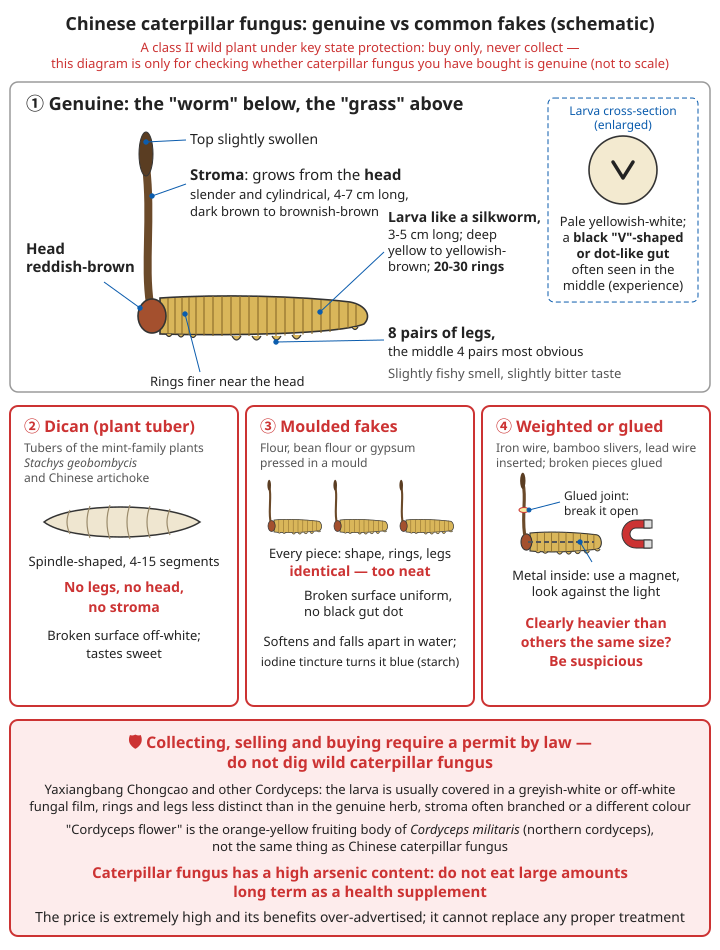

# Fungi, Algae, Resins and Others

> **The herbs in this chapter have no roots or flowers, or are not "a plant" at all: sclerotia, fruiting bodies, seaweeds, resins, insect galls, and processed powders and extracts. You recognise them not by leaf arrangement and flowers but by the broken surface, the smell, and fire and water tests**

This chapter covers 18 herbs of unusual origin, in four groups: fungi, algae, resins and other processed products. The fungi are sclerotia or fruiting bodies of fungi (*Fuling*, *Zhuling*, *Lingzhi*, *Dongchongxiacao*, *Leiwan*, *Mabo*); the algae are marine brown seaweeds (*Haizao*, *Kunbu*); the resins are products secreted by trees or extracted and processed from them (*Ruxiang*, *Moyao*, *Xuejie*, *Hupo*, *Bingpian*); the other processed products include an insect gall (*Wubeizi*), powders and concentrates processed from plants (*Qingdai*, *Luhui*, *Ercha*) and a fermented product (*Shenqu*). General methods for identification, harvesting, drying and storage are in the [General Principles](00-general-principles.md) and are not repeated here.

## ⚠️ Read these first

```
1. Picking wild mushrooms can kill you at any time. Most of the fungal
   herbs in this chapter are cultivated or bought in by professional
   dealers. Do not go out picking mushrooms to eat or steep in water
   just because they are "medicinal fungi";
   the deadly death caps (Amanita) look plain, and there is no simple
   way to tell them apart
2. Dongchongxiacao (Chinese caterpillar fungus) is a Class II protected
   wild plant (2021 list);
   digging and buying it require a permit under the law. This book does
   not describe how to dig it, only how to spot fakes
3. Resins and processed products (Xuejie, Qingdai, Bingpian, Hupo,
   Shenqu) can almost never be collected yourself;
   you can only buy them. This chapter concentrates on "how not to buy
   fakes":
   dyeing, padding with powder, synthetic products passed off as natural
   ones and plastic passed off as amber are all common
4. Luhui (aloe) is a strong irritant laxative: pregnant women must not
   take it by mouth, and children, women during menstruation and people
   with abdominal pain of unknown cause must not use it;
   aloe gel applied to minor scalds is a different matter
5. Haizao and Kunbu contain a lot of iodine: people with an overactive
   thyroid or under treatment for thyroid disease must not use them on
   their own;
   Haizao is "incompatible with Gancao" (one of the eighteen
   incompatibilities); do not use it together with Gancao
6. Bingpian, Ruxiang, Moyao, Xuejie, Ercha and the like are mostly used
   in pills and powders or externally; the internal dose is very small;
   Bingpian: use with caution in pregnancy; Ruxiang and Moyao: use with
   caution in pregnancy and in people with a weak stomach
7. Doses are the usual adult daily doses in the Chinese Pharmacopoeia
   (2020 edition)
   (the current edition is 2025; the current edition's text prevails).
   They are given only as a reminder "not to exceed"; whether to use a
   herb and how much is decided under the guidance of a TCM practitioner
8. Shenqu is not included in Volume I of the Chinese Pharmacopoeia
   (2020 edition); there is no unified quality standard
```

---

## Quick reference to this chapter

The "Toxicity / protection" column gives toxicity noted in the Pharmacopoeia, this book's risk warnings, and the protection status of wild resources. Protection grades follow the text of the lists published by the state; this table is only a reminder.

| Herb | Part used | Main actions | Toxicity / protection | See |
|------|---------|---------|----------|-----|
| *Fuling* (poria) | Sclerotium | Promotes urination and drains damp, strengthens the spleen, calms the heart | — | [1.1](#11-fuling-poria) |
| *Zhuling* (polyporus) | Sclerotium | Promotes urination and drains damp | — | [1.2](#12-zhuling-polyporus) |
| *Lingzhi* (reishi) | Fruiting body | Tonifies *qi* and calms the mind, stops cough and relieves wheezing | Beware toxic or unusable bracket fungi passed off as it | [1.3](#13-lingzhi-reishi) |
| *Dongchongxiacao* (Chinese caterpillar fungus) | Complex of stroma and dead larva | Tonifies the kidney and benefits the lungs, stops bleeding and resolves phlegm | 🛡️ Class II state protection; many fakes | [1.4](#14-dongchongxiacao-chinese-caterpillar-fungus) |
| *Leiwan* (omphalia) | Sclerotium | Kills parasites and relieves food accumulation | Not used in decoctions; traditionally regarded as slightly toxic | [1.5](#15-leiwan-omphalia) |
| *Mabo* (puffball) | Fruiting body | Clears the lungs and soothes the throat, stops bleeding | Beware mistaking young death caps for it | [1.6](#16-mabo-puffball) |
| *Haizao* (sargassum) | Whole thallus | Resolves phlegm, softens hardness and dissipates lumps, promotes urination | ⚠️ Incompatible with *Gancao*; high in iodine | [2.1](#21-haizao-sargassum) |
| *Kunbu* (kelp) | Thallus | Resolves phlegm, softens hardness and dissipates lumps, promotes urination | High in iodine; caution with thyroid disease | [2.2](#22-kunbu-kelp) |
| *Ruxiang* (frankincense) | Resin | Activates blood and relieves pain, reduces swelling and promotes tissue regeneration | Caution in pregnancy and with a weak stomach | [3.1](#31-ruxiang-frankincense) |
| *Moyao* (myrrh) | Resin | Disperses stasis and relieves pain, reduces swelling and promotes tissue regeneration | Caution in pregnancy and with a weak stomach | [3.2](#32-moyao-myrrh) |
| *Xuejie* (dragon's blood) | Processed resin exuded from the fruit | Activates blood and relieves pain, resolves stasis and stops bleeding, promotes tissue regeneration and heals sores | Many dyed fakes; *Longxuejie* is a different medicine | [3.3](#33-xuejie-dragons-blood) |
| *Hupo* (amber) | Fossil resin of ancient pine-family plants | Calms fright and the mind, activates blood and disperses stasis, promotes urination | Not in the 2020 Pharmacopoeia; many plastic and rosin imitations | [3.4](#34-hupo-amber) |
| *Bingpian* (borneol) | Borneol crystals, extracted or synthetic | Opens the orifices and restores consciousness, clears heat and relieves pain | Caution in pregnancy; very small dose | [3.5](#35-bingpian-borneol) |
| *Wubeizi* (Chinese gall) | Insect gall | Astringes the lungs and lowers fire, binds the intestines and stops diarrhoea, stops bleeding | Contains a lot of tannin | [4.1](#41-wubeizi-chinese-gall) |
| *Qingdai* (indigo naturalis) | Powder processed from leaves or stems and leaves | Clears heat and detoxifies, cools the blood and fades rashes | Many fakes padded with lime or dye | [4.2](#42-qingdai-indigo-naturalis) |
| *Luhui* (aloe) | Dried concentrate of leaf juice | Purges and relieves constipation, clears the liver and drains fire, kills parasites | ⚠️ Strong laxative; not to be taken by mouth in pregnancy | [4.3](#43-luhui-aloe) |
| *Ercha* (catechu) | Concentrated decoction of peeled branches and trunk | Activates blood and relieves pain, stops bleeding and promotes tissue regeneration, dries damp and heals sores | — | [4.4](#44-ercha-catechu) |
| *Shenqu* (medicated leaven) | Fermented product | Relieves food stagnation and harmonises the stomach (traditional) | Not in the Pharmacopoeia | [4.5](#45-shenqu-medicated-leaven) |

---

## 1. Fungi

Most medicinal "fungi" are not the mushrooms ordinary people imagine: *Fuling*, *Zhuling* and *Leiwan* are **sclerotia** buried in the soil (hard lumps formed by a mass of fungal threads), *Lingzhi* is a woody fruiting body, *Mabo* is a bag of spore powder, and *Dongchongxiacao* is a complex of a fungus and an insect body. What they have in common: **almost everything on sale comes from cultivation or professional dealers; ordinary people do not need to, and should not, go out into the wild "looking for medicinal fungi"**.

**⚠️ Picking mushrooms in the wild carries a risk of fatal poisoning**: every year in China people die from eating death caps and other poisonous mushrooms by mistake, and there is no simple way to tell them apart (colour, silver needles, insect bites and long boiling are all unreliable). See [Poisonous mushrooms: there is no simple test](../03-wilderness-survival/09-poisonous-mushrooms-and-wild-plants.md#poisonous-mushrooms-there-is-no-simple-test); if you feel unwell after eating wild mushrooms, follow [Feeling unwell after eating wild mushrooms](../03-wilderness-survival/09-poisonous-mushrooms-and-wild-plants.md#feeling-unwell-after-eating-wild-mushrooms) and see a doctor at once. The identification points in this section are only for **telling whether a herb you have bought is genuine**; they are not a basis for picking and eating wild fungi.

### 1.1 Fuling (poria)

- **Fuling (Yunling, Fulingge, Baifuling)**: Chinese 茯苓; *Poria cocos* (Schw.) Wolf. The part wrapped round a pine root is called *fushen*, the pale red part near the skin "red poria" (*chifuling*), and the skin "poria skin" (*fulingpi*)
- **Source**: the dried sclerotium of the fungus *Poria cocos* (Schw.) Wolf (Polyporaceae)
- **Distribution and habitat**: parasitic on the roots of pines such as Masson pine and Japanese red pine, buried in the soil; produced mainly in Yunnan (*yunling*, "Yunnan poria"), Anhui, Hubei and elsewhere. Today almost all of it is cultivated on pine logs
- **Key identification features**:
  - Crude drug (whole poria, *fulingge*): roughly spherical, oval or irregular lumps of varying size; **skin thin and rough, brown to blackish-brown, with clear shrivelled wrinkles**; heavy, firm and solid
  - Broken surface: **granular**, outer layer pale brown, inside white, occasionally pale red; some have a pine root embedded in the middle
  - Poria cubes and slices: white or pale red cubes or thin slices, fine in texture
  - Smell: faint smell, bland taste; **sticks to the teeth when chewed**
- **Fakes**: "poria cubes" and "poria slices" **pressed from, or mixed with, flour or starch** look whiter and more regular, do not stick to the teeth when chewed and taste of flour. **Put on a drop of iodine tincture**: genuine poria turns reddish-brown; **one that quickly turns blue-black has starch mixed in** (experience; the Pharmacopoeia test uses iodine–potassium iodide test solution, and the genuine herb turns deep red)
- **Harvesting and processing**: usually dug in July–September; after digging, pile it up to "sweat" (see [General Principles – Sweating](00-general-principles.md#54-sweating)), spread it out until the surface is dry, sweat it again, and repeat several times until wrinkles appear and most of the moisture inside has gone; **dry in the shade**. This is "whole poria" (*fulingge*). It can also be cut fresh into cubes or slices by part and dried in the shade
- **Storage**: keep in a dry place, protect from damp; it moulds easily when damp and cracks if over-dried
- **Actions**: promotes urination and drains damp, strengthens the spleen, calms the heart
- **Dose**: 10-15 g (Chinese Pharmacopoeia, 2020 edition; use under the guidance of a TCM practitioner)
- **Cautions**: mild in nature; people with yin deficiency and no water-damp, or who pass a lot of urine, should not use much of it (experience). Poria is often made into foods such as "poria cakes"; eating moderate amounts as food is generally fine, but it cannot replace treatment of oedema: **for oedema, first look for a cause in the heart, kidneys or liver**

### 1.2 Zhuling (polyporus)

- **Zhuling (Yezhufen, Zhushiling)**: Chinese 猪苓; *Polyporus umbellatus* (Pers.) Fries
- **Source**: the dried sclerotium of the fungus *Polyporus umbellatus* (Pers.) Fries (Polyporaceae)
- **Distribution and habitat**: grows in the soil beside the roots of broadleaf trees such as birch, oak and maple; produced mainly in Shaanxi, Shanxi, Hebei, Yunnan, Sichuan and elsewhere. Wild resources are shrinking year by year; it is now also cultivated
- **Key identification features**:
  - Crude drug: strip-shaped, roughly round or flat lumps, some branched, 5-25 cm long and 2-6 cm across; **surface black, greyish-black or brownish-black, shrivelled or with wart-like bumps** (it looks like pig dung, hence the name, "pig sclerotium")
  - Texture: **light but hard**, floats on water; broken surface **off-white or yellowish-white**, slightly granular
  - Smell: faint smell, bland taste
- **Fakes**: pieces whose surface is too black and shiny, whose broken surface is dull in colour, or that **sink** in water may have been dyed or padded with mud to add weight (experience)
- **Harvesting and processing**: dug in spring and autumn, cleaned of soil and sand, dried
- **Storage**: keep in a well-ventilated, dry place
- **Actions**: promotes urination and drains damp
- **Dose**: 6-12 g (Chinese Pharmacopoeia, 2020 edition; use under the guidance of a TCM practitioner)
- **Cautions**: it promotes urination more strongly than *Fuling*; not advisable for people without water-damp; long-term large doses may damage yin (experience)

### 1.3 Lingzhi (reishi)

- **Lingzhi (Chizhi, Zizhi, Lingzhicao)**: Chinese 灵芝; *Ganoderma lucidum* (Leyss. ex Fr.) Karst., *G. sinense* Zhao, Xu et Zhang
- **Source**: the dried fruiting body of the fungus *Ganoderma lucidum* (Leyss. ex Fr.) Karst. (red reishi, *chizhi*) or *G. sinense* Zhao, Xu et Zhang (purple reishi, *zizhi*) (Polyporaceae)
- **Distribution and habitat**: wild plants grow on rotting wood and stumps of broadleaf trees (purple reishi mostly on conifers); **almost everything on sale is cultivated on logs or substitute substrates**, and it is grown everywhere
- **Key identification features**:
  - Red reishi: shaped like an umbrella; **cap kidney-shaped, semicircular or nearly round**, 10-18 cm across and 1-2 cm thick; **crust hard, yellowish-brown to reddish-brown, with a lacquer-like sheen**, with concentric ridges and radiating wrinkles, the edge thin and blunt; flesh white to pale brown; **stalk attached at the side** (occasionally off-centre), 7-15 cm long, reddish-brown to purplish-brown, shiny; the underside of the cap is a mass of small pores (not gills); spores tiny, yellowish-brown
  - Purple reishi: crust **purplish-black**, with a lacquer-like sheen; flesh rusty brown
  - Smell: faintly fragrant, **taste bitter and astringent**
- **Look-alikes ("wild Lingzhi")**: there are many woody, semicircular bracket fungi growing on stumps: **artist's bracket** (*Ganoderma applanatum*, no stalk, cap greyish-brown, no lacquer-like sheen), turkey tail, various hoof fungi, *Trametes* species and others. Most are woody in texture, and the chemistry and toxicity of some have not been worked out; in markets they are often sold at high prices as "wild *Lingzhi*" or "hundred-year *Lingzhi*". **Do not use anything without a lacquer-like sheen and a long side stalk as *Lingzhi***; and never steep unknown hard fungi collected in the wild in water or liquor
- **Harvesting and processing**: cultivated reishi can be harvested all year round; remove debris, cut off the lower end of the stalk carrying rotten wood, soil or growing substrate, and **dry in the shade or at 40-50°C**
- **Storage**: seal, keep in a dry place, protect from mould and insects (reishi is very easily attacked by insects)
- **Actions**: tonifies *qi* and calms the mind, stops cough and relieves wheezing
- **Dose**: 6-12 g (Chinese Pharmacopoeia, 2020 edition; use under the guidance of a TCM practitioner)
- **Cautions**: generally fairly safe; people taking anticoagulants, blood-pressure or diabetes medicines, or preparing for surgery, should ask a doctor before taking it long term (experience). **Neither *Lingzhi* nor *Lingzhi* spore powder can replace proper cancer treatment**

### 1.4 Dongchongxiacao (Chinese caterpillar fungus)

> 🛡️ **Legal note**: Chinese caterpillar fungus is listed as a **Class II wild plant under state key protection** (2021 "List of Wild Plants under State Key Protection"). Collecting, selling and buying it require a permit under the law and are subject to the "Regulations on the Protection and Management of Wild Medicinal Resources" and other rules; digging or buying it without a permit is illegal. Digging in the producing areas is managed by the local government. This book **does not describe how to dig it**; it only helps readers tell genuine from fake and avoid being cheated. See [General Principles – List of Wild Plants under State Key Protection](00-general-principles.md#82-list-of-wild-plants-under-state-key-protection).

- **Dongchongxiacao (Chongcao, Zhonghua Chongcao)**: Chinese 冬虫夏草; *Cordyceps sinensis* (Berk.) Sacc.
- **Source**: the dried complex of the stroma of the fungus *Cordyceps sinensis* (Berk.) Sacc. (Clavicipitaceae, ergot family) and the dead body of the larva of a ghost moth (Hepialidae) on which it is parasitic
- **Distribution and habitat**: found only in alpine meadows at about 3000-5000 m on the Qinghai–Tibet Plateau and its surroundings (Qinghai, Tibet, Sichuan, Yunnan, Gansu); complete caterpillar fungus cannot yet be cultivated on a large scale
- **Key identification features** (two parts: the "worm" below and the "grass" above):
  - Larva: **looks like a silkworm**, 3-5 cm long, 0.3-0.8 cm across; surface deep yellow to yellowish-brown, with **20-30 rings**, finer near the head; **head reddish-brown**; **8 pairs of legs, the middle 4 pairs most obvious**; brittle, snaps easily, broken surface fairly flat, pale yellowish-white, **often with a black "V"-shaped or dot-like gut visible in the middle** (experience)
  - Stroma: grows from the head of the larva; **slender and cylindrical**, 4-7 cm long, about 0.3 cm across; surface dark brown to brownish-tan, with fine lengthwise wrinkles, slightly swollen at the top; tough and flexible, broken surface off-white
  - Smell: **slightly fishy**, taste slightly bitter
- **Common fakes and tricks**:
  - ***Yaxiangbang Chongcao*** and other *Cordyceps*: the larva is usually covered in a greyish-white or off-white fungal film, the rings and legs are less distinct than in the genuine herb, and the stroma is often branched or a different colour
  - ***Dican*** (the tubers of the mint-family plants *Stachys geobombycis* and Chinese artichoke): spindle-shaped, with 4-15 segments, **no legs, no head, no stroma**, broken surface off-white, taste sweet
  - **Moulded from flour, bean flour or gypsum**: every piece has exactly the same shape, rings and legs, too regular; the broken surface is uniform with no black gut dot; it softens and falls apart in water and turns blue with iodine tincture (it contains starch)
  - **Iron wire, bamboo slivers or lead wire inserted to add weight**, broken pieces glued together: test with a magnet, look against the light, break it open and look at the joint; be suspicious of pieces that are **clearly heavier** than others of the same size
  - **"Cordyceps mycelium" or "Cordyceps flower" passed off as it**: Cordyceps flower is the fruiting body of *Cordyceps militaris* (northern cordyceps), orange-yellow, and not the same thing as Chinese caterpillar fungus
- **Harvesting**: not described. You need only know that it is collected by licensed people in early summer when the stroma has come out of the ground and before the spores are released, and that collection in producing areas is managed
- **Storage**: seal, keep in a cool, dry place, **protect from insects**; it can be refrigerated
- **Actions**: tonifies the kidney and benefits the lungs, stops bleeding and resolves phlegm
- **Dose**: 3-9 g (Chinese Pharmacopoeia, 2020 edition; use under the guidance of a TCM practitioner)
- **Cautions**: in 2016 the former China Food and Drug Administration warned that caterpillar fungus **has a high arsenic content and long-term consumption carries a risk**; eating large amounts long term as a health supplement is not recommended. The price is extremely high and its benefits are over-advertised; **it cannot replace any proper treatment**



*Figure: For the genuine herb, look at the larva (20-30 rings, reddish-brown head, 8 pairs of legs), the stroma and the gut in the broken surface; Dican has no legs, head or stroma, moulded fakes are too regular, and for weighted pieces use a magnet and break them open. Buy only, never dig*

### 1.5 Leiwan (omphalia)

- **Leiwan (Leishi, Zhuling)**: Chinese 雷丸; *Omphalia lapidescens* Schroet.
- **Source**: the dried sclerotium of the fungus *Omphalia lapidescens* Schroet. (Tricholomataceae)
- **Distribution and habitat**: grows mostly in the soil near bamboo roots in bamboo groves; produced mainly in Sichuan, Guizhou, Yunnan, Hubei, Guangxi and elsewhere
- **Key identification features**:
  - Crude drug: roughly spherical or irregular lumps, **1-3 cm across**; surface blackish-brown or brown, **with slightly raised, irregular, net-like fine lines**; firm and solid, hard to break open
  - Broken surface: uneven, **white or pale greyish-yellow**, often with yellowish-white marble-like patterns
  - Smell: faint smell, taste slightly bitter; gritty when chewed, slightly sticky, leaves no residue after long chewing
  - **Pieces whose broken surface is brown and horn-like (translucent like ox horn) have gone off and must not be used as medicine**
- **Harvesting and processing**: dug in autumn, washed, sun-dried
- **Storage**: keep in a cool, dry place; the active component (a protease) is damaged by heat, so **do not dry it at high temperature**
- **Actions**: kills parasites and relieves food accumulation (traditionally used for tapeworm, hookworm and roundworm)
- **Dose**: 15-21 g, **not suitable for decoction** (heating destroys it); usually ground to powder and taken 5-7 g at a time, after meals, mixed with warm boiled water, 3 times a day, for 3 days in a row (Chinese Pharmacopoeia, 2020 edition; use under the guidance of a TCM practitioner)
- **Cautions**: traditionally regarded as slightly toxic; not for long-term use; pregnant women and children must not use it on their own. **There are now safe, effective deworming drugs for intestinal parasites**; if you suspect parasites (worms or segments seen in the stool, itchy anus, anaemia), see a doctor to identify the species before treatment

### 1.6 Mabo (puffball)

- **Mabo (Mapibao, Huibao, Niushigu)**: Chinese 马勃; *Lasiosphaera fenzlii* Reich., *Calvatia gigantea* (Batsch ex Pers.) Lloyd, *C. lilacina* (Mont. et Berk.) Lloyd
- **Source**: the dried fruiting body of the fungus *Lasiosphaera fenzlii* Reich. (peeling puffball), *Calvatia gigantea* (Batsch ex Pers.) Lloyd (giant puffball) or *C. lilacina* (Mont. et Berk.) Lloyd (purple puffball) (Lycoperdaceae, puffball family)
- **Distribution and habitat**: grows after rain in summer and autumn on grassland, hillsides, forest edges and pasture; found in most of China, mostly wild
- **Key identification features**:
  - Fresh: spherical or pear-shaped, **no cap, no gills, no stalk** (or only a sterile base); when young, **cut open it is uniformly white throughout**; when mature, the inside turns to brown spore powder, which "puffs out like smoke" from a hole at the top when pressed
  - Crude drug (peeling puffball): flattened-spherical or roughly spherical, 15-20 cm across; outer skin greyish-brown to yellowish-brown, papery, often broken into pieces or entirely gone; spore mass greyish-brown or pale brown, compact and springy, with cotton-wool-like threads inside when torn; **touch it and the spores fly up like dust**; feels fine and smooth when rubbed between the fingers
  - Smell: **smells like dust**, no taste
- **Look-alikes (poisonous)**:
  - **The "button" of a death cap**: when a death cap first emerges from the ground it is wrapped in a white cup (volva), like a small white ball or egg, and **looks very like a young puffball, and death caps are the leading cause of fatal mushroom poisoning in China**. **Cut it lengthwise from top to bottom**: a puffball is uniform inside with no structure; in a death-cap button you can see the outline of the cap, gills and stalk. If there is any "outline of a little mushroom", throw it away at once
  - **Earthballs** (*Scleroderma*): thick, hard skin, often scaly or cracked, **the inside turns purplish-black very early**; poisonous, can cause gastrointestinal poisoning
- **Harvesting and processing**: in summer and autumn, **collect promptly when the fruiting body is mature**, remove soil and sand, dry. When collecting and handling it, **wear a mask and do not breathe in the spore powder** (it irritates the airways, and breathing in large amounts can cause lung disease)
- **Storage**: keep in a dry place, protect from dust; the spores scatter easily, so wrap it in a paper or cloth bag before putting it in a jar
- **Actions**: clears the lungs and soothes the throat, stops bleeding
- **Dose**: 2-6 g; for external use, a suitable amount applied to the affected area (Chinese Pharmacopoeia, 2020 edition; use under the guidance of a TCM practitioner). The powder is light and flies about easily, so it is usually wrapped in gauze for decoction (experience)
- **Cautions**: not advisable for cough or loss of voice from wind-cold (experience). Folk practice sprinkles puffball powder on wounds to stop bleeding; use it only for oozing from small wounds; **clean the wound thoroughly first**, and for bleeding that will not stop or wounds that are deep or dirty, follow [Wounds and Injuries](../01-first-aid-and-family-health/02-wounds-and-injuries.md) and see a doctor

## 2. Algae

*Haizao* and *Kunbu* are both large brown seaweeds that grow in the sea, and their actions are similar (resolve phlegm, soften hardness and dissipate lumps, promote urination and reduce oedema); the Pharmacopoeia dose for both is 6-12 g. They share two safety problems:

```
1. They contain a lot of iodine: kelp and other brown seaweeds are among
   the foods highest in iodine
   - In iodine-deficient areas, eating moderate amounts of kelp is a
     traditional way to get iodine and prevent "big neck" (goitre)
   - But people with an overactive thyroid (hyperthyroidism), Hashimoto's
     thyroiditis, people taking thyroid medicines,
     or people about to have radioactive iodine tests or treatment, must
     not eat large amounts on their own, or use them as herbs on their own
   - "Softening hardness and dissipating lumps" does not mean they can
     shrink thyroid nodules or lumps:
     if a lump appears on your neck, go to hospital and find out what it is
2. Haizao is "incompatible with Gancao" (one of the eighteen
   incompatibilities): do not use Haizao together with Gancao,
   and Gancao is one of the commonest herbs in prescriptions, so this is
   an especially easy mistake to make when mixing herbs yourself
```

For why iodine matters, see [Nutrition and Deficiency Diseases – Iodine](../07-everyday-living-skills/02-nutrition-and-deficiency-diseases.md#iodine) and [Salt Making – Iodine](../07-everyday-living-skills/15-salt-making.md#iodine-the-biggest-weakness-of-home-made-salt); for the eighteen incompatibilities, see [General Principles – The eighteen incompatibilities and nineteen antagonisms](00-general-principles.md#73-the-eighteen-incompatibilities-and-nineteen-antagonisms-combinations-to-avoid).

### 2.1 Haizao (sargassum)

- **Haizao (Daye Haizao, Xiaoye Haizao, Haihaozi, Yangqicai)**: Chinese 海藻; *Sargassum pallidum* (Turn.) C. Ag., *S. fusiforme* (Harv.) Setch.
- **Source**: the dried thallus of *Sargassum pallidum* (Turn.) C. Ag. (*haihaozi*) or *S. fusiforme* (Harv.) Setch. (hijiki, *yangqicai*) (Sargassaceae); the former is traditionally called "large-leaf *Haizao*" and the latter "small-leaf *Haizao*"
- **Distribution and habitat**: *S. pallidum* grows on rocks below the low-tide line along the coasts of the Yellow Sea and Bohai Sea; hijiki grows on rocks in the intertidal zone along the south-eastern coast (Zhejiang, Fujian, Guangdong and elsewhere), and is farmed on a large scale in Zhejiang
- **Key identification features**:
  - Large-leaf *Haizao*: shrivelled and curled, **blackish-brown**, some with a white bloom, 30-60 cm long; main stem cylindrical with conical bumps, side branches with short spine-like bumps; leaves lanceolate, obovate or strap-shaped; **with blackish-brown spherical or oval "air bladders"** (which keep the seaweed afloat)
  - Small-leaf *Haizao*: smaller, 15-40 cm long; branches alternate, without spine-like bumps; leaves strap-shaped or narrowly spoon-shaped, tip slightly swollen and hollow; air bladders spindle-shaped or spherical, with fairly long stalks; fairly hard
  - Texture: brittle when dry, **swells when soaked in water, becoming fleshy and slimy**
  - Smell: **fishy smell, taste slightly salty**
- **Look-alikes**: there are many other brown and green seaweeds to be picked up on the shore; they are generally not poisonous, but they are not the Pharmacopoeia's *Haizao*. **Air bladders and leaf-like differentiation** are features of the *Sargassum* group
- **Harvesting and processing**: in summer and autumn, scoop or cut from the sea, remove debris, **wash in fresh water**, sun-dry. Do not collect seaweed near sewage outlets, harbours or polluted farming areas (it readily accumulates heavy metals)
- **Storage**: keep in a dry place, **protect from damp** (it contains salt and absorbs moisture easily); the white bloom on the surface is salt and mannitol coming out, not mould; do not use pieces with green or black fuzzy mould spots
- **Actions**: resolves phlegm, softens hardness and dissipates lumps, promotes urination and reduces oedema
- **Dose**: 6-12 g (Chinese Pharmacopoeia, 2020 edition; use under the guidance of a TCM practitioner)
- **Cautions**: **do not use together with *Gancao*** (eighteen incompatibilities); people with thyroid disease such as an overactive thyroid must not use it on their own; not advisable for people with a cold, weak spleen and stomach who often have diarrhoea (experience). When hijiki is eaten as food, food-safety agencies in some countries warn that its **inorganic arsenic content is high**, so it should not be eaten in large amounts long term

### 2.2 Kunbu (kelp)

- **Kunbu (Haidai, E'zhangcai, Heikunbu)**: Chinese 昆布; *Laminaria japonica* Aresch., *Ecklonia kurome* Okam.
- **Source**: the dried thallus of kelp, *Laminaria japonica* Aresch. (Laminariaceae), or of *Ecklonia kurome* Okam. (Alariaceae)
- **Distribution and habitat**: kelp is native to the coasts of Japan and Korea and the northern coast of China, and is now farmed on a large scale in Shandong, Liaoning, Fujian and elsewhere; *Ecklonia* (*e'zhangcai*, "goose-foot vegetable") grows on rocks below the low-tide line along the coasts of Zhejiang and Fujian
- **Key identification features**:
  - Kelp: rolled and folded into a lump or tangled into a bundle; **blackish-brown or greenish-brown, with a white bloom on the surface**; when softened in water it swells into a **flat, long strap**, 50-150 cm long and 10-40 cm wide, **thicker in the middle and thinner and wavy at the edges**; somewhat leathery, with the remains of the stalk flattened-cylindrical. It is the ordinary dried kelp people eat
  - *Ecklonia* (*e'zhangcai*): curled and shrivelled into irregular lumps, **black, fairly thin**; when softened in water it becomes a flat leaf, **deeply pinnately divided on both sides**, the lobes long and tongue-shaped (like a goose's foot); smooth and soft
  - Smell: **fishy smell, salty taste**
- **Harvesting and processing**: collected in summer and autumn, sun-dried
- **Storage**: keep in a dry place, protect from damp; the white bloom (mannitol) is normal, **do not wash it off before storing**
- **Actions**: resolves phlegm, softens hardness and dissipates lumps, promotes urination and reduces oedema
- **Dose**: 6-12 g (Chinese Pharmacopoeia, 2020 edition; use under the guidance of a TCM practitioner)
- **Cautions**: **extremely high in iodine**; people with thyroid disease such as an overactive thyroid or Hashimoto's thyroiditis must not use it on their own, and should ask a doctor even about eating it as food; during pregnancy and breastfeeding moderate amounts as food are fine, but do not eat large amounts "to get iodine"; not advisable for people with a cold, weak spleen and stomach (experience). **Kelp that is an unusually bright green or loses colour when soaked** may have been dyed; do not buy it

## 3. Resins

*Ruxiang*, *Moyao* and *Xuejie* come from the tropics (the Red Sea coast, South-East Asia) and **are all imported**; *Hupo* is tree resin fossilised underground over tens of millions of years; *Bingpian* is an extracted or chemically synthesised crystal. **Ordinary people cannot collect** these herbs; this section only covers how to tell genuine from fake and how to store them safely. Common features of resins and how to test them:

```
1. Most soften when heated and burn; the smoke and smell when burning are
   important clues for identification
2. They do not dissolve in water, but Ruxiang and Moyao ground together
   with water form a milky emulsion
3. Common fakes: rosin (cheap pine resin) with dye or sand added,
   or plastic or synthetic resin passed off as amber, and synthetic
   products passed off as natural Bingpian
4. Most have a very small internal dose (Bingpian less than 1 g) and are
   mainly used in pills and powders or externally;
   an internal overdose irritates the stomach and intestines, and most
   need caution in pregnancy
5. They are damaged by heat, volatile (Bingpian) and stick together
   easily: seal and keep in a cool place
```

There is also a poisonous resin herb, ***Tenghuang*** (gamboge), which is for external use only and must never be taken by mouth; see [Toxic Herbs – *Tenghuang*](09-toxic-herbs-and-poisonous-look-alikes.md#219-tenghuang-gamboge).

### 3.1 Ruxiang (frankincense)

- **Ruxiang (Diruxiang, Ruxiangzhu, Yuanruxiang)**: Chinese 乳香; *Boswellia carterii* Birdw., *B. bhaw-dajiana* Birdw.
- **Source**: the resin exuded from the bark of the frankincense tree, *Boswellia carterii* Birdw., and the related *B. bhaw-dajiana* Birdw. (Burseraceae, torchwood family); by origin it is divided into Somali and Ethiopian frankincense, and by shape into "frankincense tears" (*ruxiangzhu*) and "raw frankincense" (*yuanruxiang*)
- **Distribution and habitat**: produced in the dry regions of Somalia and Ethiopia on the Red Sea coast and on the Arabian Peninsula; China imports all of it
- **Key identification features**:
  - Crude drug: **long oval "drop"-shaped** or roughly round grains, or stuck together into irregular lumps, the larger ones about 2 cm long (tears) or 5 cm (raw frankincense); **surface yellowish-white, translucent, dusted with yellowish-white powder**, darkening with long storage; brittle, softens when heated; the broken surface has a glassy or waxy lustre
  - Smell: **a distinctive fragrance**, taste slightly bitter
  - Chewing test: when chewed it first breaks into small pieces, then **quickly softens into a gummy lump that sticks to the teeth**, and the saliva turns milky white
  - Water test: ground with water it forms a **white or yellowish-white milky emulsion**
  - Fire test: burns oily, gives black smoke and a fragrance
- **Fakes**: **rosin** passed off as it or mixed in: rosin is more transparent and yellower, does not soften into a gummy lump when chewed and does not form an emulsion, and smells clearly of turpentine when burnt; if sand or grit has been mixed in, impurities show when it is crushed (experience)
- **Storage**: seal, keep in a cool, dry place; **in summer it easily softens and sticks together**
- **Actions**: activates blood and relieves pain, reduces swelling and promotes tissue regeneration
- **Dose**: in decoctions or in pills and powders, 3-5 g; for external use, a suitable amount ground to powder and applied as a paste (Chinese Pharmacopoeia, 2020 edition; use under the guidance of a TCM practitioner). The raw herb has a strong smell and irritates the stomach, so processed forms such as vinegar-fried frankincense are mostly used; see [Traditional Chinese Medicine Preparations](../06-pharmaceuticals/04-herbal-preparations.md)
- **Cautions**: **use with caution in pregnancy and in people with a weak stomach**; people allergic to frankincense can get a rash even from external use

### 3.2 Moyao (myrrh)

- **Moyao (Moyao 末药, Tianran Moyao, Jiaozhi Moyao)**: Chinese 没药; *Commiphora myrrha* Engl., *C. molmol* Engl.
- **Source**: the dried resin of *Commiphora myrrha* Engl. or *C. molmol* Engl. (Burseraceae); divided into natural myrrh and gummy myrrh
- **Distribution and habitat**: produced in dry regions of Somalia, Ethiopia, the southern Arabian Peninsula and elsewhere; all of it is imported
- **Key identification features**:
  - Natural myrrh: irregular granular lumps, the larger ones over 6 cm across; **surface yellowish-brown or reddish-brown**, the nearly translucent parts brownish-black, dusted with yellow powder; hard and brittle, broken surface uneven and **without lustre** (frankincense is lustrous, myrrh is not: one way to tell them apart)
  - Gummy myrrh: irregular lumps and grains, mostly stuck together into masses; surface brownish-yellow to brown, **opaque**, hard and solid or loose
  - Smell: **a distinctive fragrance, taste bitter and slightly pungent** (gummy myrrh tastes bitter and is sticky)
  - Water test: ground with water it forms a **yellowish-brown milky emulsion** (frankincense gives a white emulsion)
- **Fakes**: other gums, rosin or mud mixed in (experience): do not use pieces with a weak bitter taste, a weak fragrance, a turpentine smell or a lot of impurities
- **Storage**: seal, keep in a cool, dry place, protect from softening and sticking together
- **Actions**: disperses stasis and relieves pain, reduces swelling and promotes tissue regeneration
- **Dose**: 3-5 g, processed to remove the oil, mostly used in pills and powders (Chinese Pharmacopoeia, 2020 edition; use under the guidance of a TCM practitioner)
- **Cautions**: **use with caution in pregnancy and in people with a weak stomach**; it is often used together with frankincense, and both irritate the stomach, so take extra care when they are combined

### 3.3 Xuejie (dragon's blood)

- **Xuejie (Qilinjie, Jinkou Xuejie)**: Chinese 血竭; *Daemonorops draco* Bl.
- **Source**: processed from the resin exuded by the fruit of the dragon's blood palm, *Daemonorops draco* Bl. (Arecaceae, palm family)
- **Distribution and habitat**: *Daemonorops draco* is a climbing palm (rattan) from Indonesia, Malaysia and elsewhere; all the Pharmacopoeia's *Xuejie* is imported
- **Key identification features**:
  - Crude drug: roughly **rounded-square or brick-shaped**; **surface dark red, glossy**, with red powder from rubbing; hard and brittle, broken surface red, **brick-red when ground to powder**
  - Smell: faint smell, bland taste; does not dissolve in water, softens in hot water
  - **Paper-heating test** (Pharmacopoeia identification test): put some powder on white paper and heat it with a flame from under the paper: **the powder melts, but there is no oily stain spreading out across the paper**, and against the light it is **bright red**
  - Fire test: lit with a flame, it gives off **choking smoke**
- **"*Longxuejie*" is not "*Xuejie*"**: the Chinese-produced ***Longxuejie*** is resin extracted from the resinous wood of *Dracaena cochinchinensis* and related species (Asparagaceae; formerly placed in the lily family Liliaceae or the agave family Agavaceae), produced in Yunnan and Guangxi and used under ministry or local standards. **It is not the Pharmacopoeia's "*Xuejie*"**; the two have different sources, and although their actions are similar they must not be freely substituted for each other or called by each other's name
- **Fakes**: **rosin with red dye** pressed into blocks, or genuine herb mixed with rosin or earth: in the paper-heating test, **an oily stain spreads** or **a large patch of paper is stained red**, or there is a rosin smell: it is a fake; be suspicious of any that **loses colour** when wiped with water or alcohol
- **Storage**: keep in a cool, dry place, protect from heat (it softens)
- **Actions**: activates blood and relieves pain, resolves stasis and stops bleeding, promotes tissue regeneration and heals sores
- **Dose**: ground to powder, 1-2 g, or in pills; for external use, ground and sprinkled on or put into medicinal plasters (Chinese Pharmacopoeia, 2020 edition; use under the guidance of a TCM practitioner)
- **Cautions**: use with caution in pregnancy, not advisable during menstruation (experience); not advisable for people without blood stasis. External use to stop bleeding is only for small wounds; for heavy bleeding follow [Wounds and Injuries](../01-first-aid-and-family-health/02-wounds-and-injuries.md), apply pressure and see a doctor

### 3.4 Hupo (amber)

- **Hupo (Xuepo, Meipo)**: Chinese 琥珀; fossil resin of ancient pine-family (Pinaceae) plants, mostly *Pinus* species (no single binomial)
- **Source**: a fossil-like substance formed from the resin of ancient pine-family plants (mostly of the genus *Pinus*) buried underground over long geological ages; what is dug from soil is called *hupo* (amber), and what is dug from coal seams is called *meipo* ("coal amber", black). **It is not included in Volume I of the Chinese Pharmacopoeia (2020 edition)**; it is used under ministry or local standards
- **Distribution and habitat**: in China produced in Guangxi, Yunnan, Henan, Liaoning (Fushun coal amber) and elsewhere; also imported from Myanmar, the Baltic coast and elsewhere
- **Key identification features**:
  - Crude drug: irregular lumps, grains or polygonal pieces of varying size; **blood-red, yellowish-brown or dark brown, nearly transparent**; loose and brittle, broken surface smooth, **with a glassy lustre**; crumbles to powder when rubbed between the fingers
  - Smell: no smell, bland taste; **crumbles easily when chewed, not gritty**
  - Static test: after rubbing hard on cloth or a woollen jumper, **it picks up scraps of paper**
  - Salt-water test: amber is very light and **floats in saturated salt water**; glass and most minerals sink (experience)
  - Hot-needle test: touch an inconspicuous spot with a heated needle tip: **it smells of rosin**; plastic gives off a sharp plastic smell (experience)
- **Fakes**: **plastic and synthetic resin** imitations; rosin or very young "copal" (resin that has not fully fossilised) passed off as it: a drop of alcohol on copal makes the surface **sticky**, while genuine amber is unaffected (experience). Amber for crafts is often heated, pressed or dyed: **do not use jewellery amber as a herb**
- **Storage**: keep in a dry place, avoid high temperatures and long exposure to direct sunlight
- **Actions**: calms fright and the mind, activates blood and disperses stasis, promotes urination and relieves painful urination (traditional)
- **Dose**: ground to powder and taken mixed with water, usually 1.5-3 g, **not used in decoctions** (usual textbook dose; not in the Pharmacopoeia; use under the guidance of a TCM practitioner)
- **Cautions**: not advisable for people with yin deficiency and internal heat or without blood stasis (experience); convulsions and fits in children must be seen by a doctor; do not rely on amber to "calm fright"

### 3.5 Bingpian (borneol)

- **Bingpian (Longnao, Meipian, Pian'nao)**: Chinese 冰片; synthetic borneol; *Cinnamomum camphora* (L.) Presl; *Blumea balsamifera* (L.) DC.
- **Source** (the Pharmacopoeia distinguishes three kinds by source, with different doses):
  - ***Bingpian* (synthetic borneol)**: **chemically synthesised** from turpentine, camphor and other raw materials; the commonest and cheapest on the market
  - **Natural *Bingpian* (d-borneol)**: made by **extracting and processing** the fresh branches and leaves of the camphor tree, *Cinnamomum camphora* (L.) Presl (Lauraceae)
  - ***Aipian* (l-borneol)**: crystals made by extracting and processing the fresh leaves of *Blumea balsamifera* (L.) DC. (Asteraceae)
  - The "*longnaoxiang*" and "*meipian*" of old books are resin crystals of the Borneo camphor tree (Dipterocarpaceae); imported, and rarely seen today
- **Distribution and habitat**: the raw material of natural *Bingpian*, the camphor tree (a particular "borneol camphor" chemotype), comes mainly from Jiangxi, Hunan and elsewhere; *Blumea balsamifera* grows in Guangdong, Guangxi, Guizhou and Hainan
- **Key identification features**:
  - Synthetic *Bingpian*: **colourless and transparent or white and translucent, flaky, brittle crystals**; **clear fragrance, taste pungent and cool**; volatile; when lit it gives thick smoke and a bright flame
  - Natural *Bingpian*: white crystalline powder or flaky crystals, clear fragrance, taste pungent and cool, volatile
  - Natural and synthetic products are **almost impossible to tell apart by eye**; synthetic *Bingpian* contains a substantial proportion of isoborneol and can only be identified by laboratory testing. The price difference is large: **be suspicious of anything labelled "natural *Bingpian*" that is very cheap**
- **Look-alikes**: **camphor** (also white crystals extracted from the camphor tree, with a sharper smell, more like a "camphorwood chest") **is not *Bingpian***; taken by mouth it can cause fits, and **a few grams swallowed by a child can kill**; mothballs and camphor balls (mostly naphthalene or p-dichlorobenzene) must never be used as medicine
- **Storage**: **seal**, keep in a cool place; *Bingpian* is extremely volatile and left open it "gets less and less"
- **Actions**: opens the orifices and restores consciousness, clears heat and relieves pain
- **Dose** (Chinese Pharmacopoeia, 2020 edition; use under the guidance of a TCM practitioner):
  - *Bingpian* (synthetic borneol), *Aipian*: 0.15-0.3 g, in pills and powders; for external use, ground to powder and dabbed on the affected area
  - Natural *Bingpian*: 0.3-0.9 g, in pills and powders; for external use, a suitable amount
  - **Not used in decoctions** (it evaporates as soon as it is heated)
- **Cautions**: **use with caution in pregnancy**; do not use on babies and young children (including not putting ointments containing *Bingpian* near their mouth or nose); taken by mouth it irritates the stomach and intestines, and an overdose can cause nausea, vomiting and dizziness; coma, stroke and "closed patterns" (*bizheng*) must be seen by a doctor at once; do not rely on *Bingpian* to "open the orifices"

## 4. Other processed products

The herbs in this group have very different origins: *Wubeizi* is an "insect gall" formed on leaves when aphids irritate them; *Qingdai*, *Luhui* and *Ercha* are made by processing the leaves, juice or wood of plants into a powder, a concentrate or a concentrated decoction; *Shenqu* is a block of leaven fermented from flour and several herbs. **Apart from *Wubeizi*, it is very hard for ordinary people to collect suitable raw material themselves or to make an acceptable product**; this section again concentrates on telling genuine from fake and on safe use.

### 4.1 Wubeizi (Chinese gall)

- **Wubeizi (Baichongcang, Dubei, Jiaobei)**: Chinese 五倍子; *Rhus chinensis* Mill., *R. potaninii* Maxim., *R. punjabensis* Stew. var. *sinica* (Diels) Rehd. et Wils.
- **Source**: the **insect gall** on the leaves of the Chinese sumac, *Rhus chinensis* Mill., or of *R. potaninii* Maxim. or *R. punjabensis* Stew. var. *sinica* (Diels) Rehd. et Wils. (Anacardiaceae, cashew family), formed mainly by the parasitic gall aphid *Melaphis chinensis* (Bell) Baker; by shape it is divided into "belly galls" (*dubei*) and "horned galls" (*jiaobei*)
- **Distribution and habitat**: Chinese sumac is very common on hillsides, forest edges and waste ground in the Yangtze basin and southwards; *Wubeizi* is produced mainly in Guizhou, Sichuan, Hubei, Hunan, Yunnan, Shaanxi and elsewhere
- **Key identification features**:
  - Host, Chinese sumac: deciduous small tree or shrub; **odd-pinnate compound leaves, with clear leaf-like "wings" along the leaf axis** (the most reliable feature for recognising Chinese sumac); leaflets with coarse teeth, hairy underneath; the leaves turn red in autumn; the small drupes in the fruit clusters have a white bloom and **taste salty and sour** when licked (hence the Chinese name, "salt-skin tree")
  - Fresh galls: green to red hollow "fruits" hanging on the leaf axis and leaf stalks in autumn; broken open, they are full of tiny aphids
  - Belly gall: oblong or spindle-shaped sac, 2.5-9 cm long and 1.5-4 cm across; **surface greyish-brown or greyish-tan, slightly downy**; hard and brittle, broken surface horn-like and lustrous, wall 0.2-0.3 cm thick; **inner wall smooth, with dead blackish-brown aphids and grey powdery droppings**
  - Horned gall: diamond-shaped, with irregular blunt horn-like branches; downier, with a thinner wall
  - Smell: distinctive smell, **extremely astringent taste**
- **⚠️ Do not confuse it with the lacquer tree or wax tree**: the lacquer tree and wax tree are in the same cashew family, also have pinnate compound leaves and turn red in autumn, but **the leaf axis has no wings**; touching them can cause severe allergic dermatitis ("lacquer sores"); see [Forest Survival – Poisonous plants](../03-wilderness-survival/02-forest-survival.md#plants). **Do not touch trees whose leaf axis has no wings**; people allergic to lacquer should also wear gloves when collecting *Wubeizi*
- **Harvesting and processing**: pick in **autumn** when the galls are mature and before the aphids have come out (once the aphids fly out the gall splits and its quality falls); after picking, **put them in boiling water for a short boil, or steam them until the surface turns grey**, to kill the aphids inside, then take them out and dry them
- **Storage**: keep in a well-ventilated, dry place, protect from crushing
- **Actions**: astringes the lungs and lowers fire, binds the intestines and stops diarrhoea, checks sweating, stops bleeding, dries damp and heals sores
- **Dose**: 3-6 g; for external use, a suitable amount (Chinese Pharmacopoeia, 2020 edition; use under the guidance of a TCM practitioner)
- **Cautions**: not advisable for cough from an external attack or at the start of damp-heat diarrhoea and dysentery (experience); it contains a very large amount of tannin (can be over 50%), so **large internal doses can cause constipation and stomach discomfort** and may affect the absorption of iron supplements and other medicines; take it at a different time from other medicines (experience). The tannin of *Wubeizi* is also a traditional raw material for tanning hides, making ink and dyeing black; for tanning methods see [Vegetable tanning](../07-everyday-living-skills/07-textiles-sewing-and-tanning.md#method-2-vegetable-tanning-for-leather-with-the-hair-removed)

### 4.2 Qingdai (indigo naturalis)

- **Qingdai (Dianhua, Landianhua)**: Chinese 青黛; *Baphicacanthus cusia* (Nees) Bremek., *Polygonum tinctorium* Ait., *Isatis indigotica* Fort.
- **Source**: the **dried powder, lumps or granules processed from** the leaves or stems and leaves of *Baphicacanthus cusia* (Nees) Bremek. (Acanthaceae), of Chinese indigo, *Polygonum tinctorium* Ait., (Polygonaceae, knotweed family), or woad, *Isatis indigotica* Fort. (Brassicaceae, cabbage family)
- **Distribution and habitat**: *Baphicacanthus* grows in Fujian, Guangdong, Sichuan, Yunnan and other southern regions (its rhizome and root are "southern *Banlangen*"); woad is widely grown in the north (its root is [*Banlangen*](01-roots-and-rhizomes-1.md#33-banlangen-isatis-root) and its leaf is *Daqingye*); *Qingdai* is produced mainly in Fujian ("Fujian *Qingdai*", *jianqingdai*)
- **Key identification features**:
  - Crude drug: **deep blue powder, light, flies about easily**; or irregular porous lumps and granules that crumble to fine powder when rubbed between the fingers
  - Smell: slightly grassy-fishy smell, bland taste
  - Fire test (Pharmacopoeia identification test): heat a little over a low flame: **purplish-red fumes are given off** (indigo subliming)
  - Water test: sprinkled on water, **most of it floats on the surface** and the water does not turn noticeably blue (indigo does not dissolve in water) (experience)
- **Fakes**: **too much lime, talc or earth mixed in** to add weight: it feels heavy, much of it sinks in water, and with a drop of vinegar or dilute hydrochloric acid it fizzes strongly (lime); powder **coloured with chemical dyes**: in water **the water quickly turns blue**, and heating gives no purplish-red fumes (experience)
- **Processing at the place of origin** (for information only): traditionally, fresh leaves are soaked and fermented, the branches and leaves are removed, lime water is added and the liquid is beaten repeatedly, and **the blue froth floating on the surface is skimmed off** and sun-dried to give *Qingdai*; what settles at the bottom is the "indigo paste" (*landian*) used for dyeing cloth. Medicinal *Qingdai* must have few impurities, and home-made product can hardly meet the standard
- **Storage**: keep in a dry place, **protect from damp**; the powder flies about easily, so keep it sealed
- **Actions**: clears heat and detoxifies, cools the blood and fades rashes, drains fire and stops convulsions
- **Dose**: 1-3 g, best used in pills and powders; for external use, a suitable amount (Chinese Pharmacopoeia, 2020 edition; use under the guidance of a TCM practitioner)
- **Cautions**: use with caution in people with a cold stomach or a weak spleen and stomach; **do not take it by mouth long term**: pulmonary arterial hypertension, ischaemic colitis and other problems have been reported after long-term use; pregnant women must not use it on their own. It is quite commonly used externally for mouth ulcers and eczema; if the skin lesions are extensive or weep a lot, see a doctor

### 4.3 Luhui (aloe)

- **Luhui (Lao Luhui, Xin Luhui, Xiangdan)**: Chinese 芦荟; *Aloe barbadensis* Miller, *A. ferox* Miller
- **Source**: the **dried concentrate of the leaf juice** of Curaçao aloe, *Aloe barbadensis* Miller, Cape aloe, *A. ferox* Miller, or other closely related *Aloe* species (Liliaceae, lily family); the former is traditionally called "old aloe" (*lao luhui*) and the latter "new aloe" (*xin luhui*)
- **Distribution and habitat**: native to Africa; grown in southern China (Guangdong, Guangxi, Fujian, Hainan, Yunnan), and mostly as a pot plant in the north
- **Key identification features**:
  - Plant: perennial succulent herb; leaves thick and juicy, **lanceolate, with small spiny teeth along the edges**, clustered on a short stem; cut open a leaf and **the middle is clear gel, while the layer right under the skin oozes a bitter yellow juice**: the herb *Luhui* is this yellow juice concentrated and dried, not the clear gel
  - Old aloe (Curaçao aloe): irregular lumps, often broken into polygonal pieces; **surface dark reddish-brown or deep brown, without lustre**; light, hard, not easily broken, broken surface rough or with hemp-like streaks; strongly absorbs moisture
  - New aloe (Cape aloe): surface dark brown, slightly greenish, **glossy**; light, loose, breaks easily, **broken surface glassy** with layered lines
  - Smell: **a peculiar unpleasant smell, taste extremely bitter**
- **Look-alikes**: there are many varieties of "aloe" grown as house plants, and some similar-looking ornamentals (such as some agaves and snake plants) are not aloe at all; **do not eat any variety you do not know**. "Aloe gel" on sale is a product for external use made from the clear gel, and has nothing to do with the herb *Luhui*
- **Storage**: seal, keep in a cool, dry place, **protect from damp** (it turns sticky and cakes when it absorbs moisture)
- **Actions**: purges and relieves constipation, clears the liver and drains fire, kills parasites and treats infantile malnutrition (*gan*)
- **Dose**: 2-5 g, best used in pills and powders; for external use, a suitable amount ground to powder and applied to the affected area (Chinese Pharmacopoeia, 2020 edition; use under the guidance of a TCM practitioner)
- **Cautions**:
  - The Pharmacopoeia says "use with caution in pregnancy"; **this book advises pregnant women not to take aloe by mouth at all** (an irritant laxative can stimulate contractions of the womb), and not to use it while breastfeeding either
  - It is a powerful **irritant laxative** and can cause abdominal cramps and diarrhoea; do not use it during menstruation, with bleeding piles, or with **abdominal pain of unknown cause** (it may be appendicitis or bowel obstruction); children must not use it on their own
  - Long-term use can cause low potassium, a "lazy" bowel (dependence on laxatives) and melanosis coli; **eating large amounts of raw aloe leaf** can cause diarrhoea, vomiting and even kidney damage
  - External use: aloe gel is fine for small areas of minor scalds; see [Scalds and burns](../01-first-aid-and-family-health/02-wounds-and-injuries.md#scalds-and-burns); people allergic to aloe can get a rash

### 4.4 Ercha (catechu)

- **Ercha (Haiercha, Heiercha)**: Chinese 儿茶; *Acacia catechu* (L. f.) Willd.
- **Source**: the **dried concentrated decoction of the peeled branches and trunk** of the catechu tree, *Acacia catechu* (L. f.) Willd. (Fabaceae, legume family)
- **Distribution and habitat**: catechu is a thorny deciduous small tree, produced in southern Yunnan (Xishuangbanna and elsewhere), Guangxi and Hainan, and also imported from India and Myanmar
- **Key identification features**:
  - Crude drug: **square or irregular lumps** of varying size; **surface brown or blackish-brown, smooth and slightly glossy**; hard, brittle, broken surface uneven and glossy, **with fine pores**, sticky when damp
  - Smell: faint smell, **taste astringent and bitter, with a slightly sweet aftertaste**
- **Look-alikes**: "square catechu" (pale catechu, gambier) is the concentrated decoction of the young leafy twigs of *Uncaria gambier* (Rubiaceae, coffee family); it is in square blocks with a brown surface and is fairly light. It was used as catechu in the past but is not the Pharmacopoeia's *Ercha*. Pieces with starch or earth mixed in have an uneven colour on the broken surface and feel gritty (experience)
- **Harvesting and processing**: cut branches and trunks in winter, remove the bark, chop into large pieces, boil in water, concentrate and dry
- **Storage**: keep in a dry place, **protect from damp** (it turns sticky and clumps together when it absorbs moisture)
- **Actions**: activates blood and relieves pain, stops bleeding and promotes tissue regeneration, dries damp and heals sores, clears the lungs and resolves phlegm
- **Dose**: 1-3 g, **wrapped in cloth for decoction**; mostly taken in pills and powders; for external use, a suitable amount (Chinese Pharmacopoeia, 2020 edition; use under the guidance of a TCM practitioner)
- **Cautions**: contains a lot of tannin, so taken by mouth it can cause constipation; taken together with iron supplements, some antibiotics and other medicines it may affect their absorption, so take them at different times (experience). It is used externally for sores and eczema; if a wound festers or spreads, see a doctor

### 4.5 Shenqu (medicated leaven)

- **Shenqu (Liushenqu, Liuqu, Jianqu)**: Chinese 神曲; a fermented product (no single source species)
- **Source**: **not a herb included in Volume I of the Chinese Pharmacopoeia (2020 edition)**; it is produced under local standards such as the provincial and municipal processing standards for Chinese herbs. Traditionally it is a block of leaven made by mixing flour (or bran) with bitter apricot kernel, rice bean and several fresh herbs such as fresh *Qinghao*, fresh cocklebur and fresh water pepper, and **fermenting** the mixture; recipes and methods vary from place to place. "Jianqu" is a Fujian variety with more herbs added
- **Key identification features**:
  - Crude drug: **square or oblong blocks**; surface **greyish-yellow, rough**; brittle, snaps easily, broken surface uneven, off-white or yellowish-white, with visible brown remains of unground herbs and **small holes produced by fermentation**
  - Smell: **a stale, fermented smell**, bitter taste
  - Stir-fried and scorched *Shenqu*: surface yellow or scorched brown, with a toasted smell
- **Note**: this book **does not give a fermentation recipe for *Shenqu***: cocklebur, one of the raw materials, is poisonous (see [Cocklebur seedlings and Cangerzi](09-toxic-herbs-and-poisonous-look-alikes.md#410-canger-seedlings-and-cangerzi-cocklebur)), contamination by other microbes during fermentation can produce mycotoxins, and the quality of a home-made product cannot be guaranteed. **The leavens used for brewing liquor or making soy sauce are not *Shenqu*** and cannot replace it
- **Storage**: **very easily attacked by insects and mould**: seal, keep in a cool, dry place and check often; **do not use any with green or black mould spots, or a mouldy, sour or rancid smell**
- **Actions** (traditional): strengthens the spleen and harmonises the stomach, relieves food stagnation and regulates the middle; used for food stagnation and fullness and distension of the upper abdomen
- **Dose**: usually 6-15 g (usual textbook dose; not in the Pharmacopoeia; use under the guidance of a TCM practitioner). For common combinations for food stagnation and bloating see [Traditional Chinese Medicine Preparations – Food stagnation and bloating](../06-pharmaceuticals/04-herbal-preparations.md#food-stagnation-and-bloating)
- **Cautions**: use with caution in pregnancy (experience); not advisable for people with spleen-yin deficiency or strong stomach fire (experience). **Persistent bloating, loss of appetite, weight loss, vomiting or black stools** are not "indigestion": see a doctor to find the cause

## 5. Look-alike summary and self-check

### 5.1 Summary of look-alikes and risks

| Herb in this chapter | Main risk | How to avoid it |
|---------|---------|---------|
| All fungi | Eating death caps or other deadly fungi picked in the wild by mistake | Do not pick wild fungi for medicine or food; use only proper herbs |
| *Fuling* | Fake poria slices pressed from flour or starch | Sticks to the teeth when chewed; turns blue-black with iodine tincture if starch is mixed in |
| *Lingzhi* | Artist's bracket and other bracket fungi passed off as "wild *Lingzhi*" | Look for the lacquer-like sheen and the long side stalk; do not steep unknown hard fungi in water or liquor |
| *Dongchongxiacao* | Illegal digging and buying; *Dican*, *Yaxiangbang Chongcao*, moulded fakes, iron wire for weight; high arsenic | Do not dig wild plants; check the legs, rings, stroma and broken surface; do not eat large amounts long term |
| *Mabo* | Young death-cap buttons, earthballs | Cut lengthwise: only a puffball is uniform inside with no structure; do not collect any that turn black inside early |
| *Leiwan* | Used instead of deworming drugs; destroyed by decoction | See a doctor for parasites; not used in decoctions |
| *Haizao*, *Kunbu* | Too much iodine worsens thyroid disease; *Haizao* is incompatible with *Gancao* | People with thyroid disease must not use them on their own; do not use with *Gancao* |
| *Ruxiang*, *Moyao* | Rosin passed off as them; irritate the stomach; risks in pregnancy | Chewing test, water test; caution in pregnancy and with a weak stomach |
| *Xuejie* | Fakes of rosin plus dye; confusion with *Longxuejie* | No oily stain in the paper-heating test, bright red against the light; check the Pharmacopoeia source |
| *Hupo* | Plastic and copal imitations | Picks up paper after rubbing, floats in salt water, smells of rosin with a hot needle |
| *Bingpian* | Synthetic passed off as natural; camphor mistaken for *Bingpian* | Look at the price and the test report; never take camphor by mouth; no *Bingpian* for babies and young children |
| *Wubeizi* | Touching lacquer or wax trees by mistake while collecting | Look for Chinese sumac with winged leaf axes; people prone to allergy wear gloves |
| *Qingdai* | Lime mixed in, dyed with dye | Gives purplish-red fumes when heated; water does not turn blue |
| *Luhui* | Strong purging; can cause contractions of the womb in pregnancy | No internal use in pregnancy; not for abdominal pain of unknown cause |
| *Shenqu* | Mould; contamination of home fermentation; confusion with brewing leaven | Use only proper prepared slices; throw away mouldy pieces |

### 5.2 Self-check

Before using or buying the herbs in this chapter, confirm each point:

- [ ] I have not gone out into the wild to pick unknown mushrooms "looking for medicinal fungi"
- [ ] I only buy *Dongchongxiacao*, never dig it, and I check the legs, rings, stroma and broken surface, and break it open to look for iron wire
- [ ] I have chewed the *Fuling* slices and tested them with iodine tincture, and confirmed they are not pressed flour
- [ ] The *Lingzhi* has a lacquer-like sheen and a long side stalk; anything without these is not used as *Lingzhi*
- [ ] People with thyroid disease do not use *Haizao* or *Kunbu*; *Haizao* is not added to a prescription containing *Gancao*
- [ ] The resins (*Ruxiang*, *Moyao*, *Xuejie*) have been chewing-tested, water-tested or paper-heated to rule out rosin
- [ ] *Bingpian* is kept sealed, apart from camphor and mothballs, and out of reach of children
- [ ] Pregnant women do not use *Luhui*, *Bingpian*, *Ruxiang*, *Moyao* or *Xuejie*
- [ ] I know the Pharmacopoeia doses and cautions; pregnant women, children, people with liver or kidney disease and people taking anticoagulants ask a doctor first

| Step | Difficulty | Risk of error |
|------|------|----------|
| Recognising cultivated sclerotia and fruiting bodies (*Fuling*, *Zhuling*, *Lingzhi*) | ⭐⭐ | ☠️ (buying fakes) |
| Telling genuine from fake *Dongchongxiacao* | ⭐⭐⭐⭐ | ☠️ (fakes, added weight, arsenic) + illegal digging |
| Picking puffballs and other wild fungi in the wild | ⭐⭐⭐⭐⭐ | ☠️☠️☠️☠️☠️ (picking death-cap buttons by mistake) |
| Telling genuine from fake resins (*Ruxiang*, *Moyao*, *Xuejie*, *Hupo*) | ⭐⭐⭐ | ☠️ (rosin and dye fakes) |
| Telling *Bingpian* from camphor | ⭐⭐⭐ | ☠️☠️☠️☠️ (camphor swallowed by mistake causes fits) |
| Collecting *Wubeizi* | ⭐⭐ | ☠️☠️ (dermatitis from touching lacquer trees by mistake) |
| Pregnant women taking *Luhui*, *Bingpian* and the like by mouth | Not allowed | ☠️☠️☠️☠️ (contractions of the womb, miscarriage) |

## 📝 Key points of this chapter

```
□ Do not go into the wild picking mushrooms for "medicinal fungi"; there
  is no simple test for poisonous mushrooms
□ Fuling sticks to the teeth when chewed and does not turn blue with
  iodine tincture; Lingzhi has a lacquer-like sheen and a side stalk
□ Dongchongxiacao is a Class II protected wild plant: do not dig it;
  to spot fakes, check for 8 pairs of legs, 20-30 rings, the stroma and
  the gut in the broken surface; high in arsenic, do not eat it long term
□ Cut a puffball lengthwise: uniform inside with no structure; a "little
  mushroom outline" means a death-cap button
□ Haizao and Kunbu are high in iodine; people with thyroid disease must
  not use them on their own; Haizao is incompatible with Gancao
□ Ruxiang, Moyao, Xuejie, Hupo: watch out for rosin, dye and plastic fakes
□ Bingpian: dose under 1 g, not used in decoctions, caution in pregnancy;
  camphor is not Bingpian
□ Wubeizi grows on Chinese sumac, whose leaf axis has wings; do not touch
  lacquer trees, whose leaf axis has no wings
□ Luhui is a strong laxative; pregnant women must not take it by mouth;
  external use of aloe gel is a different matter
□ Shenqu is not a Pharmacopoeia herb; do not ferment it yourself; do not
  use it if mouldy
```

---

## Related chapters

- ⏮️ [Barks, Stems and Woods](06-barks-stems-and-woods.md) - phellodendron, magnolia bark, eucommia, cinnamon bark, agarwood, uncaria and other bark and stem herbs
- ⏭️ [Animal and Mineral Medicines](08-animal-and-mineral-medicines.md) - donkey-hide gelatin, oyster shell, cicada slough, gypsum, talc and other animal and mineral medicines, and the ban on protected animals
- 🔗 [General Principles of Identifying and Collecting Chinese Medicinal Herbs](00-general-principles.md) - general methods for identification, harvesting, processing, storage, safety and the law
- 🔗 [Toxic Herbs and Poisonous Look-alikes](09-toxic-herbs-and-poisonous-look-alikes.md) - identification and poisoning signs of toxic resins such as gamboge and poisonous plants such as cocklebur
- 🔗 [Poisonous Mushrooms and Wild Plants](../03-wilderness-survival/09-poisonous-mushrooms-and-wild-plants.md) - why you should not pick wild mushrooms, and what to do after eating the wrong thing
- 🔗 [Nutrition and Deficiency Diseases](../07-everyday-living-skills/02-nutrition-and-deficiency-diseases.md) - iodine deficiency and iodine-rich foods such as kelp
- 🔗 [Traditional Chinese Medicine Preparations](../06-pharmaceuticals/04-herbal-preparations.md) - processing, decoction, common formulas and safe use
- 🔗 [Wound and Injury Care](../01-first-aid-and-family-health/02-wounds-and-injuries.md) - stopping bleeding, treating scalds (external use of aloe gel)

---

**Fungi, algae, resins and processed products are mostly "bought medicines": do not pick wild fungi, do not dig caterpillar fungus, and put your effort into looking at the broken surface, smelling, and fire and water tests. Only when you have bought the right thing and use the right dose do you really know them.**
