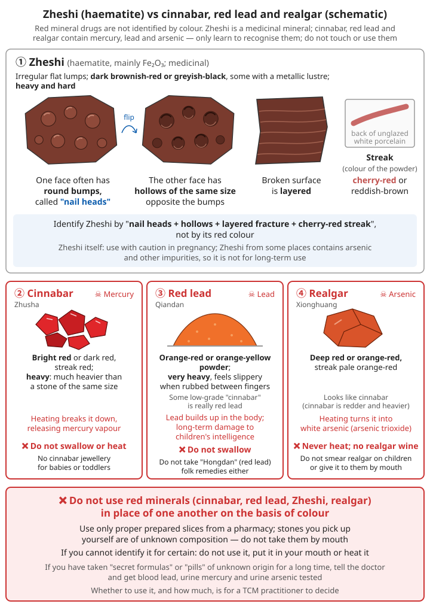

# Animal and Mineral Medicines

> **Animal and mineral medicines are the two groups of Chinese medicines most likely to "go wrong": one involves protected animals and illegal trade, the other involves heavy metals such as mercury, arsenic and lead. Before you learn to recognise them, be clear which ones can be used and which ones should never be touched at all**

This chapter covers 18 common animal medicines, 7 protected-animal medicines and 9 mineral medicines. The animal medicines are divided by source into gelatins, horns and shells (*Lurong*, *Ejiao*, *Guijia*, *Biejia*, *Muli*, *Zhenzhu*, *Shijueming*, *Haipiaoxiao*) and insects, worms and others (*Chantui*, *Jiangcan*, *Dilong*, *Quanxie*, *Wugong*, *Tubiechong*, *Shuizhi*, honey, *Fengfang*, *Jineijin*). For the protected animals (pangolin, rhinoceros horn, tiger bone, natural musk, bear bile, saiga antelope horn, hawksbill shell) **only the legal bans and legal substitutes are given**. The mineral medicines are *Shigao*, *Huashi*, *Mangxiao*, *Longgu*, *Cishi*, *Zheshi*, *Luganshi*, *Baifan* and *Pengsha*; toxic mineral medicines such as cinnabar and realgar are only named, see [Toxic *Herbs* and Poisonous Look-alikes](09-toxic-herbs-and-poisonous-look-alikes.md). General methods for identification, harvesting, drying and storage are in the [General Principles](./00-general-principles.md) and are not repeated here.

## ⚠️ Read these first

```
1. Do not hunt, buy, sell or use protected animals or their products:
   pangolin, tiger bone, rhinoceros horn, natural musk, bear bile,
   saiga antelope horn, hawksbill shell and others.
   Illegally hunting, buying, transporting or selling them is against the
   law, and in serious cases is a crime;
   this book gives only legal reminders and legal substitutes for them,
   not how to identify, obtain or use them
2. Use Lurong and Guijia only from captive-bred sources: wild sika deer,
   red deer and Reeves' turtles are all wild animals under state key
   protection
3. Quanxie, Wugong, Shuizhi and Tubiechong are marked "toxic" or
   "slightly toxic" in the Chinese Pharmacopoeia;
   they are forbidden in pregnancy. Do not catch them yourself, do not
   remove their toxicity yourself, do not prescribe them yourself; use them
   only under the guidance of a TCM practitioner
4. Mineral medicines containing mercury, arsenic or lead, such as cinnabar,
   realgar, calomel, red mercuric oxide (Hongfen), red lead and arsenolite,
   are extremely toxic. This chapter only names them; do not take them by
   mouth, do not heat them, do not use them on children
5. Babies under one year old must not eat honey (it can cause infant
   botulism);
   honey from places where poisonous plants such as Leigongteng
   (thunder god vine) or Gouwen (gelsemium) are in flower can poison people
6. Baifan (alum) contains aluminium and Pengsha (borax) is toxic: neither
   should be taken by mouth long term or in large amounts;
   do not use a white crystal of unknown origin as Mangxiao — nitrite and
   saltpetre look similar
7. Doses are the usual adult daily doses in the Chinese Pharmacopoeia
   (2020 edition)
   (the current edition is 2025 — the wording of the current edition
   prevails).
   They are only there to warn you "do not exceed this"; whether to use
   a medicine, and how much, is decided under the guidance of a TCM
   practitioner
8. Animal medicines are often faked: mixed-hide gelatin sold as Ejiao,
   Quanxie and Shuizhi with weight added, dyed Lurong slices,
   plastic imitation pearls — buy prepared slices from a proper pharmacy
```

---

## Quick reference to this chapter

The "Toxicity/protection" column gives toxicity noted in the Pharmacopoeia, this book's risk warnings, and the protection status of the animal. For protection levels the published state lists prevail; this table is only a reminder.

| Medicine | Part used | Main actions | Toxicity/protection | See |
|------|---------|---------|----------|-----|
| *Lurong* (deer antler velvet) | Young, unossified antler of a male deer | Strengthens kidney yang, replenishes essence and blood, strengthens sinews and bones | 🛡️ Captive-bred sources only; many fakes | [1.1](#11-lurong-deer-antler-velvet) |
| *Ejiao* (donkey-hide gelatin) | Gelatin boiled down from donkey hide | Tonifies blood and nourishes yin, moistens dryness, stops bleeding | Often faked with mixed-hide gelatin | [1.2](#12-ejiao-donkey-hide-gelatin) |
| *Guijia* (tortoise shell) | Upper and lower shell | Nourishes yin and subdues yang, benefits the kidneys and strengthens bones | 🛡️ Wild turtles protected; captive-bred only | [1.3](#13-guijia-tortoise-shell) |
| *Biejia* (turtle shell) | Upper shell | Nourishes yin and subdues yang, brings down fever and relieves steaming, softens hardness and dissipates lumps | — | [1.4](#14-biejia-turtle-shell) |
| *Muli* (oyster shell) | Shell | Heavily settles and calms the mind, subdues yang and tonifies yin, softens hardness and dissipates lumps | — | [1.5](#15-muli-oyster-shell) |
| *Zhenzhu* (pearl) | Pearl | Calms the mind and settles fright, brightens the eyes and clears corneal opacity, removes toxins and promotes healing of flesh | Imitation pearls and shell powder passed off | [1.6](#16-zhenzhu-pearl) |
| *Shijueming* (abalone shell) | Abalone shell | Calms the liver and subdues yang, clears the liver and brightens the eyes | — | [1.7](#17-shijueming-abalone-shell) |
| *Haipiaoxiao* (cuttlefish bone) | Internal shell of the cuttlefish | Astringes and stops bleeding, controls acid and relieves pain | — | [1.8](#18-haipiaoxiao-cuttlefish-bone) |
| *Chantui* (cicada slough) | Skin shed by the nymph when the adult emerges | Disperses wind-heat, soothes the throat, vents rashes | Weighted with mud and sand | [2.1](#21-chantui-cicada-slough) |
| *Jiangcan* (stiff silkworm) | Silkworm killed by white muscardine fungus | Calms wind and stops spasms, dispels wind and relieves pain, resolves phlegm and dissipates lumps | Weighted with lime | [2.2](#22-jiangcan-stiff-silkworm) |
| *Dilong* (earthworm) | Dried body of a slit-open earthworm | Clears heat and settles fright, unblocks the channels, relieves wheezing, promotes urination | — | [2.3](#23-dilong-earthworm) |
| *Quanxie* (scorpion) | Dried body | Calms wind and stops spasms, unblocks the channels and relieves pain, attacks toxins and dissipates lumps | ⚠️ Toxic; forbidden in pregnancy | [2.4](#24-quanxie-scorpion) |
| *Wugong* (centipede) | Dried body | Calms wind and stops spasms, unblocks the channels and relieves pain, attacks toxins and dissipates lumps | ⚠️ Toxic; forbidden in pregnancy | [2.5](#25-wugong-centipede) |
| *Tubiechong* (ground beetle) | Dried body of the female | Breaks up blood and expels stasis, joins sinews and bones | ⚠️ Slightly toxic; forbidden in pregnancy | [2.6](#26-tubiechong-ground-beetle) |
| *Shuizhi* (leech) | Dried whole body | Breaks up blood and unblocks menstruation, expels stasis and dissolves masses | ⚠️ Slightly toxic; forbidden in pregnancy; anticoagulant | [2.7](#27-shuizhi-leech) |
| *Fengmi* (honey) | Honey made by honeybees | Tonifies the middle, moistens dryness, relieves pain, removes toxins | ⚠️ Not for babies under 1 year; poisonous nectar sources | [2.8](#28-fengmi-honey) |
| *Fengfang* (wasp nest) | Nest of paper wasps | Attacks toxins and kills parasites, dispels wind and relieves pain | Guard against wasp stings when collecting | [2.9](#29-fengfang-wasp-nest) |
| *Jineijin* (chicken gizzard lining) | Inner lining of the chicken gizzard | Strengthens the stomach and promotes digestion, relieves painful urination and dissolves stones | Duck gizzard lining passed off | [2.10](#210-jineijin-chicken-gizzard-lining) |
| *Chuanshanjia* (pangolin scales) | — | — | 🚫 State Class I protection; no longer in the Pharmacopoeia | [3.2](#32-chuanshanjia-pangolin-scales) |
| *Xijiao* (rhinoceros horn) | — | — | 🚫 Trade and medicinal use banned since 1993 | [3.3](#33-xijiao-rhinoceros-horn) |
| *Hugu* (tiger bone) | — | — | 🚫 Trade and medicinal use banned since 1993 | [3.4](#34-hugu-tiger-bone) |
| *Shexiang* (musk, natural) | — | — | 🚫 Musk deer under state Class I protection | [3.5](#35-shexiang-musk) |
| *Xiongdan* (bear bile) | — | — | 🚫 Bears under state key protection | [3.6](#36-xiongdan-bear-bile) |
| *Lingyangjiao* (saiga antelope horn) | — | — | 🚫 Saiga antelope under state Class I protection | [3.7](#37-lingyangjiao-saiga-antelope-horn) |
| *Daimao* (hawksbill shell) | — | — | 🚫 State Class I protection | [3.8](#38-daimao-hawksbill-shell) |
| *Shigao* (gypsum) | Mineral | Clears heat and drains fire, relieves restlessness and thirst | Keep separate from building plaster | [4.1](#41-shigao-gypsum) |
| *Huashi* (talc) | Mineral | Promotes urination and relieves painful urination, clears heat and relieves summer heat | Do not inhale the powder; beware asbestos content | [4.2](#42-huashi-talc) |
| *Mangxiao* (mirabilite) | Crystals processed from a mineral | Purges and relieves constipation, moistens dryness and softens hardness | Caution in pregnancy; beware mistaking nitrite for it | [4.3](#43-mangxiao-mirabilite) |
| *Longgu* (dragon bone) | Fossil bones of ancient mammals | Settles fright and calms the mind, calms the liver and subdues yang (traditional) | Not in the Pharmacopoeia; fossils are protected by law | [4.4](#44-longgu-dragon-bone) |
| *Cishi* (magnetite) | Mineral | Settles fright and calms the mind, calms the liver and subdues yang | Not for long-term use | [4.5](#45-cishi-magnetite) |
| *Zheshi* (haematite) | Mineral | Calms the liver and subdues yang, heavily settles and directs counterflow downwards, cools blood and stops bleeding | Caution in pregnancy; not for long-term use | [4.6](#46-zheshi-haematite) |
| *Luganshi* (calamine) | Mineral | Removes toxins and brightens the eyes, absorbs damp, relieves itching and heals sores | External use only | [4.7](#47-luganshi-calamine) |
| *Baifan* (alum) | Processed mineral | Removes toxins and kills parasites, dries damp and relieves itching, stops bleeding and diarrhoea | ⚠️ Contains aluminium; not for long-term use | [4.8](#48-baifan-alum) |
| *Pengsha* (borax) | Processed mineral | External use: clears heat and removes toxins (traditional) | ⚠️ Toxic; no separate entry in Part I of the Pharmacopoeia; must not be added to food | [4.9](#49-pengsha-borax) |
| Cinnabar, realgar and others | — | — | ☠️ Contain mercury, arsenic, lead | [Section 5](#5-toxic-mineral-medicines-names-only) |

---

## 1. Gelatins, horns and shells

The medicines in this group come from deer antlers, donkey hide, the shells of turtles and softshell turtles, and seashells. What they have in common: **the raw materials come from farming or from fisheries, so ordinary people do not need to, and should not, go "looking" for them in the wild**. What you need to learn is how to tell whether a medicine you have bought is genuine, and which animals are protected.

Shells are hard, so in a decoction most of them are **decocted first** (boiled for about half an hour before the other herbs go in). For calcining, see [TCM preparations – calcining](../06-pharmaceuticals/04-herbal-preparations.md#calcining). Their main components are calcium carbonate, keratin and collagen, and they are mild in nature, but they **cannot replace calcium supplements or the treatment of osteoporosis**.

### 1.1 Lurong (deer antler velvet)

- **Lurong (Hualurong, Malurong)**: Chinese 鹿茸; *Cervus nippon* Temminck, *Cervus elaphus* Linnaeus. Velvet from sika deer is called *hualurong* ("spotted-deer velvet"), velvet from red deer *malurong* ("red-deer velvet")
- **Source**: The young, unossified antler, densely covered in velvet hair, of the male sika deer *Cervus nippon* Temminck or red deer *Cervus elaphus* Linnaeus (Cervidae, deer family)
- 🛡️ **The only legal source is captive breeding**: the wild sika deer is a Class I wild animal under state key protection and the wild red deer is Class II (2021 "List of Wild Animals under State Key Protection", in both cases "wild populations only"). Sika deer and red deer are on the "National Catalogue of Livestock and Poultry Genetic Resources", so farmed deer can legally be used to produce velvet. **Do not hunt wild deer, and do not buy "wild deer velvet" of unknown origin**
- **Distribution and habitat**: Deer farms are mainly in Jilin, Liaoning and Heilongjiang (sika deer) and in Xinjiang, Inner Mongolia and the northeast (red deer)
- **Key identification features**:
  - Sika deer velvet (two-branched, *ergang*): cylindrical, branched; the main branch, traditionally called the "big shaft" (*dating*), is 17-20 cm long, with one side branch; **skin reddish-brown or brown, mostly glossy, densely covered with fine reddish-yellow or brownish-yellow velvet hair**; the saw cut is yellowish-white, with no bone around the edge and dense fine pores in the middle (honeycomb-like); light; faint fishy smell, taste slightly salty
  - Red deer velvet: thicker and larger than sika deer velvet, with more branches; skin greyish-black, velvet hair greyish-brown or greyish-yellow; the skin at the saw cut is thicker and the edge mostly ossified
  - Velvet slices: the "wax slices" cut from the tip are yellowish-white, translucent and waxy; the "powder slices" and "blood slices" from the middle have fine, dense pores; the "bone slices" near the base have large pores and are hard — **the lower down, the closer to bone and the lower the value**
- **Fakes**: Velvet from other deer passed off as *Lurong*; **fake velvet slices made of animal skin wrapped round pressed bone glue and flour** (they fall apart in water and have no honeycomb pores, experience); ossified antler slices dyed and passed off as velvet slices. *Lujiao* (deer antler), *Lujiaoshuang* (degelatinised antler) and *Lujiaojiao* (antler glue) are different medicines, with different properties and prices
- **Harvesting and processing**: On the farm, trained staff saw off the velvet in summer and autumn; after processing it is dried in the shade or oven-dried. Sawing velvet requires anaesthesia and restraint, with a risk of bleeding and of injury to people, so it may only be done by trained farm staff
- **Storage**: Seal and keep in a cool, dry place; **protect from insects** (the General Principles mention storing it with *Huajiao* (Sichuan pepper), see [Common pests and what to do](./00-general-principles.md#63-common-pests-and-what-to-do))
- **Actions**: Strengthens kidney yang, replenishes essence and blood, strengthens sinews and bones, regulates the *chong* and *ren* vessels, draws out toxins from sores
- **Dose**: 1-2 g, ground to powder and taken mixed with water (Chinese Pharmacopoeia, 2020 edition; use under the guidance of a TCM practitioner)
- **Cautions**: Warm and hot in nature: not suitable for people with fever, yin deficiency with flaring fire (hot palms and soles, dry mouth, night sweats), high blood pressure or bleeding (experience); **start with a small amount** — a sudden large dose can cause dizziness, nosebleeds and so on (experience). Do not drink "deer velvet steeped in liquor" in large amounts over a long time

### 1.2 Ejiao (donkey-hide gelatin)

- **Ejiao (Lüpijiao, Fuzhijiao)**: Chinese 阿胶; *Equus asinus* L.
- **Source**: A solid gelatin made by boiling and concentrating the dried or fresh hide of the donkey *Equus asinus* L. (Equidae, horse family)
- **Distribution and habitat**: The traditional place of production is Dong'e in Shandong; the donkey is a domestic animal — for keeping donkeys see [Livestock farming – keeping donkeys, horses and mules](../04-farming-and-animal-husbandry/06-livestock.md#keeping-donkeys-horses-and-mules-key-points)
- **Key identification features**:
  - Crude drug: **rectangular blocks, square blocks or small cubes**; brown to blackish-brown, glossy
  - Texture: **hard and brittle**, the broken surface shiny; **a fragment held up to the light is brown and translucent**
  - Smell and taste: faint smell, taste slightly sweet
- **Fakes (mixed-hide gelatin)**: Gelatin boiled from pig, cattle or horse hide or from mixed hides, sold as *Ejiao* or mixed into it, is the most common fake. In experience, mixed-hide gelatin has a dull broken surface with bubbles or impurities, **easily goes soft and sticky in summer**, has a clear fishy or burnt smell when dissolved, and looks cloudy and opaque against the light. **But none of these is reliable** — the Pharmacopoeia tells them apart by testing for peptides specific to donkeys (mass spectrometry), which cannot be done at home. **Buy only proper products with an approval number**
- **Harvesting and processing**: Made in factories; you cannot make *Ejiao* of medicinal quality yourself. This book does not describe how to boil the gelatin
- **Storage**: Keep closed in a cool, dry place; **it does not tolerate damp or heat**: damp makes it soft and mouldy, too dry and it cracks
- **Actions**: Tonifies blood and nourishes yin, moistens dryness, stops bleeding
- **Dose**: 3-9 g, **melted and added** (dissolved in boiling water or yellow rice wine and stirred into the decoction, not boiled with the other herbs) (Chinese Pharmacopoeia, 2020 edition; use under the guidance of a TCM practitioner)
- **Cautions**: It is rich and cloying, and not suitable for people with **indigestion, bloating, loose stools or a thick, greasy tongue coating** (experience). **Anaemia needs its cause found first** — iron-deficiency anaemia needs iron, blood loss needs the bleeding stopped; *Ejiao* cannot replace tests and treatment, see [Nutrition and nutritional deficiency diseases](../07-everyday-living-skills/02-nutrition-and-deficiency-diseases.md)

### 1.3 Guijia (tortoise shell)

- **Guijia (Guiban, Guike)**: Chinese 龟甲; *Chinemys reevesii* (Gray)
- **Source**: The upper shell (carapace) and lower shell (plastron) of the Reeves' turtle *Chinemys reevesii* (Gray) (Testudinidae, tortoise family)
- 🛡️ **The wild Reeves' turtle is a Class II wild animal under state key protection** (2021 list, "wild populations only"); the medicine should come from captive breeding. **Do not catch wild turtles and do not buy wild turtles**; most other turtle species (especially the golden coin turtle, the big-headed turtle and others) are also protected animals, and their shells must not be used as *Guijia*
- **Distribution and habitat**: Farmed throughout the Yangtze basin and areas to the south
- **Key identification features**:
  - The upper and lower shells are joined by a bridge; **the upper shell is long-elliptical and domed**, 7.5-22 cm long, brown or blackish-brown on the outside, with a lengthwise ridge down the middle
  - **The lower shell is plate-like**, nearly long-rectangular-elliptical, 6.4-21 cm long; the outer surface is pale yellowish-brown to brownish-black, with 12 scutes, each often with purplish-brown radiating lines; the inner surface is yellowish-white to greyish-white
  - Hard; faint fishy smell, taste slightly salty
- **Look-alikes**: Shells of other turtles (mostly protected animals); ***Biejia* passed off as *Guijia* or mixed in** — *Biejia* is only the upper shell, has no horny scutes, and its ribs stick out beyond the edge on both sides (see the next section)
- **Harvesting and processing**: After a farmed turtle is slaughtered, the shell is removed, the remaining flesh cleaned off, and the shell sun-dried (the Pharmacopoeia also describes scalding in boiling water before removing skin and flesh; not covered here)
- **Storage**: Keep in a dry place; protect from insects
- **Actions**: Nourishes yin and subdues yang, benefits the kidneys and strengthens bones, nourishes blood and tonifies the heart, secures menstruation and stops uterine bleeding
- **Dose**: 9-24 g, **decocted first** (Chinese Pharmacopoeia, 2020 edition; use under the guidance of a TCM practitioner)
- **Cautions**: Cool in nature: not suitable for people with a cold, deficient spleen and stomach or with diarrhoea; caution in pregnancy (experience)

### 1.4 Biejia (turtle shell)

- **Biejia (Jiayuke, Tuanyujia)**: Chinese 鳖甲; *Trionyx sinensis* Wiegmann
- **Source**: The upper shell of the Chinese softshell turtle *Trionyx sinensis* Wiegmann (Trionychidae, softshell turtle family)
- **Distribution and habitat**: Softshell turtles are widely farmed everywhere, and the medicine mainly comes from farmed turtles
- **Key identification features**:
  - **Elliptical or ovate, domed on the back**, 10-15 cm long, 9-14 cm wide
  - Outer surface blackish-brown or dark green, slightly glossy, with a fine net of wrinkles and greyish-yellow or greyish-white spots; a lengthwise ridge down the middle, with 8 symmetrical transverse grooves on each side; where the skin has come off, saw-toothed sutures can be seen
  - Inner surface whitish; **a raised backbone down the middle, the neck bone curled inwards, and 8 ribs on each side that stick out beyond the edge**
  - Hard; faint fishy smell, taste bland
- **Look-alikes**: How it differs from *Guijia* — *Biejia* is the upper shell only, **with no horny scutes and with ribs sticking out beyond the edge**; *Guijia* has both upper and lower shells and scute patterns
- **Harvesting and processing**: All year round; after slaughter the upper shell is removed, the remaining flesh cleaned off, and the shell sun-dried (the Pharmacopoeia also describes scalding in boiling water before removing skin and flesh)
- **Storage**: Keep in a dry place; protect from insects
- **Actions**: Nourishes yin and subdues yang, brings down fever and relieves steaming bone heat, softens hardness and dissipates lumps
- **Dose**: 9-24 g, **decocted first** (Chinese Pharmacopoeia, 2020 edition; use under the guidance of a TCM practitioner)
- **Cautions**: Not suitable for people with a cold, deficient spleen and stomach, poor appetite and loose stools; caution in pregnancy (experience)

### 1.5 Muli (oyster shell)

- **Muli (Haoke, Haolizike)**: Chinese 牡蛎; *Ostrea gigas* Thunberg, *O. talienwhanensis* Crosse, *O. rivularis* Gould
- **Source**: The shell of the Pacific oyster *Ostrea gigas* Thunberg, the Dalian Bay oyster *O. talienwhanensis* Crosse or the Jinjiang oyster *O. rivularis* Gould (Ostreidae, oyster family)
- **Distribution and habitat**: The intertidal zone and shallow seas along the coast; today oysters are farmed in large numbers, and the shells left over after eating oysters are the raw material
- **Key identification features**:
  - Pacific oyster: **long and plate-like**, with the dorsal and ventral edges almost parallel, 10-50 cm long; the right valve is smaller, with thick, hard scales arranged in layers or layered lines; the outside of the valve is flat or has a few hollows, pale purple, greyish-white or yellowish-brown; **the inside is porcelain-white**, with no small teeth on either side of the hinge; the left valve is deeply cupped, with coarser scales than the right valve
  - Dalian Bay oyster: roughly triangular; the outside of the right valve is pale yellow, with loose concentric scales that rise and fall like waves
  - Jinjiang oyster: round, ovate or triangular; the outside of the right valve is slightly uneven, grey, purple, brown, yellow and other colours, with rings of concentric scales
  - Hard; broken surface layered and pure white; faint smell, taste slightly salty
- **Look-alikes**: Other shells mixed in, usually not poisonous; **shells with mud, sand, seaweed or remaining flesh on them must be washed clean**
- **Harvesting and processing**: All year round; **remove the flesh, wash and sun-dry**. Oyster shells left over from your own meals can simply be scrubbed clean and sun-dried for use as raw material; for calcining see [TCM preparations – calcining](../06-pharmaceuticals/04-herbal-preparations.md#calcining)
- **Storage**: Keep in a dry place
- **Actions**: Heavily settles and calms the mind, subdues yang and tonifies yin, softens hardness and dissipates lumps; calcined *Muli* astringes and secures, controls acid and relieves pain
- **Dose**: 9-30 g, **decocted first** (Chinese Pharmacopoeia, 2020 edition; use under the guidance of a TCM practitioner)
- **Cautions**: Cool and astringent in nature; people who are weak with cold, or constipated, should not use much (experience). If stomach pain with acid reflux goes on for a long time, get checked for a stomach ulcer and *Helicobacter pylori*; do not rely only on calcined *Muli* to "control acid"

### 1.6 Zhenzhu (pearl)

- **Zhenzhu (Zhenzhu, written 真珠)**: Chinese 珍珠; *Pteria martensii* (Dunker), *Hyriopsis cumingii* (Lea), *Cristaria plicata* (Leach)
- **Source**: Pearls formed under stimulation in the Akoya pearl oyster *Pteria martensii* (Dunker) (Pteriidae, pearl oyster family), or in the triangle sail mussel *Hyriopsis cumingii* (Lea) or the cockscomb pearl mussel *Cristaria plicata* (Leach) (Unionidae, freshwater mussel family), and other bivalves
- **Distribution and habitat**: Seawater pearls come from Guangdong, Guangxi and Hainan; freshwater pearls from Zhejiang, Jiangsu, Hunan and elsewhere. **Almost all are cultured pearls**
- **Key identification features**:
  - **Roughly spherical, oblong, ovate or rod-shaped**, 1.5-8 mm across
  - Surface whitish, pale pink, pale yellowish-green or pale blue, translucent, smooth or slightly uneven, **with a characteristic iridescent lustre**
  - Hard; broken surface shows layers; faint smell, taste bland
- **Fakes**: Glass or plastic beads coated with "pearl lacquer": **two real pearls rubbed gently against each other feel slightly gritty, imitation pearls feel smooth and slippery**; the coating of an imitation pearl comes off when scraped with a fingernail (experience). **Pearl powder is faked even more**: shell powder or mother-of-pearl powder is passed off as pearl powder or mixed in, and you cannot tell at home. *Zhenzhumu* (mother-of-pearl) is a different medicine (the nacreous layer of the shell), with similar but different actions
- **Harvesting and processing**: Taken out of the animal, washed and dried; for medicinal use it is **ground under water (*shuifei*) or ground into a very fine powder** (powder that is not fine enough irritates the stomach and intestines)
- **Storage**: Keep closed
- **Actions**: Calms the mind and settles fright, brightens the eyes and clears corneal opacity, removes toxins and promotes healing of flesh, moistens the skin and removes spots
- **Dose**: 0.1-0.3 g, **mostly used in pills and powders**; an appropriate amount for external use (Chinese Pharmacopoeia, 2020 edition; use under the guidance of a TCM practitioner)
- **Cautions**: Generally not used in decoctions; claims that "pearl powder whitens the skin" or "pearl powder supplements calcium" are exaggerated — you do not need something this expensive to get calcium

### 1.7 Shijueming (abalone shell)

- **Shijueming (Baoyuke, Jiukongluo, Qianliguang — do not confuse with Qianliguang, the daisy-family herb)**: Chinese 石决明; *Haliotis diversicolor* Reeve, *H. discus hannai* Ino, *H. ovina* Gmelin, *H. ruber* (Leach), *H. asinina* Linnaeus, *H. laevigata* (Donovan)
- **Source**: The shell of the variously coloured abalone *Haliotis diversicolor* Reeve, the Japanese abalone *H. discus hannai* Ino, the sheep's ear abalone *H. ovina* Gmelin, the Australian blacklip abalone *H. ruber* (Leach), the donkey's ear abalone *H. asinina* Linnaeus or the greenlip abalone *H. laevigata* (Donovan) (Haliotidae, abalone family)
- **Distribution and habitat**: Rocky reefs along the coast; today mostly the shells of farmed abalone
- **Key identification features**:
  - Variously coloured abalone: **long-ovate, roughly ear-shaped when seen from inside**, 7-9 cm long; surface dark red, with many irregular spiral ribs and fine, dense growth lines; **starting from the top of the spire, a row of 20-odd wart-like bumps runs to the right, the last 6-9 of which are open holes**, with the hole openings level with the shell surface
  - Japanese abalone: long-elliptical, 8-12 cm long; surface greyish-brown, with many coarse, irregular wrinkles; the last 4-5 holes are open, with the openings raised above the shell surface
  - **The inside is smooth, with an iridescent, pearl-like lustre**; hard, not easily broken; faint smell, taste slightly salty
- **Look-alikes**: Other snail shells do not have this row of holes and are easy to tell apart
- **Harvesting and processing**: Caught in summer and autumn; **remove the flesh, wash and dry**. Shells left over from eating abalone can simply be scrubbed clean and sun-dried
- **Storage**: Keep in a dry place
- **Actions**: Calms the liver and subdues yang, clears the liver and brightens the eyes
- **Dose**: 6-20 g, **decocted first** (Chinese Pharmacopoeia, 2020 edition; use under the guidance of a TCM practitioner)
- **Cautions**: Cool in nature; use with caution in people with a cold, deficient spleen and stomach, poor appetite and loose stools (experience). **For dizziness, headache or blurred vision, measure the blood pressure and have the eyes checked first** — high blood pressure and glaucoma must be treated as diseases

### 1.8 Haipiaoxiao (cuttlefish bone)

- **Haipiaoxiao (Wuzeigu, Moyugu)**: Chinese 海螵蛸; *Sepiella maindroni* de Rochebrune, *Sepia esculenta* Hoyle
- **Source**: The dried internal shell of the spineless cuttlefish *Sepiella maindroni* de Rochebrune or the golden cuttlefish *Sepia esculenta* Hoyle (Sepiidae, cuttlefish family)
- **Distribution and habitat**: Coastal; cuttlefish is a common seafood, and the "cuttlebone" taken out when cleaning a cuttlefish is the raw material
- **Key identification features**:
  - Spineless cuttlefish: **flat, long-elliptical, thick in the middle and thin at the edges**, 9-14 cm long, 2.5-3.5 cm wide; on the back a porcelain-white ridge-like bulge, slightly reddish on both sides; the belly side is white, with fine, dense wavy transverse layer lines from the tail end to the middle; **the tail is fairly wide and flat, without a bone spine**
  - Golden cuttlefish: 13-23 cm long, with obvious warty dots on the back; **one bone spine at the tail**, usually broken off
  - **Light, loose in texture, breaks easily, broken surface powdery**, showing loose layer lines; faint fishy smell, taste slightly salty
- **Look-alikes**: Internal shells of other cuttlefish, usually not poisonous
- **Harvesting and processing**: Collect the bone-like internal shell of the cuttlefish, **wash and dry**
- **Storage**: Keep in a dry place; protect from damp
- **Actions**: Astringes and stops bleeding, secures essence and stops vaginal discharge, controls acid and relieves pain, absorbs damp and heals sores
- **Dose**: 5-10 g; an appropriate amount for external use, ground to powder and applied to the affected area (Chinese Pharmacopoeia, 2020 edition; use under the guidance of a TCM practitioner)
- **Cautions**: Astringent in nature; constipated people should not use much (experience). **For stopping bleeding externally it is only suitable for small wounds that are oozing**; for large wounds or heavy bleeding, first apply direct pressure as described in [Wounds and injuries](../01-first-aid-and-family-health/02-wounds-and-injuries.md), and do not sprinkle medicine powder into deep wounds

## 2. Insects, worms and others

Half of the insect and worm medicines are things you can collect yourself: *Chantui* is picked up from tree trunks, *Jineijin* is peeled off when a chicken is killed, and *Dilong* is simply the earthworm. The other half — *Quanxie*, *Wugong*, *Tubiechong* and *Shuizhi* — are blood-breaking and wind-calming medicines marked "toxic" or "slightly toxic" in the Pharmacopoeia, **forbidden in pregnancy**. What is on sale comes mainly from captive breeding and specialist buyers. This book **does not describe catching them or processing to remove their toxicity**; it only says how to recognise them and why they are dangerous.

*Banmao* (blister beetle) and *Chansu* (toad venom) are extremely toxic animal medicines on the state-controlled list of 28 toxic Chinese medicines; see [Toxic herbs – *Banmao*](09-toxic-herbs-and-poisonous-look-alikes.md#220-banmao-blister-beetle) and [Toxic herbs – *Chansu*](09-toxic-herbs-and-poisonous-look-alikes.md#221-chansu-toad-venom).

```
Common reminders for insect and worm medicines:
- Animal proteins can cause allergies: if a rash, itching, wheezing or
  tight chest, or facial swelling appears after use, stop at once and
  see a doctor
- Faking by adding weight is common: salt, alum, mud and sand, lime
  powder. When you buy, look, weigh and smell first
- They are easily attacked by insects and easily go mouldy: keep sealed,
  dry and cool; they can be stored with Huajiao (Sichuan pepper)
```

### 2.1 Chantui (cicada slough)

- **Chantui (Chanyi, Zhiliaoke, Chantui written 蝉退)**: Chinese 蝉蜕; *Cryptotympana pustulata* Fabricius
- **Source**: The skin shed by the nymph of the black cicada *Cryptotympana pustulata* Fabricius (Cicadidae, cicada family) when the adult emerges
- **Distribution and habitat**: Found in most parts of the country; in summer the nymphs crawl out of the ground at night and the adults emerge on **tree trunks, shrub branches and the bases of walls**, leaving the empty shells behind
- **Key identification features**:
  - **Roughly elliptical and curved**, about 3.5 cm long and about 2 cm wide; **surface yellowish-brown, translucent and glossy**
  - The head has 1 pair of thread-like antennae (usually broken off) and bulging compound eyes; the mouthparts are well developed, with the lower lip extended into a tube
  - **The back of the thorax is split open in a cross shape** (where the adult climbed out), with the edges of the split curled inwards; 2 pairs of small wings on either side of the back; 3 pairs of legs on the underside, covered with fine yellowish-brown hairs
  - The abdomen is bluntly rounded, with 9 segments; **light, hollow, fragile**; faint smell, taste bland
- **Fakes**: **Mud and sand stuffed inside to add weight** (it rattles when shaken and there is soil inside when broken open, experience); sloughs of other cicadas mixed in, usually not poisonous
- **Harvesting and processing**: Collected in summer and autumn; **remove mud and sand, sun-dry**. This is one of the few animal medicines you can safely collect yourself: just pick them off tree trunks, without harming any animal. Do not collect from trees that have been sprayed with pesticide or from dusty places by roads
- **Storage**: Keep in a dry place; **do not crush** (very easily crushed)
- **Actions**: Disperses wind-heat, soothes the throat, vents rashes, brightens the eyes and clears corneal opacity, relieves spasms
- **Dose**: 3-6 g (Chinese Pharmacopoeia, 2020 edition; use under the guidance of a TCM practitioner)
- **Cautions**: Caution in pregnancy (traditional experience). **A child with fever, a rash or convulsions must see a doctor first** — it may be measles, meningitis or the like; see [Common illnesses](../01-first-aid-and-family-health/01-common-illnesses.md)

### 2.2 Jiangcan (stiff silkworm)

- **Jiangcan (Baijiangcan, Tianchong)**: Chinese 僵蚕; *Bombyx mori* Linnaeus, *Beauveria bassiana* (Bals.) Vuillant
- **Source**: The dried body of a 4th-5th instar larva of the silkworm *Bombyx mori* Linnaeus (Bombycidae, silkworm moth family) killed by infection (or artificial inoculation) with the white muscardine fungus *Beauveria bassiana* (Bals.) Vuillant
- **Distribution and habitat**: A by-product of silkworm-raising areas (Jiangsu, Zhejiang, Sichuan, Guangdong and others)
- **Key identification features**:
  - **Roughly cylindrical, mostly curved and shrivelled**, 2-5 cm long, 0.5-0.7 cm across
  - **Surface greyish-yellow, covered with white, powdery-frost-like aerial hyphae and conidia**; head fairly round, 8 pairs of legs, segments distinct, tail slightly forked in two
  - Hard and brittle, breaks easily; **broken surface flat, the outer layer white, with 4 shiny brown or shiny black silk-gland rings in the middle**
  - Faint fishy smell, taste slightly salty
- **Fakes**: Silkworms that died of disease, coated in **lime powder, talc powder or alum** to imitate the white fungus and add weight (experience: the powdery frost rubs off at once and smells of lime, and the broken surface has no shiny silk-gland rings); **silkworms that died of other diseases (such as flacherie or rot)** turn black and stink, and must not be used
- **Harvesting and processing**: Mostly produced in spring and autumn by drying silkworms that died of white muscardine infection. White muscardine spreads through a silkworm house, so **do not deliberately infect your silkworms "to make *Jiangcan*"** — it will destroy the whole batch
- **Storage**: Keep in a dry place; **protect from insects**
- **Actions**: Calms wind and stops spasms, dispels wind and relieves pain, resolves phlegm and dissipates lumps
- **Dose**: 5-10 g (Chinese Pharmacopoeia, 2020 edition; use under the guidance of a TCM practitioner)
- **Cautions**: A few people have been reported to have allergic reactions after taking it; **people allergic to silkworm pupae should not use it** (experience)

### 2.3 Dilong (earthworm)

- **Dilong (Qiuyin, Qushan)**: Chinese 地龙; *Pheretima aspergillum* (E. Perrier), *P. vulgaris* Chen, *P. guillelmi* (Michaelsen), *P. pectinifera* Michaelsen
- **Source**: The dried body of *Pheretima aspergillum* (E. Perrier), *P. vulgaris* Chen, *P. guillelmi* (Michaelsen) or *P. pectinifera* Michaelsen (Megascolecidae, earthworm family). The first is traditionally called *Guang Dilong* ("Guangdong earthworm"), the last three *Hu Dilong* ("Shanghai earthworm")
- **Distribution and habitat**: *Guang Dilong* comes from Guangdong, Guangxi and Fujian; *Hu Dilong* from Shanghai, Jiangsu, Zhejiang and elsewhere; they live in damp, fertile soil
- **Key identification features**:
  - *Guang Dilong*: **long, thin strips (already slit open)**, curved, the edges slightly rolled, 15-20 cm long, 1-2 cm wide; ringed along the whole body; **back brown to purplish-grey, belly pale yellowish-brown**; segments 14-16 form the clitellum, traditionally called the "white neck", which is shinier
  - *Hu Dilong*: 8-15 cm long, 0.5-1.5 cm wide; back brown to yellowish-brown, belly pale yellowish-brown
  - Light, slightly leathery, not easily broken; **fishy smell, taste slightly salty**
- **Fakes**: Worms that have not been slit open, with **a lot of mud and sand** in the gut (the Pharmacopoeia sets a limit for impurities); usually not poisonous
- **Harvesting and processing**: *Guang Dilong* is caught from spring to autumn, *Hu Dilong* in summer; **slit the belly open promptly, remove the gut contents and mud, wash, and sun-dry or dry at low temperature**. **Do not dig earthworms from polluted soil (near factories, mining areas, rubbish dumps, main roads)** — earthworms accumulate heavy metals
- **Storage**: Keep in a ventilated, dry place; **protect from mould and insects**
- **Actions**: Clears heat and settles fright, unblocks the channels, relieves wheezing, promotes urination
- **Dose**: 5-10 g (Chinese Pharmacopoeia, 2020 edition; use under the guidance of a TCM practitioner)
- **Cautions**: Cold in nature; caution in people with a cold, deficient spleen and stomach; a few people are allergic; caution in pregnancy (experience). **High fever with convulsions and an asthma attack are emergencies**: get to a doctor first

### 2.4 Quanxie (scorpion)

- **Quanxie (Quanchong, Xiezi)**: Chinese 全蝎; *Buthus martensii* Karsch
- **Source**: The dried body of the Chinese scorpion *Buthus martensii* Karsch (Buthidae, scorpion family)
- **Distribution and habitat**: Mainly produced in Henan, Shandong, Hebei and elsewhere; **what is on sale mostly comes from captive breeding**. This book does not describe catching them in the wild
- **Key identification features**:
  - The head-thorax and front abdomen form a **flat, long ellipse**; the rear abdomen is tail-like, shrivelled and curved; a complete body is about 6 cm long
  - The head-thorax is greenish-brown, with 1 pair of short, small chelicerae at the front and **1 pair of longer, larger pincer-like pedipalps, shaped like crab claws**; the back is covered by a trapezoid shield; 4 pairs of legs on the underside
  - The front abdomen has 7 segments; **the rear abdomen is brownish-yellow, with 6 segments, the last segment bearing a sharp, hooked sting**, with no spur below the sting
  - Faint fishy smell, **taste salty**
- **Fakes**: **"Salted scorpions" with too much salt added for weight** — obvious salt frost on the surface, damp and soft when pinched, extremely salty to taste (experience); mud and sand stuffed into the abdomen; other scorpion species passed off
- **Harvesting and processing**: Processed by farms and specialist buyers (the Pharmacopoeia specifies boiling in boiling water or boiling salt water, then drying in the shade); live scorpions sting, so **do not catch them yourself and do not handle them with bare hands**
- **Storage**: Keep in a dry place; **protect from insects**; salted scorpions easily absorb damp again
- **Toxicity**: Marked "**toxic**" in the Pharmacopoeia. Scorpion venom is mainly a neurotoxin; too large a dose can cause headache, dizziness, raised blood pressure, palpitations and restlessness, and in severe cases difficulty breathing; it can also cause allergic rashes (experience)
- **Actions**: Calms wind and stops spasms, unblocks the channels and relieves pain, attacks toxins and dissipates lumps
- **Dose**: 3-6 g (Chinese Pharmacopoeia, 2020 edition); **use only under the guidance of a TCM practitioner**; do not increase the dose yourself, and do not eat "fried scorpions" or drink "scorpion liquor" in large amounts
- **Cautions**: **Forbidden in pregnancy**; caution in children, weak people and people with blood deficiency (experience). For stings by live scorpions see [Wounds and injuries – insect bites and stings](../01-first-aid-and-family-health/02-wounds-and-injuries.md#insect-bites-and-stings)

### 2.5 Wugong (centipede)

- **Wugong (Baizuchong, Tianlong)**: Chinese 蜈蚣; *Scolopendra subspinipes mutilans* L. Koch
- **Source**: The dried body of the Chinese red-headed centipede *Scolopendra subspinipes mutilans* L. Koch (Scolopendridae, centipede family)
- **Distribution and habitat**: Mainly produced in Hubei, Zhejiang, Jiangsu, Anhui and elsewhere; what is on sale comes from specialist buyers and captive breeding. This book does not describe catching them in the wild
- **Key identification features**:
  - **Flat, long strip**, 9-15 cm long, 0.5-1 cm wide; made up of a head and trunk, **22 segments in all**
  - **Head dark red or reddish-brown**, slightly glossy, covered by a head plate; 1 pair of antennae on either side at the front, and 1 pair of forcipules (poison claws)
  - **Back plates of the trunk brownish-green or dark green**, glossy; underside pale yellow or brownish-yellow, shrivelled; from the second segment on, each segment has 1 pair of walking legs, one on each side; **the legs are yellow or reddish-brown and hooked**; the last pair of legs is tail-like (the terminal legs) and falls off easily
  - Brittle, the broken surface with cracks; **faint fishy smell, with a peculiar pungent, unpleasant odour**, taste pungent and slightly salty
- **Fakes**: Other centipede species passed off; **soil or flour stuffed into the abdomen to add weight**; pieces with broken heads or legs joined together (experience). The goods are often stretched straight on a bamboo strip; when buying, check that the head and tail are intact
- **Harvesting and processing**: Caught and processed by specialists (the Pharmacopoeia specifies inserting a bamboo strip through head and tail, stretching straight and drying); a live centipede bite is very painful and can cause local redness and swelling, and a few people are allergic
- **Storage**: Keep in a dry place; **protect from mould and insects**
- **Toxicity**: Marked "**toxic**" in the Pharmacopoeia. An overdose can cause nausea, vomiting, abdominal pain, palpitations and a slowed heart rate, and in severe cases difficulty breathing; **there are also reports of it causing haemolysis, anaphylactic shock and liver damage**
- **Actions**: Calms wind and stops spasms, unblocks the channels and relieves pain, attacks toxins and dissipates lumps
- **Dose**: 3-5 g (Chinese Pharmacopoeia, 2020 edition); **use only under the guidance of a TCM practitioner**; do not make "centipede liquor" to drink yourself
- **Cautions**: **Forbidden in pregnancy**; caution in children, weak people and people with liver disease (experience)

### 2.6 Tubiechong (ground beetle)

- **Tubiechong (Zhechong, Dibiechong, Tuyuan)**: Chinese 土鳖虫; *Eupolyphaga sinensis* Walker, *Steleophaga plancyi* (Boleny)
- **Source**: The dried body of the female of *Eupolyphaga sinensis* Walker or *Steleophaga plancyi* (Boleny) (Corydiidae, wingless cockroach family)
- **Distribution and habitat**: In the wild they live in loose soil in dark, damp places such as the bases of walls in old houses, under kitchen stoves and in granaries; **almost all of what is on sale is captive-bred**
- **Key identification features**:
  - *Eupolyphaga sinensis*: **flat and ovate**, 1.3-3 cm long, 1.2-2.4 cm wide; narrower at the front, wider at the back; **back purplish-brown, glossy, wingless**
  - The pronotum is well developed and covers the head; 9 abdominal back plates, **overlapping like roof tiles**; underside reddish-brown, with 3 pairs of legs
  - *Steleophaga plancyi*: 2.2-3.7 cm long, 1.4-2.5 cm wide; back blackish-brown, usually with pale yellowish-brown patches and small black dots along the edge
  - Loose and brittle, crumbles easily; **fishy, foul smell**, taste slightly salty
- **Fakes**: **"Golden-edged Tubie"** (*chibian shuizhe*, with a golden-yellow border) and other species passed off; mud, sand or salt added for weight (experience); the males have wings and are not used as medicine
- **Harvesting and processing**: On the farm they are caught, scalded to death, and sun-dried or oven-dried
- **Storage**: Keep in a ventilated, dry place; **protect from insects** (easily attacked by insects and easily turns oily)
- **Toxicity**: Marked "**slightly toxic**" in the Pharmacopoeia
- **Actions**: Breaks up blood and expels stasis, joins sinews and bones
- **Dose**: 3-10 g (Chinese Pharmacopoeia, 2020 edition; use only under the guidance of a TCM practitioner)
- **Cautions**: **Forbidden in pregnancy**; not for people with heavy periods, a bleeding tendency, or who are taking anticoagulant or antiplatelet drugs (experience). **A fracture must first be immobilised and seen by a doctor**, see [Wounds and injuries](../01-first-aid-and-family-health/02-wounds-and-injuries.md); do not rely only on "bone-joining medicines"

### 2.7 Shuizhi (leech)

- **Shuizhi (Mahuang)**: Chinese 水蛭; *Whitmania pigra* Whitman, *Hirudo nipponica* Whitman, *Whitmania acranulata* Whitman
- **Source**: The dried whole body of the horse leech *Whitmania pigra* Whitman (Chinese 蚂蟥, *mahuang*), the Japanese medicinal leech *Hirudo nipponica* Whitman or the willow-leaf leech *Whitmania acranulata* Whitman (Hirudinidae, leech family)
- **Distribution and habitat**: Rice fields, ponds and ditches; **what is on sale mostly comes from captive breeding**
- **Key identification features**:
  - *Whitmania pigra*: **flat and spindle-shaped, with many rings**, 4-10 cm long, 0.5-2 cm wide; back blackish-brown or dark brown, slightly raised, **after soaking in water black spots can be seen arranged in 5 lengthwise stripes**; belly flat, brownish-yellow
  - **One sucker at each end**; the front sucker is inconspicuous, the rear sucker larger
  - *Hirudo nipponica*: flattened long-cylindrical, the body mostly bent and twisted, 2-5 cm long, 0.2-0.3 cm wide
  - *Whitmania acranulata*: long, narrow and flat, 5-12 cm long, 0.1-0.5 cm wide
  - Brittle, breaks easily, **broken surface gelatinous**; faint fishy smell
- **Fakes**: **Injecting or soaking with alum, salt, magnesium sulphate, mud slurry or glue to add weight** is the most common way *Shuizhi* is faked (experience: white crystals or mud and sand in the broken surface, an astringent, salty taste, and it feels unusually heavy in the hand); the Pharmacopoeia has requirements for ash and "antithrombin activity" for *Shuizhi*, which cannot be tested at home
- **Harvesting and processing**: Processed by farms and specialist buyers (the Pharmacopoeia specifies scalding to death in boiling water, then sun-drying or drying at low temperature)
- **Storage**: Keep in a dry place; **protect from insects**
- **Toxicity**: Marked "**slightly toxic**" in the Pharmacopoeia. Hirudin has a very strong **anticoagulant effect**, and an overdose can cause bleeding (from the gums, under the skin, from the digestive tract)
- **Actions**: Breaks up blood and unblocks menstruation, expels stasis and dissolves masses
- **Dose**: 1-3 g (Chinese Pharmacopoeia, 2020 edition; use only under the guidance of a TCM practitioner)
- **Cautions**: **Forbidden in pregnancy**; not for use during menstruation, or by people with bleeding disorders or recent surgery or injury; **people taking anticoagulant or antiplatelet drugs such as warfarin, aspirin or clopidogrel must not use it at the same time** (the bleeding risks add up, see [General principles – taking herbs with Western medicines](./00-general-principles.md#75-taking-herbs-with-western-medicines)). For bites by live leeches in the wild see [Wasps, ticks and dangerous animals – land leeches](../03-wilderness-survival/10-wasps-ticks-and-dangerous-animals.md#land-leeches)

### 2.8 Fengmi (honey)

- **Fengmi (Mi, Baimi, Shimi)**: Chinese 蜂蜜; *Apis cerana* Fabricius, *Apis mellifera* Linnaeus
- **Source**: Honey made by the Asian honeybee *Apis cerana* Fabricius or the Italian (western) honeybee *Apis mellifera* Linnaeus (Apidae, bee family)
- **Distribution and habitat**: Bees are kept all over the country; both the Asian honeybee and the Italian honeybee can be kept at home
- **Key identification features**:
  - **A translucent, glossy, thick liquid**, white to pale yellow or orange-yellow to yellowish-brown
  - **When kept for a long time or chilled, white granular crystals gradually form** — crystallisation is normal and is not evidence that sugar has been added
  - Aromatic smell, very sweet taste; honey from different nectar sources (black locust, vitex, jujube, rape) differs in colour and aroma
- **Fakes**: **Adding syrup (high-fructose corn syrup, rice syrup)** is the most common fake. Folk tests such as "drawing threads", "dripping on paper" or "setting it alight" are not reliable; only a laboratory can test it. Buy from **beekeepers whose source you know, or products that meet a standard**
- **⚠️ Poisonous honey**: If bees gather nectar from poisonous plants, the honey they make can poison people. Known poisonous nectar sources include ***Leigongteng* (thunder god vine), Kunming Shanhaitang, *Gouwen* (gelsemium, "heartbreak grass"), Boluohui (plume poppy), rhododendrons such as *Naoyanghua* (*Rhododendron molle*), *Lilu* (Veratrum) and *Wutou* (aconite)**.
  - The highest risk is from **wild bee nests in the mountains, "local honey" of unknown origin, and apiaries with large stands of poisonous plants nearby in the flowering season**
  - Signs of poisoning: from tens of minutes to a few hours after eating, numbness of the mouth and tongue, dizziness, nausea and vomiting, abdominal pain and diarrhoea, palpitations; in severe cases a fall in blood pressure, heart rhythm problems, shock and even death (honey from thunder god vine can cause kidney failure)
  - **Do not eat honey that tastes bitter, astringent or numbing**; if the symptoms above appear after eating honey, see a doctor at once and take the remaining honey with you. For identifying these poisonous plants see [Toxic *Herbs* and Poisonous Look-alikes](09-toxic-herbs-and-poisonous-look-alikes.md)
- **⚠️ Babies under one year old must not eat honey**: honey may contain spores of *Clostridium botulinum*. A baby's gut flora is not yet established, so the spores can multiply in the gut and produce toxin, causing **infant botulism** (constipation, weak feeding, a weak cry, a floppy body, difficulty breathing). Boiling does not reliably kill the spores. See [The newborn's first days – feeding](../01-first-aid-and-family-health/11-emergency-childbirth-and-newborn-care.md#feeding) and [Botulism](../07-everyday-living-skills/01-food-processing-and-preservation.md#botulism)
- **Harvesting and processing**: From spring to autumn the beekeeper extracts the honey from the hives and **filters** it. Do not poke wild bee nests to get honey — besides the danger of stings, the nectar sources of wild nests cannot be controlled
- **Storage**: **Seal** and keep in a cool place; honey absorbs moisture, and if left open for a long time it absorbs water, ferments, turns sour and bubbles — do not eat fermented honey; do not store it long term in metal containers
- **Actions**: Tonifies the middle, moistens dryness, relieves pain, removes toxins; used externally, promotes healing of flesh and sores
- **Dose**: 15-30 g (Chinese Pharmacopoeia, 2020 edition; use under the guidance of a TCM practitioner)
- **Cautions**: People with diabetes must count it in their sugar intake; it is not a "blood-sugar-lowering food". People with damp obstruction and fullness in the middle, or with diarrhoea, should not eat much (experience)

### 2.9 Fengfang (wasp nest)

- **Fengfang (Lufengfang, Mafengwo)**: Chinese 蜂房; *Polistes olivaceous* (DeGeer), *P. japonicus* Saussure, *Parapolybia varia* Fabricius
- **Source**: The nest of the paper wasps *Polistes olivaceous* (DeGeer), *P. japonicus* Saussure or *Parapolybia varia* Fabricius (Vespidae, wasp family)
- **Distribution and habitat**: All over the country; paper wasp nests hang under eaves, on tree branches and in thickets
- **Key identification features**:
  - **Disc-shaped or irregular flat lumps**, some like a lotus seed head, of varying size; surface greyish-white or greyish-brown
  - **The underside has many regular hexagonal cells**, 3-4 mm or 6-8 mm across; **the upper side has 1 or several short black stalks** (where it hung from the branch)
  - Light, **tough and slightly springy**; faint smell, taste pungent and bland
  - The Pharmacopoeia specifies: **nests that are crumbly or hard must not be used as medicine**
- **Look-alikes**: The comb of honeybees (made of beeswax, which burns and smells of wax) is not *Fengfang*
- **⚠️ Harvest**: The Pharmacopoeia specifies collecting in autumn and winter, sun-drying, or steaming briefly, removing dead wasps and pupae, and sun-drying. **Wasp (paper wasp, hornet) stings can kill**: people attacked by a swarm can die of anaphylactic shock or of haemolysis and acute kidney failure caused by the venom. Only collect abandoned nests **in deep winter, when the colony has left the nest and you have made sure there are no live wasps inside**; **do not poke a nest that has wasps in it**. For what to do after a sting see [Wasps, ticks and dangerous animals – wasps (hornets)](../03-wilderness-survival/10-wasps-ticks-and-dangerous-animals.md#wasps-hornets)
- **Storage**: Keep in a ventilated, dry place; **do not crush; protect from insects**
- **Actions**: Attacks toxins and kills parasites, dispels wind and relieves pain
- **Dose**: 3-5 g; an appropriate amount for external use, ground to powder and mixed with oil to apply to the affected area, or boiled in water as a mouthwash or to wash the affected area (Chinese Pharmacopoeia, 2020 edition; use under the guidance of a TCM practitioner)
- **Cautions**: Caution in people with weak *qi* and blood; not for people allergic to bee or wasp venom (experience)

### 2.10 Jineijin (chicken gizzard lining)

- **Jineijin (Jizhunpi, Jihuangpi)**: Chinese 鸡内金; *Gallus gallus domesticus* Brisson
- **Source**: The dried inner lining of the gizzard of the domestic chicken *Gallus gallus domesticus* Brisson (Phasianidae, pheasant family)
- **Distribution and habitat**: Any household that keeps chickens can get it; for keeping chickens see [Poultry farming – raising chickens](../04-farming-and-animal-husbandry/05-poultry.md#chickens)
- **Key identification features**:
  - **Irregular curled pieces**, about 2 mm thick
  - **Surface yellow, yellowish-green or yellowish-brown, thin and translucent, with clear striped wrinkles**
  - Brittle, crumbles easily; broken surface horn-like and glossy; faint fishy smell, taste slightly bitter
- **Fakes**: **Duck gizzard lining** passed off — purplish-black or blackish-green, thicker, with fewer wrinkles (experience); duck gizzard lining is also used as a medicine, but it is not the Pharmacopoeia's *Jineijin*
- **Harvesting and processing**: **After killing a chicken, take out the gizzard and peel off the inner lining at once**, wash and dry. Peel it while fresh — once it has been left for a while it is hard to peel; do not soak it in water too long while peeling, or the active components are lost (experience). Use only healthy chickens, never chickens that died of disease
- **Storage**: Keep in a dry place; **protect from insects**
- **Actions**: Strengthens the stomach and promotes digestion, secures essence and stops emissions, relieves painful urination and dissolves stones
- **Dose**: 3-10 g (Chinese Pharmacopoeia, 2020 edition; use under the guidance of a TCM practitioner)
- **Cautions**: Mild in nature; it works better ground to powder and swallowed (experience). **When a child has poor appetite, weight loss or abdominal pain for a long time, find the cause** (parasites, malnutrition and so on); do not rely only on digestive medicines. "Dissolving stones" cannot replace investigation and treatment of stones

## 3. Protected-animal medicines: bans and substitutes

This section **covers only the law and the substitutes**. This book does not describe how to identify, obtain, process or use these animal medicines — not because they are "useless", but because **obtaining any of them means killing endangered animals or taking part in illegal trade**, and legal substitutes or artificial products now exist for all of them. For an overview of the law see [General principles – Wildlife Protection Law](./00-general-principles.md#83-wildlife-protection-law).

### 3.1 Overview of the law

```
1. Wildlife Protection Law of the People's Republic of China (revised 2022):
   hunting and killing wild animals under state key protection is
   forbidden;
   selling, buying and using wild animals under state key protection and
   their products is forbidden (except where the law provides otherwise);
   illegally buying wild animals under state key protection and their
   products for eating is forbidden
2. Criminal Law: harming precious or endangered wild animals (hunting,
   killing, buying, transporting, selling) can, in serious cases, be
   punished with a fixed-term prison sentence
3. State Council "Notice on Banning the Trade in Rhinoceros Horn and Tiger
   Bone" (1993):
   all trade in rhinoceros horn and tiger bone is banned; the medicinal
   standards for rhinoceros horn and tiger bone are withdrawn,
   and rhinoceros horn and tiger bone may no longer be used to make
   medicines
4. Rhinoceroses, tigers, pangolins, hawksbill turtles and others are also
   controlled under the Convention on International Trade in Endangered
   Species of Wild Fauna and Flora (CITES);
   international trade is equally forbidden
5. A few medicines (musk, bear bile powder, saiga antelope horn) still have
   legal sources,
   but only approved captive breeding or existing stocks, used in
   designated Chinese patent medicines; individuals may not buy or sell them
```

| Medicine | Source animal | Protection level | Current status | Legal substitute |
|------|---------|---------|------|---------|
| Pangolin scales | Pangolins (genus *Manis*) | State Class I (upgraded in 2020) | No longer in the Pharmacopoeia from the 2020 edition | A TCM practitioner switches to other medicines |
| Rhinoceros horn | Rhinoceros | CITES Appendix I | Trade and medicinal use banned since 1993 | Water buffalo horn (in the Pharmacopoeia) |
| Tiger bone | Tiger | State Class I | Trade and medicinal use banned since 1993 | Artificial tiger bone powder and others |
| Natural musk | Forest musk deer, alpine musk deer, Siberian musk deer | State Class I | Limited to musk taken from live farmed animals, for designated Chinese patent medicines | Artificial musk |
| Bear bile | Asiatic black bear, brown bear | State Class II | Limited to approved farmed sources | Ursodeoxycholic acid (Western medicine) |
| Saiga antelope horn | Saiga antelope | State Class I | Limited to existing stocks, for designated Chinese patent medicines | A TCM practitioner switches to other medicines |
| Hawksbill shell | Hawksbill (sea turtle) | State Class I | Trade and use forbidden | No substitute needed |

For protection levels, the text of the 2021 "List of Wild Animals under State Key Protection" prevails.

### 3.2 Chuanshanjia (pangolin scales)

- 🚫 **Law**: In June 2020 all species of the pangolin genus were moved from state Class II to **Class I wild animals under state key protection**; **the 2020 edition of the Chinese Pharmacopoeia no longer includes pangolin scales**, nor some of the Chinese patent medicines containing them; the 2025 edition further dropped a group of Chinese patent medicines whose formulas contain endangered animal materials, and reportedly the Pharmacopoeia no longer contains any item with pangolin
- The pangolin is one of the most heavily trafficked mammals in the world; the "pangolin scales" and "*shanjiazhu*" (processed pangolin scales) on the market **all come from illegal sources**, and buying or selling them is a crime
- **Substitute**: Pangolin scales used to be used to "unblock menstruation and promote lactation" and "reduce swelling and expel pus"; today TCM practitioners switch to other medicines (such as *Wangbuliuxing* (cowherb seed), *Lulutong* (sweetgum fruit), *Zaojiaoci* (Chinese honey locust spine) and others, **decided by the practitioner according to the condition**). For **too little breast milk after childbirth**, first make sure the mother is well nourished, breastfeeds often and the baby latches on properly; a red, swollen, hot, painful breast with fever may be mastitis and needs a doctor

### 3.3 Xijiao (rhinoceros horn)

- 🚫 **Law**: The 1993 State Council notice **banned all trade in rhinoceros horn** and withdrew its medicinal standard; internationally, rhinoceroses are protected under CITES Appendix I
- **Substitute**: **Water buffalo horn**, the horn of the water buffalo (Bovidae, cattle family), included in the Chinese Pharmacopoeia; its actions are to clear heat and cool blood, remove toxins and settle fright; the dose is large and it must be decocted first. There is also concentrated water buffalo horn powder. Old formulas that contained rhinoceros horn now all use water buffalo horn instead, **with the method of use decided by a TCM practitioner**
- "Rhinoceros horn cups" and "rhinoceros horn slices" on the market are either illegal goods or fakes made of cattle horn or resin — do not buy either

### 3.4 Hugu (tiger bone)

- 🚫 **Law**: The 1993 State Council notice **banned all trade in tiger bone**, withdrew its medicinal standard and forbade the further use of tiger bone to make medicines; the tiger is a Class I wild animal under state key protection
- **Substitute**: There are already approved Chinese patent medicines made with **artificial tiger bone powder**; TCM also has many other medicines for rheumatic bone pain. **"Tiger bone liquor" is always illegal or fake**: do not buy it, do not drink it
- **Long-term pain in joints or bones needs its cause found**: osteoarthritis, rheumatoid arthritis, gout, osteoporosis and cancer that has spread to bone are treated in completely different ways

### 3.5 Shexiang (musk)

- 🚫 **Law**: The forest musk deer, alpine musk deer, Siberian musk deer and other musk deer are all **Class I wild animals under state key protection**; **hunting musk deer for musk is illegal**. Natural musk today comes only from approved farms (taken from live animals) and is used only in a small number of state-designated Chinese patent medicines; individuals may not buy or sell it
- The 2020 edition of the Chinese Pharmacopoeia still includes musk, but **the great majority of "natural musk" on the market is fake or illegal**
- **Substitute**: **Artificial musk**, approved for use in Chinese patent medicines since the 1990s; most Chinese patent medicines containing musk now use artificial musk
- Reminder: musk has a very strong blood-activating effect and is **forbidden in pregnancy**; pregnant women must ask a doctor first before using any Chinese patent medicine containing musk or artificial musk (including plasters stuck on the skin)

### 3.6 Xiongdan (bear bile)

- 🚫 **Law**: The Asiatic black bear and the brown bear are **Class II wild animals under state key protection** (the sun bear is Class I); **hunting bears for their gall bladders is illegal**. Bear bile powder today comes only from approved bear farms; individuals may not buy or sell wild bear bile
- "Wild bear bile" on the market is mostly pig, cattle or sheep bile passed off, or illegal goods
- **Substitute**: One of the main components of bear bile, **ursodeoxycholic acid**, has long been made synthetically and is a **Western medicine** for certain gallstones and cholestatic liver diseases (it needs a doctor's prescription). Jaundice, pain in the upper right abdomen and fever need a doctor; do not look for "bear bile folk remedies"

### 3.7 Lingyangjiao (saiga antelope horn)

- 🚫 **Law**: The saiga antelope is a **Class I wild animal under state key protection** and has died out in the wild in China; international trade is controlled under CITES. The 2020 edition of the Chinese Pharmacopoeia still includes saiga antelope horn, but its sources are limited to state stocks and legal imports, and it is **used only in designated Chinese patent medicines**
- "Saiga antelope horn" on the market is mostly goat horn, Mongolian gazelle horn and the like passed off; the Tibetan antelope, Mongolian gazelle, goitred gazelle and others are also protected animals, so **do not buy the horn of any antelope**
- **Substitute**: In TCM, goat horn and similar are sometimes used instead, with a weaker effect, **decided by a TCM practitioner**. High fever with convulsions is an emergency: get to a doctor first

### 3.8 Daimao (hawksbill shell)

- 🚫 **Law**: The hawksbill, like all sea turtles, is a **Class I wild animal under state key protection** and is protected under CITES Appendix I; **buying, selling or transporting hawksbill shell plates or hawksbill ornaments is illegal**
- Hawksbill shell is now hardly used in modern TCM, and no substitute is needed. Do not buy the "tortoiseshell bracelets" or "tortoiseshell combs" sold at tourist spots — they are either illegal or plastic imitations

## 4. Mineral medicines

Mineral medicines are natural ores or processed mineral products. To recognise a mineral, look mainly at **colour, streak (the colour of the powder left when you scrape it across the back of an unglazed white porcelain tile), lustre, hardness (whether a fingernail can scratch it), specific gravity (weigh it in your hand), magnetism and smell**; see [General principles – simple water and fire tests](./00-general-principles.md#33-simple-water-and-fire-tests).

```
Common reminders for mineral medicines:
- Use only proper prepared slices from a pharmacy: natural ores often
  contain harmful impurities such as arsenic, lead, mercury and fluorine;
  the composition of stones you pick up yourself is unknown, so do not
  take them by mouth
- This book does not describe how to calcine, purify or refine minerals
- Heavy mineral medicines are decocted first in a decoction; most are not
  suitable for long-term use (hard to digest, harm the stomach)
- White powders and crystals that look alike (Mangxiao, saltpetre,
  nitrite, borax, alum, table salt)
  must be labelled and kept apart; anything of unknown origin does not go
  in the mouth
```

### 4.1 Shigao (gypsum)

- **Shigao (Sheng Shigao, Xishi, Baihu)**: Chinese 石膏; gypsum, mainly hydrated calcium sulphate (CaSO₄·2H₂O)
- **Source**: Gypsum, of the gypsum group of the sulphate minerals, mainly hydrated calcium sulphate (CaSO₄·2H₂O)
- **Distribution and habitat**: Produced in Yingcheng in Hubei, and in Anhui, Henan, Shandong and elsewhere, in beds within sedimentary rock
- **Key identification features**:
  - **A fibrous aggregate**, in long blocks, slabs or irregular lumps
  - **White, greyish-white or pale yellow**, some translucent
  - Heavy, **soft (a fingernail leaves a mark)**; **the lengthwise broken surface has a silky lustre**
  - Faint smell, taste bland
- **Look-alikes**:
  - **Calcite** (calcium carbonate): rhombic cleavage, harder, a fingernail cannot scratch it, fizzes with a drop of vinegar or dilute hydrochloric acid; gypsum does not fizz
  - **Anhydrite** (anhydrous calcium sulphate): harder, without the fibrous silky lustre
  - **Building plaster powder and moulding plaster**: already calcined and often with additives; they cannot replace medicinal raw or calcined gypsum. For gypsum in building see [Lime and building materials – gypsum](../07-everyday-living-skills/16-lime-and-building-materials.md#gypsum)
- **Harvesting and processing**: After mining, remove other stones, mud and sand
- **Storage**: Keep in a dry place
- **Actions**: Raw *Shigao* clears heat and drains fire, relieves restlessness and thirst; calcined *Shigao*, used externally, absorbs damp, promotes healing of flesh, heals sores and stops bleeding
- **Dose**: Raw *Shigao* 15-60 g, **decocted first**; calcined *Shigao* an appropriate amount for external use, ground to powder and sprinkled on the affected area (Chinese Pharmacopoeia, 2020 edition; use under the guidance of a TCM practitioner)
- **Cautions**: A very cold medicine: not suitable for people with **a cold, deficient spleen and stomach, poor appetite and loose stools, or without excess heat** (experience). For a high fever that will not come down, see a doctor first to find the cause, see [Common illnesses](../01-first-aid-and-family-health/01-common-illnesses.md)

### 4.2 Huashi (talc)

- **Huashi (Ying Huashi, Huashi written 画石)**: Chinese 滑石; talc, mainly hydrated magnesium silicate [Mg₃(Si₄O₁₀)(OH)₂]
- **Source**: Talc, of the talc group of the silicate minerals, mainly hydrated magnesium silicate [Mg₃(Si₄O₁₀)(OH)₂]
- **Distribution and habitat**: Produced in Shandong, Jiangxi, Liaoning, Guangxi and elsewhere
- **Key identification features**:
  - Mostly massive aggregates, in irregular lumps
  - **White, yellowish-white or pale bluish-grey, with a waxy lustre**
  - **Soft and fine-textured, slippery to the touch**; **does not absorb moisture and does not fall apart in water**
  - Faint smell, taste bland
- **Look-alikes**: "Soft talc" of the kaolin and white clay type (absorbs moisture, sticks to the tongue, falls apart in water) is not the Pharmacopoeia's *Huashi*; **some talc deposits contain asbestos**, and industrial talc powder must not be used as medicine
- **Harvesting and processing**: After mining, remove mud, sand and other stones; medicinal talc powder must be extremely fine and is processed by pharmaceutical factories
- **Storage**: Keep in a dry place
- **Actions**: Promotes urination and relieves painful urination, clears heat and relieves summer heat; used externally, dispels damp and heals sores
- **Dose**: 10-20 g, **decocted first** (talc powder in a decoction is wrapped in cloth for decoction); an appropriate amount for external use (Chinese Pharmacopoeia, 2020 edition; use under the guidance of a TCM practitioner)
- **Cautions**: Cold and slippery in nature: **caution in pregnancy**; not suitable for people with spleen deficiency, seminal emissions or frequent urination (experience). **Do not inhale talc powder**, and do not dust large amounts of powder near a baby's mouth and nose; do not dust powder on the female genital area long term (a reminder from experience). Frequent or painful urination, or blood in the urine, needs a doctor to check for urinary tract infection and stones

### 4.3 Mangxiao (mirabilite)

- **Mangxiao (refined Poxiao, Pixiao)**: Chinese 芒硝; mirabilite, mainly hydrated sodium sulphate (Na₂SO₄·10H₂O). The white powder left when *Mangxiao* weathers and loses water is **Xuanmingfen** (a separate medicine)
- **Source**: Crystals processed and refined from mirabilite, of the mirabilite group of the sulphate minerals, mainly hydrated sodium sulphate (Na₂SO₄·10H₂O)
- **Distribution and habitat**: Occurs in salt lakes, saline-alkaline land and brines containing sodium sulphate
- **Key identification features**:
  - **Prismatic, rectangular or irregular lumps and grains**
  - **Colourless and transparent, or whitish and translucent**
  - Brittle, crumbles easily; broken surface with a **glassy lustre**
  - Faint smell, **taste salty** (with a bitter edge)
  - **It weathers when left in dry air**, the surface turning into white powder
- **⚠️ Look-alikes**:
  - **Sodium nitrite (industrial salt)**: white or slightly yellowish crystals that look like salt and *Mangxiao*; **swallowing 0.2-0.5 g by mistake can cause poisoning, and about 3 g can kill** (purple lips and nails, dizziness, difficulty breathing)
  - **Saltpetre** (potassium nitrate): colourless or white crystals; thrown into a fire it burns fiercely and crackles, completely different from *Mangxiao*
  - **Table salt, alum and borax**: all white crystals
  - **White crystals of unknown origin, without a label, never go in the mouth**; label any *Mangxiao* kept at home
- **Harvesting and processing**: Refined by pharmaceutical factories; this book does not describe the refining method
- **Storage**: **Keep closed, below 30°C**, and protect from weathering (once it has weathered and lost water, the dose is no longer accurate)
- **Actions**: Purges and relieves constipation, moistens dryness and softens hardness, clears fire and reduces swelling
- **Dose**: 6-12 g, **generally not decocted**: dissolve it in the finished decoction and take; an appropriate amount for external use (Chinese Pharmacopoeia, 2020 edition; use under the guidance of a TCM practitioner)
- **Cautions**: **Caution in pregnancy**; **should not be used together with *Liuhuang* (sulphur) or *Sanleng* (bur-reed rhizome)** (Pharmacopoeia); caution in weak people, the elderly and people with a cold, deficient spleen and stomach (experience). **Do not use laxatives for abdominal pain of unknown cause** — in appendicitis or bowel obstruction a laxative can cause perforation, see [Acute symptoms](../01-first-aid-and-family-health/05-acute-symptoms.md)

### 4.4 Longgu (dragon bone)

- **Longgu (Bai Longgu, Hua Longgu)**: Chinese 龙骨; fossil bones of ancient mammals. The fossil teeth of ancient mammals are called *Longchi* ("dragon teeth")
- **Source**: Fossil bones of ancient mammals such as three-toed horses (*Hipparion*), rhinoceroses, deer, cattle and elephants, or fossil elephant incisors
- ⚠️ **Pharmacopoeia**: **Part I of the Chinese Pharmacopoeia (2020 edition) does not include *Longgu***; quality standards are in some provincial local standards, which differ from place to place
- 🛡️ **Law**: Vertebrate fossils are protected under the "Regulations on the Protection of Fossils"; **fossils of important scientific value may not be dug up, bought or sold privately**; if you find a fossil bed, report it to the local authority. In the past, large numbers of precious fossils and oracle bones were ground into medicine powder as "dragon bone"
- **Key identification features**:
  - Bone-shaped or broken into irregular lumps of varying size
  - Surface **white, greyish-white or pale brown**, mostly fairly smooth, some with lines and cracks, or with brown streaks and spots (*Hua Longgu*, "patterned dragon bone")
  - Hard; **the broken surface is uneven, with many small honeycomb pores at the joints**
  - **Strongly absorbs moisture and sticks to the tongue when licked** (a traditional test from experience); faint smell, taste bland
- **Fakes**: **Modern animal bones calcined and aged** to look old (they do not stick to the tongue or only weakly, and smell burnt, experience); lumps of limestone passed off
- **Storage**: Keep in a dry place
- **Actions (traditional)**: Settles fright and calms the mind, calms the liver and subdues yang; calcined *Longgu* astringes and secures
- **Dose**: Not in the Pharmacopoeia; traditionally 15-30 g is commonly used, decocted first (experience; the TCM practitioner's judgement prevails)
- **Cautions**: Astringent in nature; not suitable for people with damp-heat or excess pathogens (experience)

### 4.5 Cishi (magnetite)

- **Cishi (Ling Cishi, Xitieshi)**: Chinese 磁石; magnetite, mainly ferrosoferric oxide (Fe₃O₄)
- **Source**: Magnetite, of the spinel group of the oxide minerals, mainly ferrosoferric oxide (Fe₃O₄)
- **Distribution and habitat**: Produced in iron ore deposits in Hebei, Shandong, Liaoning, Jiangsu and elsewhere
- **Key identification features**:
  - Massive aggregates, irregular lumps or roughly square, **mostly with sharp edges**
  - **Greyish-black or brownish, black streak, metallic lustre**
  - **Heavy, hard**; broken surface uneven
  - **Magnetic, attracts iron** (the magnetism weakens when kept for a long time); earthy smell, taste bland
- **Look-alikes**: *Zheshi* (cherry-red streak, not magnetic); other black iron ores (weakly magnetic or not magnetic)
- **Harvesting and processing**: After mining, remove other stones
- **Storage**: Keep in a dry place
- **Actions**: Settles fright and calms the mind, calms the liver and subdues yang, sharpens hearing and brightens the eyes, helps the kidneys grasp *qi* and relieves wheezing
- **Dose**: 9-30 g, **decocted first** (Chinese Pharmacopoeia, 2020 edition; use under the guidance of a TCM practitioner)
- **Cautions**: Heavy and hard to digest, **not suitable for large amounts or long-term use**; caution in people with a weak spleen and stomach (experience). Insomnia, ringing in the ears or dizziness that goes on for a long time needs its cause found

### 4.6 Zheshi (haematite)

- **Zheshi (Daizheshi, Dingtou Zheshi, Tuzhu)**: Chinese 赭石; haematite, mainly ferric oxide (Fe₂O₃)
- **Source**: Haematite, of the corundum group of the oxide minerals, mainly ferric oxide (Fe₂O₃)
- **Distribution and habitat**: Produced in Shanxi, Hebei, Henan, Shandong and elsewhere
- **Key identification features**:
  - Oolitic, pea-like or kidney-shaped aggregates, mostly as irregular flat lumps
  - **Dark brownish-red or greyish-black, streak cherry-red or reddish-brown**, some with a metallic lustre
  - **One face usually has round bumps, traditionally called "nail heads" (*dingtou*); the other face has hollows of the same size opposite the bumps**
  - Heavy, hard; when smashed **the broken surface shows stacked layers**; faint smell, taste bland
- **Look-alikes**: **Cinnabar** (bright red, red streak, heavier, contains mercury — extremely toxic) and **red lead** (orange-red powder, very heavy, contains lead) — do not identify red mineral medicines by colour, see [Section 5](#5-toxic-mineral-medicines-names-only)
- **Harvesting and processing**: After mining, remove other stones
- **Storage**: Keep in a dry place
- **Actions**: Calms the liver and subdues yang, heavily settles and directs counterflow downwards, cools blood and stops bleeding
- **Dose**: 9-30 g, **decocted first** (Chinese Pharmacopoeia, 2020 edition; use under the guidance of a TCM practitioner)
- **Cautions**: **Caution in pregnancy** (Pharmacopoeia); *Zheshi* from some places contains impurities such as arsenic, so it is **not suitable for long-term use** (experience). Vomiting blood is an emergency: see a doctor at once



*Figure: Recognise Zheshi (haematite) by its "nail heads", matching hollows, layered broken surface and cherry-red streak; cinnabar (contains mercury), red lead (contains lead) and realgar (contains arsenic) only need to be recognised — do not take them by mouth, do not heat them, and do not use one red mineral in place of another*

### 4.7 Luganshi (calamine)

- **Luganshi (Ganshi, Luganshi written 卢甘石)**: Chinese 炉甘石; smithsonite, mainly zinc carbonate (ZnCO₃)
- **Source**: Smithsonite, of the calcite group of the carbonate minerals, mainly zinc carbonate (ZnCO₃)
- **Distribution and habitat**: Produced in zinc deposits in Guangxi, Sichuan, Yunnan, Hunan and elsewhere
- **Key identification features**:
  - Massive aggregates, in irregular lumps
  - **Greyish-white or pale red, the surface powdery, without lustre, uneven and porous, like a honeycomb**
  - **Light, crumbles easily**; faint smell, taste slightly astringent
- **Look-alikes**: Other porous white stones; **it fizzes with a drop of vinegar or dilute hydrochloric acid** (a carbonate)
- **Harvesting and processing**: After mining, wash, sun-dry and remove other stones; the medicinal form is an extremely fine powder ground under water (*shuifei*), or calcined and then ground under water
- **Storage**: Keep in a dry place
- **Actions**: Removes toxins, brightens the eyes and clears corneal opacity, absorbs damp, relieves itching and heals sores
- **Dose**: **External use only**, an appropriate amount (Chinese Pharmacopoeia, 2020 edition); not taken by mouth
- **Cautions**: Not for large areas of broken, weeping skin; **keep out of the eyes** (eye conditions are treated by a doctor). The common **calamine lotion** is a Western topical anti-itch medicine that can be used for insect bites and itchy eczema, see [Wounds and injuries – insect bites and stings](../01-first-aid-and-family-health/02-wounds-and-injuries.md#insect-bites-and-stings)

### 4.8 Baifan (alum)

- **Baifan (Mingfan, Fanshi)**: Chinese 白矾; alum, mainly hydrated potassium aluminium sulphate [KAl(SO₄)₂·12H₂O]. After calcining, when it has lost its water of crystallisation, it is called **Kufan** (dried alum)
- **Source**: Made by processing and refining alunite, of the sulphate minerals, mainly hydrated potassium aluminium sulphate [KAl(SO₄)₂·12H₂O]
- **Distribution and habitat**: Produced in Anhui, Zhejiang, Shanxi, Hubei and elsewhere
- **Key identification features**:
  - **Irregular lumps or grains**
  - **Colourless or pale yellowish-white, transparent or translucent**; surface fairly smooth or uneven, with fine, dense lengthwise ridges, **with a glassy lustre**
  - Hard and brittle
  - Faint smell, **taste sour, slightly sweet and extremely astringent** (one lick makes the tongue feel tight)
- **Look-alikes**: *Mangxiao* (tastes salty), borax (tastes sweet then slightly salty, alkaline), table salt; label them all and keep them apart
- **Harvesting and processing**: Processed in factories; this book does not describe the refining method. For using alum to clear water see [Water supply – multi-stage treatment](../07-everyday-living-skills/10-water-supply.md#multi-stage-treatment)
- **Storage**: Keep in a dry place
- **Actions**: Used externally, removes toxins and kills parasites, dries damp and relieves itching; taken by mouth, stops bleeding and diarrhoea and expels wind-phlegm; *Kufan* absorbs damp and heals sores, stops bleeding and removes rotten tissue
- **Dose**: 0.6-1.5 g; an appropriate amount for external use, ground to powder and applied, or dissolved in water to wash the affected area (Chinese Pharmacopoeia, 2020 edition; use under the guidance of a TCM practitioner)
- **⚠️ Cautions**: **Contains aluminium**; aluminium building up in the body may damage the nervous system and bones, so it is **not suitable for long-term use or large amounts**; people with poor kidney function, children and pregnant women should not take it by mouth (experience). Large amounts taken by mouth can cause burning pain in the mouth and throat, vomiting, diarrhoea and even collapse. **Do not eat large amounts of foods made with alum, such as fried dough sticks (*youtiao*) and glass noodles, over a long time either**

### 4.9 Pengsha (borax)

- **Pengsha (Yueshi, Pengsha written 蓬砂)**: Chinese 硼砂; borax, mainly sodium tetraborate (Na₂B₄O₇·10H₂O)
- **Source**: Crystals refined from borax ore, mainly sodium tetraborate (Na₂B₄O₇·10H₂O)
- ⚠️ **Pharmacopoeia**: As far as the editors know, **Part I of the Chinese Pharmacopoeia (2020 edition) has no separate entry for borax as a medicinal material**, but it does include external-use formulas containing borax (such as *Bingpengsan*); quality standards are in ministry or local standards (the wording of the Pharmacopoeia prevails)
- **Key identification features**:
  - Irregular lumps of varying size; **colourless and transparent or white and translucent**, with a glassy lustre; left in the air for a long time it easily weathers into white powder
  - Light, brittle, crumbles easily; no smell, taste sweet then slightly salty, its solution in water is alkaline
- **⚠️ Toxicity**: Borax **is toxic**: an overdose taken by mouth causes nausea and vomiting, diarrhoea, red, peeling skin, and in severe cases kidney damage, convulsions and shock; **children are more sensitive to boron**; small amounts taken over a long time build up in the body and affect reproduction and development
- **⚠️ Forbidden in food**: Borax is **a non-food substance that the state expressly forbids adding to food** — in the past some people added it to noodles, *zongzi*, cold jelly and meatballs to "make them chewier" or "preserve them"; this is illegal and is also a source of chronic poisoning
- **Use (traditional)**: Used externally to clear heat and remove toxins, reduce swelling and prevent rot, mostly in powders applied to the mouth and throat; **this book gives no dose for taking it by mouth**
- **Cautions**: Not taken by mouth; not for large areas of broken skin; **not for babies and young children** (including painting it inside the mouth); not for pregnant women. Mouth ulcers that keep coming back or have not healed after two weeks need a doctor to rule out other diseases

## 5. Toxic mineral medicines (names only)

The mineral medicines below contain heavy metals such as mercury, arsenic and lead. **This book gives only their names and where the danger lies, not how to use them or doses.** Their identification and signs of poisoning are in Chapter 09. Most of them are on the state-controlled list of 28 toxic Chinese medicines; see [List of the 28 toxic Chinese medicines](09-toxic-herbs-and-poisonous-look-alikes.md#11-the-list-of-28-toxic-chinese-medicines).

| Medicine | Main toxic component | Greatest danger | Details |
|------|------------|----------|------|
| Cinnabar (*Zhusha*) | Mercuric sulphide | Releases mercury vapour when heated; long-term use builds up mercury and damages the kidneys; "mind-calming" folk remedies, baby ornaments | [Cinnabar](09-toxic-herbs-and-poisonous-look-alikes.md#224-zhusha-cinnabar) |
| Realgar (*Xionghuang*) | Arsenic sulphide | Turns into white arsenic (arsenic trioxide) when heated; "realgar wine" | [Realgar](09-toxic-herbs-and-poisonous-look-alikes.md#223-xionghuang-realgar) |
| Arsenolite, white arsenic (*Pishi*, *Pishuang*) | Arsenic trioxide | A tiny amount kills; looks like flour or white sugar | [Arsenolite and white arsenic](09-toxic-herbs-and-poisonous-look-alikes.md#222-pishi-and-pishuang-arsenolite-and-white-arsenic) |
| Calomel (*Qingfen*), red mercuric oxide (*Hongfen*), *Baijiangdan*, mercury | Mercury compounds, metallic mercury | Corrosive, acute kidney failure; absorbed even when applied to broken skin | [Calomel, *Hongfen* and mercury](09-toxic-herbs-and-poisonous-look-alikes.md#225-qingfen-hongfen-and-shuiyin-calomel-red-mercuric-oxide-and-mercury) |
| Red lead (*Qiandan*), litharge (*Mituoseng*) | Lead oxides | Lead builds up; long-term damage to children's intelligence | [Red lead](09-toxic-herbs-and-poisonous-look-alikes.md#226-qiandan-red-lead) |

```
❌ Do not take by mouth any mineral medicine or "ancestral elixir pill"
   containing mercury, arsenic or lead
❌ Do not heat or burn cinnabar or realgar; do not drink realgar wine
❌ Do not let babies and young children wear cinnabar or realgar, and do
   not put it on their skin
❌ Do not use red minerals (cinnabar, red lead, Zheshi, realgar) in place
   of one another on the basis of colour
✓ If you have taken "secret formulas" or "pills" of unknown origin for a
   long time, tell the doctor and get blood lead, urine mercury and urine
   arsenic tested
```

In addition, **Liuhuang** (sulphur; marked "toxic" in the Pharmacopoeia, mainly for external use), **Danfan** (chalcanthite, copper sulphate; taken by mouth it can cause severe poisoning) and others are also toxic mineral medicines; likewise, do not take them by mouth yourself.

## 6. Look-alikes summary and self-check

### 6.1 Look-alikes and risks at a glance

| Genuine medicine | Look-alike/fake | How to tell them apart | Consequence of a mix-up |
|------|-------------|---------|----------|
| *Ejiao* | Mixed-hide gelatin (pig, cattle, horse hide) | Translucency against the light, whether it goes soft in summer, smell (none of these reliable) | No effect; buy only proper products |
| *Lurong* slices | Slices pressed from bone glue and flour, dyed antler slices | Whether it falls apart in water, whether it has honeycomb pores | No effect, cheated |
| *Guijia* | *Biejia*, shells of other turtles | *Guijia* has upper and lower shells with scutes; *Biejia* is the upper shell only, with ribs sticking out beyond the edge | Wrong medicine; involves protected animals |
| *Quanxie*, *Shuizhi*, *Wugong* | Weighted with salt, alum, mud and sand | Salt frost, crystals in the broken surface, extremely salty or astringent taste, too heavy in the hand | Inaccurate dose; harmful impurities |
| *Jiangcan* | Diseased dead silkworms coated in lime powder | The powdery frost rubs off at once; no shiny silk-gland rings in the broken surface | No effect; lime irritation |
| *Jineijin* | Duck gizzard lining | Duck gizzard lining is purplish-black, thicker, with fewer wrinkles | Wrong medicine |
| Honey | Adulterated with syrup; honey from poisonous nectar sources | Cannot be told apart at home; do not eat honey that tastes bitter or numbing | ☠️ Poisonous honey can kill |
| *Shigao* | Calcite, building plaster | Gypsum can be scratched with a fingernail, has a silky lustre and does not fizz with acid | Wrong medicine |
| *Mangxiao* | Sodium nitrite, saltpetre, borax | **White crystals of unknown origin never go in the mouth** | ☠️ Nitrite poisoning |
| *Zheshi* | Cinnabar, red lead | *Zheshi* has a cherry-red streak and "nail heads"; cinnabar is redder and heavier | ☠️ Mercury or lead poisoning |
| *Longgu* | Modern bones calcined and aged | How strongly it sticks to the tongue, burnt smell (experience) | No effect |
| Rhinoceros horn, tiger bone, musk, bear bile, saiga antelope horn | Illegal goods, or fakes made of cattle horn, pig bile and the like | **No need to tell them apart — never buy any of them** | Illegal; cheated |

### 6.2 Self-check

- [ ] I know that pangolin scales, tiger bone, rhinoceros horn, natural musk, bear bile, saiga antelope horn and hawksbill shell must not be bought, sold or used, and I know their legal substitutes
- [ ] *Lurong* and *Guijia* come from captive breeding and from a proper source
- [ ] *Quanxie*, *Wugong*, *Tubiechong* and *Shuizhi* are used only under the guidance of a TCM practitioner; not used in a household with a pregnant woman
- [ ] People taking anticoagulant or antiplatelet drugs do not use blood-breaking medicines such as *Shuizhi* and *Tubiechong*
- [ ] No honey for babies under 1 year old; no wild honey of unknown origin that tastes bitter or numbing
- [ ] *Fengfang* is collected only as abandoned nests with no wasps, in deep winter
- [ ] White crystals (*Mangxiao*, alum, borax, table salt) are all labelled; anything of unknown origin does not go in the mouth
- [ ] Alum and borax are not taken by mouth long term; borax is not added to food
- [ ] Mineral medicines containing mercury, arsenic or lead, such as cinnabar and realgar, are not taken by mouth and not heated
- [ ] I know the Pharmacopoeia doses and contraindications; pregnant women, children and people with liver or kidney disease ask a doctor first

| Task | Difficulty | Risk of getting it wrong |
|------|------|----------|
| Collecting *Chantui*, peeling *Jineijin*, keeping oyster shells and cuttlebones | ⭐ | ☠️ (collecting near pollution sources) |
| Telling genuine from fake *Ejiao*, *Lurong* and pearls | ⭐⭐⭐⭐ | ☠️ (cheated, no effect) |
| Recognising weighted *Quanxie* and *Shuizhi* | ⭐⭐⭐ | ☠️☠️ (inaccurate dose) |
| Using *Quanxie*, *Wugong*, *Shuizhi* or *Tubiechong* yourself | Not recommended | ☠️☠️☠️☠️ (poisoning, bleeding, miscarriage) |
| Collecting *Fengfang* | ⭐⭐ | ☠️☠️☠️☠️ (death from mass wasp stings) |
| Eating wild honey of unknown origin | — | ☠️☠️☠️☠️ (poisonous nectar sources) |
| Telling *Mangxiao* apart from nitrite and other white crystals | ⭐⭐⭐⭐ | ☠️☠️☠️☠️☠️ (nitrite poisoning) |
| Taking toxic mineral medicines such as cinnabar or realgar by mouth | Not allowed | ☠️☠️☠️☠️☠️ (mercury or arsenic poisoning) |
| Obtaining protected-animal medicines | Illegal | 🚫 Criminal liability |

---

## 📝 Key points of this chapter

```
□ Never buy or use protected-animal medicines: pangolin scales, tiger bone,
  rhinoceros horn, natural musk, bear bile, saiga antelope horn,
  hawksbill shell;
  substitutes: water buffalo horn for rhinoceros horn, artificial musk for
  musk, artificial tiger bone powder for tiger bone
□ Use Lurong and Guijia only from captive-bred sources; Ejiao is often faked
  with mixed-hide gelatin — buy only proper products
□ Shells and minerals (Muli, Shijueming, Guijia, Biejia, Cishi, Zheshi,
  Shigao) are decocted first in a decoction
□ Quanxie and Wugong are toxic, Tubiechong and Shuizhi slightly toxic;
  forbidden in pregnancy, use only under the guidance of a TCM
  practitioner;
  Shuizhi is not used together with anticoagulants
□ Babies under 1 year old must not eat honey; honey from poisonous nectar
  sources can kill
□ Chantui, Jineijin, oyster shells and cuttlebones can be collected
  yourself; collect Fengfang only as abandoned nests with no wasps, in
  deep winter
□ Mangxiao: caution in pregnancy, not used with sulphur or Sanleng;
  white crystals of unknown origin do not go in the mouth
□ Alum contains aluminium and borax is toxic: do not take either by mouth
  long term; borax must not be added to food
□ Longgu is not in the Pharmacopoeia, and fossils are protected by law
□ Cinnabar, realgar, calomel, Hongfen, red lead, arsenolite: do not take
  by mouth, do not heat
```

---

## Related chapters

- ⏮️ [Fungi, Algae, Resins and Others](07-fungi-algae-resins-and-others.md) - *Fuling* (poria), *Lingzhi* (reishi), *Dongchongxiacao* (cordyceps), frankincense, borneol and other fungi, algae, resins and processed products
- ⏭️ [Toxic *Herbs* and Poisonous Look-alikes](09-toxic-herbs-and-poisonous-look-alikes.md) - cinnabar, realgar, arsenolite, red lead, *Banmao*, *Chansu* and other toxic Chinese medicines, and poisonous nectar plants
- 🔗 [General Principles of Identifying and Collecting Chinese Medicinal *Herbs*](00-general-principles.md) - general methods for identification, harvesting, processing and storage
- 🔗 [General principles – Wildlife Protection Law](00-general-principles.md#83-wildlife-protection-law) - the law on protected animals and their products
- 🔗 [General principles – taking herbs with Western medicines](00-general-principles.md#75-taking-herbs-with-western-medicines) - interactions between blood-breaking medicines such as *Shuizhi* and anticoagulants
- 🔗 [Traditional Chinese Medicine Preparations](../06-pharmaceuticals/04-herbal-preparations.md) - processing methods such as calcining, decoction and safe use
- 🔗 [Poultry Keeping Guide](../04-farming-and-animal-husbandry/05-poultry.md) - keeping chickens (the source of *Jineijin*)
- 🔗 [Livestock Keeping Guide](../04-farming-and-animal-husbandry/06-livestock.md) - keeping donkeys (the raw material for *Ejiao*)
- 🔗 [Wasps, Ticks and Dangerous Animals](../03-wilderness-survival/10-wasps-ticks-and-dangerous-animals.md) - preventing and treating wasp stings and land leech bites
- 🔗 [Food Processing and Preservation](../07-everyday-living-skills/01-food-processing-and-preservation.md#botulism) - botulism
- 🔗 [Poisoning](../01-first-aid-and-family-health/12-poisoning.md) - general principles for dealing with poisoning

---

**The first lesson of animal and mineral medicines is not "how to use them" but "what not to touch": do not touch protected animals, do not touch ores containing mercury, arsenic or lead, and do not give honey to babies. The only things you can collect yourself are *Chantui*, *Jineijin* and shells; for everything else, buy proper medicinal materials and use them in doses set under the guidance of a TCM practitioner.**
