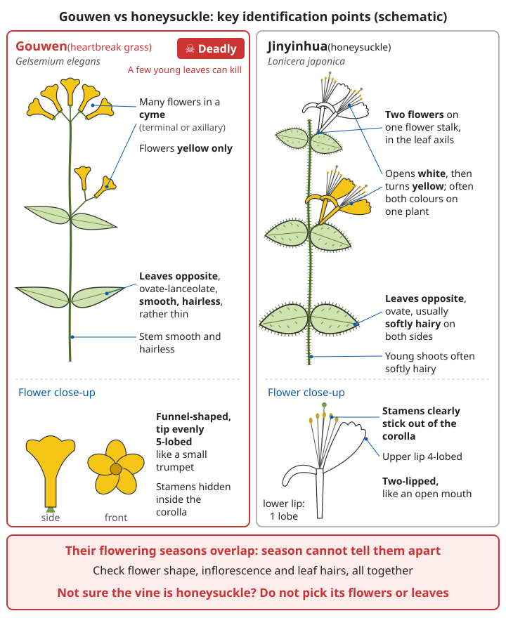

# Toxic Herbs and Poisonous Look-alikes

> **This chapter does not teach you to use toxic herbs. It teaches you to recognise them and keep away from them.** Most poisonings from Chinese medicines each year come from herbs people collected and prepared themselves, from medicinal liquors and folk remedies, and from mistaking one plant for another: aconite stewed with meat, *Gouwen* (heartbreak grass) taken for honeysuckle, pokeweed root taken for ginseng, *Tusanqi* steeped in liquor. Recognise them and do not touch them: that is the best antidote.

---

## ⚠️ Read these first

```
1. This chapter covers only identification, toxicity and the signs of
   poisoning. It gives no processing methods to remove toxicity and no
   usage or doses.
   This is deliberate: at home you cannot reliably control processing
   quality or dose, and "just process it the way the book says" is where
   many poisonings start.

2. Never collect, process, take or apply any herb listed in this chapter
   yourself, and never use them to steep medicinal liquor, stew soup or
   make "folk remedies".
   When needed, they may only be dispensed as properly processed slices
   by a hospital or a proper pharmacy, on a doctor's prescription.

3. Many highly toxic plants do not taste bad and do not act at once;
   some (aconite, Gouwen, water hemlock) can stop breathing and the
   heart within tens of minutes.

4. The names "Duanchangcao" (heartbreak grass), "Tusanqi", "Mutong",
   "Fangji", "Wujiapi" and "Baifuzi" each refer to several different
   plants, some toxic and some not.
   The right name does not mean the right thing.

5. Photo-identification apps, "the old folk say you can eat it" and
   "I ate it before and was fine" are never proof.

6. After swallowing or using one by mistake: call 120 at once, and bring
   whatever is left of the plant, herb, decoction dregs or medicinal liquor.
   Do not make the person vomit, and do not use mung bean soup, liquorice
   water or other folk remedies to "remove the poison".
   See section 5 of this chapter and the Poisoning chapter.

7. This chapter is an educational reference and cannot replace a doctor
   or pharmacist.
```

---

## Quick reference to the herbs in this chapter

"Pharmacopoeia toxicity" is the toxicity noted for the herb in Volume I of the Chinese Pharmacopoeia (2020 edition); "not included" means the herb is not in the main text of Volume I of the 2020 edition. The current edition is 2025; the wording of the current edition prevails for toxicity notes and inclusion. "Danger" is this book's rough rating of the consequences of collecting or using the herb by mistake: the more ☠️, the more dangerous.

| Herb | Toxic part | Main toxic constituents | Pharmacopoeia toxicity | Danger | See |
|------|---------|-------------|---------|---------|-----|
| *Chuanwu*, *Caowu*, *Fuzi* (aconite) | Root tuber | Aconitine-type alkaloids | *Chuanwu* and *Caowu* highly toxic; *Fuzi* toxic | ☠️☠️☠️☠️☠️ | [2.1](#21-chuanwu-caowu-fuzi-aconite) |
| *Xueshangyizhihao* (short-stalked aconite) | Root tuber | Aconitine-type alkaloids | Not included | ☠️☠️☠️☠️☠️ | [2.2](#22-xueshangyizhihao-short-stalked-aconite) |
| *Maqianzi* (nux vomica) | Seed | Strychnine, brucine | Highly toxic | ☠️☠️☠️☠️☠️ | [2.3](#23-maqianzi-nux-vomica) |
| Raw *Banxia* (pinellia) | Tuber | Calcium oxalate needle crystals, toxic protein | Toxic | ☠️☠️☠️ | [2.4](#24-shengbanxia-raw-pinellia) |
| Raw *Tiannanxing* (arisaema) | Tuber | Calcium oxalate needle crystals and others | Toxic | ☠️☠️☠️ | [2.5](#25-shengtiannanxing-raw-arisaema) |
| *Baifuzi* (typhonium) | Tuber | As for arisaema; "*Guanbaifu*" contains aconitine | Toxic | ☠️☠️☠️ | [2.6](#26-baifuzi-typhonium-tuber) |
| *Badou* (croton seed) | Seed (croton oil) | Croton oil, crotin | Highly toxic | ☠️☠️☠️☠️ | [2.7](#27-badou-croton-seed) |
| *Gansui* (kansui) | Root tuber | Diterpene esters | Toxic | ☠️☠️☠️ | [2.8](#28-gansui-kansui-root) |
| *Jingdaji*, *Hongdaji* | Root | Diterpene esters and others | *Jingdaji* toxic; *Hongdaji* slightly toxic | ☠️☠️☠️ | [2.9](#29-jingdaji-and-hongdaji-peking-spurge-root-and-knoxia-root) |
| *Yuanhua* (genkwa) | Flower bud | Diterpene orthoesters | Toxic | ☠️☠️☠️ | [2.10](#210-yuanhua-genkwa-flower) |
| *Langdu* (euphorbia root) | Root | Diterpenes | Toxic | ☠️☠️☠️ | [2.11](#211-langdu-euphorbia-root) |
| *Qianjinzi* (caper spurge seed) | Seed | Diterpene alcohol esters | Toxic | ☠️☠️☠️ | [2.12](#212-qianjinzi-caper-spurge-seed) |
| *Shanglu* (pokeweed) | Root (whole plant) | Phytolacca saponins, phytolaccatoxin | Toxic | ☠️☠️☠️ | [2.13](#213-shanglu-pokeweed-root) |
| *Leigongteng* (thunder god vine) | Root (whole plant) | Triptolide and others | Not included | ☠️☠️☠️☠️☠️ | [2.14](#214-leigongteng-thunder-god-vine) |
| *Naoyanghua* (yellow azalea) | Flower (whole plant) | Grayanotoxins | Highly toxic | ☠️☠️☠️☠️ | [2.15](#215-naoyanghua-yellow-azalea-flower) |
| *Yangjinhua* (datura) | Flower, seed (whole plant) | Scopolamine, hyoscyamine | Toxic | ☠️☠️☠️☠️ | [2.16](#216-yangjinhua-datura-flower) |
| *Tianxianzi* (henbane seed) | Seed (whole plant) | Hyoscyamine, scopolamine | Highly toxic | ☠️☠️☠️☠️ | [2.17](#217-tianxianzi-henbane-seed) |
| *Lilu* (false hellebore) | Root and rhizome (whole plant) | Veratrum steroidal alkaloids | Not included | ☠️☠️☠️☠️ | [2.18](#218-lilu-false-hellebore) |
| *Tenghuang* (gamboge) | Resin | Gambogic acid | Not included | ☠️☠️☠️☠️ | [2.19](#219-tenghuang-gamboge) |
| *Banmao* (blister beetle) | Whole insect | Cantharidin | Highly toxic | ☠️☠️☠️☠️ | [2.20](#220-banmao-blister-beetle) |
| *Chansu* (toad venom) | Secretion (whole toad) | Bufadienolides | Toxic | ☠️☠️☠️☠️ | [2.21](#221-chansu-toad-venom) |
| *Pishi*, *Pishuang* (arsenic) | Mineral | Arsenic trioxide | Not included | ☠️☠️☠️☠️☠️ | [2.22](#222-pishi-and-pishuang-arsenolite-and-white-arsenic) |
| *Xionghuang* (realgar) | Mineral | Arsenic sulfide | Toxic | ☠️☠️☠️☠️ | [2.23](#223-xionghuang-realgar) |
| *Zhusha* (cinnabar) | Mineral | Mercury sulfide | Toxic | ☠️☠️☠️ | [2.24](#224-zhusha-cinnabar) |
| *Qingfen*, *Hongfen*, *Shuiyin* (mercury) | Mineral/processed product | Mercury compounds, mercury | *Qingfen* toxic; *Hongfen* highly toxic | ☠️☠️☠️☠️ | [2.25](#225-qingfen-hongfen-and-shuiyin-calomel-red-mercuric-oxide-and-mercury) |
| *Qiandan* (red lead) | Processed product | Lead tetroxide | Not included | ☠️☠️☠️ | [2.26](#226-qiandan-red-lead) |
| *Guanmutong*, *Guangfangji*, *Qingmuxiang* and others | Various parts | Aristolochic acid | Approval for medicinal use withdrawn | ☠️☠️☠️☠️ | [3](#3-herbs-containing-aristolochic-acid) |
| 16 groups of easily confused poisonous plants | — | — | — | — | [4](#4-poisonous-plants-that-are-easily-confused) |

---

## 1. Toxic Chinese medicines under state control

### 1.1 The list of 28 toxic Chinese medicines

The "Measures for the Administration of Toxic Drugs for Medical Use", issued by the State Council in 1988, list the following Chinese medicines as "toxic Chinese medicines". Like toxic Western drugs, they are under special state control:

```
Pishi (red and white arsenolite)  Pishuang (white arsenic)
Shuiyin (mercury)                 raw Maqianzi (nux vomica)
raw Chuanwu (aconite main root)   raw Caowu (Kusnezoff aconite)
raw Baifuzi (typhonium)           raw Fuzi (aconite lateral root)
raw Banxia (pinellia)             raw Nanxing (arisaema)
raw Badou (croton seed)           Banmao (blister beetle)
Qingniangchong (green blister beetle)
Hongniangchong (red-headed blister beetle)
raw Gansui (kansui)               raw Langdu (euphorbia root)
raw Tenghuang (gamboge)           raw Qianjinzi (caper spurge seed)
raw Tianxianzi (henbane seed)
Naoyanghua (闹阳花, i.e. 闹羊花, yellow azalea flower)
Xueshangyizhihao (short-stalked aconite)
Hongshengdan (red mercuric elixir)
Baijiangdan (white mercuric elixir)
Chansu (toad venom)               Yangjinhua (datura flower)
Hongfen (red mercuric oxide)      Qingfen (calomel)
Xionghuang (realgar)
```

- Many items on the list are marked "raw" (*sheng*): this means the unprocessed crude herb, which is the most toxic
- *Hongshengdan* and *Hongfen* are different names for the same kind of thing; *Hongshengdan* and *Baijiangdan* are traditional external-use elixirs (processed products), not natural crude drugs
- *Qingniangchong*, *Hongniangchong* and *Banmao* are all insects of the blister beetle family (Meloidae) and contain cantharidin
- Different sources count this list slightly differently (some say 27 items, some count 24 crude drugs); the appendix to the original text of the Measures prevails

### 1.2 What the list means

```
- Buying, trading, processing and dispensing of these herbs are done only
  by designated organisations; medical institutions dispense them on a
  doctor's prescription, under strict dose and prescription rules
- It is illegal for an individual to buy, process or sell these herbs
  privately
- If a pharmacy will not sell you "raw Chuanwu" or "raw Banxia", it is not
  out of stock: the rules do not allow it to sell them freely
- "Wild raw Fuzi" or "ancestral-recipe Maqianzi" sold online or at markets
  is of unknown origin and unknown quality: do not buy it, and above all
  do not process it yourself
```

### 1.3 Equally dangerous herbs not on the list

The list was drawn up in 1988, and **not being on the list does not mean safe**. The following are not among the 28 but are just as toxic or often cause poisoning:

- ***Leigongteng*** (thunder god vine), ***Lilu*** (false hellebore), ***Gouwen*** (*Duanchangcao*, heartbreak grass): extremely toxic and common in the wild
- ***Shanglu*** (pokeweed), ***Jingdaji***, ***Yuanhua***, ***Xiangjiapi***, ***Cang'erzi*** (cocklebur fruit), ***Baiguo*** (ginkgo seed), ***Kuxingren*** (bitter apricot kernel), ***Bimazi*** (castor seed): marked "toxic" or "slightly toxic" in the Pharmacopoeia
- **Herbs containing aristolochic acid**: acute poisoning is not obvious, but they cause irreversible kidney damage and cancer (see section 3)
- ***Zhusha*** (cinnabar), ***Qiandan*** (red lead): heavy metals; taking small amounts over a long time causes chronic poisoning
- ***Jusanqi*** (*Tusanqi*, *Gynura japonica*): not a Pharmacopoeia herb, but often grown at home and steeped in liquor, causing severe liver damage

---

## 2. Common highly toxic herbs

For each herb this section gives only: source, key identification features, what it is often mistaken for, toxic parts and constituents, and signs of poisoning. **Never collect or use any of them yourself.**

### 2.1 Chuanwu, Caowu, Fuzi (aconite)

**Source**:
- *Chuanwu*: the dried mother root (main root) of *Aconitum carmichaelii* (aconite, buttercup family, Ranunculaceae)
- *Fuzi*: a processed product of the daughter roots (the small lateral root tubers) of the same aconite species
- *Caowu*: the dried root tuber of *Aconitum kusnezoffii* (Kusnezoff aconite, buttercup family)
- China has more than a hundred species of *Aconitum*, and many local kinds (such as *Xueshangyizhihao* and *Guanbaifu*) are just as highly toxic

**Key identification features**:
- Plant: Perennial herb about 0.6-1.5 m tall; leaves alternate, palmately deeply divided into 3 or fully divided, the lobes divided again; blue-purple flowers in autumn, the upper sepal shaped like a helmet (hence the English name "monkshood"); grows in grassy hillsides and at forest edges
- Root tuber: Shaped like a small taro or an inverted cone, the mother root often joined by one to several daughter roots; surface brownish, with wart-like bumps (lateral root scars)
- *Chuanwu* crude drug: Irregular cone, slightly curved, often with remains of the stem at the top, the middle usually swollen to one side; cross-section whitish or pale greyish-yellow, with a polygonal ring

**Often mistaken for**:
- "*Fuzi*" or "*Caowu*" dug up by people themselves "to stew in soup" or "to steep in liquor", which is in fact the unprocessed raw herb or another *Aconitum* species
- Young spring seedlings taken for wild celery, *shanqin* (mountain celery) and other wild greens (see [4.9](#49-wutou-aconite-vs-wild-celery-type-greens))
- Root tubers taken for taro, wild yam and the like

**Toxic parts and constituents**: The whole plant is toxic; the root tuber is the most toxic. The main toxic constituents are diester alkaloids such as aconitine, mesaconitine and hypaconitine; **a very small amount can kill**.

**Signs of poisoning** (often appear 10 minutes to 2 hours after taking it):
- Numbness of the lips, tongue and throat, spreading quickly to the fingers, toes and whole body, with a feeling of ants crawling on the skin
- Drooling, nausea, vomiting, abdominal pain
- Palpitations, chest tightness, a very slow or very fast heartbeat, severe abnormal heart rhythm (which can progress to ventricular fibrillation), falling blood pressure
- Dizziness, blurred vision, convulsions, difficulty breathing; in the end breathing and the heart can stop suddenly

```
❌ Do not make your own aconite, Caowu or Fuzi medicinal liquor: aconitine
   dissolves in the liquor, and one mouthful can kill
❌ Do not make your own "Fuzi stewed with meat" or "Caowu stewed with
   chicken": the claim that "it's fine if you boil it long enough" is not
   reliable; boiling time, heat and the toxicity of the herb itself all
   vary in ways you cannot control
❌ Do not apply raw aconite to the skin: broken skin absorbs it too and
   causes poisoning
⚠️ If your lips go numb after drinking a medicinal liquor or soup
   containing aconite, call 120 at once
```

### 2.2 Xueshangyizhihao (short-stalked aconite)

**Source**: The root tuber of *Aconitum brachypodum* (short-stalked aconite) and several other *Aconitum* species (buttercup family), produced mainly in the high mountains of Yunnan and south-west Sichuan, where it is used locally as a folk "herb" for injuries from falls and blows and for rheumatism.

**Key identification features**: Plant fairly short, the stem usually unbranched; leaves palmately finely divided, the lobes narrow and linear; flowers blue-purple, helmet-shaped; root tuber long, slender and spindle-shaped, often in pairs. It looks like other *Aconitum* species, and non-specialists cannot reliably tell them apart.

**Often mistaken for**: Sold at local herb stalls as a "painkiller" or "medicine for injuries", and bought to steep in liquor or to grind and swallow.

**Toxic parts and constituents**: The root tuber; it contains aconitine-type alkaloids and is even more toxic than *Chuanwu* and *Caowu*.

**Signs of poisoning**: As for aconite: numb lips and limbs, nausea and vomiting, severe abnormal heart rhythm, paralysis of breathing; it progresses quickly.

```
❌ When travelling, do not buy or try local pain-relieving herbs such as
   "Xueshangyizhihao", "Sanfensan" or "Caowu"
```

### 2.3 Maqianzi (nux vomica)

**Source**: The dried ripe seed of *Strychnos nux-vomica* (strychnine tree, Loganiaceae). Native to India and South-East Asia, cultivated in Yunnan, Guangdong and elsewhere in China.

**Key identification features**:
- Seed: Flat, round and button-like, about 1.5-3 cm across, slightly concave on one side and slightly convex on the other; surface greyish-brown to greyish-green, **densely covered in greyish-brown or greyish-green silky hairs that radiate from the centre outwards, with a silky sheen**; the rim slightly raised, with a small bump (the micropyle); extremely hard
- Faint smell, extremely bitter taste (**do not taste it**)

**Often mistaken for**: Rarely mistaken for food; poisoning usually comes from home-made folk remedy liquors or pills "for rheumatism" or "for paralysis", or from bad home processing or overdose. Related species such as Yunnan *Strychnos* may also get mixed in.

**Toxic parts and constituents**: The seed; the main toxic constituents are strychnine and brucine. Strychnine is a powerful stimulant of the central nervous system, and the therapeutic dose is very close to the toxic dose.

**Signs of poisoning**:
- Early: headache, dizziness, restlessness, tight jaw and neck muscles, difficulty swallowing
- Later: sound, light or touch can all set off rigid convulsions of the whole body; the jaw clenches, the face goes into spasm in a "sardonic grin", and the body arches backwards like a bow (opisthotonus)
- The person is often conscious during convulsions and in great pain; repeated convulsions can cause death by suffocation from spasm of the breathing muscles

```
⚠️ Keep the area around the poisoned person quiet and dark; do not keep
   shaking or patting them; call 120 at once
❌ Do not take "ancestral rheumatism medicines", "Maqianzi medicinal
   liquor" or "bone-strengthening pills" of unknown origin
```

### 2.4 Shengbanxia (raw pinellia)

**Source**: The dried tuber of *Pinellia ternata* (arum family, Araceae). Grows wild at field edges, on waste ground and under trees in most parts of the country.

**Key identification features**:
- Plant: Short herb about 15-30 cm tall; seedling leaves simple and ovate, mature leaves divided into 3 (three leaflets); a small bulbil often at the lower part of the leaf stalk and at the base of the leaf blade; in early summer a green spathe appears, and a long, thin, whip-like appendage sticks out from the tip of the spadix inside it
- Tuber: Roughly round, about 1-1.5 cm across; surface white or pale yellow, with a sunken stem scar at the top surrounded by dense pitted root scars; firm and solid, cross-section pure white and very powdery

**Often mistaken for**:
- Small taro, small wild potatoes, wild water chestnuts
- Counterfeits in the herb trade, such as "*Shuibanxia*" (tuber of *Typhonium flagelliforme*) and *Huzhang* (*Pinellia pedatisecta*), are toxic too

**Toxic parts and constituents**: The whole plant is toxic, the tuber most of all. The main agents are calcium oxalate needle crystals and an irritant toxic protein; the needles pierce the lining of the mouth and throat and cause intense irritation.

**Signs of poisoning**:
- Chewing a little raw: intense numbness, burning pain and swelling of the mouth, tongue and throat, drooling, unable to speak (loss of voice)
- Severe: swelling of the larynx causing difficulty breathing and suffocation
- Nausea, vomiting and diarrhoea can also occur; sap on the skin can cause itching and dermatitis

```
❌ Do not chew it raw to try it, and do not cook wild tubers as small taro
⚠️ Tight throat, difficulty breathing, hoarse voice → call 120 at once;
   the airway is in danger
```

### 2.5 Shengtiannanxing (raw arisaema)

**Source**: The dried tuber of *Arisaema erubescens*, *A. heterophyllum* or *A. amurense* (arum family). Common in shady, damp places in mountain forests across the country.

**Key identification features**:
- Plant: Leaf blade divided radially or in a bird's-foot pattern into many leaflets, like an open umbrella; the flower is a spadix wrapped in a spathe, the spathe green or with purplish-brown stripes; in autumn it bears a cluster of red berries (like a red corn cob) that is very conspicuous
- Tuber: Flattened sphere, about 1.5-6.5 cm across; a sunken stem scar in the centre of the top, surrounded by pitted root scars; some tubers have small, flattened, round side buds around the edge; cross-section white and powdery

**Often mistaken for**: Taro, konjac; children pick and eat the red fruit clusters as wild fruit.

**Toxic parts and constituents**: The whole plant is toxic; the tuber and fruit are very toxic. As with pinellia, the main agents are calcium oxalate needle crystals and irritant constituents.

**Signs of poisoning**: Numbness and burning pain of the mouth and tongue, swelling and ulceration of the lining of the mouth and throat, drooling, difficulty swallowing, hoarse voice; in severe cases swelling of the larynx and suffocation; on the skin it causes itching, redness and swelling.

```
❌ Teach children not to pick and eat wild fruit like a "red corn cob"
   growing under trees
```

### 2.6 Baifuzi (typhonium tuber)

**Source**: *Baifuzi* in the Pharmacopoeia is the dried tuber of *Typhonium giganteum* (arum family), traditionally called "*Yubaifu*".

**Key identification features**:
- Plant: Leaves grow from the underground tuber; leaf blade large, halberd- or arrow-shaped or broadly ovate-triangular; spathe purple
- Tuber: Elliptic or ovoid, about 2-5 cm long; surface white to yellowish-white, slightly rough, with rings and fine-root scars, and a stem or bud scar at the top; cross-section white and powdery

**Often mistaken for**:
- **"*Guanbaifu*"**: the root tuber of *Aconitum coreanum* (yellow-flowered aconite, buttercup family). The name is similar, but it is an aconite and contains aconitine, so it is even more toxic. The name "*Baifuzi*" may mean different things in different regions
- Looks like the tubers of taro, pinellia and arisaema

**Toxic parts and constituents**: The tuber; irritant constituents as in arisaema; if it is *Guanbaifu*, aconitine-type alkaloids.

**Signs of poisoning**: Numbness and burning pain of the mouth, tongue and throat, drooling, swelling of the larynx; if *Guanbaifu* has been used by mistake, signs of aconitine poisoning such as numb lips and limbs and abnormal heart rhythm.

### 2.7 Badou (croton seed)

**Source**: The dried ripe fruit of *Croton tiglium* (spurge family, Euphorbiaceae); the toxic part is mainly the seed inside. Produced in Sichuan, Yunnan, Guangxi, Guangdong and elsewhere.

**Key identification features**:
- Plant: Shrub or small tree; leaves ovate, with finely toothed edges and 2 glands at the base of the leaf
- Fruit: Ovoid, with 3 blunt ridges, divided inside into 3 chambers, one seed in each
- Seed: Slightly flattened ellipse, about 1-1.5 cm long, surface brown or greyish-brown; kernel yellowish-white and very oily

**Often mistaken for**: The seed looks like a small nut, a castor seed or certain beans, and children may eat it by mistake.

**Toxic parts and constituents**: The seed, especially the **croton oil** in it (which contains phorbol esters, a powerful irritant and purgative that promotes cancer in animal experiments), and crotin, a toxic protein.

**Signs of poisoning**:
- Burning in the mouth, throat and gullet, severe abdominal pain, frequent watery or bloody diarrhoea
- Severe dehydration, shock; the toxic protein can cause breakdown of red blood cells and kidney damage
- Croton oil on the skin causes redness, swelling and blistering; in the eyes it can cause severe burns

### 2.8 Gansui (kansui root)

**Source**: The dried root tuber of *Euphorbia kansui* (spurge family). Produced in Shaanxi, Shanxi, Henan, Gansu and elsewhere.

**Key identification features**:
- Plant: Perennial herb with white milky sap when broken (a shared feature of the genus *Euphorbia*); leaves alternate, linear-lanceolate; umbrella-like branching at the top, with cup-shaped cymes (cyathia)
- Root tuber: Elliptic, long and cylindrical, or beaded (like a string of prayer beads); surface whitish or yellowish-white, with remains of brown outer bark in the hollows; cross-section powdery and white

**Often mistaken for**: The beaded root tubers are sometimes taken for other "root tonics" or wild yams.

**Toxic parts and constituents**: The root tuber; it contains diterpene esters such as kansuinines, and triterpenes, which strongly irritate the lining of the gut.

**Signs of poisoning**: Severe abdominal pain, frequent diarrhoea (may be watery), nausea and vomiting, severe dehydration, electrolyte disturbance, falling blood pressure; the milky sap on the skin causes redness, swelling and blistering.

### 2.9 Jingdaji and Hongdaji (Peking spurge root and knoxia root)

**Source**:
- *Jingdaji*: the dried root of *Euphorbia pekinensis* (Peking spurge, spurge family)
- *Hongdaji*: the dried root tuber of *Knoxia valerianoides* (madder family, Rubiaceae)
- They share a name but belong to different families and genera: they are two different herbs

**Key identification features**:
- *Jingdaji* plant: Herb 30-80 cm tall, **with white milky sap when broken**; leaves alternate, oblong-lanceolate; umbrella-like cymes at the top. Root irregular, long and conical, surface greyish-brown or brownish, with lengthwise wrinkles; hard, cross-section whitish or pale yellow, fibrous
- *Hongdaji*: Root tuber roughly spindle-shaped, surface reddish-brown, firm and solid; in cross-section the bark is reddish-brown and the wood brownish-yellow

**Often mistaken for**: There are many *Euphorbia* species (such as *Zeqi* (sun spurge), *Rujiangdaji* (*Euphorbia esula*) and *Maoyancao* ("cat's-eye grass")); they are very common by roadsides and in fields, look alike, all have milky sap and are all toxic. Do not pick them as wild greens.

**Toxic parts and constituents**: The whole *Jingdaji* plant is toxic, the root and milky sap most of all; it contains irritant diterpene esters and other constituents. *Hongdaji* is less toxic.

**Signs of poisoning**: Sore, swollen throat, severe abdominal pain, vomiting, diarrhoea, dehydration, in severe cases falling blood pressure; milky sap in the eyes can cause severe conjunctivitis and even blindness; on the skin it causes redness, swelling and blistering.

```
✓ In the wild, as a rule do not pick or eat herbs that give white milky
  sap when broken, and do not let the sap get into your eyes
  (Note: edible wild greens such as dandelion and Kumaicai (Ixeris) also
   have white milky sap, so "has milky sap" is only a reminder to be
   careful, not a test of whether something is edible)
```

### 2.10 Yuanhua (genkwa flower)

**Source**: The dried flower bud of *Daphne genkwa* (daphne family, Thymelaeaceae). Found by roadsides and on hillsides in the provinces of the Yangtze basin and to the south, and in Shandong, Henan, Shaanxi and elsewhere.

**Key identification features**:
- Plant: Deciduous shrub about 0.3-1 m tall; **in early spring it flowers before the leaves come out**, with clusters of small pale purple or pale purplish-red flowers on the previous year's twigs
- Flower buds: Often 3-7 clustered on a short flower axis; each bud club-shaped, slightly curved, about 1-1.7 cm long; the floral tube pale purple or greyish-green, densely covered in short soft hairs; soft, faint smell, taste sweet and slightly pungent

**Often mistaken for**: An early-spring shrub with purple flowers that look like lilac or Chinese redbud flowers; some people pick it by mistake for flower tea or as a wild green.

**Toxic parts and constituents**: The whole plant is toxic; the flower buds and root bark are more toxic. The main agents are diterpene orthoesters such as genkwadaphnin, which are strongly irritant and can stimulate the uterus (forbidden in pregnancy).

**Signs of poisoning**: Nausea, violent vomiting, abdominal pain and diarrhoea, dizziness, headache, in severe cases dehydration and convulsions; in pregnant women it can cause miscarriage.

### 2.11 Langdu (euphorbia root)

**Source**: *Langdu* in the Pharmacopoeia is the dried root of *Euphorbia ebracteolata* or *Euphorbia fischeriana* (spurge family).

**Key identification features**:
- *E. ebracteolata*, *E. fischeriana*: Perennial herbs with white milky sap; root thick and fleshy, conical or spindle-shaped; the cross-section has yellowish-brown concentric rings (a feature of *Euphorbia*)
- ***Ruixiang Langdu*** (*Stellera chamaejasme*, daphne family): Very common on the grasslands and plateaus of the north, also popularly called "*Langdu*" or "*Duanchangcao*"; at the top it bears ball-shaped heads of small red-and-white flowers; root thick, also toxic, but it is not the *Langdu* of the Pharmacopoeia

**Often mistaken for**: The thick, fleshy roots are easily taken for wild "ginseng" or radish; *Stellera* on the grasslands is occasionally eaten by livestock and children.

**Toxic parts and constituents**: The root (the whole plant is toxic); it contains diterpenes and other irritant constituents.

**Signs of poisoning**: Burning pain in the mouth and throat, violent vomiting, abdominal pain and diarrhoea, dizziness, weakness, in severe cases convulsions and coma; milky sap or juice on the skin causes redness, swelling and blistering.

### 2.12 Qianjinzi (caper spurge seed)

**Source**: The dried ripe seed of *Euphorbia lathyris* (caper spurge, spurge family). Cultivated in many places and escaped into the wild; some people grow it in their yards as a "mole and rat repellent plant".

**Key identification features**:
- Plant: Biennial herb with an erect, stout stem and white milky sap; **leaves in opposite pairs at right angles to each other, linear-lanceolate, arranged in four neat rows in a "+" pattern**, which is very distinctive
- Seed: Elliptic or obovoid, about 5 mm long; surface greyish-brown or brownish, with irregular net-like wrinkles and a groove-like raphe along one side; kernel white or yellowish-white, very oily

**Often mistaken for**: The seeds look like sesame, perilla seed or small beans, and children may eat them by mistake.

**Toxic parts and constituents**: The whole plant is toxic, the seed most of all; it contains euphorbiasteroid and lathyrane diterpene alcohol esters, which irritate the gut.

**Signs of poisoning**: Dizziness, nausea, violent vomiting, abdominal pain and diarrhoea, palpitations, cold sweats, falling blood pressure, in severe cases dehydration and shock.

### 2.13 Shanglu (pokeweed root)

**Source**: The dried root of *Phytolacca acinosa* (Indian pokeweed) or *Phytolacca americana* (American pokeweed) (pokeweed family, Phytolaccaceae). *P. acinosa* is widespread; *P. americana* is native to North America and has now spread widely on waste ground, roadsides and forest edges in town and country, and is extremely common.

**Key identification features**:
- Plant: Tall herb about 1-2 m tall, the stem stout and much branched, **often tinged purplish-red**; leaves large, elliptic, with smooth edges
- Flowers and fruit: Racemes; fruit a flattened round berry, purple-black when ripe, in strings very like grapes; **in *P. americana* the fruit spikes hang down**, in *P. acinosa* they stand upright
- Root: Thick and fleshy, conical, often forked, skin pale yellow or greyish-brown; **the cross-section shows several layers of concentric rings (popularly called "compass rings")**, a very important identification feature
- Crude drug: Transverse or lengthwise slices; the cut surface pale yellowish-brown or yellowish-white; transverse slices show several uneven concentric rings, lengthwise slices show uneven lengthwise stripes

**Often mistaken for**:
- **Ginseng**, "earth ginseng", wild radish: the thick, forked, human-shaped root is taken for wild ginseng and steeped in liquor or stewed in soup (for a comparison see [4.4](#44-shanglu-pokeweed-vs-renshen-ginseng))
- Children pick the fruit as wild grapes; the young leaves are eaten as a wild green

**Toxic parts and constituents**: The whole plant is toxic; the root and unripe fruit are the most toxic. The main agents are phytolacca saponins and phytolaccatoxin.

**Signs of poisoning** (often appear half an hour to 3 hours after eating): Nausea, violent vomiting, abdominal pain and diarrhoea, dizziness, headache, slurred speech, unsteadiness on the feet; in severe cases convulsions, coma, falling blood pressure, depressed breathing.

### 2.14 Leigongteng (thunder god vine)

**Source**: The root of *Tripterygium wilfordii* (thunder god vine, spindle-tree family, Celastraceae); the whole plant is toxic. Found at mountain forest edges and in scrub in the provinces south of the Yangtze. In some areas it is also called "*Huangteng*", "*Duanchangcao*" or "*Caichongyao*" ("vegetable insecticide").

**Key identification features**:
- Plant: Deciduous climbing shrub, which can reach several m in length; young branches reddish-brown, with 4-6 fine ridges, densely covered in wart-like lenticels and short rust-coloured hairs
- Leaves: Alternate, elliptic or broadly ovate, with finely toothed edges
- Flowers and fruit: Panicles of small yellowish-white flowers; **the fruit has 3 papery wings, like a small propeller**, reddish-brown when ripe
- Root: Skin orange-yellow to orange-red, wood pale yellowish-white

**Often mistaken for**: Collected by local people to steep "rheumatism liquor"; young shoots eaten by mistake as a wild green; honey made mainly from thunder god vine nectar (so-called "intoxicating honey") has also caused poisoning.

**Toxic parts and constituents**: The whole plant is toxic; the root bark, young shoots and flowers are very toxic. The main toxic constituents are diterpenes such as triptolide and alkaloids such as wilforine. **The therapeutic dose is very close to the toxic dose**, and even the thunder god vine preparations used in hospitals must be used under a doctor's monitoring.

**Signs of poisoning**:
- Acute: violent vomiting, abdominal pain, diarrhoea (may be bloody), dizziness, weakness, abnormal heart rhythm, falling blood pressure, little or no urine (acute kidney failure); can kill
- Long-term use: liver damage, low white blood cell and platelet counts, disturbed periods and loss of periods, low sperm counts in men (reproductive toxicity)

```
❌ Do not collect thunder god vine yourself to steep liquor for rheumatism
❌ Wild honey of unknown origin: if your mouth goes numb, or you feel sick
   or have palpitations after eating it → see a doctor at once
```

### 2.15 Naoyanghua (yellow azalea flower)

**Source**: The dried flower of *Rhododendron molle* (yellow azalea, heath family, Ericaceae). Found on hillsides and in scrub in the Yangtze basin and southern China. The name comes from "sheep that eat it stagger (*zhizhu*) and die".

**Key identification features**:
- Plant: Deciduous shrub about 0.5-2 m tall; leaves long-elliptic, with greyish-white soft hairs underneath
- Flowers: Open in spring; **large golden-yellow funnel-shaped flowers**, often several clustered at the branch tips; corolla 5-lobed, the upper lobe with green spots on the inside; 5 stamens, about as long as the corolla
- Crude drug: Flowers mostly fallen apart and shrivelled, greyish-yellow to yellowish-brown; corolla funnel-shaped, 5 stamens, the filaments curled

**Often mistaken for**: In some places wild azalea flowers (*Yingshanhong*, red azalea) are picked, blanched and eaten as a vegetable, and the yellow *Naoyanghua* gets picked and eaten along with them; the flowers are also mistaken for daylily flowers (*huanghuacai*).

**Toxic parts and constituents**: The whole plant is toxic, the flowers and fruit most of all; it contains grayanotoxins (andromedotoxin).

**Signs of poisoning**: Nausea, vomiting, drooling, numb lips and limbs, dizziness, blurred vision, weakness, **a markedly slow heartbeat and falling blood pressure**, in severe cases shock and depressed breathing.

```
❌ Do not pick or eat yellow azalea flowers; do not eat any wild azalea
   flower you are not sure of
```

### 2.16 Yangjinhua (datura flower)

**Source**: *Yangjinhua* in the Pharmacopoeia is the dried flower of *Datura metel* (white-flowered datura, nightshade family, Solanaceae). The related *Datura stramonium* (thorn apple, *mantuoluo*) is extremely common on waste ground, by roadsides and around villages throughout China, and is just as toxic.

**Key identification features**:
- Plant: Stout annual herb about 0.5-1.5 m tall; leaves large, broadly ovate, the edges with irregular wavy shallow lobes; **crushed leaves have an unpleasant smell**
- Flowers: Single, **large and trumpet-shaped (about 10-20 cm long), white or pale purple**, with 5 pointed tips at the mouth of the corolla
- Fruit: Ovoid or round capsule, **densely covered in stiff spines** (like a small spiky ball, popularly called "dog walnut"), splitting into 4 when ripe, containing many blackish-brown or pale brown, flattened kidney-shaped seeds
- *Yangjinhua* crude drug: Mostly shrivelled into strips; an intact corolla is trumpet-shaped, the surface slightly downy; oven-dried flowers are soft and pliable, with a distinctive smell

**Often mistaken for**: The seeds get mixed into sesame, beans and other grain; the root is mistaken for burdock and other root vegetables; the leaves for wild greens; the flowers are kept at home as ornamentals and eaten by children; some people also make their own "cough and asthma" cigarettes from it (see [4.8](#48-mantuoluo-datura-vs-nightshade-family-wild-greens-and-root-vegetables)).

**Toxic parts and constituents**: The whole plant is toxic, the seeds most of all, then the flowers. The main agents are tropane alkaloids such as scopolamine and hyoscyamine (atropine-type).

**Signs of poisoning** (known as "anticholinergic syndrome"; often appear half an hour to several hours after eating):
- Dry mouth and tongue, hoarse voice, difficulty swallowing; skin dry, flushed, not sweating and hot
- **Markedly dilated pupils, dislike of light, blurred vision**
- Fast heartbeat, raised body temperature, difficulty passing urine
- Restlessness, talking nonsense, hallucinations, mania, then drowsiness and coma; in severe cases breathing fails

```
Medical students' mnemonic (to help recognise it, not for self-diagnosis):
  "Dry as a bone, red as a beet, hot as a hare, blind as a bat,
   mad as a hatter"
   = dry skin and mouth, flushed skin, raised temperature, dilated pupils
     and blurred vision, confusion
```

### 2.17 Tianxianzi (henbane seed)

**Source**: The dried ripe seed of *Hyoscyamus niger* (henbane, nightshade family). Found at village edges, in fields and by roadsides in north, north-east and north-west China.

**Key identification features**:
- Plant: Annual or biennial herb, **the whole plant covered in sticky glandular hairs, with a peculiar foul smell**; leaves large, the edges irregularly pinnately lobed or deeply divided, the base half-clasping the stem
- Flowers: Corolla bell-shaped, **pale yellow with conspicuous purple net-like veins**, the throat dark purple
- Fruit: A small capsule hidden in the persistent vase-shaped calyx, opening by a lid at the top
- Seed: Very small, roughly flat kidney-shaped or flat ovate, about 1 mm across; surface brownish-yellow or greyish-yellow, with a fine, dense net pattern

**Often mistaken for**: The seeds are tiny and can get mixed into other seed herbs or grain; the root has been mistaken for an edible wild root.

**Toxic parts and constituents**: The whole plant is toxic, the seeds most of all; the main constituents are hyoscyamine and scopolamine.

**Signs of poisoning**: As for datura: dry mouth, flushed skin without sweating, dilated pupils, fast heartbeat, high temperature, delirium and hallucinations, coma.

### 2.18 Lilu (false hellebore)

**Source**: The root and rhizome of *Veratrum nigrum* (black false hellebore) and several related species (Melanthiaceae; formerly placed in the lily family, Liliaceae). Found under forest on hillsides and in meadows in the north-east, north, north-west and south-west of China.

**Key identification features**:
- Plant: Tall herb up to 1 m tall; **the base of the stem is wrapped in blackish-brown net-like fibres from torn old leaf sheaths** (like a ring of brown bristles), a very important feature
- Leaves: Broad and large, elliptic, **with parallel veins and conspicuous lengthwise pleats, like a folding fan**
- Flowers: A large terminal panicle of small flowers, blackish-purple (*V. nigrum*) or yellowish-green or white (other species of the genus)
- Root: Rhizome short and thick, with many long, thin roots clustered below it

**Often mistaken for**: Young spring shoots are picked and eaten as the young shoots of **Gecong (*Allium victorialis*, mountain onion, *Hancong*)**, **hosta (*Yuzan*)**, or **Huangjing and Yuzhu (Solomon's seal)**; the root is taken for other herbs.

**Toxic parts and constituents**: The whole plant is toxic, the root and rhizome most of all; it contains steroidal alkaloids such as veratrine-type alkaloids and protoveratrine.

**Signs of poisoning** (appear within tens of minutes of eating): Burning, stinging pain in the mouth, tongue and throat, drooling, violent nausea and vomiting, abdominal pain, sweating, dizziness, **a markedly slow heartbeat and falling blood pressure**, in severe cases abnormal heart rhythm and impaired consciousness.

```
✓ To tell it from Gecong: Gecong leaves smell strongly of onion and garlic
  when crushed; Lilu has no onion or garlic smell
✓ If you are not sure it is Gecong, do not pick it
```

### 2.19 Tenghuang (gamboge)

**Source**: The gummy resin that flows from the cut trunk of *Garcinia hanburyi* (gamboge tree, Clusiaceae), used after drying. Native to Cambodia, Thailand and elsewhere; it is also a traditional painting pigment (the colour "gamboge").

**Key identification features**: Tubes or irregular lumps, reddish-yellow or orange-brown, with lengthwise stripes on the surface; brittle, the broken surface smooth and glossy; ground with water it gives a yellow emulsion.

**Often mistaken for**: It circulates as a pigment for Chinese painting and for other uses; children may eat it by mistake, or it may be swallowed by mistake as an "external folk remedy".

**Toxic parts and constituents**: The resin; it contains gambogic acid and others and is extremely irritating to the gut.

**Signs of poisoning**: Severe abdominal pain, vomiting, frequent diarrhoea (may be bloody), dizziness, severe dehydration, shock.

```
✓ If you have gamboge pigment at home, put it away, out of reach of
  children
```

### 2.20 Banmao (blister beetle)

**Source**: The dried body of the blister beetles *Mylabris phalerata* or *Mylabris cichorii* (blister beetle family, Meloidae). In summer and autumn they often swarm on the flowers and leaves of bean and melon crops.

**Key identification features**:
- *Mylabris phalerata*: Oblong beetle about 1.5-3 cm long; head and legs black; **wing cases black with 3 broad yellow or brownish-yellow crossbands**
- *Mylabris cichorii*: Similar in appearance, smaller, about 1-1.5 cm long
- A peculiar foul smell

**Often mistaken for**: Children catch them as toys; local people use them to "draw out poison", apply them to the skin "to treat ringworm", or grind them and swallow the powder "to treat cancer". *Qingniangchong* and *Hongniangchong* of the same family contain the same toxin.

**Toxic parts and constituents**: The whole insect; it contains cantharidin, a powerful blistering agent. **If you crush one with bare hands or swat it on your skin, the skin it touches will blister**.

**Signs of poisoning**:
- Skin: burning, redness and swelling where it touched, large blisters a few hours later
- Swallowed: burning and blistering of the mouth, throat and gullet, violent vomiting (may be bloody), abdominal pain, blood in the stools
- Frequent, painful urination, **blood in the urine, in severe cases acute kidney failure**; abnormal heart rhythm, convulsions and coma may occur

```
✓ In the wild, do not pick up black-and-yellow beetles with bare hands;
  if one lands on your skin, blow it or shake it off gently; do not swat it
✓ If it gets on your skin: wash at once with plenty of water and soap
```

### 2.21 Chansu (toad venom)

**Source**: The secretion of the parotoid glands and skin glands of the toads *Bufo bufo gargarizans* (Asiatic toad) or *Bufo melanostictus* (black-spectacled toad) (toad family, Bufonidae), processed and dried.

**Key identification features**:
- Toad: Skin rough, covered in warts of different sizes; behind the eyes a pair of prominent, raised, oval glands (parotoid glands), which ooze a white fluid when the toad is disturbed
- *Chansu* crude drug: Flattened round cakes or sheets, brownish to reddish-brown; cross-section brownish, horny, slightly glossy; faint fishy smell, **taste sweet at first, then a lasting numbing, burning sensation (do not taste it)**

**Often mistaken for**:
- Folk practice of "eating toads to cure illness"; toads eaten by mistake as bullfrogs or frogs
- Children taking too much of a Chinese patent medicine containing *Chansu* (such as certain throat pills)
- The fluid splashing into the eyes

**Toxic parts and constituents**: The parotoid glands, skin, eggs and internal organs of the toad are all toxic; the main agents are bufadienolides (which act like digitalis-type cardiac glycosides) and bufotenines.

**Signs of poisoning** (appear about half an hour to 1 hour after eating): Nausea, vomiting, abdominal pain, diarrhoea, numb lips and limbs, dizziness, sweating, **a slow heartbeat, severe abnormal heart rhythm (various kinds of heart block) and falling blood pressure**, which can lead to cardiac arrest; the fluid in the eyes causes intense pain, redness and swelling, and even damage to sight.

```
❌ Do not eat toads or toad eggs, and do not use them as a "folk remedy"
✓ Keep Chinese patent medicines containing Chansu out of children's
  reach, and use them strictly as the leaflet or the doctor says
✓ If the fluid splashes into the eyes: rinse at once with running water
  for at least 15 minutes, then see a doctor
```

### 2.22 Pishi and Pishuang (arsenolite and white arsenic)

**Source**: *Pishi* is a natural arsenic mineral (such as arsenolite) or is made by processing arsenic ores such as arsenopyrite or realgar; its main constituent is arsenic trioxide. It comes as *hongpi* (red) and *baipi* (white). *Pishuang* is the product of subliming and refining *Pishi*: a white powder of arsenic trioxide.

**Key identification features**: White *Pishi* is white, colourless or slightly pale grey lumps or powder; red *Pishi* is slightly reddish or yellowish; *Pishuang* is a fine white powder, **odourless and tasteless**, that looks like flour, baking soda or white sugar.

**Often mistaken for**: Confused with white food ingredients or medicine powders; folk remedies of "fighting poison with poison".

**Toxic parts and constituents**: Arsenic trioxide, extremely toxic; a very small amount can kill. Heating makes it sublime into arsenic-containing fumes, which are just as dangerous.

**Signs of poisoning**:
- Acute (tens of minutes to several hours after swallowing): metallic taste in the mouth, burning in the throat and gullet, violent vomiting, abdominal pain, **large amounts of watery diarrhoea (may look like rice water)**, severe dehydration, shock; then abnormal heart rhythm, liver and kidney damage, convulsions and coma may follow
- Chronic (small amounts over a long time): weakness, darkening of the skin and thickened skin on the palms and soles, numbness and tingling in the hands and feet (peripheral neuropathy), anaemia; in the long term it can cause skin cancer, lung cancer and other cancers

### 2.23 Xionghuang (realgar)

**Source**: The mineral realgar (sulfide minerals, realgar group), mainly arsenic disulfide (As₂S₂).

**Key identification features**: Lumpy or granular aggregates, **deep red or orange-red**, streak pale orange-red; crystal faces with a diamond-like lustre; brittle and easily crumbled, the broken surface with a resinous lustre; a faint peculiar smell.

**Often mistaken for**: Looks like cinnabar (which is redder and heavier); at the Dragon Boat Festival there is a folk custom of drinking "realgar liquor" and dabbing realgar on children's foreheads.

**Toxic parts and constituents**: Arsenic sulfide itself dissolves poorly, but **when heated (including burning it or drinking it warmed) or left in contact with air for a long time it forms arsenic trioxide (i.e. *Pishuang*)**, and its toxicity rises sharply; the impurities in it also often include soluble arsenic.

**Signs of poisoning**: Acute poisoning as for *Pishuang* (vomiting, abdominal pain, diarrhoea, shock); long-term use of small amounts can cause chronic arsenic poisoning (darkening and thickening of the skin, nerve damage).

```
❌ Do not drink realgar liquor, above all not warmed; do not dab realgar
   on children or give it to them by mouth
❌ Do not use realgar to repel insects or to fumigate rooms
```

### 2.24 Zhusha (cinnabar)

**Source**: The mineral cinnabar (sulfide minerals, cinnabar group), mainly mercury sulfide (HgS).

**Key identification features**: Granular or lumpy aggregates, **bright red or dark red**, streak red to brownish-red; lustrous; **heavy (much heavier in the hand than a stone of the same size)**, brittle; faint smell, bland taste.

**Often mistaken for**: Taken long term as a "mind-calming" health product, or made into ornaments and "blessed" pendants for babies and young children to wear or hold in the mouth; some low-quality products are faked with red dye or red lead.

**Toxic parts and constituents**: Mercury sulfide; **when heated it breaks down and releases mercury vapour, and its toxicity rises sharply** (the Pharmacopoeia states that cinnabar must not be calcined in fire). When taken long term, mercury builds up in the body.

**Signs of poisoning**:
- Acute: metallic taste in the mouth, swollen, painful, bleeding gums, nausea and vomiting, abdominal pain and diarrhoea
- Chronic mercury poisoning: inflammation of the mouth, a blue-black line on the gums, tremor of the fingers and tongue, irritability, insomnia, poor memory, **kidney damage (protein in the urine, declining kidney function)**
- Children and pregnant women are more sensitive

```
❌ Do not take "mind-calming" folk remedies containing cinnabar long term;
   do not let babies and young children wear cinnabar ornaments that can
   get into the mouth
❌ Do not heat or burn cinnabar
```

### 2.25 Qingfen, Hongfen and Shuiyin (calomel, red mercuric oxide and mercury)

**Source**:
- *Qingfen*: mercurous chloride (Hg₂Cl₂), made by sublimation from mercury, alum, salt and other raw materials; white, lustrous, flaky crystals or powder
- *Hongfen* (*Hongshengdan*): refined from mercury, saltpetre, alum and other materials; mainly mercuric oxide (HgO); orange-red flakes or powder
- *Baijiangdan*: mainly mercuric chlorides; a traditional external-use elixir, strongly corrosive
- *Shuiyin*: the liquid metal mercury

**Key identification features**: *Qingfen* is white and gradually darkens in light; *Hongfen* is orange-red and heavy; mercury is a silvery-white, flowing liquid metal that slowly evaporates even at room temperature.

**Often mistaken for**: Folk external powders to "draw out poison" or "remove dead tissue", folk remedies for skin disease; traditionally for external use, but swallowed by mistake or applied over large areas of broken skin.

**Toxic parts and constituents**: Mercury compounds and metallic mercury. Soluble mercury salts are strongly corrosive; mercury vapour is absorbed through the airways.

**Signs of poisoning**:
- Swallowed: burning pain in the mouth and throat, violent vomiting, abdominal pain, bloody diarrhoea, acute kidney failure (little or no urine)
- Applied to large areas of broken skin: once absorbed, can also cause mercury poisoning
- Mercury vapour breathed in: cough, chest pain, difficulty breathing, fever; long-term breathing in causes tremor and changes in mood and memory

```
⚠️ If a thermometer or similar breaks: open the windows, and everyone leaves
   the room; do not vacuum it up or sweep it about with a broom;
   collect the mercury beads with a piece of stiff card into a jar that can
   be sealed; do not pour it down the drain
```

### 2.26 Qiandan (red lead)

**Source**: Lead tetroxide (Pb₃O₄) made by processing metallic lead, also called *huangdan*, *guangdan* or *zhangdan*; it was used in the past to cook traditional black plasters for external use. *Mituoseng* (lead oxide, litharge) is of the same kind.

**Key identification features**: Orange-red or orange-yellow powder, **very heavy**, insoluble in water; fine-textured, slippery when rubbed between the fingers.

**Often mistaken for**: Mixed into low-quality cinnabar and "red dan" folk remedies; a few folk remedies give it by mouth to treat epilepsy or to "calm the mind".

**Toxic parts and constituents**: Lead compounds, which build up in the body.

**Signs of poisoning**:
- Bouts of severe abdominal colic ("lead colic"), constipation, poor appetite
- Anaemia, pale face, a blue-grey "lead line" along the edge of the gums
- Headache, weakness, wrist drop (peripheral nerve damage)
- **Children are extremely sensitive to lead, which can cause long-term damage to intelligence and behaviour**

```
❌ Do not take any "folk remedy" containing lead, mercury or arsenic by mouth
✓ "Secret recipes", "ancestral pills" and "detox powders" of unknown origin
  may contain heavy metals; if you have taken them for a long time, tell
  a doctor and have your blood lead, urine mercury and urine arsenic checked
```

---

## 3. Herbs containing aristolochic acid

### 3.1 Why aristolochic acid is dangerous

Aristolochic acid occurs mainly in plants of the genus *Aristolochia* (birthwort family, Aristolochiaceae). The harm it does is different from the "you eat it and something happens at once" poisons above:

```
- Acute poisoning is often not obvious; many people "took it for a while
  and felt nothing"
- But it damages the kidney tubules and the tissue between them (called
  "aristolochic acid nephropathy"), which can progress to chronic kidney
  failure months to years after taking it, needing dialysis or a kidney
  transplant; the damage is irreversible
- It is confirmed as a human carcinogen, linked to cancer of the upper
  urinary tract (renal pelvis, ureter) and bladder cancer; some studies
  also suggest a link with liver cancer
- The larger the dose and the longer it is used, the higher the risk;
  but there is no accepted "safe dose"
- The damage can keep progressing after you stop taking it
```

### 3.2 Herbs and their current status

| Herb | Source | Current status | Herbs often sharing its name or used in its place |
|------|------|------|----------------------|
| *Guanmutong* | Climbing stem of *Aristolochia manshuriensis* (Manchurian birthwort, birthwort family) | State withdrew its standard for medicinal use from 2003 | *Mutong* (Lardizabalaceae, akebia family), *Chuanmutong* (buttercup family) |
| *Guangfangji* | Root of *Aristolochia fangchi* (birthwort family) | Standard for medicinal use withdrawn from 2004 | *Fangji* (*Fenfangji*, Menispermaceae, moonseed family) |
| *Qingmuxiang* | Root of *Aristolochia debilis* (birthwort family) | Standard for medicinal use withdrawn from 2004 | *Muxiang*, *Tumuxiang* (daisy family) |
| *Madouling* | Fruit of *A. debilis* or *A. contorta* | No longer included in the 2020 edition of the Pharmacopoeia | — |
| *Tianxianteng* | Aerial parts (stems and leaves) of *A. debilis* or *A. contorta* | No longer included in the 2020 edition of the Pharmacopoeia | — |
| *Xungufeng* | Whole plant of *A. mollissima* (birthwort family) | Contains aristolochic acid; used as a local herb | — |
| *Zhushalian* | Root tubers of several plants of the birthwort family | Contains aristolochic acid; used as a local herb | — |

```
✓ Do not collect or buy yourself any herb with "Mutong", "Fangji",
  "Madouling", "Qingmuxiang", "Xungufeng" or "Zhushalian" in its name
✓ The "Mutong" now used by proper pharmacies is Mutong of the akebia family,
  "Fangji" is Fenfangji of the moonseed family, and "Muxiang" is Muxiang of
  the daisy family; what you buy yourself at markets or online is not
  guaranteed
✓ If you have taken "folk remedies", "slimming teas" or "stone-dissolving
  teas" containing these herbs for a long time, tell a doctor and have your
  kidney function and urine checked regularly
```

### 3.3 Xixin: use only the root and rhizome

*Xixin* (asarum) is the dried root and rhizome of *Asarum heterotropoides* var. *mandshuricum*, *A. sieboldii* var. *seoulense* or *A. sieboldii* (birthwort family).

- In the past the whole *Xixin* plant was often used as medicine. Research found that **aristolochic acid is concentrated mainly in the aerial parts (the leaves)**, while the root and rhizome contain very little, so from the 2005 edition of the Pharmacopoeia the medicinal part of *Xixin* was changed to **the root and rhizome only**, and the 2020 edition keeps this
- The Pharmacopoeia itself marks *Xixin* as "slightly toxic"; it contains volatile oil (safrole and others), and too much can cause headache, vomiting, restlessness, convulsions and depressed breathing
- "*Xixin*" you collect yourself in the mountains is often the whole plant with leaves, and may be another species of the genus (*Duheng*, *Tuxixin* and others): **do not collect or use it yourself**

### 3.4 How to recognise plants of the birthwort family

This is not so that you can identify herbs by it, only so that when you meet them in the wild you know "this is a group of plants to avoid":

- ***Aristolochia***: Mostly twining vines; leaves alternate, heart-shaped or triangular heart-shaped; **the flower shape is very distinctive: the floral tube is bent like a tobacco pipe or a trumpet, swollen into a ball at the base**; the fruit is a hanging capsule that, when ripe, looks like a small upside-down bell or a parachute
- ***Asarum***: Small herbs growing flat on the ground; 1-2 leaves, heart- or kidney-shaped, on long stalks; the flower is single at the base of the leaf stalks, close to the ground, purplish-brown, pot- or bell-shaped, often hidden under fallen leaves; the whole plant has a pungent smell

---

## 4. Poisonous plants that are easily confused

### 4.1 Comparison table

This is the heart of the chapter. **The distinguishing features below are to help you "rule out", not to "confirm that something is safe to eat or use"**: if you are even slightly unsure, do not pick it, eat it or use it.

| See | Poisonous plant | Often mistaken for | Difference you can see at a glance | Result of poisoning |
|---|---------|-----------|---------------|---------|
| [4.2](#42-gouwen-heartbreak-grass-vs-jinyinhua-honeysuckle) | *Gouwen* (heartbreak grass) | Honeysuckle, *Wuzhimaotao*, *Jixueteng* and others | *Gouwen* flowers are small yellow funnels with 5 even lobes, many together; honeysuckle flowers are two-lipped, in pairs, white at first then yellow | Death from paralysis of breathing within tens of minutes to hours |
| [4.3](#43-duqin-water-hemlock-vs-shuiqin-water-dropwort-and-yehuluobo-wild-carrot) | Water hemlock | Water dropwort, wild carrot, wild celery | Water hemlock has a thick rootstock with hollow chambers separated by cross-walls when cut lengthwise; do not pick any wild plant of the carrot family | Convulsions, paralysis of breathing |
| [4.4](#44-shanglu-pokeweed-vs-renshen-ginseng) | Pokeweed | Ginseng | Pokeweed root shows concentric rings in cross-section; tall plant, strings of purple-black berries | Vomiting, convulsions, coma |
| [4.5](#45-jusanqi-tusanqi-gynura-vs-sanqi-notoginseng) | *Jusanqi* (*Tusanqi*, gynura) | *Sanqi* (notoginseng) | *Jusanqi* is in the daisy family, with pinnately lobed leaves and yellow flower heads; *Sanqi* is in the ivy family, with palmately compound leaves and red fruit | Sinusoidal obstruction syndrome (liver damage) |
| [4.6](#46-xiangjiapi-periploca-root-bark-vs-wujiapi-acanthopanax-root-bark) | *Xiangjiapi* | *Wujiapi* | *Xiangjiapi* has a strong, peculiar aroma; *Wujiapi* smells faintly aromatic | Cardiac glycoside poisoning, abnormal heart rhythm |
| [4.7](#47-guanmutong-vs-chuanmutong-guangfangji-vs-fenfangji) | *Guanmutong* | *Chuanmutong*, *Mutong* | *Guanmutong* cross-section is yellow, its vessel pores arranged in many neat rings | Aristolochic acid nephropathy, cancer |
| [4.7](#47-guanmutong-vs-chuanmutong-guangfangji-vs-fenfangji) | *Guangfangji* | *Fenfangji* | Hard to tell apart by eye; rely only on proper suppliers | Aristolochic acid nephropathy, cancer |
| [4.8](#48-mantuoluo-datura-vs-nightshade-family-wild-greens-and-root-vegetables) | Datura (thorn apple) | Nightshade-family wild greens, burdock root, sesame | Large trumpet flowers, spiky ball fruit, foul-smelling leaves | Anticholinergic poisoning, mania, coma |
| [4.9](#49-wutou-aconite-vs-wild-celery-type-greens) | Aconite | Wild celery, *shanqin* and other wild greens | Aconite leaves palmately deeply divided, no celery smell, root tuber like a small taro | Abnormal heart rhythm, cardiac arrest |
| [4.10](#410-canger-seedlings-and-cangerzi-cocklebur) | Cocklebur seedlings and fruit | Wild greens, bean sprouts | Seedlings at the seed-leaf stage, fruit with hooked spines | Acute liver failure, low blood sugar |
| [4.11](#411-baiguo-ginkgo-seed-eaten-raw-or-in-quantity) | *Baiguo* (eaten raw or in quantity) | Nut snacks | Ginkgo seed | Convulsions (mostly in children) |
| [4.12](#412-kuxingren-bitter-apricot-kernel) | Bitter apricot kernel | Sweet apricot kernels, almond snacks | Bitter taste | Cyanide poisoning |
| [4.13](#413-bimazi-castor-seed) | Castor seed | Beans, nuts | Elliptic, smooth, mottled, with a white spongy bump at one end | Severe gut damage, multiple organ failure |
| [4.14](#414-xiangsizi-rosary-pea) | Rosary pea | Red beans, *haihongdou* (red sandalwood tree seed) | Bright red, black at one end | Severe gut damage, multiple organ failure |
| [4.15](#415-jiazhutao-oleander) | Oleander | Willow leaves, bamboo leaves; barbecue skewers | Leaves in whorls of 3, leathery, side veins dense and parallel | Cardiac glycoside poisoning, abnormal heart rhythm |
| [4.16](#416-haiyu-giant-taro-vs-yutou-taro) | *Haiyu* (giant taro, "*Dishui Guanyin*") | Taro | Taro leaf stalk joins the middle of the underside of the leaf (peltate); giant taro leaf stalk joins at the notch at the leaf base | Burning pain in mouth and throat, swelling of the larynx |

Each group is explained below.

### 4.2 Gouwen (heartbreak grass) vs Jinyinhua (honeysuckle)

***Gouwen*** (*Duanchangcao*, heartbreak grass; also *Dachayao*, *Humanteng*): *Gelsemium elegans* (Gelsemiaceae; formerly placed in Loganiaceae), found on hillsides, in scrub and at forest edges in Zhejiang, Fujian, Jiangxi, Hunan, Guangdong, Guangxi, Guizhou, Yunnan and other southern provinces. **One of the most toxic plants in China: eating a few young leaves can kill.**

| Feature | *Gouwen* (toxic) | *Jinyinhua* (honeysuckle) |
|------|-----------|-------------|
| Stem | Smooth and hairless | Young twigs often softly hairy |
| Leaves | Opposite, ovate-lanceolate, **smooth and hairless**, fairly thin | Opposite, ovate or oblong, **often softly hairy on both sides** |
| Inflorescence | Many flowers together in cymes at the stem tip or in the leaf axils | **Two flowers side by side on one flower stalk** (hence the names "*Jinyinhua*" (gold-and-silver flower) and "*Yuanyangteng*" (mandarin-duck vine)) |
| Flower shape | **Funnel-shaped, the corolla with 5 even lobes at the tip**, like a small trumpet | **Two-lipped**: the corolla has 4 lobes joined into one upper lip and 1 lobe as the lower lip, like an open mouth |
| Flower colour | **Yellow only** | White when it first opens, then turns yellow; yellow and white often on the same plant |
| Stamens | Hidden inside the corolla | Stick out clearly beyond the corolla |
| Flowering | About May to November; in the south some still flower in winter | About April to June; in some places a second flush in autumn |

**The flowering seasons overlap, so you cannot tell them apart by flowering time**: look at the flower shape, the inflorescence and whether the leaves are hairy, all together.



*Figure: Gouwen has many yellow flowers together in a cyme, the corolla funnel-shaped with 5 even lobes, and smooth, hairless leaves; honeysuckle has two flowers side by side on one flower stalk, a two-lipped corolla with protruding stamens, white at first then turning yellow, and softly hairy leaves*

**Other mix-ups**:
- In the south, roots and climbing stems used for soup, such as ***Wuzhimaotao*** (root of *Ficus hirta*, hairy fig) and ***Jixueteng*** (spatholobus stem), grow in the same places as *Gouwen* roots and stems; *Gouwen* gets mixed in when digging, and this has poisoned whole families many times. *Wuzhimaotao* root has a milky smell and gives white milky sap when cut; but **once roots and stems are sliced and sun-dried, ordinary people can hardly tell them apart**
- "*Duanchangcao*" is a common name that in different places also means several other poisonous plants, such as thunder god vine, *Stellera* (*Ruixiang Langdu*) and *Corydalis* (*Zijin*)

**Toxic constituents**: The whole plant is toxic, the young leaves and root most of all; it contains many indole alkaloids such as koumine and gelsemine.

**Signs of poisoning** (appear within tens of minutes of eating): Dizziness, blurred vision, double vision, **drooping eyelids, dilated pupils**, slurred speech, difficulty swallowing, weak limbs, unsteadiness on the feet, then difficulty breathing; death from paralysis of the breathing muscles can come within hours.

```
✓ In the southern mountains: do not dig Wuzhimaotao, Jixueteng or any
  "soup roots" yourself; buy them from proper suppliers
✓ If you are not sure a vine is honeysuckle, do not pick its flowers or
  leaves
✓ Double vision, eyelids you cannot lift, or slurred speech after drinking
  a soup or medicinal liquor made from herbs you collected → call 120 at once
```

For identifying genuine honeysuckle flower and honeysuckle stem, see [Flowers and Leaves: Jinyinhua](05-flowers-and-leaves.md#11-jinyinhua-honeysuckle-flower) and [Barks, Stems and Woods: Rendongteng](06-barks-stems-and-woods.md#35-rendongteng-honeysuckle-stem).

### 4.3 Duqin (water hemlock) vs Shuiqin (water dropwort) and Yehuluobo (wild carrot)

**Water hemlock** (*Duqin*): *Cicuta virosa* (carrot family, Apiaceae), found in marshes, by water and in wet meadows in the north-east, north and north-west of China. **Water hemlock is not the only poisonous plant in the carrot family**: there is also poison hemlock (*Conium maculatum*, with purplish-red spots on the stem and a smell like mouse urine when crushed), *Shuiduqin* and others.

| Feature | Water hemlock (toxic) | Water dropwort (edible) | Wild carrot (*Nanheshi*) |
|------|-----------|-----------|----------------|
| Plant | Tall, can exceed 1 m, upright | Short, stems creeping or ascending, about 20-60 cm tall | About 0.5-1 m tall, stem with coarse stiff hairs |
| Root | **Rootstock thick and short; cut lengthwise it shows several hollow chambers separated by cross-walls (one compartment after another), and pale yellow juice flows from the cut** | Fibrous roots, rooting at the nodes | Long, thin, fleshy taproot like a small carrot, smelling of carrot |
| Leaves | 2-3 times pinnately compound, leaflets narrow and lanceolate, toothed | 1-2 times pinnately compound, leaflets ovate | 2-3 times pinnately deeply divided, segments fine |
| Smell | No fresh celery smell; some have an unpleasant smell | **Fresh celery smell** | Carrot smell |
| Stem | Hollow, sometimes purplish at the base | Hollow | Hairy |

**Toxic constituents**: The whole plant is toxic, the rootstock most of all; it contains cicutoxin (a polyacetylene alcohol), which acts on the central nervous system.

**Signs of poisoning** (appear tens of minutes to 2 hours after eating): Burning in the mouth and throat, drooling, nausea and vomiting, abdominal pain, dizziness, then **violent convulsions of the whole body**, difficulty breathing; death can come from breathing failure.

```
✓ The distinguishing features only help you rule out; they cannot
  guarantee that something is edible
✓ Do not pick or eat any wild plant with small white flowers in umbrella-
  shaped clusters and leaves like celery or carrot
✓ If you want water dropwort: grow it yourself, or buy cultivated water
  dropwort at the market
```

### 4.4 Shanglu (pokeweed) vs Renshen (ginseng)

| Feature | Pokeweed (toxic) | Ginseng |
|------|-----------|------|
| Plant | Tall herb 1-2 m tall, stem stout, often purplish-red | Short herb about 30-60 cm tall |
| Leaves | Simple, large, elliptic, alternate | **Palmately compound**, usually 3-6 in a whorl at the stem top, each compound leaf with 5 leaflets |
| Fruit | Strings of purple-black berries, like grapes | A terminal umbel bearing a cluster of **bright red** small berries |
| Shape of root | Thick and fleshy, conical, much forked, skin pale yellow or greyish-brown, no reed head | Main root spindle-shaped or cylindrical, **with a "reed head" (*lutou*, the rhizome) and stem scars at the top**, broken coarse cross-wrinkles on the upper part, small wart-like bumps on the fine roots ("pearl dots") |
| Root cross-section | **Several layers of concentric rings** | A ring of brownish-yellow cambium, small brownish-yellow dots in the bark |
| Distribution | Extremely common on waste ground and roadsides in town and country | Wild ginseng is extremely rare (deep old-growth forest in the north-east) and is a wild plant under key state protection |

```
✓ "Ginseng" dug by a roadside, on waste ground or near a village is almost
  certainly not ginseng
✓ Wild ginseng is protected by the state; even if you see it, you must
  not dig it
✓ "Tu Renshen" (earth ginseng) at markets may be Lulan (Talinum, the "earth
  ginseng" of the purslane family, which is edible), or it may be pokeweed
  root: do not buy it to steep in liquor
```

For identifying genuine ginseng, see [Roots and Rhizomes (1): Renshen](01-roots-and-rhizomes-1.md#11-renshen-ginseng).

### 4.5 Jusanqi (Tusanqi, gynura) vs Sanqi (notoginseng)

| Feature | *Jusanqi* (toxic) | *Sanqi* |
|------|-------------|------|
| Family | Daisy family, *Gynura japonica* | Ivy family (Araliaceae), *Panax notoginseng* |
| Leaves | Alternate, **pinnately deeply divided**, often purplish on the surface, slightly fleshy | **Palmately compound**, 3-4 in a whorl at the stem top, each with 5-7 leaflets |
| Flowers | **Yellow or orange-yellow flower heads** (like small pompoms) | A terminal umbel of small, pale yellowish-green flowers |
| Fruit | Achenes with white pappus | **Bright red** berries |
| Root | Fist-shaped root tuber, surface greyish-brown or brownish-yellow, with wart-like bumps; cross-section pale yellow | Main root roughly conical, surface greyish-brown or greyish-yellow, with branch-root scars and wart-like bumps; **heavy and hard, cross-section greyish-green, yellowish-green or greyish-white**, bitter taste with a sweet aftertaste |
| Where it comes from | The "*Sanqi*", "*Tusanqi*" or "*Xuesanqi*" many families grow in their yards and flowerpots | Mainly cultivated in Yunnan and Guangxi; very rare in the wild |

**Toxic constituents**: *Jusanqi* contains pyrrolizidine alkaloids, which damage the small blood vessels of the liver and cause **sinusoidal obstruction syndrome** (hepatic veno-occlusive disease).

**Signs of poisoning**: Seen mostly in people who have used "*Tusanqi*" for a long time or in large amounts, steeped in liquor, stewed in soup or ground to powder; weeks to months later they develop a swollen belly, fluid in the abdomen (ascites), pain over the liver, an enlarged liver and jaundice; in severe cases liver failure.

```
❌ Do not steep home-grown "Sanqi" or "Tusanqi" in liquor, stew it in soup
   or grind it to powder to eat
✓ The "Sanqi" in yards and flowerpots with pinnately lobed leaves and small
  yellow or orange pompom flowers is Jusanqi
✓ There is also "Jingtian Sanqi" (Feicai, Sedum aizoon, stonecrop family,
  with small yellow star-shaped flowers and fleshy leaves), which is also
  often called "Tusanqi"; it is not the same plant as Jusanqi, which shows
  exactly why common names are unreliable
```

For identifying genuine *Sanqi*, see [Roots and Rhizomes (1): Sanqi](01-roots-and-rhizomes-1.md#28-sanqi-notoginseng).

### 4.6 Xiangjiapi (periploca root bark) vs Wujiapi (acanthopanax root bark)

| Feature | *Xiangjiapi* (*Beiwujiapi*, toxic) | *Wujiapi* (*Nanwujiapi*) |
|------|---------------------|-----------------|
| Source | Root bark of *Periploca sepium* (Asclepiadaceae; now placed in the dogbane family, Apocynaceae) | Root bark of *Eleutherococcus nodiflorus* (ivy family) |
| Shape | Rolled into tubes or troughs, a few in irregular pieces; **outer surface greyish-brown or yellowish-brown, the cork loose and soft, often scaly and peeling easily** | Irregular rolled tubes; outer surface greyish-brown, with slightly twisted lengthwise wrinkles and long, transverse lenticel-like marks |
| Inner surface | Pale yellow or pale yellowish-brown, fairly smooth, with fine lengthwise lines | Pale yellow or greyish-yellow, with fine lengthwise lines |
| Broken surface | Uneven, yellowish-white | Uneven, greyish-white |
| **Smell and taste** | **A strong, peculiar aroma**, bitter taste | Faintly aromatic, taste slightly pungent and bitter |
| Plant | Deciduous twining vine with white milky sap when broken; leaves opposite, lanceolate, smooth; flowers purplish-red | Shrub, prickly branches, palmately compound leaves |

**Toxic constituents**: *Xiangjiapi* contains **cardiac glycosides** such as periplocin, which act like digitalis.

**Signs of poisoning**: Nausea, vomiting, diarrhoea, dizziness, blurred vision (seeing things tinged yellow or green), **a slow heartbeat or abnormal heart rhythm**, in severe cases cardiac arrest. People already taking heart drugs such as digoxin are at greater risk.

```
❌ Do not buy "Wujiapi" yourself to steep medicinal liquor; Xiangjiapi is a
   common counterfeit or substitute
✓ "Wujiapi" with a strong, special aroma (some describe it as like
  wintergreen oil) is very likely Xiangjiapi
```

For identifying genuine *Wujiapi*, see [Barks, Stems and Woods: Wujiapi](06-barks-stems-and-woods.md#25-wujiapi-acanthopanax-root-bark).

### 4.7 Guanmutong vs Chuanmutong, Guangfangji vs Fenfangji

**The *Mutong* group**:

| Feature | *Guanmutong* (contains aristolochic acid, banned) | *Chuanmutong* | *Mutong* |
|------|-------------------------|--------|------|
| Source | Climbing stem of *Aristolochia manshuriensis* (birthwort family) | Climbing stem of *Clematis armandii* or *C. montana* (buttercup family) | Climbing stem of *Akebia quinata*, *A. trifoliata* or *A. trifoliata* var. *australis* (akebia family) |
| Outside | Greyish-yellow or brownish-yellow, with shallow lengthwise grooves and brownish patches of remaining coarse bark; nodes slightly swollen | Yellowish-brown or brownish-yellow, with lengthwise grooves and ridges; nodes mostly swollen | Greyish-brown to brownish-grey, with irregular cracks or lengthwise grooves and raised lenticels |
| Cross-section | **Yellow or pale yellow; wood broad, with many vessel pores arranged in many neat rings**, rays radiating (like a spider's web) | Edge uneven; wood pale yellowish-brown, with yellowish-white radiating grain and cracks, densely pored, with pith in the centre | Wood yellowish-white, rays arranged radially, pith small or sometimes hollow |
| Smell and taste | Rubbing the remaining coarse bark gives a camphor-like smell; bitter taste | Faint smell, bland taste | Faint smell, taste slightly bitter and astringent |

**The *Fangji* group**: *Guangfangji* (birthwort family, contains aristolochic acid) and *Fenfangji* (Menispermaceae, the "*Fangji*" of the Pharmacopoeia) are both cylindrical or lumpy roots, and both have powdery cross-sections with radiating grain: **they are very hard to tell apart by eye**. *Fenfangji* has a greyish-white cross-section with sparse rays ("cartwheel pattern"); *Guangfangji* has a cross-section in which greyish-white, greyish-brown and whitish areas alternate in a radiating pattern. Telling them apart is a job for specialist identification; ordinary people need only remember: **herbs with "*Fangji*" in their name should be used only from a proper pharmacy, on prescription.**

For identifying genuine *Chuanmutong*, see [Barks, Stems and Woods: Chuanmutong](06-barks-stems-and-woods.md#39-chuanmutong-clematis-stem).

### 4.8 Mantuoluo (datura) vs nightshade-family wild greens and root vegetables

Datura belongs to the nightshade family together with aubergine, chilli, tomato, black nightshade (*Longkui*) and goji, and its seedlings and leaves look somewhat similar to theirs.

| How it is mistaken | Difference |
|---------|------|
| Seedlings and young leaves eaten as wild greens (like aubergine or black nightshade seedlings) | Datura leaves are large, the edges with irregular large wavy shallow lobes, and **they have a strong, foul smell when crushed**; black nightshade leaves are smaller, with almost smooth edges or shallow wavy teeth, and no foul smell. Unripe black nightshade fruit is itself toxic, so picking and eating it is not recommended either |
| Root taken for burdock root or yam | Burdock root has brown skin, a white cross-section and burdock's own fresh earthy smell, and the above-ground part has very large, heart-shaped leaves with white woolly hairs underneath; datura root is woody, and the above-ground part has trumpet flowers and spiky ball fruit. When digging roots, always look carefully at the above-ground part |
| Seeds mixed into sesame, beans or other grain | Datura seeds are flattened kidney-shaped, about 3-4 mm, blackish-brown or pale brown, with tiny bumps or a net pattern on the surface; sesame seeds are flattened ovate and smooth. When harvesting grain, watch out for datura in the field |
| Flowers taken for "*jinzhenhua*" (daylily), lily or ornamental flowers | Datura flowers are single, large trumpets about 10-20 cm long, with 5 pointed tips at the mouth |

### 4.9 Wutou (aconite) vs wild celery-type greens

The seedlings and young leaves of *Aconitum* species just after they come up in spring look rather like *shanqin* (mountain celery), wild celery and some wild greens of the genus *Anemone* (such as *Erluncao*, *Anemone flaccida*) when not in flower; abroad there have been deaths from picking aconite by mistake while gathering wild greens.

| Feature | Aconite (toxic) | *Shanqin* and wild celery types |
|------|-----------|------------|
| Leaf shape | **Palmately** divided deeply into 3 or fully divided (spreading out from one point at the leaf stalk), the lobes divided again | **Pinnately** compound (leaflets arranged along both sides of the leaf axis) |
| Smell | **No celery smell** when crushed | Fresh celery smell |
| Underground part | **Root tuber**, shaped like a small taro or an inverted cone, often two joined together (mother root and daughter root) | Taproot or fibrous roots |
| Flowers | Blue-purple (a few yellow or white), **like a helmet or a monk's hood** | Small white flowers in umbrella-shaped clusters |

```
✓ When aconite seedlings grow mixed in with wild greens, a single plant
  mixed in by mistake is enough to kill: when gathering wild greens,
  check them one plant at a time; do not cut them by the handful
```

### 4.10 Cang'er seedlings and Cang'erzi (cocklebur)

**Cocklebur** (*Cang'er*): *Xanthium strumarium* (daisy family; Pharmacopoeia name *X. sibiricum*), extremely common on waste ground, by roadsides and in fields throughout China. The Pharmacopoeia marks *Cang'erzi* (the fruit with its involucre) as "toxic".

**Key identification features**:
- Mature plant: Annual herb about 0.2-1 m tall; leaves alternate, triangular-ovate or heart-shaped, with irregular coarse teeth, rough on both sides
- Fruit: **Elliptic or spindle-shaped, densely covered in stiff hooked spines, and often sticks to clothes and animal fur**, about 1-1.5 cm long, containing 2 achenes
- Seedling: When it first comes up it has only two thick, long-elliptic seed leaves (cotyledons), like a large bean sprout

**Often mistaken for**: Seedlings taken for wild greens or bean sprouts; children chew *Cang'erzi* as a snack; people stir-fry *Cang'erzi* themselves and steep it in water "to treat rhinitis".

**Toxic constituents**: The whole plant is toxic; **the fruit (seed) and seedlings at the two-seed-leaf stage are the most toxic**. They contain atractyloside, carboxyatractyloside and others, which mainly damage the liver.

**Signs of poisoning** (appear several hours to 2-3 days after eating): Nausea, vomiting, abdominal pain, weakness, drowsiness, **low blood sugar**, jaundice and an enlarged liver (acute liver failure); in severe cases convulsions, coma and death.

### 4.11 Baiguo (ginkgo seed) eaten raw or in quantity

**Source**: The ripe seed of *Ginkgo biloba* (ginkgo family, Ginkgoaceae). The Pharmacopoeia marks it as "toxic".

**Key identification features**: The outer layer is a foul-smelling yellow fleshy seed coat (the outer seed coat, which can cause dermatitis on contact); inside it is the hard white "*Baiguo*" with ridges on both sides (the middle seed coat); inside that is the pale yellowish-green kernel.

**Often mistaken for**: Roasted or baked and eaten as a snack, or put in large amounts at a time into soups and porridge; children are poisoned more easily.

**Toxic constituents**: The kernel (especially raw kernels and the embryo) contains ginkgotoxin (4'-O-methylpyridoxine) and others, which interferes with the action of vitamin B6 and overstimulates the nervous system; the outer seed coat contains ginkgolic acids, which irritate the skin.

**Signs of poisoning** (appear 1-12 hours after eating): Vomiting, abdominal pain, diarrhoea, restlessness, fits, convulsions; in severe cases coma and breathing failure. **Eating too many cooked *Baiguo* also causes poisoning**, and in children a few to a dozen or so seeds can cause symptoms.

```
❌ Do not eat Baiguo raw; children should not eat Baiguo as a snack
✓ Wear gloves when gathering ginkgo fruit: juice from the outer seed coat
  causes red, swollen, itchy skin
```

For identifying ginkgo leaf and its cautions, see [Flowers and Leaves: Yinxingye](05-flowers-and-leaves.md#62-yinxingye-ginkgo-leaf).

### 4.12 Kuxingren (bitter apricot kernel)

**Source**: The dried ripe seed of mountain apricot (*Shanxing*), Siberian apricot, Manchurian apricot or apricot (rose family, Rosaceae). The Pharmacopoeia marks it as "slightly toxic".

**Key identification features**: Flat and heart-shaped, about 1-1.9 cm long, pointed at one end, the other end blunt, rounded and thick, not symmetrical left to right; seed coat yellowish-brown to dark brown; **bitter taste**. Most of the snack "apricot kernels" sold in supermarkets are "sweet apricot kernels" (or "American big apricot kernels", which are actually almonds), which are larger, flatter and not bitter.

**Often mistaken for**: Eaten as sweet apricot kernels or as a snack, or people crack apricot stones themselves and eat the kernels; peach kernels, loquat kernels, raw cassava and plum kernels are similarly toxic.

**Toxic constituents**: Amygdalin, which breaks down in the body to release **hydrocyanic acid (cyanide)**.

**Signs of poisoning** (appear half an hour to several hours after eating): Bitter, astringent taste in the mouth, drooling, nausea, vomiting, dizziness, headache, palpitations, rapid breathing; in severe cases loss of consciousness, convulsions and breathing stops. In children, a dozen or so bitter apricot kernels can cause severe poisoning.

```
❌ Do not eat raw bitter apricot kernels, peach kernels, apricot stone
   kernels or loquat stone kernels
✓ If an "apricot kernel" tastes clearly bitter, spit it out and eat no more
```

### 4.13 Bimazi (castor seed)

**Source**: The dried ripe seed of *Ricinus communis* (castor oil plant, spurge family). The Pharmacopoeia marks it as "toxic". Castor is widely cultivated and has escaped into the wild everywhere.

**Key identification features**:
- Plant: Tall herb or like a small tree; **leaves very large, palmately divided deeply into 5-11 lobes**, the leaf stalk attached in a peltate way; stem often purplish-red with a white bloom
- Fruit: Ovoid capsule with soft spines on the outside
- Seed: **Elliptic, slightly flattened, about 1 cm long; surface smooth, mottled with greyish-white alternating with blackish-brown or reddish-brown, like a small bean or a tick; a white spongy bump (the caruncle) at one end**

**Often mistaken for**: Children eat the pretty mottled seeds as beans or nuts, or they are made into handmade ornaments.

**Toxic constituents**: The seed contains **ricin**, which is extremely toxic; it is most dangerous when the seed is bitten open or chewed up and swallowed.

**Signs of poisoning** (incubation of several hours, sometimes as long as 1-3 days): Burning in the mouth and throat, nausea, violent vomiting, abdominal pain, severe diarrhoea (may be bloody), dehydration, shock; liver, kidney and other multiple organ failure may follow.

```
⚠️ If castor seeds have been chewed and swallowed, even only one or two,
   and even if there are no symptoms yet, see a doctor at once
```

### 4.14 Xiangsizi (rosary pea)

**Source**: The seed of *Abrus precatorius* (rosary pea, pea family, Fabaceae). Found in Guangdong, Guangxi, Yunnan, Taiwan and elsewhere; the seeds are often made into bracelets and necklaces for sale.

**Key identification features**:
- Plant: Twining vine; even-pinnately compound leaves with many small, oblong leaflets
- Seed: **Elliptic, about 5-7 mm long, mostly bright red and glossy, black at one end (around the hilum)**
- Telling it from "red beans": **Haihongdou** (*Adenanthera*, red sandalwood tree) seeds are all red with no black patch, heart-shaped and flattened-round; seeds of **Hongdoushu** (*Ormosia*) are all red and larger; **Chixiaodou** (rice bean) is dark red and oblong, with a white line-shaped hilum

**Often mistaken for**: Given as "red beans" or "love beans" (*xiangsidou*), threaded into ornaments; children put them in their mouths and bite them.

**Toxic constituents**: The seed contains **abrin**, as toxic as ricin or more so. When the hard seed coat is whole, a swallowed seed mostly passes through unchanged, **but once it is bitten open or drilled it is very dangerous** (when drilling beads by hand, also keep the powder away from cuts and eyes).

**Signs of poisoning**: As for castor seed: hours to days later, violent vomiting, diarrhoea (may be bloody), dehydration, shock, liver and kidney damage, convulsions.

```
✓ Do not let children play with bracelets or ornaments made of red-and-
  black seeds
```

### 4.15 Jiazhutao (oleander)

**Source**: *Nerium oleander* (oleander, dogbane family, Apocynaceae). Widely planted along roads and in parks and schools in both north and south China.

**Key identification features**:
- Large evergreen shrub; **leaves in whorls of 3 (a few opposite), long and narrow-lanceolate, thick and leathery, with a prominent midrib and fine, dense, parallel side veins almost at right angles to the midrib**
- Flowers: Terminal cymes, pink, red, white or yellow, corolla 5-lobed, some double
- Fruit: Long, thin follicles; seeds hairy
- White milky sap when broken

**Often mistaken for**: Leaves used for tea as willow or bamboo leaves; branches used as barbecue skewers or chopsticks; children pick the flowers and suck them.

**Toxic constituents**: The whole plant is toxic (leaves, flowers, seeds, branches, milky sap); it contains **cardiac glycosides** such as oleandrin. **Smoke from burning the branches and leaves is toxic too**.

**Signs of poisoning**: Nausea, vomiting, abdominal pain, diarrhoea, dizziness, blurred vision, **a slow heartbeat and severe abnormal heart rhythm**, which can lead to cardiac arrest.

```
❌ Do not use oleander branches as skewers for grilling meat or as
   chopsticks; do not burn oleander branches or leaves for heating or cooking
✓ Wear gloves when pruning oleander, and wash your hands before eating
```

### 4.16 Haiyu (giant taro) vs Yutou (taro)

**Giant taro** (*Haiyu*): *Alocasia odora* (arum family; often called "*Dishui Guanyin*", a name also loosely given to ornamental species of the same genus), grows wild in valleys, under forest and around villages in the south, and is often kept as a pot plant in the north.

| Feature | Giant taro (toxic) | Taro (edible) |
|------|-----------|-----------|
| Where the leaf stalk joins | The leaf stalk joins **at the notch at the base of the leaf blade** (the blade is arrow-shaped, its base split into two lobes) | **Peltate**: the leaf stalk joins the underside of the blade near the middle, and the base of the blade has only a shallow notch |
| Leaf surface | Glossy, shiny green | The surface has a fine velvety layer; **water on it rolls into beads** and does not wet it |
| Above-ground stem | **Stout, upright stem above the ground, like a section of tree trunk**, can exceed 1 m | No thick stem above ground; the leaves grow straight from the underground corm |
| Underground part | A thick rhizome, no cluster of edible corms | A mother corm underground surrounded by a cluster of small taro corms |
| Dripping leaf tips | In humid weather the leaf tips often drip water ("*Dishui Guanyin*", "dripping Guanyin") | Usually not noticeable |

**Toxic constituents**: The whole plant is toxic, the stem and sap most of all; it contains calcium oxalate needle crystals and irritant constituents.

**Signs of poisoning**: Intense numbness, pain and swelling of the mouth, tongue and throat, drooling, difficulty swallowing, hoarse voice; in severe cases swelling of the larynx and suffocation; sap in the eyes can cause intense pain and damage to the cornea; on the skin it causes itching, redness and swelling.

```
✓ Eat only taro you have grown yourself or bought at the market
✓ If you keep a "Dishui Guanyin" at home, put it out of reach of children
  and pets; wear gloves when pruning it, and keep the sap away from your eyes
✓ Raw taro itself also irritates the mouth and tongue: always cook it
  thoroughly
```

### 4.17 General reminders for gathering wild greens and digging roots

The lessons of the groups above, boiled down to a few "don't pick it on sight" rules:

```
✓ Leaves palmately deeply divided, blue-purple helmet-shaped flowers
  (aconite) → do not pick
✓ Small white flowers in umbrella-shaped clusters, leaves like celery or
  carrot (carrot family) → do not pick wild ones
✓ Leaves with parallel veins and lengthwise pleats, brown bristles at the
  base (false hellebore) → do not pick
✓ Large trumpet-shaped flowers, spiky ball fruit (datura) → do not pick
✓ Arum family (spathe-and-spadix flowers, tubers) → never pick wild ones
```

---

## 5. General handling of poisoning

For the full principles of handling poisoning, see [Poisoning: general principles of handling poisoning](../01-first-aid-and-family-health/12-poisoning.md#general-principles-for-handling-poisoning). Only the key points for poisoning by plants and Chinese medicines are listed here:

```
Do at once:
1. Call 120; do not wait for symptoms to appear or get worse
   - Aconite, Gouwen, water hemlock and Maqianzi can kill within tens of
     minutes
   - Castor seed, rosary pea, Cang'erzi, poisonous mushrooms and others may
     take hours to days to act; "fine for now" does not mean not poisoned
2. Everyone who ate or drank the same thing must go to hospital, even
   without symptoms
3. Bring samples: whatever is left of the plant, herb, decoction dregs,
   medicinal liquor or pill packaging, or photos of the whole plant
   (including leaves, flowers, fruit and root)
4. Tell the doctor: what was eaten (drunk, applied), how much, at what time,
   and when the person started to feel unwell
5. On the skin or in the eyes: take off contaminated clothing and rinse with
   plenty of running water; rinse eyes for 15-20 minutes
6. Person unconscious but breathing → lay them on their side (recovery
   position) so vomit does not block the airway
   No response and no normal breathing → start CPR at once

Do not:
❌ Do not make them vomit (sticking fingers down the throat or giving salt
   water are not recommended; even more dangerous if they are unconscious or
   convulsing)
❌ Do not use mung bean soup, liquorice water, vinegar, milk, raw egg or other
   folk remedies to "remove the poison"
❌ Do not give an unconscious person anything by mouth
❌ When someone poisoned by Maqianzi is convulsing, do not keep shaking or
   patting them or shine bright light on them
```

For CPR and the recovery position, see [Basic first aid: CPR](../01-first-aid-and-family-health/00-basic-first-aid.md#cardiopulmonary-resuscitation-cpr) and [Recovery position](../01-first-aid-and-family-health/00-basic-first-aid.md#the-recovery-position-lying-on-the-side).

---

## 📝 Key points of this chapter

```
□ The 28 toxic Chinese medicines under state control: individuals must not
  buy, process or use them privately
□ Every herb in this chapter: do not collect it yourself, do not process it
  yourself, do not steep it in liquor, do not stew it in soup, do not make
  folk remedies with it
□ The aconite group (Chuanwu, Caowu, Fuzi, Xueshangyizhihao) is the number
  one cause of poisoning from home-made medicinal liquor
□ Names are unreliable: Duanchangcao, Tusanqi, Mutong, Fangji, Wujiapi and
  Baifuzi are each "one name, several things"
□ Herbs containing aristolochic acid damage the kidneys and cause cancer,
  with no obvious acute symptoms
□ Gathering wild greens: do not pick wild carrot-family or arum-family
  plants, do not pick "wild celery" with palmately divided leaves; if unsure,
  do not pick
□ Ginkgo seeds, bitter apricot kernels, castor, rosary-pea ornaments,
  oleander and Dishui Guanyin at home: keep children from eating them
□ After poisoning: 120, bring samples, do not induce vomiting, no folk
  remedies, everyone who ate the same goes to hospital
```

---

## Related chapters

- ⏮️ [General Principles of Identifying and Collecting Chinese Medicinal Herbs](00-general-principles.md) - general methods for identification, harvesting, safety and the law
- ⏭️ [Herb Name Index](10-herb-name-index.md) - look up every herb by Pinyin and alternative names
- 🔗 [Poisoning](../01-first-aid-and-family-health/12-poisoning.md) - general principles of handling poisoning
- 🔗 [Basic First Aid](../01-first-aid-and-family-health/00-basic-first-aid.md) - CPR and the recovery position
- 🔗 [Poisonous Mushrooms and Wild Plants](../03-wilderness-survival/09-poisonous-mushrooms-and-wild-plants.md) - eating poisonous mushrooms, wild greens and wild fruit by mistake
- 🔗 [Forest Survival: Plants](../03-wilderness-survival/02-forest-survival.md#plants) - common poisonous plants in the wild
- 🔗 [Medicinal Plants](../04-farming-and-animal-husbandry/04-medicinal-plants.md#poisonous-plants-do-not-misuse) - poisonous look-alikes to watch for when growing medicinal plants
- 🔗 [Traditional Chinese Medicine Preparations](../06-pharmaceuticals/04-herbal-preparations.md) - processing and decocting common Chinese medicines (not including the toxic herbs in this chapter)

---

**Don't pick what you can't identify for sure, don't buy what you can't trace, don't touch what is toxic: these three rules work better than any antidote.**
